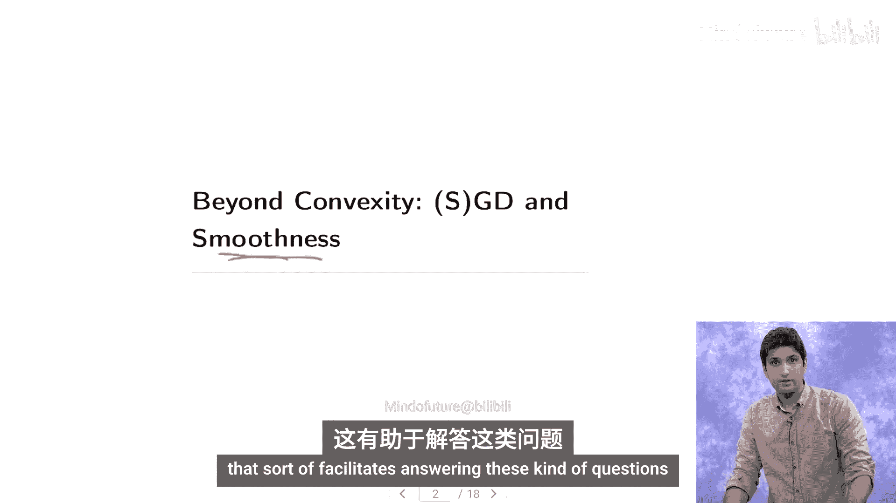
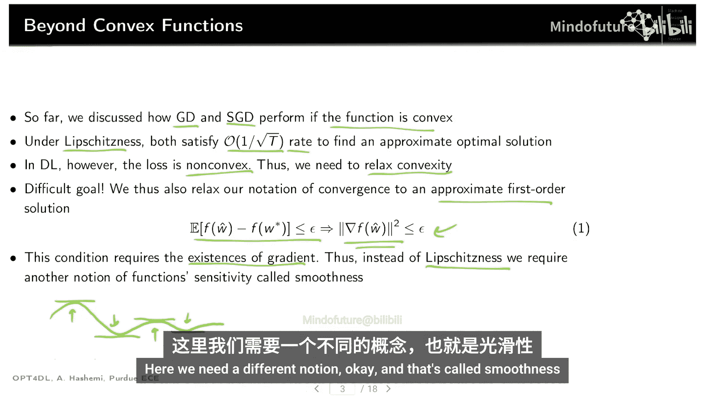
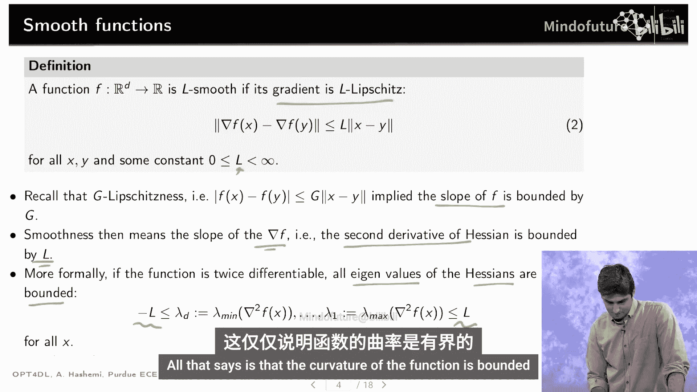
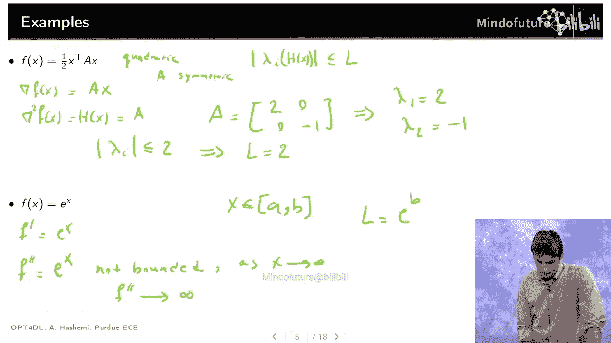
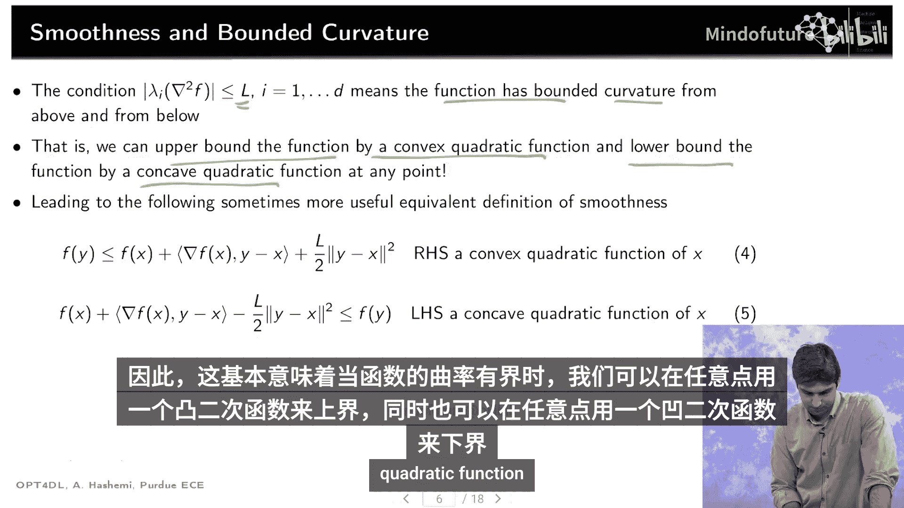
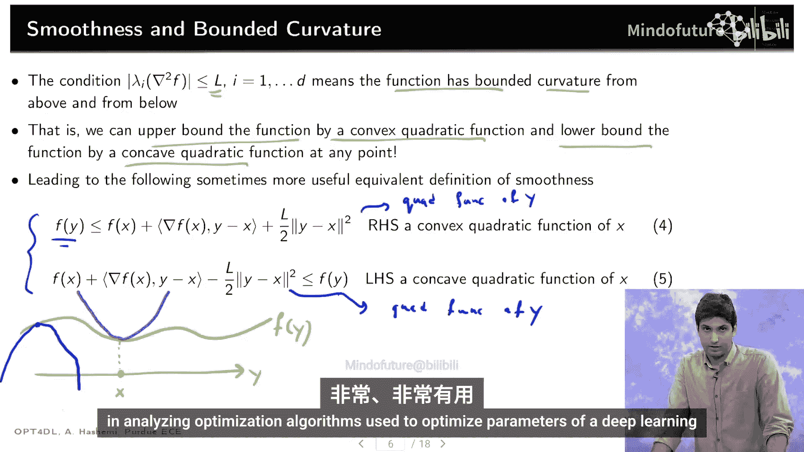
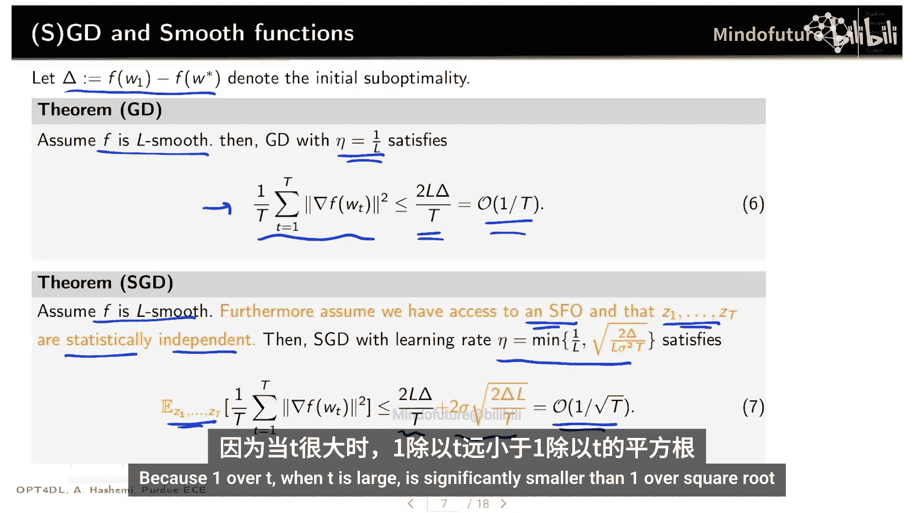
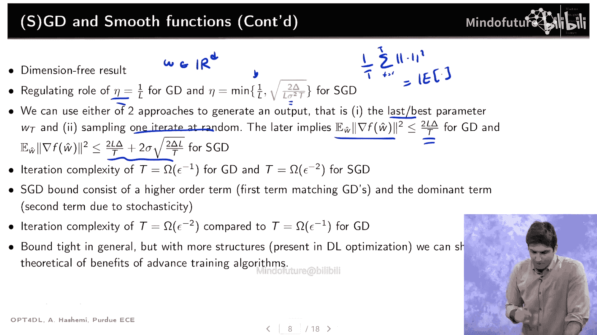
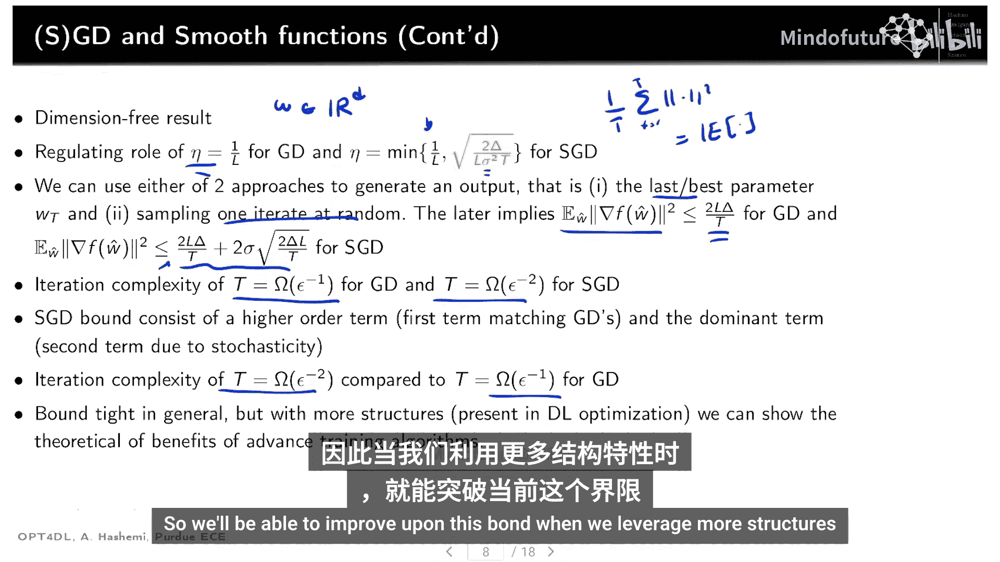

# 【普渡大学】深度学习中的优化 ｜ Optimization For Deep Learning ｜ Purdue University p08 P08_突破凸性约束_光滑性条件下的随机梯度下降法1 -BV1tvzKBcEom_p8-

🎼，🎼Yeah。Welcome back。So we were talking about a schastic gradientdes and gradient incent algorithm。

 and we talked about how they perform when our loss functions are Comvex。

But that's not typically the case when we are optimizing parameters of a deploy model。

 So we want to go beyond the convexity assumption。 Okay， and we're going to talk about a property。

 which is called the smoothest that sort of facilitates these kind of answering these kind of questions。

Okay。So we talked about it， as I mentioned， Garnison and SGD and how they perform if the function is convex。

 So at in a nutshell， our result says that if the function is lipless again。

 that means that it has bounded sensitivity。Both of these metals satisfy。嗯。The same rate。

 But note that the， the notion of convergence is slightly different。 For your in the。

 we said that the average subopality gap was bonded by by， let's say， one of the scores of the E I。

Ignore the other constant parameters。 But for S GD。

 the expected average so gap was bounded by this by this by this rate okay。Right。

But deploying problems。Are typically noncom optimization problems。

So our goal is to relax the conity assumption。Okay。Unfortunately。

 this is a very difficult goal and very ambitious goal to achieve。

So our approach will be the following。 First of all。

 we're going to start with simpler notions of convergence。

 meaning instead of focusing on the subopality of a specific solution。

 we're just going to assess whether that's a stationary solution or not。

 Basically a solution at which the gradient is is 0 or near 0。

Then when we gain some install on the performance of gradient GD and more advanced learning algorithms。

 we're going to start as we progress in the course。 We're going to start。Are identifying。

Certain structures that exist in deep learning optimization problems。

 And we're going to leverage those structures。To strengthen。The conversion notions。And therefore。

 provide a stronger guarantees for， for attorney algorithms。Right right。But first and first。

 we're going to start， as I mentioned with basic assumptions。

 and that requires basic notions of conversions。 So what is our goal。Our goal is to， again。

 focus on approximate fer stationity， meaning instead of focusing on。

Suboptiality of a solution or expected suboptiality of the solution。

 We're just gonna assess whether that solution has a a small gradient or not， okay。So， and again。

 this is a picture you should have emerged。So， all of these points。

Our points at this the gradient is is 0。 Okay， Ideally。

 we want to ensure that we find solutions like this。

But this condition could mean that the solution is also a local maxr。But intuitively。

 gradient descent and other metals that follow a direction of descent。Are not going to converge to。

 to solutions like this， which are highly， highly instable。 Okay。

 because if I just a per the solution is slightly。I can。 I can reduce the function value。

 This is something we're going to get back when we talk about。

A stronger notions of convergence later in the course。Alright。

So this is our notion of conversionence。And。This notion， when you look at it。

 requires that the gradient to be well defined。Okay， it requires the existence of the Caran。Now。

 this is something that will require us in turn。To resort to a different notion to characterize the sensitivity the of the function。

Previousiously， we are talking about lipness。Right。

 which basically mean meant that if I change the the parameter value slightly。

 the function value doesn't change much here， we need like a different notion。 Okay。

 and that's called。

Sです。All right， so formally。We call a function L smooth。 if its gradient is Lips。So basically， again。

 if I change the parameter selected， now the gradient value doesn't change much as of opposed to function value。

Good， and then there is a constant L。That determines the degree of sensitivity， okay。

So if L is large， that means that the gradient is more sensitive with respect to changes in the input。

So therefore， the function is also in some sense more， more sensitive。On the other hand。

 if L is is very small or in the extreme case is equal to 0， then if I change the input。

 the gradient doesn't change much。 Therefore， my function has lower sensitivity as well。Okay。Now。

 you should also think of about this condition as some form of a slope。

 like we talked about when we introduced the concept of lipishness。 Okay。

 lipness employed that the slope of the function or the tangent line of the function is bonded。

The sters， on the other hand， means that the slope of a tangent linein at the gradient。In particular。

 the second。呃。That taken order the derivative or the Hasian is is bonded by L。More formally。

 because Hasian is like metrics， this means that if our function is twice differentiable。

 all log values of the Hasians are bounded。Okay， so if a function is a smooth is L is smooth。

 all log values of the Hs are bounded by L。 So that means that they are nicely located between minus L。

And l。Okay。Note that this doesn't require the function to be convex because the originig values can indeed be negative。

 All that says is that。The carriage of the bonded function is bonded。

Let's go over some examples first， and then we'll， we'll talk about the smoothness a little bit more。

Okay， so imagine that my function is something like this。 This is basically a quadratic function。

Now I want to find the smoothest constant。Or basically determine whether the function is smooth or not。

都。So what we need using the last discussion is to show that the organigvalue。Of。啊。Dehiian。

Are bonded by L， okay。So this basically requires us to find the Haitian。

 So let's find the Hatian okay。Now， it turns out that the gradient of this function with respect to x。

Is a X。Here am I assuming that a is symmetric。So asymmetric。And it turns out that， again。

 if I take the gradient one more time to find the HatN。So this is basically the Hatian。

This becomes a， okay。So as long as this matrix A has or new values。That are bonded。

The function will be smooth。 For instance， let's imagine that the A is some diagonmatics。

So I have 2 minus-1，0，0。The four diagonal matrices。

 you may know from linear algebra that the eigenvalues are basically the entries that are located on the diagonal。

 So one eigenvalue is equal to 2， another eigenvalue is equal to minus-1。Okay。Again。

 this function is a function that's non convex。But thevalue are， basically。

The absolute value of the argumentvalue。Or listen to。

This means that the lipsis constant is equal to2。 Okay， so therefore， the function is lipses。 sorry。

 the function is a smooth and the smooth constant is equal to 2。Right。

 now let's go over the second example。 And that's a scalar function。

 which is just the exponential function。Okay。And this is something we saw before when and talked about theipes。

 And there we， we saw that if we don't restrict the domain， the function is， is not globally lipses。

 And this is also the case here。Because。They to find a smooth constant， I have to find the Haian。

 basically。So the first order derivative is， again， E X。The second order is also e to the power of x。

And this is not bonded。Because。As x goes to infinity。The second order。Deity also goes to infinity。

 so therefore the function is not smooth。And this does make sense。 Like。

 it is a highly sensitive function to， to the changes in this input， on the other hand。Let's say。

 I restrict the domain such that let's say X belongs to some interval A B。Then I can。

 I can bond the this smoothness， right， So in that case， because I'm restricting the domain。

The largest the smoothest parameter there can be is just E2 B。Therefore。

 it any function with a restricted domain， as long as it's nice and differentiable。

You can assume that its also a smooth， but the smooth constant could be very， very large。

 And one implication of that， as well see。Is that the guarantee is that we establish。

Are going to be sometimes very， very loose and conservative。

All right。So hopefully， the these two examples help you to gain more insight about functions。

 But let's also discuss them a little bit more because。This discussion is gonna provide some。

 some tools that we that are that are very frequently used when analyzing。Optimization algorithms。

 especially those used in the in the optimization of deep models。Okay。

 so we said that we one way to think about smoothness is that all log values are bonded。 Okay。

 so it doesn't say that they are negative or positive。

 just is that the absolute value is bonded by some constant and that constant is nothing but the。

 but the smoothness constant， okay。So this basically means that the function。Has bonded curs。

Both from above。And from below。So this basically means that value function as a bonded curvature。

By that， we mean that we can upper bond the function at any point。By a conx quatic function。And also。

 we can lower bond function at any point。By a conve quadtic function。

So let's， let me try to demonstrate this here。 Let's say this is the the X axis okay。And then。

 I have some。Some function like this。对。Now， imagine that this is0 x。Okay。Now， I consider。

The quadratic function， as you can see here。I can't find an upper bond。

The global uparoundund on the function。At this point， X。Okay。

 and this is my function less call function F of y。So this is the Y axis。

So this is a convex quadratic function because the function is caring upward first。

 the curvature is essentially positive。Similarly。If you give me any other point， x。Here。I can find。

A concave quadratic function that lower wants the function globally， okay。Therefore。

 this is an example of a function which is a smooth。Alright， so more mathematically。

 these two conditions， meaning that I can upper one the function globally by a convex quadratic。

 and I can lower one the function globally by a cont quadtic can be written using these two in inequalities。

 okay。So this basically the first one it says that as a function of y。Again。

 I can find a quadratic function。 So this is basically a quadratic function of I。

So I have my global upper brand。And this one is that as a function of oil。

 I can find a global lower part on the on the function， which is a concave qua function。

So so this is basically a qua quadratic。Function。Of wife。Right。So these two conditions are very。

 you can actually take them as equivalent definition of， of a smooth function。 Okay。

 so you can say that a smooth function is， is a function is a smooth。

 if you can find such global upper bond and lower bonds。On the function。

 So these two inequalities are very， very useful， as I mentioned before。

 in analyzing optimization algorithms used。To optimize parameters of a deep learning model。

All right。So this is something we're going to use in this lecture to analyze the performance of the the two algorithms we have seen in this course。

 The first one is carriedian descent。 The second one is basically the stochastic version of Cariancent or S GD。

 okay。So let's see what our theium says and before diving into the proof。

 we're going to provide some insights and then we'll see how we can approach proving these theorems while leveragingvis the smoothest property of the function。

So let's define this notation first。Let this delelta to be the initial。Suboptialology。Okay。Now。

 for the 18 descent， we have the following theory。If our function is a smooth。

Then if I run gradient in send with this a specific size。

Which is inversely proportional to the smooth smoothest constant is going to satisfy。This bond。

 So what does the bond say。It says that。啲。😔，Accumd norm of gradientians is bonded。Bye。This。

 this ratio。It is proportional with L， meaning that the more sensitive the function。

 the larger the bond， it is proportional to the initiallig gap。

 the further away you are from an optimal solution at initialization， the larger the bond。

 So these are both intuitive。 And finally， it is inversely proportional to the number of iterations。

 the more you run neural algorithms the closer you get to a stationary point， basically。

And what we have here on this side。You should think of it as again， a notion of asity， okay。

And we'll talk about this a little bit more in the next slide。Corry。Now， in terms of the O notation。

 meaning that if I only care about the dependence on the number of iterations。

The depend is basically one over t。 So this is an instance of a sublinear rate。All right。

 so we also have a similar theory for stochastic gradient and descent， okay。So we again。

 a similar function is a little smooth。But we also now have assumptions。

 and these are assumptions we saw before as well。 When we analyze H TD for comics function。

 We're going to assume that we have access to an stochastic first or orac。Meaning。

An oracle that returns to us unbiased estimators of the gradient in each iteration with bonded values。

And in addition to that， we assume that the samples we use in each iterations are statistically independent。

 meaning that， again， the mini batches we use in each iteration of S GD or are independent。

If youre run a C， with is a step size。Which is a little bit more complicated than what we had before。

 We're going to satisfy the following bond。expected。Average norm of Carians。

Is bonded by two terms again， like before， we have one term。

Which is identical to the performance of gradientiancent。But we have another term。

 which depends on the， on the variance of our oracle。 If our， if our oracle is perfect。

 meaning that the variance is 0， this term will vanish。 Otherwise， the higher the variance。

 the larger the second term in， in the performance of a city。Now， in terms of the O notation。

This is one of our square of T。 Okay， and this is something new that we didn't see when we are comparing GD and SGD for convex functions。

 Okay， so previously。When our function was coming and lipses。

Both essentially achieve the same rate as a function of T。 In this case， however。

 that's not the case。 You can see that gradientian descent。errorr goes0 faster。Then。

SGD in the worst case， Okay， because one over T， when t is large is significantly smaller than one over squares of T。

All right。So let's have a short discussion about the， the these thes and their statements。

 So first of all， the results are again， dimension free。Meaning that。The size of our parameters。

 which we use。D to denote it doesn't appear in the bond at all。 Okay， but again。

 you should expect that the appears implicitly。Through parameters of relevance。

 such as the variances of the oracule or the smoothest constant。Et cetera。

The step size or the learning rate again plays a regulating role。So the sharper the function。

 the more sensitive the function， the smaller slip size we have to use to ensure that the we are still able to。

 to approach a stationary point。And we also see it here。 But for S GD。

 there is also like a noise dependence on the on the variance。

 So this basically means that if the variance of the oracle is large。

Eto is chosen to to account for that。 So essentially。

 we're gonna be more careful with the steps that we are taking because each step is now a little bit more noisy than before。

 Okay， so， and that means that we're gonna adopt a smaller learning rate。Now。

 the statements were about accumulated norm of the or average norm of the gradientians that we encounter while we' run SGD and and gradientian decent。

L before， there are certain procedures that we can use to output the solution。

The first procedure is to output the last solution or essentially the best solution。

And this is what we do in practice。 And the the the term doesn't establish anything about the performance of this approach when generating a solution。

 And this is sort of。Consistent with our previous discussion on the performance of gradientian descent and SGD on lipses and Comvex functions。

The second approach is to samplevolnu at random， okay。So in particular， for this。

 the average double average norm of the gradient that we saw。So， something like this。

This could be taught as。An expectation。 when you sample the solution uniformly at random。

 And this is identical to what we what we saw before。 when we talked about conx functions。Okay。

So using this approach， when you sample one iterate uniform at random。

 you can basically show that they expect it。Nor of the gradient。Is bounded by this。

For gradientian descent and the expected norm of the gradient is bonded by this other term。

 for a stochastic gradientian descent algorithm。

Now， another way to interpret the result is to talk about iteration complexity。Essentially。

 if I want the， the error to be less than epsilon。How many solutions do I need to run my my algorithm？

And it's not hard to see that for gradientian descent， theer complexity is given by this。

 so it's one over epsilon。Whereas the four SDs。Basically， one over Epsilon S square。 Again。

 this means that。For the same。Performance， if you， if you are shooting for Epsilon。

 you may have to run。SGD for more iterations than Gary and descent。Right。

 now let's look at this one again for schastic and。 We have two terms。Here。

We have one term which is referred to as a higher order term。 So this is the first term。

That matches the performance of SD， and we have a dominant term。Which is the second term。

Which is due to a s B。 And these are defined， again， based on the dependence on， on T。

The first term is much， much smaller than the second term， in terms of T。Therefore。

 we refer to it as the higher term and we refer to the second term as the dominant term。嗯。Okay。

 and this is why the iteration complexity of SGD is actually worse than the gradientiancent。

 Because despite the higher order term matching gradientiancent， the dominant term。

Is actually much much larger， meaning that the algorithm is going to suffer from worse iteration complexity。

And finally， a natural question to ask is whether these bond are tights or not。

 because at the end of the day， what we are saying is that divorce case performance is is bonded by certain quantity。

 certain bond， okay。But this is a worst case performance in practice， many times。

 we are very far from from a voice case scenario。 And that means that these algorithms could indeed converge faster than the race that we are stating here。

Okay。But in the worst case。You can do better than better than this， unfortunately。However。

 as we're going to talk about later in the course， when we talk about more advanced training algorithms。

We can leverage the structures that exist our in our optimization algorithms when we are optimizing deploy models。

To show that certain。Trany algorithms are actually provably better than S GT。

 So we'll be able to improve upon this bond。Then we leverage more structures。

So in the next video， I'm going to talk about another benefit of a smoothness。

 which essentially provides us a way to look into gradientian descent。And potentially， design。

More general。And even better。Algorithms。I'll see you next time。

