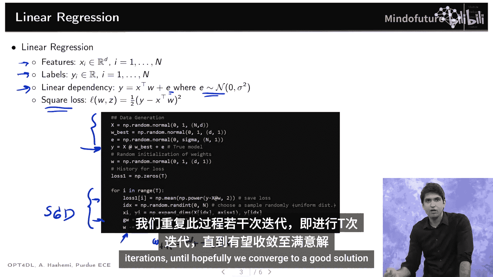
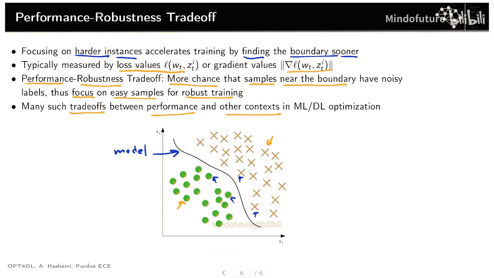

# 【普渡大学】深度学习中的优化 ｜ Optimization For Deep Learning ｜ Purdue University p11 P11_随机梯度下降实例分析 -BV1tvzKBcEom_p11-

Welcome back。 So we， we were talking about SD， and I hope we have now a better understanding of what this algorithm is。

 And in this short lecture， I want to go over two quick examples to see SD in action， if you will。

 okay。The first example is linear regression。 And we talked about this when we talked about some basics of machine machine learning。

 right， So this an instance of the regression， we assume that we have some feature vectors， X Os。

If it helps， you can think of them for instance again， as pixels， we have some labels。

 so our labels here belonging to R， so they are scalar。

And that's what this typically distinguishes between the regression and classification problems。Okay。

 and we assume that the regression model， the true model that describes the relationship between the features and labels is a simple linear。

Model， so something like this where we may also have some noise in our observations。 Okay。

 and as we talked about in these kind of examples， we typically use the square loss。 Okay。

 so we look at the regression error， basically， or the mean square error， if you will， okay。

And want to minimize that to make sure that our model is going to fit the training data well okay now this is basically a part of a simple code I wrote using Google Collab。

 So this is a very useful tool that you can use， especially if you don't have access to powerful computing resources。

To run basic machine learning codes right so to train basic deep learning models So in this case we have we don't necessarily have a deep learning model。

 we have a simple linear regression model， which in some sense you can actually think of it as the most simple deep learning architecture and we're going to talk about this in in the future lectures。

In any case so here in this part of the code we are generating some data at random that means that I'm generating the features at random。

 I'm generating the noise at random with certain variants。

 certain power and then I generate some true model at random as well and from that in this line I'm going to generate the observations okay。

Now， this is the part where we are running the CD algorithm。 okay。

 so what we are doing in the so first off， we calculate the loss and this is a calculation we do typically to to see how the algorithm is performing essentially as we're going to see the next slide。

 we're gonna plot how the loss evolves as we run the algorithm。In the next two lines。

 we form the mini batch， right， So， and we talk about different ways to do this。

 We said the simple version。For which we also provide theoretical Ganttes is when you calculate the mini batch。

Youiveverse uniform me at random with replacement。 Okay， and this is the version I'mm。

 I'm running this method。 Okay， there is also the more practical way where the mini batches are generated uniformly at random without replacement。

 And that is basically the epoch based version of the S GD that we talk about。

 And in the next example， we're gonna see how that algorithm performs and how the its performance compares with this simple version of S GD。

Alright， so we calculate the miniwa。 And then in this line。

 we basically calculate the gradient or the stochastic gradient， if you will。 Okay now in this case。

 because our model is simple， we are trying to just fit a linear model to the data。

 we have a very nice close form expression for how the gradient is going to look like。

In more complicated models， deploying architectures， for instance， we cannot do this。

That's why there has been a lot of development in terms of how to perform this。Divative， if you will。

 in an automated way。 And this is something we're going to talk a little bit more as we。

Progress in this course， all right。So after the calculation of the gradient。

 what we do in the last line， we just update our parameter。 right， So this is nothing but the。

 the update we， we talked about before。 So the next solution is the current fund minus some learning rate。

Time theium。 okay， and we do this for a certain number of iterations。

 So capital T number of iterations until hopefully we we comeverse to a good solution。

All right， so here I'm showing how SD performs for two instances of this problem where in both cases I have 100 data points。

In one case。The number of features or the dimension is 10。 In the other case， the dimension is 200。

So in the first case， we are we are basically dealing with an under parametermeized model because these is less than the total number of data points In the second case。

 however， we have an example of an over parametermeized model where D is larger than n。

 And remember this is the second case is what we typically observe in practice。

 we have very large models。Typically， their size is larger than the size of the data that we have。

And in that case， because the model is over parametermetized。

 we may have multiple solutions to our optimization problem， okay。Now， on the left hand side。

 we have the performance of SD for the first case。 D is equal to 10 under perimeies。

 and we can see that the the algorithm is converging why because the empirical risk。

Is going to zero as I'm running the algorithm？Now we can see some noises here。

 So there are some tiny ups and downs and that's to be expected because again。

 we are we don't have access to the true gradient the end。

 We have only access to noisy estimator the gradient the end， right。

So this is basically the impact of the noise in our estimation of the trigger gradient。 Allright。

 now something that is a little bit surprising is that for the second case。

 where these equal to 200 SD again converges。 So we are still able to。Reduce the empirical risk。

 okay。嗯。Now， it is less surprising， I would say in this case， because at the end of the day。

 we have a convex problem。 so she can still work well。But in more general cases。

 where we have a highly complex deploying model， as we're going to talk about， we are still。

Observe nice performance out of S GD。 Okay， and that's related to the topic of interpolation over parameteritization that we're going to talk about later on in the course。

 Okay， so in both cases， we still have convergence， obviously。

 when the dimension is larger the optimization program is more difficult， but nonetheless。

 S GD still is able to to converge to a solution that is a minimizer of the empirical loss。Alright。

 now let's talk about the second example and。This is nu nonlinear regression。 Okay。

 so very similar to the previous case， except we have a nu nonlinearity here。Okay。

 now you should think of this as a very simple neural network with。No nonlinear activation。

 for instance radio activation， and these are things that we're going to talk about in future lectures。

Linear regression， you can think of it as a neural network with linear activation functions。

There the sigma。Let's say sigma of x was basically x， like a linear function。 In this case。

 sigma is in the plot that I'm showing here or in this experiment。Sigma。Is the radio。Activation。

So is is something not linear。All right， now what what are we showing here。

 we are again showing the loss， the empirical loss。Versus iteration。

For four different versions of HGD， okay？The the blue curve corresponds to the simple version of HD that we also provide a vertical guarantee for that。

And that's the version where we sample and mini the uniform at random width replacement。

And this is performing divorce among these four variants。The second curve here， the。

The orange curve corresponds to S GD without replacement。 Okay， so basically。

 we are samplinging the mini matches uniform antenna without replacement。

 This corresponds to the epoch based version of SD that we talked about in previous lectures。

 And we can see here that it performs better than the simple version。And this is something we expect。

 right， because when we do sampling with replacement。

It is still likely to see a sample that I have utilized in in the previous iteration。 Okay。

 so if I fit the sample in let's say iteration 1。With with with with the with replacement sampling。

 it is still likely to see that。 So it's not going to be quite useful for me。

 But when the sampling is done without replacement。Every batch is going to provide。

Useful and new information。 So therefore， I should be able to utilize that and converge faster。

Alright， so the last two versions we haven't talked about before。

 and these are what I call order SGD。Where we're going to be a little bit more strategic when forming the mini batchsh。

Essentially， what we're going to do， we're going to look at either the loss value of a sample in the mini match or the gradient norm。

Of the sample in the minimat。And prioritize selection of these samples。Okay。

So what that means is that I'm going to sample the mini matcheses。诶。

Such that the samples have higher loss or the samples have higher gradient norm。

And as we can see here。Doing so will result in a much faster convergence。

Compared to SGD with replacement and SGD without replacement。Now， let's talk L bit about。

Why this is a useful thing to do。 Why I should look at the loss of a sample or the norm of the gradient when forming the mini match。

So the idea here is that by doing so， we are focusing on harder instances。

And focusing on how in instances is going to accelerate the training。

 as we saw in the previous slide。Because we're going to be able to find the boundary sooner。 Okay。

 so let's discuss this in the context of classification。

 Imagine that don' I have a classification problem。 In this case。

 I'm showing a simple binary classification problem。 So what's the goal。Essential。

 the goal is to separate class 1 from class 2。 So I'm looking for a separation manifold such as this。

 So this， you can think of it as my model。So after the training。

 Mike I'm going to be able to find a model like this。

 which could be a nonlinear nonlinear manifold that results in the separation of the one class from the other class okay。

Now， if my goal is to find a model like this。It should be intuitive that samples that are closer to the boundary。

 such as this sample or this sample。From one class。

 and let's say dis sample and dis sample from the other class are more informative than the samples that are further away from the boundary。

For instance， this sample and that sample。 because when I focus on the samples that are closer to bodyi。

 I should be able to。Find this separating manifold faster。

 And this is exactly what is happening in our experiments from the previous slide， okay。

So it is useful to focus on hard instances。 How can we quantify hardness。The only national way is to。

To look at the loss values or the gradient values。 Okay， because if the loss value is hard。

 that means that my model is not able to fit this sample easily， So it should be a hard sample。

 And a similar statement can be stated for for the gradient now， okay。

So that's the reason that those two methodss were converging much faster than the simple versions of SGD okay。

So this also is a good point to talk about trade offs that we observe and and have to deal with when we are optimizing deploy models。

 Okay， so in this case， a national trade off is the trade off its performance。 how fast。😊。

I'm able to minimize the function。And robustness。Okay。

So when I put my focus on the samples that are closer to Bdy。

 I may get a solution that is not robust， why， because。

Imagine you you are dealing with a scenario where the the labels are noisy。

 and this could be good are in practice very， very often， right， so。

If you are dealing with scientific data， you should expect to have noisy data points。Also。

 many times when we are labeling， let's say。Data sets。That process could be erroneous okay。

Even for very carefully put together dataset sets such as C410 and C400。

 there are instances that are being built。Now， the chance of mis mislabelling intuitively is higher for the samples that。

A lie near the boundary。Okay。So if we are focusing on the samples that are near the boundary and it happens that those samples are noisy。

 then our solution is going to be wrong， meaning that it's not going to generalize as well as we hope for。

So therefore， it's not going to be a robust solution。So， there are。

Articles in the literature that advocates。Focusing on easy samples。For robust training。

 So this is exactly the opposite of what we just mentioned， right， So it。

 it therefore depends on what your goal is， right， and what's the context。

 If you know for the fact that the data is very， very clean。

 you need it is a good idea to focus on hardces， like the previous experiments。

 we saw in in the previous slide。 However， if you expect to see some noise in the data。

 you may want to focus on easy examples， right， that that could mean that the performance is gonna be slower。

But you may gain nicer robustness properties。 So this is basically a tradeoff between performance and and robustness。

 And indeed， there are many trade offs like this。Between performance and other contexts。

 for instance， they perform a trade off between performance and fairness or performance and privacy and things of that nature。

 which we're going to talk about later in this course。

So hopefully this gives you an idea of how STD performs for basic problems。In the future lectures。

 we're going to talk about。Some variations of HGD。That basically aim to make S GD a little bit more stronger。

I'll see you next time。