# 【普渡大学】深度学习中的优化 ｜ Optimization For Deep Learning ｜ Purdue University p12 P12_高置信度保证 -BV1tvzKBcEom_p12-

🎼，🎼Yeah。Welcome back。 So we gained some familiarity with with this G。 And today。

 we're going to talk about high confidence guarantees。😊，Recall。

 we showed for S GD that basically the expected error is， is bonded。

By a bond that depends on some parameters。Notably， the number of iterations， for instance。

 we saw for convex and gilyies。Functions that the expected subopim multi， right？

 So our error was basically the expected sub the sub multi gap。 So let's say if。W T minus F star。

So this was bounded by， let's say， one over the squares of T。And for general noncon functions。

And the case where the function was a smooth。We show that the expected gradient norm。

Was bonded by you one or risk risk of T， okay。So abstracted。

 then what we showed was that expected error was bonded。 Okay， so let's see what this means。

 This means that our ouree says if you run S GD many， many， many times。On average。

 the performance is film。 Okay， so I get in a performance on on the first round another performance on the second round and so on and so forth。

 I take the average of all of these。 And that that's a that's a， that's a good performance， right。

 So I get a very low error。 So obviously， this is not satisfactory， right。

 because we want a good performance after only one time training。😊，So ideally。

 I just want to train my model only advance。 And I wanted the model to perform very， very good， okay。

So mathematically， we can express this desire as follows。

 So let's say that we have some confidence parameter。😊，때터。

And we run with probability exceeding 1 minus delta。 So Delta。

 you should think of it as a very small number， like like 0。1 or 0。01 or something like that。

Though with high probability， I want the error to be bonded。Okay。

 so that means that every time I run SGD with high probability， I expect a good performance。可。

Equivally the probability that my performance is not good。Is bounded by some very small number。

 Delta。Now， the the big question here is， can S GD deliver such a result or not， Okay。

 because our previous result was not of this nature。

 So we just proved that the expected performance is good。

 So this is what we want to talk about today。

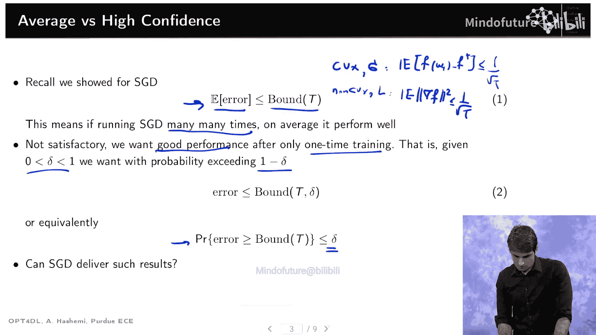

Okay。So，Or first。Approach to answer this question is that。

Let's see what happens when we impose the stronger assumptions。

So what was our main assumption last time。So we assume that we have access to a stochastic festival or a。

Okay， so what that means is that。My moistto acid guian。

Is basically a noisy version of the true gradient， such that。Condition on how I have done so far。

 the noise is， the mean of the noise is 0。And also， the noise has a bonded virus。Okay。

 so we just assume0 in noise， conditionally zero in noise and bonded variance noise assumption， okay。

Now， if we make this assumption a little bit more stronger。

 it turns out that we can showD performs well with high probability。

One way to do so is to assume that the noise is lighttailed or subgaussian。Okay。

 so this is the condition of a subgaussian noise。Essentially。

 what that means is if you consider the P D F of a Egosian random variable。

The tale of the noise is sort of bonded。So， this is the tale of。The noise distribution。

So the tail of the noise distribution is sort of upper bonded by the tail of a Figasian randomno variable。

Okay。So examples of this are obviously the case where the noise is Gaussian or the case where the noise is uniformly bonded。

所以说。嗯。So basically， this， this detail doesn't go to infinity。 That's what I'm saying。Now。

 if we impose an assumption like this， it turns out that we can resort to concentration of measure inequalities。

whichhich basically aim to capture the deviation of a random variable or a sum of random variables from their mean。

One notable example here is the Ozemohofeing inequality。So using this kind of results。

 we can indeed show that our prere hold with high confidence， basically the error of SGD。

So that means for convicx function， we are talking about subop multi gap for general noncomx function。

 we are talking about the expected gradient norm。Is bonded by something that depends on T。

 So this has the previous dependence。 So， for instance， one various squares of T that we saw before。

And also， it depends on the log of one over Delta。 Okay， and this is very， very good， right。

 because you can basically treat log as a constant。 Okay， So for instance instance， if， if Delta is。

 let's say。Delta is one over。E to the 10， sorry E to the2， which is， which is roughly one over 10。

 let's say。The log of one Delta。Is nothing but two。 So it's just a constant。Okay， so we can。

 we can basically ignore the dependence on our confidence parameter。

So that means that we can essentially have the bonds be established before that hold on expectation。

With high probability， without any noticeable dependence on our confidence parameter okay。

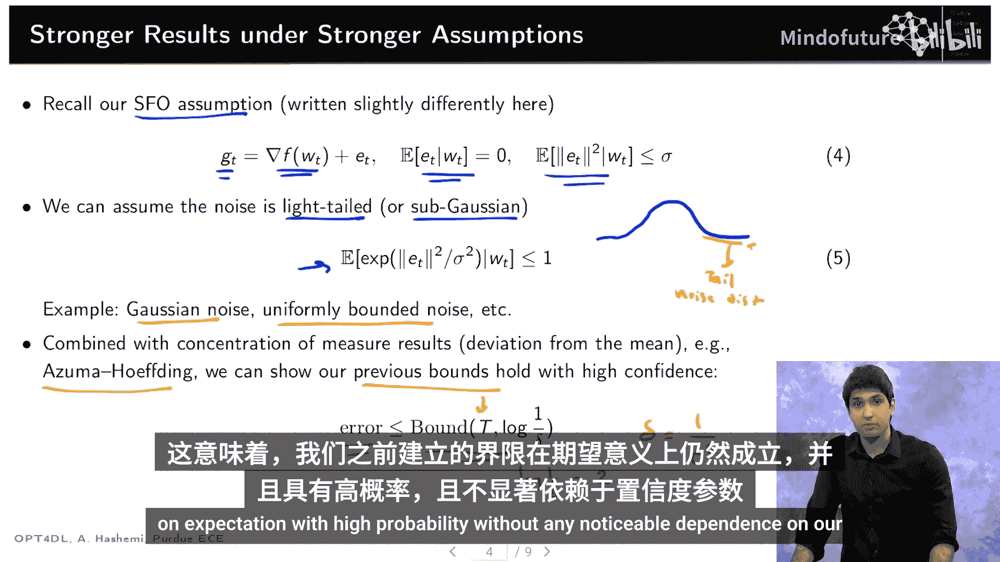

。

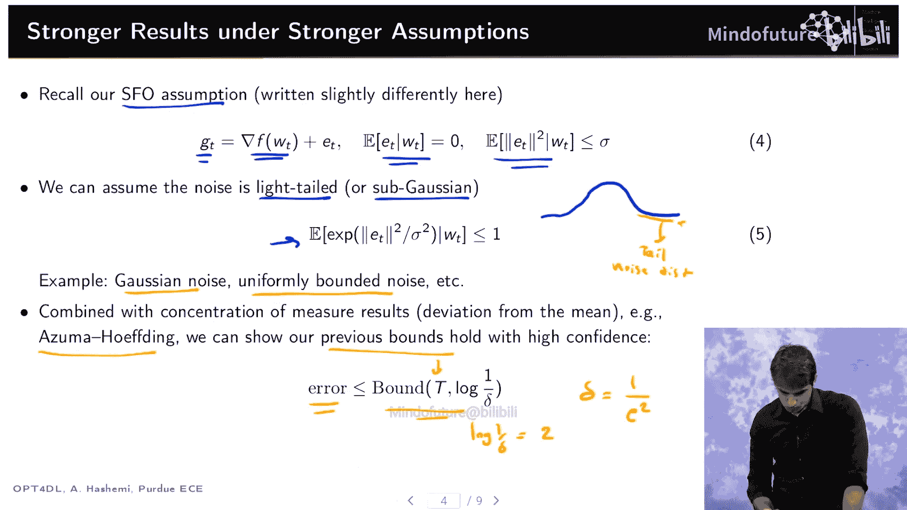

Now， let me talk very briefly about the key idea。To， to leverage these kind of assumptions。

And how we can integrate this idea with， with the， with the theoretical tools we developed so far。

 And to do that， we， we sort of require。And a very useful concept that's called the Martinale difference sequence。

 okay。So let's go over the definition and then I'll alternative connect it to something that you may have seen before。

 Okay， so a sequence of random variables。Is a more different sequence。If。

Conditioned on a on another sequence of random variable， the expected value is 0。Okay。

So the intuition here is that you should think of these as a generalization of zero mean independent。

Random variables。 Indeed， if I have a sequence of 0 mean independent random variables。

 they actually form a multi different sequence。 So why do we need this。So in our context。

 in deepening optimization。The X， which form this marginaling a different sequence。

 are typically basically the difference of your stochastic gradient。And the true gradient。Okay。

 and what I'm interested to see is。If I average this exercise over time。Wter that average growths。

Gracefully with tea or not， okay。No。The issue here is that Xon， X 2 X X， Xon， etc cetera。

 are not independent。 Okay， because as we can see here。

 they depend on the current parameters of value W T。 And obviously。

 W T depends on the previous instances， instances that have've used the same my T T algorithm。 Okay。

 but if a condition on the previous。Examples。The expected value of this difference is 0。

 meaning that condition in my noise is is 0 mean okay。

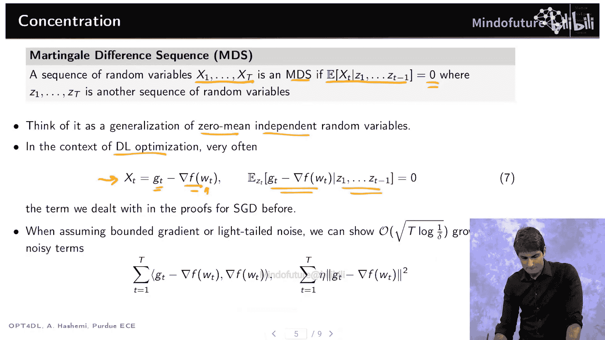

No。This， in addition with， let's say， assuming bonded noise or lighted noise。

Helps us to to basically leverage advanced concentration major inequalities。

 such as omorphfiing inequality that I mentioned。

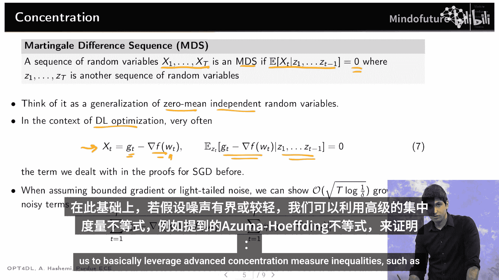

To show that。

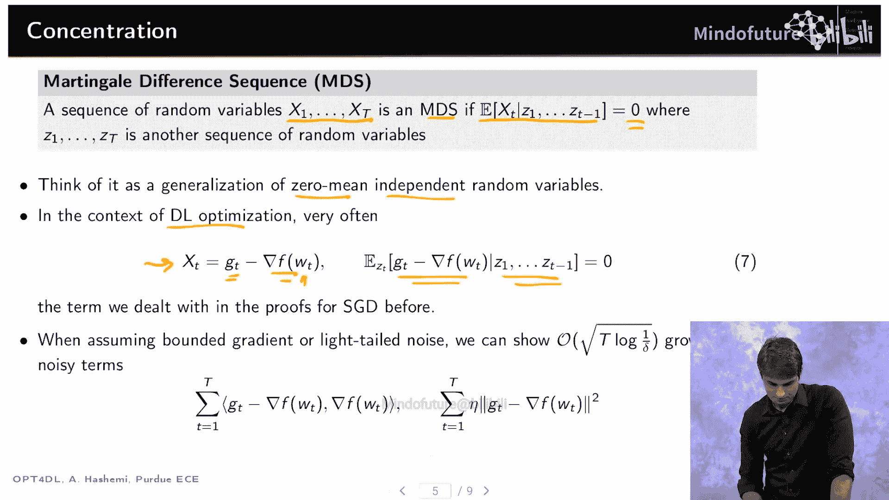

The growth of the noise termss。Basically， termshams like this。That we actually studied。

When we analyze the performance of SD。Grow very gracefully with tea。So， essentially。

Using this marginaling different sequence idea。And the stronger assumption。We are still。

Can hope to get the same good dependence on the number of iterations and also a very good dependence on our confidence parameter。

 not to the log of one deelta。So that's basically the main idea。 So we can easily leverage this to。

 to the theoretical tools we talked about before。

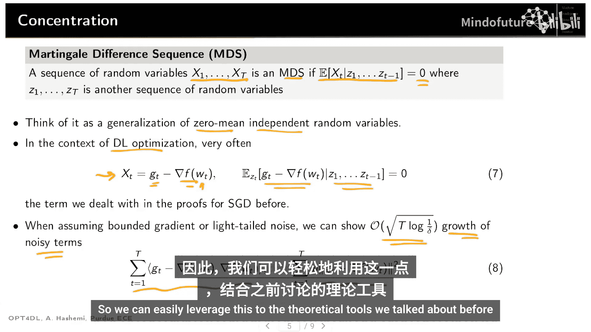

Okay。So。But the catch is the following that this assumption could be violated in practice。 Okay。

 so in practice， especially in the concept of different optimization。

 it has been observed that the noise is not long tail， okay， so。1 remedy。

Which could be very intuitive is that you perform clipping or normalization。 So what does that mean。

Let's say that again， I have a stochastic gradient， which is a no noisy version of the true gradient。

Instead of using this directly in my SD algorithm， I'm going to clip it。So basically。

 I'm going to ensure that the gradient。Cords are not larger than， let's say。

 some constant C and are not the smaller than some constant minus C。 So this is called clipping。

 Okay， and this operation is applied coordinate advice。Alternatively， I may。

Normalize the gradientian。 So both of these ensure that the update vector that I'm using。

Is not too large。Okay。Therefore， I should be able to control the noise。Of， of the updates。

And using more advanced theoretical analysis。We can show that the resultant algorithms could deliver hopee confidence guarantees。

So the main challenge in those theoretical analysis is to deal with the bias that you are introducing when you perform clipping or normalization。

 okay， because。If G is an onbi estimator， the clipping of G or the normalization of G is not going to be an onbi estimator of the true gradient anymore。

And the impact of these bias needs to be studied very carefully when performing convergence analysis。

What I want to mention beside this is the connection to advanced training methods， for instance。

 adaptive algorithms。That we're going to talk about in this course。And also， other contexts。

 such as making algorithms。Private， so the idea of clipping and normalization turns out to be useful in these two contexts。

 as well。And this is something that we're going to talk a little bit about later on in the course。

Another useful thing to know is that these ideas also appear in diverse learning settings。

 So one example is the celebrated PPO method that's used very frequently in reinforcement learning。

 There There is also， you can， you can observe the idea of clipping。 having an appearance。😊，So。

And it is if our purpose is establishing high， high confidence guarantees。

 it is important to leverage sometimes these these safeguarding mechanisms。Because otherwise。

 the growth of the accumulation of the noisy terms。嗯。Could be could be larger。With respect to Delta。

 So that means that we may not be able to get this very desirable dependence on the confidence parameter。

So make get something that is potentially significantly worse， okay。

So that's basically one answer to the question， whether S GD can can achieve high confidence guarantees。

 And the answer is under a stronger assumption。 Yes， if not， we may have to modify S GD。

In certain ways。One particular way is to clip the updates or normalize the updates。

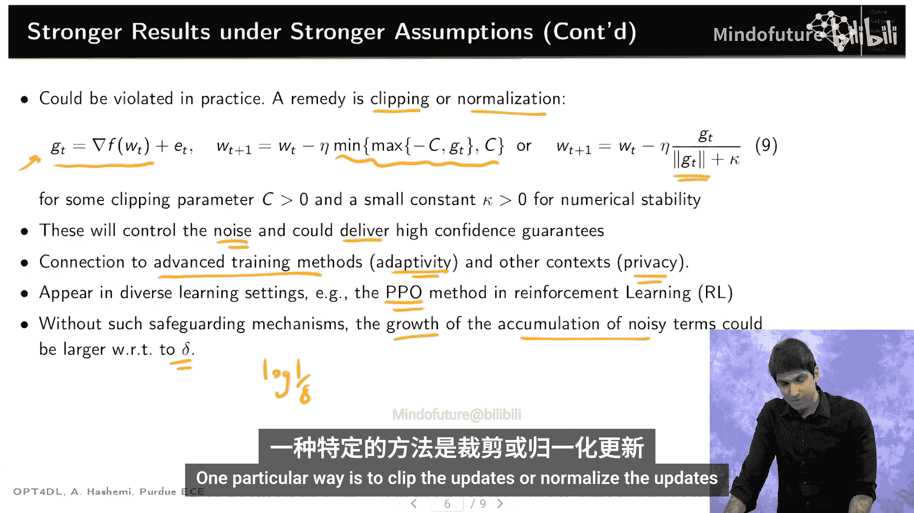

Another way is by way of boosting or ensemble of SGD that I'm going talk about for the remainder of the video three。

So。The idea here is that given that we not going to impose the， the bonded assumptions anymore。

 we cannot use those noise and and and advance。Consider measure inequalities。

All we can use is the basic mark of inequality okay。

So let's see what's Markov inequality and what's the implication of that for high confidence guarantees of SGD。

 So Markov inequality is very simple， just says that for any positive random variable x。

And any positive constant lambda。You can basically deviate bond deviation probability of x。

 So the probability that x is larger than lambda is bonded by。The expected value of x。

Divided by lambda。So all we need is for the expectation to exist。

 so we don't need any assumption on the variance or higher moments。Alright。

 so what's the implication for us， So let x to be the error。 Again， the error is random variable。

Because it's the error of our randomized algorithm S GD。And let lambda be the bond we get。

 let's say from one of our previous theors。Divided by Dlta or confidence parameter。

Then by Markov inequality， it's very easy to see that the probability that the error is larger than。

Boond over Delta。He's upper bonded by dis expression。So I'm just plugging in what x and lambda are。

And recall， we were able to show that the expected error was less than equal to bond。

 So whatever this ratio is is at most one。 So I can replay upper bonded by 1。 And therefore。

 the probability that the error is bonded by is exceeding bond divided by Delta is umost deelta。

So equality with high confidence。We can say that the error is bonded by。The previous bond。

 let's say one over the square roots of T。Divided by the delta。So with this very simple inequality。

 therefore， we can indeed establish a high confidence guarantee for SGD。But。

It is not a good guarantee because we now have a very terrible dependence on our confidence parameter。

 The dependence is now one over delta。As opposed to。L of one over Delta。 Okay。

 so if Delta is a small， I can't treat log of one over delta as a constant。

 but surely I cannot treat one over deelta as a， as a constant， okay。都。😔，We are looking for a way to。

 to sort of。Improve upon this result。

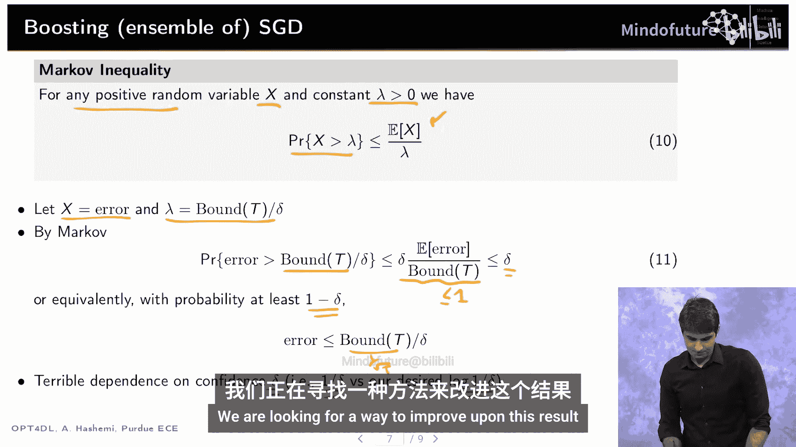

And the idea is actually very simple。 We just want to boost SGD， right， So essentially。

 you can think of S GD as a weak learner。And we want to boost S GD。

 meaning that we want to put together a bunch of these weak learners in a specific way such that we get a strong learner out of it。

Okay， and this is very similar to the idea of model ensembling。In in machine learning。 Okay。

 so let's see how do we。Approach。Boosting a。So the idea as I mentioned is very simple。

 we are going to run multiple SGDs in parallel and perform a simple post optimization step。

So therefore， the algorithm is as follows。Lets let capital S den the number of polar neuronss。

And let N the number of data points that we're going to use in the post optimization step。

What we're going to do is that we're going to run S versions of HD imp parallelreial。

And let's say stored our sports。And in the post optimization step。

 we're going to select the best output。可。Now， our selection requires us to。Have an estimation。

Of the true gradientian， that's why we use capital n number of data points in the post optimization step。

 So we use this， these data points。To approximate the true gradient。

And then we're going to find the best output， the output that has the lowest gradient norm。And。

 I know that in certain to norm in practice， we may use the function values。

 So both of these are are good ways of talking about which solution is better， right， because。

When I'm minimizing a function without any constraint。

The both of these mean that I'm going to have a solution， have a good solution。Okay， so。

Let's talk about the total complexity of this algorithm。Compared to astochastic gradient and descent。

Okay， so in S GD。We said that the total complexity is B times t。

And the reason is that our mean size is B。And we， we run the algorithm for capital number of iterations。

Therefore， overall， we're going to perform B times T gradient and computations。

And if it should be to be a constant， then the total computation is basically O of T。In this case。

 however， the SCD with post optimization algorithm has a total complexity or oracle complexity。

Which is as follows。We have S versions of SGD， we are running the onepoal。

 and we run each one for t number of iterations。In the final step， the post optimization step。

We want to select one out of S solutions， okay。And to do that， we perform。E in computation。

 pair solution。Therefore， the total number of gradients that we calculate is n plus T times S。Okay。

Now， what is desired is that this number is roughly the same。As the computation。

 the complexity of SGD。While resulting in a high confidence guarantee。

And what we can show is that indeed， we can set N， T and S such that with minimal increase in in the in number of gradient computations。

 we can boost SGD and get high confidence guarantees。

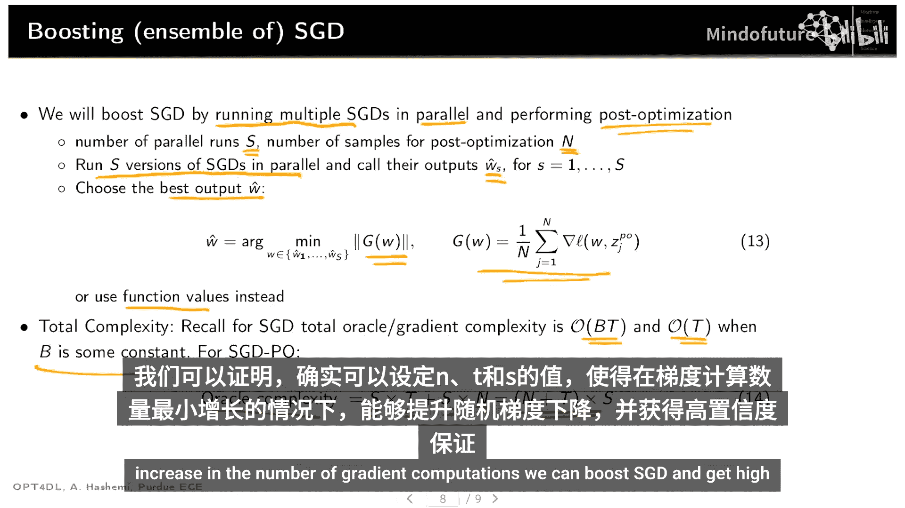

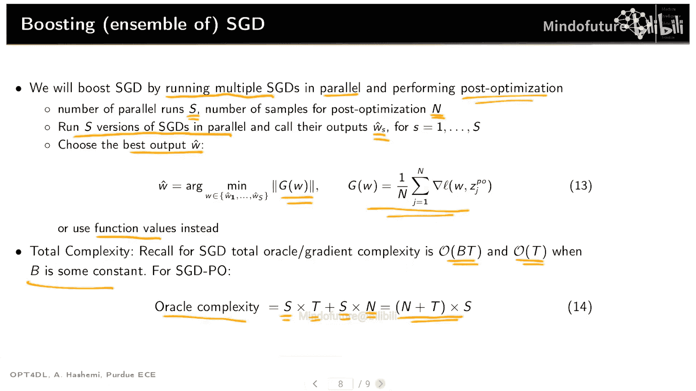

Okay。In particular， we have the following theoryorem。

That says that if the number of samples used in a post optimization step is given by this expression。

The total number of iterations for each of those polar SGD drawings is given by this expression。

 and this is exactly what we had before for SGD。And finally， if the number of SGD runss imp parallel。

S is given by this expression。A city with Poex optimization can find a solution such that with high probability。

The expected gradient in norm is a small。佢。So we said that the total complexity is n plus T times S。

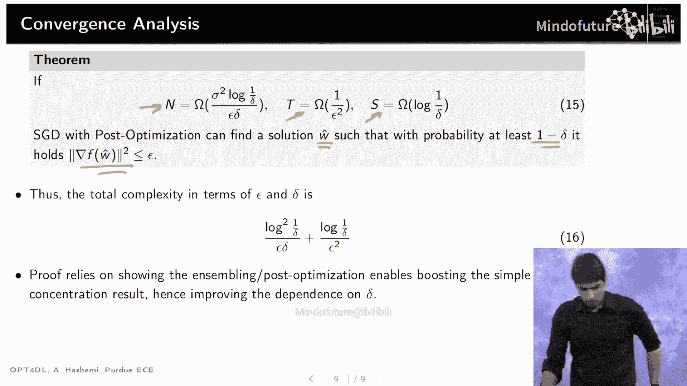

So if we use these expressions， even in the entire statement。We can find that the total complexity。

In terms of the quantities of interest， notably our， our。

 our notion of performance epsilon and our confidence notion， Delta。Is given by this expression。Okay。

So there are two terms here，The first term in terms of epsilon is the higher order term。

And the second term is the dominant term， okay， because it has a worst dependent on Esidon。

So let's compare the second term， which is the dominant term in the bond in the total complexity bond。

 with what we got for， for S GD。 So for S G D， we said in terms of the expected performance。

 the expected performance of S GD。The dominant term was one over Eps Square。And。

The simple result we got while leveraging the Markov inequality said that the。High confidence。

 performance of SD。We got one over Epsilona square divided by Delta。

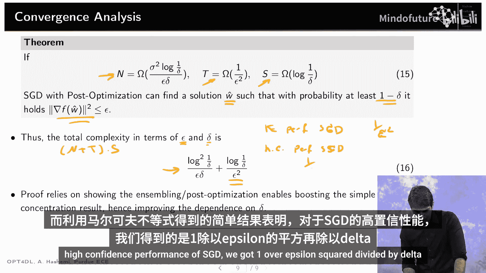

Okay。So， therefore。We can see that as a result of doing H GD with post optimization。

 we can improve the dependence on the high confidence parameter quite drastically。

 So that dependence improves from1 over delta to log of1 over delta， which is very， very desirable。

Okay。And essentially， the， the total complexity doesn't change much compared to just one single run of SGD。

 Okay， so compared to just one single run of SGD， we have to expand。Lo of one over Delta more。

Computs， again， this is like like a constant。 So what this means is， is that in practice。

 all you need to do is to， to to to get a higher confidence performance out of SD is to run。

 let's say，3，4 S GD methods in parallel and then perform this post optimization。

 And the result tends to be better and have lower variance than just a single round of S GD。그。Now。

 the proof is actually quite simple and we can carry out with that using the tools we've developed in the course so far。

呃。The crucial point is that we need to show。That by leveraging andsembling or post optimization。

 we can actually， as I mentioned， boost the simple。

Markovinequality concentration result that we got and therefore improve the dependence on Delta。Okay。

 so therefore we in this lecture， we talked about some ways to。

To either show that the T method we talked about achieves high confidence guarantees。

 and that was basically imposing a stronger assumptions。

We also talk about some ways to modify S GD so it achieves a bond with high confidence。

One approach was based on clipping or normalization。To control the amount of noise。In each update。

 another one was this idea of boosting where we would run multiple versions of S GD and then perform post optimization。

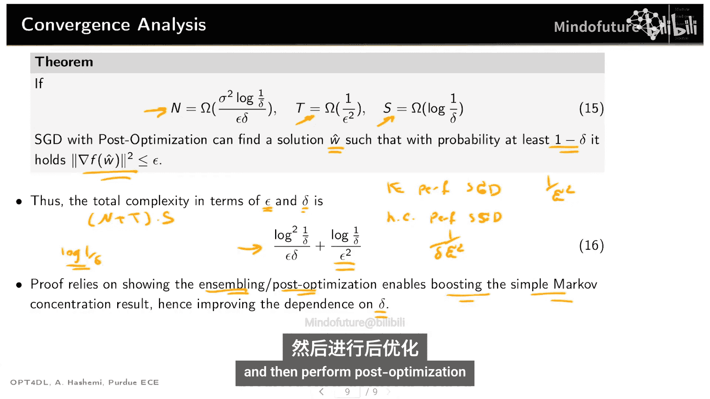

In the next lecture， we're going to talk about another way to。嗯。

As strengthen the power of esooc alienian descent。I'll see you next time。

