# 【普渡大学】深度学习中的优化 ｜ Optimization For Deep Learning ｜ Purdue University p14 P14_无梯度随机下降方法2 -BV1tvzKBcEom_p14-

🎼，🎼Yeah。Welcome back。 So we motivated the goal of performing S G B without the grade information。

 So let's see how we can， we can do this。 Okay， so let's first build some intuition。Okay。

 and to do that， let's focus on a scalar function。So let's recall the definition of a derivative。

 Okay， so what's the derivative is basically some limit right So as as I'm writing here。

And if the function is is noise such that the left derivative on the right derivative are the same。

 we can basically write down the， the formula for derivatives using either one of these。

 these formulas， okay。So this is a limit。 So we we basically。

 if we want to calculate the derivative at one point， we perform some slight perturbation。

And see what's the change in in the function value。 And then we divide that by that perturbation。

 such that when this perturbation goes to 0， we can find the slope of the line tangent to w。

 And that's basically nothing but the derivative okay。Now。

 let's imagine that instead of setting a mu to go to0， we use a mu， which is not zero and fixed。

 but is very， very small。And let's consider this quantity。Okay。

 so it's F evaluate that W plus mu minus F evaluate that W minus mu divided by two mu。 Again。

 if mu goes to 0， this is nothing but the derivative of the， the function。

 But if mu is not going to 0 and it's a small， we still expect this to be a good approximation of the derivative。

Okay，So for a small mu， this should be a good approximation。Now， let's look at this。So， all we need。

There is two function evaluations。We don't need any gradient or in this case， derivative calculation。

 And this is basically what we wanted， right。So if I were to minimize， let's say this function F。

Instead of using the derivative of F and， and performing in the end， I could have used。

This approximation， which doesn't require the gradient only two function evaluations to perform my gradient design。

 basically okay。Now the cache is that and I think it is intuitive to expect to incur some bias depending on mu right。

 so the smaller the mu， the better the approximation， therefore the smaller this bias。

 and surely as mu goes to0， the bias vanishes and our approximation converges to the true derivative of the function。

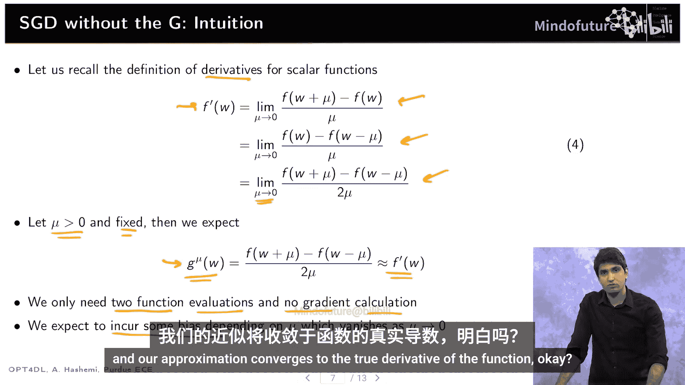

Okay。Al right， so that's hopefully that gives you an idea of what we want to do。Essentially。

 we want to just use function evaluations and and form an estimator that looks very similar to what we discussed in the previous slide。

But the catches。The models have billions of parameters， right。

 So theyre not So that means that our loss functions are not scalar functions。

 So the the domain is multi dimensional。 So we want to extend this idea to multiple dimensions。Okay。

 and to do that， iss what we do。 we're going to resort to the power of randomness， basically。

So we're going to view the estimator as we are still in one dimension。

 we are talking about the scar functions。But we're going to view the approximation that we talked about in the previous slide as an expectation now。

 the expectation over random directions。In R。 So that means that the directions are only left that right。

 okay。So mathematically， this is what I'm talking about。 let you be a random direction。

 So it's either right or left， one or negative one。

I'm using a language here which is going to become apparent why I'm doing that。

 so let you this random direction。Be a vector in R， lying on the surface。Of the unit， E。

So what's the UniE sphere in R？Is nothing。 the unitospher。

I basically the interval between minusus1 and v。And the surface of the universe here in R is nothing but-1 and 1。

 okay。Not consider this this random variable。 Okay。

 so it's very similar to what we had in the previous slide， except I'm introducing you here。

And you here。 Okay， And I'm also slightly changing the expression we had in the numerator。Okay。

 this is a random variable because u is random。 U is a random direction。 G is a function of u。

 therefore G is also a random variable。Okay， so let's talk about the expected value of this。

 of this con this random variable。So when I take the expectation， with respect to you。

 So the selection is uniformly at random。 So it's equally likely to go left or right。So therefore。

 the expectation is actually very simple。 It's half times this quantity when this corresponds to the case where u is equal to1。

Times。This other quantity。So you have to rid of this。

 And this goes on to the case where u is equal to -1。Good。You， if you do the simplification。

 which is quite easy to do。You see that。The expectation is nothing but the approximation we talked about in the previous slide。

 okay。So therefore， the approximation。Is nothing but the expected value of this random。Don away。Okay。

And obviously， as we said before， when a mu is a small。

This is gonna be a good approximation of the true derivative of the function。

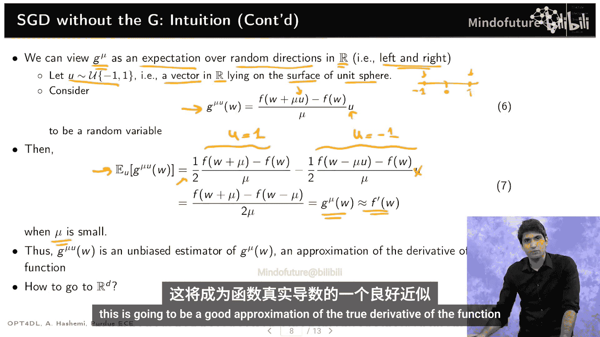

그。So what's the conclusion then， this new random variable I defined is。

An unbied estimator of this approximation。Which is an approximation of the true derivative。

Of my function， okay。Now， let's see how we can build upon this idea to go to multiple dimensions。

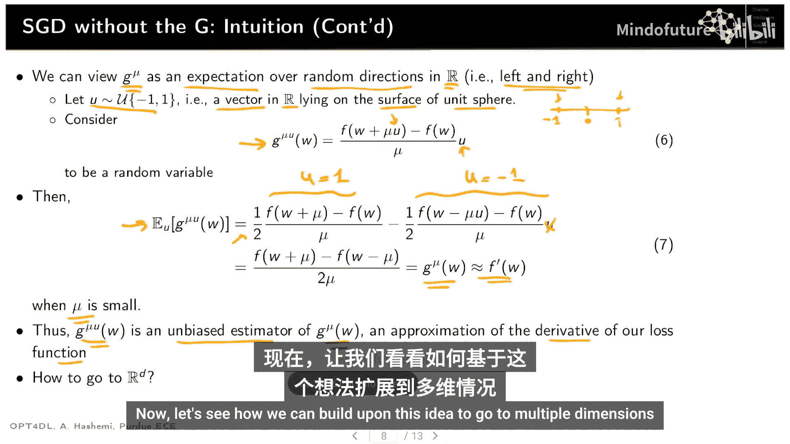

This is what you said。 So we select a random direction。On the surface of the unit S sphere。Now。

 if you are in multiple dimension， we are still going to do the same thing。 Okay。

 we are still going to sample you uniformly。From the surface of the unit S sphere。

 But now our unit S sphere is in R T。 Okay， So in particular， if D is equal to 2。

This is how does the unitosphere look like。 So I'm going to。

 I'm going to sample a vector on the surface。Of of this circle， basically。对。Now。

 our estimator is going to be exactly the same as what we talked about in the previous slide。

 It's going to have this form。In particular， it has， let's say， a random。

 So this is the random magnitude， if you will。And this is the random direction。So therefore。

 it's a random estimator， okay。So this is what we are going to use to optimize loss functions without the gradientian information。

And this estimator is called0 order estimator because it only uses zero order information。

 basically the function values。It doesn't use。Pal information or the gradient。

North the second order information， the Hatian。Now，1，1 detail here is that。

Instead of using the unit aspher。You can also use other distributions。 For instance。

 you can use Gaussian distribution to sample you okay， so and。

The reason is that there is actually a very neat connection between vectors that are distributed according to a normal distribution and vectors that lie on the unit of thephere。

 in particular， if U is a Gaussian vector。No its normal normalized version lie lies on the surface of the eosia。

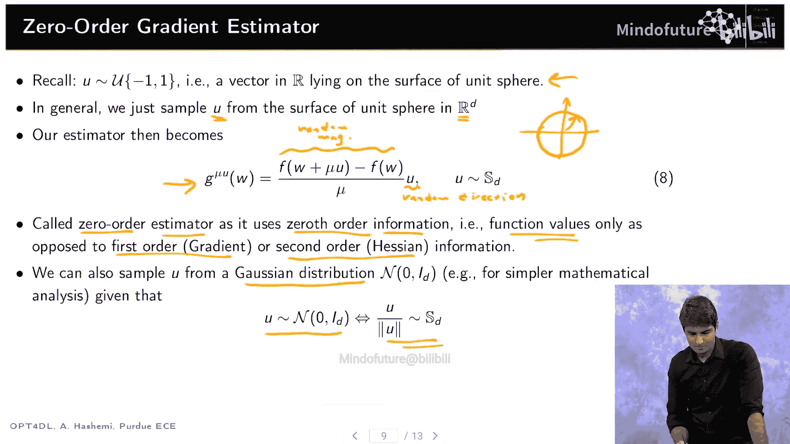

Alright， so how can we use it for optimization。 So imagine that we are minimizing a stochastic loss such as this。

 again， we think of this as minimizing the average loss over the training data。

we initialize our iterative algorithm。 We use some learning rate。And we're gonna fix the。

A smoothing rate mu。 And we're going to see in in a minute why I call this the smoothing rate or the smoothing parameter。

So we have an intuitive algorithm for capital T number of iterations。

We're going to sample a random direction U from either the unit the surface of the unit atmospherepher。

Or according to the Gaussian distribution。This part is identical to SD with sample a miniwach。

And then we our update vector。 Okay， so the update vector is basically it has a mini batch form。

 So it's the average of the zero order estimator we discussed in the previous slide。

And then we're going to use it to update。Our parameter。

By using this simple first order update that we have seen more than a few times in the course so far。

So this is called the zero order S GD method， right， So it is almost identical as to S GD。

 except that。Instead of using a stochastic gradient， we use the zero order。

Estimation of this stochastic gradient。To update the parameter。And the zero order submission。

 as a asymmetric， as I mentioned， only requires access to function values， not the gradientian。

 So it can be used to， for instance。Sove。Those three motivating examples that are mentioned， right。

 so you can use versions of this in online oral。 You can use versions of this for advers turning。

 and also recent results have explored。Utilizing this idea when fine tuning large language models。

Okay， so one point I want to make here is that given that we there are a lot of random operations here。

 So the， the direction is random。 the， the， the sample you are using a random。

This approach is going to suffer from a high variance。 So again， we are using the random estimator。

 So this random estimator is going to have some by us。Also， potentially large variance。

So it is something to try to deal with。So in the most simple case that we saw before in order to deal with the high variance was the idea of mini batchching where instead of one sample。

 we we used let's say B samples。 Okay， so we can use the same idea here So to lower the variance in instead of using one random direction。

 you can use a mini batch of random directions。 Okay， so in particular， you can form the simeter。

 which is basically the average of average over K random directions right and these random directions are again。

 are either chosen from the unitpher or according to aossian distribution。

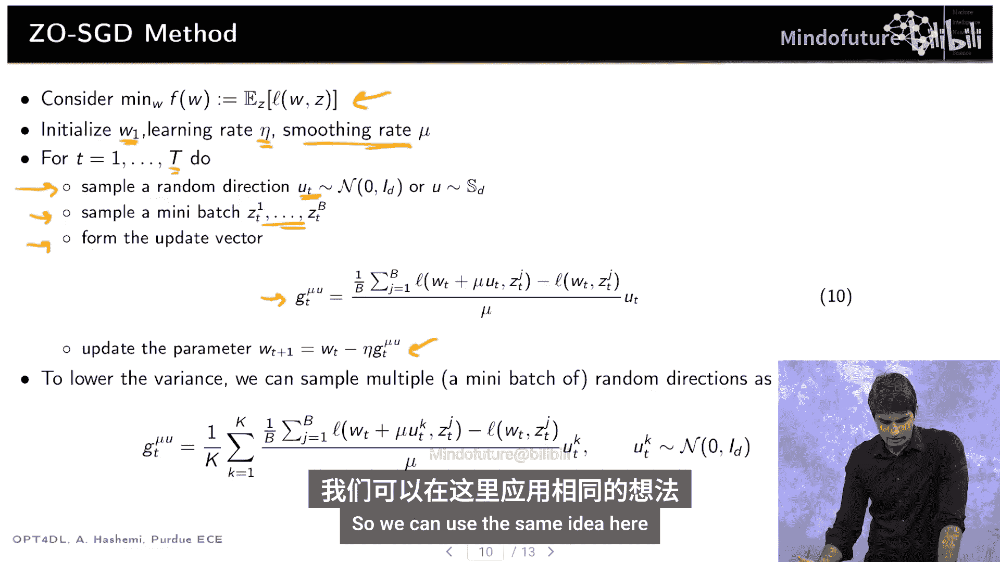

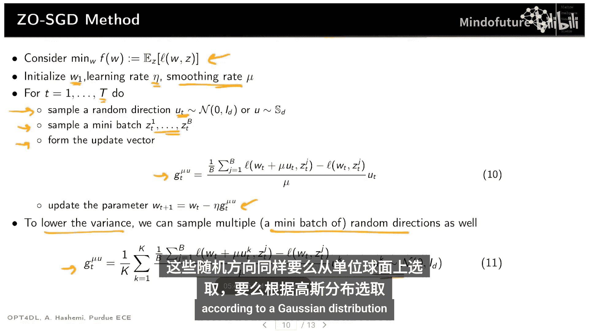

So now let's talk about that the smoothing term I mentioned。

 why are you referred to me as the smoothing parameter okay？

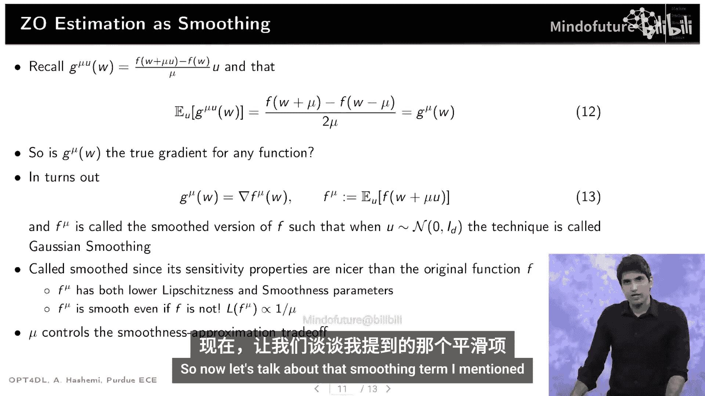

So recall， this is the estimator we talked about。 So we started with this estimator。

 This is the approximation of the true gradient。Which is。

 which is a random variable because the direction is random。 We show that its expected value is。

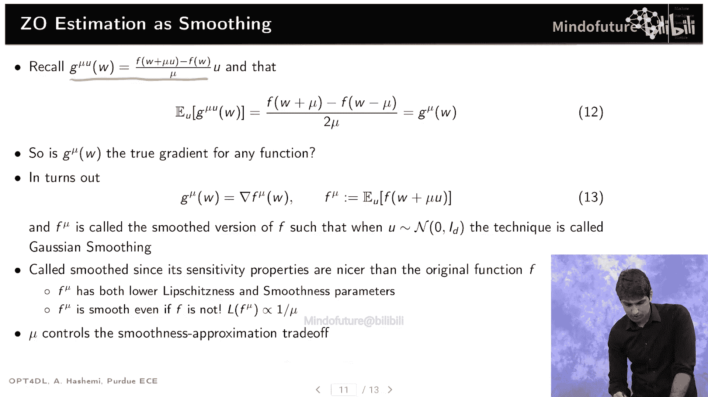

It's going to be something like this。 So G meal。And this was the approximation of the true gradient。

No。One question is that， if。Noblela F is the gradient of F。

And I'm keep referring to this G meal as approximation of the gradient。 I this itself。

The gradient of any function。 And if so， which function。Okay， it turns out that the answer is yes。

Gimio is actually。Aient。It's a range of some function。Which function is F muu， which has this form。

So it's as if you're taking F and you're shifting the parameter。呃。In a random direction。

With a tiny amount meal。 And then you're taking the expectation with respect to your random choice of direction。

Okay。Now， this F mu is called a smooth version of F。Okay。So that when the direction is chosen。

 let's say， according to， to today the Gaussian distribution。The technique is called Gaussianming。

Okay， so why do we call it this morning， Because it turns out that this function F mu。

Has sensitivity parameters or properties that are nicer than the original function。

So what does that mean in terms of the terminologies we've discussed before？

So for instance assume that the original function is lipy sand。

It turns out that F mu is going to have lower lipid parameter and also lower S smoothness parameter。

Even more， if the original function F is not as smooth， it turns out that F mu can be a smooth。Okay。

 and in fact， this full parametermeter typically is proportional to。

The inverse of the smoothing parameter mu。 So that gives you an idea of why we call mu the smoothing parameter。

 Okay， because it controls how smooth and noise F mu is。 Okay， in particular。

 mu controls the smoothness。An approximation trade of okay， So the the larger mu is。The nor。

This function of mu is going to be because it's going to have better a smoothness parameter。

 for instance。But the approximation is gonna to be worse。

 So the distance between F mu and and mu is actually going be larger。 On the other hand。

 when mu is a small and in the extreme case， approaches 0。

Then Fm is going to approach the original function。And as a result。The。

 the sensitivity parameters are going to increase。That's why we call me with a smoothing rate or the smoothing parameter。

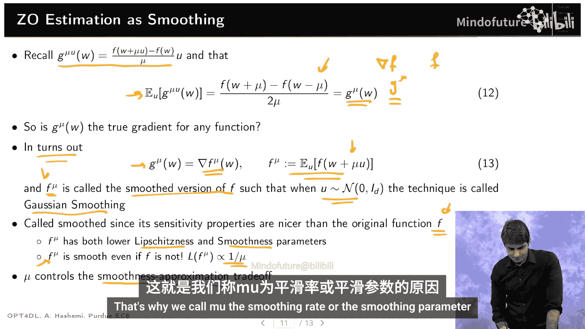

Alright。 So， but why， why， why this operation helps to smooth the function， okay。So recall。

 this is the the gradient we talked about。 So Gu or approximation of the G the gradient。

Is the gradient of another function， And this function is nothing but a smooth。

Version of the original loss F okay。So the intuition is here is that the expectation is essentially an integral。

 okay， and integrals tend to make functions smoother and noisr， okay。都。Because。

If I give you a function， the derivative may not exist。Right， but many times the， the integral。

 especially， for instance， for a scalar function， the integral does exist， right。

 and tends to be nicer than the original function， okay。Indeed。F mu， is a smooth function。

 is nothing but the convolution of F。And the P D F of U。 Okay， so what's the con convolution。

 So recall the convolution between two functions is given by this expression。 Okay， so basically。

 what we are doing， we are taking the original function。

 which may not be as noise and as smooth as we are hoping。

We convolve that with the PDFf of this random direction U， for instance。

 the PDF of a Gaussian distribution， and then we're going to focus on the result and function。

 which we call the smooth version of the original function okay。Now。

 here we are talking about this idea in the context of optimizing a function without accessing the gradient。

 But it turns out that this idea is very， very powerful。

 And you can use it in in different areas as well， for instance。

Then you are analyzing the models with non smooth activations。P instance says radio， okay。

So here I'm showing the， the pillar of the radio activation。 So as we talked about radio。

Of x is basically the max。Of 0 and x。And it is non a smooth， because at 0 here。

The the derivative doesn't exist。But if you take it and and let's say convolul it with the P a Gaussian。

 you're gonna get something like this。Which is also referred to as the soft plus radio activation。

 Okay， so what that means is that if you have some results for deploy models with the smooth activations。

嗯。You can extend that。To deploying models with non activation， such， such as the radio activation。

 which we typically use in many practical settings。对。

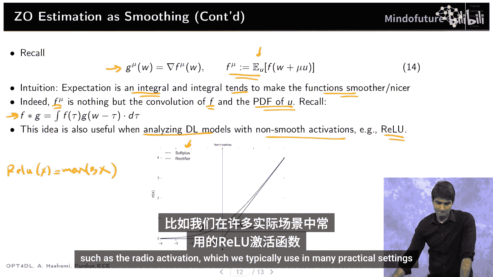

All right。So but this go back to the implication for optimization， right。

We talked about the zero SD method， right， And we said that basically the estimators we are forming can be thought of as an onbi estimator。

off。G mu， which itself is the gradient for another function。

 The smooth version of the original loss function F。Okay。So， therefore。

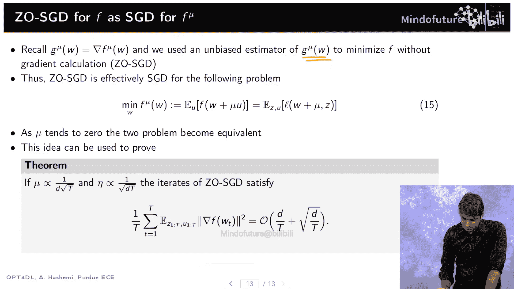

Our zero order SD method is essentially a SGD， but for a different problem。Okay。

 so instead of minimizing the function F directly。Which requires access to the true gradient of the function。

What we are doing， we are minimizing。The smooth version of the function。Using SGD。

And this process turns out that it doesn't require access to the true gradient of the original loss function。

 okay。Now we have two problems therefore， and these two problems are different。

And they're gonna become more and more similar as the smoothing parameter approaches 0， because F mu。

 the loss function for， for this new problem is gonna converge to the loss function of the original problem。

Okay， now this idea actually it can be leveraged quite easily to prove a thium that I'm misttating here。

 Okay， so what you can show is that if the smoothing parameter is small enough。For instance。

 it it scales with with one over D， the dimension。Times the square root of T。

And if these steps are small enough as well。The zero order C D method is gonna。Satisfy thisno bond。

Essentially， the accumulation or the average of the gradient。There norms is going to be bonded。

So the bond depends here on multiple parameters。 I'm focusing on two important parameters here。

 The first one is the total number of iterations。 So the bond shows that similar to SD。

 we have two terms， a higher order term， the first term。And and a dominant term， the second term。

 and as T the total number of iterations goes to to infinity， the bond becomes smaller。

 meaning that the method converges to a stationary solution of the original minimization problem。

The second problem parameter that I'm focusing here is the dimension。 Okay。

 so here we see a dimension。Depenent result。 Okay， so for the first time。

The dimension explicitly appears in the band。And in fact， the larger the dimension。

 we can see that the larger the bond， okay。So it turns out that in many scenarios。

 the the dependence on the dimension is unavoidable。And in fact。

 there are many settings where the zero order method is is the optimal algorithm that you can use in the case。

Alright， so there you go。 This is another important modification to SGD that helps us to broaden the applicability of SGD。

To not only scenarios where we have access to the gradient。

 but also scenarios where we don't have access to to the gradient。

And along the way we hopefully learn some useful mathematical concepts that actually trans beyond the context of this lecture。

 so for instance， as I mentioned， this is a very useful tool to analyze deep learning properties of deep learning models that utilize nonmode activation functions。

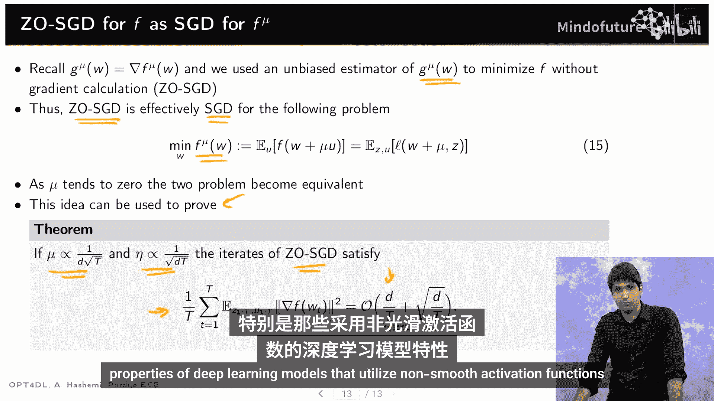

That's basically the end of our first module。 we're going to switch gear slightly and talk about some basics of deep learning architectures and basic deep playing training strategies in our second module。

I see there。