# 【普渡大学】深度学习中的优化 ｜ Optimization For Deep Learning ｜ Purdue University p15 P15_深度学习架构一_多层感知机1 -BV1tvzKBcEom_p15-

🎼，🎼Yeah。Welcome back。 So we are starting our second module。

 and we want to talk about deep learning training techniques and heuristic。😊。

So to understand these methods， it is essential to talk about deep architectures。

 So the reason we want to do this is because the training problems that we're going deal with。

The optimization problems are very difficult problems， right， So to to tackle them。

 we need to identify structures and leverage those structures to find effective and efficient solutions。

 And one way to understand those structures is to actually understand the architectures of the deploy models。

 We want to optimize in the first place。So my hope is to be able to drive these architectures as solutions to the simple models that we are familiar with。

 such as linear regression。Other as opposed to just tell you what these architectures are， okay。

Therefore， we're just gonna go back again to the simple model we have seen before linear regression and we want to see how we can think of that as a simpleing architecture and how we can build upon it to basically come up with more complex differing architectures to alleviate the issues of this linear regression approach okay so recall for a simple linear regression model we are basically assuming that the the relation between the features and labels is given by a linear relation so again。

 let's assume that y o is or y labels， the features are Xs so I'm going to assume that there is this linear relation right so where the regression ways are w star and there is also some bias P star okay so my goal is to learn this from data。

So previously， when we talked about linear regression。

 we didn't talk about this biaser term or the intercept term。

 And that's without loss of general generality。 And the reason for that is that whatever dimension。

 your original problem you can increase the dimension by one and define new WS star and new features such as this so you can augment WS star and BS star into just one parameter called the W star and then add just this one as one of your features。

 Okay so therefore many times people ignore the bio term。

 especially when they want to talk about linear regression from a mathematical perspective Okay so what's the goal。

 the goal again， as demonstrated in this figure is to learn the slope and the intercept of a line that crosses through the data that fits the data as well as possible okay。

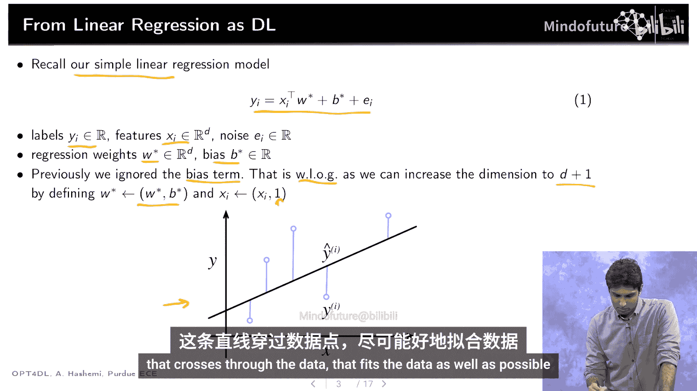

So that's the linear regression model。Okay， so we can think of this model as a combination of artificial neurons。

 Okay， so essentially， neurons are elements that take an input。An input signal， they process it。

 and then they pass it forward。So linear regression is nothing basically but as a very simple artificial neural network or a shallow display learninging where we are taking these inputs。

 the input features， and then we we are processinging it。 So for instance。

 we multipied it by the first component of w。 So we we multi X1 with the first component of w we multiply the second component with the second component of w and so on and so forth。

 and we multiply the last component with the last component of w to get the output。Okay。

 so therefore。In the language of deep learning， this is nothing but a simple neural network with one input layer and one output layer。

So that all that happens to the input signal。 The features is that we are just multiplying that by some weights。

And then report the result as our output。Now， what's the training problem。

 the training again involves。Fitting the， the data。 Okay。

 so we want to optimize over the parameters of these neurons， essentially。

 the weights and the viruses。Which are， our regression parameters。

So we want to optimize them so that we have the best fits to the data。

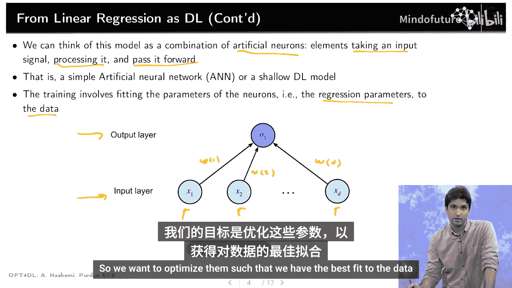

So it is also very useful to think of linear regression as a maximum likelihood estimation problem。

Okay， so essentially， we assume that we have some observations that are noisy。

 such that the noise distribution is given as a Gaussian distribution， okay。

And that the observations are statistically independent。Now。

 when we have these observations and a useful principle in estimation theory is to point the parameters such that the likelihood of the data is maximize。

So the likelihood is essentially the probability of the observations given the given the features。

 So we want this probability to be maximized， if we want the likelihood to be maximized。 Now。

 given that the observations are statistically independent。

 the likelihood over the entire training data is is nothing but the product of these marginals。

And if you're assuming that the observations are corrupted by independent Gaussian noise。

 That means that the distribution of each observation is is going to follow a Gaussian distribution。

 So ignoring some constant， the likelihood is basically the product of a bunch of exponential functions。

 as I've written here。对。And our goal is， again， to maximize the likelihood that means that we want to find the parameters of this distribution。

 the W。And B。 So I said the likelihood with these maximum noise。 And sigma here。

 you can just see it as a constant which which den the the noise power。 Okay， so for instance。

 it can be equal one。No。嗯。We want to turn this into a minimization problem。

And its useful trick is to leverage the log function。 Notably， log is a monoton function。

 So that means that。The solution to this problem is exactly the solution。

To another problem where I just take the log of the objective function。So we can use this idea。

 therefore， to take the negative like。And therefore。

 form the following negative like likelihood problem。 So therefore。

 if you take the log of this equation here， multiply by negative sign。And ignoring the constant。

 you're gonna arrive to this problem。 Okay， so what is this problem。

 This is exactly an empirical risk minimization problem where our model is linear。

And we are using the score。To to basically find the best fit to the data。So therefore。

 this maximum likelihood estimation problem is， is a very nicely link to empirical riskization problem for a linear regression model。

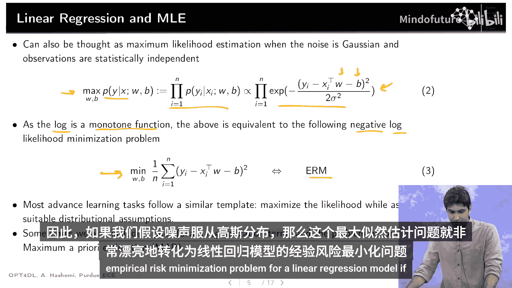

If we assume that we are dealing with the Gaussian noise， okay。Now。

 this is very useful because we're going to extend this idea to a lot of more complicated learning tasks。

 in particular， most advanced learning tasks。Pollow a similar template。

They hope to maximizeimize the likelihoodhood。Right。

 but given that the situation could be a little bit more complicated。

 they may assume different distributional assumptions。

 So here we assume that the data is IID and the noise is Gaussian。 depending on your learning tasks。

 you may replace these assumptions with something else。

And it is also useful to talk about the concept of prior or regularization here。 So using this idea。

 we can assume that we know some prior information about the input， okay。呃。

And we can use that prior information as regularization。 For instance。

 a useful and veryent regularization term added to to this kind of objective is L 2。

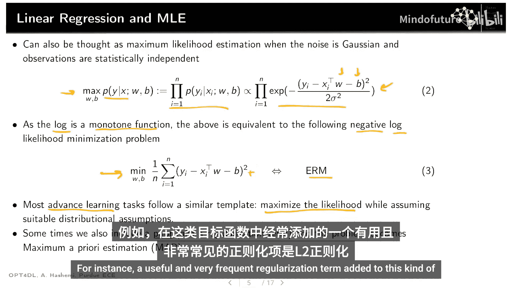

Regularization， we just add the Euclidean normal square of the parameters with some regularization constant Lada to the objective。

 Okay， so we， we're going to include the regularization term。

 And this is something we're going to talk a little bit more in， in one of our future lectures。Now。

 after in this regularization term or this prior。Information on our。On our unknowns。

The problem basically now call is called maximum a priori estimation。Or map。

 as opposed to maximum likelihood estimation。

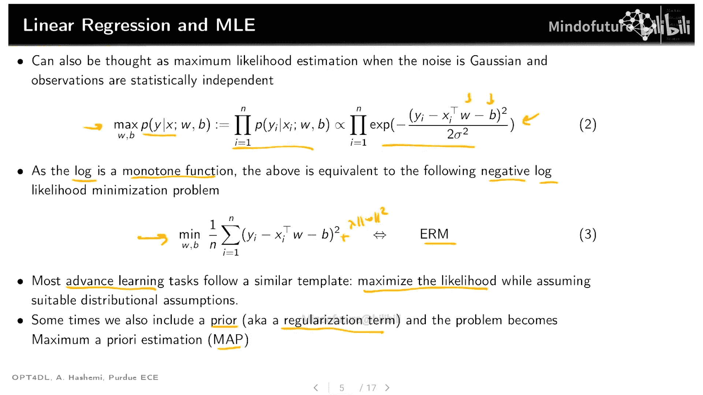

All right。So， so there you go。 So when we are talking about a simple regression problem。

Perhaps the most simple model is a linear regression model。

 And we talked about the connection of that to， to deep learning。

And we mentioned that we can think of it as a very simple neural network。

Such that the training involves minimizing。The square loss over。

 or the average square loss over the entire training data。

 And we also talked about this very nice connection to maximum likelihood estimation。 Now。

 what we want to do next is to extend this idea from regression to classification。 Okay。

 so in particular， instead of assuming that the labels or scalar and belong to R。

 we have a classification problem with capital C。Classes， okay， so for instance。

 a famous data set is the M data set or another famous dataset is C for 10。

 And in both of these data sets， we， we have a classification problem with 10 classes。

 So C is equal to 10， but C could be even larger for a lot of other data sets that are very frequently used in the literature to test the capability of deep learning models and deep learning training algorithms。

Okay， now for these kind of problems， it is a very useful idea to find a good representation for the labels。

 Notably， it is very frequent to use what we call1 had encoding to represent these categorical labels。

 Okay， in particular， we're going to encode each label to a vector in R C。 So in particular。

 Y I is gonna be one of the following vectors E1 through E。 So what are these vectors。

 These are basically the standard unit basis vectors in R C。 such that E I is all 0。

Except it has a one at the os。Position。Okay， so this is called  one hard encoding。Now。

 after this includingcod， we want to find a model to， to classify the data。 Again。

 we're gonna go back to the most simple model one could imagine。 And that's a linear model。 Okay。

 so we're going to assume that the relationship between the labels and the features is gonna follow a linear model again。

 okay。So in particular， we're going to have。A relation like this。

 know that previously in the case of regressionion， W was a vector here。 W。

 which I'm using the capital W， is gonna be a matrix。 And the reason for that is that now。

 after this holdingding our output is not a scalar array is actually a vector in R C。 Okay。

 so if we have 10 kilosses， the output is a 10 dimensional vector。 If you have two ksses。

 the output is a two dimensional vector and so on and so forth。Okay， so these are our labels and and。

 and features。 And what are the learnable parameters of this linear model or this weight matrix。

And the boys。Now， again， we can think of these as an artificial neural network。

 basically a combination of neurons that take an input signal， process and pass it forward。

 In this case， again， we have a single input layer and a single output layer。 Now， as I mentioned。

 given that the output is is going to be a vector。We take the first feature。 We multiply。

 let's say with W11 to get the first output。 And then there' is gonna be a link from this to all the other output as well。

 for instance， W1，2， and then W 1，3。And so on and so forth， okay。Now， what are these output。

 the output are basically the labels， right， but it is very useful to think of them as the probability that is specific。

Let's say image belongs to a specific class。 For instance， we can' think of Y I as the probability。嗯。

So let me write it here。 Y I as the probabilityty。That the image X belonging to。Plus。By。对。Now。

 this is very useful and important， as we're going to talk about in a minute。

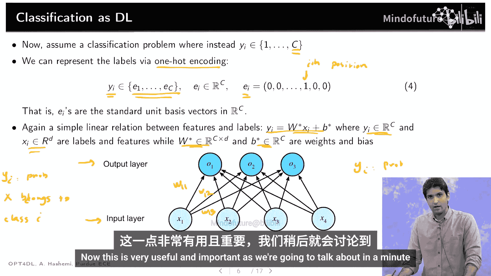

Okay， now let's talk about training。 So we have our model。 Now you can think of training。

 and we talk about how we can train a linear regression model， and we arrived at a square loss。 Okay。

 and the pass we took was from the perspective maximum likelihood estimation。

So you could think of that we can， again， use a square loss as before to find this， these vase。

 right， So the classification， the v of this classifier， Okay， and we can indeed do that。

 and it will work in practice。 But it turns out it's not an elegant solution， okay。

And the reason for that is， is gonna go back to what I mentioned earlier that we should think of the output as the probability that the specific image belongs to that to that to that class。

 Okay， and it turns out that if we use a square loss。

 we're not gonna necessarily have this noise structure， okay。So for instance。

 let's imagine that we use a square loss or something like that to。

 to learn the parameters of our model。 that's column W hat and W B。

 And then we have this linear relation。 Okay， so as I mentioned。

 it is very desirable to think of the C S entry of the output as the probability。

That the label of this input X is C。 Okay， for instance， this is an image of a dog。 So if。

 if ca one is is the class of all cats， C is dogs， so。

I want the first entry of Y hat to denote the probability that the image belongs to to the first class。

 meaning the class of all cats。 So it should be a very small number。Near 0。

 if I have an image of a dog。 And otherwise， the probability is gonna be large if I have an image of a cat。

 okay。But we are not going to get this necessarily if we through this linear relation， okay。

 so if if I use this in conjunctioning with a square loss。

 it's not necessarily the case that the entries I can think of the entries of these as probabilities okay。

So we want to ensure that this is like a probability。对。都。

What are what are the characteristics of a probability vector。

 So each coordinate should be non negative and all coordinates should sum to one。 In particular。

 the vector should belong to the simplex。Okay， so we want non negativity and the fact that the entries is sum to one。

 And we're not gonna necessarily have that if we just use this linear model and train it with a square loss。

 Okay， it turns out that we need some sort of normalization。 Okay。

 so we basically want to normalize this y such that entries are non negative。 And the sum to one。

 Okay， that's basically normalization。 and one very useful way to。

 to do this normalization is called soft max normalization。 Okay。

 where we basically use the fact that the exponential function is always positive。

And a simple normalization to ensure that the output is actually like a probability okay。

So what's softwareax normalization， So let's consider the the outcome our linear model。Now。

 instead of reporting this as my output， why I'm gonna apply a Soaxax operator on that。

 What's the Soax operator， especially to define it entry wise。

 So the Js entry of this softm is basically you take the exponential of the Js entry of O。

 And then you normalize all of these exponentials by including this normalization term the deator。

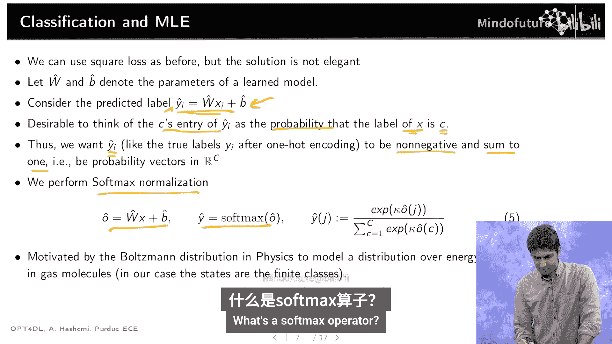

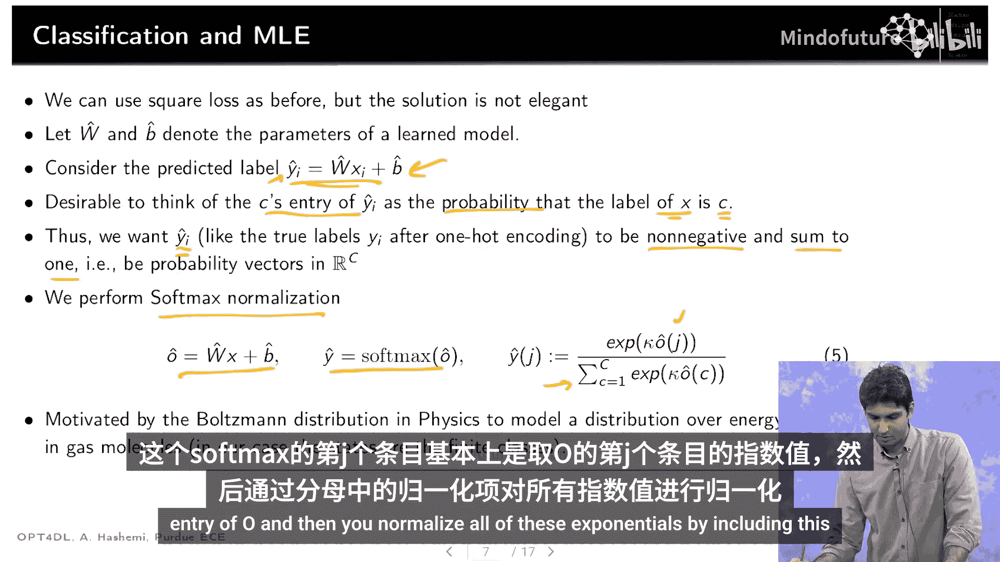

Optionally， you can have a parametermeter copper here， which is called the temperature。 Now。

 the motivation for the softwarex operator actually goes back to physics。 and， in particular。

 the Btzman distribution in physics。Which is a very famous model to characterize distributions over energy estates in gas molecules。

In particular， here， for our case。We can think of our finite classes，1，2。

3 up to capital C classes as a collection of finite states。 Okay， so therefore。

 this distribution gives like it talks about what's the chance of an an input。

 Let's say an input image belonging to a specific state。

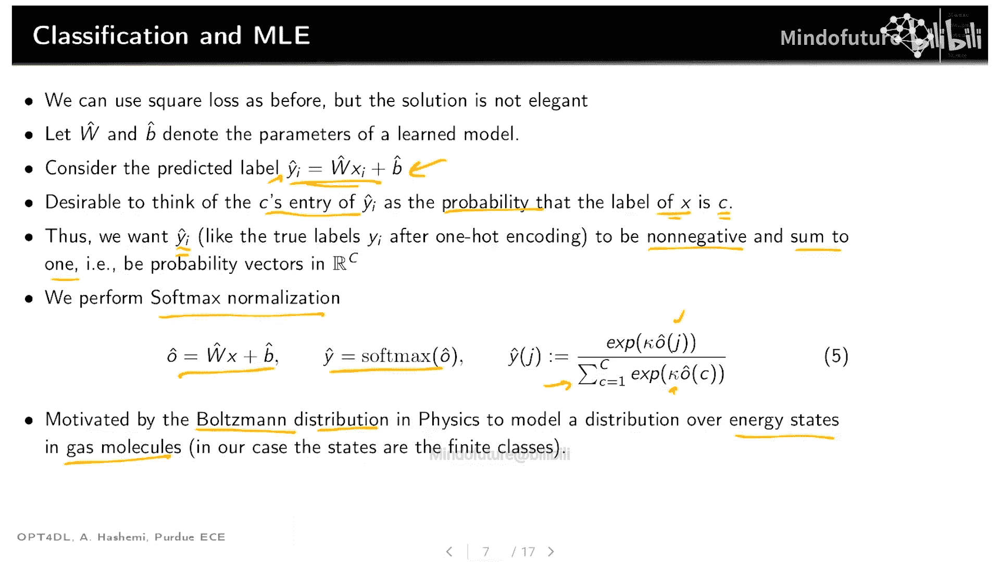

Alright， so， so that's， that's basically our， our very simple classification model。

 We gonna use a linear model like before。 But because we want this nice feature that the output pool represent the probability that the input belongs to a specific class。

 we also leverage selfm normalization。 So what's the training process。

 then then the training involves finding parameters such that we get the best fit to the。

 to the data。 okay。😊，So we need to come up with an optimization problem。 In particular。

 we need to come up with， with a loss function。 So for regression， we had a square loss。

 And if we recall from our lecture on basics of machine learning， we talk， we talked about。

Clification。And logistic regression in particular。 And we mentioned that the loss that we use in those cases is actually the cross entropy loss。

 okay。Now， that doesn't come out of blue。 So we're going to see that we can actually drive that cross entropy is a very natural loss use for classification problems。

By following the principle of maximum likelihood estimation，So we're going to resort to Emily。

And we want to find the parameters that maximize the likelihood of data。Now。

 note that we assume that we are using this sux normalization。

 therefore a natural observation slash noise distribution is basically the multinoal。Distribution。

 and this is nothing but as we talked about in the previous lecture。

 a discrete version of the Bzman distribution。Okay， now。Let's。

 let's see how we can we can arrive at cross entropy。 So we want to maximize the the likelihood。都。

This is essentially our likelihood。So the probability that the class or state is is J。

 given that the input features is x。 okay， And as we mentioned after following the and soft max normalization。

 here is gonna be the output okay， now we mentioned before that maximizing the log is equivalent to minimizing the negative log likelihood。

 Given that log is is a monotton function。 So here what I'm doing。

 I'm just taking the negative log from from this side。 okay。No。

Notice that our true labels after 100coings are basically one of the standard basis vector。

 mean that all entries are are 0 except 1。 I can use this quantity here。

To include this summation here。 So in particular， I'm going to go from this side to a minus sum over all classes。

 Y J。Times log of Y hat。 Okay， And as I mentioned， only one entry of y J y is 0。Only one entry of y0。

 therefore， I can in this sum and still get anequ。Okay， now this is exactly the cross enthtropy。

Between。Why and why hat。So in particular， what I'm doing here。

 I'm viewing Y and Y hat as two probability vectors okay and cross entropy is basically a notion of distance between these two probability vectors between these two distributions and as we're going to talk about in the next。

 it is also very related to a notion of distance from information theory called colvaar divergence or the divergence。

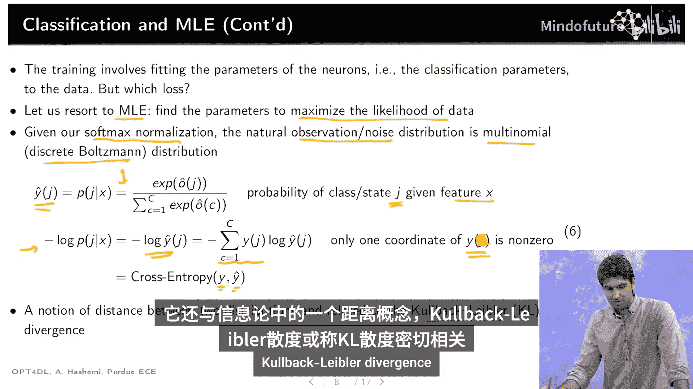

Okay， so let's talk about a little bit。 Let's talk a little bit about the connection between the the KL divergence and the crossenttropy loss to see why minimizing the crossenttropy is essentially equivalent to minimizing the distance between the predictions。

And the true labels that we get from our training data，To do that。

 we need some concepts from information theory that we may have seen in other places。

One concept we need is the notion of entropy。 So entropy is basically a way to talk about how random a certain quantity is。

 right，Essential， if a quantity is more random， we need more bits to， it has more information。

 Therefore， we need more bits to represent it， okay。

And entropy is exactly character in the number of bits needed to represent a certain quantity。

This is the definition of entropy given here。 So I have a vector。

 a probability vector of the dimension C。 I can calculate this entropy by following this expression。

 And in terms of the entropy is always positive。 So the more random the this variable。

 the higher entropy and the more determin it is the smaller the entropy， right。Does that win P。

Is basically one and 0 elsewhere。Enthtropy is exactly equal to 0。All right。Now， from this entropy。

 we can talk about relative entropy or KL dirgs。 So this essentially is saying how random11 variable is relative to another variable。

So in particular， the k is defined by this expression。 Again， you can show that it is non negative。

 So， and it， it basically describes the difference between two distribution。

 So it is useful to to think of it as as a notion of distance。

 although it is not a distance because it doesn't satisfy it is not symmetric， okay。Al。

 so as a side note。K divergence is actually an instance of a larger family of notions of distance in information theory。

 which are called F divergences， in particular， for any conx function。

 you can define F divergence with this expression for the case of KL or conx function is actually T log T。

 So if I change this function to something else， I may get a different notion of distance or divergence。

 For instance， total variation distance。No。By looking at the the expression for the entropy and the K divergence is actually and also reminding ourselves of the definition of the cross entropy laws is's actually very simple to show this relation that the cross entropy is the entropy of y plus the dirgence between why the labels we get from the training data and why hat the predictions。

 okay。No。We said that we want to minimize the cross entropy。

 If we want to follow the maximum like lu estimation principle。 Okay， now y is actually fixed。

 There is no parameter here is， is a fixed quantity I'm getting from the data。 So therefore。

 the entropy of y is also fixed。So， when I'm minimizing。The cross entryul loss。

 that's equivalent to ignore this term completely。 So therefore。

 minimizing the cross entryul loss is exactly equivalent to minimizing the K originence。 Okay。

 so therefore， what are we doing here by fitting the data。

 we are minimizing the distance between the probability of the labels according to the to the training data。

 which is why and the probability of the labels or predictions that we get as part of the training process。

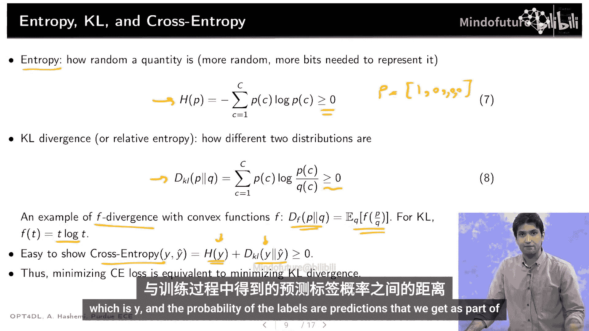

No。As I mentioned earlier， you can actually use a square loss for classification。

But it is not natural or elegant because it doesn't correspond to the maximum likelihood estimation solution。

Okay。It turns out that cross entropy provides also larger feedback sooner。 Okay， so essentially。

 there is another reason why we may want to use cross entropy when learning classifiers。

So here in this plot， what I'm showing the loss value versus how good our prediction is。 Okay。

 so early on in the training， we should expect that our model is not going be is not going to perform very well。

 Okay， so the， the prediction， therefore is not going to be very good， okay。So， in this case。

If you were to follow the square loss。 So this is the square loss。

The last value is not going to be terribly large。So as we're going to talk about that the implication is that we're not going to get a very large。

 very large feedback or signal。That we can use in our sayGD algorithm to update the weights。

 So therefore， the training is going to be slow。Okay，On the other hand， for cross interview loss。

 early on when the distance between y and y hat。Is is large。 The loss value is going to be very。

 very large。 In particular， is it could actually be on bonded。 Okay。

 so this means that we're going to get。Like a very large signal， very large gradient。 therefore。

 make a make a progress。 a lot more progress early on in the training。 And obviously。

 as our predictions are getting better and better。 we expect both of these loss values to。

 to go to 0。 So when， when the training is done。 And we have a very good model that can make great predictions。

 both of these loss values is gonna are going to be very， very small。

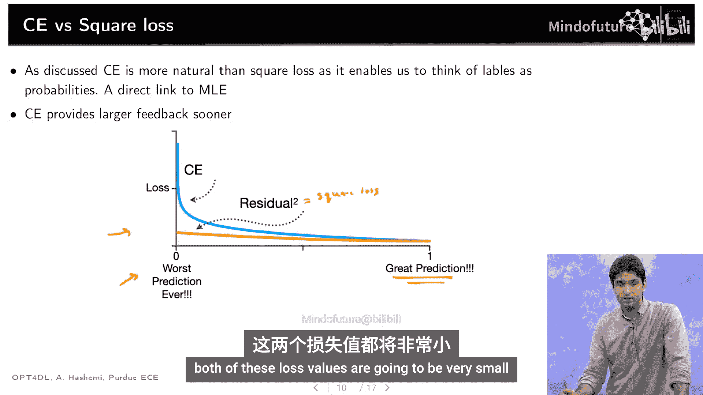

All right， so let's talk a little bit about what I'm what I mean by by the signal。

 So signal for is actually gradient， because we are using iterative training algorithms such as SD to update the parameters of the model。

 And to do that， we need to find the gradient。 So the more informative the gradient。

 the better our updates are going to be。 And the faster we can find a good predictor okay。

So let's talk about this and， and， and the connection between the gradient and basically how good our predictions are。

Such that when we are making a mistake。We have a large gradient。

 and therefore we can have faster training。To do at least consider our linear regression okay first。

As I mentioned for training， we use SGD to minimize， let's say， the empirical riskmunization problem。

 okay。Now， we need the basically the guarantee of the loss with respect parameter。

To update the parameter， okay。So， in particular， this quantity。

So for linear regression is actually very simple calculus to show that the gradientian is going to be followed this expression。

And not aably， this is by channel rule。Proportal to the gradienting of the the loss with respect to the output。

Okay， so what is this， This is basically nothing but the difference between our current prediction and the true labels that we get from the。

 from the train data， okay。So what this means is that as we talked about before， the our prediction。

 the larger the gradient therefore， the the larger the updates and hopefully the faster we can converge to to a good predictor okay。

It turns out that a similar thing also is satisfied for the classification problem。 the。

 in particular， the softmicax classification problem。 When we use the cross entropy loss。 Okay。

 so this was our。Or our prediction， okay。Which basically is nothing but uploading the soft max normalization to this linear model。

And again， notice that without loss of general generality， I'm ignoring the bias then。

So for training， again， we use SD to minimize the empirical risk minimization problem。

It cross and to be loss。 again， by chain rule， the gradient that we're gonna use to update the parameter is gonna be sort of proportional to the gradient of the loss with respect to the output。

 Okay， and it is a very simple calculation that I'm ignoring here。

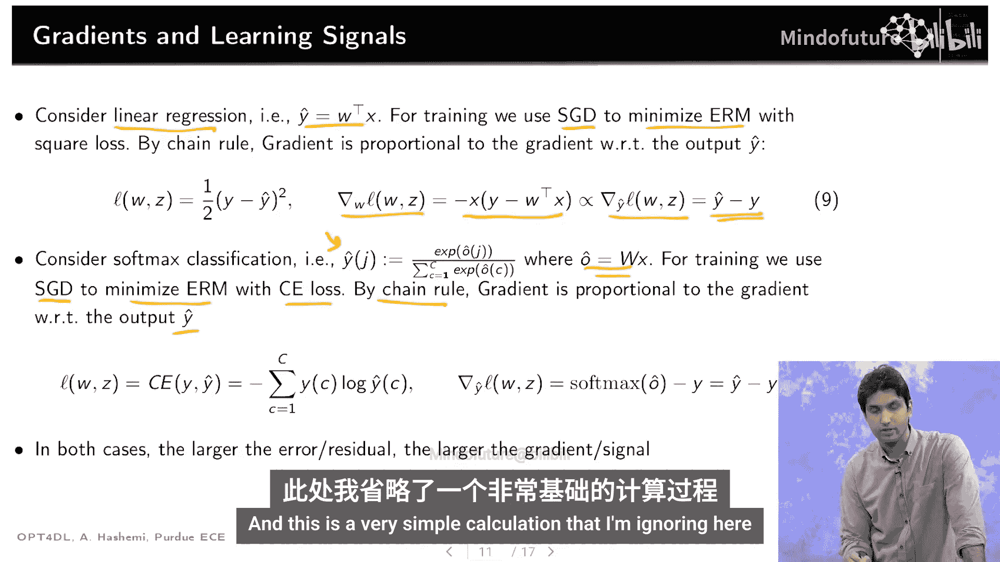

To show that the guarantee of the loss with respect to artwood is again。Going to be。

Exactly the difference between our prediction。And the true labels， Therefore， in both cases。

 the larger the error or a residual， the larger the gradient。

Or this useful signal that we are leveraging to update the parameters of our model。

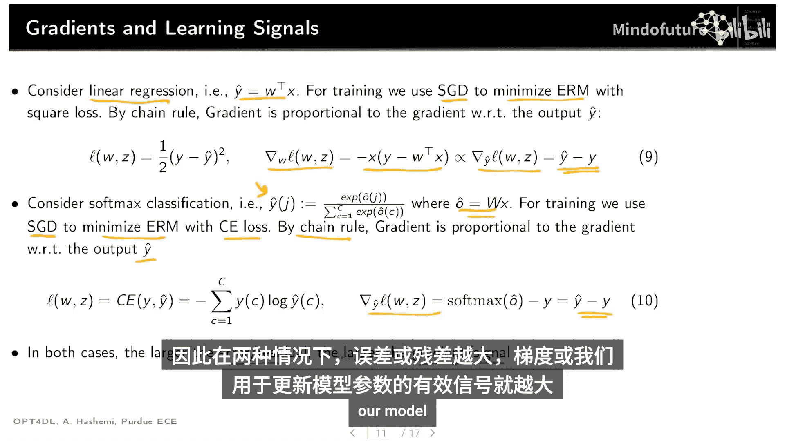

So basically， we talked about simple regression， linear regression and linear classification problems in the next lecture。

 we're going to talk about the need to go beyond these simple models。Let's do there。

