# 【普渡大学】深度学习中的优化 ｜ Optimization For Deep Learning ｜ Purdue University p16 P16_深度学习架构一_多层感知机2 -BV1tvzKBcEom_p16-

🎼，🎼Yeah。Welcome back。 So we talked about linear regression and sx classification or or linear classifications as two basic neural network for architectures where all we had was a layer or input layer。

 which was directly connected to， to an output layer。Now， in this lecture。

 we want to talk about the need to have hidden layers。 So more complex deep architectures。

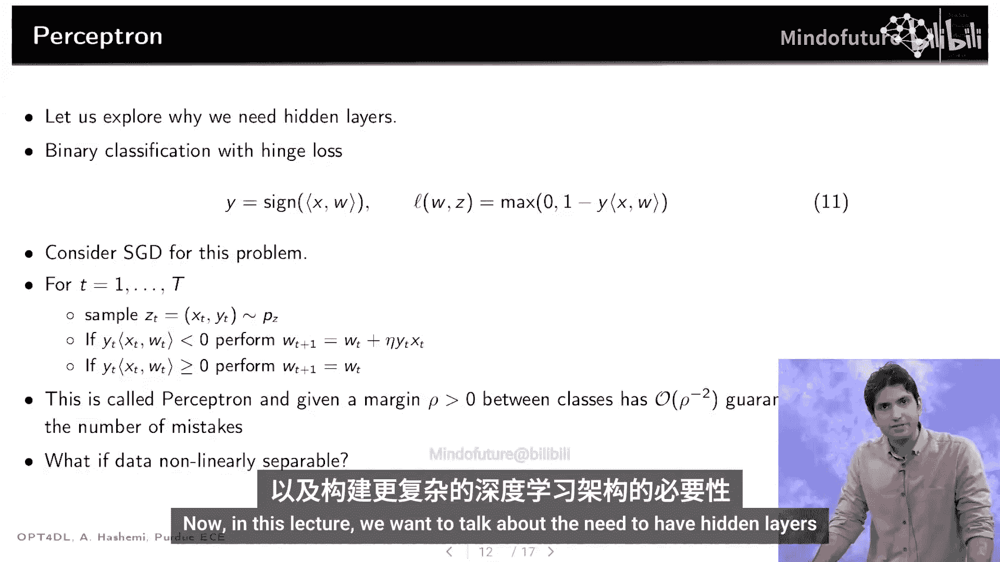

To do that， again， we're going to talk about the binary classification problem that we introduced。

In our earlier lecture on basics of machine learning。 Okay， so we're going to consider。Again。

 the goal is to explore why we need hidden layers。 So we're going to consider binary classification with hinge loss。

 something we talked about before。 Okay， so in particular。

 what I'm assuming here is that in the I have。Let's say two classes， plus and minus。And here。

 I'm going to assume that the data is linearly separate。 Again， something we we talked about before。

 Okay， so therefore， the classification problem is going to be reduced to finding a separating hyper plane。

 okay。So I'm gonna therefore assume that the relationship between the labels and features is given by this and this this expression。

 So all I need to find is this w value， right， So if the inner product within x and w is is positive。

 therefore， the data belongs to the positive class。 Otherwise。

 the data belongs to to the negative class。 Okay， so basically W is something like this。

So I just want to find this W。

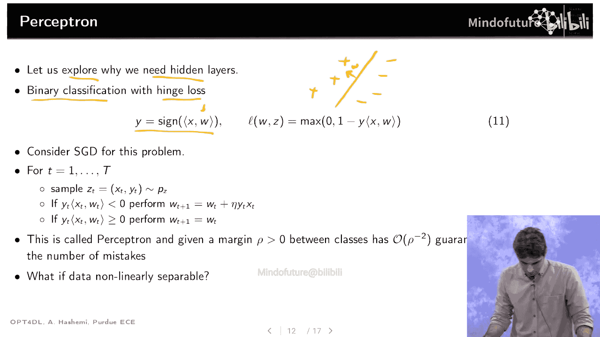

And the loss that we typically use here is hinge loss because it it's a convex function。 so we can。

 we can easily optimize it。

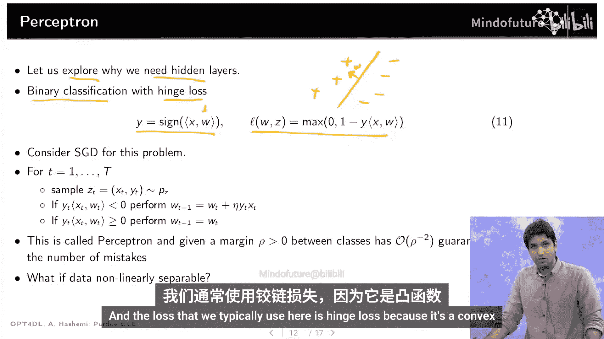

Okay， now what is our， our， our our algorithm to， to optimize this loss。 Let's， let's look at a TD。

 Okay， so what's the GD for this problem， we have an iterative algorithm， the C capital T iterations。

 every time we're gonna choose a sample， This basically means that I'm gonna select a mini from the training data。

And I'm gonna perform the CD update。 So what was the C update， This C of it was W。

 next W was the current solution minus some learning rate times the gradient。Okay， so over use G T。

Now， it turns out that the gradient of this function is gonna be basically given by。

 by these two lines。 Okay， so these two lines are essentially my SD update。

 where I'm gonna look to see whether my current solution is making a mistake on this current data or not。

 so。If。My current solution is not making a mistake。I'm not gonna update。My parameter。

 But if it is making a mistake， I'm going to update my parameter。 Okay， and this part again。

 this update is exactly nothing but the gradient of this max， this hinge loss。

 So given that the hinge loss is， a is basically。嗯。Its not going to be differentiable in this point。

 therefore we expect to see these two lines representing our gradientian update。So therefore。

 we can use S GD to learn this parameter W， this the promise of this separating hyper plane。

 and therefore， hopefully we can classify the data。 In fact， this method is called perceptron。 Okay。

 and it is gonna work very well。When the data is linearly separable， notably。

We can drive a simple result that shows that if there is a margin row between class positive and class negative。

Then we can get a guarantee on the number of mistakes that perceptton makes。

 and the guarantee is actually inversely proportional with margin a square okay。

So we are bonding the number of mistakes， basically。

If the data is linear reseable and then we have this non negligible gap between the two classes。

But the question arises here。 What if the data is non nonlinearly separable。 Okay。

 Can we still use this idea or not， And the answer is no， right， So as we can see here。

 the performance hardly depends on linear separability。

 And also a non negligible margin between the two classes。 So if the data is not linear separable。

 essentially， this margin is is 0， right， So therefore， we we。

 we're not gonna have any bond on the number of mistakes of dispersed algorithm。And in fact。

 there are examples such as the one that we're going to talk about next that basically show this simple method is going to fail。

 meaning that it， it will never stop making mistakes。

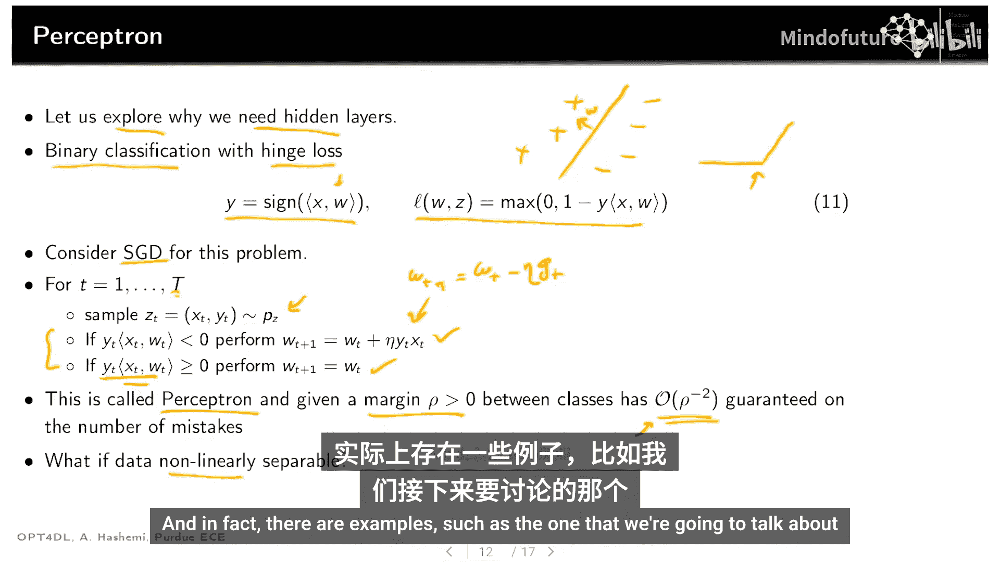

Okay。So let's talk about this example then。 So we're gonna consider a very simple example where we have only two features。

 Okay， so x1 and x 2 and the relationship between the label and the feature is given by the exclusive or or X or。

Operator， so the operator that you， you may have some familiar with it。 If not， I'm。

 I'm defining it here。 So again， it， it， it is operating on， on， on bits。Binary quantities。

 So the Xor between A and B is going to be calculated with。 first of all。

 is is shown with the symbol。 and then it can be calculated with this table。

 So if both A and B are 0， the outcome is is actually 0。 if one of them is one， the at one is 0。

 the outcome is going be 1。 And finally， if they are the same。 So again。

 and both are taking the value of1， the outcome is going to be 0 okay。So let's， let's， let's。

 first of all， visualize。How the data will look like。In the， in this 2D surface。X， x 1， x2， okay。

So as I said， if both of them are0， the outcome is 0。 So let's say， let's doote that with 0， okay。

If both are one， the outcome is again one。But if both are， if one is one， the other one is 0。

 the outcome co is actually1。 Okay， so let's use a different symbol here，1。Okay。

 so therefore I have two classes。And are these two classessses leading in your separate world？

I hope we can be， it is clear to see that they're not。Okay， so to。To separate these two classes。

 I need a highly nonlinear。Classifier。So my perceptioncept model is not going work。

So how can we approach therefore solving this problem， The idea is actually a very neat idea。

 and it requires combining multiple perceptrons in a specific way。So for this problem。

 what we can do is to go back to the properties of the Xor operator。

 It turns out that the Xor can be， if we will decomose in in these two a specific phase。

 So this phase and that way， essentially， you can refer to you can。

 you can utilize the and operator the or operator and the complement operator to to represent Xor。

 So what we're gonna do then we're gonna do this decomposition and combine perceptance together。

 such that。We have multiple labeling rules， each one individually。

Leads to a linear reseparable classification problem。 so we can use perci。

 And then once we combine them， we can actually， therefore classify the data okay。So in particular。

 I'm gonna follow this second decomposition， and I'm gonna call this one01， the second term or2。

Such that the final rule is the end of O1 and02。So as we're going to talk in the next slide。

The the labeling rule of one is actually leads to a linear separable problem。

 same for or2 and same for03。 So each one individually can be attacked with preciron。

 And then if you combine them using this idea， therefore we can solve the original non nonlinearly separable problem。

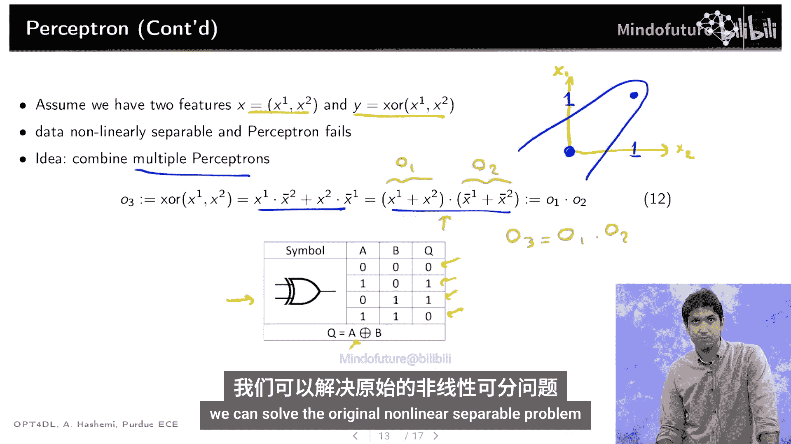

Okay。So this is basically， again， our our individual livinging rules， so。

Here we want to demonstrate that again， they individually are linear reseparable problems okay。

So let's try to， therefore。Plot them here again。 I'm gonna consider the， for all cases， the。

 the plane in given by x1 and x2， okay， so。Let's see。For each case。Will look like in this case。

 I have， sorry， I have all。1 or two。First here have x 1， x2， and the second here have x 1 bar。X2 bar。

So， the first case。Then x1 is1。And x 2 is。1 or one is gonna be one。 So I have a one here， let's say。

But if pole are 0， you have。0로。If first one is  one， Second one is 0。 I have  one。 So here I have a1。

 And then secondly， I have a 0 here。 So as you can see。Door linearly se， okay。

So let's also go over the second case。 So if both are1， then I have a0。 So I have a0 here。

 if both are0 and have a1。So there is the one here。If1 bar is1， an x2 bar is 0。

I have one here and then0 here。 So again， linear separate。

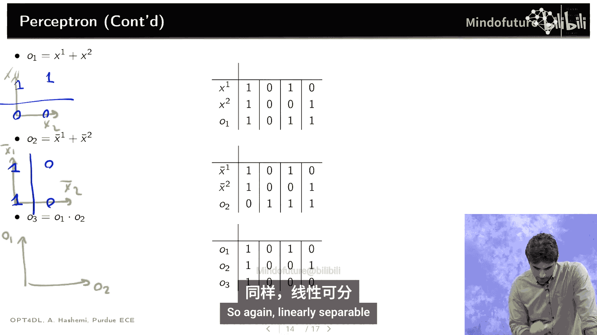

And finally， in this case， the last case， if both are one， I have one。Both are0。 I have zero。

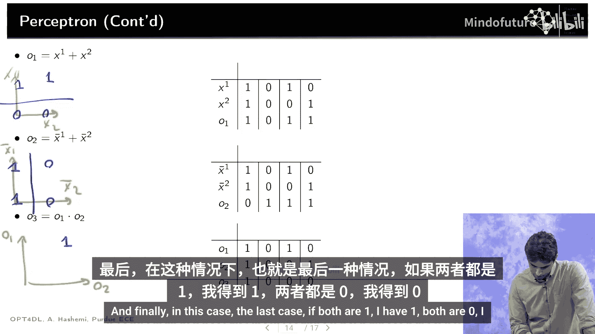

Then I have a1 here。 Then I have a0 here。那你跟。They are linearly separable。

 So I can use the perci to handle this case separately， but that's not enough。

 What I'm looking for is to basically handle the the the labor rule given by that X X or operator。

 So I have to combine the outcome of these individual percept to find a nonlinear classifier。

 or the original problem， which which entails nonlinearly separable data。

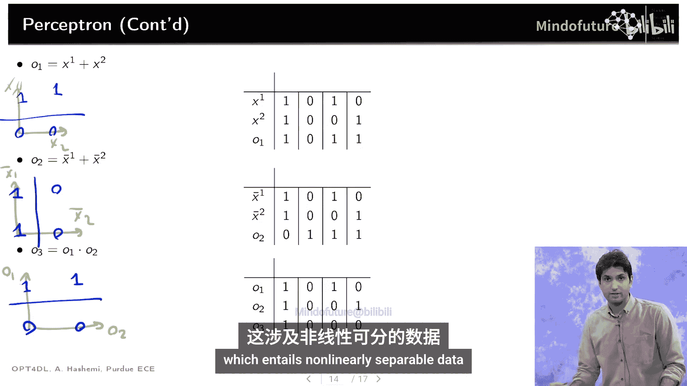

Okay。So therefore， as I mentioned， each rule can be learned by a single perceptron。

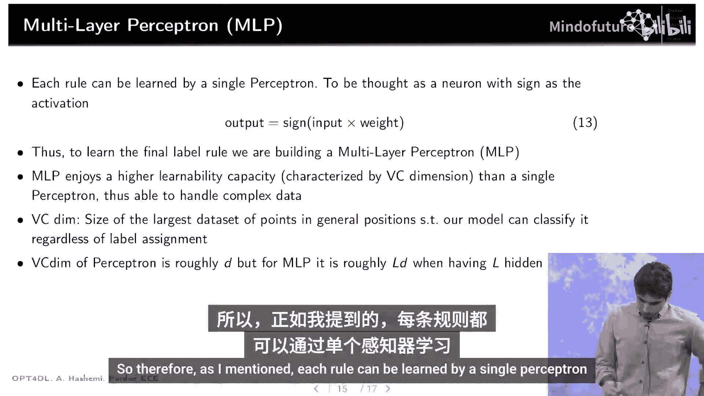

And again， we think of this pericron as essentially a neuron。With the sine activation function。

 because each one is looking at basically the the sign of the inner product between the feature and and the and its parameter W。

 And if the sign is， is positive， it's gonna return plus plus 1。 If the sign is negative。

 is's gonna return minus sign， okay。都。And as I mentioned to find the labor rule。

 we are basically combining these perciance， these neurons， if you will。

 with this sinus activation function。

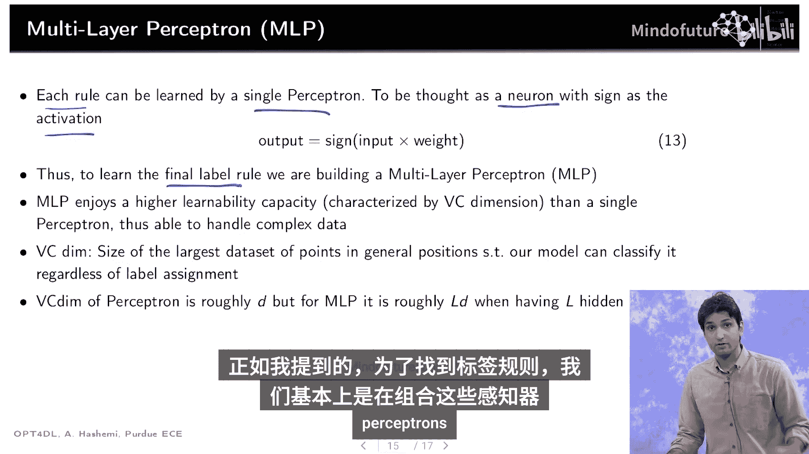

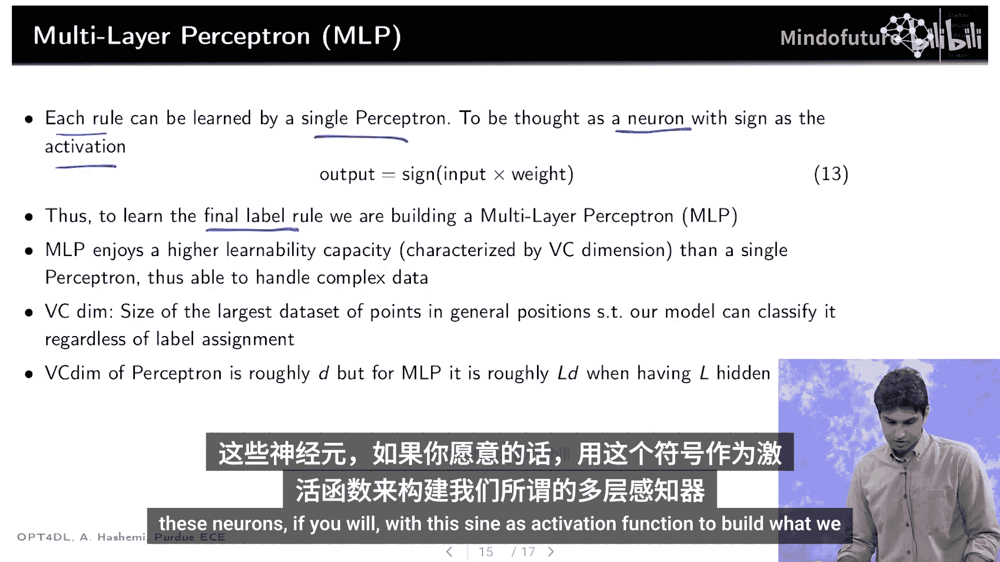

To build what we call a multilayer preciin。So， in particular。We have an input layer here。And then。

 we have。A hidden layer。And then finally， we have an output layer。

So this layer is actually new compared to our representation of linear regression and soft mice classifier。

 And we need it here to basically make sure that our model is capable of handling nonlinear data or linear separable classes。

Now， it is actually talk possible to talk about this in terms of increasing the learning capacity of our of our model。

 and we can actually formalize this this idea。 So MLPs multi perence lead to a higher learning capacity。

 and we can characterize this by a notion we call in a statistical learning theory V C dimension。

 okay。So what's V dimension。 It is not very important for us。

 but the main idea is that VC dimension is the size of the largest data set of points in general positions such that our model can classify。

 So for instance， in in R2， VC dimension of a linear model， such as perceptone is actually 3。

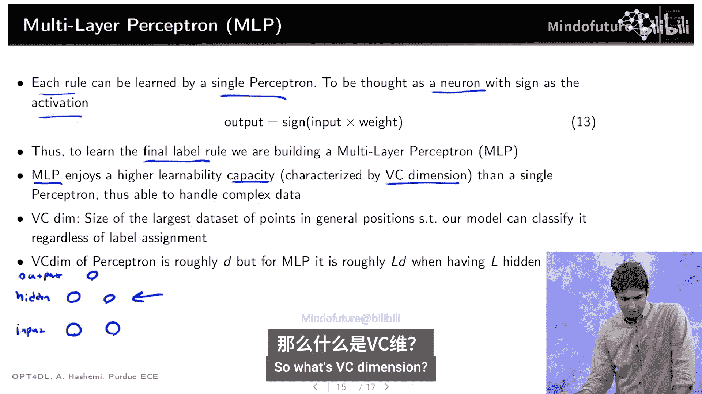

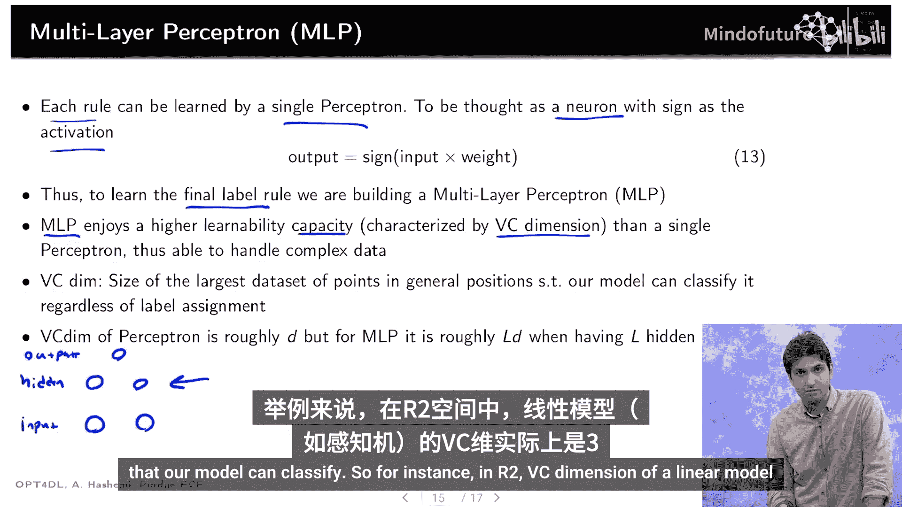

Because。If I give you any sort of labelings。Of three data points。You can classify each。Perfectly。

 right， and general position means that we should ignore the degenerate cases where， for instance。

 all the。

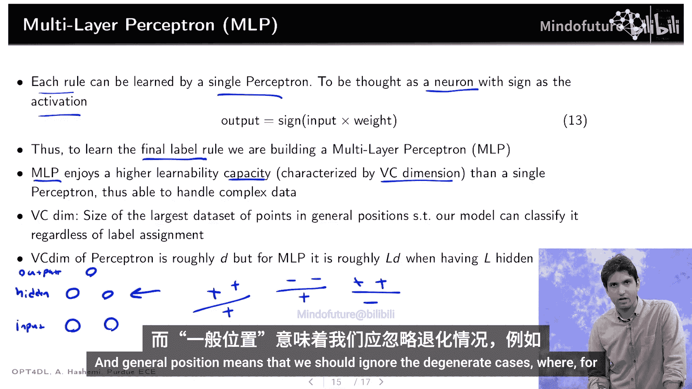

Plometerters， all the data points lie in in in one line。 Okay， so that's what it means。

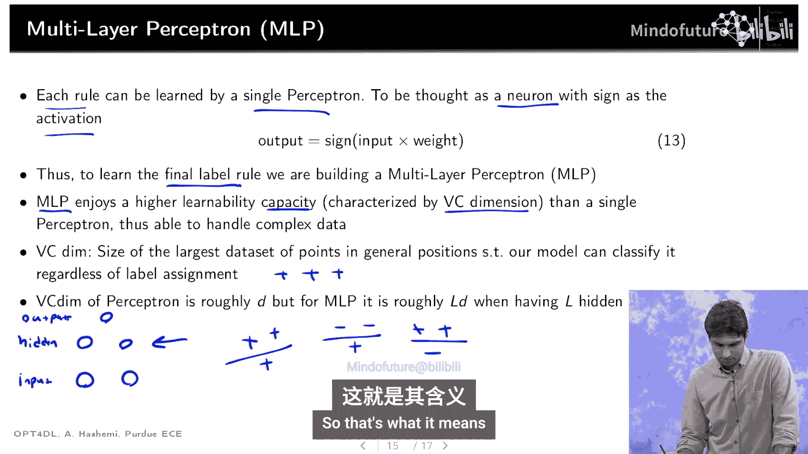

Now， it turns out that the VC dimension。Of the perciron is actually roughly D。 In particular。

 is D plus1。But for multi layerer percirons where we have hidden layers。

 let's assume that we have L hidden layers。The the V dimension is actually roughly L times the。

 So by adding these。Heidden layers。 We are increasing the V dimension of our function class。

 and that basically means that we are increasing the learning capability of our function class。

 So therefore， we should be able to handle more complex data。

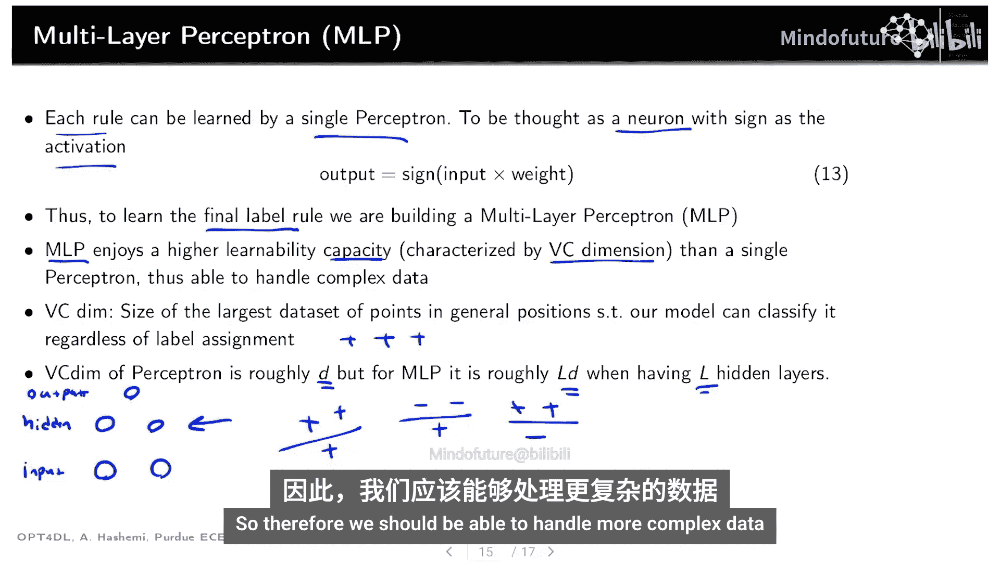

Alright， so we mentioned that perciin is actually like a like a neuron with the sign activation。

 Okay， and multi perciin is basically a combination of a bunch of these neurons in a specific way。

 Okay， now， because we want to use computational tools， such as gradientian based methods。

To optimize the parameters of a model， it turns out that the sign activation is not going be quite easy to deal with。

 So therefore， there's been a lot of research in the past few decades to。

 to find a good approximation to， to the activation。

And here I'm talking about basically three of these the most famous activation functions。 Okay。

 again， the idea is that we want to approximate if you will the the， Okay。

 so the first activation function is called the sigmoid activation。 Okay。

 it's given by this expression。 and the second one is the the tannage again T activation given by this expression。

 And finally， we have direct rectified linear unit， which is given by by this expression。 okay。

And here I'm， I'm showing how each one looks。 So， and again。

 you can compare this with the step or the sign activation here， okay。

Notice that all of these are nonlinear。 Okay， so all four of these activations are are nonlinear。

 and this is something very useful。 in particular， we're not approximating the sign with a linear activation。

 Okay， so we don't have， let's say， sigma of x equal to x。 We don't have anything like that。 Okay。

 and this is something I'm going to talk about in E minute。Now， amongs。呃。

We have observed empirical particular that radio actually is a lot more capable。

 It leads to more efficiency in computation and also more stability in training。 Okay。

 so that's why among these， I would say the radio activation and its extensions are are more popular。

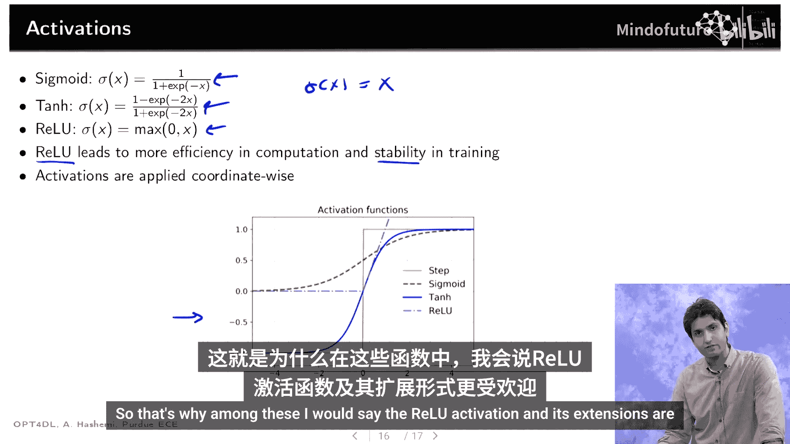

And finally， one remark here is that activations are applied coordinate advice。

 I mean that if x is an is a vector， for instance， if x is equal to 1，2，3。呃。Then呃。I apply the。

 the activation functions in a coordinate way such that if this is in R 3。The activation is also。

In R 3， Okay， the list list makes this to -1。So therefore， for instance， for the case of value。

 the activation of the value applied to x is basically nothing but。2，3。

 because these two are non negative。 and then -1 is is negative。 So therefore。

 I just replace it with 0。

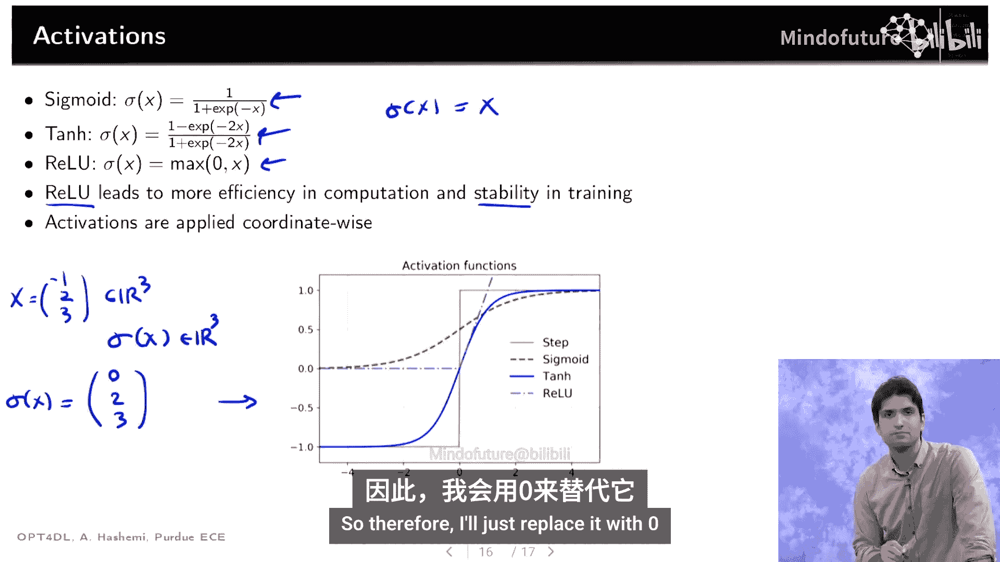

对。Alright， so I， I mentioned that we， we don't use linear activation to have approximately design activation。

 And the reason for that is that were， we， if we do so， we're gonna lose the。

 the increase in learning capability of our model。 Okay， so let's， let's see why that's the case。

Let's consider a scenario where we have two hidden layers in our multi layerer preceptron with linear activations。

 Okay， so in particular， let's say I have the input。 I multiply with W1， add some bios。

And then I don't apply any non nonlinear activation。

 therefore the output of the first hidden layer is H1， and then I feed it to the next hidden layer。

And that means that I'm multiplied with another weight matrix W2， add a Boos。

 and then I get my output H2。

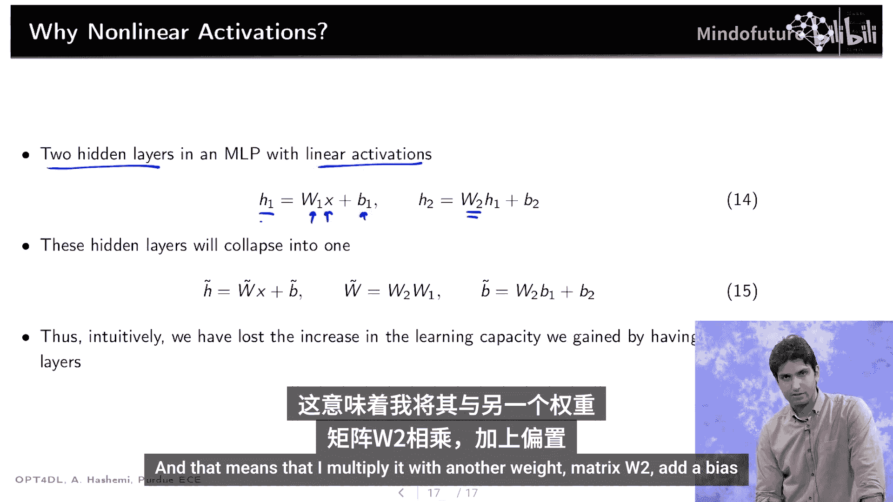

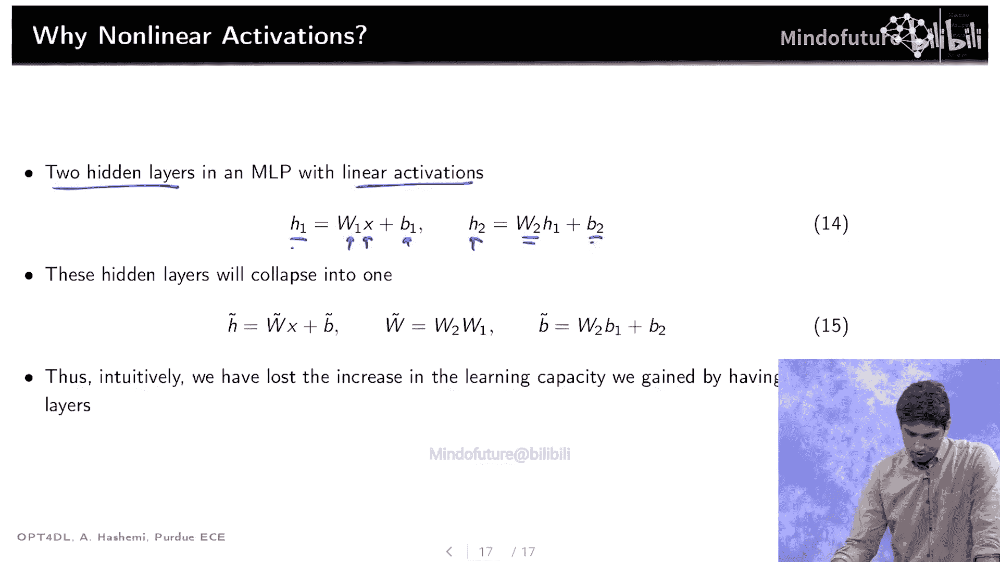

Now， it is actually very easy to see that these hidden layers will collapse into one。 Okay。

 so this model is actually equivalent to another model where I have only one hidden layer。

 I directly go from X。To， let's say， H T law with two。New parameters。

 W T law and B T law and W C and B T actually depend upon W 1 and W2。And B1 and B2， B2， as I'm。

 as I'm showing here。 Okay， so， so this is not desirable why。

 because we talked about the fact that increasing the， the。

 the hidden layers could increase the learning capability。 Okay。

 but if we use a linear activation function。Regardless of how many layers we have。

That's essentially a one layer。Multi layer press。 So we're not gonna be able to increase the learning capability by increasing the the layers of the model。

 Okay， so therefore， we， we we aim to avoid such scenarios。And to do that。

 we are going to always utilize nonlinear activation functions， such as radio。

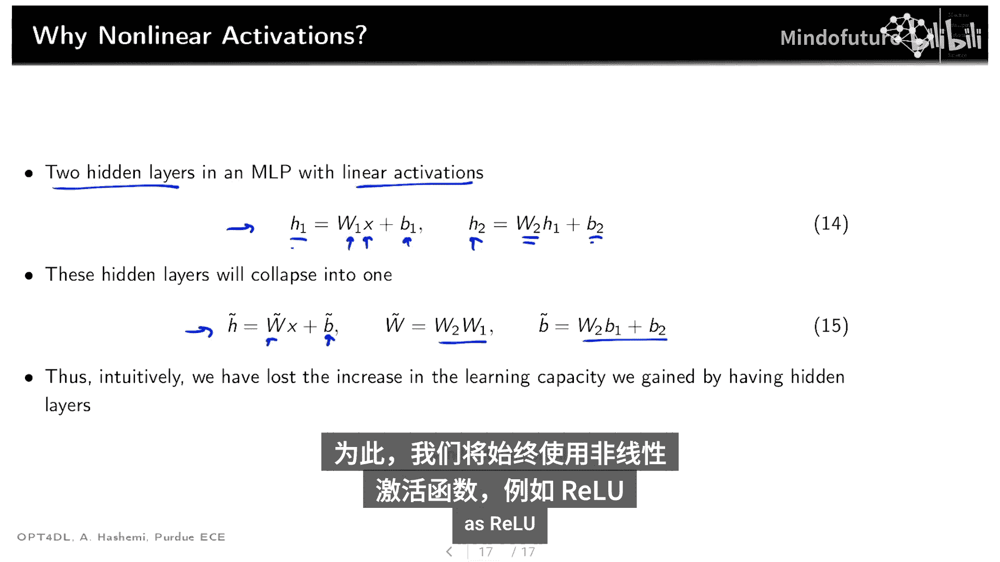

So that's basically a short introduction to perciproron and multi layer perciron in the next lectures。

 we're going to talk about some other architectures that we typically use in deep learning today。

And the main idea is that we want to have architectures that can handle different types of data。

 and also they can leverage structures that are very frequently present in the data。

I'll see you next year。