# 【普渡大学】深度学习中的优化 ｜ Optimization For Deep Learning ｜ Purdue University p17 P17_深度学习架构二_卷积神经网络1 -BV1tvzKBcEom_p17-

🎼，🎼Yeah。Welcome back。 So we were talking about deploying architectures to make sure we understand these black box models so that we can design very effective training methodss and training algorithms。

 We talked about multi layer preciron。 And today， we're going to talk about。

And other type of architectures， essentially convolution neural networks or CNNs。What's the idea。

 So the idea is that ML LP are useful， but they're not。

Very effective in terms of exploiting the relations that could exist in among the features。

 in particular， they are not very effective in in leveraging prior knowledge that we may have on a specific data type。

 Okay， for instance， images， right， So images have lots of structures。

 And two of them I'm gonna talk about in a minute， Okay， now， what's the implication。

 because they are not able to to leverage these kind of structures。

 We need very large MP to handle even basic tasks。And that is going to be problematic because we typically deal with。

Imput dimensions that are somewhat large， for instance。

If we are handling or pressing a1 megapixel image。We essentially have 10 to the。

 The dimension of the input is something like 10 to the 6， okay。Now， if I think of it as a vector。

And let's say that I want to proceed it with a multi layer perceptron， where I have a single。

A hidden layer with 100 neurons。

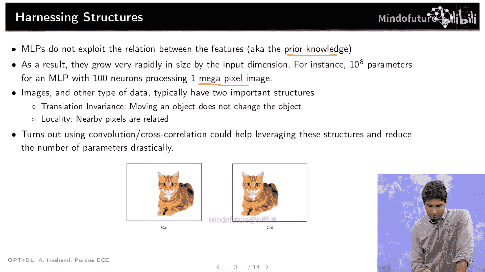

Then I need to basically learn 10 to the 8 parameters from data。 Okay。

 and this is a very huge number of parameters to learn。都。

What we want to do is to therefore come up with alternatives。

That can reduce the number of parameters drastically。

And still retain the same or even better learning capabilities while leveraging the structures in the data。

 Okay， so as I mentioned， images and other type of data have a lot of structures to a structures that I'm gonna talk about a little bit here to motivate CNNs are essentially translation invari and low quality。

 So translation variance means that if I move an object。

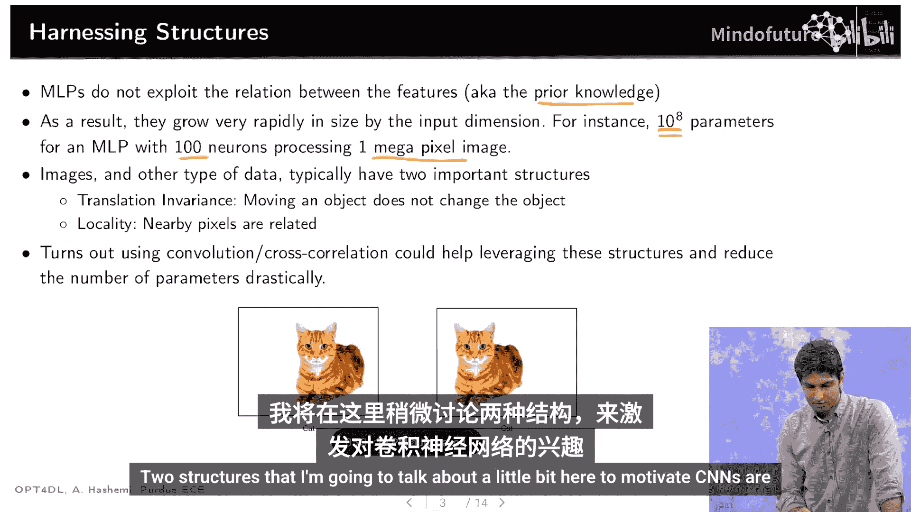

The object is still the same object is's not gonna change。 For instance says in this this image here。

 let's say you have an image of a cat on the right side。And then I move it to the left。 Okay。

 so it's a silly image of the same cat。 So the image doesn't change。 So therefore。

 if I want to learn a pattern。By changing the， the pattern is not going to change when I move it。

 Okay Its still the same pattern。Loocality basically says that nearby pixels or nearby features are are basically related。

 Okay， so for instance， if I look at this side。 So they， the the pixels here are。

 are related in terms of describing the ear of a cat， okay。So or or hear the eye the eye of a cat。

And this is something we want to basically leverage， as I mentioned， to reduce the number of。

L parameters of our neural network。And hopefully， also increase the learning power。It turns out。

That using convolution or cross correlation。As opposed to this linear product that we talked about before。

We can help leveraging these structures。 Therefore。

 we can reduce the number of parameters drastically while having the same or even a better learning performance。

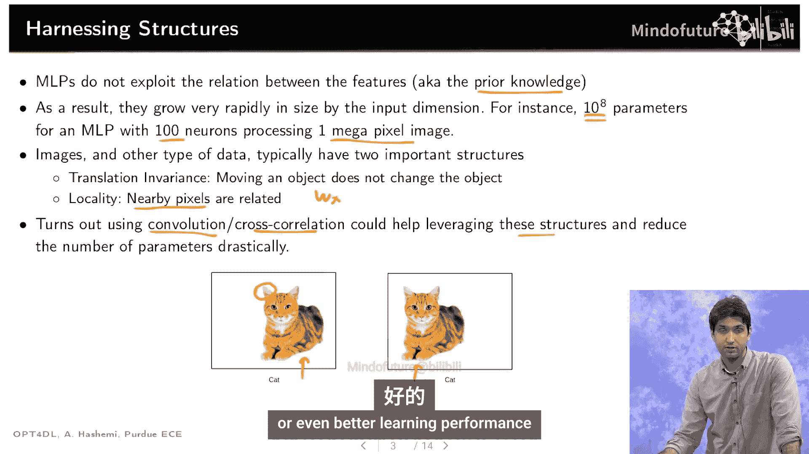

Rightor。So。Let's see how we can sort of observe why。

Convolution or cross correlation is the right solution here， okay。So let's again。

 go back to our linear sort of operation。 And let's take a look at the pre activation results。

 So for the time， I'm just ignoring the。The non nonlinear activation that we talked about。

So let's consider this quantity。 Okay， so again， this is in in vector form where in make this form is nothing but the。

 the product of s matrix W x。Plus， this vector B。 Okay， so you can， you can expand it。

And write it equivalent in this form。 Now， please bear with me。

 And I'm gonna do a change of variable。 So I'm going change this Js here to， let's say I plus k。

 So I'm talking about， let's say the， the I pre activation output。

So I'm going change J to O plus game。And therefore。

 I'm gonna change this sum to go instead of over J to go over to over K。 Okay， now。

 let's call this guy something else。 Okay， so I'm gonna call this omega I K。对。Now。

 it turns out that translation in variance。As we mentioned。

 employeess that a shift in the input should also lead to the same shift。In the output。

So in particular， if I have an image and I'm learning a pattern。 Okay， so let。

 let's say I'm learning edges。So the main goal of this activation。

 pre activationation here is to just learn the edge。So therefore。

 these two are going to help me to find an H or detect an H。So when I change the input。啊。

These two should still be able to find edge。 It's just that the location has changed。Right。

 so therefore。If their goal of this omega and b is to find N H。

 they should not depend on the specific location that I'm talking about。

 which location I'm talking about here， I'm talking about I so therefore， to get translation invari。

 I have to ensure that this omega and B are basically independent of this specific location I such that if I shift the input the shift is is actually transferred without any disruption to the output。

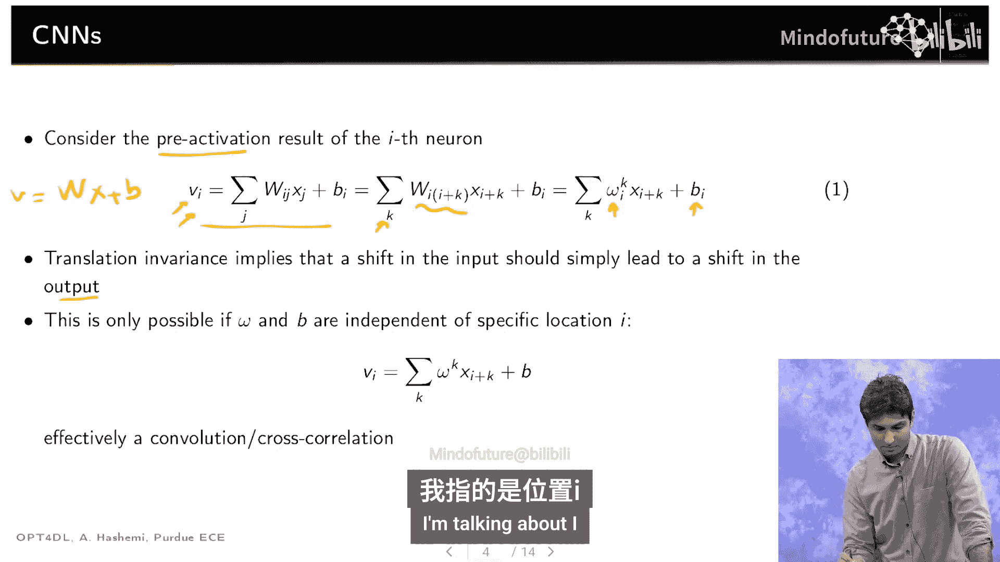

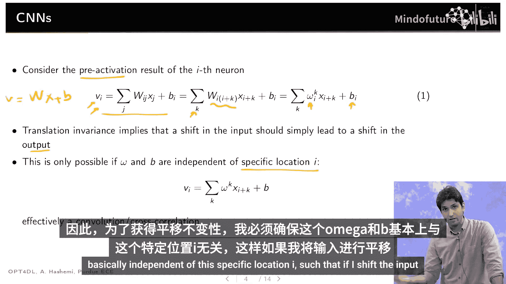

So therefore， this is the place we are making a change to our linear operation。 Okay。

 so were gonna to change it such that this omega and B are now independent of the location。

 And as you can clearly see with this change， we're gonna drastically reduce the number of parameters。

 okay。嗯。And what is this operation， This is basically called cross correlation。

So this is a cross correlation between。omega and sorry， omega and x。But for historical reason。

 in the context of deploy is called convolution。 Therefore。

 the neural networks that utilize this operation as opposed to linear operation we talked about before are called convolutional neural networks or CNNs。

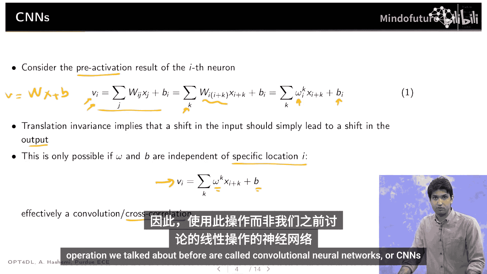

Allright， so let's go a couple of examples to， to make sure we understand this。Convolution operation。

 Okay， so let's consider a first， a very simple case where let's say we have an input X。

 which is 5 dimensional。And then let's see that the opo is three dimensional。Now。

 if we were to use our linear operator that we talked about before in the context of MLP。

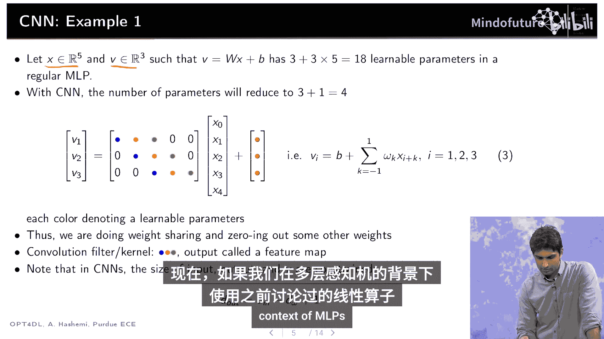

Such as this one。We're gonna have a total of 18 learnable parameters。 Y。

 because B is also 3 dimensional。 So I need to learn 3 parameters for B。

 W is gonna be 3 by 5 dimensionals to make sure that I can have a product of W and X。

 So W has 15 parameters。 So in total， I have to learn 18 parameters。

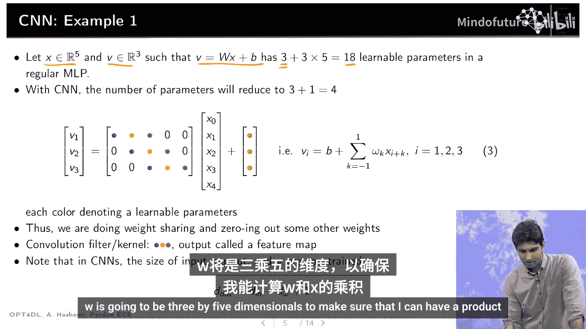

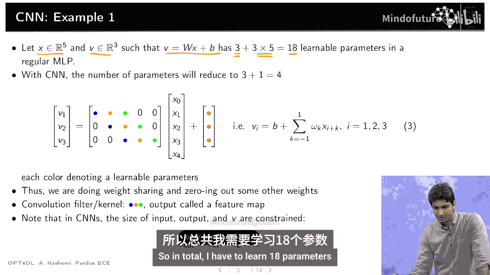

With CNN， it turns out of the parameters are actually reduced to only 3 plus one。

 which is equal to four parameters。 And the key idea is that we are doing some weight sharing， right。

 So we as we saw in the previous slide， be sure that the the weights and the bias don't depend on the specific location。

 So therefore， if we again represent them in this in this form， in this matrix form。

 there's going to be some structure。 Was this structure。 So here I'm showing that。

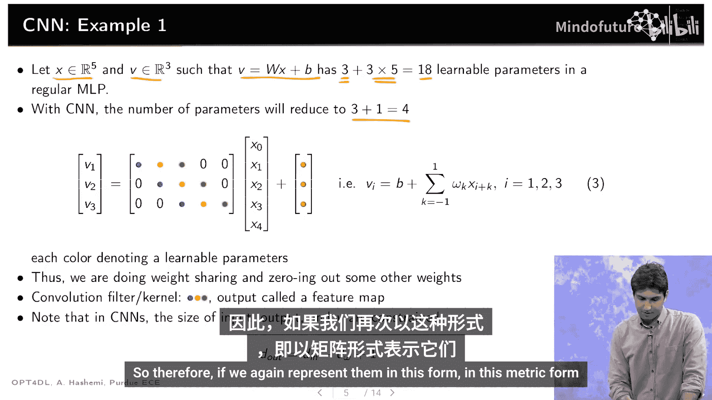

So in particular， let's first look at the the bias。 Okay。

 so all the coordinates of the bias are all going to be the same。 So in the in this figure here。

 each color is going to denote a learnable parameter。 Okay， so therefore。

 as a result of making sure we have transition invari。We're not going learn three parameters for B。

 We are only going to learn one parameter for B， but we are basically sharing that parameters across different locations。

 Okay， and we do the same a similar thing for the weight matrix w。 Okay， So in particular。

 we're gonna have this a structure。 So we are only going to learn these three parameters。

We're going to set these to be 0。 And then for the second row。

 we're gonna to shift shift the first row1 to1 to the right。 And then for the for the third row。

 we're gonna shift it twice to the right。 Okay， such that our weight metrics is going have this structure。

 Okay， only three learnmer parameters that are shared。And also。

 we are setting off certain parameters to to0 okay。Now， as I mentioned。

 this is basically a representation that tries to show the changes we are making compared to the linear model。

And it is best represented using the cross correlation operator， which is basically。Reten here again。

 Okay， so V I， the output， the I output is B， some， some parameter we want to learn。

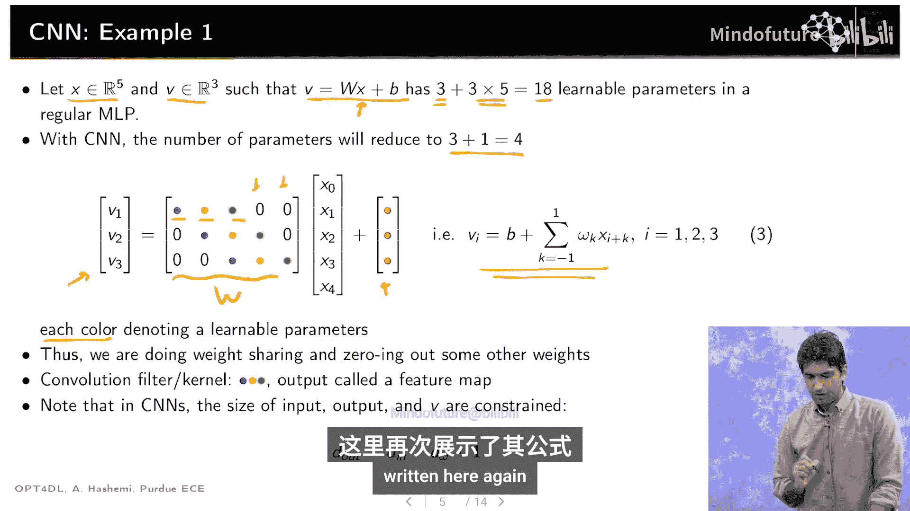

And it doesn't matter which oil I'm talking about， the first activation， the second or the third one。

Plus， the cross correlation between W， which is basically this part。And X，So。This part in particular。

 this part of the weight matrix。Is called in the literature the convolution filter or convolution kernel okay。

And in terms of another terminology， the output is actually sometimes called a feature map。嗯。

One important point here is that in CNN N， there is a constraint between the size of the input。

 the size of the output。And and omega。Ourre， our convolution kernelel。

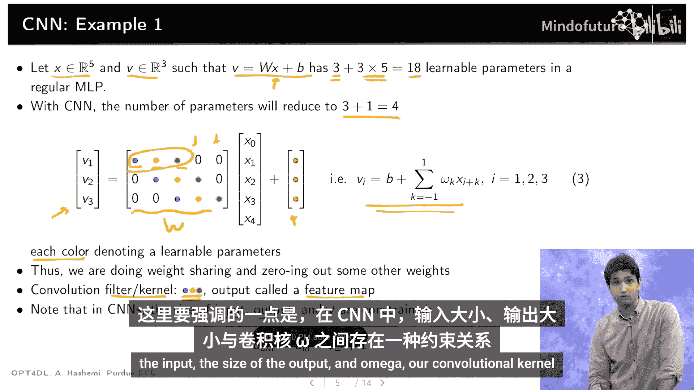

In particular， we're going to have this relation such that the output is actually the dimension of the output is the dimension of the input minus the size of the kernel plus 1 okay。

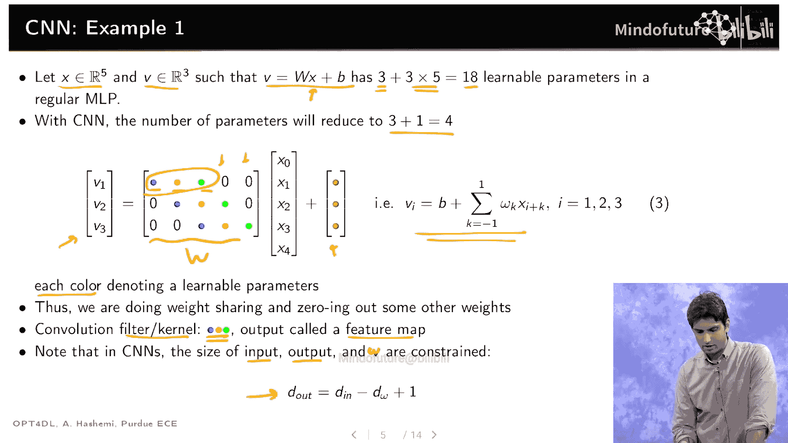

Now， this in some， ties our hands。And because we're going to lose some control。 Many times。

 the architectures are standardized， meaning that， for instance， W。

 the size of the kernelel is fixed。 something fixed。

So what this means therefore is that I'm not going have any control over the size of the output。

 So therefore， typically we're going to introduce some other operations。

 operations that I'm going to talk about next to gain a control on how fast or slow the size of the input size of the output changes。

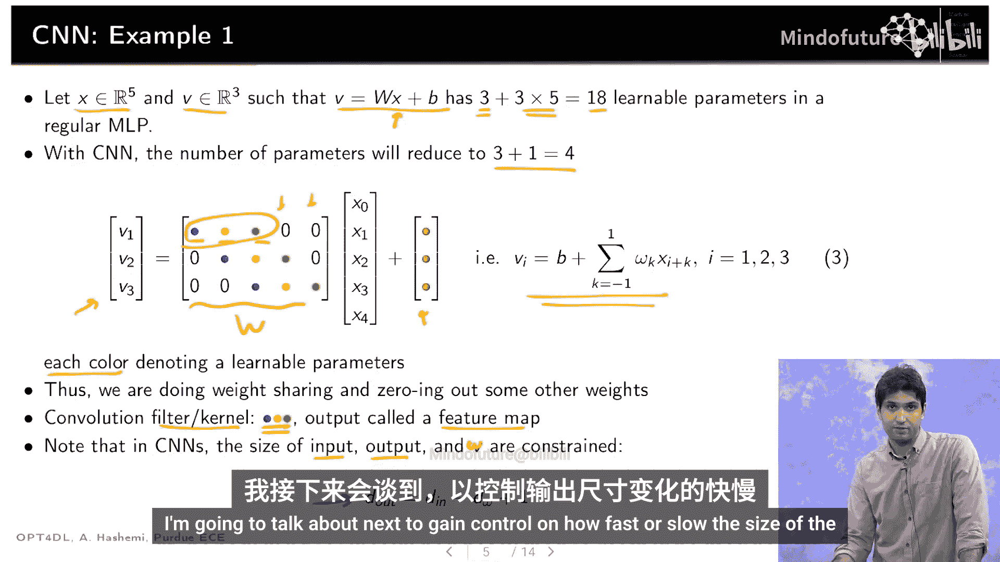

Before that， let's actually go over another example。

 So a two dimension example to see how we can calculate the， the convolution。 Okay。

 so let's imagine that this is my input。 And then I have my kernel here。

And I want to find the output。 It turns that the output is gonna be given by， by this matrix。

 Let's see how， how does' the case。Let's first， let's say that I want to calculate first the first。

Coordinate of the output。 So for to calculate the cross correlation。

 I'm going take this kernelel and then find this product with what I'm highlighting in blue， okay。

So to do that， therefore， I find a product of  zero。Time 0 plus。1 times 1。Lo。2 times 3 plus。

3 times 4。And this is gonna to be 19， exactly what I'm writing here。Now。

 when I want to find the second output。What I'm gonna do， I'm gonna shift。The kernel。

 Venom multi planee， I'm gonna shift shift it one time to the right。

 meaning that I'm gonna gonna to I'm now going to find the product of the kernel。And。

This part of the input。 Okay， so let's do that again。 So the product is gonna be 0 times1。

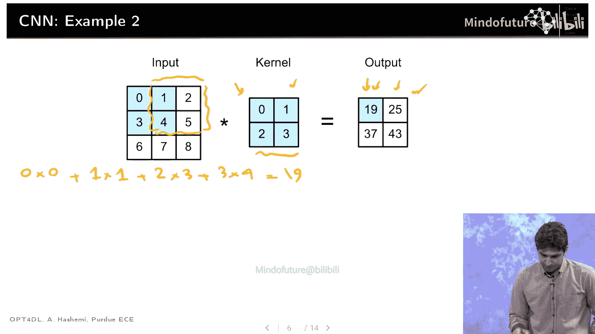

Plus， two times 1。Plus， four times 2 plus  five times 3。And the answer is 25， okay。

So that's basically how we can calculate the first row for the second row。

 we shift the the kernel actually below by one。Unit， okay， by one location。So we shifted basically。

Llow by one location。 and then we can find this guy。 and then to calculate the remaining coordinate。

 we shifted one time to the to the left。

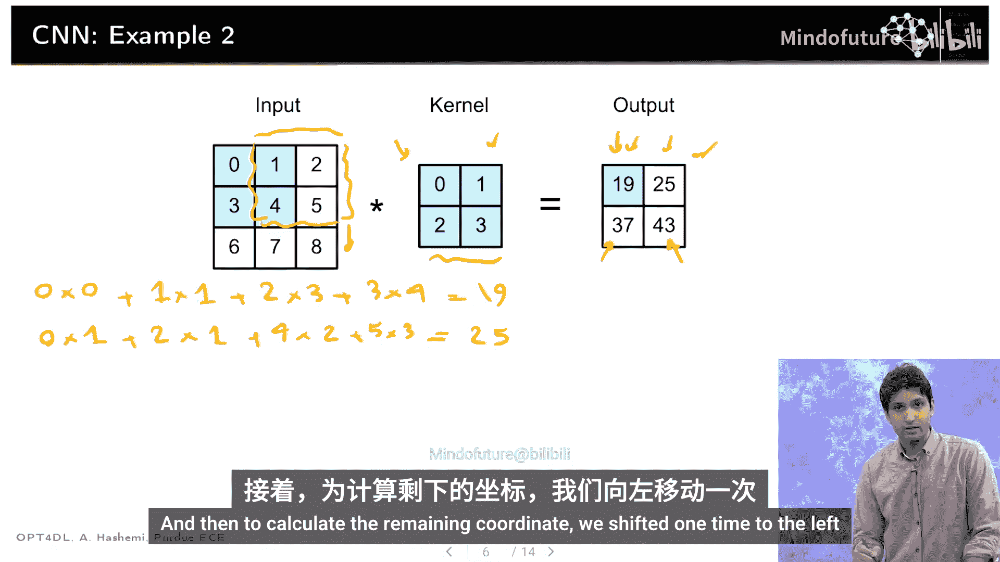

Okay， and then we'll be able to calculate this 77。

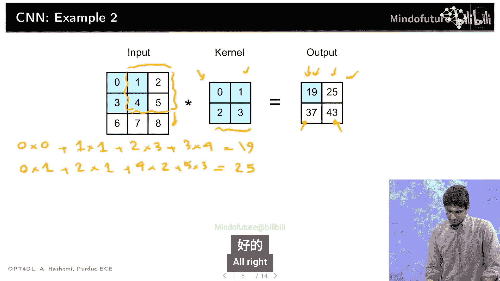

All right。So。As I mentioned， the basically CNN helps us to。

Or the convolution operator helps us to leverage the translation invari property。 Okay。

 another property of the the， the data is typically locality。

Meaning that information relevant to the I output are are typically localized。 Okay， so therefore。

 we can leverage this to even reduce the number of parameters even further。 Okay， in particular。

 previously， we said that this is our cross correlation operator where the range of these sums are typically of the order of the data。

 Let's say I have like， like can 10 to the 6。Dim of input， like one megapixel image。Therefore。

 the range of this sum is going to be something of like 106。 so it's going to be like a large storm。

But we can limit the range。Thanks to this locality property of the data。

 And this is what we do in practice。 We limit the range to something like Delta。

 where Delta does not necessarily grow with the size of the input。 In particular， Delta is O of one。

 basically constant。In practice， Delta is like an odd number。 Let's say 3，5，7，9。

 And we're gonna talk about bio that case， which means that the size of the kernel is two delta plus1。

 Okay， so in the first example， you mentioned basically， Delta was equal to one。 Therefore。

 the size of the kernel was two times 1 plus1， which is3。 Okay。

 so that's why we had those three colors。 represent your convolution filter。All right。

 so this is basically the ultimate operation we use to make sure that we are taking advantage of both the local as well as the translation variance property。

One drawback， as I mentioned， is that。We are losing some control over the size of the output。

 and we want to gain this control back。 Therefore， we got to supplement this operation by some additional operations。

 in particular， padding and str。 So what padding。 So the it is actually quite simple。

 It just me what you do， you add some zeros around the original， let's say input。 Okay。

 so if this was my original input。I had some zeros around it， okay。

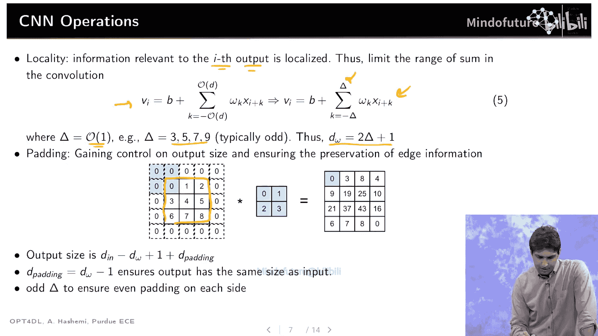

Now， this is gonna give me some control over the size of the output because it's not very difficult to。

 to， to show that the size of the output is gonna be what we had before。Plus。

 the number of zeros that you're like the， the width of the zeros that you're adding。To。And on， the。

And on the original input。Also， it's going to ensure that we are preserving edgeging information。

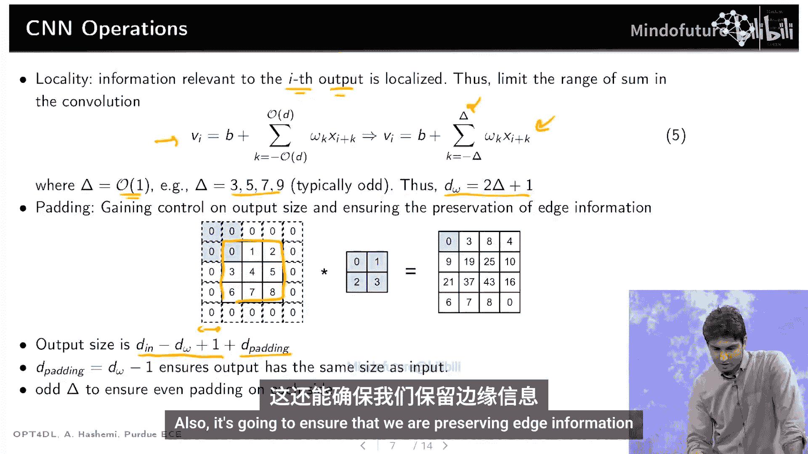

Okay， so if I don't add these zeros。I'm going to process this information here on the top left corner this0 only。

 let's say once。 Okay， But if I in introduce padding， I'm going to process a few more times。

Therefore， my model should be able to again， learn patterns that could lie around the edges of a the same image okay。

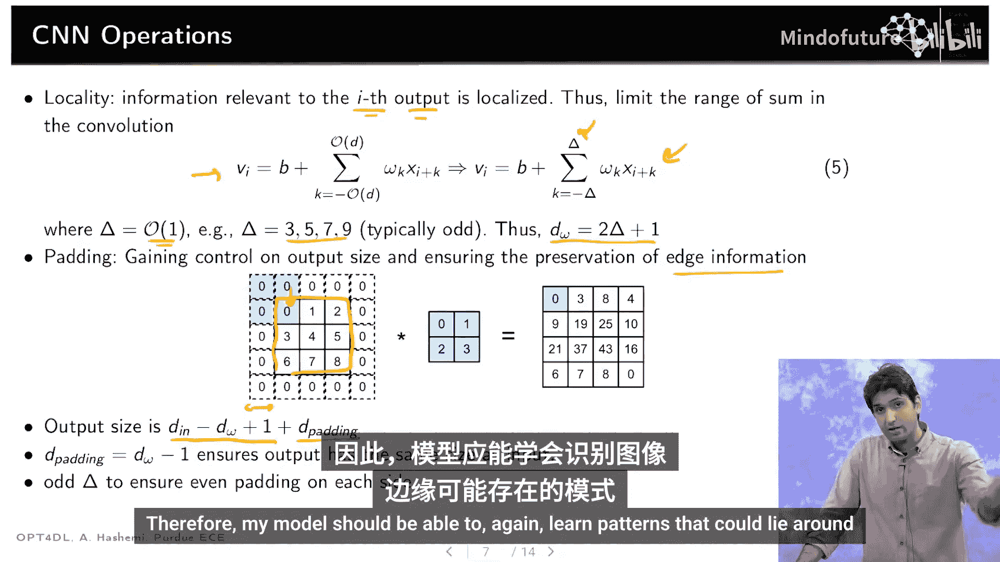

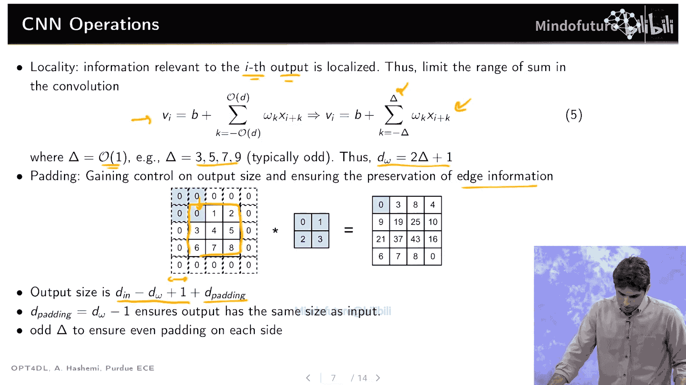

And yeah， this example， you can actually， again using our following using our previous example。

 you can， you can tackle it to show that the outcome of the。

Paded input with this convolution filter is gonna be。Something like this。 And as you can see。

We now have a larger。Output， okay， and that's thanks to adding this the zeros around the image okay。

Now。It is desirable to make sure that we have like the same number of zeros on the left side and the same number of zeros on the right side and same for the top and bottom。

 right。Therefore， we're gonna basically want to have an even number of like zeros， right。

 So if we want this D padding to be an even number。

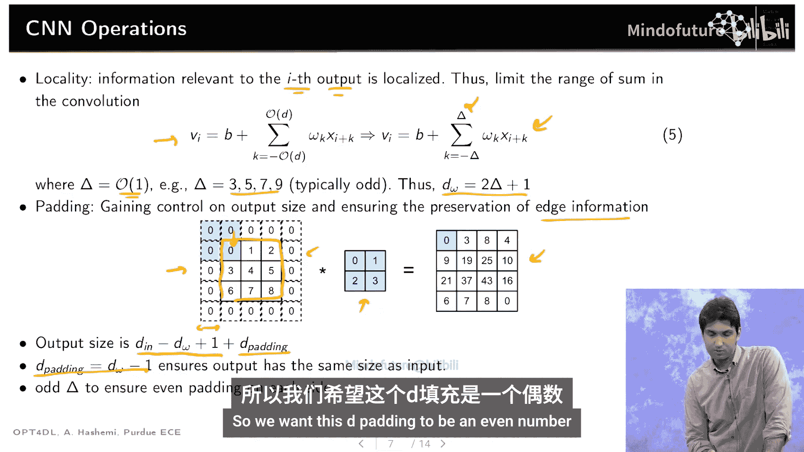

That why in practice， this DW， the size of the filter。

 the convolution filter is actually typically an odd number。

To ensure that the padding is an even number。 And we have。

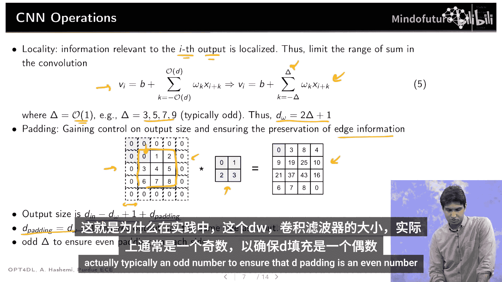

We have， sorry， I'm talking about Delta here。 So Delta is actually an odd number to ensure that we have an even padding on each side。

 And also， sometimes we want the output to have the same size and input。 So we。

 if you said this to be。

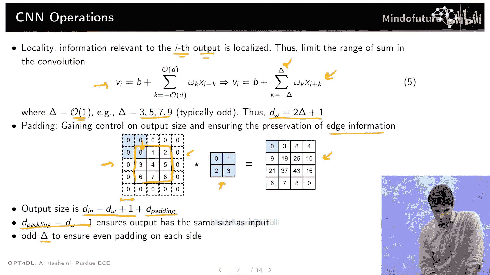

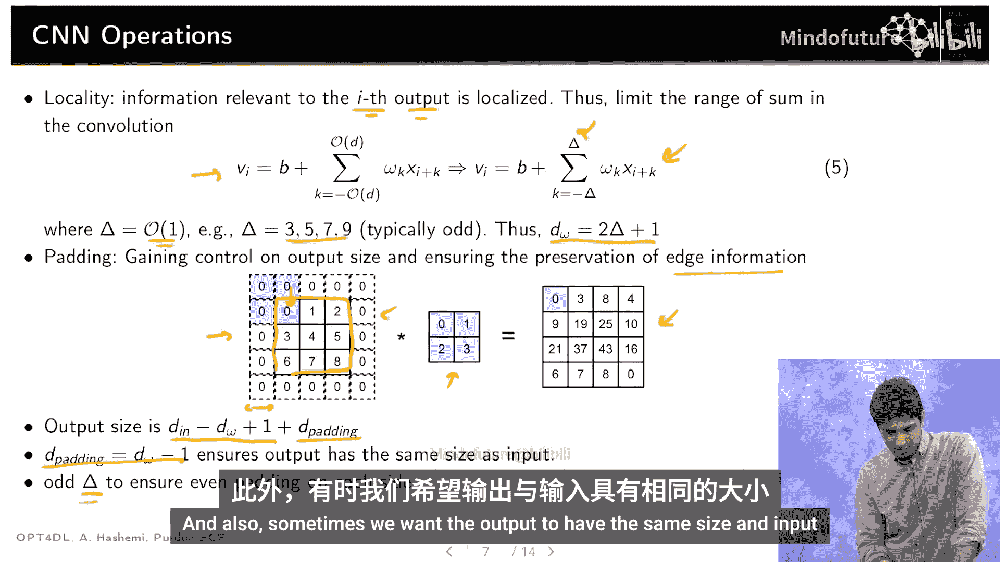

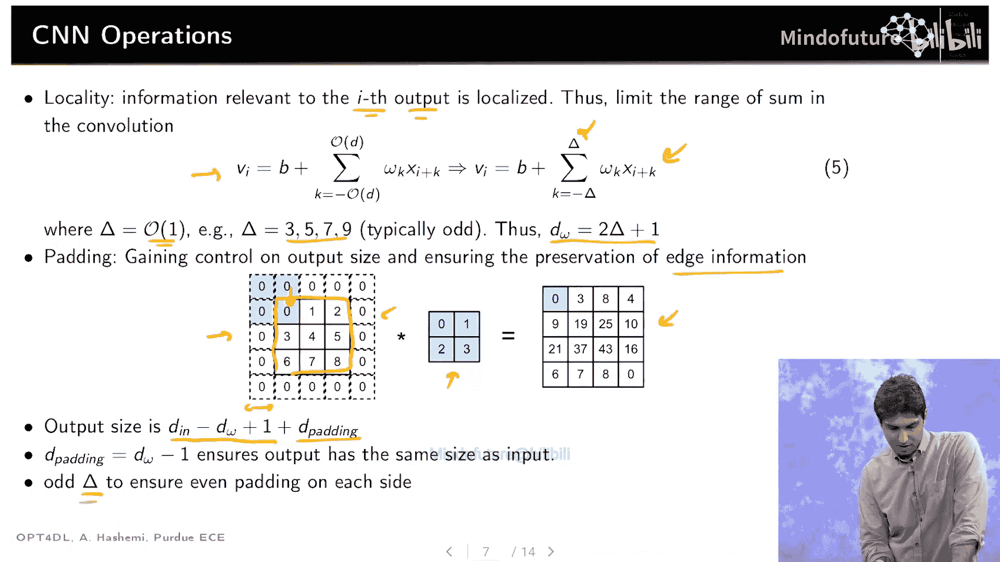

De。We can find that to to ensure the output and input have the same。 So is D pad is equal to D W-1。

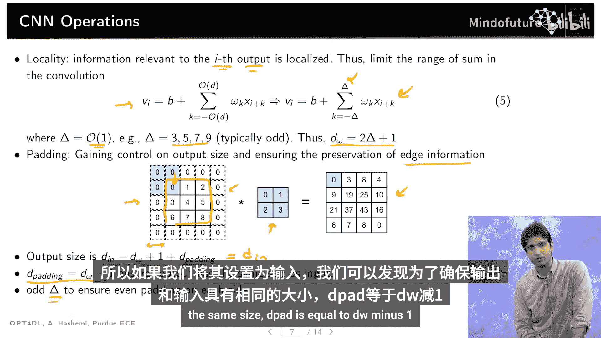

Right， so， so padding therefore helps us to retain the information in the edge of an image and also gain control on how fast the output size shrinks。

 So the more padding we have， the the slower the output size is gonna shrink。

 And even we can we can preserve the size of the， the output。 Okay， the sliding on the other hand。

 provides a more aggressive。Reduction in the soil of the output。

And the way to do that is to basically shift the kernel by more than one location。Okay。

 so previously， you're shifting one to the right or one to the bottom。When you have a string。

 let's say with parameter D sub S， you shift the kernel D sub S location to the right or d sub S location to the bottom。

 Okay， and therefore， as a result， we're gonna have a smaller output compared to the previous cases。

It turns out that you can actually find a relationship between the the sliding parameter。

 the padding parameter and the the size of the cur。

 So the size of the output is going to be given by this expression。And as we are increasing the S。

 therefore， we are increasing this term denominator， and we we are shrinking the size of the output。

 okay。Alright， so one final operation I want to talk about here is basically the max and average pulling。

So the idea is， again， to have an approach that performs down sampling reduces the size of the the process input。

In a way that is parameter free， Okay， and we also want to make sure that while we are done sampling。

 we are retaining useful and representative information， okay。So therefore。

 we're going to perform max or average pudding。 So how is it going to work。So essentially。

 let's say that I have a2 by2 max pulling。 as I'm showing here。

 I'm going to look at this part of the input。

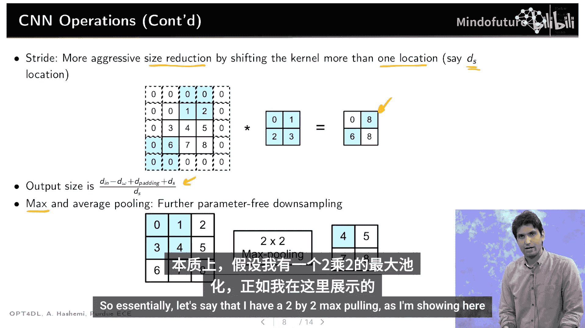

Okay。

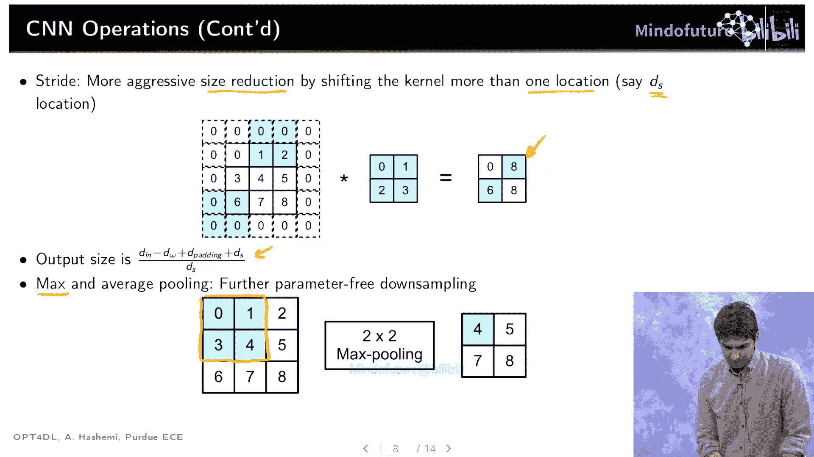

And in this case， I'm gonna see， So I'm gonna to look at this because I'm talking about the 2 by2 max pullinging。

 So therefore， I look at the two by twos part of the input。

And then here I'm gonna perform down sampling by only retaining。The pixel， if you will。

 or or the part of the input that has the highest value。 In this case， the highest value is 4 okay。

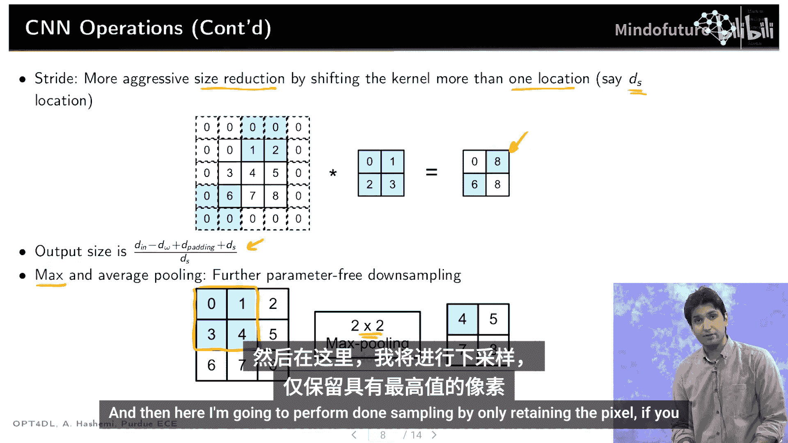

Now， I'm going to shift one to the right。

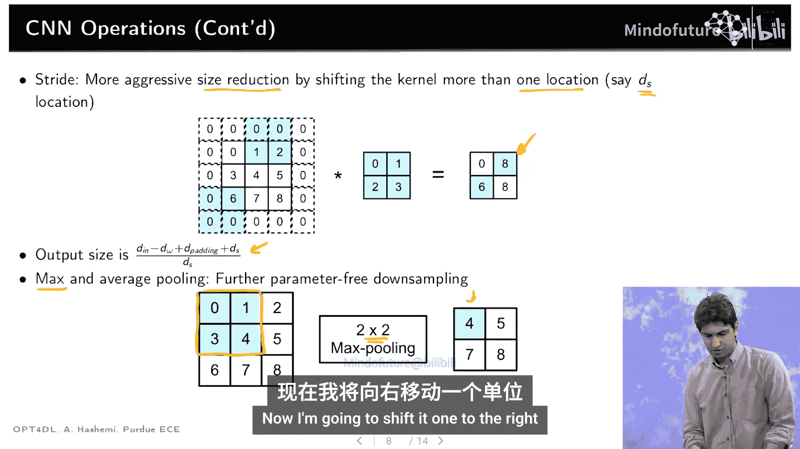

And then I'm gonna， again， find the。The part of the input that has the highest。

Vue in this 2 by 2 segment。 And in that case， the， the value is 5。

 So I'm going to write 5 as the output。 and I'm gonna to repeat the same。

 let's say for the for the other 2 by 2 segments。So this segment。Dot is gonna be 7。

7 is the largest number， And finally。This segment， the output is going to be 8。

 because8 is the largest number。So that's max pullinging。 again。

 the idea is that if you associate this with the scores and the higher the score。

 the the more informative that that part of the input is。

We want to make sure that our presentation is such that it retains the most informative part of the input。

 okay。

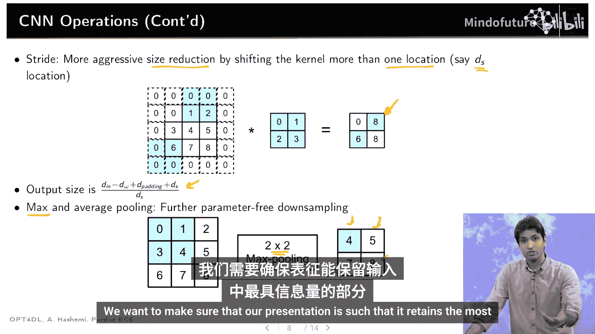

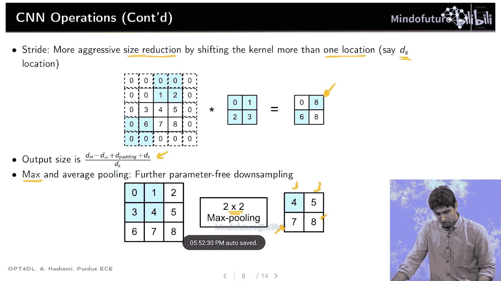

You can characterize this definitely but say that I want to preserve like some global information。

 therefore， instead of max pullinging， you may do average pullinging。An average pulling。

 for instance， requires us to replace this 4， which was the highest value with the average value in this segment。

 was the average value is 0 plus 1 plus 3。Plus 4。Divided by4。

 because I'm talking about it like a two by two average pudding。 So I have four。For scores here。

 And this is 2。 So in average pullingdding， therefore， we're gonna replace this for bit2。W it。

There you go。 So this this is basically the the the main idea behind convolution or neural networks。

 Again， the idea is that we want to leverage translation variance and locality and we can use cross correlation or convolution operator while limiting the range to make sure that we。

 we leverage both of these properties and drastic we reduce the number of parameters。

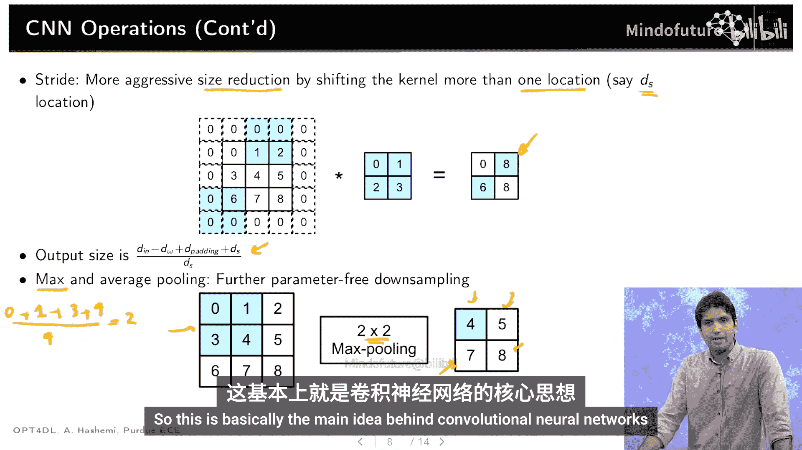

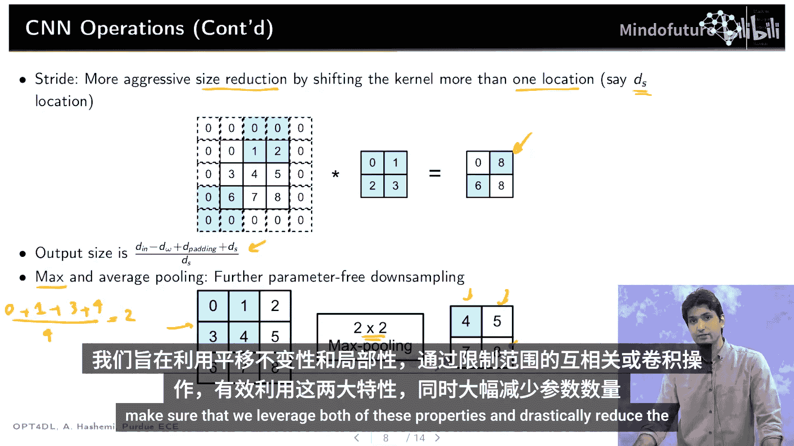

Now， there are other operations that we typically also utilize， as I mentioned， sting。

 padding and max pullinging。 And the main idea is that we want to gain some control over how fast or slow we are changing the size of the inputs。

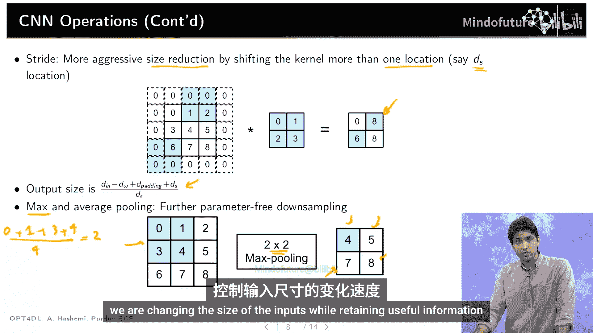

W retaining useful information。

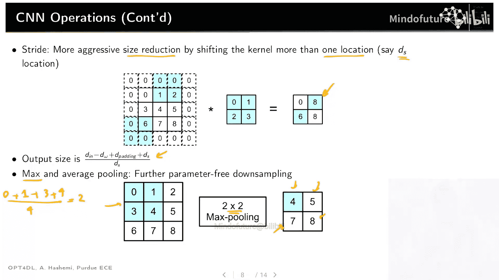

In the next lecture， I'm going to talk a little bit about some famous CNN architectures。

And we're going to talk about another modification that we。

 we typically make to make these kind of architectures even more powerful。I'll see you next time。

