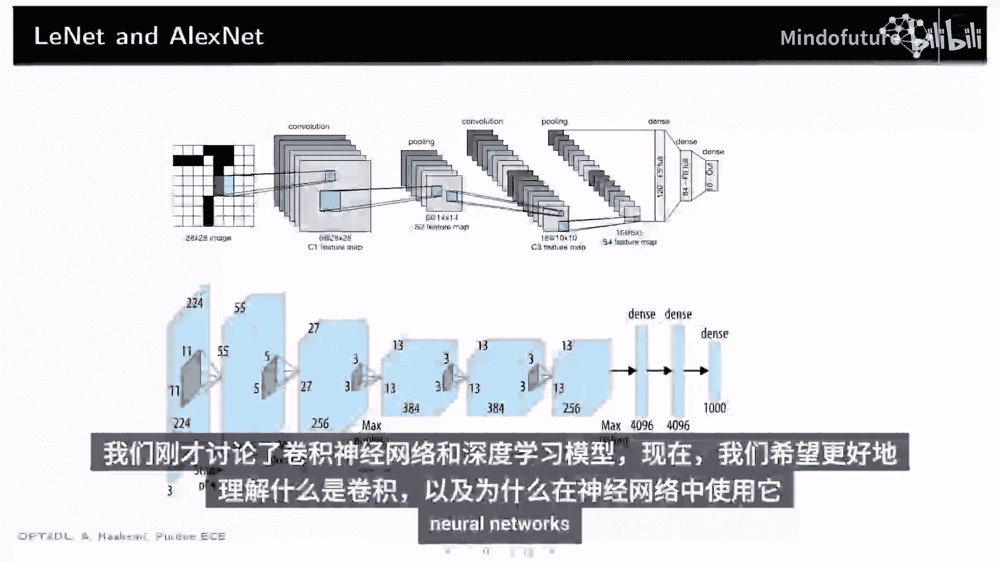
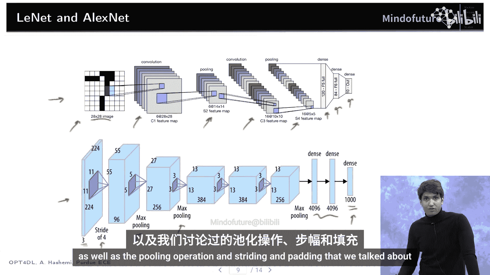
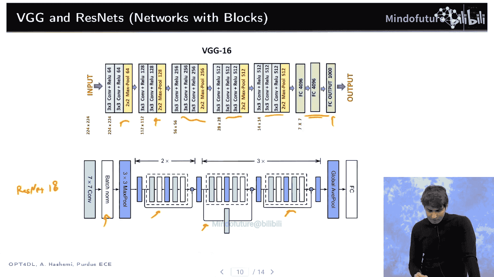
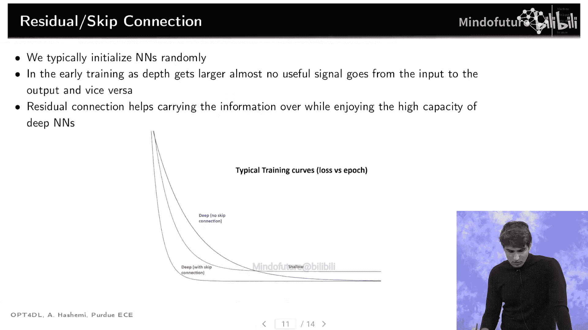
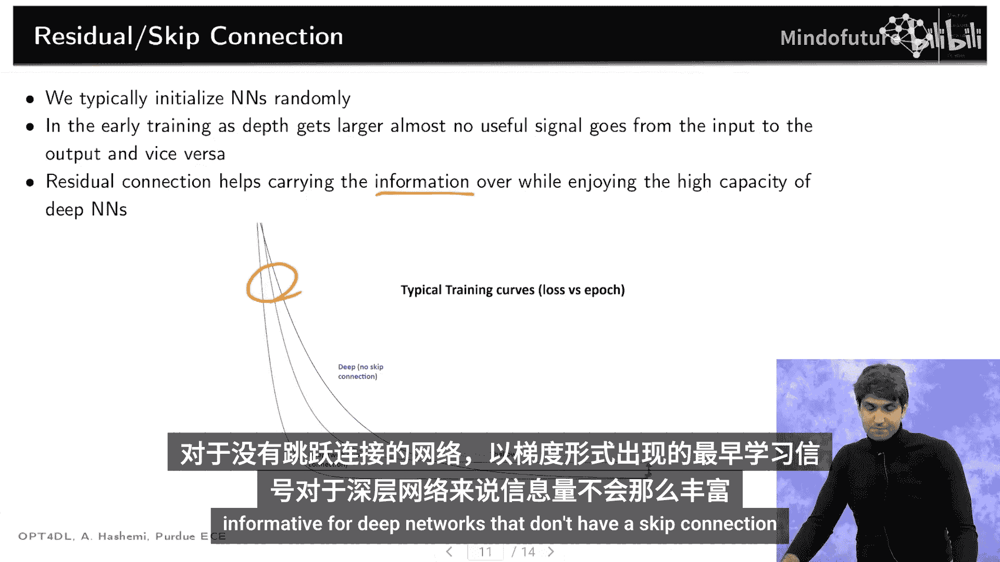
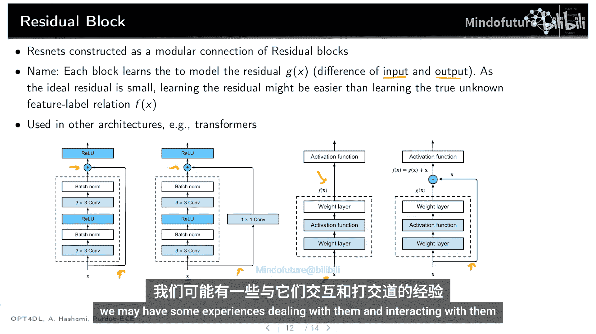
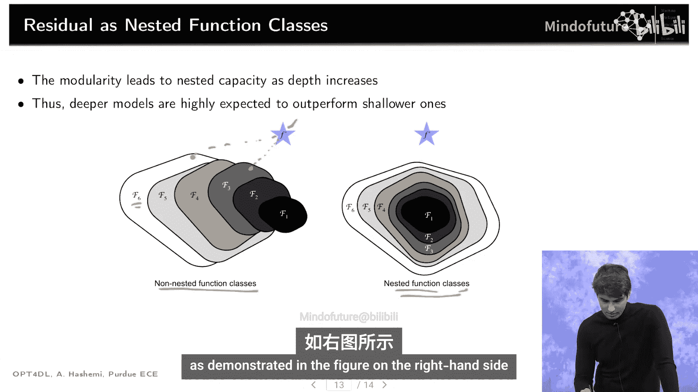
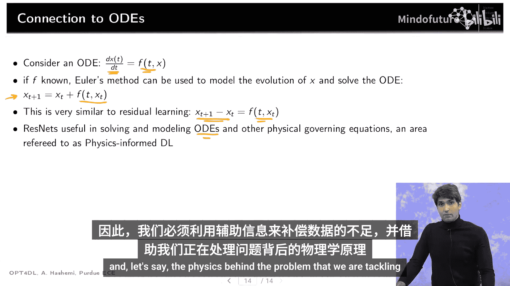

# 【普渡大学】深度学习中的优化 ｜ Optimization For Deep Learning ｜ Purdue University p18 P18_深度学习架构二_卷积神经网络2 -BV1tvzKBcEom_p18-

🎼，🎼Yeah。Welcome back。 So we were talking about CNN deploylaring models。

 and now hopefully we have a better understanding of what convolution is and why we use it in in the context of neural networks。

So here in this short lecture， I just want to talk about some examples of CNN architectures and also see why we may need to also incorporate another modification in these kind of architectures。

 Allright， So the first model I want to talk a little bit about is the perhaps the the first example of a CNN model。

 and that's called lean is name after per you only call one of the influial figure in in deploying a machine learning。

 So this model is built to classify images for a data that's called Ems。

 That's a data set of grayscale images of 28 by 28 pixels。About digits， right， So digits from 0 to 9。

 right， And the goal is to classify these images。 So the network has a bunch of layers。

 So we have basically a convolution layer。 We have a pulling layer。 Again。

 this is followed by a convolution and a pulling layer。 Finally， we have a number of dense layer。

 So these are basically the multilayer perci that we talked about。 And finally。

 the output is basically a layer with 10 neurons。 So this is to say that we are basically dealing with the classification problem with 10 classes right and the output。

 again， the dimension is 28 by 28， because we have an image of size 28 by 28。Okay。

 so the next model is called Alexnet that was proposed in 2012。

 And this is another example of a CNN model but spill to sort of tackle a different data。

 the image innet data there we have RGB images。 So our object is essentially3 dimensional。

 So the number of channel is 3， and each image is of size 224 by 224。

 So that's the total number of pixels。 and we have 1000 classes。 Okay， so what's Alexnet again。

 it performs CNN。 so convolutional filters with max pullinging。

 So we have a straight the4 here and as you can see。

 we gradually reduce the size of the the image as we progress。

So we have the the first CNN layer is followed by a max pullinging Again CNN max pullinging and we repeat this process。

 And finally， we implement a couple of dense layers。 And then we have the output layers。 Okay。

 so most of these models are a combination of CNNs and dense models。

 as well as the pooling operation and astroing and padding that we talked about。

Alright， so designing new architectures is going be cumbersome。

 So one design principle is blocks and modularity。 So it is therefore desirable to have to design blocks that we can therefore repeat and build deeper and deeper neural networks。

 So here I'm providing two examples that follow this principle。

 The first one is called the VGG 16 model。 This is again。

 a model that' is designed to tackle the imagenet data set。 So so here as you can see。

 we have a bunch of blocks that are a combination of convolution and max pullinging。

 and then we repeat this these blocks these blocks。 Okay so this called' a first block。

 Second block and again， we have another block of like again a slightly different block。

 but still it includes。Convolution layers with the radio activation， as well as max pullinging。

 We repeated a couple of more times。 And then we， we follow these convolution layers with fully connected layers and。

 and build the output layer。 Again， the output layer is1 1000 dimensional because we have a classification problem with 1000 classes。

 okay。And the next model is called resnet。16。30018。And again。

 you can see that we have blocks and the model sort of repeats this block a couple of times in this architecture。

But。There are some， some new concepts here。 So there is one block or like one operation that's called batchsh normalization。

 We will talk about this in the in the in the next lectures， but。The。

 the point that I want to make here is that compared to all the previous architectures where there was only a single path from the input to the output。

 So the information could only flow from， from the single path here in Resnet， that's not the case。

 We have these， if you will a steep connections。 So one connection here， another one here。

 another one here。 right， So that provides multiple path for the input to go from the input layer to to the output layer。

And this is shown to be quite an influential change。To make to， to。

 to enable building deeper and deeper neural networks that can potentially perform better than the existing models at a time。

 Okay， so I want to talk a little bit about the， the importance of the skip connection。

Right， so the idea is based on some empirical observation we've had when training shallow neural networks and deep neural networks。

 Okay， so and the empirical observation that we had is that we expect the deep networks to perform better than the shallow ones in terms of both training and test error。

 and this is indeed an observation that we've made。 So， so here， as you can see。

 there is this gap between the final performance of a shallow neural network and a deep neural network。

 However， what we have observed is that early on in the training process the shallow network can make。

Progress faster than a deep network。 Okay now， this could be attributed to the fact that we typically initialize the models at random。

 And and this is something we are going to talk about in the future lectures。

 Now one implication of random initialization is that early on in the training。

 when we have we are processinging an input。 And again。

 the input is going to provide useful information for us to learn patterns from the data。

 The input gets multiplied by， let's say， these weights， the are random。

 And as the model gets deeper and deeper， we are multiplying the original informative signal with a lot of random quantities。

 So intuitively， as the data is processed the kind of the signal that we see towards the end of the network is highly noisy and highly random。

 and。May not have an adequate correlation with the original input or original features。 Okay。

 so therefore this might mean that we're not going be able to make progress fast early on。

 because the wavess are random， we don't have like a various strong signal early on。

 But as the model is updated。 And as the weights are moving away from random ways and and essentially or optimize to learn the pattern from data。

 Then we expect that again，The final signal at the output layer has high correlation with the input and also given that our model is deep。

We have a very high learning capability。 Therefore， we'll be able to not only fit the data well。

 but also identify generalizable patterns and therefore improve the test performance as well。

 now the idea behind the residual connection or connection is to make sure we can carry out information over from the input side to the output side while still enjoying the high capacity of the neural networks。

 right， So we want to make sure that we are building this connection such that the original the input。

 the informative signal， has another path to find its way back to the to the output。

 Okay and a similar statement could also be made for for the gradient， because typically。

 as we're going to talk about， the gradient is calculated using the back propagation algorithm。

 So not only we process the information in the forward direction。

 we also process in the backward direction。 So。Early on the training to calculate the gradient。

 we have to process the， let's say， some data from in the back direction。 Again。

 we are multiplying quantities with noise with a lot of noisy quantities。

 and therefore the early learning signal in the form of the gradient is not going to be as informative for deep networks that don't have skip connection。

All right。So resnet architecture is basically constructed as a modular connection of residual blocks so here I'm showing the residual connection。

 So these are the skip or the residual connection and each of these is basically one residual block。

 so on the left hand side I'm showing two versions of a residual block one version you basically directly connect the input to the output of the block and then you perform let's say some concatenation okay。

On the other hand， you may optionally。Perform a convolution operation。

Before concatenating the input to the output of the residual block。Now， why the name。

 why this particular name and the name comes on the fact that the model is trying to learn the residual。

 Basically， the difference between the input and output of a residual block So and this is different than the fit forward neural networks without any skip connections where we we essentially are trying to learn the relationships or the labor rule that characterize is the relation between the input and the output。

 So the idea is that learning the residual could be simpler why because the idea residual is a small。

So learning a small quantities is intuitively easier than learning large quantities。 Okay。

 so therefore， by adding this a connection， we may be able to improve the learning capability of the model。

Now this another important point to make here is that this skip connection is actually used not only in construction of residual networks。

 but also other architectures， for instance， transformers。

That are perhaps one of the most famous architectures these days that are basically the building the like of all of these large language models that we may have some experiences dealing with them and interacting with them。

Now， there is also another intuitive explanation of why residual connection could be helpful in terms of not only access in the learning。

 but also improving the test and training accuracy。

The idea is that this modularity in in residual networks leads to a nested capacity。

 So as we are adding more and more to the， to the depths of the network， we are guaranteed to。

Enlargeging the capacity of the network in a in a way that。The deeper network is guaranteed to。

Be always better than the smaller network。 So essentially， without connections。

 or if you are talking about a non nested function class。

As we are increasing the the depth of the network， we， again。

 intuitive expect the capacity to increase， but it's not guaranteed that the。

 the best model inside a large class is going to have， let's say， the the best。

Performance compared to， to a smaller class。 For instance， let's say。

 let's consider this larger neural network。 So this this， you can imagine to be， to represent。

 for instance， all。MLP of with 10 layers， okay。Now， let's say that if I were to optimize it。

 I would find a function here。 So， so this would be， let's say my optimal model another。

 And if I consider a smaller display MLP architecture。Let's say MP is with 5。Layers then optimizing。

 I'm going to， let's say find a model here。 Now， let's imagine that the true label law is this a start point。

 right， So it could be。That the optimal5 layer M LP is gonna perform better。

Than the optimal and by optimal， I mean the solution to the empiricalismization problem。

 the optimal10 layer ML LP， okay。However， when we are adding these escape connections and building a residual error for based on these residual blocks。

 we are sort of ensuring that we have this nest function class。Therefore， if the， let's say。

 the best model is therefore， as we are increasing the the the depth of a model。

 we are increasing the capacity， but also， we are making sure that the optimal of the optimal。

 deeper model is going to perform better than the optimal shadower model。

As demonstrated in the figure on the right hand side。

All right。Now one other nice thing about the residual networks is that they have a very immediate connection to differential equations。

So let's consider an ordinary differential equation。

 That's essentially the derivative of x with respect to。

 let's say time is some function of x and time。 Okay。

 now one approach from simple approach to solve these kind of differential equations is the oiler method essentially will distize the equation。

And try to find in the solution in an iterative approach using an iterative approach， okay。

So the idea is， therefore， that we're going to form the following update。 X T plus1 is X T。

 So this difference is essentially the discritization of the derivative plus。F at T and X T。 Okay。

 now， if we do some rearranging， you'll notice that this difference is essentially， again。

 like the residual is equal to F at T and X T。 Okay。

 So so therefore we we see this disconnect here that that the F is basically our residual。

 So in re we are trying to learn the residual。 So therefore we can leverage residual networks for solving and discovering governing equations described by less differential equations。

 Okay， so therefore residual networks have been shown to be very useful in solving and modeling O these。

 as well as other physical governing equations。 So this area is an activity area of research。

 which is called the physics inform the learning or machine learning。

 And the idea is that when we want to use this datad approaches。ForFor physical data。

 we can leverage some side knowledge。To perform without。

Having access to a large number of data sets or a large dataset set。

And the idea is that in lot of scientific applications and scientific discovery applications。

 we don't have access to large datas as we do in other domains such as computer vision and national language processing。

 therefore we have to compensate the lack of data by leveraging site information and let's say the physics behind the problem that we are tackling。

So therefore， this is a very brief overview of some of the famous coal neural networks。

 notably residual network。 in the next lecture， we're going to talk about a different kind of architectures name the recurrent neural networks that are designed to deal with data of sequences。

 I'll see next time。