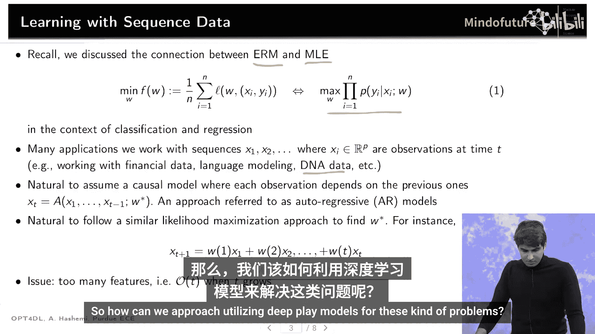
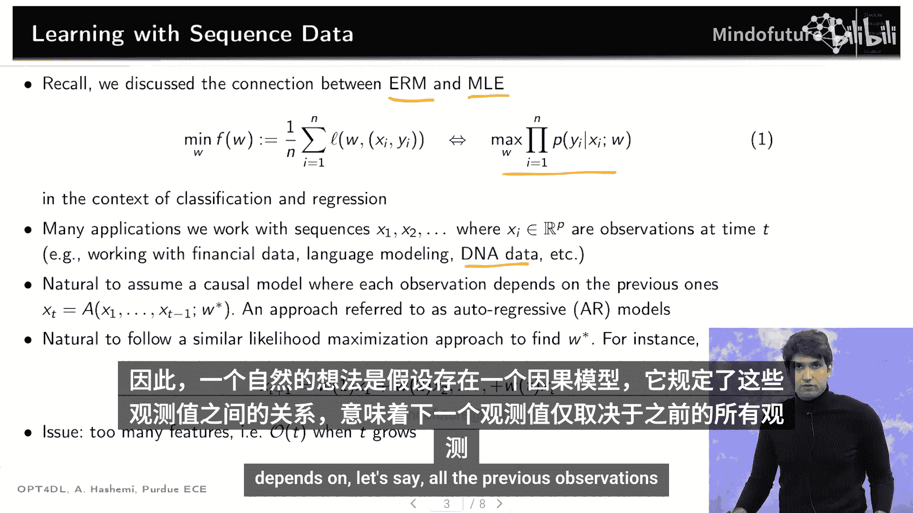
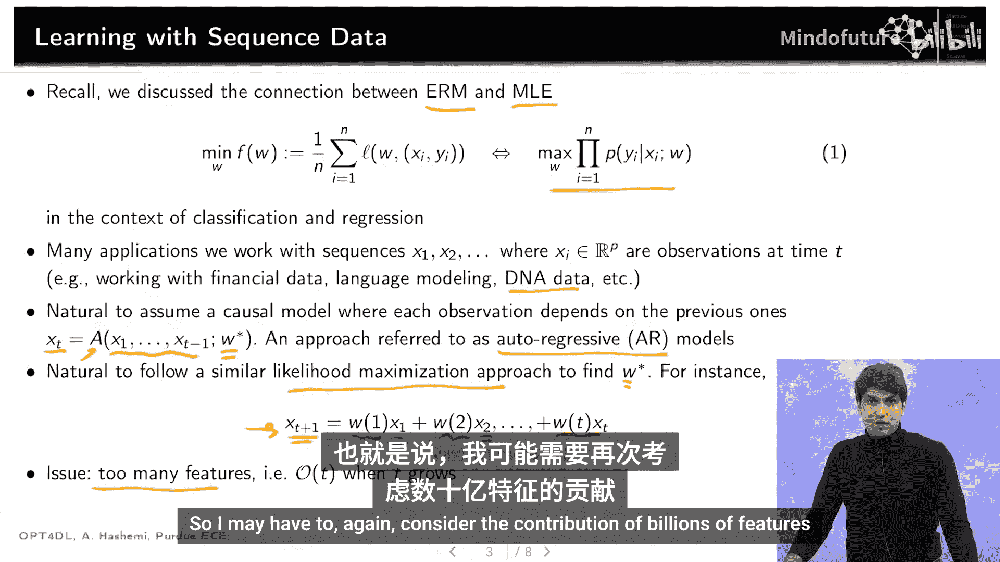
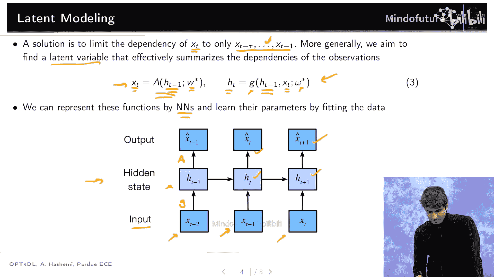
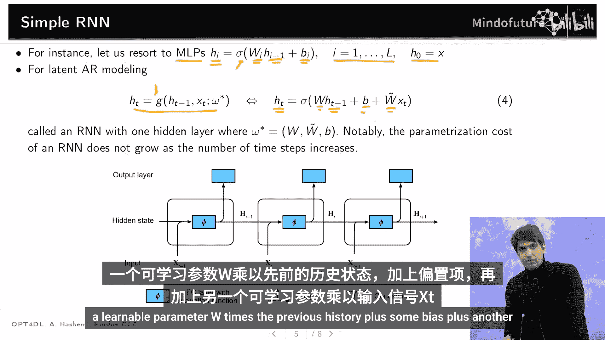
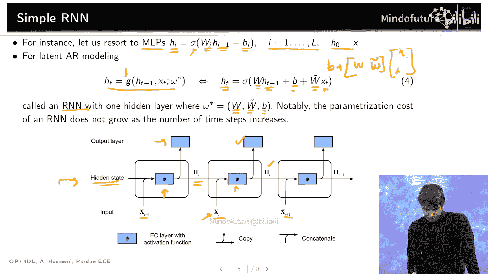
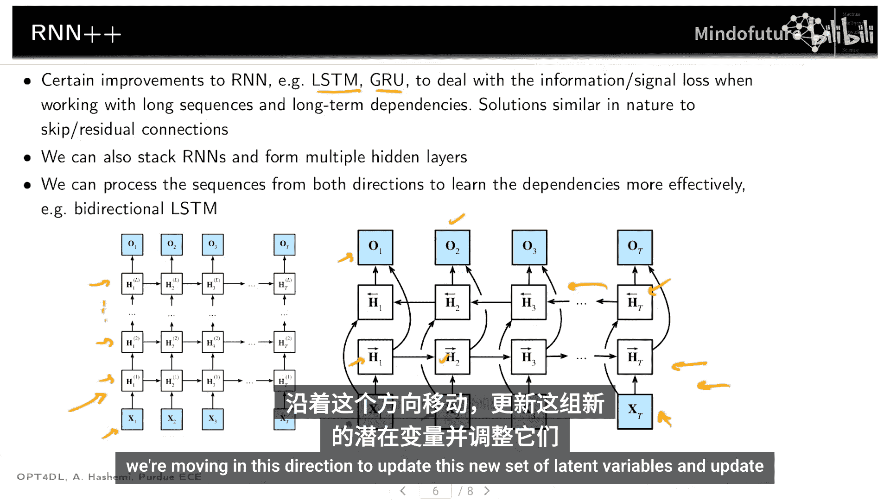
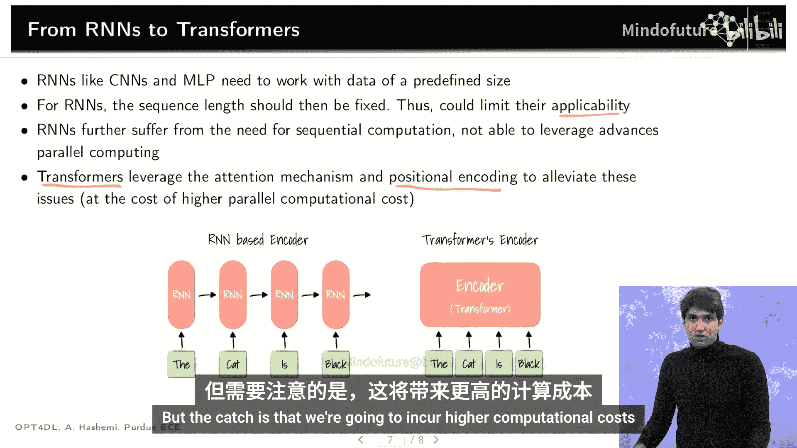
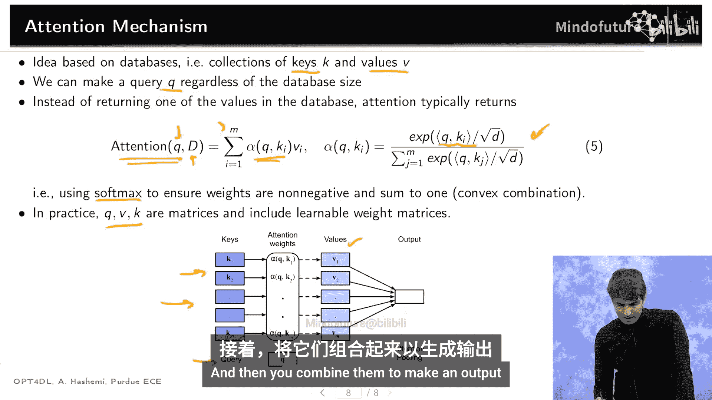

# 【普渡大学】深度学习中的优化 ｜ Optimization For Deep Learning ｜ Purdue University p19 P19_深度学习架构三_循环神经网络 -BV1tvzKBcEom_p19-

Welcome back。 So in this lecture we want to talk very briefly about another type of deep architectures and that's reren neural networks。

😊，So far， we basically discussed the connection between empirical risk minimization and maximum would estimation。

 So what we said was that。In the context of for classification and regression。Our training task。

 basically finding a model that minimizes the average loss over the training data。

Is equivalent to maximizing the luxury of the data， okay。

Now we discussed this in the context of classification and regression。

 meaning that I have a pairs of let's say x and ys where x are features and ys are label。 Okay。

 but in many applications， we are dealing with sequences。 Okay。

 so let's say I have observation at time 1， observation at time two， time 3， etc ce。

 and the goal is to let's say given a set of observation。

 predict what the next observation would be and this is very frequent in practice， for instance。

 in scenario where we work with financial data in language modeling and also like when you work with sequence of nuleized。

 basically DNA data。So how can we approach utilizing deploy models for these kind of problems？ Okay。

 so one natural idea is to， to assume that there is a causal model。 Okay。

 that dictates the relationship between these observations。

 meaningan that the next observation only depends on all， let's say all the previous observations。

 Okay， so X T only depends on all observations from time 1 to time T -1， okay。

So in particular， we can imagine that for any time T X T。

 that say the function could be a highly nonlinear function of all the previous observation。

When our function is parametric， so it depends on some parametermetric W star。So， so you see。

 hopefully where I'm going。 Let's say that a is some， I don't know MLP or something like that。

 It has certain parameter。 If we have access to let's say its like a data of this time series。

Maybe we can leverage like like a training algorithm to minimize the empirical risk or a problem similar to that。

 find this W， or therefore for any time we'd be able to make a good prediction of what the next observation would be。

This approach is actually referred to as the autoregressive models。Now。

 how can we basically again make progress here。 So the idea is that we want to utilize parametermeized functions to represent this。

 let's say， highly nonlinear relationship， okay， so。And therefore。

 we'll be able to follow a similar maximum likelihood approach that we talked about before to find the optimal parameter。

 So in some sense， we want to find the， the optimal parameter that maximizes the likelihood of the next observation。

 okay。Now。A simple example here is that instead of hiding a linear a with parameter W star。

 we just consider a linear relationship。 Okay， so in particular， the observation at time T plus1。

 is some let's say parameter scalar times the observation at time 1， another scalar at time 2。

 so and so forth and another scalar at time T， right， So so these， for instance。

 could indicate the importance of the like the observations we've made so far。

 in terms of what the next observation would be， right， So for instance。

 if all of these weights are0 except the last one you could say that we have something like a markov model。

 right， so that the given the present future is independent of the past okay。

So this is a model that we can adopt and and and basically。

 if you have access to certain data data of sequences， we'll be able to find these， let's say。

 these ways。 But there is an issue here。 And the issue is that we're gonna have too many features。

 especially as time grows， because we are sort of imposing the following requirement that。

Every like the next observation depends on。Every single observations we've made so far， right。

 So it depends on X1 through X T。 Okay， so therefore， if I have a very。

 very long sequence and I want to make a prediction on what， what the next X would be。

 I'm gonna I may， I may have to deal with like billions of weights here。 right。

 so I may have to again consider contribution of billions of features， okay。

So。So how can we sort of deal with this issue？A simple solution is to limit the dependency of X。

 Okay， so it's very natural。 So we consider a window， right， So of size tau。

 And we say that every observation depends only on the past tau。Observations， okay。

 and T is a constant that does not grow with time， okay。More generally。

 what we want to do is therefore find a latent variable that effectively summarizes the dependencies of the observation。

So said if we know this latent variable， we can make a good next prediction without imposing explicit dependency among all observations。

 Okay， so basically a little bit more mathematically， what we want to do is the following。

 we say that let's say X D， for any time。Is a highly let's say。

 a nonlinear function of with some parliamentW star。And a latent variable H T。

 So you can think of it as history。 Okay， so something that summarizes the history of what what's been going on so far。

And the history itself。Depends， let's say using another nonlinear function with parametermeter omega star on。

The previous history。And the new observation that I make。No。For instance。

 in the example that I mentioned here， H。 So for this example。

 our history is basically this window of size ta observations okay。And to update the history。

 we throw out the the last like the the last observation and replace it with the most recent one。

 Okay， so that's how we would update the history。 And in this case， for instance。

 we can still follow the linear model that we talked about before， right， So basically。

 let' say we have a set of weights that we want to learn them。 So in that case。

 the number of ways that we have to learn is only tau。 Okay， so that's the size of the history。

 And that doesn't grow with time。 So therefore we have sort of reduce the number of。

Learable parameters drastically from order of SAT to a constant number。Okay， now more generally。

 we can go beyond a neural a linear model and represent these functions with with neural networks。

 Okay， and learn the parameters by fitting the data。 Okay， so in particular， we can， let's say。

Can build a neural networks。And， and， and show how the information sort of profile gaze。 Okay。

 so in particular， this figure is meant to represent this mathematical equation， right？

 So in particular， we， we get and as input on observation。 to say we。

 we get an observation at time T -2， we use that to， to get history。T-1。 And based on the history。

 we're gonna make a prediction。 Let's say we feed it to our model A。

 So here we feed it to our model G。 Okay， so feed it to model A， we make a prediction。

 Now to get the to update the history。We' going make another observation。Use the previous history。

 Okay， And then we're going to update the history， make use that to make another prediction。

 And then we continue following this process。 make an observation， updateate the history。

 Make a prediction。Okay， so so that's basically the idea of latent modeling in autoregressive models。

All right。So as we talked about， we want to sort of utilize neural networks to。

 to represent those problematic functions。 Okay， and， and what we can do。

 a simple idea is to use multilay percept that weve talked about before。 Okay。

 so remember a multi layer perci can be represented as as follows。

 like the the activation or the output of a layer is basically。

The weight of the layer times the previous activation or the output of the previous layer。Plus。

 some bio。And then we feed that into a nonlinearity， basically an activation function。

 such as radio tanage or sigmite。Okay。So， and we may have like， let's say L layers。 And what's our。

 our first input， our first activity， that's basically the input， let's say X okay。

So for later autorogacy modeling， basically， this is what we want to do。

 We want to find a way to update the history。And we're going to use an MLP to represent this。

Non nonlinear function G， okay。So what we do then， we're gonna basically say that the next history。

Is some nonlinearity， some activation applied on the following。 We have。

 let's say a learnable parameter W times the previous history。Plus。

 somebody else plus another linear parameter。

Times our input signal X T。Okay。So essentially， what we are doing here is that we are concatenating。

 So， so let's say we have this big matrix W。And we are multiplying that with de concatenation。Of。

The history at  time t -1 and x。Okay， so and then we add somebody else to it。

So this is exactly the MLP operation we we were we had before， right， So， but in in in that context。

 we didn't have like this history， we would just multiply this weight matrix to， to the input。

 which is basically the output of the previous layer。Okay。Now。

 this is basically called a recurrent neural network。 And we have only one hidden layer， Okay。

 because we feed the X， the input directly into， let's say the linearity。 Let's say the soid。

 And then we based on that， we're going to make a prediction okay。What are the letter parameters。

 as I mentioned， the letter parameters are the？That we use to multiply with the history。

 the previous history， base of the input x。And the bias。

But one crucial thing to note here is that the parameterization cost does not grow with the number of time steps。

 Okay， so it doesn't matter if I have a sequence， if I'm handling a sequence of length，1000。

1 million，1 billion。The number of formats I have to learn is always the same。 It's always W。

 W T law and B。 Okay， so it's not going with with time。 Okay。

 so this is very similar to that like setting up a window idea we discussed in the previous slide。

 Okay now this figure is could be helpful to， to see how the information flows。 so we have。

 let's say our inputs。 Okay， so these are the observations。 We take them， let's say。

 and then we concatenate them。With the with the history， we feed them。

 let say through some non nonlinearity， some activation function。 And then based on that。

 we're gonna make。A predictiondi。 So basically， we're gonna generate an output。Use the history。

A new observation to and feed that into an activation to update a history。

And then make another another prediction。 And we continue this process for all time steps， okay。

Al， so that's basically the call neural networks is is a。

 is a very useful family of neural networks that is designed to deal its scenarios where the data is actually a time series data。

 Okay， and there have been lots of improvements to。😊。

The simple reren neural network that we talked about in the previous slide。

 and I'm not going go over the details。 I'm just listing them for for your information。 So。

 for instance， a long short term memory neural networks and and gated recurrent unit GR U are designed to deal with the fact that the simple R we talked about may suffer from information loss。

 especially when we deal with very long sequences that contain very long term dependencies okay。

And the solutions that these new architectures are employing。

 I would say in nature are sort of similar to this escape or residual connection that we talked about in our lecture on CNNs。

So， that's one idea。 So basically I design like some connections like and complicated architectures to make sure we can still learn long term dependencies。

Another idea is to increase the learning capability by having more layers of R S。

 So in the previous slide， what we saw was basically an R with a single hidden layer。

 we can have multiple hidden layers。 Okay， so as as I'm showing。

 on this on this figure on the left hand side。 So we take the input， we feed it or or to learn。

 let's say， the history or latent parameter of the first layer。

 we use that to learn the latent parameter of the second layer and so on so forth for the L S layer。

 And then we make a prediction。So that's the idea of stacking other ends to have multiple hidden layers as opposed to one。

Another thing we can do to， to basically make sure that our model is more effective in terms of capturing independenceencies in in the sequence is to not only process the data。

 let's say， from left to right in in a causal manner， but also from right to right， right to left。

 Okay， and this is basically called bidirectional R N or bi directionional LSTM。

 if you are using an LSTM model， as opposed to an R N。

So heres a simple way to demonstrate how this works。 Okay， so previously， we。

 we are basically using the observation， let's say X one to。To update the history。

And then make a prediction for time 1。 Okay， and we would go in this direction。 So we use。

 we would use H1， the new observation to update the history and then make a prediction。

 So that was our， our previous architecture in the by direction approach。

 We also process data from this direction。 Okay， so we take the， let's say the last one。Use that to。

 to get this history， make a prediction。 Okay， and then we are moving in this direction to update this new set of。

 let's say， latent variables and update them。

One issue of the other S。 and also the CNN N is that they need to work with data of a predefined size。

 So if I change the size of the the dimension of the image。

 the architecture is not gonna is not gonna is' not gonna work。

Or we need to like go through a lot of sort of problems to， to。

 to basically make sure that our architecture can work with data of of， of a different dimension。

 okay。For or， there is also another issue that so， so the implication for RNA is therefore that the sequence legs typically needs to be fixed such that we can utilize the or。

 and if， if we change the， again， the legs of the sequence we have to go through a loss to。

 to make sure that our RNA is applicable。And this could limit the applicability of the Reion network architectures that we've introduced。

In addition to this issue， RNA also solve of an order issue。 and that's sequential computation， okay。

 so。And this is not ideal because there has been a lot of advances in in。

 in hardware to leverage parallel computation， right， so and， and therefore。

 orance cannot leverage the parallel computations， let's say in GPU to。

 to accelerate the training and also the inference process。So therefore。

 there has been a breakthrough in the literature to design a new kind of architectures that's called transformers。

Which leverage， I would say， two important。Mechanisms。

 the first mechanism is the attention mechanism that I'm gonna very briefly talk about that。

 And another one is positional encoding， right， So essentially。

 you want to leverage an encoding procedure to know which let's say what's the location of。

 let's say， word in in a specific sequence， right， So basically and and the sentence is。

 is basically a sequence， right。So we use this position encoding to remember what was the location of each wordd。

 and therefore we should be able to sequence the data to process the data not only in a sequential manner but in fact in a parlor manner。

对。And the idea is that， again， leveraging these two ideas。We can alleviate both of these issues。

 so we can deal with sequence of wearing lens， and also， we can work with parallel computation。But。

 the catch is that we're going incur higher computational costs okay。

Alright， so， so what's the attention mechanism。 Let's talk about it very intuitively and very simply。

 So I would say we can it， it is useful to think of it as， as a database， right。

 So databases are basically a collection of keys and and values， okay。

And let's say that you want to interact with with with the database。 Okay。

 so what you're going to do， you're gonna， let's say make a query queue。 and it doesn't。

 you can always make a query。 Okay， regardless of the size of the database。 right。

 So So let's say that you， again， you you give you have your query query is basically a specific key key。

 So you give that key to the database and the database is gonna return the corresponding value。 Okay。

 so it doesn't matter what's the size of the database。

 how many pairs of keys and values you have in the database。Okay， and the attention mechanism。

 I would say， leverages the same idea。 But instead of retaining one value。

 it basically returns a convex combination of all values in the data。

 and so it's basically a weighted sum。 and the waves are designed such that they are larger if there is a higher correlation between the query that you're making and the key in the。

 Okay， so， so therefore the， the attention mechanism is as follows。 right， So let's say you take。

You have a database， Okay， and you are making a query。 Okay， so in the simple case。

 based on your your query， only a single value would be returned。 But in this case。

 we are returning again， a weighted combination of all values in the data。

 And here I'm using M to doote the size of the database。So what are these wayss。

 These wayss are basically， again， dependent on how similar the query and the keys in the tests are the。

 the larger the similarity， the higher these weights。 Okay， so in particular。

 we're gonna use this expression。 Okay， so we do some normalization。

To make sure that these weights are non negative and they sum to one。 So basically。

 we want to have a convex combination。 Okay， and you know that in in this expression here in the in the numerator of the。

 the numerator and the exponentialonent of this exponential function。

 I have the inner product between the query and the key， right。

 and inner product is basically nothing but a notion of correlation， right， So the。

 the more aligned key and query are， the larger the inner product， right， therefore。

 the larger the weights。So this normalization， if you， if you。

 I hope you recognize that this normalization is basically the softmax normalization that we talked about before in the context of softmax classification。

 there we also basically wanted to make sure that our output is basically like a probability vector。

 So therefore we are utilizing the softmax to ensure both nonreivity and the fact that the sum to one。

 the probability sum to one。Okay， so this is basically the attention mechanism。 And， and it is。

 is used in in the， in the transformer architecture。So in practice this Q query value and keys。

 they are basically matrices， and they also have some learningable parameters that we going to learn from data okay。

And here is like a figure again， demonstrating the attention mechanism。

 So let's say you have a certain。Qury and a number of keys。

 So these are fed to the attention mechanism， right， So unless you've learned the weights。

And then for each corresponding key query pair， you're gonna receive a value。 Okay。

 and then you combine them。To， to， to make an output。

So this is a short overview of the third type of architectures。

 basically the architectures in the next lecture， we're going to talk about some learning techniques or training techniques that we use to train deep learning architectures。

I'll see you next time。