# 【普渡大学】深度学习中的优化 ｜ Optimization For Deep Learning ｜ Purdue University p20 P20_自动微分 -BV1tvzKBcEom_p20-

🎼，🎼Yeah。Welcome back。 So we were talking about some training techniques and heuristics， namely。

 we talked about initialization and normalization methods。 Today。

 we're going to talk about another kind of method， which is very essential for us。

 And that's automatic differentiation。😊，So essentially。

 the idea is that we are training deploy models using some variations of aschastic gradient descent that we're going to talk about in future lectures。

 But what all of them that have in common is that we need to calculate derivatives so calculation of derivative derivatives or gradients is one of the crucial steps in all of the training algorithms that either we've seen like gradient descent and C or we will see very soon in future lectures。

 Okay now it would be because this is a repeating computation。

 it would be really good if we can automate this process。 And in fact。

 modern deep frameworks or packages that we use to build train deep models and use them for inference such as pointtor and Tensorflow have done these automation。

😊，And what they do， they offer what we call automatic differentiation。 Okay。

 so different automatic differentiation， I would say。

 relies on two crucial ideas that we're going to very briefly talk about today。

 So these ideas are back propagation method， and computational graph。So back propagation。

 as well see is essentially identifying these structures from our model。

As well as applying chain rules to very efficiently calculate the derivatives and partial derivatives of our。

 let's say loss function in with respect to the weights of each， each layer。 Okay， so so that's。

 that's based the main idea behind back propagation。

 And computational graph is essentially going to help us when we apply back propagation。

 So it's gonna basically help us to see how different variables depend on each other。

And we're going to use this graph in the back propagation algorithm to calculate other variables。

So essentially and therefore apply chain rule。

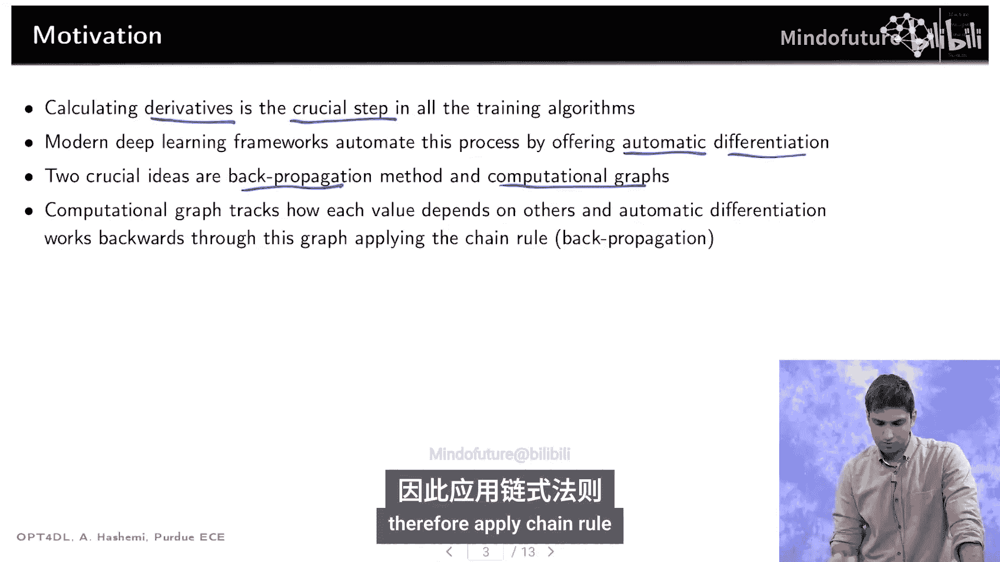

So let's talk about these two ideas。 So first， we're going to talk about back propagation。

 Now we're going to do a very simple application of back propagation。

 and we're going to just focus on one of the simplest models we can imagine and that's a fit forward multilayer perci model。

 So let's consider a canonical training tasks， which is essentially minimizing some average loss。

 we want to find the best model that fits the the data as as as well as possible。 okay。

Let's consider simple M M LP。 And let's assume that we have a regression task with a square loss。

 Basically， each sample loss is gonna have a form like this。 Okay， so where。As always。

 V Is are or our labels here， arem just assuming that my labels are vectors。

 like M dimension of vectors。And this term here is basically the prediction of the model。

 So this is this is the MLP。An X O is basically the input features。Now， as you can see here。

 I have a multi layer per sproron where I take the input， multi weight vector， apply linearity。

 and then I feed this to the next layer。And I continue doing so until I feed everything to the to the last layer。

 App the nonlinearity。 let's say the value， and then the base of the output layer。

 and then I'll be done。 So we basically have a have an MLP with M layers。 And for simplicity。

 I'm assuming that the bias terms are 0。 Okay， so we're not talking about that。Alright。

 so what are our relevant parameters then， Those are basically the base of each layer。 Okay。

 so W 1 through WL， and these are typically matrices。 And in fact， in practice， are ten source。

 right， but。From let's say， a mathematical perspective， it is easier for us to think of this as a。

 let's say， a very big vector W， which is in R D okay。Alright， so what is our algorithm。

 Let's assume that we are using S GD or stochastic gradient sent。 We have this very simple update。

 Okay， so next parameter is the current one minus some layering rate times the the stochastic gradient G T and G T。

 as we have talked about before， basically is representing the gradient of the miniwa of the miniwa of samples that we are。

 let's say， selecting and pressing at time or research T。 Okay， so to update the parameter。

 therefore。What we will be doing will be updating each of these weight metricsric W1 through WL okay。

So therefore， to do that， we need to find a partial derivative。Of the loss。

 with respect to each of these weight messages。对。And we're going to do that by applying chain rule。

 Okay， so the idea is that if I ignore the structure of my model and therefore my loss function and perform the calculation namely。

 it's gonna to be computationally prohibitive。 But if I identify this structure。

 as we will talk about and leverage that， I can accelerate the competition and do that a lot more efficiently。

Okay。Now， for our discussion in the in the in the rest of the lecture today。

 I'm going to basically treat this w as a big vector。 Okay， so it's a' a matrix。

 let's say if we Latin it out or like vectorize it such that is a DL times DL minus-1 vector， okay。

So Dl is basically the number of outputs of layer L and Dl minus-1 is basically the number of inputs。

To， to that layer。 Okay， now， given that this is basically a vector and my loss is a scalar valued loss。

 the partial derivative is also going to be a vector versus this dimension。

 The dimension is exactly D L times D L -1， okay。So the reason I'm talking about this here is that I would say potentially the most confusing part about the chain rule when you talk about it in the context of vector valued or metrics valued vectors and metricsrices is to keep track of the dimensions right and we basically have to employ certain operations to make sure that everything matches。

 the dimension matches and our expressions are correct。

So these are things that we don't necessarily have to deal with when we are talking about scrs and basically derivatives in one dimension。

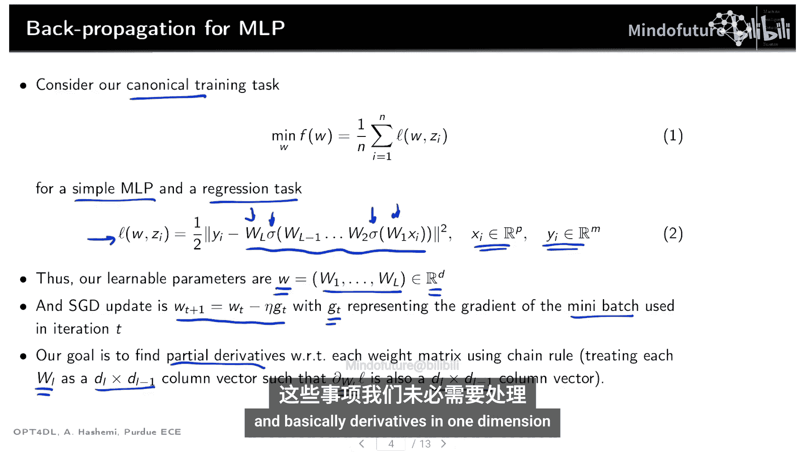

All right。So as I said， the main idea is to identify and leverage the structures。

To that that we're going to define certain variables and we'll see how each of them will show up in basically the expression for the partial derivative of the loss with respect to our parameters。

 which again are basically the base of each layer。Let's define two vectors first。

 I'm going to define the pre activation vector， and I'm going to call that V。

 And also post activation。 I'm going call that H。 Okay， so mathematically。

 this is what I'm what I'm doing。So pre activation is basically the weights times the the。

 the output of the previous layer， which is basically the input to to layer L that I'm considering here。

 And then I take this pre activation vector， and I apply my activation function， Let's say radio。

Such that I can get the， the post activation vector。 Okay， and note that these。

 these period activation and post activation vectors have the same dimension and their dimension is D sub L。

 okay。

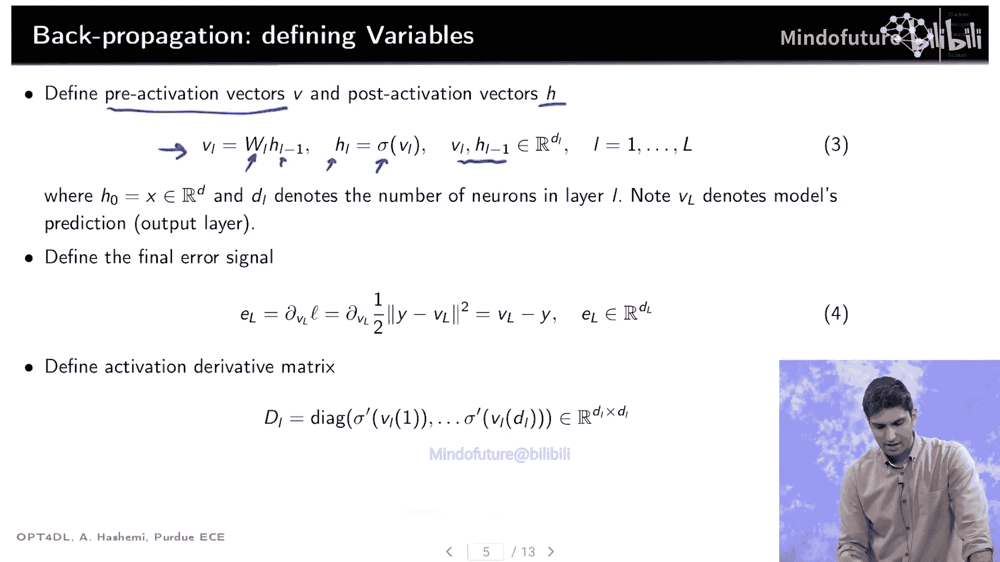

And we define this for each layer from layer1 up to layer capital L。And based on this definition。

 it's not difficult to see that H0 is basically our input。And V sub L。

 V sub capital L is basically the output。 The prediction of my model， basically Y， okay。Alright。

 so these are the first two variables that we define。

 Let's also define the what I call the final error signal。

 And this is basically the partial derivative of the loss with respect to the。

 the pre activationation。Of the last layer。 So basically， we respect to the output。

 the prediction of our model。 Okay， so this is not necessarily something that we'll see immediately impacting the the partial derivatives。

 Therefore， the update of each weight metrics， But as we see。

 And we actually did talk about it very briefly in some of the previous lectures。

 This is something that will will actually show up in the partial derivatives。

 So that that's the main reason we are defining that。 so。

And the reason we call this the error signal is that this is gonna be。Basically。

 the difference between our final prediction VL。And the true labels。 So if I'm。

 I'm not making any errors， this error signal will be 0。 Therefore， the gradient is 0。 and we。

 we are not updating。Our parameters， on the other hand， if they， if I'm。

 I'm making some errors during training， this error signal is large。

 which means that the gradient is nonze and large。 So I'm gonna make more progress。

 I'm gonna update more of my parameters a little bit more compared to the case where the error is。

 is a smaller。Alright， so this is the third variable。 And finally。

 let's also define the activation derivative metrics。 Okay， so obviously。

 when we are talking about the partial derivatives， I if I change the activation function。

 I'm also changing those partial derivatives。 So that's why it's essential to also define this metrics。

 So this is basically diagonal metrics。😊，That has unintoagonal the， the partial derivative。

 and basically， the derivative of the activation functions， okay。嗯。

So sigma prime is basically the derivative of， let's say， sigmoid。

 If my activation is the sigmoid or the derivative of radio。

 if my activation is radio and so on and so forth。And given that we are applying activations to vectors coordinate advice。

So the input to the activation is basically a vector。

 That's why you have to stack the vector of all of these derivatives as diagonal of a of em matrixs。

 okay。And once again， why do we need the metrics because we are working with vector valued quantities。

 so we have to do certain operations such as diagonalization to make sure that everything will match in terms of dimension and our expressions are correct。

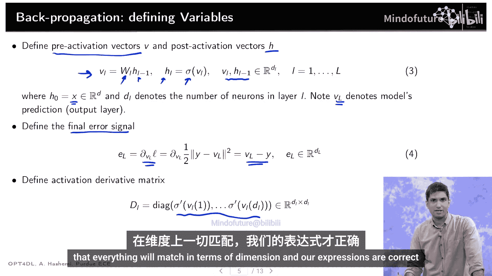

不。

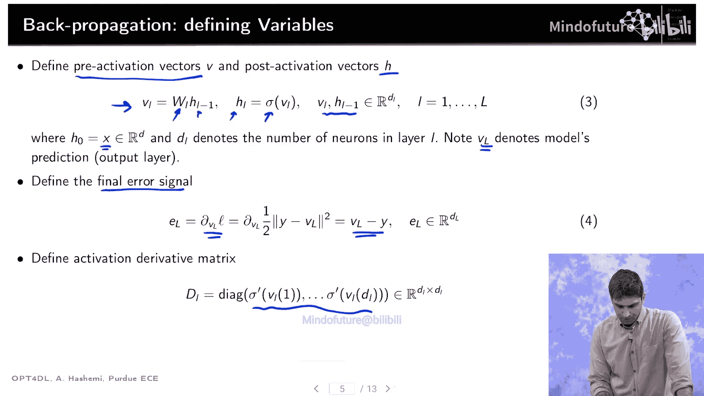

So now， given that we define this， let's actually go and see what's the form of these partial derivatives。

 Okay， and let's start with the with the partial derivative which speak to W L capital L。

 which is the race of the last layer， okay。No。Let's upload channel。 Okay， so。

 so Cha basically says that the derivative with respect to WL is basically the derivative of the prediction。

Pal prediction or， or the last pre activation with respect to W L times the gradient of loss with respect to V L。

 Okay， so this is nothing but chain rule。And it should be intuitive It's just that again。

 because we are working with vectors and mattresses。

 we have to make sure that the orders are in in the correct order such that everything again matches the dimension matches and our expressions are correct。

In this case， this is something we actually calculated before。

 and we we actually name it the final error signal。

So this is going to be just the difference of our prediction。And the true labels。

 So this is exactly E L。 and it's a vector。 Itsation is D L times 1， okay。No。

This first name might be a little bit more confusing and complex。 But let's actually recall。

The definition of V L， let me write it here。 VL was basically W L times H。L-1。 Okay， so intuitively。

 this is something that is linear。In W L。 So when I take the derivative with respect to W L。

 the result is basically independent of W L and only depends on H L -1。

And this is indeed true if we were talking about scalrs。 For instance， let's say。

 I have some function F of x， which is 5 x。 Okay， when I take the data with respect to X。

 F prime is 5。So this is exactly what we are dealing with here。

 except that what we are taking the derivative respect to is this huge vector。 So we have to again。

 introduce some operations to make sure that the dimensions match。 In this case。

 we have to introduce what we call the chronicle product okay。

Between an identity metrics with appropriate dimension。NHL。

But all that matters is that the dimension of this matrix is such that。

The final partial derivative has the correct dimension。

 and the dimension is basically again a vector of size Dl times Dl minus-1。

So here I have a simple example to show what what character product means。 Okay。

 so let's say that I have， again， a vector value function。

 I'm taking the direct respect to this thissymmetric step。 So it's not gonna be a， too difficult to。

 to show that the derivative is actually going to be。This matrix， which is 6 by 3。 Okay。

 and currently your product basically takes this。Victor A and repeats it in each in each column by shifting it appropriately okay。

But long story short， the first term only depends on the post activation of the last layer。 Okay。

 so that's that's what matters for us。Right。So here basically therefore we see a structure that the partial derivative depends on the error signal as well as the post activation of the previous layer。

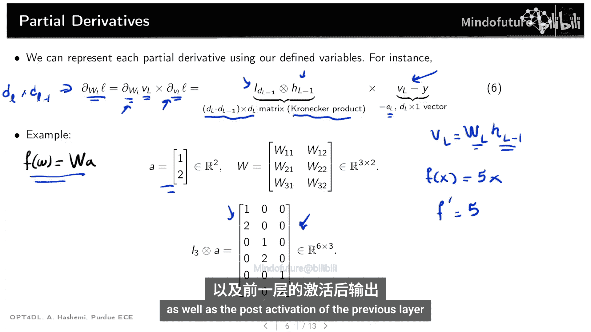

Now， let's see whether。

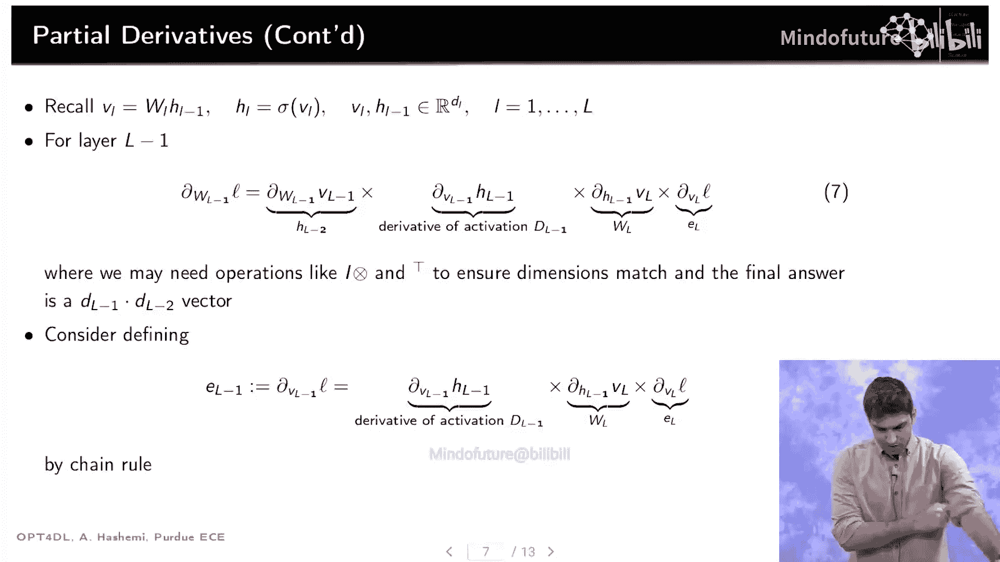

We can identify a similar structure， not just for the partial derivative restrictive base of the last layer。

 but for all layers。So that's what we want to do。Recall our definition of the period activation and post activation。

This and， and， and these okay。Now， let's do a calculation with did in the previous slide for layer L-1。

 Okay， so the partial derivative is the derivative of the partial derivative of the post activation of L minus。

Pth layer with respect W1 times another partial derivative，And times another partial derivative。

 And finally， the partial derivative of the loss with speak to the predictions。

So this is basically the final error signal。This is the again， is， it's not easy。

 It's not very difficult to see that it will be something that depends on， on WL。This guy。

 the partial derivative of H L1 is found， with respect to。The pre activation of。Layer L -1。

 A layer of L is basically something that would only depend on the activation derivative metrics。

And finally， this guy is gonna be something that only depends on HL minus-1。 Okay。

 so I am hiding certain operations such as a chronicical product without identity metrics。

 we may need the transpose or things like that。 but all that matters is that again。

 these terms only depend on what I'm writing under underneath each one Okay but we have to again。

 introduce certain operations to make sure that our final answer is a DL minus-1 times the L minus-2 vector okay。

So what is this term。Again， by Chler， it is。 it's not difficult to see that this is going be the partial derivative or loss with respect to。

第呃。Output of the L minus first layer。 Now， this is the part that we， we now identify as structure。

 So what's the structure。 So let's go back。

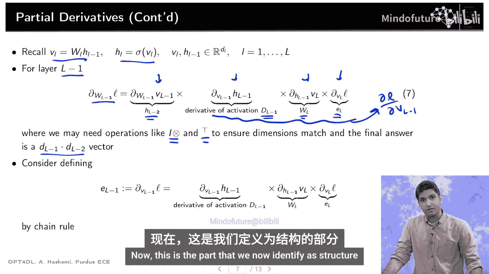

The partial derivative of loss with respect to the weight of layer L is basically the partial derivative of the output of layer L。

With respect to W L。Times the partial delivery of loss with respect to WL。

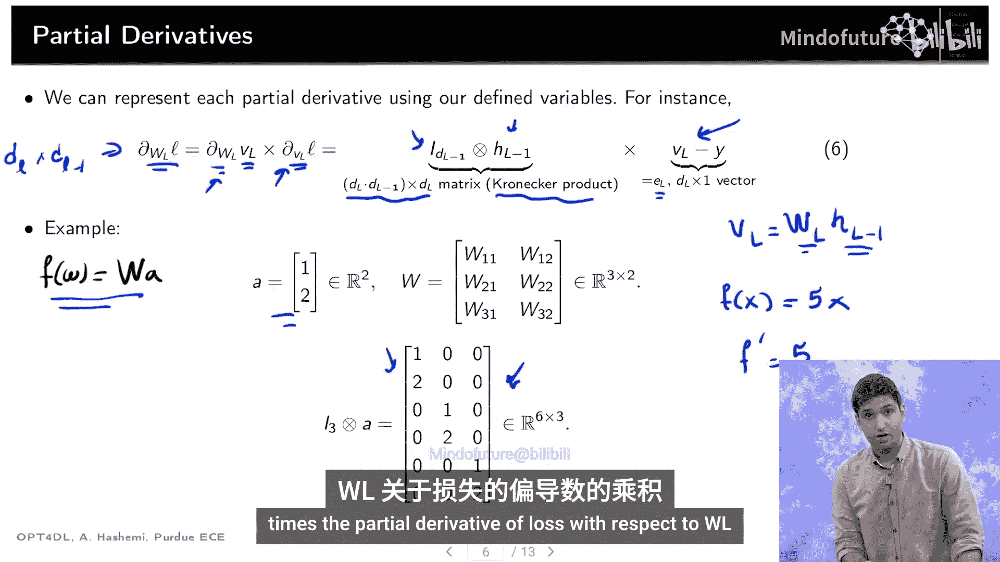

For layer L minus1， again， the partial derivative。Is the partial derivative of the output of that layer with respect to its weights。

Times the partial derivative of the loss with respect to output of that layer。 Okay。

 so this is exactly the same as what we had for layer L。 Okay， so therefore， it is。

 it is meaningful to also give this guy a name。W whichhich we will basically call it the error signal for layer L minus1 as opposed to the final error signal that we defined earlier。

Okay。So what's his definition， Basically， this is something that is the product of the。

Actation derivative metrics of layer L minus1 the weights of layer L， okay and a final error signal。

 So this is what we as we can see here， I'm talking about， let's say a layer L minus1。

 and in particular， a quantity that is important to calculate the partial layers of loss respective base of that layer。

 but this quantity depends in some sense。

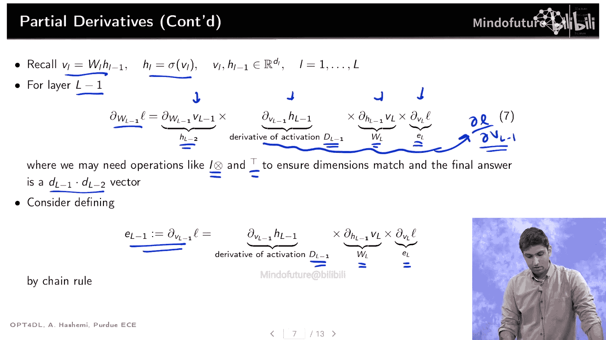

On future。Values， notably， it depends on the weight of layer。 The next layer。

 as well as the  error signal for the next layer。 So therefore。

 this basically gives us a procedure on how to calculate。The the error signal for layer L -1。

 if in some sense， I would be able to traverse the network backward。

I would be able to propagate these values。Then I'll be able to calculate this signal， error signal。

 and then I'll be able to calculate the partial derivative of loss with respect to the weights of this specific player。

And this is exactly the pack propagation method that we're going formalize in a few minutes。

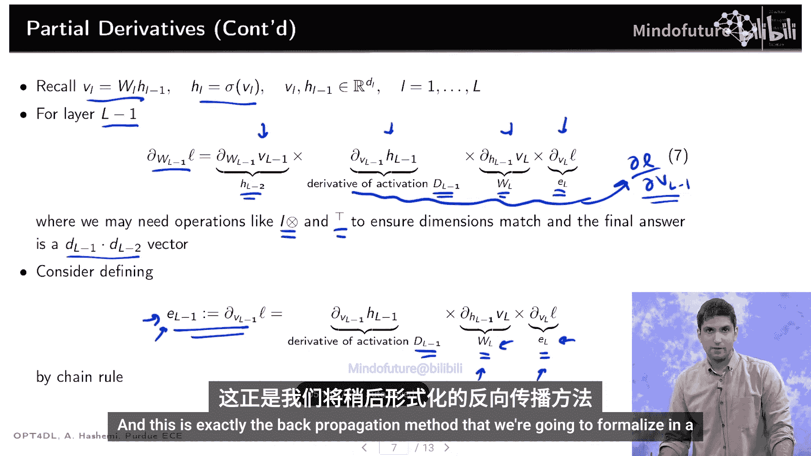

对。So therefore， this is what we what we observe that for layer L-1。

 the partial derivative is basically the partial derivative of V L-1 respect W L-1。

 And this is nothing but the post activation。Sorry， the post activation of the previous layer。

Times the error signal。Of this layer， okay。So as I mentioned， therefore。

 we this us the natural procedure to to in some sense， leverage memory。

Meaning we calculate certain quantities and stored the memory for the sake of reducing the computational cost of calculating gradient。

And this procedure is called back propagation。 What do we do。

 So we notice that we have to calculate certain quantities， notably the。The period post。

Actation vectors。In order to calculate partial derivatives。

 So what we'll do is that we're going to calculate them。In what we call the forward pass。 Okay。

 So we traverse the network from the input to the output forward pass and store the PM post activation vectors in in memory。

And then， in their backward pass。I'm going to propagate the errors。

 So I first calculate the error for the last layer。

 I propagate that bank to calculate the error for the layer L -1。 And by doing so。

 I'll be able to calculate the partial derivatives of the the the lowest ways of that layer。

 Okay So in in particular， this is basically how the the error signals for one layer depends on the error signal for the the next layer。

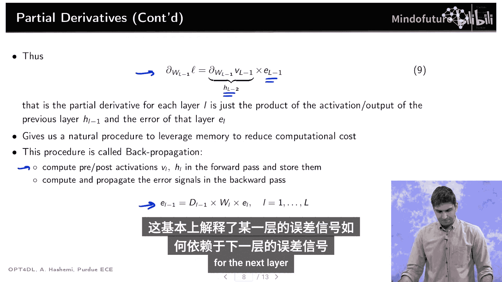

Alright， so that's the， the the first main idea behind automatic differentiation。 Okay。

 so by propagation that requires travering the network in in two directions to calculate certain quantities during the memory。

 and then eventually calculated a partial derivative。 Now， in practice。

 the computation is actually sort of guided。 But what， by what we call computation graph。

 So computation graph is basically a directed a cyclic graph。

That represent the sequence of operations applied to variables。 So operations， in this case。

 these these products， right。

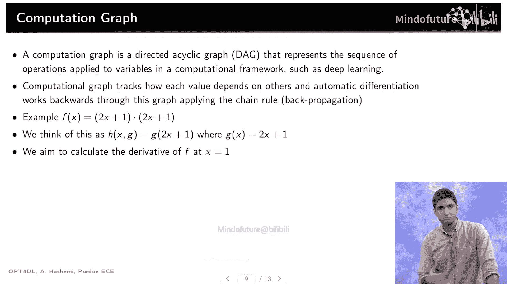

呃。And our variables are basically the pre activation post activation in the system， so。

So this is an idea that I would say transcends the the concept of deep learninging that we are talking about here。

 and it is pertinent in in certainly in in various computational frameworks。

 But we're going to talk about this little bit in terms of calculating the derivative right。

 so which is basically what we what we need when we want to update weights of a deploying model okay。

Now， competition graph basically helps us to track how each value depends on others。 in particular。

 for instance， how。

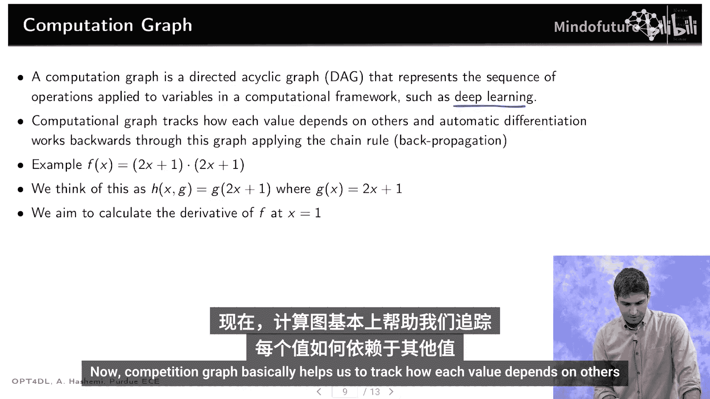

The one pre activation depends on the other pre activations。

 How one error signals depends on the another error signals， etc cetera， okay。

And in the context of deep learning。A notably automatic differentiation。

 what we do is that we're going to traverse this this graph。 Okay。

 so in forward direction to calculate these quantities and in the backward direction to apply chain rule and therefore apply the back propagation method okay。

So。To， to see this idea， I'm going to go very a very simple example。

 So our example is that I have a function F of x， which is basically2 x plus1 times 2 x plus1。

 And my goal is to calculate the derivative of f at x equal to1。So obviously。

 this is very simple to do， right， So F of x。Is nothing but2 x plus one a square。

 so therefore is derivative。Hes basically2。Times。嗯。图。Times 2 x plus 1。But that。

F prime at1 is basically two times two times。2 plus 1， which is 12， okay。So。

 so we're gonna see how we can reach the same answer using computation graph and basically chain。

 Okay， in， in this case， basically， the back propagation algorithm。So to do that。

 we're going to think of， we're gonna make things complicated。 Okay。

 so we're gonna think of this function as some other function edge。

 which depends not on two variabless。

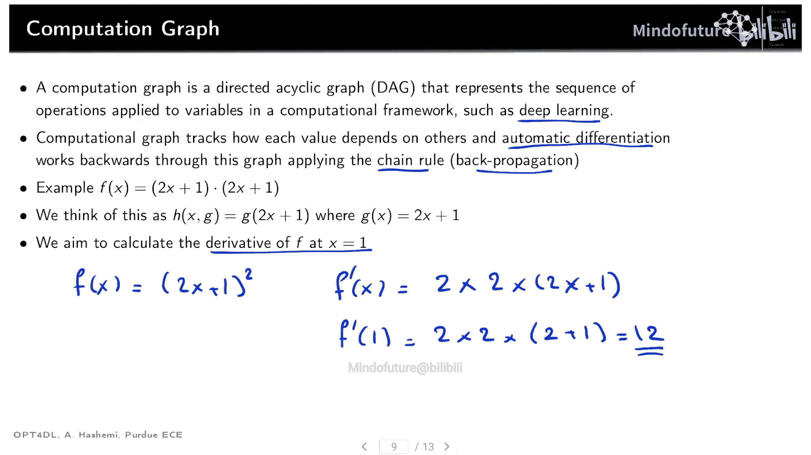

X andG对。What's the dependence， Basically， the function is G。Times  to x plus  one。Okay。

 now what's this other variable G。It's just a function of x。

And it basically takes x and it returns 2 x plus1， okay。

It's not difficult to see that this is exactly our original function， okay。So if I calculate。

 therefore the partial derivative of H with respect to x。

 I should be able to calculate the partial derivative of every respect to x as well。

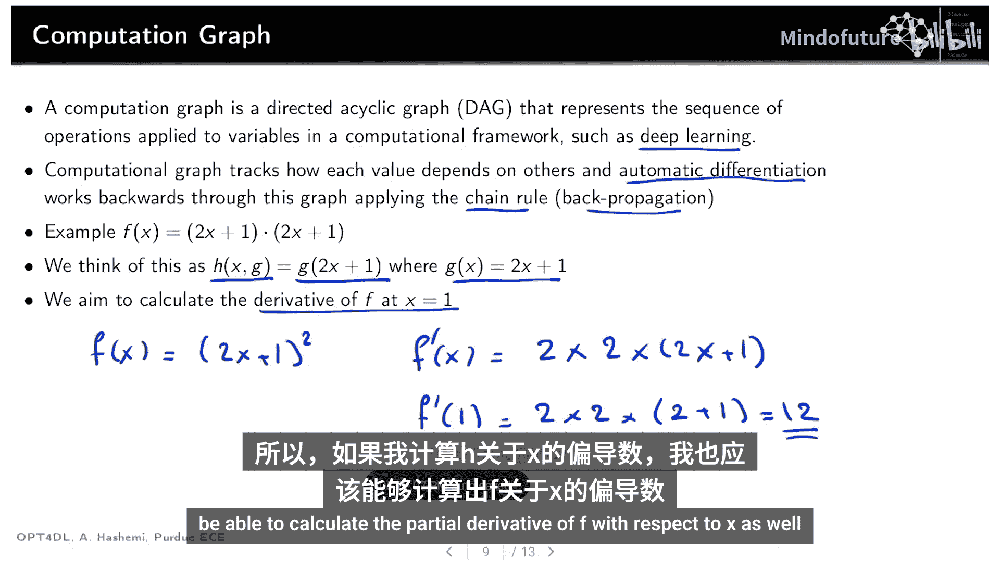

Right right。So therefore， we're going to define a graph。 like。

 And this a graph where we have certain nodes。 Each node is a variable。

 and basically the edges help us to see how the variables depend on each other。 Okay。

 so we have three variables here。 X， G and H。 Okay， and here is a dependency。

 So G was basically 2 x plus1。 So therefore， there should be like an directed edge going from X to G。

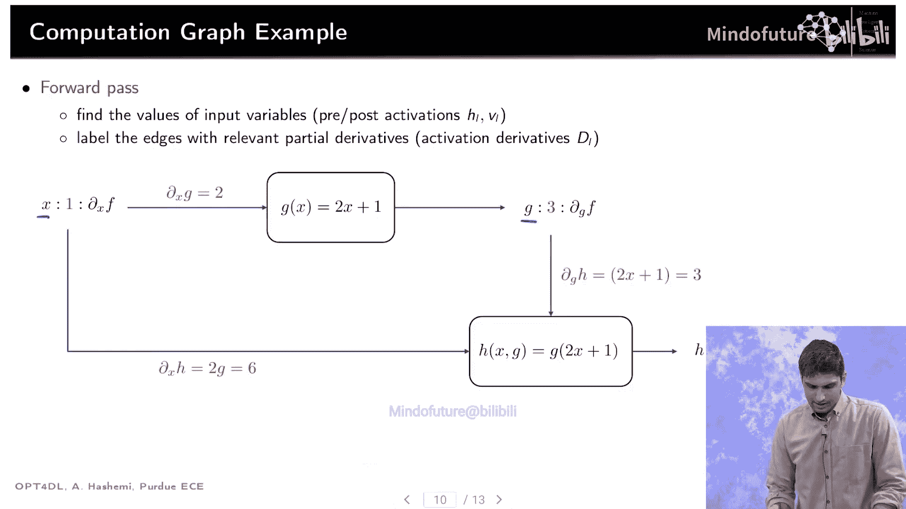

H depends on both G and x。 So there should be one edge。

Going from G to H and another directed edge going from x to H。So this is basically our graph。 Okay。

 so we define the graph before doing any any calculation。Now， in the forward pass， now， now。

 this is where the calculation starts to happen， right。

 So we're going to calculate these7 quantities。Namely， we again， in the context of deep learning。

 we're going to calculate p and post activation vectors。Okay。

 so that we are ready for the backwardboard pass where we propagate the error and therefore calculate the partial derivative of this。

In addition to calculating these input variables， were also going to label the edge edges with relevant partial derivatives。

 Okay， so let's do this calculation。 Then first， we'll see what are the each of these input variables。

 So x was equal to1 that I know， given the dependency of G and X G will will be 3。And finally。

 given the dependency of H on both X and G， H will be 9。 Okay， so this should be easy to see。Now。

 on the edges， we're gonna basically write down the partial derivative of each variable with respect to its input variable。

 So here my variable is G。 The partial derivative with respect to is input X is gonna be 2。

H has two inputs。 One is G。 Another one is X。 Okay， so on this edge， therefore。

 I have the partial derivative of H with respect to G。Which is nothing but two explore one。

When I plug in x equal to1， answer will be 3。 and then finally。

 the partial is of H with respect to its other input x。Here。Is gonna be two times G。 Okay， Again。

 when I plug in the value for G， the answer will be 6。 Okay， so therefore。

 we have successfully completed the forward pass。 We went from this site。

To the output along the world， we calculated the important variables and also name these edges with relevant partial derivative。

Now we are ready for the back for pass。 So in the back for pass， we are basically propagating the。

 the error signals we talked about before to calculate the partial derivative of。The， the output。

 with respect to。The input okay。都呃。So here's how we do。 And in this process。

 we are going to basically apply chain， and that requires us to accumulate。

The derivatives and sum them over all pass。 Okay， so let's see what I mean by that。 So first of all。

 here。I'm going to write the partial derivative of my my function with respect to H。

 So F was exactly H。 So the partial derivative is equal to1， okay。No。

Here I'm going to write the partial derivative of my function F with respect to this variable that I define G。

By chain rule， this is nothing but the partial derivative of H with respect to G and then F with respect to H。

Fortunately， I have both of these quantities calculated， but this is always equal to one。So。

 this guy。And this I already calculated in the forward path。So therefore。

 I'll be able to calculate the partial of F with respect to G okay。So this is equal to 3。Now。

 so in this example， there is， there are two paths from output to to the input signal X。 Okay， so as。

 as I'm going to talk to here， we have to accumulate these partial derivatives and then sum them up across all paths。

 okay。So。So this is basically the partial derivative for， for this variable。 Now。

 I'm going to calculate the partial derivative of F with to X。

 So which I'm writing here by chain rule， this will be。The partial derivative of H with respect to x。

Which is something I calculate in the forward pass。

Time is the partial derivative of F with respect to H。Which I've calculated here。

So this is basically the accumulation of derivatives。B。Dis pass。But there is another path。

From output to input。 And that's this pass。 So I have to also calculate accumulate the derivatives and then sum the result of it with my with the calculation I've talked about here。

So therefore， there is another term。 What's the other term is basically the derivative of H with respect to derivative of F with respect to H。

 which is1。 So now I'm moving along this path plus the derivative of H with respect to G。Which is3。

 something I calculate in the forward pass。 And then finally。

 the result is nothing but the product fit。 the partial derivative of G with respect to x。

 which is equal to 2。 Again， something I calculate in the forward pass。 So therefore。

 when I do this accumulation， I'm going to find that the partial derivative is nothing but 12。

 the the result that we expected to to C。

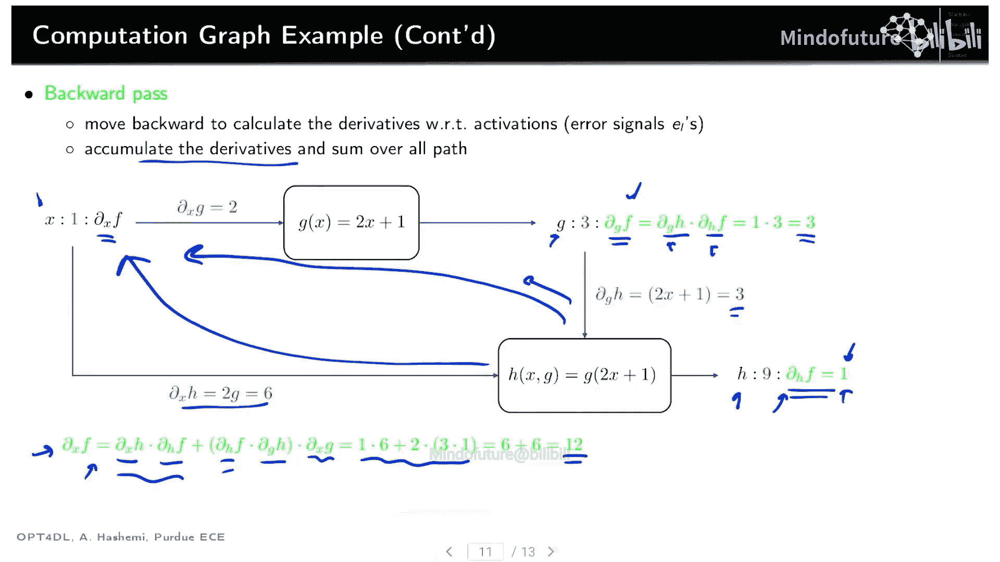

Alright， so this example is basically an example of a static computation graph because we。

 we defined the entire graph。Before。Execution， okay， so the graph is defined。

Before we start the process of back propagation and calculating， let's say。

 the PMm post activations and in the forward pass and also propagating the error in the back for pass。

 Okay， and this is indeed an approach that we took when we defined earlier versions of one of the most famous deploy packages。

 which is called Tensor fellow， okay。And in some， this is intuitive to be called defined and run approach。

 because we are defined the graph first， and then we are running the calculation。 Okay。

 and there are advantages and disadvantage advantages here。 So the。

 the most important advantage is that this is highly optimized， okay。

 because we know the competition graph in advance。And or later on， when we basically run or execute。

 the computations will be highly， highly efficient。 Okay， but the disadvantage is that this is。

 is not very flexible。 And also， more importantly， the debugging process is gonna be is gonna be difficult。

 Okay， because if there was some， some bug happening， when we define the graph， we're not gonna。

See that bug or or face that or even notice the bug。When we define a graph。

 we're only going to notice it in the execution。phasese of our， of our computation。

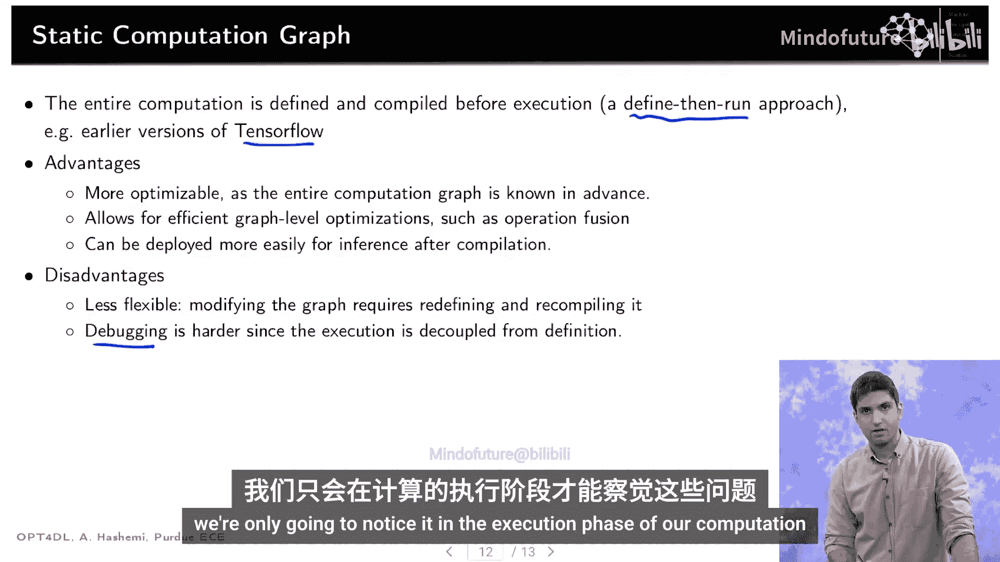

So this therefore leads to what we call dynamic computation graph to try to。

Make sure we have more flexibility and also the debugging process is a little bit more easier。 Okay。

 so in the dynamic competition graph， we are basically building the graph on the fly during the execution phase。

 okay。So this basically means that the structure of the graph can change at each。Iteration。

 so our approach is basically defined by， defined by Iran approach， okay。

And this is the way we construct the computation graphs and basically perform by propagation in modern deep packages。

 such as Tensorflow 2。0 and Pytorch so the advantage is that it's is flexible given that the graph is defined in a dynamic way。

 and it's also easier to debug and in some it's also more intuitive for development as when we talk about more complicated models such as recurrent neural networks。

 or when we use deep learnings in context beyond supervised learning， such as reinforcement learning。

The disadvantage is that we're gonna basically now lose some optimization， okay， so。Because they。

 we don't know the graph before computation starts。 Okay， so therefore。

 it could be slightly store compared to the aesthetic static graphs due to。

 due to this runtime overhead。Alright， So， so this is basically a short lecture on two important ideas that we need when we want to calculate the gradient efficiently in the context of filtering。

To make sure we can have efficient training algorithms。In the next video。

 I'm going to talk about a very brief example of how we we basically deal with these ideas in。

 in practice when we use deploy packages such as。

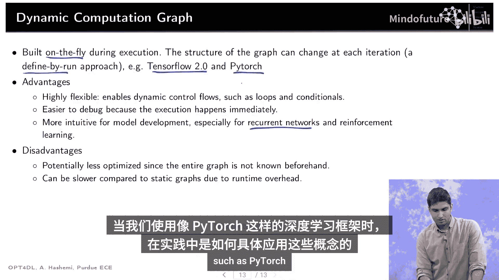

Ps。Also so。