# 【普渡大学】深度学习中的优化 ｜ Optimization For Deep Learning ｜ Purdue University p21 P21_反向传播在PyTorch中的实例解析 -BV1tvzKBcEom_p21-

🎼，🎼Yeah。Let come back。 So we talked about back propagation and computation graph and and how they can help us to calculate the gradient efficiently and therefore have efficient training algorithms。

 So in this video， I'm just gonna very briefly go over a very simple example of how we use this in in practice。

 And as you'll see， we don't necessarily need to deal with them at a deeper level。

 thanks to the advances in in， in， in deepening optimization packages。

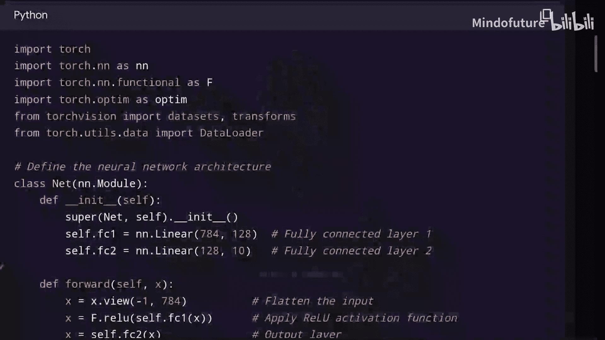

In this case， we our goal is to build a simple multilayer perciron and train it on a very simple data cell。

 which is， which is called Ms， okay。And what we are using is basically， we are using the Ptorch。ALi。

So。First thing， we're going to import certain certain functions。 Okay namely。

 we import basically something that helps us to to define our neural network。We're going to。

 let's say， import。A library that helps us to， to apply optimization algorithms。And then we also。

 let's say， import certain functions to help us with the process of the the data， okay。

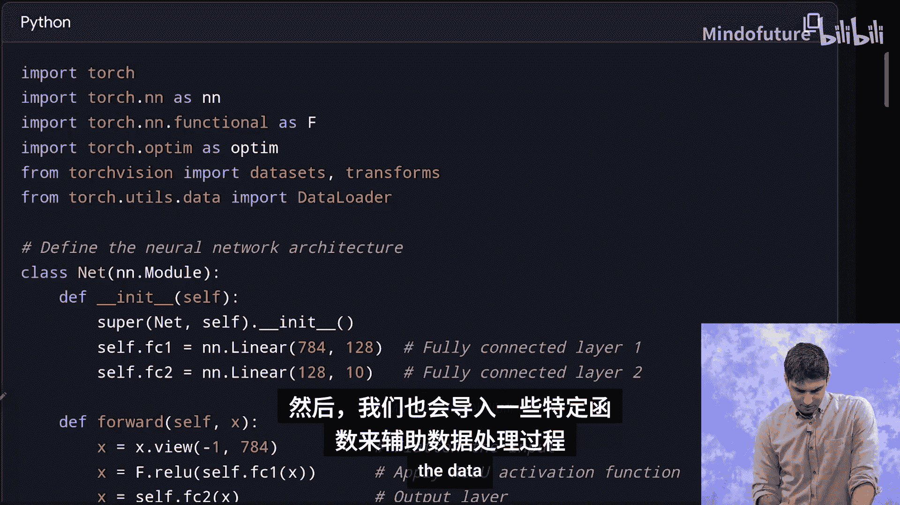

周。In this part of the code， we're gonna， we are defining the neural network。 So basically。

 we're just gonna have two layers。 And both of them are fully connected layers or basically multi layer per。

 Okay， now first one， first is basically the input。 Okay， it。It takes the input。

 and then it multiplies by a weight matrix。So the dimension of the weight matrix is basically 7。

84 times 128。So this 784 is basically dictated to us by the size of the training。

Data in the Ms example。The train data is nothing but 28 by 28 images。And if you。Basically。

 think of that as a vector。That vector is going to be 7，84 dimensional okay。

This is the first layer fully connected。 The second layer is going to be again。

 a fully connected layer with 1，28 neurons。Where the size of the output is 10。 Again。

10 is something that is sort of dictated to us because in this case。

 we have a classification problem with 10 classes。Now， here's very。

 we defined the model is's a fit forward neural network。 Okay， so we have basically the input。

 We fit the input to the first layer。Okay， which basically means that we are applying with some we are finding this product the product of the input X with some weight metrics。

 and then we apply some non nonlinearity， some activation function in this case， value okay。

And then finally， we feed the result back to the to the next layer， which is again。

 a fully connected layer， okay。So this will be basically our prediction。

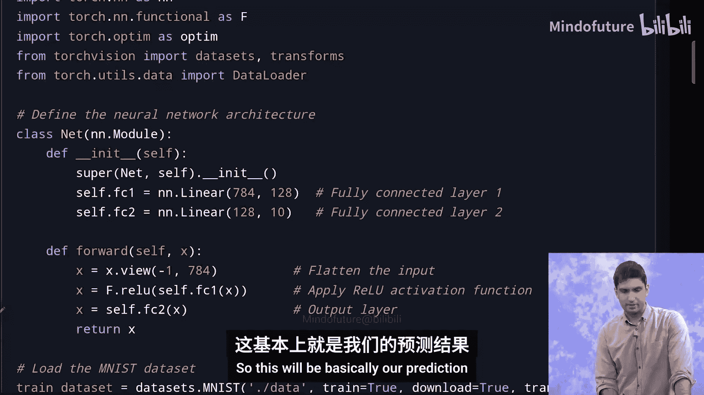

All right。So these， these lines are basically these two lines are gonna help us to。

 to load the M dataset into into our our code。 Okay， so the dataset has two parts， one part。

 which is the training part。 Okay， we use that for training。 another part is test。

 We use that for inferencefr。 So we， we're going to use the test data set to assess the prediction power of our training model。

 okay。Now， we， we also basically use these two functions， our data loader。To， to。

 to see how we want to process the data。 So we're gonna have a training loader。

 which basically helps us to say that。I'm going to sample 64。

Data points in each iteration of only optimization algorithm。 Okay， so basically the ba is 64。

 I'm gonna process the term data 64 at a time。So we have a parameter here shuffling。

 And if you recall， when you talk about S GD we also talk about S GD with with shuffling。

 So shuffling is true here， That means that at the end of every epo。

 I'm going to shuffle the data in the random order。

 Okay and this has certain advantages in terms of the variance deduction and therefore better optimization as we've talked about before。

The next one is not as important in training， this basic means that how。

 how do you want to process the test data， Basically means that I'm gonna take 1000 samples at a time and then find the prediction of the model on those 1000 samples and then move on to the next。

 next batch， okay。

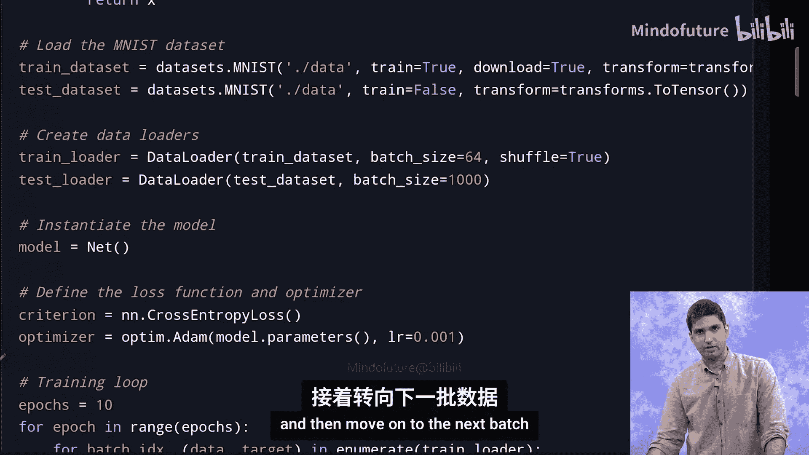

Okay， so we essentially the， the model， this tool linear neural network。

And then we want to optimize it。 Okay， so what is our criterion。 As we've talked about before。

 a national curiterion is for classification problem is to minimize the cross entropy laws， okay。

So we， we said that to be our， our loss function。And then this is basically our optimizer， okay。

So we haven't talked about the animal algorithm， but we will。 But this。

 you should think of it as like a more advanced version of S G T， okay。That uses， in this case。

 a learning rate， which is， which is specified here。

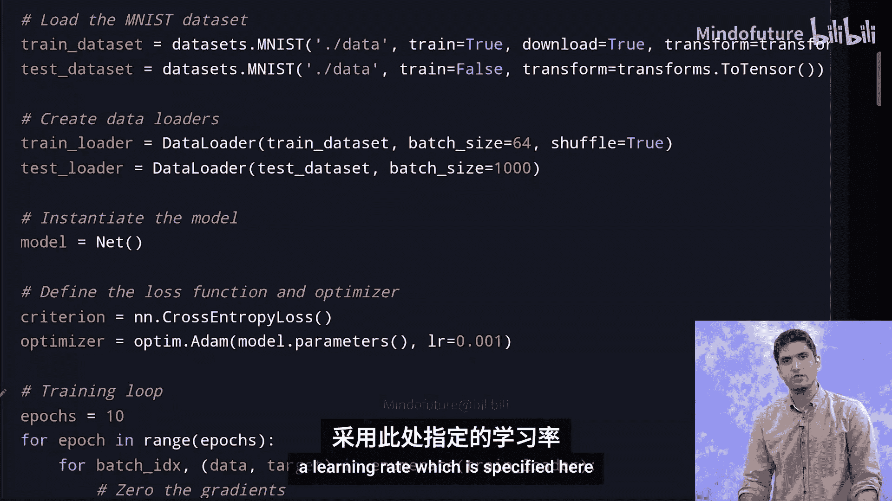

Alright， so with this then， we can start training。

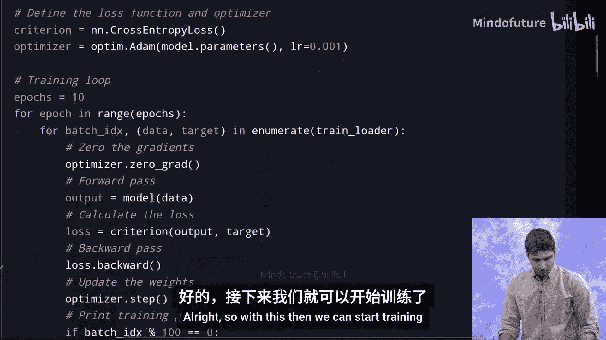

We have  ten new partss。 Okay， so that means that I'm going to process the training data 10 times。

Okay， in eachpo， you're gonna basically process the the mini batches。 Okay， so what does that mean。

 It means that from each mini batch， I want to calculate the gradient。Okay。So we first reset our。

 our computation。 And I believe this is important， given that we are using a dynamic computation graph。

 Okay， now we want to calculate the gradient。 And we talked about the back proppagation algorithm。

 So back proation has two paths， a forward path， which helps us to。呃。Find certain variables。

That are essential in the calculation of the gradient。 and in the back for pass。

 we're going to propagate the error and therefore calculate all the partial derivatives that we need in order to update the model。

So therefore， in the forward pass， we feed the data to our model and take the output， okay。

We calculate the loss。So this we calculate the loss。 And in the back。

 and then we initiate the back pass。 Okay， and then at the end of the back pass。

 we now have access to all the variables we need to calculate the derivatives。Therefore。

We'll be able to apply your optimization training algorithm to to update our parameters。

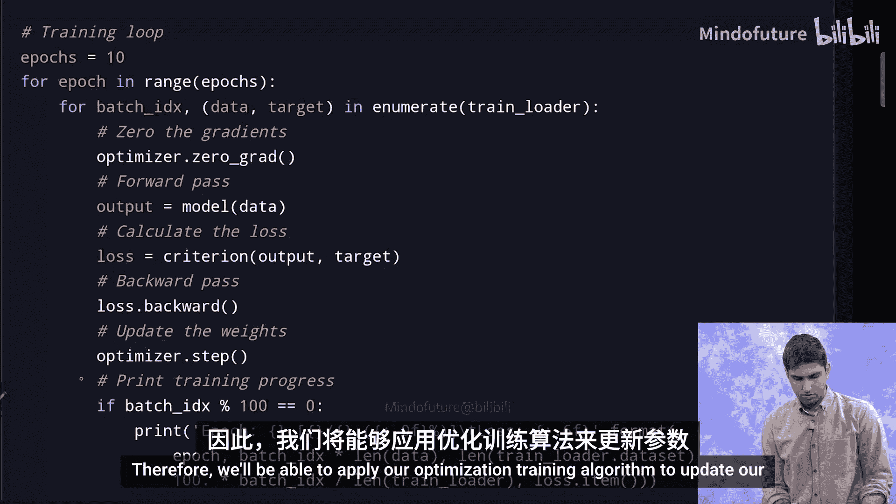

And then the rest is is basically talking about printing the training process。 right， so progress。

What percentage of the data I've I've。Sorry。Calculated， I have。

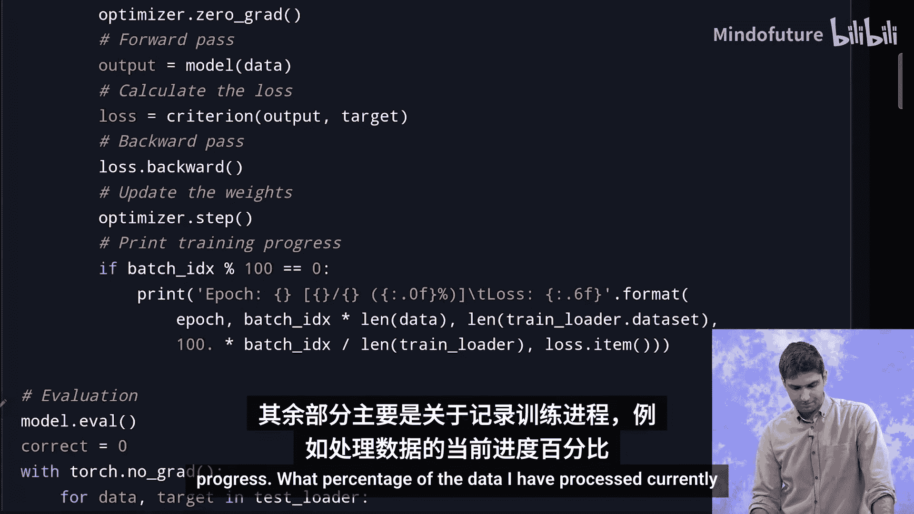

Processed currently， okay。And this is the end of the training。 This is basically about。

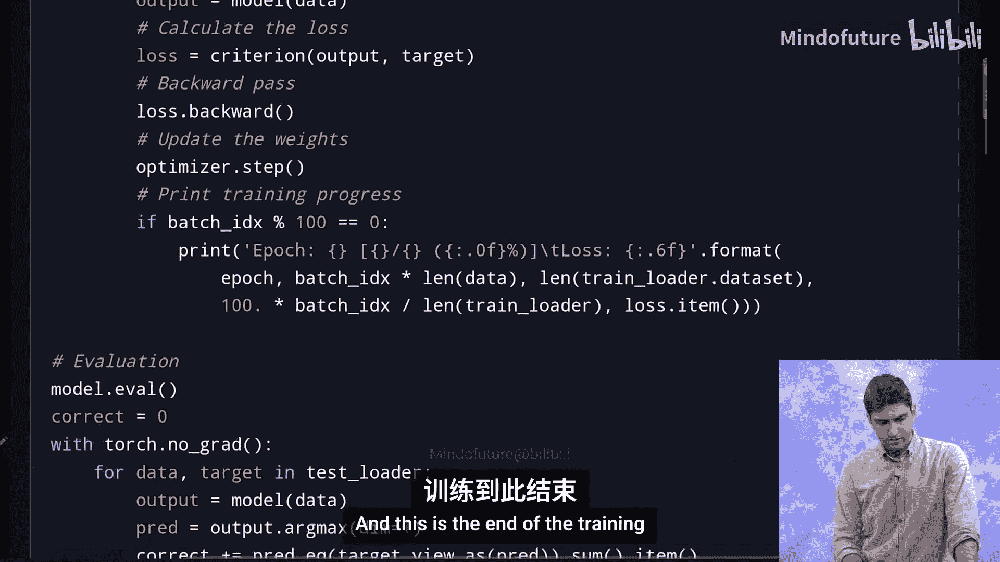

Evaluation。 So you go to the evaluation mode。 In that case， you don't need to take any。

 any derivative。 Okay， and then you basically take the data visit or to your model and then make some prediction。

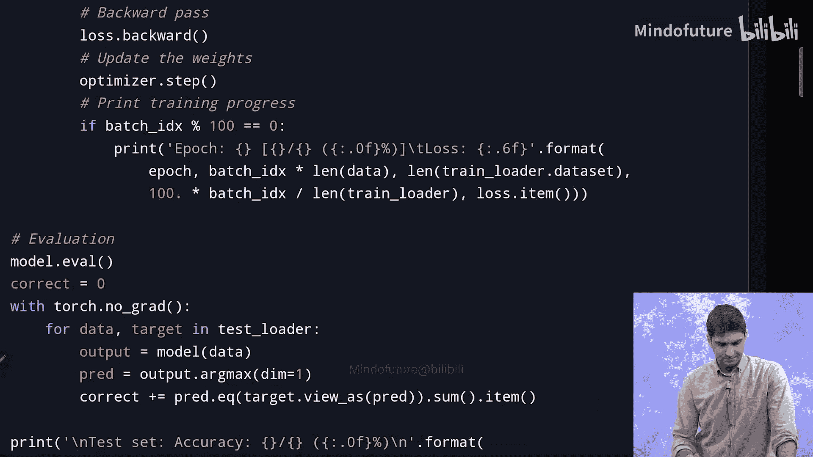

For。And then you， you output put yourself。 Okay， so this is basically how we the， we。

 we can leverage the pack propagation algorithm to train a simple neuraln network。

 And as you can see。The， the interaction with the algorithm is is very， very minimal。

 but nonetheless， it is is a really good idea to， to understand the。

 the main idea and the main mechanism behind behind this algorithm and also the attorney opt train algorithms such as atom。

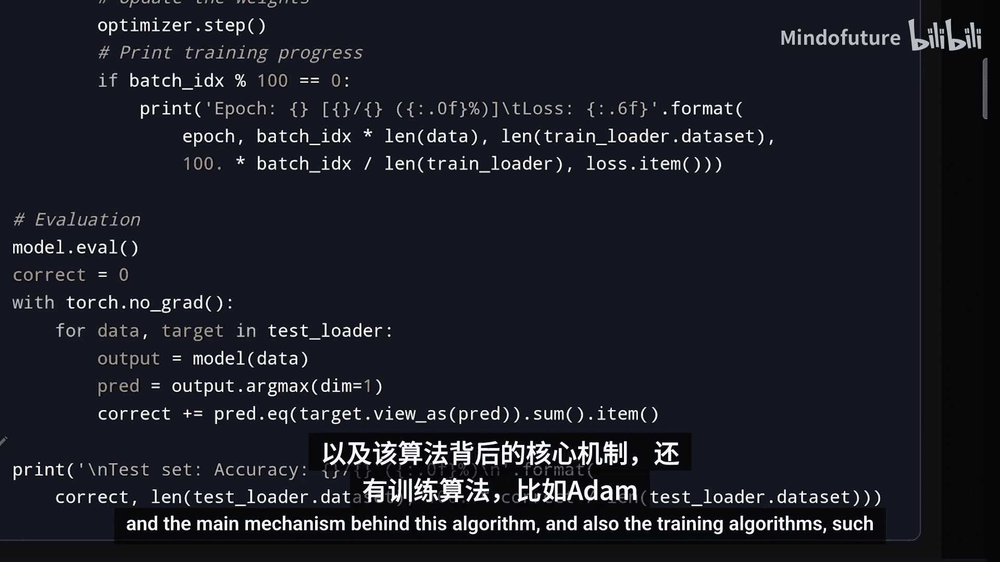

In their context of deep。Okay， so hopefully this gives you an idea on how we。

 we go about calculating the derivatives and therefore。

 applying our optimization methods to update base of a neural network。In the next lecture。

 we're going to talk about another kind of training techniques or heuristics， if you will。

 that is essential when training neural networks at a scale。 I'll see you next time。

