# 【普渡大学】深度学习中的优化 ｜ Optimization For Deep Learning ｜ Purdue University p22 P22_参数初始化与归一化1 -BV1tvzKBcEom_p22-

🎼，🎼Yeah。Welcome back。 So hopefully we now have a better picture of the some of the model architectures that we need in。

 in different applications。😊，So for the， for this lecture and and the next few lectures。

 we're going to talk about some training techniques and heuristics that we。

 we use to make sure that we can effectively and efficiently and successfully。

Train these architectures。So in this section， we're going to talk about two techniques that we call initialization and normalization。

So initialization。 So basically， how should we initialize the weights of these。

 these these architectures， Okay， and whether initialization matters or not， so。So obviously。

 initialization matters。 And the reason for that is that these deep architecture are complex， okay。

 and they dictate。The， the kind of the loss functions that we're gonna deal with。

 So because these are convex， these are highly complex。

 the loss functions are going to be highly complex as well。

 And they're gonna be basically highly non convex。 Okay， so lots of ups and downs。

 as we can see in a likeives。So given this， it it really matters where you start your， your。

Your optimization， Okay， so can， if I let's say start here， Okay。

 I'm gonna find a so optimalmal solution。 whereas if I start here。

 I may actually define a better solution。 So in this case。

 a better solution means a better fit to the， to the data and hopefully， therefore， a better。

 a more generalizing model， okay。

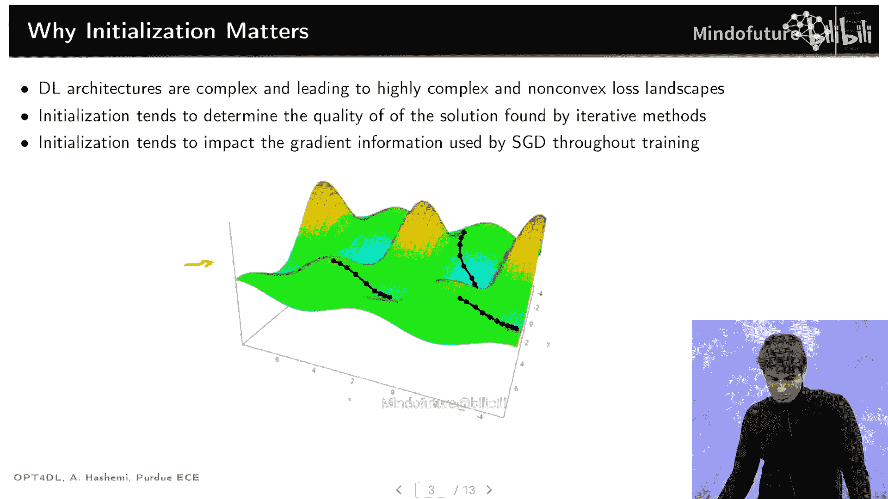

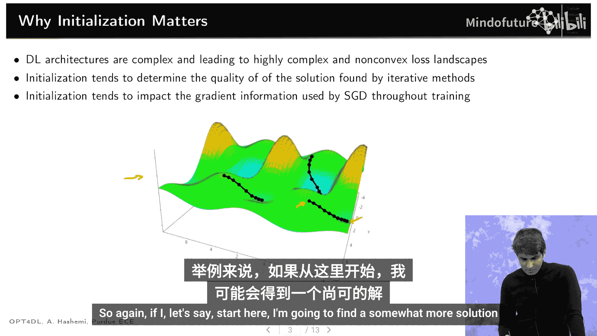

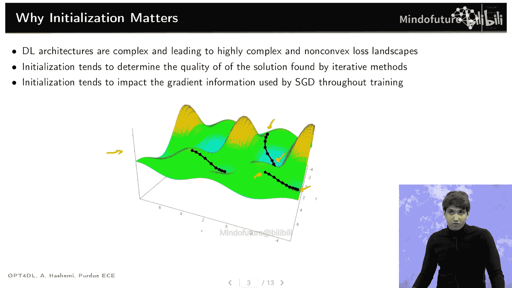

都 so呃。Therefore， initialization is important to， to make sure that the solutions we are finding about our iterative optimization and algorithm is of high quality。

 Okay， and one other thing we're going to talk about is that initialization。

 especially early on is also very crucial in terms of the gradient information。 Okay。

 so gradient information is a learning signal。 So if that information is is， is， is useful。

 we should be able to， let's say， be more effective in in optimizing our model。

 But if that information is not useful， the training process is going to be slow or even in a stable okay。

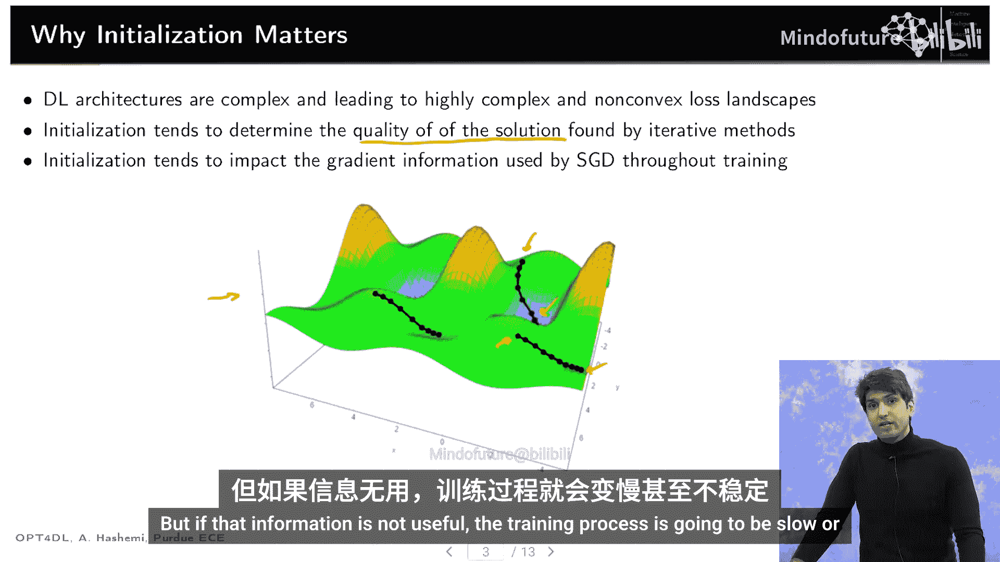

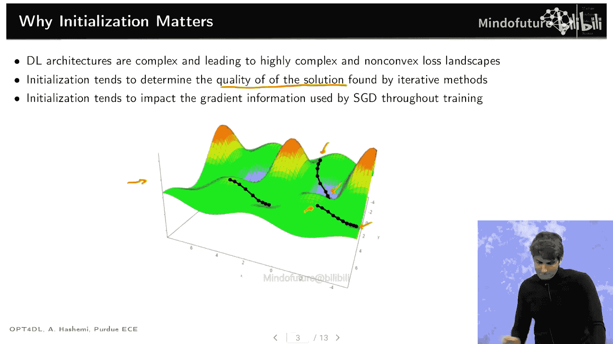

So the idea is， therefore， we want to find initialization techniques that help us to to have like a better training process。

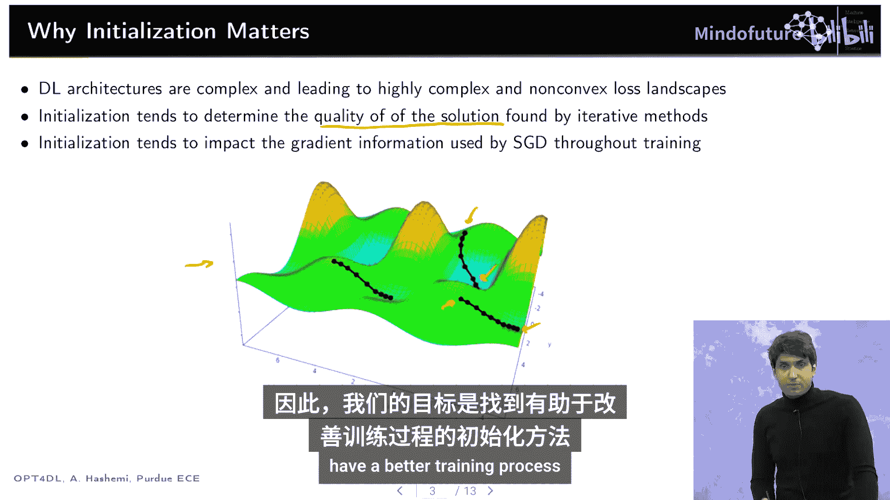

Okay。So let's， let's consider multilay perceptron。 And。

 and we're going to consider this to point out two potential issues。

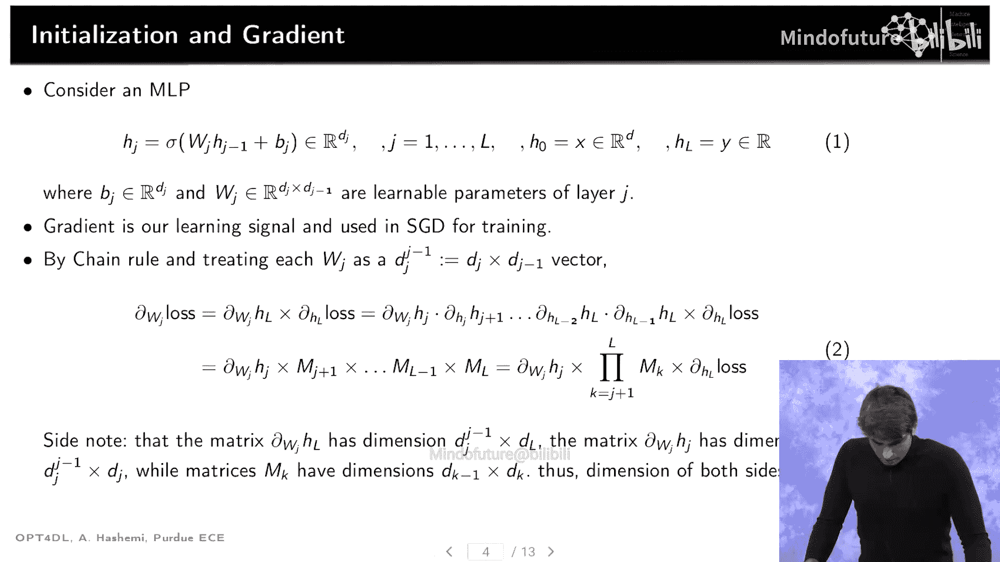

That could arise。And therefore， see how we can leverage initialization techniques to mitigate them。

So what was in multilay perci。 So it's basically represented by this mathematical equation here。

 Okay， so the output of each layer or the activations are basically the activations of the previous layer times。

 some weight matrix plus some bias。 And then we apply a non linearity。

 basically an activation function， such as again， value or or or sigmoid， okay。

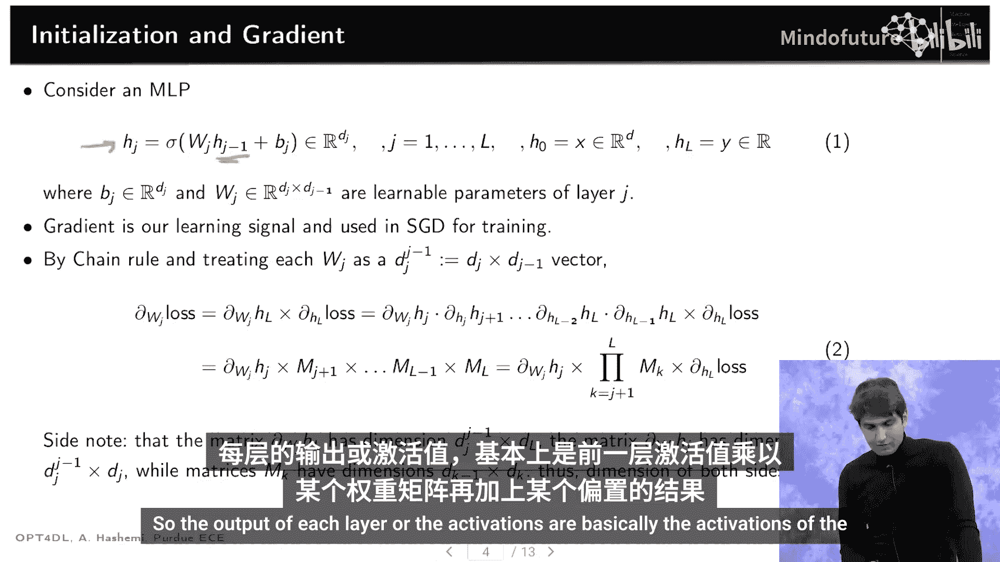

And let's say we have L layers。 Okay， The first input is X。 The last output is basically。

 our prediction。And as I mentioned， these are， are the， the biases and。

 and Ws are the learnable device， which are the learnable parameters of the， let's say。

 the Js layer here， okay。Okay， so we mentioned that the our learning signal is basically the gradient。

 right， So that's the quantity we're going to use in the SGD and other advanced training algorithm we're going to talk about to update the parameterss of the model。

 Okay， so let's see what is the what， what's the shape of this gradient， okay。So essentially。

 if you want to update Bs， we need the like the partial derivative of the loss。

 with respect to H PJs。 And if I want to update W Js。

 I need the partial derivative of the loss with respect to W J， okay， so here what I try。

 I'm trying to do is to basically see what's the shape or。

 or the form of the partial derivative of the loss， with respect to W J。 Okay。

 the weights of a J S layer。 Okay。Now， this is， this could be a little bit complicated because ws are。

 are metricsrices。 So the loss of a scalar value function with respect to a metric。

 the guarantee of a scale value function with respect to a matrix is basically a matrix Okay。

 so to to make things a little bit simpler at least for myself。

 what what I'm doing here is to that I'm thinking of each W J as a vector。

 So I'm vectorizing this matrix。 Let's say I'm stacking all the columns into a very large column vector。

 Okay， but the size of that column vector is basically DJ times DJ-1。Right。Okay， so。

Our goal is to find a partial derivative。 We can use chain rule。 Okay， so therefore。

 the partial there is a loss restricted to WJ is basically the partial derivative of the。

Last activation， with respect to W J times the derivative of the loss。 with respect to the last。

Actation， okay。

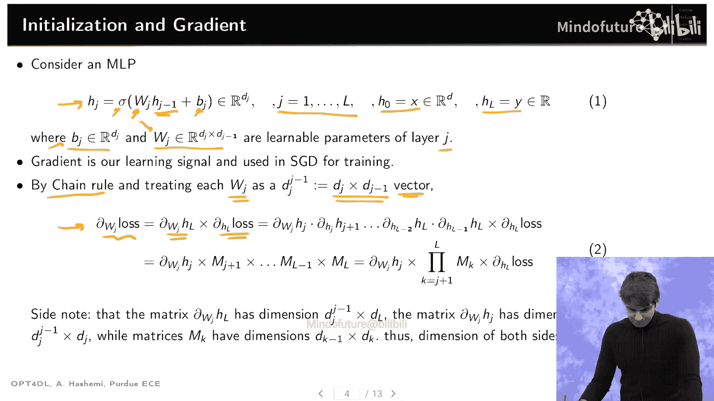

Now I can again apply a chain rule to this component here。To basically decompose this derivative in。

 in terms of。The product of a bunch of。There it is， okay。Right。

 so one thing to note here is that H is basically a vector。

 and we are taking the derivative of a vector with respect to another vector。

 So the outcome will be a matrix。 Okay， so therefore。

 we can use channel to represent this matrix as the product of a bunch of other matcheses。

 as I'm showing here， And by channel rule， this partial derivative is equal to the derivative of the output of the the J S layer。

 with respect to WJ。The derivative of the orbit of the J plus burst layer。

 with to HJ and so on and so forth。Until。The derivative of the last layer output the last layer or the the last activation。

 with respect to the， the activation of the layer L -1。 And finally。

 I have this derivative of the loss with respect to H L。And this guy is， is。

 is a vector because I'm taking the derivative of a scalar with respect to a vector， okay。Alright。

 so， so therefore this is the shape of the the the gradient。 Okay， so we have some metrics here。

Some vector。 and then the product of a bunch of other mattresses。 Okay。

 and note that this product is gonna get larger as I'm considering the partial derivative of the layers early on in the in the network。

 Okay， so so this， this product is gonna be the the product of more terms for when I'm considering the partial derivative of the first layer compared to the partial derivatives with vector base of the。

 let's say the last layer。 okay。Now， so this is this because its like a， again， like a product。

 a bunch of messagess， it could be a very large quantity， or it could be a very small quantity。

And that depends on。Basically， the， the eigenvalue of these matches， okay。

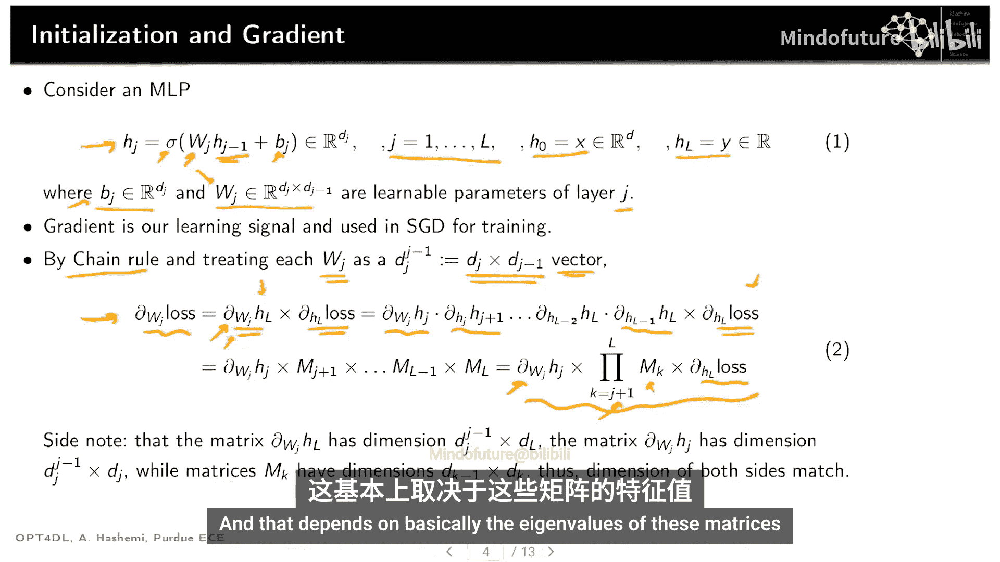

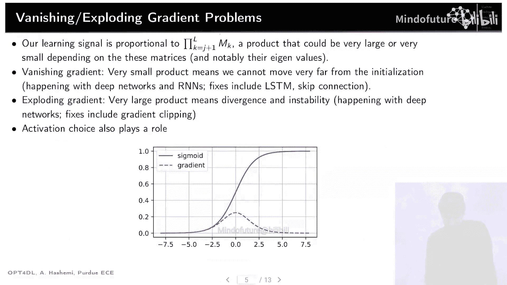

So， so what our outcome therefore， is that our learning signal is proportionities to this product。

And as I mentioned， it could be a very large matrix or very a small matrix， right？So。

 and that depends typically on the organigvalue of these map。

So therefore two potential issue co alleries。So if this product is large。

We may have the exploding gradient problem。 And if this product is， is a small。

 we may have the vanishing gradient problem。 Okay， so what's the vanishing gradient problem again。

Varus small product。Therefore， the gradient is going to be a small and what's the implication。 Well。

 we use the gradient to update the parameters。 So if the gradient is small。

 we're not gonna update the parameter much or even at all。 Okay。

 So we're not going to move very far from， from the initialization。

And this has been observed to happen with very deep networks and also RNAN。

And the fixes in the literature include basically the LTM architecture that we we briefly talked about。

 as well as including or adding escape connections to our networks， such as residual networks， okay。

So the other problem is explode gradient。 Okay， so it happens when this product is very large。

 which means that the gradient is very large。 So we're gonna overshoot。 okay， so。

 and this could lead to inst。Okay， again， this happens with with deep networks。

 But I would say the fix here is， is somewhat simpler and it's something that we have talked before。

 It's called gradientian clipping， right， So you just make sure that you。

 you have like a explicit safeguarding mechanism that ensures that the gradientian is not is。

 is not becoming very large。

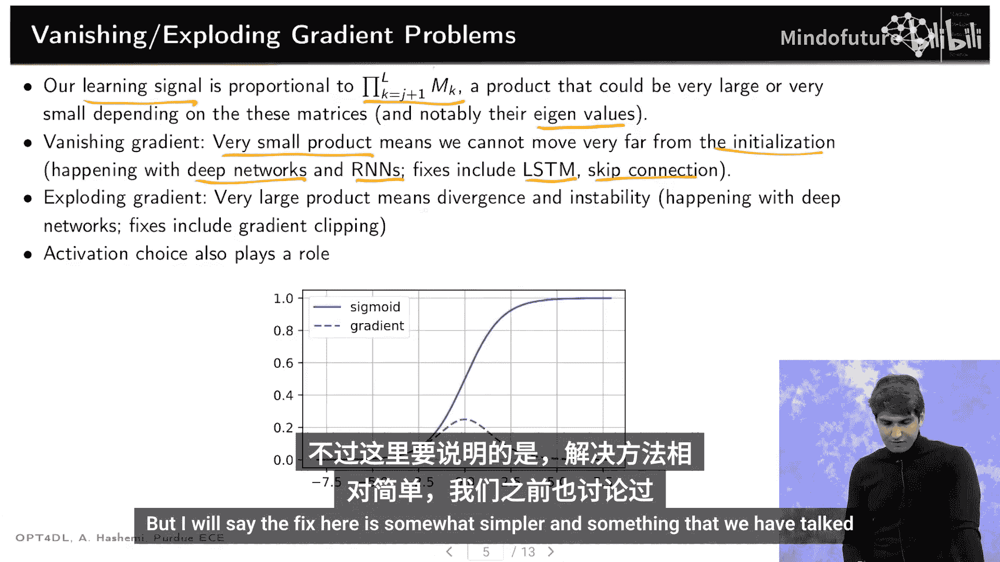

Alright， so。In addition to basically these these metrics these considerations。

 I should point out the activation choice also matters， right， because these。

 these derivatives are basically hiding the derivative of the activation function in the mat file。

 okay， so for instance， what we are observed is that sigoid could are more prone to vanishing gradient problem。

 Okay， and the reason is somewhat intuitive。 If you plot the sigmoid function and its gradient。

 So heres the sigma function。 And here is the。Basically， the gradient of the sigm function。

 As we can see here， the gradient。For somewhat moderately large or moderately small numbers is。

 is super， super low。 Okay， so it's basically0。 So therefore， if I'm。

 let's say initializing the model here or somewhere in the training。

 my my weights or some of my weights enter this regions。

The gradientian is going to be potentially very small。

 So I'm going to suffer from the vanishing gradientian problem。

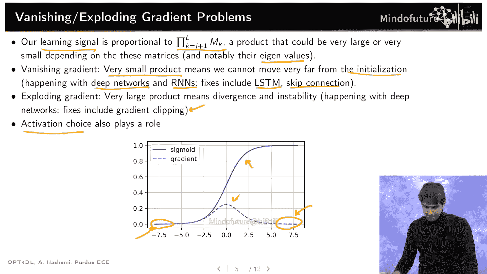

Alright， so in addition to these two problems， there is I would say。

 another problem that motivates the use of randomness when initializing neural networks。

 And that's the problem with symmetry and potentially limiting the capacity。

 the learning capacity of of our models， okay。So recall。

 we had this motivation behind introducing non nonlinearity and also deep models。

To make sure that we are increasing the learning capability。Therefore。

 the performance of a deeper model hopefully is better than a shallow one。

And we specifically talked about the role of non nonlinearity。

To ensuring that we have a higher capacity。 so that if we have a linear activation our network basically collapses into a linear model。

 okay， so。But a similar behavior could happen or when we have bad initialization。

 meaning that we're not gonna enjoy a high learning capacity。Okay。

So let me try to demonstrate you this simple example。 Imagine that I have like a， again。

 like a multi layer preci。 So here I'm just focusing on， on， on， on one layer。 So layer 1。🤧So。

So this is basically the orbit of layer 1， the activations。 So I assume that I have two neurons only。

 Okay， I have some nonlinear activation， let's say re。

 And then this is basically the product of weight matrix and the bias okay。Alright。

 so let's make the following assumption。 So we are similar our initialization is such that all of these wayss are the same。

They say there are some parameter alpha。And all of the voices are also the same。

 Let's say better okay。Now， it is not difficult to show that H1 and2 are the same。Okay。

So at the initialization， the output of the my model is， is， is the same。

 or the output of my neurons are the same。 So I have two neurons。

 but they are acting exactly the same。Now， it is also not difficult to show that the gradient。

 the partial derivatives。

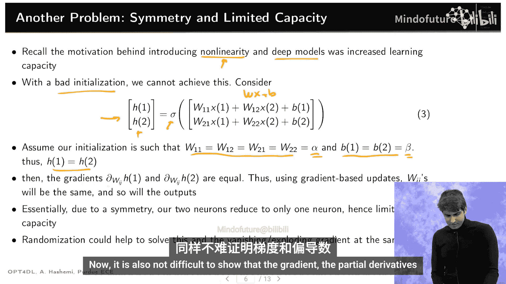

Are also the same。Okay。So what's the conclusion， The conclusion is that if I'm using gradient based updates。

To update department as a more model， let's say WJs and VJs。呃。If I start at the same place。I'm all。

 I'm updating these neurons to be the same。 So throughout the training。

 these two neurons will remain identical。 So despite having two neurons and therefore。

 hopefully a high learning capability， I'm actually gonna have just basically one neuron。

 So therefore a lower learning capacity， okay。So there is a symmetry here。 therefore。

 so our two our two neurons are are reducing only to one neuron。 Okay， so。

 and the capacity is reduced。And。This is like an example that is easily avoidable。

 If we were to introduce randomization。 okay， and we're going to reduce randomization a lot in in in optimization of deep learning models。

 One place we use it is basically in the stochastic gradient the algorithm itself。

 So our objects are basically random noise。 Another place we use it is actually an initialization。

 So we're going to use initial random noise initialization。

To avoid this symmetry issue and also mitigate the vanishing and exploiting gradientian problem。

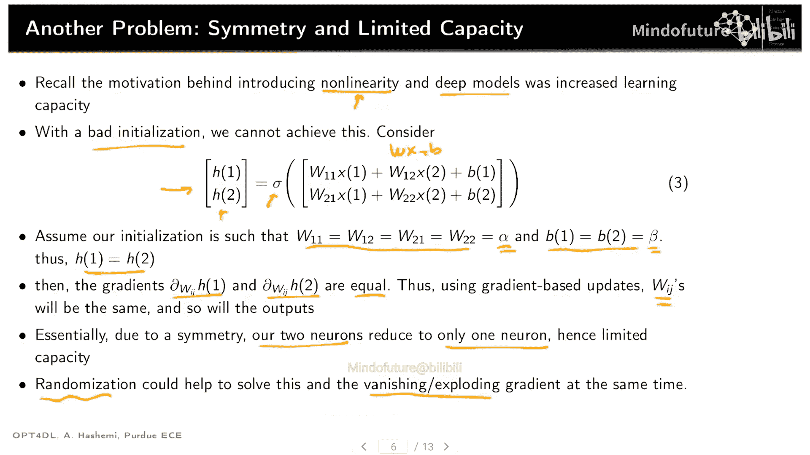

So one very famous techniques， initialization techniques is basically the heavierer initialization。

 It's named after the name of the the person proposing this idea。

 So the main idea is that we want to initialize the weight such that we don't sort of。

Change the signal strengths much。 Okay， so as a result of， let's say this， these。

 these matrix products， these vector products， we're not gonna change the in the strength of the input signal much。

 okay。And so we， we want to make sure that this happens when we process the information in the forward direction and also in the backward direction okay。

And the main idea for that is is that the way we calculate these gradients。

 as we're going to talk about in our future lectures through the back propagation algorithm。

 which requires us to traverse the network in both forward and password directions。So， therefore。

What we want is to make sure there is no drastic reduction or amplification in the signal strengths。

Which could lead to vanishing and exploding ingredients， okay。Now， for for our derivation。

 we're going to， let's say， consider that the activation is linear。

Or you can say that I'm going to assume that I'm， I'm acting， let's say。

 in the linear regime of of our activation。 Okay， so for instance， if my let's say at initialization。

I'm in the areas。Like in this region。I can， It is safe to say that almost all of my activations are linear。

 Okay， so the for the sigmos， I can replace it as say with the linear line。

 same for the radio activation and same for the for the Tish activation。 Okay。

 so for the next evaluations in the next slides， we're gonna basically make this assumption。

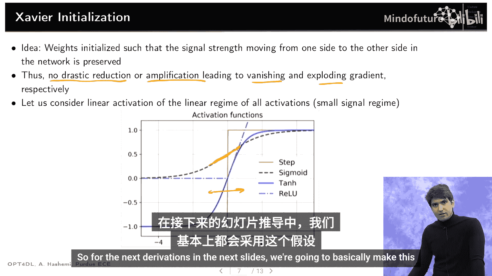

All right， so now let's consider a specific layer。Okay， and。

 and I'm setting the bias to be 0 with a loss of general generality。

 So let's say that I have a layer with where the dimension of the input is the in。

 dimension of the output is the out。 Okay， and let's let' us call the input and output X and and O for simplicity。

No，We need two conditions。 So we said that if we like traverse a specific layer from in the forward and password direction。

 we are not changing the strengths of the signal much。 Okay， or， in fact。

 we want to make sure that we don't change the strengths of the signal at all。 Okay， So therefore。

 we're gonna have two conditions。 our forward information probation condition is as follows。

 I want the strength of the output。Which we can denote it with this， the say the， the second moment。

 Basically， the expected value of the norm of the output the square。嗯。

To be exactly the same as the strength of the input signal。 Okay， so， so here the。

 the strength of the output is basically。This expectation。So we can expand it out。

So this is gonna be basically the sum of。诶。They each of these or。A square。

 the strings of each of these oil is a square。And what is my output。 I'm again。

 assuming that I'm in the linear regime of my activation functions， and there is no bias。

 So each of the output is basically this simple product okay。Alright。

 so this is when I I'm feeding X to， to this a specific layer， meaning that I。

 I find the prototype of X and W。 And then I get the out get the， get the output signal。Now。

 in the other direction， in the backward direction。

 I wna still make sure that I'm not describinging the power of the the signal by much。 Okay。

 so in this case， let's say I'm， I'm feeding or。In the back direction to my network。

And my output is basically X。 Okay， so in this case。

 the power of X is basically going to follow a similar expression。

 And it's gonna be basically the product of W and O。 In this case。

 I'm fitting O in the backward direction to this a specific player。Okay。

 now let's make some simplifying assumption。 Let's assume that the。

 the strength of each coordinate of the， the input x is some gamma in a square。 And for all。

 let's say， it gamma of the square。And also， let's say that we are utilizing random weights。 Okay。

 so we're gonna make sure that each of these coordinates of the weight matrix are， are independent。

0 mean random variables。With variance sigma square。

 So our goal basically would be to find a very nice sigma square a very nice variance or noise strengths to make sure that these two forward information propagation and backwardbone information propagation conditions or satisfied such that we are not again。

 amplifying or reducing the strengths of the the signal much， okay。

So all conditions therefore employ that after some simplication。

 employ that basically from the forward information proagation condition， D out。

 because they have D out number of outputs times gamma out because this is the strings of each each of the outputs is equal to D out D in。

Sigma square gamma in a square。 And you can see that the out appears in both sides。 so I can。

 I can get rid of it。 And similarly， in the back informationation condition。

 the in gamma in a square is D in the out sigma square gamma out。 And again。

 the in appears in both sides。 so I can get rid of it， okay。

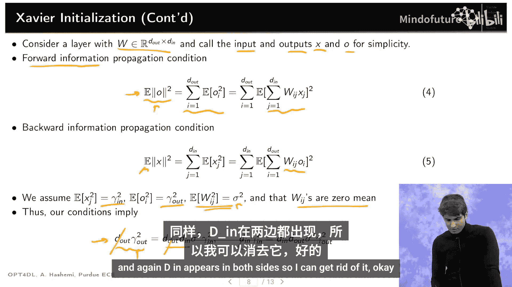

For it。So this is basically the condition that we want， right。

 So when we process the information in the forward， or backward direction。

 we don't want to the the strength of the signal to change at all。

 So that means that I want gama in a square to be exactly commma of the square， okay。

So these are the conditions we drive in the previous slide。Okay， if come on and go out are the same。

Therefore， I'm going to arrive at this condition。So one is equal to D in times sigma square and also one is equal to D out time sigma square。

 Okay， so basically， we want sigma squared to be inversely proportional order reciprocal of one over D in。

And also， you want sigmas scroll to be the reciprocal of vulnerability out， okay。So in many cases。

 and D out and D in are not the same。 Okay， we are changing lets say the this。

 the size of the image as we process it in the network， okay。

So we basically settle for the for the following。 So we set sigma squared to be the reciprocal of the average of。

D out and the in， okay。So therefore， we， we basically find like a nice formula for the strengths of these random。

 randomly initialized weights。 Okay， so we we， we set each weight to be a zero mean random variable。

 which is independent of the other weights。Such that is variance is given by this formula。 Okay。

 now we have to make a decision on which distribution we want to use to sample these。Random weights。

And typically， we either use the Gaussian distribution。 Okay， so for 0 me。

 we this a specific variance， or we use the like uniform distribution， which is symmetric around 0。

You can with the variance， which is proportional to sigma squared。Al， so。

 so this is basically the heavier initialization in terms of some， some modification to this。

 So here I mentioned we we use the reciprocal of the average。Average can be the arimetic average。

So basically d in plus the odds over 2 or the geometric average。

 So both of these are valid options in practice。Another modification is that in many situations。

 we are basically using the radio activation， okay。

And one implication of that is that when we are crossing a signal。

 it is likely that we are dropping half of the signal。 Okay， so therefore。

 we will compensate for this by increasing the variance with a factor of two。 So essentially。

 the idea is that let's say I have a symmetric input X。 So think of it like a random variable。

 Let's say a normal random variable， which is symmetric around0 or let's say uniform random variable or a binary random variable。

 okay。If the the variance of this random variable is to say it can come on in a square as a result of feeding it to value。

The， the strength is not gonna drop。 So the variant， and this is a very simple calculation to。

 to show that the variance is just gonna be gamma in a square divided by 2。

 That's why we increase the noise power by a factor of two to make sure that we， again。

 have this this this condition satisfied。

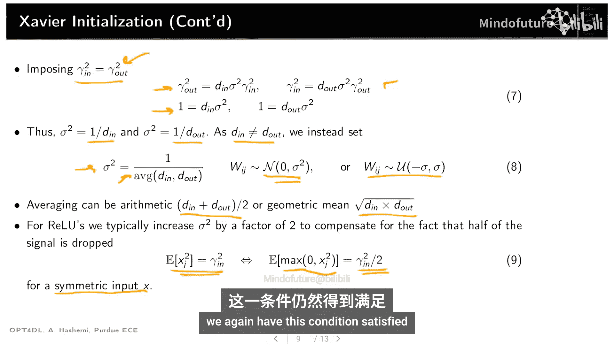

So this is the one of the frequently use initialization techniques， random initialization techniques。

 In the next video， I'm going to talk about and another kind of ideas that we use in practice to deal with the with the issues we mentioned。

I'll see you next time。