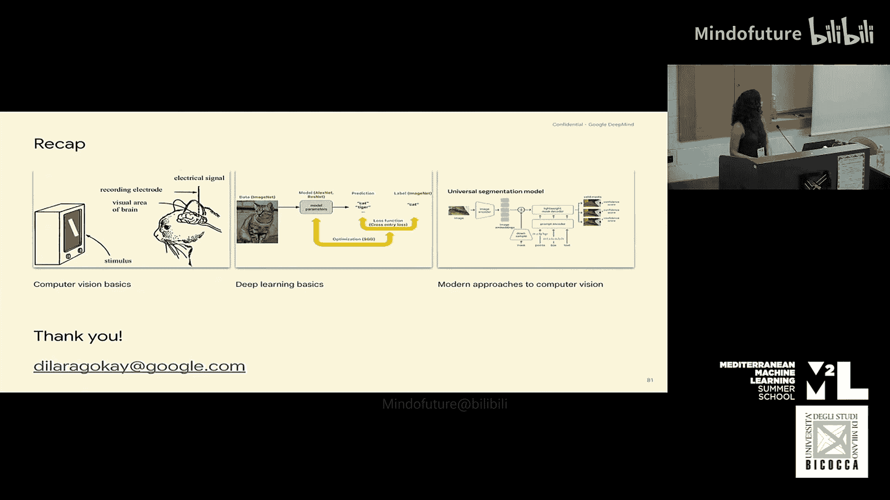

# 【比科卡大学】机器学习讲座 ｜ Machine Learning ｜ Moe ｜ Grpah ｜ Rlhf ｜ Llm ｜ Ai Safty ｜ 2024 p01 P01_深度学习视觉导论-Dilara_Gokay -BV1XzScBEEdJ_p1-

Well， thank you for inviting me to the summer school。

 This is actually the first time that I'm ever attending a machine learning summer school。

 so I'm excited to be here。😊，And today， I will talk about introduction to deep learning and vision。

 So I'm guessing that most of the content would be more of a refresher for today。

So we'll start with some computer vision basics。And we can define computer vision as the process of extracting meaningful signals from visual data。

 And what we mean by visual data could be lots of different things。 It could be an image。

 It could be a video， It could be a 3D visual data。

 which could spanm from point clouds or to matcheshes， and it's not only limited to these。

 It could be also medical data like MRI scans and so on。

And when we look into the applications of computer vision， it's applied in quite。

Quite a wide range of domains。 One of them could be face recognition。

 which is used in many of the smartphones today for authentication。

 Another one is autonomous driving in which computer vision is usually used for detecting the objects。

 like in this image。 the cars have been detected， or it could be the pedestrians。

 or it could be lane detection to make sure that the vehicle is on the right track。

It is also used in retail。 So， for example， there are the Amazon G stores， which are cashier list。

 So in there customers go， they pick up the stuff they'd like to have and then just leave the store。

 And how it works is that the items that the customers are picking up are tracked with computer vision algorithms。

Another area is healthcare here。 There is an MRI I scan and some segmented areas of the brain。

 So this could be the segmentation and the diagnosis could be done by the medical people。

 but also today with the help of。Computer vision techniques。

 We observe that computer vision is quite useful in that area， as well。

It's also helpful in manufacturing， where， for example， in a factory。

 where each of the object is and also in agriculture。 For example， in this image。

 its theres like a box between every insect or it could be， for example。

 computer vision could be useful also for detecting whether a plant is nutrition deficient。

 So quite a wide range of areas。And I'd like to talk a bit about the history of computer vision。

 which I think started with the first digital camera because the first camera actually made images。

Computationally possible to process。 And the first commercially available one was produced by Kodak。

 And it has the slogan， something like you press the button and we do the rest。 So it was， you know。

 available for the public。 and that。I think that's where it's where where everything began。

So fast forward to 60s， there are some neuroscientific experiments。

 This one being done by Hubo and Viasel， which is an experiment on Cat's brain。

 where they observe that on the when they show a screen to cats and some certain patterns on that。

 it fire certain neurons on the brain of the cats。 So that is an important neurological experiment that's done on how our visual cortex works。

Another work， which is often considered as the birth of computer vision is the summer Vi project。

 That was a project done in 1966 at M I T。 And if we look at the first paragraph， it says that。

Summer Vision project is an attempt to。Construct a significant part of a visual system。

 So that's quite an ambitious goal。 And within the span of a few months during summer， of course。

 not whole visual system has been constructed。 But due to setting this ambition。

 It's considered as the beginning of the computer vision as a scientific field。

And there are some computer vision algorithms that have been developed in the meantime。 For example。

 in 1986， there is a very cool edge detection algorithm that was proposed by Kenny， and by edge。

 I mean， in images where the brightness changes sharply。 So this is what we call edges。

 And Kenny's algorithm works in high accuracy and fast and still used in some of the applications today。

😊，Another thing is face detection。 So face detection hasn't started in 2001。 But again。

 a prominent work done by Viola and Jones is。Is one of the significant works in the area。

 And so what is also significant about that work is that although it works in lower accuracy compared to today's deep learning based approaches。

 it had unsurprisingly way fewer parameters than what we have today。

 So there's a comparing contrast in that sense。In 200，2005， Pascal challenge is。呃。

Pascal challenge starts。 And what happens is that in the Pascal challenge。

 there is an image data for which every image has been annotated with a bounding box or a segmentation mask。

 and that there are four object categories like car， motorcycle and so on。And that such。

Image dataset set challenges are usually considered helpful in advancing the field。Therefore。

 coming to 2010， theres the imagenet dataset with over 10 million labeled images and over 10000 object categories is training。

 So that's quite a large scale dataset。 And we're gonna talk more about it in the upcoming slides。

And building on the presence of Imnet data in 2012， Alexnet。Paper has come out。

 and this figure we see is the percentage error on Inet challenge。

 And until the time that Alexnet came， we observed that the error was only as low as 25%。

 and with the emergence of Alexnet， it came down to 15%。

 And then from then on deep learning algorithms emerged。

 So what Alexnet showed here was that there were other deep learning approaches as well。

 But it contained more layers and that it was able to utilize GPSus for making the training of deep neural networks efficient。

 So that was， therefore quite influential in that sense。And if we come to today or near history。

 we observe that almost every computer vision algorithm or approach is tied with deep learning。

 For example， today， we will talk about convolutional neural networks a bit more in detail。

 There are autoenrs。 There are transformers and diffusion models as well。

 which are used quite often today。And if， if you also take a look at the academic presence of the vision and deep learning。

On the left， there's the number of papers at CBPR Comp vision Pat recognition conference。

 And we observe that the number of submitted papers have increased quite significantly。

 And when we also look at the number of M L AI archive papers papers， it almost grew exponentially。

 So these two examples like this and this show the。

Impact of deep learning on the field of computer vision。

 But it also has impact on practical applications as well。 For example， recently。

 Google announced a project called Astra where one can take a video of their surrounding area and ask some questions。

 So here's。How it looks like。Tell me when you see something that makes sound。Are you able to hear it。

 which makes sound？What is that part of the speaker called？That is the tweeter。

 It produces high frequency sounds。So we not only see the academic。Applications。

 but also in the industry， we see that deep learning finds this place。

 So I'll introduce some example tasks in the field of computer vision。 So given an image。

What iss called image classification is what would be the category of an image。 And in this case。

 it could be a jackkyal。An object recognition and localization means to find which objects there are。

 which are jackal and car and also localizing。 And in computer vision。

 often localization is denoted through bounding boxes。 So that's why it's been visualized this way。

There's visual question answering about the image。 For example， iss this an outdoor scene。 Yes。

 what is the weather like cloudy but dry。And another task would be activity recognition which activity is being done in this image。

 And in this example， it is walking for thejakyal。Theres a pose estimation problem。

 which is often attributed to humans。 So pose estimation。

Usually means finding the joints of a human in an image。 And in this case。

 that also translates to an animal as well。Caaptioning is briefly explaining what's happening in an image at Jakyal walking across a rural asphalt road。

And semantic segmentation is a bit different than the previous tasks。

 because semantic segmentation is a pixel level task。 It shows which category each pixel belongs to。

 like a road， a jackal， vegetation， and therefore。Often in the field， it is called a dance task。

 since it is pixel level annotations。There is also depth estimation。

 which is to predict how far each pixel in the image is from the camera。

 And that is also considered as a dense task。There's 3D shape estimation。

 which is often estimating the 3D shape， 3D shape of an object in a 2D image。And lastly。

 there is the visual localization problem for which given a global map of the environment。

 like on the top right and given an image。Preicting where the image corresponds to in that global map。

So if we consider the traditional computer vision pipelines， like the ones we have discovered。

 we explored in the。History section， one way to， for example。

 solve the image classification problem could be to have an image of the ske cat and then find the edges。

 And according to how the edges look like， predicting what class it could be。

So that's a traditional way of doing it。 But we're in the era of deep learning。 So in deep learning。

 we have an input data。 We have our model。And our model is also defined by our model parameters。

 And then it predicts which class the image belongs to。

So the important point here is how to find the rights of model parameters so that we can get good predictions。

And this is。Done through training。 So for training， we need a label ground truth。 By the way。

 I'm referring to supervised learning here。 So this image is valid for this one。 Of course。

 there's selfupvised learning or unsupervised learning as well。 Just wanted to make it clear。

And the how close the prediction and label would be。Computed through the loss function。

 And then the loss function would be used to optimize the model parameters。

So we're going to walk over them one by one now。Starting with the data。So in computer vision。

 our input is images often or videos， other visual data。 And usually it looks like this。

 It's usually a tensor of integers。 And for the case of an image。

 its shape is usually high by width by channel。 And in the colored images。

 it's usually three channels， red， green， blue。 Or if it's a grayscale image。

 then a single channel is usually sufficient as well。And in the case of supervised learning。

 especially it's important that there is large scale， annotated data available， and Inet is。

A widely used data， in that sense。Then， there are some。There are some models that we can use。

 And what we mean by model is typically stacking more than one layer。

 And what we mean by layer is simply a matrix multiplication。And。Some types of layers are。

 they could be fully connected layer。 It could be convolutional layer。Could be a pooling layer。

 non nonlinear layer。 attention layer could be anything。And we're gonna go over them， one by one。

So for a fully connected layer， it's made up of a simple matrix multiplication weight matrix times the input vector X plus the bias。

 And so in this image， the bias is not visualized。And the weight matrix。

 when we open this expression and take a look at the。H vector through1 by one。For example。

 H1 could be defined as W 1，1， x1 plus B1， W 1，2， x 2 plus B2， and so on。 so the W。

Ws correspond to the edges in this graph。 And we can do this for all of the H。Here。

And in this example， the input and the output have both are both vectors with five elements。

 but that doesn't have to be the case。 So they could contain different number of elements。Next。

 we'll talk about the convolutional layer， which is given an image。 So in this one。

 it was a 1 D vector。 And in this one， we have a 2D matrix。 And we also have a convolution kernel。

 which is also 2D。And the computation of the convolutional layer looks like this。

 We put the kernel on each part of the image and slide it from left to right， top to bottom。

For example。If we put that yellow matrix on top of that。

And do some sort of like a product where we multiply each element with each other and then sum them up。

 In this case， it is one because it's like 0，0，0，0，0， and then  one。If we slide it by one。

 which means to have straight 1， then we have one plus 1 plus 2，4。 And if we do another。Striide。

 then it is 2 plus 6 plus 2 plus one。Another layer is the max pooling layer。 In this case。

 let's say that we have a matrix which is 4 by 4 and would like to do a max pooling。

 So max pooling operation is。Visually looks similar to the convolution， where it's also 2D。

And that it could be also strideed as well。 So in this case。

 it is a two by two max pooling with a stride of two， meaning that we look at each area。

 each region with the same color and get the maximum value out of it。 for the pink region。

 It is 6 for the green1。 It's 8 for the yellow。 It's 3 and so on。

So how max pooling is different than fully connected and convolutional layer is that it's simply a max operation。

 So there is no learnable parameters， as in the other cases。

 because if we look at the convolutional layer， then this kernel could be learned。

 And in the case of fully connected layers， it's the weight matrix。

 it's the we can learn the edges in that case。So we also should consider non nonlinearity often when building a neural network。

 because if we just stack multiple linear layers and add no nonlinearity， then that would be。

 that would only be able to represent a linear function。

And if you look into the universal approximation theM。

 it says that a neural network with at least one hidden layer and a non nonlinear activation function can approximate any continuous function。

 So it's important to include non nonlinearity and some。Freely used ones are sigmoid，10 H and Relu。

Often， Relo is pretty commonly used in the applications， while the others are used as well。

Another function that is important for the image classification problem is the softm function。

 So given the output of the layers。 So， for example， in the fully connected layer。

 we had five outputs， right。What is， then the question is。

 what is the probability that if those five outputs are each representing a class。

 what is the probability that the image is belonging to a certain class。And in this case。

 softmax translates the output into probabilities。 and that this is used to get the。

Get the predictions。Another important thing while training neural networks to add is regularization。

 because if we， while training the neural network observe that the training errors is going down。

 training accuracy is amazing。 But then when we look at the validation split。

 it's not doing so great。 then it's likely because that the network is overfitting。

 And one of the commonly used regularization techniques is drop out。And if we look at the a。

 this is how a standard fully connected neural network would look like。

 And what dropout does is that during the training time， some of the neurons are deactivated。

 so essentially。The network is smaller than what it used to be， meaning that。The capacity is lower。

 And one of the reasons why overfitting happens is that when the model has too many parameters。

 then it could overfi to the training data。 So this effectively helps that。 And during the test time。

 there is no dropout。 So this helps quite a lot with the overfitting problem。

And so we talked about fully connected convolution， regularization， max pooling， and also softms。

 And having all of these actually brings us to the Alexnets， which is the 2012 Inet challenge winner。

So Alexnet begins with an image of size， size， height， width and channels。

 And then there is a convolutional layer with 11 by 11 kernel and4 stride。

 So in our convolution example， we had a three by3 kernel and strideide 1。

Then it has a relu nonlinear layer。 And then there is a pooling。With3 by3 and two stride。

 in our case， the kernel was  two by2， and the stride was 2。Then it's again。

 followed by conreou pullinging and then several convolutional layers。 And at the end。

 what happens is that this image is。Well， it's effectively has smaller size， and then it's flattened。

 meaning that it's now a 1 D vector。 and then it's passed through several fully connected layers。

 And then the last fully connected layer has thousand0 neurons。

 each of which corresponds to one of the classes in imagenet。So。

When we look at the impact of CNNNs on Inet。 So 2010，2011， there are shallow networks。

 and then Alexnet has eight layers and improves the performance on Inet quite significantly。

 And then when we move to 2014， there's VG G and Googlenet， which even has more layers。

 like actually， if you consider it's double the number of layers。

 And then if we move more than starting from 2015， the depth of the networks increased significantly while also you might notice in 2015。

For the first time， the。Performance of a neural network surpasses the performance of a human。

 which is on the rightmost side。 So it's quite impactful。And the work that LED to this is the resnet。

So we'll take a close look at Resnet a bit because that's where very deep neural networks。

 like training them has been shown to be has has worked basically。

 and that how they did it is through residual connections that we will discuss shortly。

 So Resnet has 152 layers and that it not only performed well on INe， but also coco as well。

And on the rightmost side， there's the architecture of the resnet。

So obviously seeing the improvements on the imagenet with Alexnet and so on。

 the natural question was， what happens if you keep on stacking because that seems to work？

 But what is observed is that actually， as there are more layers。

Neither the test error nor the training error is actually improving。 It's still the worse。So。

And this is not caused by overfitting because， as I mentioned， overfitting。

 we can see it when it's doing very well on the training set， but not so well on the test set。

 And we observe that it's doing it's doing not well on both of these cases。So。

The authors of the Resnet come with the observation that deep models should have more representation power。

 or at least as much representation power as the shallower models。

And that their hypothesis is that this is not a， you know stacking the layers problem。

 It's a optimization problem。And then。They come with the observation that if we had a convolutional and re layer。

 like on the left， and if we had more layers。And if the， let's say， second layer is identity。

 then it should be just as same as the previous solution。

And then what they do is that they decide to have those residual connections。

 So it usually looks like this。 There is the input。 Theres a convolutional layer。

 a non nonlinearity layer， convolution。 And then the input is added to the output of that。

And if we look into the full resonnet architecture on the rightmost side， we can see that it's。

 it has lots of lots of residual connections。 and every residual block has 3 by 3，2。

3 by 3 convolutional layers。The number of filters double every time like it starts with 64 and increases to 128 and so on。

Theres at the beginning one convolutional layer。 And at the end， a bit different than Alex andnet。

 they have only one fully connected layers just to output the。

 just to output the probabilities for each output class。So in the， in this work。

 they try different depths like 18 layers，34，50，101 and 1，52。

And the result is that it has very low error on imagenet and as well as also on Coco 2015 competition。

 So what Resnet shows is that。By stacking more layers， while initially。

 it has been shown that the test error and trainer weren't performing so well with residual connections。

 this degradation could be improved。And， yeah， and also another thing that's worth noting related to Resnet is that what is observed when stacking too many layers is that。

The vanishing gradient problem， which is during back prop when multiplying small gradient values。

 the final result could be too small。 And also another observation here is that the residual connections。

Help。Help to tackle this vanished ingredients problem。So this was the model part。

 and for the image classification， a loss function should tell us how good the current classifier is。

 how close the prediction is to the target。 and this is usually done through the cross entropy loss。

 which is on the left side true probability distribution multiplied by the logarithm of the predicted probability distribution。

And on the right， theres an example。 So the column represented with L shows the true probability distribution。

 For example， if the top row is cat， it's one because it's ground truth。

 And then the rest are the other classes。 And on the left， there' is a predicted one。

 And we can just plug them into the equation。So the last bit is how we optimize the model so that we have good model parameters that gives us good predictions。

And usually。What is done is the usage of stochastic gradient descent。

 So the batch gradient descent without the stochasticity is updating the weights after computing it for all samples。

 stochastic gradient descent is computing only for one sample。

 whereas stochastic gradient descent with mini batch is doing this computation for k samples。

 which is a commonly used case， because batch gradient descent。 While it seems stable， Its。

Computationally more expensive to compute than the other approaches。

 satochastic gradient descent could be too noisy， and therefore。

 the mini batch gradient descent gives a good。Middle spot。

 And what's usually used in practice is stochastic gradient decent with momentum。

 Or there's also the atom optimizer， which is quite often used。

So this is the summary of how a data driven visual recognition pipeline or like a deep learning pipeline looks like we have our data and in some cases。

 label as well， which in this case was imagenet。We have our model， which in this case。

 were Alexnet and Resnet。The loss function between the prediction and label was computed through the crosscenttro P loss。

 and we can optimize it through S GD or any other optimization。

So that brings us to the modern approaches to computer vision。To begin with。

The problem of semantic segmentation， like。Predicting which category each pixel belongs to。

One of the latest works in that area is segment Anything。

 which was published on International Conference on Computer Vision last year。

And the architecture looks like this。 So there's an image。

And there is an image encoder that gets the embeddings。 Actually， can I point。Yes。

 so this image encoder helps us get the embeddings。

 So what this image encoder could be that it could， for example， be a convolutional neural network。

 But in this case， it is an M A E V， I T。 So M E stands for must auto encoders。

 and V I T are vision transformers。And how must auto encoders works is that they are auto encoders。

 which means that there's an input image and the model。Tries to reconstruct the same image。

 And when it is masked， some parts of the input image are masked， but still。

 the model reconstructs the same image。 And that has been shown to be a strong pretrain strategy for vision models。

And related to the vision transformers， I'm sure you'll hear more about them in the upcoming sessions。

So this is the image encoder part。 and then there's the prompt part。

 So how segment anything works is that either the using user can click a point like for example。

 click here， and then it would segment the road or I could draw a bounding box and then it would segment the pixels for the jackal。

 So there are a few different ways to prompt the model。

And there's a prompt encoder that gets the embeddings for the prompt。

 And they use a clip encoder for that。 So clip is a。

Is a framework that helps us get good image and text。Encodes through contrastive， free training。

And then there is a mass decoder， which is a transformer decoder that fuses the two embeddings and gets us the results。

So this is an example for the semantic segmentation。For the visual question answering， there's Polly。

Which takes an image and also a text。 The image embeddings have been obtained through a vision transformer again。

 and then。The transformer encoder and decoder are large pretrained language models。

 and that they are cross attendedend。 And the result is the question related to the image。

I'm not going too much into details of those models because I'm assuming that the building blocks will be explored more。

 but feel free to ask any questions。Another problem we looked already previously is depth estimation。

 and one of the works that came out recently and works really well is depth anything。

 So indeed depth anything。 there are two different predictions。

 So there's the labeled prediction for which the labels are coming from， for example。

 Lidar matching or structure for motion。 And there's the unlabeled one where the labels are pseudo labelbels coming from a。

Free train model。And in this case， for the labeled image。

 the encoder decoder reconstructs the depth map。And for the unlabeled one。

 what happens is that there is。Another encoder。Whi is pretrained and unlabeled image is augmented for a bit perturbed。

 and then it is fed to this gray encoder。 And then the loss here is that even though the unlabeled image has been perturbed a bit。

 there should be still some semantic preservation。So the building blocks of this model for the encoders is。

 again， a vision transformer， and it has been pretrained a Dno V2。

 So Dyno V2 is another selfupvised learning method to pretrain image models。

 and it has been shown to perform from well across a wide range of tasks could be image classification。

 depth estimation。And DP T is a dense vision transformer that came out a few years ago。 And this。

 we observe that is often used in depth estimation works in the literature as a decoder network。

 And what DP T is， is essentially is also a。Transformer。So image generation。

 we haven't discussed this before， but I'm sure， like you've all seen very photorealistic nice images on the Internet that were outputs of the image generation models。

 In fact， I generated one here from the stable diffusion by giving a prompt a group of people discussing machine learning in Milan。

 So image generation helps us get those creative contents。

And one of the works that works well for the image generation is the onc model。

So UnClip has two parts。In the architecture， there are the dotted lines。

 So if we just look at the top of the dotted line， it's simply a clip objective。

For which there is a text encoder， and theres an image encoder。And the clip objective。

Helps us find a joint embedding space between the text and the image。 And afterwards。

 the text encoder is frozen。And then there is a prior network that generates an image embedding。

 given a text caption。And this prior could be a diffusion， or it could be in this paper。

 an auto aggressivegressive model as well。And then there is the decoder which generates an image。

 and this decoder is a diffusion model as well。Another computer vision problem we haven't looked before is the object tracking。

 So object track object tracking happens over a video。 So we looked into mostly the images so far。

 And in the case of video， given an object， it is tracking where it is。 And again。

 it's usually done through the bounding boxes。For example。

 this video is from the perception test data set。 And if we take a look。

 we observe that over the time， the bounding box around the tea box is changing because the person is opening it。

And one of the example。Models that tackle this is the Si F S。

 which contains two identical networks to learn the similarity between the representations。

 And this is essentially what a Siamese network is because in Siamese networks。

 there are two identical networks and。It's also worth noting that this is fully convolutional。

 So this is similar to what we have。What we have discussed so far。And lastly。

 another video related task is point tracking， so point tracking is more fine grainined than object tracking because in the object tracking。

 it's the whole object we're tracking through a bounding box， whereas in the case of point tracking。

 it is predicting where each pixel is throughout the video。

 like where each of them correspond to in every other frame。And one of the example。

Works we did on that is called Bootstep。This is also。

Similar to the self supervised learning methods we looked into。So initially， if we only look at the。

Part with gray background。 So this is the supervised part， so。We。This not the spark。

In the supervised parts。It's simply given a video predicting the trajectories of each of those points。

And this is done in a supervised way。 Pointin tracking， as you can imagine。

 is not a problem with many annotated videos， like real life videos。 Therefore。

 synthetic data is often easier to obtain for training in a supervised manner。 And in this case。

 input video and some query points， output where that query is。

And the network in this case is called Tiier， which is essentially consists of some fully connected and convolutional layers。

And then comes the bootst part。 So in the bootst part。

 the pre traineded to peer model is used as an initialization for the student to peer model。

And in this case， the student appear keeps on training on the synthetic video like it has been done for the supervised part。

And there comes the bootsrapping part here for which there is now a real video without any annotations。

 but gives us the availability to use larger and more real life videos。 So given a real video。

And a corrupted real video， which is often an augmented version of the real video。 For example。

 it could be cropped。 It could be moved to some other parts。

 And then what happens is that the student predicts a trajectory。

And then there is a teacher model as well， which is simply the exponential moving average of the students。

This helps us get the pseudo ground truths。 And the expectation is that the student and teacher should predict similar trajectories and that this is the self supervised loss。

So。To put simply， this work starts from a supervised approach and then uses it for the initialization of the student and teacher models。

 which helps us improve the output through selfupvised learning even better。So that was it。

 We started with computer vision basics， went over the deep learning basics and discussed some of the modern approaches for computer vision。

Thank you for listening and happy to take any questions if you have any time。

