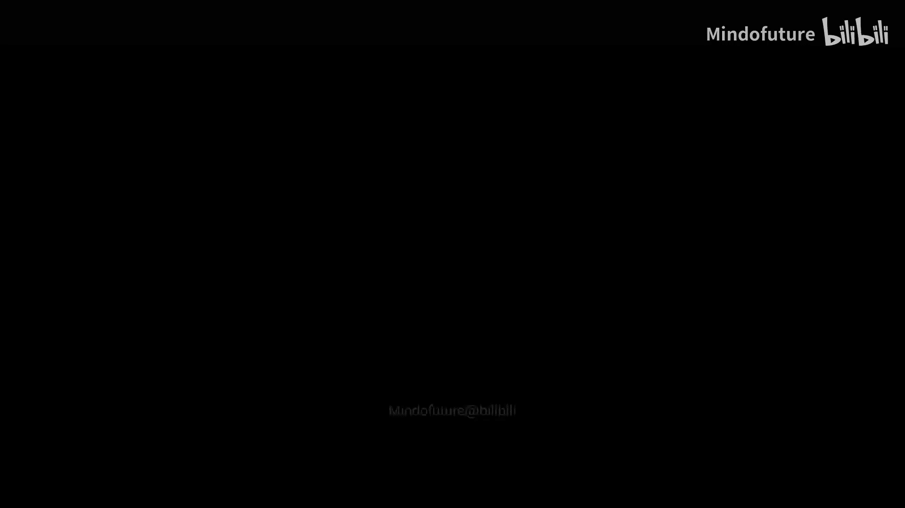
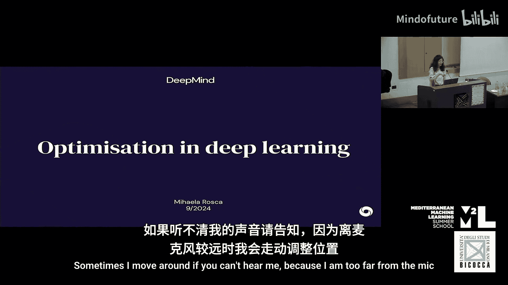
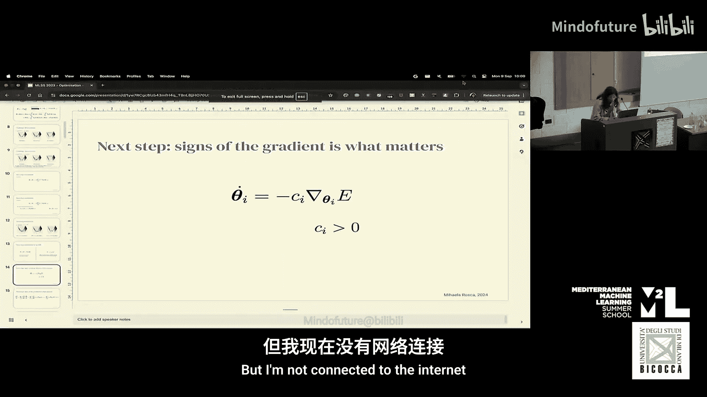
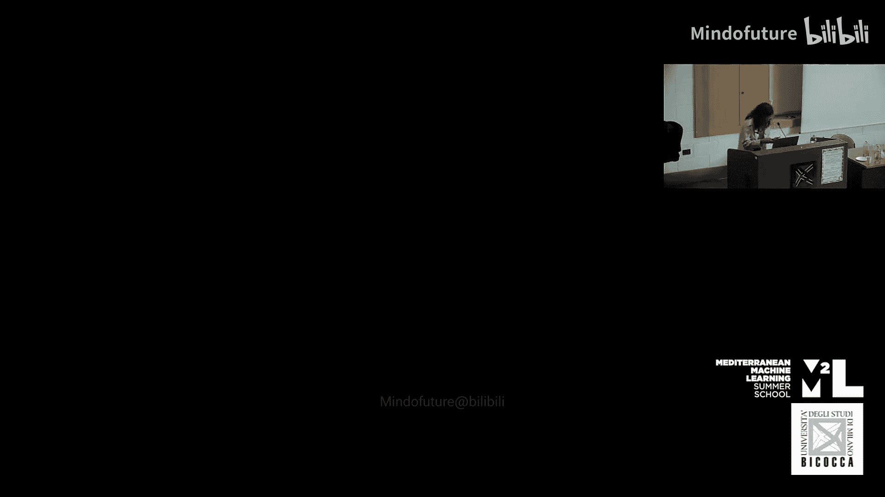
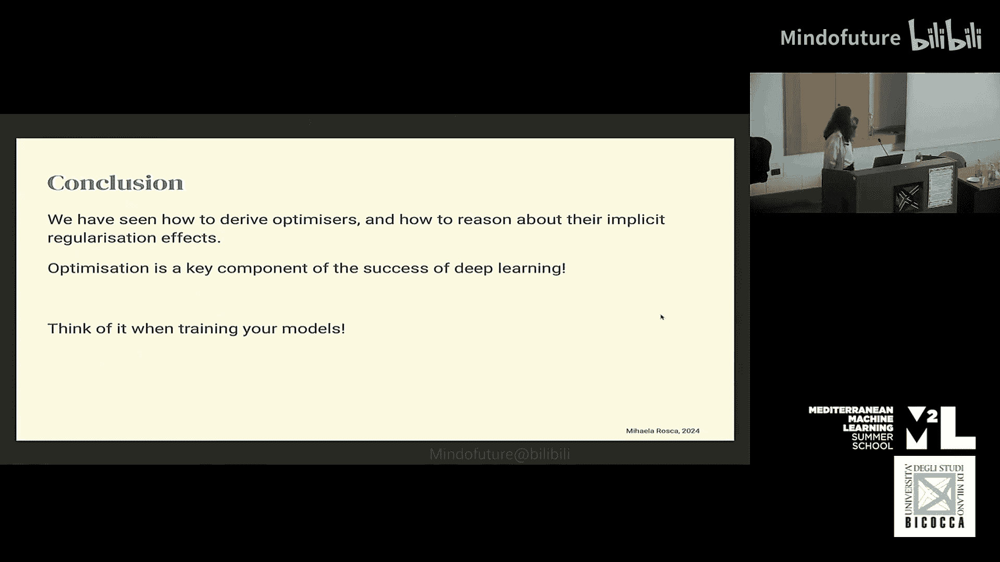
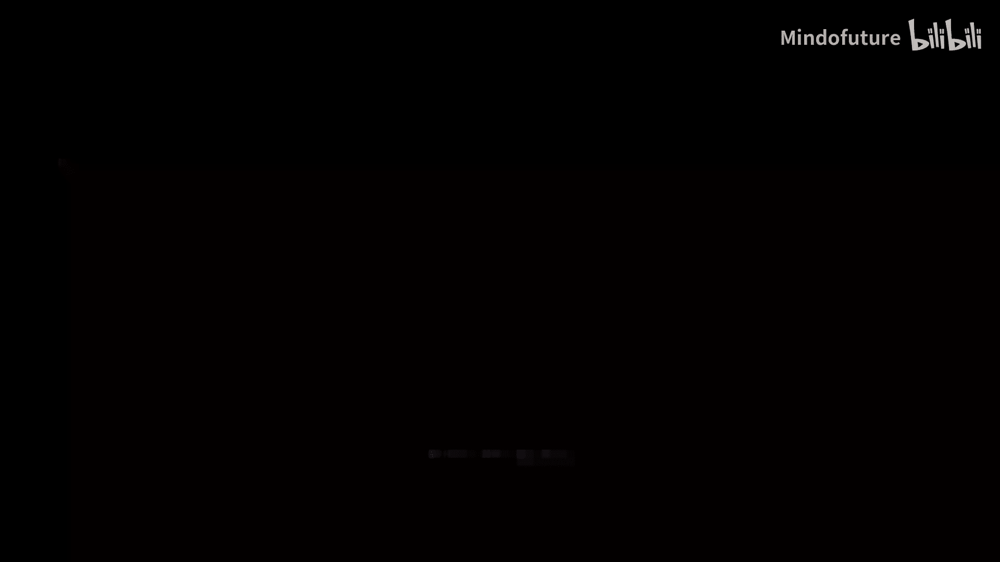

# 【比科卡大学】机器学习讲座 ｜ Machine Learning ｜ Moe ｜ Grpah ｜ Rlhf ｜ Llm ｜ Ai Safty ｜ 2024 p02 P02_深度学习中的优化-Mihaela_Rosca -BV1XzScBEEdJ_p2-

Okay， thanks， Mateo， for the World welcome。 And thanks everyone。 So as Mateo said， I'm Mihaila。

 and let's have some fun talking about optimization in deep learning。

 Sometimes I move around if you can't hear me because I am too far far from the mic。

 Just let me know。😊。

Okay， so let's start with a bit of a disclaimer。 We're gonna talk about a lot today。

 which means that I will probably miss some things that maybe you like。

 or you think something should be referenced。 There's a comprehensive list of references at the end of the slides。

 But if there's something that you think should be added， just let me know。Okay。

 so what we're gonna talk about today。 We're gonna talk about function optimization。

 So we're gonna say that we have a function。 I'm going generally denote it as E of parameters。

 which we usually denote as theta。 And we say， well， we start with some initial values of this theta。

 usually some random guesses。 and we're gonna to follow some sort of optimization trajectory to hopefully get。

😊，To some sort of minima， in our case， we often hope for local minima because we can for the algorithms that we generally look at。

 we can only hope for global minima for complex functions， which are too simplistic for our。

 our use cases。So generally， when I say minimum in the talk， I usually refer to local minimum。

 And this is a very simple example where we can visualize what's going on。

 or we start with some initial value。 and then we slowly go towards the optimum。 Now。

 how do we usually do that。 Well， we tend to do gradient descent or someone that's very。And here。

 again， to introduce some notation， we do iterative updates into the direction of the negative gradient。

 So we take the gradient at the current parameters， and we take a small step。

 This is the learning rate H into the direction of the negative gradient。😊，So why do we do this。

 Why do we follow the negative gradient？ Well， there are various ways to derive gradient descent。

 One way that I particularly like and that we're gonna follow today is to start with continuous time。

So if you remember your O Ds， we can write an O D and who。Can you not see my。Equations here。

That's not good at all。Why is that？Oh。Okay， seems to work now。If we follow the negative gradient。

Time， So that means if I have a very， very small unit of time that tends to 0。

 And if we follow the negative gradient， then we can easily prove that in time。

 the loss function goes down unless were at the point where the gradient is 0。

 So this is the O D first line there。 that we can see now， we're。

 we're saying that the parameter should move very slowly。

 So in D T goes to 0 in the direction of the negative gradient。 And then we just write a change rule。

 and we see that D over D T， that is the change of the loss in time。😊，Is smaller or equal to 0。

 So that means e goes down。 So that sounds good because we're in the business of minimizing functions。

 So we start with， with this。 Now， the problem is that this works in continuous time。 As I said。

 which really， really， really small。 steps go to 0 in the limit。

 So we can't really do that with our computers。😊，Right， so we have to do something。 We have to go。

What's happening here？I have to refresh the slides， every。Every time I have an equation。

 that's not gonna be good。Ca spoiler alert， there are quite a few equations here。啊。ok。Okay， so。

If we start with continuous time and we want to move into the discrete time。

 which is what we use for our computers， we can go。

 We can start with the continuous time approach and get to gradient descent by Euler integration。

 So this is a very simple techniques from numerical analysis that gives us gradient descent。

 So that's how you derive gradient descent。 Now， Euler integration is so simple that actually。

 we're gonna to just do it together in a few lines。 And well， now equations even more。 So its。

 it's as simple as saying if we sorry，I'm told I already move around too much。嗯。Okay。Okay。All good。

So we want to compute where would we be if we were to follow the ODE in continuous time。

 and we do that with an integral。 So we say， well， at time H， and this is already a good hint。

 usually the learning rate， the way you should think about it is as a unit of time。At time H。

 we are where， where we were at the beginning， at time 0， plus the unit of displacement。

 which is integrating from 0 to H。 This is integrating over time。 The vector field of our O D。

 which is there in the equation。 And then in our case， we know what the definition is。

 is the negative gradient。 we just replace that in。😊，Now， the problem is that the。

Doing that integral is pretty hard。So we don't really know in the case of general functions E how to compute that integral。

 But what we can say as well， Im going I'm just going to approximate that gradient on that small time interval with the initial gradient。

That's it。 That's all you need。 And then you end up with gradient in the sand because the thing inside the integral is the constant。

 And then you can pull the edge out。So that's it On the right hand side。

 Now we have gradient descent。 This also gives us an idea of the assumptions behind gradient descent。

 We have assumed that the gradient is locally constant。If that holds。

 gradient descent is very close to the gradient flow。

 If that doesn't and it doesn't always have to be the case。

 then we are pretty far from following the gradient flow， which we know minimizes the loss function。

And this is what disccratization can lead to。 So while following the negative gradient flow here shown with the red line always minimizes a function。

 We've just proven that。Greak in descent doesn't always do that， right。

 And that's because of this discretization that is dependent on the learning rate。

So if the learning rate is small enough， K E here， you are still taking bigger steps。

 You see how the dotted green hi fully jumps down in the first plot， but you。

Get through the optimum as the same as the gradient flow。 However， if the learning rate is too high。

 as you can see on the last plot， then you might even diverge。

 And that is due to thiscratization because of this assumption that we made here that we're on a small enough interval that the gradient being constant approximation holds。

So we've derived gradient descent， and we've already seen some of the challenges in this very small example。

 and we'll see how this can affect neural network training in a bit。

So for quadratic functions like this one。Wef again。嗯。Okay。

We know exactly actually in which of these cases we're going to be。

 And that depends on the curvature of the loss。 but we will see that for neural network is becomes a bit more complicated。

So now let's talk about momentum。 So when we train neural networks。

 we don't usually use just gradient descent。And the intuition behind momentum is very simple。

 We've just seen that we want to go into the direction of the negative gradient。

 But if the negative gradient across iteration tends to be very aligned。

 maybe I can speed up training a little bit by creating a moving average over all the previous gradients。

 But I want to use some sort of geometric decay because if the gradients are from very。

 very far back in my trajectory。 Maybe I don't want to use them too much。 So that's it。

 That's the whole intuition behind momentum。 Of course， we don't usually write it like this。

 because this would be very memory inefficient because it means that I would have to hold it memory。

 all previous gradients。 But instead we can write it using a momentum buffer。

 And this is the update that you're most familiar with。 So that's it。 simple intuition。

 And now with the right momentum， we can again look at its behavior or if only we could。😊。

Look at its behavior， and we see that。It what。It has slightly different behavior and gradient thecent。

 of course， we would expect that， but we also see that this hyperparameter beta that we've introduced that keeps track of how much do we account for previous gradients can have a huge effect on the optimization trajectory where you can see the difference between beta 0。

9 in beta 0。5 on the last two plots， even though the learning rate is the same。

 hugely different trajectories and large beta in this case can introduce a lot more oscillations around the optimum due to previous directions that are way too different than what we should be doing right now。

We can also think of momentum as an O D。 It's often thought of as a second order O D E。

 But most recently， by using different discretizations。

 people have thought about it in a very similar way to the negative gradient flow。

 And the reason I want to mention this is that the intuition is very simple because beta is between 0 and1。

1 over  one minus beta is going be greater than1。 So in this case。

 as long as the discretization behaves well。 And as we've seen it doesn't always。

 you can think of it just as a sped up version of gradient descent。Now， this is quite important。

 sorry。How do we， I'm wondering if I should just get the Pdf out。To avoid this。In the future life。

Yeah， that's what I'm thinking of doing it。But I'm not connected to the internet。

Sorry， one sec。Oh。

I'll just do a hot hotpot for my phone again。嗯。Okay。Where's the。Is it not worry？すね。

But this way I comp press them to drink。What's a good tool for presenting PDFs？你 know。今なす。Yeah。

 but I'm trying to see how I can。Because this way it doesn't present you something because I'm in Chrome。

That's not sure how to present a billion from Chme。あ。

Maybe you can open it with the preview instead of time。Let's see。新装。Yeah。あだても。系。Okay。

I can' have to move it to the other screen。Why。They are it should to be mirror， yes。

Let's see if this works。Yeah。ok ok。I think we're good， we have the PDF now。Okay， so moving on。

 hopefully with all equations now， the main insight here。

 and I think if you take one thing from this talk， this is a really important one is that what matters in the gradient。

 It's primarily its sign。 The magnitude is also important。

 But the direction in which you're changing the parameters is the most important one。 And again。

 an easy， easy way to see that is using continuous time。 So now I'm a new Od。

 where for each parameter and'm saying we can move into the direction of the negative gradient。

 with some coefficient， some positive coefficient。 So I'm changing the speed。

 but I'm keeping the sine of the gradient because C is positive。

 And then we can do the exact same trick as we did before。

 and we see that we can again prove that the loss function goes down。

 So this is a very quick way to remember why the s is what matters with gradient sign。😊。

So if you take this idea， you can derive our problem。Which just replaces the。Negative gradientdiant。

Well， it replacera the gradient with the sign。And this is all good。

 But now you're quite sensitive also to the learning rate， right。

 because each parameter gets changed by by the value of the the magnitude is given by the learning rate。

 Only the sign is given by the gradient。😊，But an insight here comes from the fact that you can write a sign of the gradient as the gradient divided by the square root of the gradient square。

And you can say well inhaa， but this is pretty trivial。 Yes， but from here， we can use， again。

 some insights。From momentum that we've just seen and use moving averages to stabilize things a little bit。

 And we still use the gradient for the denominator， but use a moving average for the denominator。

And that's it we derived RMS f。 And this is an algorithm that we tend to use already quite a lot。

 And if you want to move forward and combine two ideas that we've just discussed， one。

 the sign of the gradient is what matters。 and we're going to use moving averages to smooth things a bit。

 That's how we derived our prop。 and we use the moving average for the denominator。

 If you use the momentum trick for the denominator。

 So now we're moving from only depending on the gradient here to having a moving average at the top。

 then you have atom。And that's it。 That's all you need to know to derive at very intuitively from scratch。

Now， of course， now we end up with even more hyperparameters， beta 1， beta 2 learning rate。

 and of course all of these affect optimization trajectory。And I want to point out one thing。

 There is this extra hyperparameter， the epsilon。This one is often used for numerical stability and very often ignored。

 but the default in optimization packages that we use tends to be quite small。

 And just changing that。 just this one small hyperparameter。

 This is the difference between the top and the bottom rows can be quite big in your optimization trajectory。

 And you can see this examples here。 But actually， we've seen that， for example。

 in applications such as reinforcement learning， this epsilon manners a lot。

 So ignore it at your own per。So to summarize this part of the talk。

 I hope I've convinced you that it's a bit useful to think about continuous time to derive an optimizer。

 The sign of the gradient is what matters， and it's often good to smooth things over multiple steps。

 And of course， we all know atom。 and we've seen how we can very intuitively derive it。

 but often can think about not enough we can ignore some hyperparameter that actually we see that matter a lot。

😊，So that's how we derive some of our basic optimizers。 Now。

 let's think about some of these things in the context of deep learning optimization。 So so far。

 nothing that we've talked about is deep learning specific。

 But when me do deep learning optimization。 Things change a little bit。 So far。

 we've talked about very nice quadratic functions where we even know what the global minima is。

 And even then， as you see in the left hand side。 trajectories are not always easy。😊。

But if you look at neural networks， then their landscape can be much more。narly to say。

 but turns out that in deep learning optimization， things really work better than we would have expected。

 So this is what we are going to talk about now。 It's like， why is that。

 Why is it that deep learning optimization generally works so well。

So some of the challenges with it is that it's high dimensional。

 So we've moved from two dimensions to like a million。

 Now we're talking about billions and billions of dimensions with these large models today。

 Of course， we also use a lot of data。 right So if we use a lot of data。

 that means we have to use SGD or something like that because we don't fit all the data and memory。

 we could do some tricks to go around that。 But turns out that SGD is actually a good thing。

 It tends to have some positive generalization effects。 And we're going to talk about that in a bit。

 deep learning optimization can also exhibit edge of stability phenomena。

Which we're gonna talk about later， but also generalizes perhaps unexpectedly or more than we would' have expected。

 let's say，10 years ago。So we're going to talk about some of these。Now。

So some of the questions we're going to think about is。

 why does deep learning optimization work so well， Why are saddle points on bigger issues and why do deep learning local optima generalize。

So concerned about saddle points， We've talked about gradient descent。

And we've seen that gradient descent iteration stop where the gradient is 0。 right。

 If the gradient is 0， we're done， but that doesn't mean we're at the local minimum。

 We are at a local minimum where all the hesian itemvalue are greater or equal to 0。

And there was a lot of concern in the optimization literature around saddle points in particular for deep learning。

 because we have a lot of dimensions。 And intuitively。

 it's quite unlikely that all of these dimensions。 if you look at theessian。

 it has as many eigenvalues as dimensions， of course。

 and it seems quite unlikely that all of them are going to have positive eigenvalues。 However。

 this seems to be less of a problem in practice。 If we were to converse to saddle points。

 What would happen is that we would probably have。Not very good to even training loss， rather。

Generalize so well。 And there's been a lot of theory also looking into this and try to explain this absurd phenomenon。

 And it seems like the noise from stochastic gradient in the sun seems to be quite important here。

Another question is， why do deep learning models generalize。

 So I want to stress a little bit that the goal of optimization is to minimize the training loss。

The goal of optimization is to say， if I， if you give me this function， I'm gonna minimize it。

 But we in machine learning don't necessarily care about having a small training loss。

 We care about generalizing beyond the training data。

 And it's not immediately clear that optimizes that are good at the former at minimizing the training laws will immediately general。

 You can have an optimizer that will easily memorize the training data， for example。

 but not generalize。 But it seems， again， that the optimizer that we use in deep learning seems to seem to be quite good at generalization。

 And we're gonna see how theory can help us understand some of these empirically observed phenomena in a bit。

So another concept that is worth mentioning， even though it's a bit controversial， is flatness。

So it seems that in deep learning， we often converse to flat minima。

 and that has been connected to generalization。 You can define flatness in various ways around gradient norms。

 a lot of measures around hessian eigenvalues and。The general eigen spectrum of the Hessian。

 we' already starting to see a little bit of a trend here。

 how this quantity around the Hessian seems to appear a lot。

But it was shown in a very nice paper that due to reparamatization properties of neural networks。

 you can have two equivalent neural networks。 that one is very flat and one is very sharp。

 but they represent the same function。 So how can flatness have to do with generalization。

 That was one of the points that was made there。 And the way to see this reparameterization idea is that if you have a value。

 if I have a weight， a value and another weight matrix。

 I can actually I can actually divide by the first weight matrix by c and multiply the second one by C and I have the same function。

 but the flatness properties be different。So then perhaps we can think well。

 but maybe then slackness is not that important。But maybe optimization plays a role here。

Maybe our optimization procedures make the chance that we converge to some functions。

Bigger than the chance that we converse on some other functions。

 So maybe there is an implicit bias coming from our optimization procedures in the kind of functions that we will learn。

 And we're going to see some examples of that spoililer alert again， using continuous time in a bit。

😊，Now， just to give a bit of visualization and understanding， of of course。

 Flness changes with model architectures， you're probably familiar know with Resnets。

This is a very nice projection of a very high dimensional landscape into 2D。

 And you can see the effect of adding skip connections to the converge loss landscape。

 But optimization has an effect。 too。 This is another simple example where we don't even change the optimizer。

 It's also S GD。 We change a bit of learning rate。 And you can see how。😊，Changing the。

 the learning rate to be an adaptive one can remove the chance that we have this very high losses。

 very close to our， our opt。So we've seen some of these general concepts that are always worth thinking about when we think about optimization。

 flattenness， Hess and eigenvalues。 Why does the model generalize and so on。

 But let's start looking at investigating some of these。 Again。

 some of these were often observed empirically。 And then a bunch of theory we folks were like， okay。

 let's start to understand why this happens。So remember this picture that we've just seen。

 it's often good to have it in mind in terms of what can happen when your discretization error becomes too large。

 you can see divergence or you can see int and so on。

 And turns out that we can model some of this discretization error。

 We can try to understand it a little bit more and see if that leads to some sort of these implicit biases that we've seen that we were discussing in terms of flatness and so on。

So this discretization error， we can also call it discretization drift。

In the case of gradient descent is of order， H squared and learning H squared where H is the learning rate。

 So what does that mean， Well， it means that。If I ask。

what would the gradient flow have done in time age。 Well， it would have been here。

 What does the gradient descent update do？ Well， it ends up here。 This error。

 which we introduce again， because our computers are not。Continuous is of order A square。

 This is very much in line with our intuition。 We've seen that if this learning rate is very small。

 then this discretization error is smaller now。We would like to ask a little bit more about this。

 Can we model it， Can we understand it， And is it always something that we want to get rid of。

And we kind of have some hint that it's not always something we want to get rid of。

 because empirically， again and again， we see that in deep learning。

 higher learning rates tend to be better and generalize better。

So even though this starts as an error because it's a discretization error， it can be something good。

 And we're going to see some examples of that。So one way to understand what's going on here is to look at another O DE。

That has another vector field， which is a gradient of another function。

This we can call a modified loss function。And if this O D E follows gradient descent closer than our original O D E。

 that means we can find some sort of implicit bias of what gradient descent is doing。

So again we have our h squared error， we're going to find another OD that is a smaller order of error。

 in this case we're going to do just H to the third， so we're going to reduce the order by an error。

So we can use a technique from numerical analysis for backward error analysis that tells us how to find this ODE。

 It tells us you need to use your original vector field So this is the negative gradient。

 plus some sort of displacement term that depends on H。

 And I'm just going quickly go through the proof because it's pretty simple。

 And I also want to show that you can get a lot of insights with just a little bit of math in this case。

We can look at the proof。Of finding F1 by construction。 So we know that such a function will exist。

 Such as the order is of age third。 How do we find F。Well， we do a tail expansion。 Again。

 where with this O D E B at time H。 just to the tail expansion。 It looks like this。 We ask。

 what does gradient descent look like， Well， it's just a gradient update。

 And then we try to match terms。 And we see， well， the only thing that we have to do is to have to make sure that the H terms squares are terms are 0。

 because gradient descent doesn't have any。And that's it。 We found that one。

 and we have a new ODE that tracks the dynamics of gradient descent up to order H to the third as opposed to H to the second。

And now we ask， cant we write its vector field as a negative gradient And turns out we can。

 So that is， we found。A loss。That when we minimize that in continuousuous time。

 we more closely follow what gradient descent does than our original O D。

 So that means that implicitly， gradient descent is minimizing this function。

So what does that tell us， Well， firstly， importantly， the learning rate is in the loss。

So the strength of this regularization depends on the strength of the learning rate， How high it's。

 And secondly， we see that gradient descent is implicitly minimizing the gradient form of the function。

And this is connected to some of these properties that we saw in terms of flats， and so on。

And not only that， the authors of this work show that implicit gradient regularization in this case。

 again， can can help us understand why higher learning rates work better。

 because perhaps they have this stronger regularization pressure and we can verify this empirically。

 Of course this is math。 Now this doesn't directly tell us that the reason we see this positive effect is because of this。

 but we're creating a lot of correlational evidence。

 We're going to see some causal evidence in a bit。So this is implicit gradient regularization。

 you've seen how with continuous time， you can find something about gradient descent， something new。

 which is that it doesn't just minimize the loss function that you started with。

 but it also has this additional term。So now let's talk a bit about sasticity。

So we haven't talked about it so far， apart from mentioning that it can help with saddle points and so on。

 But stochastic gradient descent was again introduced to deal with very large data sets and avoid the fact that really early in training。

 you don't really need a full batch to get better。 You're so bad at the beginning of training that if you just get a few examples。

 you're going to improve really quickly。So that's the been。Original reasoning behind using SGD。

 But what has happened since。Well， we see that SGB is actually quite important for the improved generalization performance that we see with neural networks。

And it tends to lead to flatter minima and tends to avoid saddle points。

 So there are some works showing that SGD can escape saddle points， some theoretical works。

 showing that HGD can escape saddle points quicker than full batch gradient descent and that sometimes full batch gradient descent just doesn't escape certain saddle points that HGD would escape。

It's also worth noting this concept of critical batch science。Because what SGD does is。

Take a batch and compute the gradient on that。 the key quantity here to think about is the variance of the gradient in the batch。

 And after some particular batch size， which we call critical batch size。

 the SGD update kind of behaves like full batch gradient thecent because the noise is very small。

 We have enough data so that there is not a lot of noise in there。

 and it's worth thinking about that， you'll see that in a lot of papers as well。

So we've talked about stochasticity， and we've talked about implicit regularization。

 Can we use some continuous time tools to understand S GD。And turns out we can。

 at least an expectation。So if you write the expected modified loss function。

 just like we've done for gradient descent。Over random shufflings of batches for HGD。

 you also end up with an implicit regularize。And this implicit regularizer tells you that SD actually minimizes the gradient norm at each smaller batch。

 not only the full batch， but you have at each step you well， on average over the epoch。

 you have a regularization pressure to decrease the gradient norm there。

 So this is a stronger regularization pressure than we see for。Full batch， gradient descent。And now。

 one question is， do we need dense sasticity to obtain good results or are we seeing a lot of the good risk。

 Let's say， generalization results of SGD because of these implicit regularization terms。

And there's this really great paper I mentioned here。

 stochastic training is not necessary for generalization。

 where they start making a bit more steps towards going from correlation to causation。😊。

And what they say is， well， can I take the implicit regularization from SGD that just happens。

 So I just want to stress again that this kind of regularization inherently happens when you do SGD。

 you don't have to do anything for it。 It just comes for free， so to say。

 can we take that and make it explicit in full batch gradient and descent and then see if that also generalizes really well and bring back the gap between SGD generalization and full batch gradient and descent generalization。

So that's their idea。 And what they do is that they take a form of this regulargizer。

And they added to the loss of a full a model training with full batch gradient thecent。

So let's see what happens if they do this， they start with a full baseline SGD on CFR 10。

 the accuracy is pretty high。If you look at the baseline full batch gradient descent。

 that's not looking good。 We are losing 20% accuracy by moving from SGD to full batch gradient descent。

 So this is some of the gap that I was mentioning in terms of generalization performance between SGD and full batch gradient descent。

Now， if we do a lot of these some tricks， but particularly at the regularization， then you can。

Bridge the gap between the two。 So now we have some ideas that you can use this implicit bias that is coming from SGD to induce a positive regularization effect in full batch gradient descent。

 And that gives us two things， Firstly， it tells us how we can improve full batch gradients。

 And if we were to want to do that。 But it particularly gives us an idea that this regularization that happens for free with SGD is a good。

Now， I want to mention one last of phenomenons that we observe in training neural networks。

 which are edge of stability results。 So this was been observed by colon and all。

 and they trained networks with full batch gradient in descent。

 And every time they observe this really interesting phenomenon where the learning they do it across learning rates。

 and the train loss is very stable at the beginning。😊，Let's see here we don't see any wiggling。

 And then at some point it starts to wiggle。And they observed that this wiggling in the train was also these instabilities。

Happen when the leading eigenvalue of the hessian。 So keyword again。

 we've seen again and again the importance of these quantities。

When the leading eigenvalue of the hesian reaches2 over the learning rate。

 and then it starts oscillating around that area。 So what happens is that the leading eigvalue of the hesian starts reasonably small。

 It grows and it oscillates around2 over the learning rate。Now。

 why is2 over the learning rate important？ Remember this？

 This is the third time I'm showing this plot。 We know。

 remember how I said when we know when each of these cases occurs in quadratic functions。 Well。

 the last one。Where you see divergence， it's actually when the learning rate is greater than or the eigenvalue of the hessian let's put it like that is greater than two over the learning rate。

😊，So the condition that we see here for instability。

Is the exact same condition that we mathematically know leads to divergence in the quadratic case。

So what do we conclude from here， Well， firstly， there seems to be something about the quadratic aspect of。

Of the function that still affects neural networks。

 because this quantity that is important for quadratic functions shows up here， too。

 but that that's not enough because if the neural network was， let's say fully quaded firstly。

 we wouldn't have a change in Digenvalue because for quadratic function is fixed。 But secondly。

 here we would diverge。So we see two points here。 The quadratic part matters， but it's not enough。

So these kind of behaviors are still being studied。 They're still being understood。

 I mentioned that it was originally observed for full batch gradient descent。

 but actually we have been expandinging it to HGT and other adaptive optimizes and so on。 Now。

 there's a lot of questions to answer。 and particularly why does gradient descent not divert here。

Implicit regularization from higher order terms or from non quadratic terms seems to have an effect。

 so you can again start to model implicit regularization with more than order h or h squared and see that some of those terms tend to regularize some of these quantities。

Now， I'm not going to talk about this much， but you can actually start to understand even some of these behaviors through continuous time models。

 and you can introduce flows that not only track implicit regularization， but also instability。

 in gradient descent and also try to understand edge of stability results。

So the summary of this part of the talk is that there's this edge of stability results that seem to have a very important role in neural network training。

But they cannot fully explain some of the behaviors that we see。

 and we cannot fully explain the behaviors we see with quadratting models。

 And we're still looking at trying to understand the higher order effects。Now。

 we've talked about how to derive。Optimizers， we've talked about some theory about。

Optimization in deep learning。 And some of you might be sitting there and thinking but actually。

 I just want to train generative models。 Turn out so do I。

 But if you want to train good generative models， it's really good to think about this stuff。😊。

So this is actually my personal journey， I worked on generative models for years。

 and then I realized that actually a lot of the benefits that we were seeing in improvements in generative models came from optimization。

 and I started working on optimization。So I want to show you a little bit of what I mean by that。

 So let's start with。Saying that this is my point of view， of course。

 But the main point of view shown here is that we need to think about optimization when we talk about generative models。

 Quick summary。 We're going to start with G generative adversarial nets。

 Do people still remember those。The main idea behind Kansas is that in general。

 when we want to distinguish between two distributions， we use divergences or distances。

 but those can be hard to approximate so we use another model。

 which we call the discriminator to estimate some of these and there are many。

 manyganNs starting from many probabilistic approaches like some of the one that I've shown here。

But how did we get from Gs being able to generate photorealistic images like the one on the right from very small black and white。

Mictures， and turns out some of the really， really key tricks are optimization tricks。

So first thing is that， of course， changes in architecture also really matter。 But of course。

 as I've mentioned before， you can't think about changes in architecture without thinking about optimization。

 We've seen the resonant example， but pretty much every change in architecture might make your model easier to optimize。

So that's one thing。 But， of course， there's another point that I won't be able to talk about today。

 but conditioning is also really， really important in generative models。 and that also help a lot。

 And that third point is directly changing the optimization。

 which is what we're gonna to talk about today。So one simple trick to make guns work better is to just increase the batchshot。

So one problem with G with that they had more collapses。

 which is that they weren't able to capture the full data distribution。

 and they were just focusing on pockets of it。And turns out that if you really increase the back size so that the model in training see a little bit from each pocket。

 that already can help quite a lot。Now we've talked about Adam。Adom is also quite important here。

Moving from SGD with momentum to atom has been quite important for Gs。

 And also the hyperpar of atom matter a lot。 So， again， ignore hyperpar at your own peril in Gs。

 because we have two models playing with each other。 turns out that having low momentum。Is better。

 So either none or very little because you don't want to move too much in previous directions。

 So thinking about that intuition of like， why are we doing momentum。

 we want to speed things up Because we want to check that if we're moving in the same direction。

 we can speed training up。 That doesn't really seem to hold here。 So low momentum seems to help。Now。

 another trick that I just want to mention， because it's in this vein of changing the architecture improves optimization is spectral regularization。

 This doesn't seem like an optimization trick。 What they do is that they divide each wave matrix by spectral norm。

 This seems to be an an architecture change。 But actually， it seems to help。A lot here。

 You can see the variance in the sensitivity to hyperparameter。 This is the baseline。

 This is with this optimization trick。 So， again， a lot of architecture changes。

 we should also think about them in terms of。Of optimization。 And actually， in a follow up work。

 myself with some colleagues show that N R L， you can get the same benefits by just doing optimization and getting inspired by this。

 So some of these are very， very tightly connected。😊，Now， even with Adam。In Gs。

 sometimes you see this issue that your performance goes up so here higher is better。

 but then it starts going down， and this is not something that we would want。

 you don't necessarily want to always check your curves and see this start going down。

 What do I do now do I have to stop training。So here is where， again。

 we can think about optimization in a theoretical way。 And here is， again。

 where continuous time can be useful。So we observe here that gradient thescent and its variants struggle to traingans。

 what can Hodo。 Well， there's one paper that said， well。

 let's look at continuous time of what the G should be doing and see if it's doing that。

And if continuous time is fine。 and the theory tells us that in continuous。Nynamics。

 one should converse to the local naash equilibrium， then maybe instead of using gradient descent。

 we can we should use another discretization method， not oiluler。

 The simple one we arrived at the beginning， but something that has a much smaller error。

 like H to the5， for example， in learning rate。 So really reducing that error。

And if we do that and add some explicit regularization。

 exactly the vein that we saw that we can do for making full batch gradient descent generalize as much as SGD。

 you can solve the problem。So again， there's a bit of patterns is what we can do in terms of improving。

 in this case， generative models with the same， same ideas。

 but we can take it also further from here。 And what we can do is to try to understand。

Why gradient descent， for example， doesn't do well here。

 And we can do exactly the same math that I've done for supervised learning。

 So for the case where we only have one must function。

 it's a bit more complicated because here we have two models。 But if we understand。

The equivalent of implicit gradient regularization here。

 we can see that that regularization is actually detrimental。 Sometimes in the case of games。

 we can cancel it and we can improve HGD trade。Now， for diffusion models。

A very popular type of generative model right now， you can think about it as a VAE。

 of course the latent space is not the same size as the data。

 and you end up with a very nice loss function that depends on you have the scale here。Now。

 the advantage of having this scale， if you think about it from an optimization point of view。

 is that compared to Gs， you have a very， very simple loss function to optimize。

 You're having some Gaussian noises and you're regressing to that Gaussian noises。

 So there is an opt effect here in the sense of there is much simpler to opt this compared to optimizing what we were talking about before。

And of course， as an aside， thinking about continuous time is also crucial for understanding diffusion。

 a lot of work that is being done in diffusion right now is understanding discretization errors。

 similar to what we've done today for optimization。So。Last but not least， maximum likelihood LLMs。

 of course， Lucas is going to talk much more about transformers in a bit。

 but we also see that with LLMs， there is a challenge in stabilizing transformers at scale。

And we see that there is a collapse in the attention layers。

So what does that mean means that you train your attention layer and what happens instead of the model attending to your entire。

Your entire context， it just attends to like one bit of it。 And this problem。It's often。

Soved with a bunch of tricks。 but what we also observe is that you cannot easily train transformers with SGD with momentum and you often need atom。

 Some early evidence suggests that this could also be due to some curvature properties of LLM。

But there are some other challenges that you have when you start scaling。

 especially with these millions and billions and billions of parameters。

 you can't really do a hyperparameter sweep right you can't say， well， I am just going to train many。

 many models and check which one is the best So we need to ask a little bit more how should we train these models。

 how should we find these hyperparameter。So there are a various ways to do this。

 but I think it's also worth mentioning that you can parameterize your neural network in different ways。

 especially how you initialize the network， such that the model is less sensitive。

Two changes in width or depth， for example。 And then you can transfer the hyperpara much more。

So this is an example here where in this paper， new P maximal update parameterization。

 they compare with the standard parameterization， the one that your Pytorch module would give you。

 and they see what happens if you have a tracking loss。

On the X axis and then the learning rate on the y axis。

 And what we see is that the optimal learning rate really changes with width， right？ So if you have。

 let's say。You experiment with small width， then you would think， well。

 my learning rate should be here， but actually if you train a larger model with larger width。

 your optimal learning rate should be here。RightSo that's not so good because if you then experiment a small learning rate and you just transfer that learning rate。

 you can lose performance。But if you are a bit careful about how you initialize the model and in particular。

 theyre using a little bit of infinite waste。Theory。

 which is something that has also been extremely fruitful in deep learning theory lately。

 where just take the width to infinity and then see what happens。

You can change the initialization so that the optimal learning rate is very。

 very similar across withs and then you have a lot more confidence that well， okay。

 I played with this at small scale See fine， then I can use it at large scale。

And they can do this not only for learning rate for a bunch of other hyperpar。

 And I just want to stress again that one， one thing that they do here is they start with the infinite。

Lit， and then they move away from that。 This is quite common in like deep learning theory。

 you start with something that a doesn't happen because we're not an infinite with。

 but it can give you very important insights and then you kind of expand that using some empirical work。

 you get some insights from there。 you check okay these insights seem to hold true and we see some of that here right so their theoretical insights hold empirically and then maybe you go a little bit further from what the theory gave you and still check whether you can do that。

So to summarize， optimization has been important for generative models progress。

 If you care about generative models。Or really anything else。

 reinforcement learning and any other kind of model。 you should be probably thinking about your。

 your optimize。And let's， I think， move on to questions。 I hope there's a lot of questions。

 We've seen how to derive optimizers from very， very first principles。 So we started with。

Radian descent and seeing that the important concept there is the sign of the gradient。

 we've then moved to momentum and atom。 and we've also seen how we can use similar insights to derive some sort of implicit regularization in our optimizers。

 So to clarify this again， it just happens， whether you want it or not when you use SGD。

 and for a lot of supervised learning task， we see that this is a positive implicit regularization。

And then we've talked also a little bit about how。In the context of generative models from Gs。

 diffusion and L LNs， optimization is very， very important。

That's it looking forward to your question。

