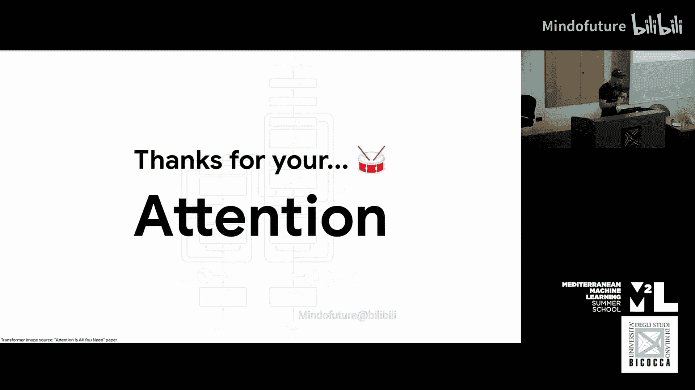

# 【比科卡大学】机器学习讲座 ｜ Machine Learning ｜ Moe ｜ Grpah ｜ Rlhf ｜ Llm ｜ Ai Safty ｜ 2024 p03 P03_Transformer模型-Lucas_Beyer -BV1XzScBEEdJ_p3-

So in this talk， I will teach you everything you want to know about transform architecture。

 like all the way to the smallest details。I hope you'll be able or I'll be able to convey it with enough intuition that it will be fine to follow。

 before that， I want to see like who has， okay， first。

 who has used transformers in their work already。😊，Alright。

 who has implemented the transformer themselves。Oh， quite a few， right。 So for you。

 it may be a bit more boring for the rest， it should be very interesting。嗯。Alright。

 so let's jump right in。 Once upon a time。 machine learning looked very different than it looks now。

 We had different subcomities that were very clearly separated。

 There was a computer vision NLP speech translation R and each of them had their own separate tools that really just made sense for whatever they are working with like in computer vision。

 we use the convenets at later resonancenet。 So connets are basically learned the convolutions over the image that apply filters to small locations in the image and these filters I suppose to detect some patterns。

 Like， for example， you could have one filter that tries to detect the hand of the robot and the hand of the robot should look the same。

 no matter where on the image it is， because the hand of the robot just looks like the hand of the robot if I move my camera to the right the hand should still look the same So there was this。

😊，Spial independence that was built right into the architecture。Similarly for language。

 like language， vast majority of languages go from left to right， character by character。

 word by word。 And so this was built right into the models。 R N N back then。

 LSTM being the most popular or G R U， there was an architecture specifically designed to go character by character and integrate the information it sees over time。

And I'm not gonna do all of them， but like basically， each domain had their specialized architecture。

 at some point， we were still small enough that it was possible as a vision researcher to also read the papers from NLP speech and so on。

 get some ideas。 But then everything grew like crazy。 and it was impossible。

 So vision researchers just look at vision papers and architectures and so on。 NLP just at that。

 And we kind of diverge a bit and don't learn much from each other。However。

 something happened maybe five years ago or a bit more than that now。

 And now it looks kind of like this。 This is a slight exaggeration。 But for those who don't know。

 this is the canonical picture of transform architecture from the original paper and。Slowly。

 but surely it has startedd from here and then come here， come here。

 come here and just taken over everything。Is this slight exgergerration in the sense that some vision people still use conv nets and there's nothing wrong with that。

 Some speech people still use other models and so on， but。

Large part of each community uses transformer。 And the nice thing essentially the same1。

 I will show you the small differences as we go through different modalities at the end of this lecture。

😊，But。I actually like this because it means that we can， again。

 more quickly understand each other's papers。 We can learn from each other's tricks。 like， let's say。

 in vision， we found a trick to make transformer much more stable。 and then language can use this。

 And vice versa language finds ways to make it much more efficient。 So we can use it and so on。

 So I think this is great。😊，呃。Alright， now let's get to the transform architecture itself。 the。

 the very initial。Let's say sparks of it， not really version of it。

 but comes from a translation paper。 It was this one in 2014 that introduced essentially what is the attention mechanism。

 and almost exactly as it is used still now。 So that is 10 years ago。However。

 it was not very understandable， Let's say， or it didn't really look general or powerful。

 So this was the diagram that shows attention。 I'm sure you have no idea how does。

 this show attention。嗯。And the the main reason that they invented it is that basically to learn alignment during translation。

 So when you translate， you create， let's say you have this English sentence。

 And you want to write the co corresponding French sentence。

 So while writing or creating the French sentence， you go through， as I said。

 character by character or word by word。 And so when you generate a word。You need to。

 the model needs to look at the English part， right？ And for a long time。

 there was this kind of alignment that was done with heuristics and engineering it in different ways to make the word。

Look at the most relevant one in the source language。 But then this paper propose to。

 to learn this alignment。 So to for the mother to learn which words are most important or it should pay most attention to in the source language to generate the next word。

 so。Just a couple。 Yeah， never mind this one。 Just an example here。就。This only works， I think。

 if you understand French。 So maybe， maybe let's make it quick。 So to generate this one。

 this Ellaposttro is the， I forgot what is called maybe proposition or thing that comes before a noun。

 And in French， there is like male version， female version of nounce。 I think in Italian。

 probably too。But in English， not。 so it makes no sense for generating this word to just look at the。

 the corresponding English word， which is the， which is always the from just looking at the。

 you don't know， I it like a masculine or feminine word。

 And so you should also look at what word you're actually going to translate in this case， man。

 And then it， that's exactly what it does。 So it learns for generating this one to look more at man than at the。

And this was great back then， but it was very specific to translation and very specific to this subpart of translation。

 which is learning the word alignment。 And the whole paper mentions the word attention only three times and kind of like in the introduction as slight motivation and that's it。

 So it didn't really take off then。 And it took another three years for it to take off for this paper that you probably all know at least the title of attention is all you need。

 which introduced the transform architecture。 again， for translation。 However。

 what it did is like take this attention mechanism and use it basically as the core main mechanism of the model everywhere multiple times around。

😊，Is the question。No， okay。So in the next couple slides。

 I'm gonna go through the attention mechanism in very much detail and。Just。Completely out of context。

 just as a single building block that you can use to build models。To build translation models。

 language models， but also anything else you want， like。

 let's say game outcome prediction models or things like that。 right， Just see it as a new component。

 a little Leo piece you can use in building models。 and attention is essentially。

 you can think of it as a dictionary lookup， but kind of a soft dictionary lookup。

 So you have your dictionary， where just like in Python the diict。

 You have your keys and the corresponding values。 But as in your networks， everything is vectors。

 nothing else。 So your keys are vectors， your corresponding values for each keys are vectors。

 and then you have a query， The thing that you want to look up in the dictionary and that。

 too is a vector。😊，So then what do you do to perform this lookup and in a soft way。

 everything always soft so that we can later do differentiation and optimization and so on。嗯。

So you take the dot product between your query vector and each of the key vectors。

 This dot product gives you a number， which essentially means how similar they are， right。

 So it's larger as they are more similar or smaller as they are more opposite。

And so you get as many numbers as you have keys。 They are just float numbers。

 Then what we do is to normalize them。 We use the soft marks such that after normalization。

 they sum up to one。 And these we call the attention weights， so。嗯。Let's say， for example。

 this query here is。Kind of。摄。Yeah， let's say it's kind of similar to this one。

 So the dot product is like 3。 And let's say it's very dissimilar to all the next ones。

 So let's say the dot products are like-5-3-1。 And let's say again， it's kind of similar to this one。

 So dot product is again， somewhere around 3。So then after normalization。

 we would have essentially 0。5 here for that one， 0。

5 for that one and the zeros all the way in between each。

 So then what do we do with these weights Well we take the weight at sum of the values。

And that gives us the output。 So in the example I just showed。

 it would essentially be the average of this value and this value。

 The two that the query was very similar to their keys， right。And。

 as the query gets more similar to a single key and this similar to all other keys。

 this becomes more and more like retrieving the value of that key that it's most similar to， right。

 because that attention weight is gonna be more and more going towards  one and all others towards 0。

 and then the weight that sum will be like retrieving that value。嗯。

Then where do these keys and values come from， usually you have a set of vectors。

That represent something in the problem you want a model。 Let's say you want a model like。

A soccer game。 And you have all of the player tattoos， the ball statues and the other things。

 And each of these are vectors。 like just abstract vectors in space。

 And you wna model like the outcome who is gonna score next， let's say， right。嗯。

Then you would have each of these are like the player， Stas， ball Stas and so on。

 all of these vectors。 And then from those， you do a linear transformation of each learned with a learned way to a matrix to get the keys。

 One key for each of the status and to get the values， one value for each status。But later。

 we will see how to put this into a whole model to build a full transformer。 right。

 But now this is an example of how you could use it as a component in your model。 question。

We will see this very much in detail in a few slides。

 like what concretely this means in the context of language。So fire Ser。Okay。

 attention is basically a soft dictionary lookup with stuff that you can learn everything。

But that's not everything I actually lied to you。 This was not the full attention。

 There is a few more details in the one that everybody uses。🤧The first one is， sorry。We don't。Well。

 we don't usually have one query， but we have many queries。 so that's easy。

 So we just tag them together。 And instead of having one attention weight vector。

 we have hour matrix。 And instead of getting a single output， we get many outputs。

 one for each query， right。And it's nice It's more efficient because matrix operations are more efficient than vector operations。

Furthermore。What people usually use is called multi head attention。

 So it essentially means we repeat this many times again。 So for all of our queries matrix。

 we actually derive multiple  query matrices。 like， let's say 16 of them with 16 different of these。

😊，Transforms， but all based on the inputs。呃。And then we get actually 16 attention matrices。

 and we get 16 times the output for each query。This is how it's usually shown。

 I slightly prefer this one。 I think it's more real to what happens in the code and also more intuitive。

 but it's the same thing。 So usually then each of these queries， if you use multi head attention。

 the projection is to lower dimensional space。 than if you use single head attention like this W K these keys are lower dimensions。

嗯。So it's more like that。 And in this case， it would be three heads with four queries。

And and dimension two of each head。And then still， okay， it's the same。

 You get an a full attention matrix for each of the heads。 So in this case， three attention mates。

 and then the outputs， right， you get the output for each head。

 and then you just concatenate them back。 and you are back to having a single output for each vector。

And all of this process in short is usually written like this。 you will see this formula everywhere。

 this is the query key dot products， and then there is like a。

A hard coded scaling factor that makes all the learning work better。

 You can just accept it or ignore it。 Or maybe it was covered partially in the previous lecture。

 It's related to stuff discussed there like this new prop and so on。

 And then the soft marks to normalize them to get weights that sum up to one。

 And then the product with the values， which is this weighted averaging of the values。Allright。

So that was the full attention with all the birdss and whistles that I typically used。Good。

Now how this is used in the transformer architecture。

 And this we're gonna spend probably half an hour on just this slide。

 but we're gonna go through piece by piece for all the pieces and try to see how it works in detail and also for each part an intuition of how you can think about that part。

So keep in mind， this was made for language。 So I'll use for translation。 sorry。

 So I'll use the translation as an example throughout going through this。

 And then later in the rest of like the last half hour。

 I'll show how to adapt it to other tasks and modalities。So it's two parts。

 The encoder part is this side， which gets the whatever input you have。 So in translation。

 it would be the language in the the sentence in the original language。 And then it processes that。

And then we have the decoder， this side， whose task it is to generate the output。 So， for example。

 the translated version of the sentence， or if the input was a question。

 the answer or anything like that。嗯。So let's start with the encoder。 at the bottom here。

 we have two pieces， the input tokenization and the em bedding and the position encoding。So。

 in the case of language。で。Oh， and， and this is the part that differs。

 If you do other modalities like vision， audio and so on。 In the case of language。

 we have a text input， which is a string。 Like somehow we got to turn this into vectors。 Otherwise。

 all of the stuff I described before， all of the optimization and so on。

 you've seen in the previous lecture， like we cannot do this with strings， right。

So input organization is how we turn the string into vector。 And it's a couple steps。

 like this example sentence， the detective investigated。 First， it's split into pieces。

 These pieces could be individual characters or individual words。

 But what most commonly use is tokens， which is a thing kind of between character and words。

So here is an example of tokens。 So sometimes the whole word， if it， especially if it's common。

 is just a token。 So the becomes the token， the detective maybe becomes a token detective。

 but maybe investigated may get split up into three tokens， for example， like invest。

 which is very common。 It's also investing and other things。You gate and add， for example。

 I I just made up this example。 But this is like a whole。Class of things that exist tokens。

 And there is like research papers on tokens， discussions and so on。嗯。

Then you usually have a vocabulary。And that's just a predefined list of tokens that you support with your model and。

Usually it's somewhere between 32000 to2，56000 tokens。And so you now map your individual tokens。

Into their index in your vocabulary。 and usually more common words appear earlier in the vocab。

 less common more rare later。It doesn't need to。 but it's just， it's what's commonly done。

 And it's a good heuristic to know。 So， for example。

 the maybe like the third word in the in our vocabulary detective， maybe the 712 words and so on。

 So this way， we turned our string into integers。 So we're almost at vectors。嗯。Now， the vocabulary。

 actually， as part of the model， there is the vocabulary embedding matrix。

 and it's a matrix that looks like that it has vectors。😊。

That are initially randomly initialized of some size that you choose。

 And this is called the model size， like， for example，768 dimensions。嗯。

And then you have as many of them as your vocab size。 So for each word， you have this vector。

Or in the by way， if。There may be tokens that appear in the input that are not in your vocabulary。

 So usually there is a special token in the vocabulary called unknown that things get mapped to。

 or there is also other more fancy fallback mechanisms。诶。But in any case。

 so we replace now each token with the vector that corresponds to its index in this vocabulary re embedding matrix。

 And that's how we get our vectors。 So now the。The string is turned into a sequence of vectors of dimension。

 model dimension that you chose， like 7，68。O케이。Good， then comes the position embedding encoding。

 because remember， like the core part of the transformer is attention。

 and dictionary lookup does not care about the order of your keys or queries or values， right？

 However， language is very much sensitive to order。 like the mouse a。

 the cat or the cat the mouse have very different meanings。So we need to tell the models somehow。

 also about the ordering of these。token vectors。And this is done by adding position encodings。 This。

 again， is like a whole area of research。 There are many different ones。

 but the simplest one is to just add something to the vectors。And here。

 let me give you a little bit of intuition of what this means。

 this is a simplified position encoding。 The reality is a bit more complicated。But first of all。

 imagine that。The vocabulary vectors that you have， they kind of live in a bubble。

 Let's say roughly in a sphere around 0， okay。Now， where in this bubble you are， the vector is。

 this gives the meaning to which token it represents。And now if we， for each position in the input。

 add a different number to the vector。 we're basically moving this bubble in space， right。

 So if to the first word， I add the number 10， then we're moving the first word here。

 So we're basically centering the first words bubble around the number 10 in space。 If I add 20。

 So for the second word， in my input， I always， no matter what the word is， I always add 20。

 So it makes the second word here in space around 20。And for the third word， I always add 30。

 So it makes the third word here in space right So just from looking where in space the word is or the token or the vector is the transformer。

 whatever it makes， it will know how manyest word this is And then from where around this 10 you actually are it also knows which word it actually was or which token it actually was right This is a simplified way to get an intuition in reality it's more complex than 102030。

 but it's the gist of what's happening。诶。Okay， so now we have a sequence of vectors in space that have all the information related to the input needed。

 So now we can start processing it。Any questions so far？Alright， then let's start processing it。

The first piece that we encounter in the encoder is multi head attention that I just explained。

 So this basically。each of the tokens from the input becomes a query。

 becomes a key and becomes a value。So basically， each token can look around to all other tokens and see what else is there and decide how to update its own representation as the output。

 right， So for each token， we get a new token as output， samee dimension， same number of tokens。

 But it had the chance to look around at all the other tokens and consider bit what's there。

 Like collect information of what else is there。 Like， for example， the token invest。It's ambiguous。

 It could be about investment。 It could be about investigating。

 maybe a third word that I cannot come up with。 But if it can look around， it can see， oh。

 there is the token detective。 Okay， I'm very likely about investigating。

 maybe a little bit investigating， but is unlikely that detective story is about investing。

 But then it also， it looks around everywhere， right， It also sees Igate and U。 and it's like， okay。

 yeah， for sure。 I'm about investigating， and it may update its internal representation like this。

Then we have a point wise MP。 So this is。Applied to each token independently after that。

 without looking around， without looking at the context and it's the same function。

 applied to each token individually。 And this function is just a very simple MRP。

 So like multiply biometric， increasing the dimensionality a lot。

 usually four times higher dimension， but can be more then applying some non nonlinearity。

 and then again， matrix products decreasing the dimension。

 again back to the original dimension that was input。

 So the the output is again same dimension sequence of vectors of same dimension as the input was。

And this one you can think about of like each token kind of pondering a bit on what he just saw and just thinking through。

 like the previous step was collecting information。 What else is there。

 And this step gives a lot of compute such that the token can actually think and process what it just saw。

There is also some research papers， especially in NP that try to understand like in a learned transformer or what is happening where。

 and I would say it's not 100 percent settled for sure。

 but it looks very much like this is also where all the world knowledge is stored。

 like the detective that Koan is a detective or that Obama was president or things like that。嗯。

And this is also where the majority of the parameters and often of the compute of a transformer is。

 And when people talk about scaling up transformers and making giant mixture of experts and everything。

 this is almost always about the MP。 like this one grows a lot。

 And this one is replaced by multiple experts that are each MP again and so on and so forth。

 I'm not gonna go into that detail， But just know that usually it's in the MLP that the bulk of the。

😊，Processing is happening and of this scaling up is happening。And yeah， let's ignore that。

 Then there is these little pieces here that you see everywhere。

 These are residual connections or escape connections and normalizations。The skip connections。

 they actually come from vision， they were introduced by Resnets。And the idea is basically。

 when you have a module， like either the attention or the MLP， to add its input back to its output。

It sounds really weird， but I will give you an intuition in a second。 The thing is。

 this was mainly introduced in Resnet to make optimization and trainability a lot better。 Like。

 this was a complete game changer models。😊，Before that， we hard to train， especially as yougo deep。

 I envision we had 16 layer deep mother that we could train。19 layer deep was already very tricky。

 And beyond that was like nope。 and then comes resonnet， which shows by doing this。

You can train without problem 50 layer resonate 50 is completely standard。

10 layer 150 layers and so on。 So this was a complete game game changer in terms of trainability。

 and it was its main motivation。 However， so it's usually shown as this。

 And I just explained it like this also you have a block of processing and you add the input back to its output。

 But I much prefer to think of it that way。 is the exact same picture。

 I just moved stuff a little bit。 But this is a different perspective。 It's like you have the input。

 And then you have the block that does some computation on the input and proposes a change to it。

 So you can now think of the architecture， any architecture with the long residual stream going everywhere that each block keeps kind of looking at this stream and suggesting an update。

 Look at the stream suggest update。嗯。Okay。And then the normalizations are another thing that just make training much more stable。

And there is， it's， is's basically standardization of activations， like。

There exist multiple variants。 La norm， RM S norm is getting popular now。

 but is's basically stuff like subtract mean or divide by standard deviation or things like that。

 And in transformers， there is two。Big chs of where to place it。

 There is you don't need to understand。 it's just， so you know。

 if you see the word there is post norm preorm， it's just a difference of whether you put the layer norm here or here or things like that。

 And and there is not like one clear winner As far as I know， which one works better。

 depends on other things you do in training。 like if you do warm up or not。 And， and so on。

 both of them work。 and both are fine。Alright， so that is the a single encoder block。

 And then we repeat these like this attention and fit forward with the skip connections and normalization。

 We just repeat them one after another for small models that we usually call bases。

 we repeat them six times for larger ones，12 times。 And then for the really large models。

 it can go2 hundreds of times。😊，嗯。Alright， and the output of this。Is a set of vectors。

 right the same amount of vectors as we had as input and same dimension as we had as input。 However。

 now， these are heavily processed， right， we had the time to 16 or6 or 12 times to each talk and look around what is there。

 then spend a lot of compute thinking。 Then again， look around what is there。

 Sp a lot of compute of thinking and so on。 So think of the output of the encoder as like a heavily processed。

 contextualized， understood in quotes version of the input。Right， but in translation。

 this still has absolutely nothing to do with what we actually want， which is the output。

 like a translated version of this sentence。 right， So at this point。

 we have basically understood the input sentence。 and that's it。Alright， encoder。

 any questions there so far。Good， then let's go to the decoder。 the one that generates the output。嗯。

But。Yeah， let's take a little deeper where。 This one is a bit tricky。

So what we ideally want to model。Is the probability of an output sentence or output。

 given the input for all possible outputs。Right， so in ideal word。

 we would like some function that for our possible sentences in French gives us the probability of that sentence for the input。

 the detective investigated， right， because there is not usually one unique correct answer。

 There is multiple ways to translate this with more variations and so on。

 So there should be multiple sentences that have high probability。

 but also a ton of sentences that have near zero probability。

This seems kind of impossible to do because like the output space is just so gigantic。 However。

 there is a couple of saving tricks that makes this possible and tractable。The first one is this。

I forgot。 I think it's called the chain rule of probabilities。

 so we can decompose this if Z is actually like the， the output sentence is actually。

A set of output variables， individual ones， like a bunch of tokens， for example。

 then we can decompose this。Into the probability of the first token。

 given the input times the probability of the second token。

 given a first token and the input times 9，9，9，9，9， and so on until we have the complete output。

 And this is a exact equality， right， This is a ruling in probability theory。

So there was no approximation here。 But this gives us a chance now to actually start modelling something。

 So， for example， if we have from somewhere a given output， like a given sentence in French。

 we can compute its probability by going through it token by token right。

 and computing each of these piece and multiplying them。Or even better and much more important。

 we can generate individual samples from this distribution。By generating samples one token at a time。

 by first generating and sampling a specific first token， according to this probability distribution。

 which I'll show you， we can learn。 And then once we've sampled that。

Put it into the input and sample a specific second token again。

 according to probability this probability distribution。

 which then we can compute because we have input and the token we previously sampled and so on。

 So this way we can actually get a real sample， a real output from this distribution。嗯。Oh。

 and that's what I just said。 And just to put it on the picture。 So the Z 1， in this case。

 if we want to sample the third output token， the Z1 and Z 2 are those that we sampled before。

 and they are inputs to the decoder。 The X is our original input that we want to translate。

 So this is here the are the encoders output。And then the probability distribution over the next token is just the output of the decoder。

 And this is just softm classification over the vocabulary。

 Like if we have 32000 tokens in our vocab diseases soft marks over 32000 classes， right。

 And then we can sample from that。诶。Now， the sampling is the place which I will skip here。

 but there are many different strategies to sample。

 You could always speak the most likely an next token， but you can do smarter things。

 like keep the top。 So and so many and continue with them or stuff like that。

 There is whole literature on that。嗯。All right。So far so good。Good。

 now what do we do to go to actually compute this probability。 Oh。

 what I forgot to say here in this formula， basically， each P is a pass to the model， right。

 And we choose to represent to learn as to use a single model to learn all of these piece。

 the transformer model， yeah。😊，好。And then so。えそう。Yes。Exactly here。 And this way。

 we can get a sample from this distribution， but not the whole distribution。 we never get it。

 but we get the two things that we can take sample from it。 And that given output。

 we can compute its probability。And these are， I think the two most useful things to work with this。

Alright。Now， the， the decoder starts with multiha attention， but this time is masked。Why is it Mu？

 And this is the first tricky part。So again， think we are computing now the probability of the third token。

 given the p some previous two that we sampled and the X。So in， in principle。

 this is one training example。 So we have our training corpus of input sentences and translations。

 right， but。One token in this translation is one training example， to learn。One such function。

 this P of this one token， given the previous tokens on the translation in the data and the input。

 alright。How， so， so we would do one for the backward pass for one such token。 However。

 that would be insanely slow。Luckily， there is a nice trick that we can。Take all of the examples。

 So all of the tokens from one sentence pair。And do the forward backward pass simultaneously。嗯。

How does this work， Well， Because for each， for each individual output token。

 it should only look at those before it， right， because that's exactly how this function P is defined。

 right， Z 3 only depends on that 2， Z1， not on Z 4。

 even though in our data there existed Z  for and next one， right？

 So what we can do is we still send the whole data， like the whole output sentence into the decoder。

 However， when it comes to attention， we don't let everybody attend to everything。

 we only let the tokens attend to those that came before。So then that way， for each token。

 we compute its correct P function here， like P of that token， given the previous ones。Okay。

 but we can do this for all of them at the same time。

Here is a little depiction of this and of what the mask looks like。 So let's say we have this。嗯。

Right， so this is， again， the same example sentence。 And this is the。Input to the decoder。

 So this is the ground truth in our data set。 So little detective O。

 And we have these representations of these tokens。

 Now we create the queries and keys and values for those。And now these are the keys。

 We just put them here for better visualization。 And these are the queries。And now for this query。

 it may only attend at the things that came before。 so it may attend at。This one。

 this one and this one， but not at the other ones， right？

 And so the way we then implement this is remember， we have the attention matrix。

 which is the scores of all queries with all keys。 We still compute that。 But then we multiply。

Either by one， if this entry is valid or acceptable or by 0， if this entry should not exist， right。嗯。

So by doing this， by multiplying with this attention matrix。

 we actually implement the model correctly and efficiently。嗯。However， when we are generating。

 there is no such trick we can do。 We cannot send all of the inputs into the model。

 the one forward pass with some kind of mask。Because we don't know what are the outputs， right。

 We need to sample the first one first， and we need to have actually decided and sampled it before we can do computations for the second one and so on。

 right， And the second one we need to have sampled it got a concrete token that we can then input again to the decoder to star computation for the third one。

 So this is why generation with autoregressive generation with transformers。 is's insanely slow。

So for each generated token， we need to do a full forward pass， and we cannot do them in parallel。

 We always need to wait for the previous one to do the next one。However。

 there is a second key trick in transformers。 and these two tricks like the masking and the caching that I will mention there are the two reasons why transformer is viable and actually efficient。

 Any of those two tricks goes away。 Trans architecture is essentially practically useless。嗯。

So the KV cache， if we are generating。 and let's say we have generated a couple tokens already。

 we have generated everything。 And the last token that we sample is the a previously like this one。

 the third one And now we want to see what comes after the a。 So again。

 we have the representation of the a。 and we create a key query and value from it。

 But from the previous forward passes， we remember the queries are the keys and values that have been used in the attention。

 And we put them somewhere on this in Ram in what is called the Kv cache。 right， And now here。

 when doing the forward passes for seeing what comes after a we don't need to do the forward passes on all of the previous tokens again。

 we just reuse them from before。 they have not changed。😊。

Because they are unaffected by whatever happens here for because that's in the future for them。

 right， So we just load them from the cache。 and then we put the current one in the cache for next token that we generate。

 okay。This avoids a ton of computation at generation time。 However。

 the cache size is not just the detail。 It's actually， it can get huge。So what。

 what is the size of the cache？ So first of all， it's the sequence length。

Then it's the number of heads， right， because we have multiple heads。

 They different generate different keys and values。Then is the dimension of the model。

 because that's how long the vectors are。 And then we have this for every single layer。

 for every single attention layer。 And then it's usually floats。 So it's 4 B。

 Sometimes it's half floats。 So it's2 by。 But so， for example， for a。Medium size。

 let's say model like Gema 9 billion。 These are the numbers that we have。

 And that amounts to 36 gigs for the cache for like a sequence length of 4000， which is。Fine。

 but nowadays， even on the smaller side。 So that's gigantic And that's in addition to the model weights that you have to the activations that you are creating while doing inference。

 right， So you need a shit ton of memory for this to do inference。

That's why this is a very current topic of research。

 And there are many different papers and techniques to try to reduce the size of this cache。

 is it seems super specialized， but any saving you can do there without reducing quality saves tons of costs makes generation faster。

 like is a clear win。Okay， I'm not gonna like here， just if you by name， if you want to look them up。

 find papers， but I'm not gonna go through them。Alright， that was the hardest part。

 The rest is relatively simple。 Next comes the。Cross attention， it's now usually called。 So this is。

 again， attention。 But this time。Qury keys and values are not all coming from the same vectors。

 but instead， the queries are coming from the decoder vector。

 So from the torken that I' am currently looking， what comes next。

 So the R in the previous example and the keys and values are now the output of the encoder right。

 So this is where we actually look at what are we supposed to translate。

 right in the previous mass attention， we didn't look at what are we supposed to translate just at what did we generate so far。

嗯。Right， and， and this is the exact same attention mechanism as in the original 2014 paper that I mentioned at the start。

嗯。Right， this this is。This used to be what was called attention。 But nowadays。

 self attention is so widespread that people call self attention just attention。

 And so often we call this now cross attention when you basically you， basically。

 you cross from one thing into the other。 Like one thing is the queries and keys and values are another thing。

嗯。Alright， and then we just have， again， this same feet forward that， again， can grow very large。

 Ha the bulk of the compute， but is individual per token just heavy processing。

And we repeat this n times again。 I didn't have a slide for that， but again， repeat it like 6。

12 or hundreds of times。And， of course， there was also residual norm everywhere。

And then at the end of that， remember， we have our token that we are now looking what comes next。

 So we do a multi just a linear multiplication to turn it into so this token has model size like 7。

68。 And now we turn it into vocabulary size like 32000。 with're just a linear projection。

 and then take the soft marks。 And this is the probability of the next word after everything we've seen。

And that's it。 That's the whole transformer。 So that was a lot。 Now。

 the original transformer blog post had a neat animation that I just play。 This is the encoder。

 and the tokens are looking at each other， generating the next one。 and then the decoder starts。

This is the cross attention because nothing was decoded yet。 And now there is the self attention。

 and then the cross attention， self attention， cross attention going through the layers and generating the next thing。

 So this is the flow of information。Now。One thing that people are commonly thinking of when they think transformer is expensive。

 slow tons of compute， right。I want to say， this is。Not actually true。

 This is not because of transformer。 This is just because we scale everything up。

 The original transformer paper was actually especially impressive because it got better results than previous models。

1 or two orders of magnitudes cheaper。 So this is a table from the original transformer paper。

 You see transformer here in the bottom。This is some translation scores。

 translation metric from English to German， from English to French。

 and you can see that it got better score than any of the other models and the other models are very diverse things from before。

 like some sequence to sequence models with convolutions mixed in some Ar， some osembls， whatever。

 So I got just。Better than all of these。 and the computation， the training cost was。

Multiple even orders of magnitudes cheaper。 like it's in terms of flops。

 And here it was 10 to the 18 or 10 to the 19 for the larger one。

 And all previous methods were like 10 to the 20，10 to the 21。 right。

 so transformer is actually in efficient model compared to others。

 Its just seems expensive because now we use it for large satings all the time。哦。Alright。

 that's all about the architecture and its details。 If everything is clear。 now。

 everybody should be able to like， right after this， open your laptop， implement transformer。

 create AGI。 and there you go， right。그래。嗯。No， but by tomorrow， think maybe the。Alright。

 so now the last part， yeah， half an hour， I'll try to make it a little bit shorter for time for questions。

 But how this architecture now is adapted to all the different modalities and a couple of good things to know。

For your implementation that you do afterwards。So the。

 the first takeover was clearly in translation with everything that I just showed you。

 including this very impressive table that just showed like， wow。

10 to200 times cheaper and still better。😊，The next big takeover was in natural language processing in general。

 So not just translation。And there is。3 major ones there that are three different versions of the transformer。

 You have some， so， and you can use all three of them almost interchangeably。

The now most popular one is decoder only G， I think。

 was some of the first instances of it where you basically just remove the encoder。

 So you also remove the cross attention。 So how do you then use the input there。

 where you just put it in the front of the output。 And then that's your input。

 or you can use this if you want to just generate。Without a original text。

 just start generating out of the blue， right， The G paper was like， okay。

 we learn a model that just generates anything from the Internet。

 So it just learns probability distribution over all text from the Internet。

 Then you don't have an encoder。 You don't need the encoder。And if you want to input。

 then you just start your， your sentence that you generate with that。嗯。There was also。

 this is not in chronological order。 by the way， There was also Bt， which was a big breakthrough。

 that was encodeder only。 So no decoder。And that was trained again on text from the web and try to learn to just generate text from the web。

 But how this was done is after tokenization， some percentage of the inputs。

 I think maybe let's say 15% of the inputs are randomly replaced by a dummy mask token。

 And then the task is at the output to predict what token was there。 right。

 So you need to understand a bit of the word and of language in order to solve this task。

 And this model was usually used not in not to like just generate text in free form。

 but to be a really good model to start from and then fine tune for any specific task that you need。

In specific text under tasks。And then there was a encoder decoder just for moving from translation to general language tasks and a wide set of tasks。

 it the most representative was T5， where the inputs are then just all kinds of。Wait， what is it。

Yeah， so it is just multitask。 So you have some translation thrown in like， then the input would be。

 for example， Da is good in German， And then the task is translate English to German。

 And then the decoder should generate， a German to English。 The decoder should generate。

 this is good。So， my example is the other way around。

 The input would be like the text translate from English to German。 This is good。

 And then we want the decoder to output。 That is good。 or another task。

 the input can just be summarized and then blah， blah， blah long text。

 And then the output from the generator should just be a single sentence that summarizes this text。

 or or it could be is this toxic。 You look beautiful today。 And then the output should be。

 this is not toxic， for example， right， And this way they just got a large collection of language related tasks and put them into this input output mapping and then train the transformer like that。

😊，All right。Then the next， so far， transform was isolated to language。 and people thought， okay。

 so it replaced R NN in language。 It's a really good fit for language。 Vision still has CNN NNs。

 audioud still has whatever was there I forgot and so on， however，😊，Yeah， I'll skip these details。

 There were a few attempts of adding attention into vision models。

 but they were very limited to slight changes of resonates or CNN Ns that also didn't get much improvement So they were mostly ignored。

 And the thing that worked really well was to take exactly the original transformer as it is， like。

 let's say encoder only first。 just the transformer encoder。And then change the tokenizer。

 Now we don't have a string。 We want to turn into vectors， but we have an image。

 We want to turn into vectors。 and the simplest thing that works was to take the image and cut it into patches like pieces。

 for example，16 by 16 pixels。 And then the next 16 by 16 pixels。

 and then just flatten this into numbers。 right the pixel is a number between 0 and 255。

 Or if you normalize it between-1 and1， let's say and then a pixel is three such numbers。

 red green blue。 and then a patch is 16 by 16 by three numbers。 So 768 numbers。

 and there you go there you have your float vector for this patch or maybe youd just then have a learnable linear projection of that first。

 if you want another dimension that is unrelated to your patch size like let's say you want 5。

12 as your model dimension。 then you just project that768。It picks their numbers in 2，5，12。

And that's your model。 And rest is just， oh， you add the position I am bedding again。

 which tells you where the patch is from in the image。

And then the rest is just the standard transformer encoder。

 and then envision the common task for pre training used to be， you have images and。

Human unnotated classes， which says what is in the image like a cow building and so on。 right。

 And so just classification task is single class output for the whole image。Yeah。

 and then train it with that。 And then it was the same story as in translation。

 basically cheaper than previous large scale CNN NNs， but better results。

And this is called division transformer， or of it。And that was the first time transformable was used successfully。

 almost without changes。 The only thing that changes here。

 how to convert the input into a bunch of tokens and got state of the art in another modality。

 And then a bit later， the same story happened in speech。 So speech usually have the wave。

 So a sequence of， I think， also integers 16 bit。 I believe， but I'm not a speech expert。

 And then there is a standard processing thing in speech called spectrograms。

 where you transform it into this picture， which these entangles。

 I think frequency and magnitude or something like that。

 And this is essentially like a picture like pixels X axis is is all right， X axis is is time。

 Y axis is is I think frequency。 and then the value is the magnitude of that。😊。

And then they basically do the same。 Cu it into a bunch of。Ptes over time。

And then flatten and embed those and pass them through a transformer where maybe the。

 this is the input then， and the output is to turn it into text。 for example。

 with the decoder turning it into text。 question there。Ill they make sure。靠系。because。Tition works by。

Or。Of with images and sounds。Or like that， because you can cut。也有。Yeah， so how。

 how do you cut carefully is basically the question， right， or how do you know where to cut。

 Because for text， you just know these are words and they make sense where to cut。

 They are like differences。 But in the image， not really。 And in， in speech， maybe。

 but maybe not really。 basically， it doesn't matter。

 And that's the thing that shocks a lot of people， actually， especially in vision。

If you cut your patches， if you have a picture of a person and you have one patch that cuts me right in the middle here and one patch has half of me。

 the other one is half of me， it really doesn't matter because in the next stage is attention where each patch looks at everything that's around。

 And then it's says， oh yeah， there was a half the guy。 And there was the other half of the guy。

 So it's that guy。If you have very little training data。

 then maybe it matters because you don't see the cuts in many times， right。

 but in in vision and also in speech。Iither you have a ton of training data。

 and then it doesn't matter because you will see the cuts everywhere。And。

 and you're not losing any information， right， The cuts are touching each other all the time。嗯。

Or if you just have， let's say， a medium amount of data and not a ton of it。

 then you do random augmentation。 That's like random hand engineered changes to your input that don't dramatically change the meaning。

 but make the model more robust to this。 Like for a image。

 you could shift it by a few pixels at random to the left or to the right right。

 And that way you see the over time。 even though you see the same image multiple times。

 you see it slightly shifted。 So you see the cut in slightly different places。

 and the model just learns。To deal with that。There have been attempts to do like fencer nicer ways of cutting up images。

 but they usually don't give a gain as you scale up or augment more。Alright。Yeah。

 so the first model doing this was called conformer that did add a little bit of a piece into transformer model。

 But then a bit later， there was open a eyes whisper。

 which is literally just the standard transformer model。 cut the input into pieces like that。

 And that's it。嗯。The Ar takeover， I want to spend a little bit of time to explain this， because it。

It has a cool idea that you can apply to all kinds of other things。 And this is only one half of R L。

 It's offline slash supervised R。 It's not online R。

 I think you will have RL lecture later in the week。 So I'm going ahead a bit。

 But basically imagine you have a。😊，You're doing R else。

 so either playing games or a robot doing stuff。 and let's say。In however way。

 you collected a set of traces of this happening， like either from players playing game。

 you just collected their games or from the robot doing stuff with demonstration。

 you just collected the robot's motor actuas and sensor inputs over time， right？

 And now you want to learn a model to basically imitate that human or that behavior。

And so this recently， in Arl was turned into a essentially language modelling task where the language is not really the words。

 but it's the sequence of inputs and outputs of the robot or the game player over time。 So here。

 for example， the most typical example of Atari games。 So a sequence looks like this。

 You first have an observation of the screen。 You turn this into tokens。

 like I just explained you doing vision transformer。 You cut into patches。 and then have dispatches。

 This is the observation。Then in our， if forgot forgot to say what you。

 what you usually want to optimize is the return。 So it's the sum of all of the rewards you will get in the future。

And。If， wait。Yeah嗯。If you have your dataset set of traces for any individual traces。

 you see the full trace until the end of time， right， so you can just compute the return。

 like how many rewards you get until the end of the trace。 So the idea here is you put this in here。

 In reality， once you deploy， you don't know because you don't know the future。

 you don't know what will your return be， right， But for training， you can do this。

 So we put the return here from the trace after the observation。

Then the action that was taken like by the player， which key the player pressed or by the robot。

 how which motors got how much voltage or whatever。

And then there is a immediate reward that usually happens from the environment。

 This depends on your scenario。 it can。Technically， you have a reward every step。

 but it can be 0 for a long time。 right， But and it can。

 can become something when you have a success， like when you collect a coin in the game or something like that。

Right， and that that is a sequence。 Now。 This is how we turn a trace into a sequence or a sentence。

 if you want， if you think of language。 And then we。

 we can just learn this sequence with a transformer， Let's say a decoder only。

 it learns to model these sequences。 And that's it。 Then you can sample the next token of a sequence。

 right， So you could sample an observation and return and so on out of the blue afterwards。

 if you have the model。 But more realistically， when you want to use the model。

 you get an observation， the current game screen。 So you tokenize it here。😊，Now。

 you don't know the return， but you don't have to。 You can just set it， like you just say。9，9。

9 as a score。 and you give it to the model。 And then you sample the action， right。

 What does this mean， It means your， the model is now gonna give you the action of a really good player。

 that a really good player in your database that used to score very high return for this kind of input。

 the action that this kind of player would have taken。 right， If you said this to something bad。

 like 0。 Then you would get the action that is typical of a very bad player given this observation。

 right， and this is， I think， a very nice trick that you can use in general with the autoregressive models try to use some privileged information that you have in your training data that maybe about the future deployment you don't have but that kind of controls or slices and dices your。

😊，The data distribution that you're trying to model， right？ And then later at training time。

 a test time， you can just set it to sample more from the area of your data that you prefer。

 Like in this case， you just set it to a high reward to sample the actions the way a good player plays。

 right。诶。And this is very related to in language models， the prompting techniques like。

 oh you are Einstein， the physics expert and need to solve this problem。 Na， no， no。

 iss basically the same idea。 It's making it simple more from high quality regions of the data。Okay。

 and。No。All of the different communities have figured a way to use almost the plain transformer for their models。

 But what this means is we can also look at communities mixing each other， right。

 especially with vision and language this has happened a lot recently。 Now。

 basically anything you can turn into a token。 Just turn it into a token and throw it in transformer。

 It doesn't even matter what are the other tokens。 Like if in some way， for example， from videos。

 you have a image and the text and the audio， you can just turn all of them into tokens and throw them all together in the transformer。

 and have one that tries that learns to model everything together。

 And I think this is one of the coolest things that has happened in the most recent years。

 it has become very straightforward how to mix modalities。 And now it's more about thinking about。😊。

How do I get the data that is interesting， right？ what kind of task can I now。How to say。

 can I now perform or learn to perform with this model。

And I want to end with one quick note on efficient transformers。

 I think this is almost not necessary anymore。 I think now it's accepted that the original transformer really is the best thing。

 But there was a period of time in the last few years where there was a lot of more efficient versions of transformer that were suggested。

Right， let's see a few popular examples。 Was a performer or long short transformer。Chance。Perever。

 anyway， there were a lot of them。 And all of them claiming to perform the same as transformer。

 but be more efficient， not have this quadratic attention cost， for example， and things like that。

 However， some colleagues of me then spend the time first of all。

 to write a big survey about all of these and group them into different types of how they try to change the transformer make it more efficient。

 then create a benchmark that actually properly tests long sequence modelling with all of these different variances。

 and then measure all of or the most popular of these transformer alternatives。

 And this was their main result。 X axises is the speed。Of the model。

 And Y axis is their score on this LRA。 It's long range arena。

 So this was a set of benchmarks specifically for modeling long sequences and for testing that。

 And the higher the better on both sides， And so basically what you see is the original transformer is here。

 it is slow， but it is the best。 Big birdd is one exception。 And any other alternative。

 if they are much faster， they are worse。There is no free lunch。

 There was no model that is just top right here， right？

 So when you see an alternative that is much faster。

 it's usually worse on on problems that require long range connections on the input， at least。嗯。

But maybe sometimes it's fine， depending on what you want to do， right。

 Maybe you want something that is 10 times faster， but a little bit worse。And with that。

 I thank you for your attention。

