# 【比科卡大学】机器学习讲座 ｜ Machine Learning ｜ Moe ｜ Grpah ｜ Rlhf ｜ Llm ｜ Ai Safty ｜ 2024 p04 P04_量子机器学习-Armando_Bellante -BV1XzScBEEdJ_p4-

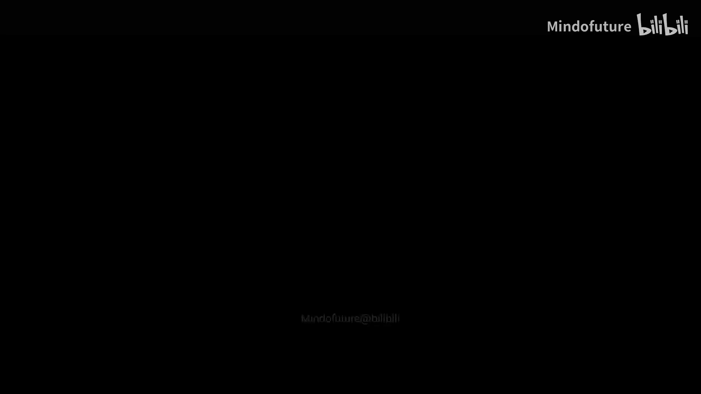

Start this talk without introducing quantum computing， right。So。The first thing is。

 quantum mechanics is now almost 100 years old， right？ I would date it back probably to 1925。

 with Heisenberg。But in 1927， the theory was almost laid out。

 And this is the famous Soway conferences。 You can conferenceference。

 You can recognize a lot of faces there。 There is Einstein Schredinger Planck Lawrence。

 lot of cool people in this， in this conference。😊，But it was only in the 80s that people started thinking that they could use quantum mechanical systems to perform computation。

And the idea was。When we have this quantum antibody systems， So we have a lot of quantum particles。

 and we want to let them evolve。We have to use matrices and vectors that are exponential in the number of particles。

 So if you have an system of within particles， you need vectors of2 to the n magnitude。

 This is problematic。 We cannot really simulate these things very often。

 But the idea is that nature is able to make them work fast。

 So why don't we use natural systems to simulate other quantum mechanical objects。

That was the first idea， more or less by a ban of Pman and Manin， more or less at the same time。

 okay。So the field is relatively recent， and it developed a bit more around the 1995。

 where two of the most famous algorithm popped out。 One is the algorithm by Love Grover。

 and it's an algorithm for speeding up unstructured search。 So if like you have a database。

 you want to search for an entry。😊，Normally， in worst case， if you have no structure in ordering。

 you would have to take order of the number of points in the data。Groover found a methods。 We。

 we can discuss this a bit better later， but found a method to search in this database with a quadratic advantage。

 So you can do it in square root of n。 It is very counter intuitivetuitive。

 like n is a lower bound in classical complexity。So that's impressive。 But even more impressive。

 probably is the result by short。Where he showed how to Co to perform factoring。

 basically the same time it， it takes you to perform a multiplication。

And solving discrete log as well。 So this breaks a lot of cryptographic primitives。

 And this was the reason for a lot of funding in the field。Okay， so basically you break AA。

 e Liive curve， DLman， a lot of classical security that is actually employed in our phones and laptops。

 okay。Cool。So， now。I'm gonna tell you a bit about the simplified rules of quantum mechanics before diving into quantum machine learning。

 because we have to set some terminology。 We， we need to know what a qubit is。

 We need to know what a superposition is。I want to develop some intuition about entanglement。

 and and maybe bus sum myths。So this is the part where you're encouraged to ask questions if you don't。

 if， if you're not following。

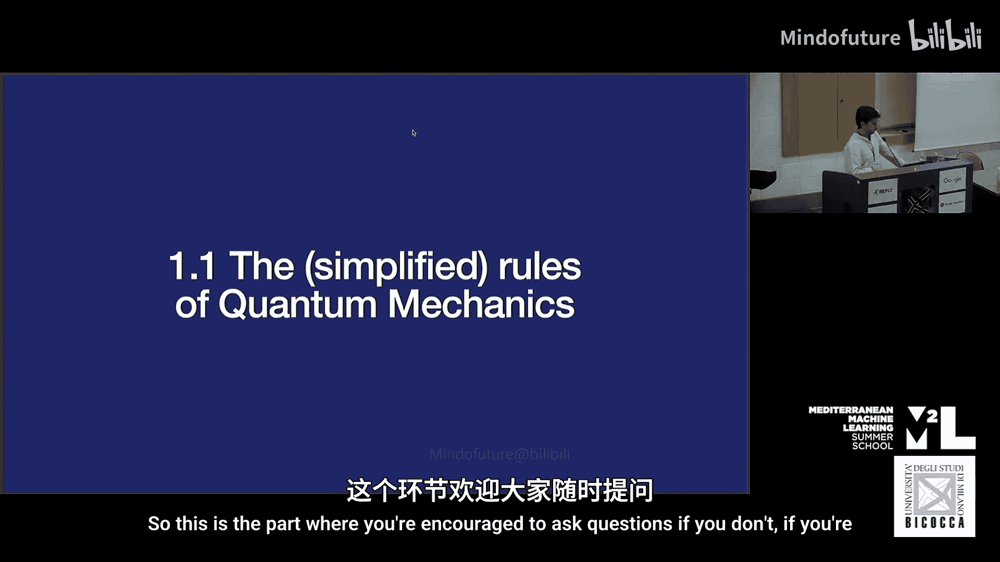

Okay， so a little spoiler。The things， the， the key takeaways here are that。

Cubbits or system of qubits。 They span an exponentially large。Hilbert space。 So basically。

 qubits are exponentially large， complex vectors。 That's the way you represent them。

 We're gonna see how and why， more or less。And they evolve via unitary operations。

 These unitary operations are basically operations that preserve norms。

 So you have these vectors that rotate in a space。 and you're not stretching these vectors。

 Unies have are matrices with singular values equal to  one are the complex equivalent of orthogonal matrices。

And finally， we， we'll talk about measurements because you have to measure these quantum systems。

 But the problem is that these measurements are not fully informative。

 They don't give you a full description of the quantum states， and they actually corrupt the state。

 So you have to do while in classical computers， you can look at the memory。 quantum computers。

 you cannot。😊，You only measure at the end。或额改收。To introduce the qubit。

 we have to think a bit about the bit。 right， The bit is the classical units of information。

 If you had to start a theory of computation， that's where you would start from。

 Probably you need some， some binary system， some difference， right。Can be black or white。

 green or red。 We chose 0 and1， more or less as a convention， because we have math that。

Helps with calculations。And you probably heard that A qubit is。Both 0 and1 at the same time。

 So it can be in a superposition of 0 and 1 at the same time。 But this concept is very hand wy。

 Like what does it mean to be both at the same time。We will， I， we hopefully。

 we will hopefully understand this better。So the idea is that abit is a vector in a complex space of dimension 2。

And just as in classical computing， we choose that 0 and 1 are are the basic of our binary system。

 We choose an orthogonal basis for this vector space。😊，Which is this， this canonical basis，1，0 and 0。

1。 They span the space。And this is called the computational basis。 Okay。

 it's like the standard basis that you use for computation。

 And we call those vector state 0 and state 1。This bracket notation in here。

 it's also called D notation。 We will use it to compress vectors in a dense representation。 Okay。

 this is。Usually， the， the kind of matter you will see。

And so if you have to express the state of a genetic qubit。

 it's a linear combination with complex coefficients。Of these orthogonal vectors。Okay。

When you measure， we will understand this better later。 But when you measure。

 you only see either a 0 or 1。 So you choose an orthogonal basis and you measure in that basis。

So when you measure the qubit， you， you don't see the coefficients。 You only see 0 or  one。

So until you measure， the qubit can be in a superposition of these states。

 we will talk about measurements a bit later。But so。

Because the vector is somehow related to probabilities。This has to be a vector with unit norm。

 with unit L2 norm。This， those are the only rules。ItCom combination of things。

When you go to higher dimensions。You are basically spanning a space of 2 to the n size， okay。We， and。

 and basically， the basis states they， they are tensor products of qubits that represent a computational basis。

So somehow you see that the， that the state 0，0 is。Yeah， I mean。

 somehow you have a one hoten coding of these computational basis states。Right， and in here， they。

 they， since you have this one auto coding， right， they， they have vectors with8 entries。

To abbreviate this notation， usually， we write just the binary representation of the。

 of the of the now of the basis state。 So I could call this state the state 1。

 and I could call this state the state 2。You just have to know that they are in 2 B or 3 qubits or more than top qubits。

And whenever you express a higher computational base， I mean， a higher quantum state。

 a quantum state that is made of more qubits。Then this is a linear combination of this basis in a higher dimensional space。

 So you can encode up to 2 to the n things in the amplitudes in the coefficients of these representation。

Okay， so that was the first point。Now， they also have to be unit vectors。 by the way。

 Well understand why in the measurements。Second part， you have unitities。

Unitary matrix are rotating these vectors。 So you use them to perform computation。 an algorithm。

 It's basically a unitary matrix。 If you go deep into physics， which we don't want to do。

 you solve the Schreddinging your equation。 And you see that if you have finite systems with finite number of qubits and the system is closed。

 then they evolve through these unitary processes。 Okay， you were， we will see that。

 But for what we are concerned， those are vectors that rotate in the space。Okay。

 and we will write our algorithms as unitary mattressrices。It's a very weird way of programming。

 It's not just like writing assembly for a different architecture。

You're programming using math rotations， linear algebra and statistics。Okay， and of course。

 you can use qubits on larger states， and they have nice properties。

 like you can take products of unitaries， and they stay unitary。😊，This is somehow intuitive， right。

 because you can， you use them to describe time evolution。 So you。

 you can discretise the time evolution in many unities。 You just take products of them， and they。

 they， they still describe an evolution。Or you can use sensors products if you want a unitary to act on a certain qubit and not on the whole system。

Okay。Hold just a few more moments。No， there are measurements。 If you have questions again， ask them。

Measurements， they work a bit like that。 So you， you can imagine state。

 the state of a quantum system more or less is a slot machine。 So the beginning。

 your quantum system is in the old zero state。 So you have all the qubits in the zero state。

 Then you apply some unitary process and you。Make thisqubit in a superposition of other states。

And the supersposition lasts until you measure。Whenever you measure。

The only thing that you are going to see is a state of the computational basis。

So a configuration of zeros and ones。Like the， the register。becomes concrete， I。

You actually see that。And the thing is that you measure a certain value of the computational basis with a probability。

 and the probability is the square of the amplitude。I don't know if this is clear。

 but I'm gonna ask you maybe a question so that we are sure that we are on the same page。

So this is a quantum state。 It is a superposition of the state 0，0，0，1，1，1。

The norm of this state sums up to one because one half plus one fourth plus one fourth is equal to one。

 You're taking the squares of this value， summing them， right， because you're doing the norm。

So the first question is， what's the probability of measuring the state 0，0。A house， right。

 because it's the square of the amplitude that is associated with a computational basis state 0，0。

Correct。Cool， so now。Another question。 What's the probability of measuring the second qubit of this register。

In the state 1。I didn't tell you everything about measurements， but。You you。

 you could probably guess it。Just by using classic， classical probability。St 1 half， correct。

 because basically， you have two events that give you one。 Either you measure 0。

1 and you do that with probability 1， fourth or you measure 1，1 with probability 1 fourth。

 So you sum the the probability of the events。Okay， so the probability is still one half。Okay， cool。

 So now what is the probability of measuring the first qubit in the state 0。

 given that the second you， you measured the second。And it wasn't 0。

So you only measured the second qubit， and you found it 0。

 but you still didn't measure the first one。Yes， it's one， correct， right， because。

You couldn't have anything else。And， lastly。This is a bit tougher， maybe。

 But what is the probability of measuring the first  cubebit in state 0。

 given that the second is in one。 So you measure the second。 It's in one。Did someone say something。

One out， yes， because somehow the state collapses。 So you measure the second qubit and you get a one。

 So you， you exclude the first computation path， like。This path is not possible anymore。

And now you're left with this state， but。Actually， you need to renormalize the state。

 So you divide it by the norm of the state to make the amplitudes again， to make the。

 the the norm of the vector equal to one。 That's the general idea。Okay。

 so what you saw in these last two examples。 So the fact that if you measure 0， you get at 0。

 for sure。That is what we call entanglement。So entanglement is just basically。Some correlation。

Some weird correlation between the qubits。Okay， and the states that are entangled。

Are really entangled in the sense that you cannot express them as a tensor product of two independent qubits。

 So if you take this vector， you cannot express it as a tensor product of two complex vector with norm  one。

This thing is entanglement。 And this is one of the power of computational in quantumant computing。

Oops， okay。Cool， so we said the basic， the basic stuff。Now， I want to。Bus one myth。

 you usually hear that quantum computing is powerful because you can explore all the paths at once。

 You have this exponentially large space， and you can search in parallel。😊。

Through all the solutions and find the correct one。

Is this true This this is something that you hear a lot。

Now that you know a bit about measurements and things。

 we can answer this question a bit better and past this me。Okay， so。It's really like that。

 This is a simple algorithm question。You have a function。

 And this is a problem that it's called like searching for a needle in a haystack。

 You have a function。That has a domain over binary strings。And it either outputs 0 or1。

And there is only one input that gives you one in outputs。

Your task is to search for the correct input。 So if you have to do it with a classical computer。

 you have to try all the configurations of the input in the worst case， which are two to the n。

You have to try all the bits configuration。What can you do with a quantum computer。

 I I lead you to this step。 So you start from the old zero state。

 You put it in a uniform superposition of all the computational basis states。

 So somehow you create this superposition that has。All the possible beat strings of n bits。

With the same probability of appearing。And it's a second step。

And then somehow you embed this function in a unitary process。That considers both the registers。

This is not thinking something you have to imagine。

 We'll talk about how to embed this unit in a few seconds。

And then we'll move to machine learning elsewhere。So it is that you apply this unitary and somehow you entangle the result of the function。

To your inputs。So you have a state that looks like that。

You have that the second qubit is one whenever the input is the input that you want。

And the second in cubit is 0 for all the other possible states。

So this is cool because this is very cheap。 I mean， just we just one call to our oracle。

Which is this function here。 We embedded the solution in our quantum system。But now。

 what's the cost of retrieving this solution。If you try to measure the second qubit。

It is very unlikely。 So if you measure it and you measure one。

 then you measure the first qubit and you know the result。 It's amazing。

But the problem is that it is very unlikely to measure these。Part of the system here。

Because it only happens with probability That is one over two to the n。Right， and。You know。

 it's like when you launch a dice， if you're launching a dice and you want the number three to happen。

In expectation value， you need to launch it six times because the probability is one over 6。Right。

 so you have to think about probabilities and expectation values of things happening。

So this still maps back to the classical complexity， which is bad。 So you have the information there。

 but you cannot extract it。The cool thing about this Gover algorithm is that you can have a quadratic speed up here。

 So basically， there are unitaries that you can create that boost the probability of measuring this state here。

😊，By only making。Square root of two to the n calls to the oracle。But you cannot do better。 Like。

 you cannot solve it exponentially faster with a quantum computer。

 even though somehow you're trying all the path at once， The problem is a bit in the measurements。

And moreover， you cannot even clone this state There are no cloning results。

 So you cannot take a value and clone it in another place and measure。 No。

 you have to repeat the experiment from scratch because every time you measure。

 you destroy the state。And you cannot clone it because of unity of operations that implies reversibility and lot of these things。

Okay， almost there。So， so far， we talked about the mathematics of this。 So we have complex vectors。

 They evolve with unitaries， and you can perform measurements， which are disruptive。

But we are computer scientists or computer engineers。 So we might want to know。

How to work with this math and what's the complexity of implementing a unitary matrix。

 How do you implement it。So fortunately， there is a quantum gate model， right？

 And the gate model works by having some gate like a not， an end， this kind of gates。

 but in a quantum version that implement small unitities。😊，And there are universal gate sets。

 So you have a set of these gates。That combined allows you to span all the possible unitities。

Moreover， there are efficient ways to go from one gate set。

 universal gate set to another universal gate set。 So if you're a quantum algorithm programmer。

 you just think of a circuit， you write it down with your case。

 It's like programming an F PGA like writing in very log。 if you， if you know that， right。

 You're programming hardware。 You're describing how the circuit look like you're not。

 you don't have an like an iter like programming language。

 You have a descriptive programming language。So you describe how the secrets look like。

 And then the compilation that really depends on the hardware。

 But we can be agnostic of whether theyre using photons， atoms， electrons。 We don't care。

 We just write gates。Okay。And the complexity is switching from one gate model to another。

 It'ss small。How do you measure complexity？ Well， you have a few ways One ways you measure the number of gates that your circuit has all the number of gates that your algorithm needs to run because you will probably need multiple measurements and redo the experiment from scratch。

 So you just count the number of gates。 That's a figure of merit in。In complexity。

 you can also consider the depth。Which is somehow， how much can you parallelize your circuits。

Theres also other interesting information about the complexity of quantum circuits。And finally。

 you have this abstract complexity measure measure， which is the query complexity。 So you're asking。

 how many times do I call a certain function。And then you are allowed to perform intermediate operation in between。

So there are several complexity measures。Overall。Do we expect quantum computers to replace classical computers？

 That's also a leg question。And the answer is， no。With a quantum computer。

 you can do everything that a classical computer can do。😊，But it is not necessarily faster。

 So the single operations are slower。It's just that you can perform some tasks with asymptotically less operations。

But moreover， you have a lot of problems with quantum computers because qubits cannot hold their superposition state for long。

 They deco cohere and they go back to the zero state。 They have a lot of problems。

 They have a lot of errors。 So you need classical computers to detect the errors and correct them。

This is why the single step is probably slower。 whenever you have an exponential speed up like in factoring。

Doesn't really matter if you have a constant overhead， you know， you'。

 you're somehow winding over this constant overhead of error correction with an exponential speed up。

asymptically kicks in with very big numbers， right。So again， it's like programming F PGs。Cool。

Are there any questions about this。This one over there。Thank Rob。

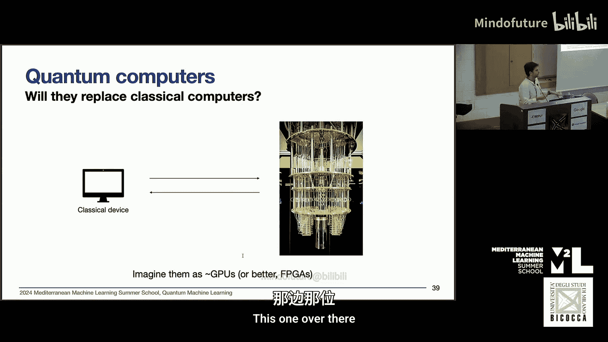

但是上。

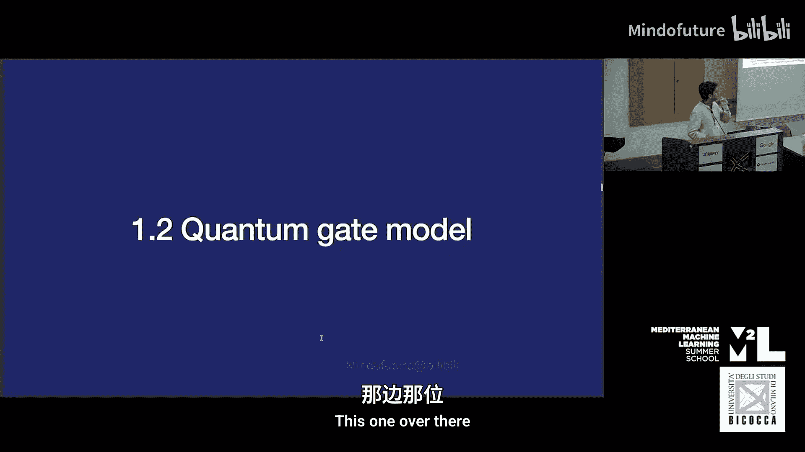

下午。And you wanted to know what they。对。認テシし。Good that。That possible。You're right。 Yeah。

 that's a very good point。 So you're saying that you can get an a speed up a quaratic speed up over optimization problems。

 Yes， but you get a quadratic speed up over a brute force， right， because you're in here。

 you're loading all the parameters somehow。 And then you're trying to search for the best one。😊。

And the problem is that you get a quadratic speed up， but over the brute force。

 if you have some classical heuristic that work better than brute force or classical metal that work better than brute force。

 gaining a quadratic speed up is not that obvious。😊。

But I would also say that for most of the algorithms， we managed to find quadratic speedups。

Which is fine to， But by， you have to play weird tricks。It's a bit。More tough。

 It's not that easy to find those speed at。 you always have speed ups over brute force， Yes， but if。

Sorry。As possible。So。True， but you still have to compare the time， right， you。

 the time that you are spending on this because say， right， I mean。Classically。

 I would say that during the optimization process， you would not。

 you would not try all the possible parameters。You would probably do something smarter， right， to。

You know， some， some gradtting descent or some other optimization methods。

Then if you see what I mean。But like in here， youre， you're。

 you're preparing a exponentially large input space。 You're preparing all the possible inputs。

 And then you're trying to search the best one， for the best one。ButBut classically， you。

 you usually do something smarter， right， than then proforcing over all the possible inputs。

So you always get a speed up over the brute forcing technique。

It's a bit more tough when it's not wood forcing。But I agree that most of the times you can get a quadratic speedup。

 Things that are very rare， are super quadratic speedups。Pnomial speedups are harder to get。

A be there are bit gems that say you， you need to search very well for them。

 There are no recipes to find them。And exponential speed ups are great。Sure。And very。嚟后。You mean。

 like， how do we implement the function。 So the idea is that you are given the function as a black box unitary。

 So you are， you are given a circuitqui that implements the function。

So just it's like in classical computer， computing。

 you can imagine it as I give you a compiled program and you don't have the source code。

So you have a binary。 You run the binary， and the binary outputs 0 or1。

 but the binary is very obfuscated， and you don't want to reverse engineer the binary。So you。

 you only have this black box access， same thing with a quantum computer。 So you have， you。

 you have your gate model。 So you implement this function with gates。

Someone implemented it for you and asked you to find the needle。

And so the the idea is that there is someone that you。

 you can always turn a classical circuit into a quantum circuit。

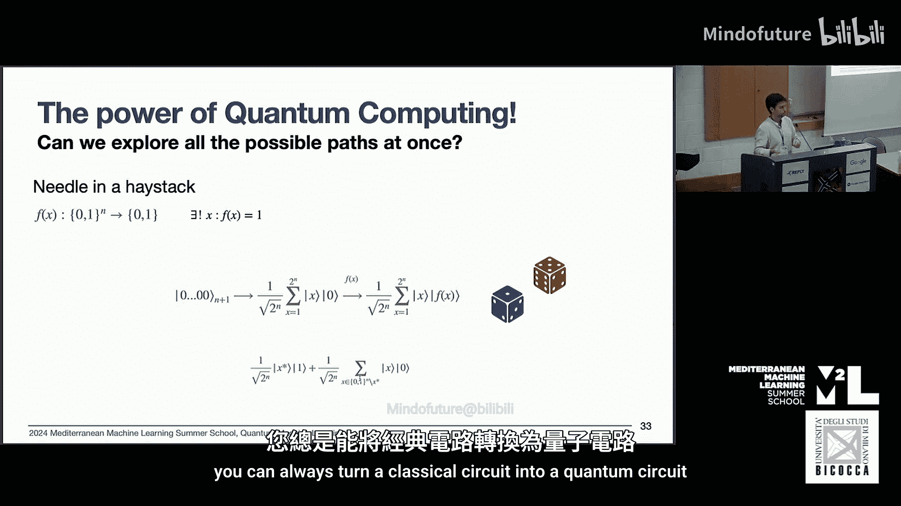

We can always do that。Welcome。

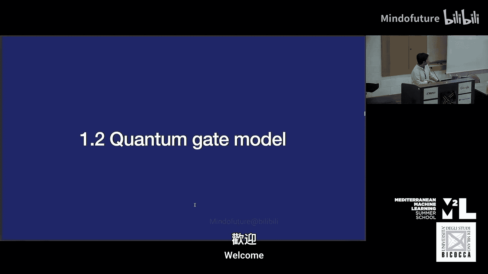

Nice， okay， here。 So I went' a too far。 So quantum machine learning， that's the。

 that's our main topic， okay。😊。

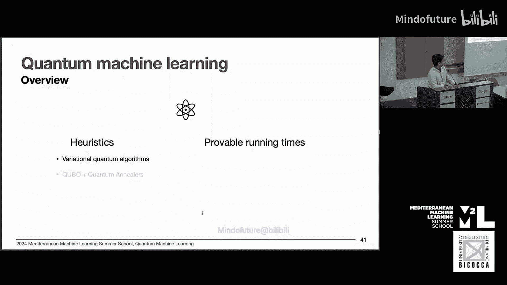

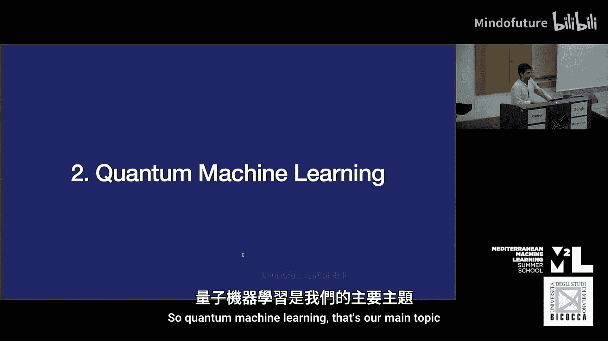

There are two big families of quantum machine learning algorithms， I would say。

 or two big approaches。One approach is a heuristic approach， which is a bit more similar to。

Maybe I would say deep learning and neural networks where you might not have guarantees over the running time。

But they might work。 And you don't have。Great theoretical guarantees of why they do work。C later。

Or you have provable running times where you tackle this machine learning problem from an algorithmic point of view。

 and you， you try to get theoretical asympttic improvements over these machine learning methods。

I'm going to discuss both。I'll start with algorithms with probable running time。

 which is what I mostly do for， for my research interests。

 But I'll also tell you a bit more about variational algorithms later。

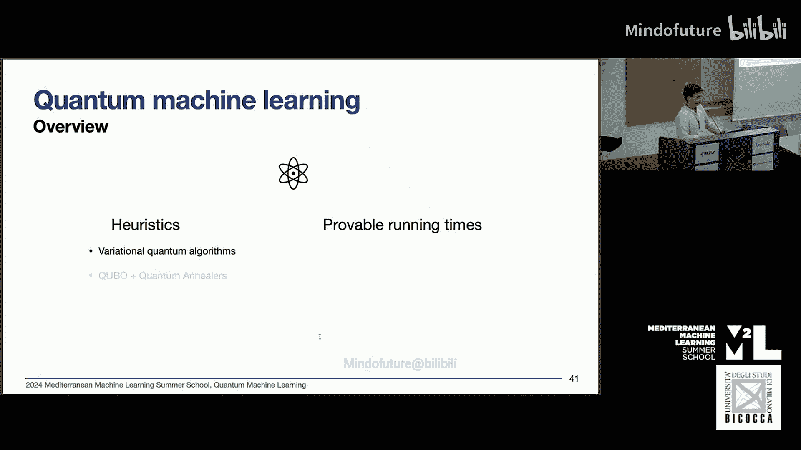

So okay， I think that the field of Q L algorithms with durable running time was born around in around 2009 with a paper that is commonly called HHL。

This paper called HHL is a paper for solving linear systems。

So it tells you that if you have a circuitqui that you always apply a circuit to the zero state and you get something out of it。

 So you always start from the zero state。 So if you have a circuitquid that prepares a quantum state B。

ItSo Im factor。And you have access to us partsse matrix。 We are going to discuss this access later。

Then what you can do is you can prepare a quantum state that is proportional to the solution of a linear system。

So that solves the linear system。With some eilon distance。In time。

 that does not depend on the system size。 So say that you have vectors of dimension N。

You're not paying this N。 You're， You're only paying it in polylogarithmic terms。Okay。

 you what what you're paying is the condition number。

 which is basically the ratio between the highest singular value and the smallest singular value。

 It's it's it's a metric that tells you how well behaved your linear system is。 So how easy it is。

 how stables the solutions are。 Okay， So you you in the original algorithm。

 you pay a quadratic cost in this term and a linear cost in one over the precision。These algorithm。

Was amazing at the beginning because people didn't expect to have exponential speedups on solving linear systems。

😊，And， of course， LED to improvement。 So now we have an exponential improvement in the other term。

 We are only， we only have a logarithmic scaling of on the precision。

And it's linear on in the condition number。But， there are some caveats。Okay， so。thinghing is that。

This spurred a lot of research in quantum linear algebra techniques。

And quantum machine learning techniques。But you need to be very careful of how you encode the data。

 because this is assuming access to a quantum vector。And。You are getting a quantum vector out。Right。

 you're not getting a classical vector。 You're getting a quantum system or a quantum state。So you。

 you don't have access to the full solution。You might observe some properties of the solution。

 or you can use it to run further algorithms。And so。Yeah。

 we will talk about this a bit more in a while。Okay， this part a lot of interest in the subject。

 nonetheless。 So you don't really have exponential speedups now， but。Still。

 you might have great polynomial advantages。Okay， and。So。

The idea in the research process of this kind of algorithms is more less the following。

You start by identifying a problem。And you find a classical algorithm that is good enough to solve this problem。

 So an an classical algorithm that you like。Learning algorithm， right？

And then you select some quantum operations that， So you want to select an input model。

 an output model and some basic operations that you perform during your calculation。You， you。

 you chain them and you get theorems， and you use these theorems with probable guarantees over the running time to compare them to the classical running time。

Sometimes the comparisons are clear。 Sometimes it， it is hard to compare them。

 and you need to run some numerical experiments。Because quantum algorithms are more similar to randomized algorithms。

 So they are not directly comparable to deter deterministic algorithms。 So don know。

 if you're solving an SVD problem。You， you should compare to something like Laxos or to the cry of space methods。

 power methods， all these randomized algorithms here and not。Yeah， like N cube classical algorithms。

 like the， the standard approaches。Maybe this will be clear later。Okay。

So I'll tell you a bit about the toolbox that people from the quantum machine learning community in the far term regime use。

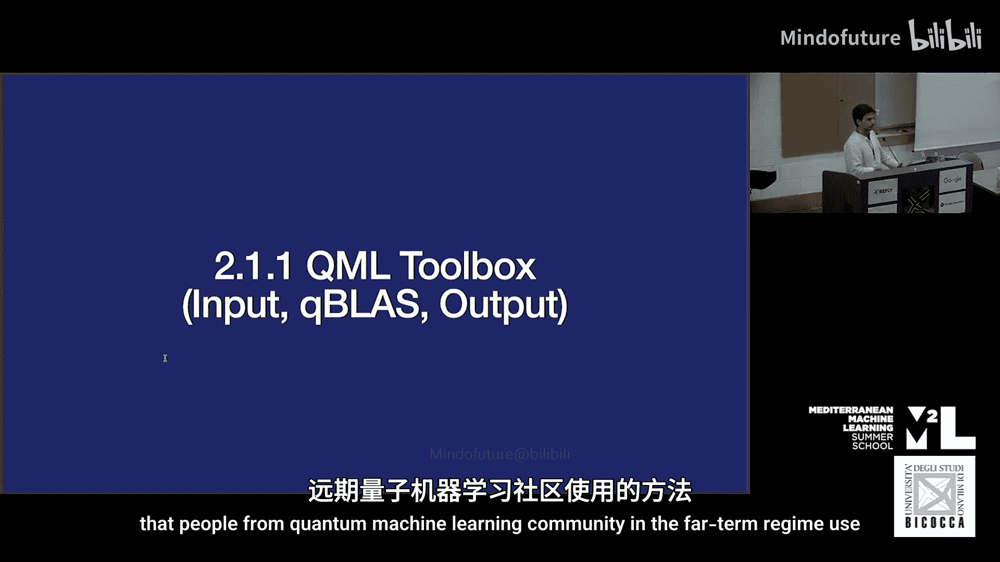

And we start by data encoding。One way of encoding data is you， you need to encode binary data。

 So you have binary strings。And bit strings， right， And you want to encode them in quantum states。

 If you have a bit string that is long n bits， you just need n cubebits。 You just put these gates。

 which are not gates。 So they flip 0 into one。And this is a way to encode a bit string。 So basically。

If you have a， I mean， it takes the same amount of qubits to write a certain number of bits。

 classical bits。But you can do better for some definition of better。

And it what you can do is you encode the information in the amplitudes of your state。

 So if you have a vector。Here， what you can do is you encode it in the。

Linear coefficient of a quantum state。 And you get this kind of vector encoded in the amplitudes。

What happens here is that if you measure， you don't measure the entries of the vector。

 but it's somehow like you measure an index of the vector。

With a probability that is proportional to the magnitude of the vector element。So this is what。

 what is happening this slot machine。But what you're doing is you are encoding this information using a logarithmic number of qubits。

Because this， they fund this exponentially large space。 So you can encode states in this way。

A similar thing you can do with mattressrices， but you will need double the number of registers。Okay。

 then an index for the rows and an index for the columns。

And whenever you measure right on all a column， then you fix。

 you have only the rows that are entangled with those column。

 And then right then you can sample indices from these matrix。

 And it also takes only a logarithmic number of qubits， both in the terms of row and columns。

And finally， another way of encoding a matrix is to put it in some unitary。

 So you em it in a bigger unitary， in a corner of a unitary。 Of course。

 you cannot embed it as it is because maybe your metrics isn't unitary。

 What you do is you normalize your metrics。 So you squeeze the elements。 You make them smaller。

 because you need the unitary matrix have unit norm vectors in columns and rows。

 So you have to reduce the the amplitude。 I mean， that the size of the elements in the in your metrics to embed it in a unitary。

 and then you pad the unitary with other things。😊，And so Q is like the number of X star qubit that you use to embed your matrix in a unitary。

And then you have zipxyon because you can tolerate some error while you encode these metrics in your unitity。

 This is another way of encoding your metrics。 This also requires a number of qubits。

 It this is a metrics that acts on a number of qubits that is located it making the dimension of the metrics。

Okay， so I， I told you a bit about how I want this data to be encoded。But not about how to do that。我。

People from quantum machine learning community or quantum optimization community would like to have is a quantum memory。

And a quantum memory is a device。Similar to a classical memory where you have cells。

That contain values and addresses。And you can write classically in these cells and think a bit of about what is a classical memory。

 It's basically a function that takes an address， and gives you a value。😊，So similarly。

 what you want in quantum computing is you want a ur。That takes an address， and an empty register。

And entangles the value of the memory cell with the others that you asked for。

So this is the process that builds a memory that that implements a memory。

And the quantumness of this memory is that you can query these addresses in a superposition。

 So if you prepare a state that is in a superposition of addresses。

 you get a superposition of values。Which are entangled to the corresponding right。

 to the corresponding index or address， okay。啊。Surprisingly， I mean。

You need to take care about initializing this memory。 So it is not for free， right。

 You have to feel classical data in this memory and the the time that you use to build this memory storage is linear in the size of what you're inputting in the memory。

 That is why solving linear system is not for free because you're putting the data in the memory。

 Right， I mean， if you have them already stored memory。That's story some somehow。 But in， in certain。

 at a certain point， you will need to input your data。 if， if they are classical data。

 if there are quantum data， you can have unites that produce them and。

 and the description of unites can be。Compressed， but that's another thing。

But so the preparation time is like linear in the matrix size or vector size in the memory size in general。

 But the query is so that the difficulty of implementing this memory is only polyloarithmic in the dimension of the memory。

 And when I say polygarithmic， I actually mean in depth。 So you can parallelize this memory a lot。

And this has been the source of much debate in the quantum community， because。

You still require a number of gates that is linear with the sides of the memory。

 It's just that you can compress them in a tree form。So that you can parallellyze a lot。

 You can really parallellyze a lot。And there are a lot of discussion going on on whether you should count this as a polylogue cost or as a linear cost。

 It really depends on your error correcting methods and a lot of technicalities that are still being discussed。

 I would say。But this is the， the， the。I don't know。 The holy grail of。

 of quantum people that work in quantum computation。 like we we。

 we would like to have a quantum memory that is very efficient。

 and you can quantify the running times in terms of cold to the memory。

 as you would do in classical computing， because the memory is like the bottleneck of your computation。

Okay。So if you have this memory here， then you can implement all the memory。

 all the quantum access that I told you before。 So you can implement the binary encoding。

 You can implement the amplitude encoding that are ways to do that。

 And you can also implement the block encoding。this is all in different papers。

There are three of them there at the the bottom， but you can do this。 Okay， if you had that device。

 So you imagine you just write them classically， and then you can prepare these quantum access via these routinein and some other gates。

Efficiently。Okay， so once you have your data， one other thing is quantum basically near algebra routines。

啊。Moving forward from HHL， there have been algorithms that， again。

 solve linear systems very efficiently or perform matrix vector multiplication very efficiently。

And more recently， there are， there is also framework which is very useful。

 which is singular value transformation。 It's basically。A a model of computational。

 like way of computing that allow you to manipulate the singular value of the metrics that you're using。

 So you can perform arbitrary transformation of your metrics。 This is， for instance。

 one way of implementing the inverse。 you apply a function to the singular values that is one over x and you invert the matrix somehow。

It transpose thematics， and then it's inverted。And you do that by polynomial approximation。

 So you take a function， you do a polynomial approximation。

 You need to count how many terms of the polynomial you need to approximate the function。

 And you're gonna build this year equipped with rotations and。Is a very powerful technique。

And these LED to a lot of deco quantizations as well。 So for certain matric in certain regimes。

 there are also classical algorithms that can compute。Basically， in a algebra operation。

 with times that do not depend depend only logarithically in the metric size。

But the thing is that they depend depend polynomly on other。Quantities like the condition number。

 the precision and the scaling of the classical algorithm is usually very bad。

 That is why you don't see them in practice implemented in the wild。Okay。

So there is still hope for huge polynomial speedups。 That's what we hope for。And lastly。

 the last routine is the our routines to get some outputs。 you can， of course， get like。

 you can reconstruct a quantum state by sampling and take statistics。

 and then you can also estimate amplitudes if they are marked。 like you mark them with a qubits。

 they set to one。 And you are able to estimate this quantity with one over E pyon repetition of this unitary。

 which is better than what you would do classically it's basically the gr speed up。

 So a quadratic speed up。😊，Seen with in in a different man manner。 Okay。

 and it's a way to estimate probabilities and expectation values in a faster way。More or less。ok。

So now I'm gonna tell you a bit about an example of easy quantum machine learning algorithm。 Again。

 I just want to give you an idea of how this algorithm are are built and what it means to program a quantum computer to do。

 to perform machine learning。 So that's the， the main thing， yeah。

You will probably not understand in depth what the algorithm is about。 and I will not even try。

 but at least you get an understanding of how it looks like to write these kind of algorithms。

So the eigenface is taskask。Pre easy。 It's it's a classical algorithm for face recognition。

 The idea is that you have a training set with a bunch of faces。

 You get a test test point or a test sample。 And you w， I mean。

 if it belongs to a subject in your training set， then you answer the。

 the idea of the subject in your training set。If it's an unseen phase。

 you answer that It's an unseen phase。 And if it's something completely unrelated。

 you answer that this is like an outlier， okay。And the original algorithm works like that。

 It's based on singular value composition， PC A， this kind of things。

And the idea is that faces are not uniformly distributed over the space of the images， right。

So you do is you center your data。Extract the top K principal components。And represent your data as。

 I mean， with， with a weight vector。That it's basically a linear combination of these principal components。

 which are called the eigen phases。 eigen phaseses because of eigenvectors。死掉。So what you do is you。

 you take all your training set and either you take centries or you take the whole whole points。

 I mean， all the points that you have and you store this weight vector。

And you will use them later to perform comparisons。 So this is like the training。

 You extract the principal components and save the weight vectors。

The classification algorithm works like that。 You get a new data point， you center it。Right。

 with the mean that you are extract from the training data set， that data set， the training set。

And then you compute the weight vector by projecting your data point onto the principal components。

 So you， you get the weights。 You compare your new weight to the centries or the， the data point。

 the weight vector of your training set。And you select the closest。Then depending on the distance。

 if the distance is less than a threshold。You output the index of the closest。

If this is somewhere between two thresholds， then it's probably an unseen phase。

 And if it's really above the other threshold， it comes from a different distribution。 Okay。

 that's a rough idea。Something else you could do is you can add this step here。

 which is an an additional out layerer detection method。 Very simple。

What you do is you check how much of the norm is preserved after you project your data on the principal components。

 right， Because if you have a phase and probably it's well represented in the sub space。

 But if you don't have a space a phase， probably it's not okay。

So you compare it against a threshold and you'd make an early decision。Cool。

 so what's the quantum equivalent of this。First of all， we need to encode our data and what we want。

 we will assume that they are stored in a quantum memory。

 So we will use a quantum memory to store these we have， we already。Perform the training。

 We are only interested in performing classification and see if we can speed this up。😊，Okay。啊。Maybe。

 let me go。Back just for one slide， I forgot to tell you about this complexity here。

So this is the complexity of the textbook implementation。 K is the number of principal components。

 M is the size of the vector。 So of your image， like if you unroll it。

And and so this is the complexity that is given by this normal detection method more or less。

 And P K is basically the complex， the complexity of searching。

 P is the number of weight vectors that you have in your training set。

 So the number of centuriesries or the number of data points that you use for the comparison。

 So if you implement it in a deterministic way。 and is a way， that's the complexity。Okay， and now。

Yeah， okay， so。You want your data stored in a quantum memory， and you want access。 you not。

 you want the weights to be amplitude encoded， and you want the your mean centered sample to be amplitude encoded as well。

And then you want your top K principal components to be in a block en coding。

So to be in in some top left corner of a unitary matrix that you know how to implement with quantum gates。

You can all of， you can do all of that without memory。

So the first thing you want to do is you want to project your quantum state onto the principal components。

To estimate and even estimate this norm ratio， what you can do is。Somehow。

 you just prepare this quantum state that you want to project。We have Pant memory。

And you apply the block encoding。So the probability of measuring 0 in the first qubits of your block enco or the qubits that are not your。

 the one of your input is proportional to the threshold that you want to estimate。

This is a cool thing because you can use amplitude estimation to estimate this amplitude。Very fast。

Okay， that's first idea。 So you create a circuit such that the probability is proportion。

 the probability of measuring something that you know。

 So the probability of measuring zeros in this case is proportional to the quantity that you want to measure。

And the city。Similarly， what you want to do next is you want to compute distances in superposition。

And you use another circuit like that。 So you have another circuit like that where the probability of measuring one qubit is proportional to an inner product。

 And from the inner product， you can compute all of these quantities。Okay。

 this is nontrieval because of， of course， here， I mean。

 this UW is the circuit that you used in the previous step。 So you。

 you have to open those boxes and know what gates are in there。

 And the circuit gets complex and complex， but we represent it with some more abstraction here。

So it is more or less always preparing things that have some probabilities of happening that are things that you want to measure。

 things that you like， and you want to estimate。And by doing this。

 you can compute all the distances in superposition。With some takes。

And you end up by doing some minimum search。With a grber like algorithm that gives you a quadratic speed up。

So if you chain all of these， what you get is。An enormous quadratic speedup。

 because it's just not just like， not just Grover。It's a lot of other things。

 But you see this dependency on M。 K disappeared。 You have a square root dependency on P， K。

 but you have an extra error term。The problem now is that it's not easy to compare these terms。

 right， because you don't know what a tolerable ebsilon is for your task。 This。

 This ailon is like an error that you have while estimating your distances。

 So you want to know what's tolerable and what's not。

So what we do usually is we run numerical experiments at this point。

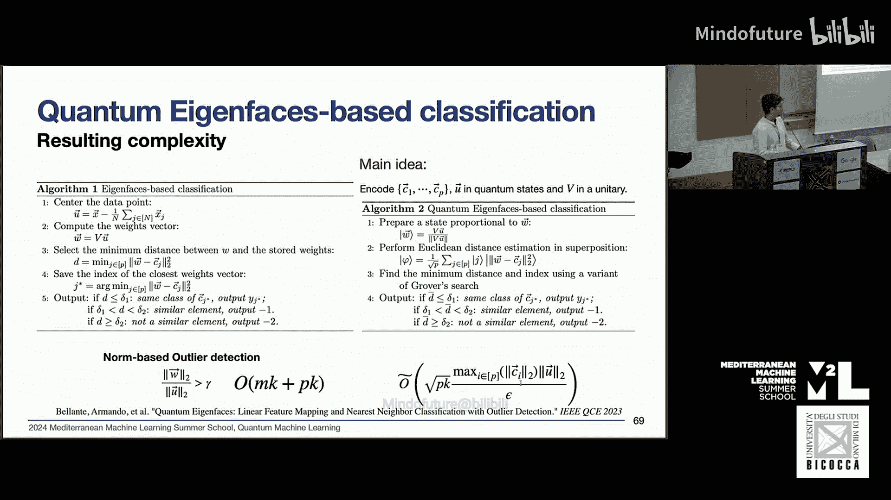

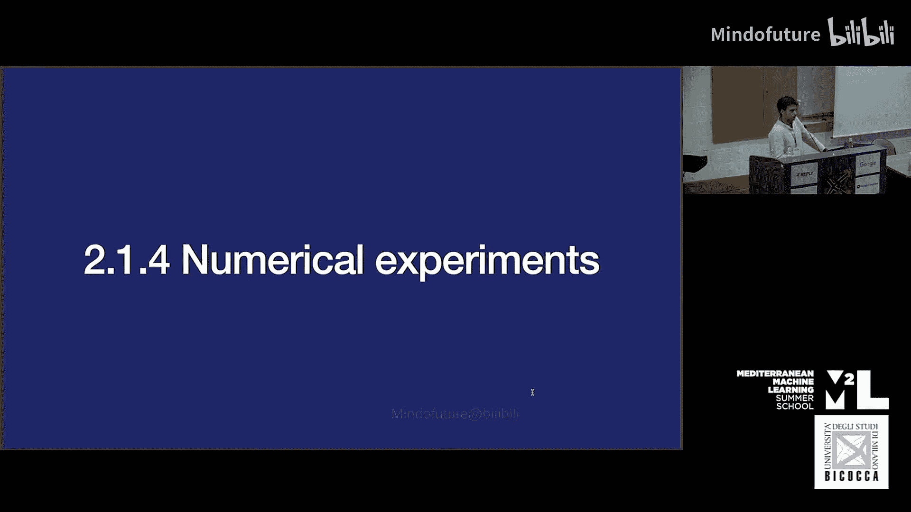

And in this case， what you want to do is， again， you want to estimate this error here。

 And these norms here are just。To compensate for errors like they。

They somehow balance these two terms。 So you estimate them at once more or less。

So what you do is you implement the classical algorithm and you just perturb the solution of the classical algorithm by inserting errors。

Where you expect errors to happen。And did that on some。Toy data sets， very simple dataset sets。

 This is like anemist data set polluted with some fashion emminist points that perform as outliers。

What we did is we trained this model by maximizing the F1 score， basically。

And we studied the performance of this algorithm as you increase the error。

 So you see how the metrics decrease or get worse as you allow for higher error， but higher error。

Theorms。Mean faster algorithms。 So what you want to find is you want to find a trade of。

And in the end， if you plot some， I mean， if you try to work out some results。

 you see that the running in time might improve considerably。

Should run accurate resource estimation for that is basically just some  query complexities。

 like the number of time you're accessing the memory。

So you might lose these speed ups if you take into account all the hardware problems。

But more or less， this is like， you get huge speedups。And you don't lose much in accuracycu。

 like you， you can tune this。 You can decide to lose a lot。 You can decide not to lose anything。

That's the idea。So， yes， in general， what you want to do is， I mean。

 what I wanted to say here is that algorithms， quantum algorithms and classical algorithms are not easy to compare right here。

 this n is disappearing， but is leaving some space for all these other parameters that you have to estimate。

 So you have to run a lot of numerical experiments to estimate these parameters project them and see more or less where the running time improves。

Right， because eventually， the quantum running times will be better asymptically。

 But we need to make sure that this happens for a reasonable amount of data points and features。

 Otherwise， if it only happens foreristic data sets， it doesn't make sense。Okay。

 it really depends on whether you're speeding up。Hours to minutes， days， to hours or。

1000 years to 100 years。You probably won't care， in this case， right。Okay， so。Have this。Last part。

Which I try to do bit more quickly。It's about variational quantum algorithms。

 Those are some heuristics。I'll go faster。 The idea was to develop algorithm for quantum computers that are noisy and that are not really stable。

 So you have only a handful of qubits and they are noisy。 You want circuits to be shallow。

 so the the error doesn't propagate。So the idea was to have circuits that are parameterized。

You put parameters in gate， and you try to learn a shallow circuit that does the job。 It's like。

It's like more or less having a neural network where。These， these， these things are called ansats。

 like the shape of these circuits。 And they are really the architecture of the parameterized quantum circuits。

Okay。And they control the expressibility of your circuits。 You can。

 they control the inductive bias of your model， somehow。

The idea is that you have this hybrid quantum and classical optimization process where the classical computer flashes onto the quantum computer。

 a circuitqui with some parameters， evaluate some expectation value。

 So it calculate some probabilities by making many measurements and then optimizes a loss function and puts the parameters back in the circuitqui。

 So the circuitqui always changes。😊，But the parameters， I mean， but only by the parameters， the。

 the architect actually is almost always the same。It stay the same。Of course。

 these variational approaches are harder to study。 like they have less theoretical guarantees。

 It's hard to say whether they are fast， faster or slower than classical algorithms。

 So you don't have all the provable guarantees of the far term models。But they are great heuristics。

 I mean， they， they are similar to neural networks in spirit， at least。

They suffer from a lot of problems， at the moment。One of them is， they have local minima。

 which you could have guessed。 And these are always。 I mean， due to I mean， you。

 you can solve them sometimes with other parameterization。

 you have this phase shift where if you have enough parameters。 you start suppressing local minima。

 another technique seems to be to have an adaptive circuit than。

 So you change the architecture of the circuit during optimization。

 This will turn some local minima to set points。 So it will be easier to estimate the gradient and understand that you are in a local minima。

 they will change。 There are ways of doing that。II suggest you check this paper out。

There are button plates。 So as the system size increases。The gradient becomes exponentially smaller。

 This is somehow similar to the issue of vanishing gradients when you increase the depth of neural networks。

So in here， if you increase the depth of quantum circuits， you have these gradient that vanishes。

 and it's the same if you increase the amount of entanglement， which is a P T。

 because entanglement is probably the source of quantum speed up。

 So you don't want to lose too much entanglement。 You want to lose a bit of it to avoid button plaaus。

啊，系。And finally， you also have problems starting just by noise。

So it can shift the landscape and move the local minima around。 That's a problem。

 noise that comes from hardware。So finally， what matters is the architecture that you choose for your variational algorithms There are architecture that try to mimic forward neural networks in the sense that they involve more and more qubits and they discard some of them passing the information forward that are architecture that take the number of the I mean。

 the the number of qubits constant throughout the the circuit。

 and there are gates like quantum convolutional neural networks that have these pooling layers that have the number of qubits used throughout the optimization process。

 like so you only have a logarithmic number of layers。

 And you have these layers that are basically single operation entanglement。

 single operation entanglement。😊，Convol quantum convolution neural network。

They have a stronger inductive bias because they model。The model in invariance to translation。

 So they have less expressibility than  Q And Ns。 And this allows for less bar plateaus。 However。

 these models have recently， like a couple of weeks ago， have been shown to be easily simable。

 So you can simulate them with classical computers up to a very high number of qubits。

 like 100 qubits， which is insane for simple data sets。

 It really depend on the data encoding process。 So it it also depend on the data sets。

 if you can simulate the circuit or not。Lastly， I just wanted to tell you that good research avenue at the moment is geometrical quantum machine learning。

 So the idea is to restrict the inductive bias of the model。 So like。

 you restrict the expressibility of your circuit and you plug like permutation equivaris in the same way we are doing now with graph neural networks。

And the idea is that this circuit should reach over parameterization in quicker and should suffer from less bar and plateaus。

 I put here a reference that you should check if you're interested in this topic。And basically。

 that's it for the talk。 I leave you with a bunch of suggested readings that you might like or you might not decide to。

 to read after this talk。And that's it。 I'm available。

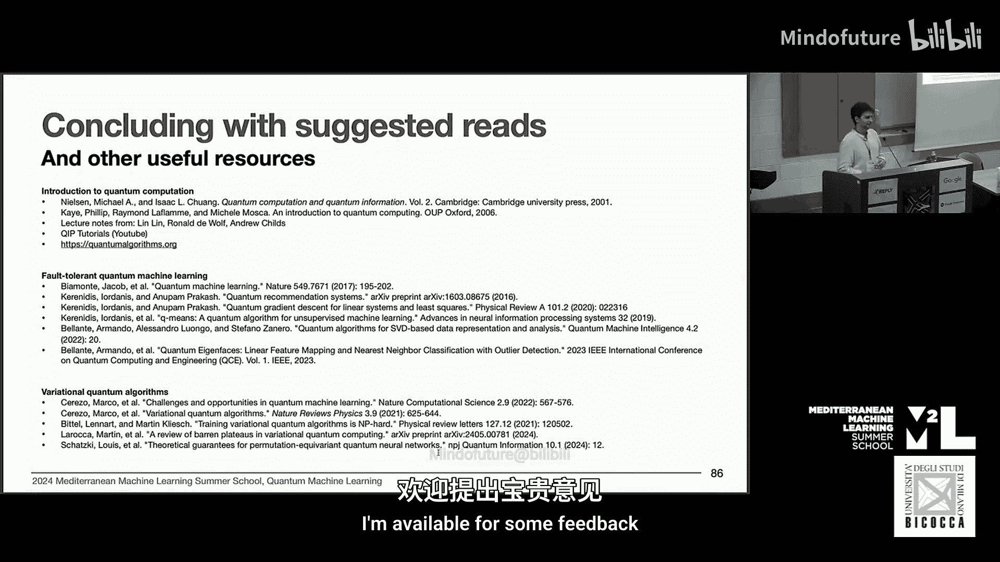