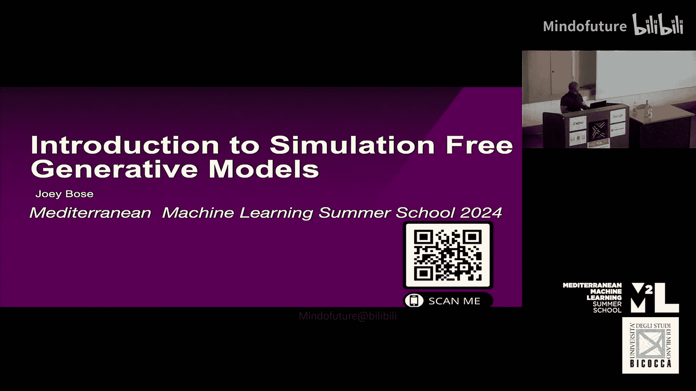
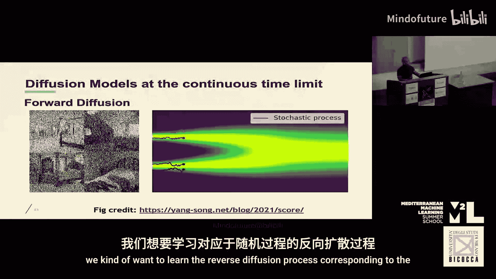
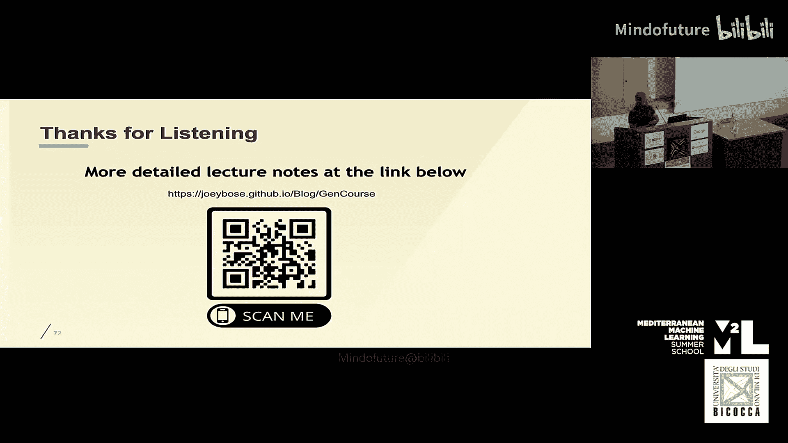

# 【比科卡大学】机器学习讲座 ｜ Machine Learning ｜ Moe ｜ Grpah ｜ Rlhf ｜ Llm ｜ Ai Safty ｜ 2024 p07 P07_无仿真生成模型入门-Joey_Bose -BV1XzScBEEdJ_p7-

Allright， so hopefully everyone can hear me。😊，So thanks for inviting me again and flying me out here。

😊，So in this kind of talk， I want to take it back a bit compared to Adriana's awesome talk earlier and kind of go back to a little bit of the basics of what are diffusion models And specifically。

 a more broader class of models， which I think people are calling these days simulation free generative models。

 which includes diffusion flow matching and other breeds of geneative models。

 And these are really like the the modern geneative models that people are kind of building on top of on all the recent advances are kind of like exploiting this kind of framework。

😊，So some of the tutorial or lecture details， I've also made it into like a a nice course note。

 So if you want more detailed math derivations or some of the things I' will talk about。

 feel free to scan that Q R code that that， that contains an actual course on geneative models and also geometric geneative models。

 which is a course that I taught two years ago at Milla。😊。

So when we talk about generative models， really， I wna kind of break this into like 4 or five parts。

 I'll talk about first discrete diffusion models that you're kind of already familiar with。

 Sc geneative models and how you can connect these two different angles into like one unified perspective as in terms of continuous time generative models or continuous time diusion models specifically。

 And then we'll move on to flow matching， which is alternative way of formulating some of the same concepts。

 And then finally， I kind of want to end off on some really cool applications that maybe you've not seen yet。

 because you've kind of already already seen a lot of image generative models。

 but some applications and scientific domains that I'm kind of particularly interested in。😊。

So when we think about generative models， I like to think of it as like three different components。

 There's the model that you're building， Of course。

 how you learn the model and then the algorithm that combines the learning。

 as well as the model class itself。 And each of these kind of knobs can kind be thought of as like a geneative model soup。

 And what you put into the soup gives you a different flavor。😊，So， for instance。

 you could have different classes of geneative models like Gan you probably heard about Vs。

 diffusions。 And they often have this gene modeling trilemma where you have to kind of trade off one of these two different modes。

 But recently， diffusion models has come into such force that this trilemma is kind of a bit outdated。

 And it' is because like at scale， a lot of these things don't really matter anymore。

So the general setup that I want to talk about is， well， your geneative model kind of consumes data。

 and sometimes your data has a little bit of noise。 But we kind of want to represent this data。

 And for this talk， we'll just assume everything is in R N or Euclidean space。

 And we wantna model this empirical data distribution。

 So this data distribution is very familiar to us。 It's your training set。

 And let's say our training set has end samples。 And we want to fit a probabilistic model to this data set。

 How do we do this。So， well， there's many classes of models to choose from。

 So the one obvious class that you probably have heard about is fully observed models。

 So these include autoregressive models。 and theyve kind of model the joint distribution over end things like like so。

 And one of the the benefits of autoregressive models is that admits this factorization。

 So you can actually get explicit log likelihoods， which is kind of important for many applications。

 However， if you have an autoregressive model， One of the the downside is that it's sometimes sensitive to the order of things it observes or oftentimes at generation time。

 you have to do sequential generation， which can be a bit slow。😊，嗯。Alternatively。

 you could have latent variable models， which say kind of like， well。

 we have some unknown latent factors of variation。 Let's call them Z that give rise to your observations in your data set X。

 And we want to learn this graphical model。 Some of the benefits of latent variable models is that you can have fast sampling。

 It doesn't have this order dependency。 But then oftentimes。

 just this learning problem is a lot harder。 And you don't always have explicit likelihoods。😊，And。

 and this inversion process， where you go from observable to lateance is often kind of tricky。

But then moving on to different learning principles。

 There's many different learning principles that people have kind of exploited in the past for generative models。

 These includes the familiar maximum likelihood estimation， expectation， maximization。

 variational methods and the list goes on。 But these days。

 most people kind of have pinned down maximum likelihood as the kind of like the the main driving force for everything。

 kind of because it kind of just works and is really scalable。

So what is maximum likely kind of doing， It's saying that we want to maximize the likelihood of observing your data set and you want to fit model parameters。

 let's say theta to observing this data set。And in an autoive model。

 this would be your LLM or whatever as your actual model class。And finally。

 when you combine these models with actual learning principles， you get the algorithms。 For instance。

 if you have an implicit general model and a two sample test， you kind of get again。

 If you had an autore model plus maximum likelihood， you get basically L O Ms and so on and so forth。

😊，Now， this brings me to the first part of this talk。

 which is gonna be on how do we build dennoing diffusion models。

 And you've already probably have seen or used these models in prior to this。

 But maybe you don't know exactly the， the， the mathematical or granular details。

So a diffusion model at a glance is really two different processes。

 There is the forward process that takes your data and slowly corrupts it by adding a lot of noise and it。

Adds enough noise that at the terminal time， you have only unstructured noise。

 And then there's a corresponding reverse process that it's critically associated with this forward process that takes noise and brings you back to your actual data distribution。

So the goal of generative modeling or learning a diffusion model is really to kind of learn this reverse process。

 given a prescribed forward process。 So one thing that's critically different for diffusion models as opposed to other classes of models is that the forward process is no longer gonna be learnable。

 and that's okay， because we don't need need it to be learnable。

 Only the reverse process is gonna be learnable。So what does this forward process look like？ Well。

 in the case of R N or images， for instance， this forward process is sequentially or progressively adding Gaussian noise。

 And you add enough Gaussian noise for， let's say， a finite number of time steps。

 capital T so that you hit basically a normal distribution，0，1 normal at your final time。

And this entire thing is driven by this idea of this transition kernel。

 which is taking you basically a noisy image at time step T -1 to a noisy image at time step T。

 where the time step T is a bit more noisy than the previous one。😊。

And we formalize this transition kernel with this distribution Q of X T given X T-1。

 And this is given to us by this normal distribution that I have over here。

 And you'll notice that the the mean of this normal distribution is kind of this square root of 1 minus beta T that's multiplying the previous X T -1。

 So you're， you're centering your normal distribution at the previous time step。

 And you're sampling around this point。 And that's how you're adding a bit more noise。

 And beta T is kind of like this variance or noise schedule that progressively increases over time。😊。

So to be a bit more crisp， beta T can be user specified。

 There's multiple choices for different beta T， different variances And， and this。

 these give rise to different types of diffusion models。 for simplicity。

 we'll just assume that this is not an interesting parameter for now。

 but the literature has really explored different choices of this。

But the key constraint is that at time t equals 0， we have to assume that we hit our original data distribution that we're trying to model。

 And at times T equals to1， we're sampling from just a standard normal distribution。

 And for the discrete time version of this diffusion model。

 We will assume that time is discretized into a finite number of steps， let's call that capital T。

Now， the question is， well， if you give me a clean data point， let's say x0。

 how do we generate a noisy sample at Xt。 naively， you can imagine you could just add a little bit of Gaussian noise sequentially and get to an Xt。

 But that's kind of wasteful。 that would be kind of simulating the entire forward process。

 And the whole point of this talk is simulation free generator modeling。

 which is how do we get to this noisy sample without actually simulating this diffusion process。

 So it turns out because we're using a Gaussian transition kernel。

 you can kind of unroll this diffusion process backwards in time a little bit。

 So imagine you have a sample X T。 And you can redefine some variables。

 which is let's say alpha t is 1 minus beta t。 And the product of alpha t。

 let's call it alpha bar is just the product of alphas。

 if you rewrite this diffusion noisy sample at X T and unroll it through time。

 It turns out you can reexpress Xt as just a function of your original clean sample X0。

 So what this tells us is that actually we could have had another normal。😊。

Distribution centered around x 0 with appropriately chosen mean and variance that is equivalent to having a noisy sample at X T。

 And the key thing is that because your forward process is not learnable。

 you can kind of precompute this。 So in some sense。

 you can jump to Q of X T given X0 or sample from this distribution without sampling the intermediate steps。

 And this is really important because this avoids a really expensive forward process。Now。

 as I mentioned， the main goal of diffusion models is to kind of learn the reverse process that is associated with the forward process。

 So how do we go backwards in time。 So to go backwards in time。

 we need to kind of like define this reverse transition kernel。

 and this reverse transition kernel takes you from a noisy sample at X T。

 and dennoises it a little bit to get to X t -1。 Now。

 what does this X T Q of X T -1 given Xt look like。 Well， if you just simple basees rule。

 you can express this as this posterior distribution。 But there's a problem here。

 The first problem is that the the denominator has this marginal term Q of Xt。 Now。

 the reason this is a tricky term is is that we don't actually have access to this probability distribution。

 And that's because this marginal is intractable to compute and high dimensions。

 And this is precisely because our data is actually an empirical sampling。

 not an actual density over your actual trading samples。But however。

 if you had access to this transition kernel， you could kind of simulate the SD D E backwards in time and actually generate an image。

 That is kind of what's happening， at least visually in this example over here。

 You start from some noise。 you simulate back progressively through time and get to a clean sample at X0。

But the marginal， as I mentioned， is the tricky object to handle。

 And the reason it's tricky again is because if you marginalize out this distribution。

 So you have this joint over Q of X0 and X T， the problem is that we don't have to actually actually have access to Q of X 0 because we only have samples from Q of X 0。

 but not the density。So you can actually compute this term。So what do we do instead。So instead。

 we say that， well， let's just assume that your variance in the forward process beta T is small enough。

 And if it's small enough， it just happens that this a Q of X T-1 given X T。

 this reverse transition is approximated well by another Gaussian distribution。Now。

 if it's kind of like a Gaussian distribution， what we can say is that， well。

 we want to learn this Gaussian distribution。 So we can say。

 let's fit this Gaussian distribution with another parameterized model。 Let's call that P theta。

 So P theta is trying to model this reverse transition。

 and we'll parameterize it also as a Gaussian distribution。 And for simplicity。

 we'll say what we'll just do parameterize the mean of this Gaussian distribution。

 So what a diffusion model is trying to do over here is just kind of learn this mean of this reverse transition。

😊，And， and this reverse transition is gonna be also defined as a process。

 So but that means that it will start from a standard normal distribution。

 So P of X T capital t is gonna start from a 0，1 normal。 And then at every intermediate step。

 which we're trying to learn this sequence of normal distributions where the mean is given by this parameter network that's gonna consume two things。

 It's gonna consume the noisy sample at X T as well as the time index。

 And this time index is important because it allows us to kind of quote unquote amortize the process across all of time。

 So what does that actually mean operationally， It means that you can use the same network for all time steps。

 if you feed it in time。😊，Now， the joint distribution over all reverse time set also factorizes across time。

 and this is。Primarily because the forward process also factorizes。 remember。

 the reverse process is associated with the forward process。

 So whatever you do in the forward process， you can equivalently do in the reverse process。Now。

 what does learning look like？So。If you examine the reverse process。

 let's assume we start from a specific sample X 0。 What does this conditional look like， So we can。

 because we're starting from a specific X 0， we can write this reverse posterior as Q of X T minus。

Q of X T-1， given X T conditioned on x 0。And this condition of X0 is kind of critical over here because it tells us we are starting from this sample。

Again， if you write this posterior again， we have magically another normal distribution。

 And the goal of diffusion is now to kind of like mass this mutilde。

 This mutilda is consuming two things。 It's consuming X T。😊，And x 0， and a modified variance beta T。

There's a little bit more algebra to this that I'm kind of glossing over。

 And that's kind of derived kind of in the， in the lecture notes that you probably scanned earlier。

 But you have to take my word for it and assume that this is also a Gaussian distribution。Now。

 because this is a Gaussian distribution， This gives us a very easy parameterization。

 as well as a learning target。And that learning target is that we want to fit the reverse。

Transition P theta and just match this everywhere。 at every time step。 And in machine learning。

 whenever we want match distributions， One natural way is to match the the K L divergence or optimize the Kl divergence。

 And in this case， because we're working with Gaussian distributions。 So Q is a Gaussian and P。

 we chose to be a Gaussian。 This Kl divergence term just simply simplifies down to this regression objective between the means of the Gaussians。

 So we're regressiongressing mutilda to mu theta。 And mu theta is the is kind of the the model that we chose。

😊，And you'll notice that this is a per time step loss。

 which means that we can kind of independently sample a specific time step compute a noisy sample X T and then try to learn the mean of this Gaussian distribution。

And up this constants that don't matter for， for grading competition。

 This is all a diffusion model is doing。It's a regression objective where you regress at every time step independently。

 Scd by the variance squared or some other weighting constant。😊，And， as a result。

 this presents a very natural way to kind of like scale these up because at no point in time do you have to actually simulate the forward process or the reverse process to to consider learning。

We can independently sample time。嗯。Because we're also trying to match the means of Gaussians。

 We can also think about alternative parameterizations that might be interesting to consider。

 So instead of mean parameterization， we can also ask the question， well。

 how much noise was added to a noiseisy sample X T。

 And this is kind of gives you this idea of parameterizing neural network as a noise prediction neural network。

 So you can reexpress the the mean of the Gaussian as a function of the the alpha T because alpha T is as user specify or model specified。

 So you have access to it。 And you can really say， oh， we want to kind of dennoise。😊，X T， so this。

 we have this new network now， which says， well， if you give me a noisy sample X T N time。

 this epsilon theta is trying to predict how much noise was added。 And we want to denoise like this。

And when you do that， it turns out you can also rewrite the loss in the same denoiser fashion。

 So now you're predicting how much noise was added。

 And all that changes is that there's a new scaling constant that appears in front of the loss。

And the scaling constant， as I'll explain in a second。

 controls what types of features you're optimizing for。For images， it just happens to be the case。

 you can just drop the scaling constant and call it one。 And it。

 it turns out it's quite good at generating high quality or high visual fidelity images。😊。

And in in the literature， this was known as the， the simplified diffusion objective or simplified DDM objective。

 And this was kind of like the， the original contribution of the， the DDPM paper。

So let's quickly recap what we've saw so far。 What is the training algorithm。

The training algorithm is， as follows。We will sample a data point x 0 from your data。

 That's Q of x 0。 and then well sample time uniformly between 0 and capital T。

And then also sample noise epsilon， which we will use this。

 which we will use to con construct our noise sample X T。And then we're gonna feed in X T。

 which is going be this first argument inside this epsilon theta network。 And we。

 we're gonna just try to de noise。And this is gonna be our loss objective that we're gonna take the great respect to。

So's， so it's extremely simple。 It's four lines。 You can code this up in five lines and and pipe towards if you w。

Now， if you do this for long enough for for enough time， you will learn basically a diffusion model。

 The next question that arises is that， well， now that I have a diffusion model。

 how do I generate pretty pictures or pretty samples。And sampling， unfortunately。

 has to be done via simulation。And this is because when you start from essentially X T。

 which is gonna be， again， a standard normal distribution。 And then we progressively dennoise。

 And we have to do this progressively。 We cannot do this without simulation。

 This is one of the downsides of diffusion models is that at inference time。

 So when you actually want generate images， you need to kind of simulate this reverse trajectory。

Buthi is still okay， because training， you need to like， you can still do a simulation free。

 But inference is a bit expensive。But more recent work has kind of opted for faster inference strategies by learning faster solvers or faster whatever。

But for this talk， I won't talk about that。Given we have sampling and as well as training。

 you could ask the question， well， how do you parameterize networks in practice and the most basic parameterization that people have kind of kind of settled on。

 And of course， there's more modern ones is this idea of using a unit where you give it X T your noisy sample。

 but you also give it this notion of time and time is embedded as well。

 So usually people use some singoid embedding for time。 And you feed it into every layer of the unit。

 And essentially the unit predicts epsilon the。Or it acts as the denoiser。

 So it's a very simple parameterization。 There's more complex ones。

 There's many more things you can do with embeddings。 But at a basic level。

 this is all a diffusion model is kind of doing。Now。

 now that weve kind of understand like the basics of diffusion， the next question is like。

 let's kind of re examine the forward process。 What is the forward process actually doing。

 So if we reexamine the forward process， we're kind of looking at this noisy distribution Q of X T given X。

 So this is， again， the noisy transition all the way to X T。Now。

 the way we examine this is by considering what's actually happening in Fourier space。

 So if you take the Fourier transform of what a X T would be。

 you can kind of like construct this Fourier transform of x 0 scaled by square root of alpha bar T and the Fourier transform of the noise。

 And you can see that like if you were to examine the Fourier transform or the magnitude of the amplitude of the transform。

 you can get a graph like this。😊，On the right， and frequency domain。

So what does the graph like this actually tell us， It tells us if T is small。

 So alpha bar t is equal to one。 You're adding a lot of high frequency noise to your data。

 And in the case of images。 So this， this example is specifically for images。

 you're corrupting a lot of high frequency details。 And when you get to high T。

 you're adding a a lot of low frequency noise， which is destroying structure。😊。

So near the end of time， you're actually trying to change the image a lot more。

And this tells us something about what's actually happening with a loss。

 So if you have uniform loss waiting， which means that you make sure that you spend equal amount of time for all denoising values。

You're kind of assuming that all frequencies are treated the same。

But this is not maybe the optimal thing to do， depending on your application。 So， for instance。

 if you spend uniform time across your loss， it's not the optimal thing in terms of learning the best likelihood or variation lower bound to the likelihood。

 So the traditional diffusion model does not actually spend equal amount of time for each time step。

 It actually reweights the loss。 if you remember。 And this reweighting is based on kind of like this frequency idea。

And this reweighting， often gives you the best model in terms of log likelihood。But however。

 if your application is actually images， what you could should actually do is take the Fourier transform of your data and look at what is the actual dominant frequencies。

 because this suggests to you。Where I should actually denoise more or where I should add noise more。

 And this kind of tells you how to tune your noise schedule and how to choose your noise schedule。

And based on this。Noise schedule。 Your performance can actually vary a lot downstream。

So that was theff fusion models。 So I want to quickly switch gears completely and talk about a very related type of models or geneative model called Sc based geneative models。

 And then I'll later， I'll bring them together。😊，So score based generator models has the same setup as diffusion models。

 you're trying to model some data in Euclidean space and R N。 and you have a data N of N samples。Now。

 the one key difference between score based models is that you have access to this energy function。

 or you choose your model parameterization as this energy function， which is essentially。

 it consumes your data point and gives you a scalar value。

The key thing about this energy function is that it induces what's called a boltzman distribution。

 So this P theta of x is this exponential of minus energy function divided by this normalization constant Z。

 So this is a valid probability distribution。 if you marginalize out the Z。

 But the cool thing is that if you look at the log likelihood of this。

 or the what's called thestein score。 the score is the the gradient log with where the gradient is taken respect to data。

 Then you can kind of just ignore the normalization constant。

 And your model parameterization or your score parameterization iss just the gradient of this energy。

😊，And this is really interesting because that it reduces the number of constraints you want to put on your model parameterization。

 For instance， a model doesn't have to be invertible here。😊，嗯。And if you have this parameterization。

 the question is like， well， how do we actually construct a generator model from this。Score。

So the idea is， well， if you can match the score at every place in space so。Gmetrically。

 what is the score doing， The score is telling you。

 what is the direction of ascent in probability space。So that you hit a mode of the distribution。

Because remember， this gradient idea that's taken in with respect to X。

 So the data score is telling you， if you were to follow it in in space。

 how to reach a mode of the distribution。 So if you can master the data score at every point in space。

 you could kind of follow this vector field， if you will， until you reach a sample。However。

 there's something wrong with this formalization that I've presented or this last function that I've presented over here。

The the first thing that's wrong with this is that in practice。

 you don't have access to this data score。 and it comes back to the same problem， which is that。

 well， unfortunately， we cannot compute P of x because X is coming from an empirical distribution of of。

 of your training set and you don't have an exact density Because if you had this， Well。

 why learn the score function in the first place， right， You could just use the data score。

So instead， what we'll do is that we'll take a kind of an inspiration from diffussion models and learn a denoying score。

😊，嗯。Yeah， so as I mentioned， we don't have access to the training set。 So we'll actually try to like。

 learn a denoising score。But before that， I w to just like， quickly give you a geometric motivation。

Thank you。A geometric motivation for what the data score looks like。 So every point in space。

 you can attach like a small vector。And that tells you the direction you want to follow till you hit a mode of the distribution。

 right， And if you could estimate the score function everywhere in space。

 you could just follow this vector field until you hit a mode of the distribution。

 And that would be your sample。So， so how do we actually learn this score function。

So one of the key innovations was this idea of denoising score matching。

 which is to say that we'll actually perturb clean data with again。

 a Gaussian kernel with finite number of noise schedule noise skills。 And for each noise scale。

 we're gonna kind of learn this denoing score。 But to do that。

 we have to kind of construct this marginal over data。

 So this marginal over data where sigma controls how much noise you've added iss just like you sample from your data data distribution。

 And you add Gaussian noise to it。😊，And if you do this。It turns out， you have。

Kind of like optimal coverage of the space。Ins the sense that like， you can now estimate your。

 your the support of your score estimation is gonna kind of be all over the actual manifold of data and all manifold of or supportive for your data。

Because the per， the pertuurbed density due to the Gaussian is gonna spread out the mass。

 And if you estimate the score at each of those points， you always have a vector field to follow。

So in practice， what does this actually look like。We just take the。

 the score of this denoised kernel。And try to match that。

 And the reason this is kind of possible to do is because when you add Gaussian noise。

 we have a really nice close form expression for this score。 So the gradient of X log of Q sigma。

 which is now a Gausian distribution， is simply X tillla divided by minus x divided by the the noise you' added or the variance of the noise you've added。

😊，And unlike the traditional score matching case where you didn't have access to the score。

 the anoing score identity over here gives you explicit access to the score。

And this gives you a viable regression target for learning。So what's the game over here。

 The game is that we're gonna sample a data point X。 We're gonna add some noise to it。

 and then we're going try to fit the score estimation or score model or score networks。😊，To this。

 at every noise level。Now， if you do that and you have a fully trans score network。

 you can actually just。Follow the vector field back in time。 So how does that work。

 So it turns out if you follow this kind of S D or stochastic differential equation。

 where we kind of iteratively follow the， the gradient of the log data。

And add a little bit of noise So that you have a little bit of stochasticity。

 If you run this process for long enough， you will guarantee。

 you're guaranteed to hit a sample from the data distribution。Unfortunately。

 we don't have access to this actual score function。

 So what we'll do is that we'll replace it with our learn score function， our neural network。

So in practice， what does this look like， We'll just take your score at work。

Follow it for a little bit。 Add a little bit of noise。And that's all it is。

And that's essentially sampling with Scorrbus geneative models。So visually， what does this look like？

So visually， it looks like the following， the particles are slowly converging。To actual mode。

 So each particle is， is running independent samples。

And it's following the learned vector field over here。 And。

 we're trying to hit this two modes that are kind of an opposite corners of this Suie example over。

Now， I want to switch gears one more time and kind of show you how discrete time diffusion models and score based in models are really the same thing and how they're not different at all。

 And the， the way we can kind of reason about this is to kind of look at diffusion models as sastic stochastic differential equations。

😊，So previously， we said that in diffusion models， we would take a finite number or discrete number of time steps。

 What happens if you let time go go to infinity。 So if you have a finer discretization of time。

 almost infinitesimal。😊，It turns out diffusion models are actually stochastic differential equations。

 So an S D E specifically has two terms。 In this case， it's a， it's a linear S D。

 So you have a drift coefficient mu and a diffusion coefficient sigma。

 So the way I think about this is that the drift coefficient corresponds to like the mean of the trajectory。

 And the diffusion coefficient tells you how much noise is being added around that mean。

 And B T is browning motion。 for simplicity， you can think of as like a time dependent Gaussian noise at that point。

😊，So you what you're doing is that at every point， you have some mean。

 and you had a little bit of gasshed noise。 and you kind of follow this process through time。

And that's all that there is to kind of this S D perspective。

But what does this perspective afford us。And why is this kind of different than ordinary differential equations。

Well， the difference is that an ordinary differential equation。 you kind of。

 the way you solve it is that you kind of have this iterative solution where you do your X T plus your mean plus some small delta time step。

 Similarly， you have an iterative solution for an S DE， where you also add the mean。

 but you also have to add this noise term。 So this this。

 this mean scale by this normal distribution or browning motion。

So if we take defient models to this noisy time limit。What do they kind actually look like。

 So the schastic process over here， I'm showing is kind of like corrupting the image in over here。

 So this is the forward process。 So we're starting from two modes of the data dis distribution。

 And we're trying to hit this again， one mode， which is this normal0，1 at the end。 And at the end。

 we， we noticed that that it we have almost 0 structure。😊，So just like in DDPM or discrete time。

 we kind of want to learn the reverse diffusion process corresponding to this stochastic process。

And the reverse distribution process， fortunately， because we have a really nice form of for N SD。

 it was shown in like 1982 by Anderson that all you need。😊，Is this score function。

And this is the same score function as score based generator model that I showed earlier。

 And these two S Ds are。Liinked together。 So for every forward S D of the form above。

 there is a corresponding。And unique， reverse diffusion S D that depends specifically on this data score。

And another Brownian motion term， which is time reversed。 So everything goes reversed in time。

 and the way that they're linked together is critically by the score function。

So which means that if you learn the score function。For continuous time。

 you actually have a continuous time diffusion model。So how do we learn the score function， Well。

 you can learn it， as I mentioned， through denoing score matching， there's other ways to do it。

 But the key difference compared to previously is that instead of doing just a Gaussian transition。

 we first sample time uniformly。😊，And then， we add the transition。

And then we matchsh it at every time scale。 And then there's a another waiting term Lambda。

 But again， it's just like diffusion。 Lambda controls essentially how much weight you wont want to put to various features。

嗯。So in some sense， most continuous diffusion models are simply just doing this。

So if you learn the score， the reverse diffusion process has a very similar flavor to the forward one。

Over here， we start from unstructured noise。 And eventually， we hit four different clean images。

And you can see that the mean of the trajectory is slowly converging to the modes of the distributions。

 But the browning motion is adding a lot of stochasticity。 And that allows you to sample hopefully。

 many different diverse things。So this is kind of where I want to park it for diffusion models。

 score models， as well as continuous versions of this。 Of course。

 there's a lot more complicated math that could be said about this。 But I think as a visual example。

 I think this is more than compelling。 And I want to switch gears again。

 one more time to introduce perhaps my favorite class of geneative models these days。

 which is flow matching or flowbasedgenative models。

 which are very similar to diffusion models in the sense that they will also be simulation free。

 but to get them to be simulation free。 we have to do a bit of work。😊，So。Like all。

 all of the previous slides。 I wantan to do a little bit of setup。But this time。

 the setup difference differs a little bit in the sense that we have our usual data N R N。

 But we also have some， let's say， latent variables Z。And we want to learn this bijective function。

 which is basically invertible function from R N to R N。😊，And if you learn this byjective function。

 you can ask， like， what it does or how does it operate on distributions。

 So if you take a random variable of Z and you apply。F to a sample from his Z。

 What is the output distribution or corresponding distribution as a function。

So it turns out because the function is invertible。

 the output distribution that is linked to the initial distribution over Z through the change of variable formula for probability densities。

And this changer variable formula is expressed very simply。 So Z Prime is my new sample。

And it's linked to the previous original sample Z through the Q of Z and this determinant term。

 which has the inverse of F。Or the gradient of the universeverse of F feather。

And I can explain to you algebraically what it's doing。

 But I'd much rather explain to you what it's doing geometrically。So geometrically。

 if you assume your initial data distribution is this square， and it's a 1 by one square。

 and your function F is mapping it to this rectangle over here。😊。

Because I'm saying that each of these little rectangles or squares are probabilities。

 they have to add to one。You're kind of restricted to what the shape of the rectangle can be if you choose a specific F。

So in this case， I say your x is gonna be a uniform 01 and your function map that maps you to Y is gonna be a simple function。

2 x plus one。So if you take this construction， you end up with this parallel gram of sorts。

 And this parallel gram is kind of essentially taking you from one space to another space。

 And this is kind of this warped space due to your function F。

 And the determinant term is just telling you how much the space is warping so that you can correct for it by having a valid probability density。

😊，And that's all it is。 The determinant is， at least in two by two。

It's just the area of this parallelogram。And you can generalize this construction to even higher dimensions。

 And if you， if you， for those who are kind of mathematically interested。

 the determant and higher dimensions for geometric objects is just the volume form。 This is all。

 this fact is always gonna be true， even for manifolds。Okay。

 so how do you do learning or density estimation with normalizing flows。

 So I didn't say it explicitly， but this is a normalizing flow。

 The reason it's normalizing flow is because it normalizes to a valid probability。

 And the reason it's flowing is because you flow from one probability distribution to another。

 So if you have a sequence of these functions， F。 It turns out you can start from an easy to sample Z 0 and pass it through a bunch of these Fs。

 and you get to a much more complicated sample Z K。😊，And they're all related to each other。

 or the final samples that K is related to each to the first sample just by this change of variable formula。

 but applied multiple times， one for each of the functions you have。And。Prior to flow matching。

 the key design consideration for kind of constructing this normalizing flow is how do you judiciously choose your function F so that the final term over here。

 the log determinant is kind of easy to sample from or easy to compute rather。

So just like in diffusion models， what happens if you take this to from the discrete time or discrete number of functions to a continuous number of functions。

It turns out you get a what's called a continuous normalizing flow。

 So a continuous normalizing flow is essentially an ordinary differential equation。

 And your sample at time step Z T is your Z 0。 But now you integrate from time T 0 to T 1 by following this function H。

😊，And because it's an ordinary differential equations， there， it's gonna to be reversible。

By construction。So there's an corresponding reverse time dynamics。

 which is just like the negative of the， the integral that you had over here。

And they're all related to each other because you can compute the， you can phrase this as this O D。

 So D Z T over D T is just an O D。And as a result， if you have a learned function H。

 the way you generate samples is that you just follow this or you integrate this O D forward in time。

Or reverseersing time， rather。So just as a consideration， remember。

 we had diffusion models that were for S Ds。So you had F of X plus this G term， because it's an S D。

A continuous normalizing flow is just an O D。 It's exactly the same thing。

 You just drop the G term normalized by different constant。

 and it's essentially doing the same thing。But the key benefit the flow offers you that a diusion model doesn't offer you is that you can explicitly compute the log likelihood。

The fusion model cannot give you a log likelihood by itself。

So why are diffusion models perhaps more popular than continuous normalizing flows？

 And the reason is that because they were simulation free to train。

In the sense that you didn't have to simulate the entire process to train a diffusion model。

 And the current formulation of flows that I've showed you。

 the actual log likelihood term is this change of variable that has to happen。

 And this change of variable has to have this integral。 And this integral。

 if you have to do it for every lost time step is gonna be really expensive for you。

 And this is why CN NFs were kind of really hard to to scale up。 However。

 O Ds often have easier inference。 So that means it's easier to simulate numerically in O D than S D because you dont have to worry about the noise。

So a natural question is， well， how do we take CF and make its simulation free。

And that's where this entire idea of flow matching comes in。

So how do we train CNfs in a simulation free manner？

The way we do it is that we take the same principles from diffusion。 We say that， well。

 we're going to define the forward O D E as a probability path that starts from this prior and is going to follow an O D E that also slowly adds noise to data until you hit unstructured prior or our complete noise。

 And the goal of learning is going to be reversing this process。And just like diffusion models。

 this forward process or forward O D E rather， is not going be learnable。 It's gonna be prescribed。

 It's gonna be fixed。 And we're gonna only seek to learn the reverse generative process。

So to put notation and terminology to this， a probability path is the time dependent on probability measures。

And a flow is a functions T that takes you from your data space to another data space。

 and is crucially the solution to this ordinary differential equation。

And the key idea or object that I want you to focus on in this ordinary differential equation is this term on the right hand side。

 which is this time dependent vector field。So U T is a time dependent vector field。

And the other aspect is also that you have to satisfy the initial conditions。

 So if you have initial conditions， So size 0 is fixed to a certain data point x。

And you solve this O D E by following this vector field。You can generate new samples。So the。

 the key question is， how do we kind of learn this vector field。That defines this O D E。诶。

So one would naively think that we can kind of regress directly to this vector field with a learned model。

 So we parameterize a model V theta， and we call it our vector field network。

 and we want to directly regress to U T。 unfortunately， just like diffusion。

 we cannot compute this naively。 And for the exact same reasons is that， well， first of all。

 there's probably more than one vector field U T marginal vector field。 And secondly。

 because we only have samples from data。 we don't have to we can't actually construct an explicit form for this。

😊，So instead， what we will do is we'll kind of build a conditional flow matching objectives。

 And the idea is， is quite intuitive。So we'll pick a point x 1。 We'll pick a point x 0。

 and we'll say that we're gonna define the shortest path between x 0 and x 1。

And we'll ask the question， what is the， the， the vector field as we travel along this path at linear speed。

 So if I pick a random point X T on this path。And I say， well。

 if X T was a particle traveling at linear speed from x0 X 1 to x 0。

What is the corresponding vector field And geometrically， what this is saying is that， well。

 X T at time T。Has to travel T more， more in time。And the direction has to travel is X T minus x0。

And if you divide this quantity by time。It corresponds to a valid vector field。

 So if you know physics， the time derivative of position is gonna to give you a velocity。

So this is the same idea over here。 You pick two points， x 1 and x 0。You define a shortest path。

 And because you've picked those points a priori， you know how to construct the shortest path。

And then。You have a close form solution to your vector field。

And this is gonna be a regression objective。So the previous objective， which was not tractable。

 can be now made tractable if you do conditional flow matching。

 whereas Z is essentially conditioning on the two endpoint of your path。Miraculously。

 it turns out these two objectives have the same gradient。

 So when you can do this conditional flow matching idea。

 you don't lose any form of generality at all。 But the cool thing is that the first objective is not computable。

 The second one is， and it gives you a valid learning target。😊，And also， if you ever wanted to。

 you can always recover the target unconditional path or the target unconditional vector shield just by marginalization。

And as I mentioned， these two objectives， although they're not the same。

 they have the same gradients。So in pictures， what is flow matching doing。So there's three。

 there's multiple variations of flow matching。The first most obvious one was proposed by Aaron Lipman and and other people。

 And the idea is that instead of conditioning on both endpoints， we'll condition only one end point。

 And then we'll just hope that with enough time will hit the other endpoint。

And the conditional flowting idea that which conditions on both endpoints is the the figure shown in the middle。

 And as you can see， the paths are qualitatively slightly different。 And you。

 because you're constructing the paths， they're guaranteed to hit each endpoint。And then finally。

 because you're choosing the path and you're constructing the path。

 you have some control over how the paths are formed。 So in some sense， you can。

 what you can do is that you can optimize paths as the preprocessing step so that they're globally optimally short。

 So that means that instead of picking the shortest path between two points。

 you can optimize this objective says that。😊，Over the entire data set。

 all passage you learn are globally the shortest。 And this happens to be an optimal transport version of flow matching。

😊，And the reason you might want to do this is that， because if you have globally shorter paths。

 your loss will have likely lower variance。So that's kind of the flow matching idea。

 It's exactly the same as diffusion。 So once you have learned this vector field。

 the way you generate a sample is that you simulate this O D E backwards in time。And。

Unlike diffusion models， you don't have to worry about adding browning motion or browning noise。

So that's kind of all I wanted to cover in the first little bit of that actual lecture material。

 And I want to move to like， well， what are people actually doing with these models in practice。

 right So we've seen images。 We've seen crazy video generation。 We've seen text conditional models。

 But really， the generality of this framework is more than that。

 And the beauty beauty of this framework is that it applies to a lot more data types that you might have thought of。

😊，So， for instance， one of the problems that I'm interested in personally is this idea of generating proteins。

 So here's an example of learning a protein diffusion model。😊。

And on the right is a qualitatively different example of learning a protein flow matching model。

 You'll notice that the types of trajectories you learn are are qualitatively different。

 but the models are essentially the same。呃。And in some sense， both of them are equally scalable。

Similarly， one of the beties of flow matching is that because you're choosing the endpoints。

 you have more flexibility over your starting distribution。

 So it doesn't have to always be a normal distribution 01。 It can be an empirical data set as well。

 So you can do conditional image interpolation right off the back。 So in this case。

 we were simulating from dogs to cats。 And in this case。

 we were doing it in latent space of some stable diffusion model。

 And the idea was that you want to kind of choose like funky trajectories that kind of closely mirror the ground truth。

 And the two different columns are two different instants of flow matching models under various constraints。

You can also work with lighter point point clouds or more geometric data。

 So you can either have paths that go straight through the data data manifold or paths that go around the data manifold。

 And the the beauty of the flow matching framework is that because you control the paths。

 you can kind of tell the paths what the constraints are in your data so you can add constraints to your data so that you can warp around known structures。

😊，Similarly， here's an example of how you can kind of respect the data manifold a bit better。

 So here's an example of single cell RNA， which is essentially a time evolving process。

 a biological process， which is destructive。 And the goal is to kind of like learn these trajectories when you have missing snapshots in time。

 So each color represents a different day of observations。 And in practice。

 you only have kind of partial observations。 So you're missing some days。

 And the goal of generatorative modeling is to kind of reconstruct this missing trajectory。

 And really， this is like a example of。😊，How path construction can be really useful。

 because you can kind of choose path that kind of hug the data manifold a bit better again。

So the right one is the one that kind has passes to the mode of the data。And finally。

 I wanna end off on personally， my personal favorite application， which is up and coming。

 is diffusion models and flow matching models can also be generalized to discrete data。 Now。

 I won't give examples of how to do it， but I'll leave you with a smiley face。😊，Yeah。And。

 and essentially， what is this is doing is that it's generating this spy face in the probability simplex and each of the corners of the probability simple corresponds to a one hot token or a vocabulary of some。

 let's say， language model， let's say， or some discrete valued data space。

Or some categorical distribution。So with that， I'd like to end off。 And， yeah， thanks for listening。

 And， of course， there's much more detailed notes and derivations for diffusion， if you're curious。😊。

