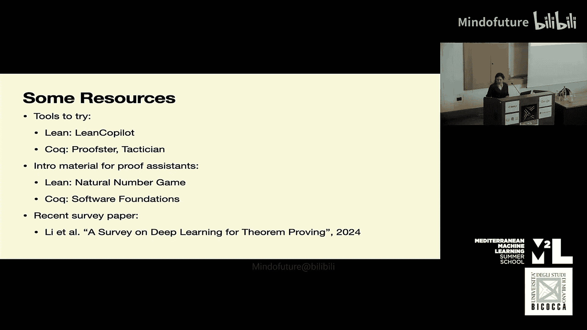

# 【比科卡大学】机器学习讲座 ｜ Machine Learning ｜ Moe ｜ Grpah ｜ Rlhf ｜ Llm ｜ Ai Safty ｜ 2024 p11 P11_定理证明的机器学习-Emily_First -BV1XzScBEEdJ_p11-

So today I'm going to talk about machine learning for theater improving。

But before moving into the machine learning aspect。

 let's go over some basics with respect to the improving。

So theater improving is essentially what it sounds like。 you stay at theorem。

 and then you try and prove it。We did this all the time in our math courses long ago， where。

 for example， a theorem could be that addition is associative。

Or we can write it out a little more explicitly to capture what we mean by associivity。

Looking at this， we can immediately think， hey， this is true by basic algebra。

 or this is trivial trivially true。 I don't need to write a proof。

You've already convinced yourself that it is true。 but at some point。

 youre probably forced to put pen to paper and write out maybe proof by induction。

Which then feels like you've made， you know， a rigorous case for correctness。But even still。

 and maybe the chalkboard like font is a dead giveaway。

This is what we consider informal theater improving。To do this in a formal way。

 we can do it programmatically， where we define the natural numbers inductively and define addition。

 and then state the theorem and write a programmatic proof。

And you could do all of this in something called a proof assistant。Such as Cock， Isabel orline。

 which allow users to perform interactive theorem proving where they stay at theorem， prove it。

 and the proof is machine checked for correctness。So how do these proof assistance work Well。

 there are entire summer schools that cover topics like this， so I won't go too into that。

All I'll say is that they typically have some logical or type theory basis and proving a theorem in them amounts to applying rules of the formal system to transform the goal which starts out as the theorem itself in the proof state until it becomes trivial。

One can try to prove the theorem directly in the proof assistant logic。

 but it would be a very difficult and unforgiving process。 And so instead。

 these proof assistance provide high level tactics like induction and reflexivity to help guide the process。

So why would someone want to use a proof assistant。

 proving addition is associative is pretty elementary level stuff and not particularly interesting。

Well， two popular applications include formalizing mathematics。And formally verifying software。

To formally verify software with a proof assistant， a programmer can write their software。

 specify a theorem about a property of their software。

 and attempt to prove that their code adheres to that theorem。So， for example。

 they can define a list data structure and write functions on lists like reverse。

Then they can try improve properties they' want to be true about the behavior of the reverse function。

 such as the reverse of app to list is the same as the reverse of the second list concatenated with the reverse of the first list。

Or maybe even a property like the reverse of the list is the original list itself。

So now I'll talk about examples that illustrate the power of formalizing math and formal software verification to motivate why you'd want to do it。

Formalizing mathematics has gained some popularity among mathematicians in recent years。

 as it can help provide more rigor to math。The proofs are easily checked。

 which can be incredibly difficult thing for humans to do on their own。

And some even envision a future where every proof submitted to a math journal is accompanied by a formal proof。

A recent success story in this space includes the liquid tensor experiment。

 where Schultz presented a challenge online to formalize at theorum about condensed real vector spaces。

 And Kamein and his team rose to the challenge。Much of undergraduate math has already been formalized in the Lean proof assistant。

In what's called the Mathlib library。 And so that formal foundation allowed for the formalization of this complex theorem about complex objects。

On the other hand， with formal verification using proof assistance。

 it has been shown to actually work in terms of producing better quality software。

 which is something that I think we can all get on board with， bugs and software are bad， right。

For example， in 2011， a project called C Smith tested three C compilers。

 The Cock verified C compiler Comt and two industry standard compilers， GCC and LLBM。

 which I'm sure you're all somewhat familiar with。And the project found that concertt was the only one for which C Smith could not find any wrong code errors。

 So no books。Which is a pretty cool result。So while formal verification does not guarantee the absence of bugs。

 the process of deeply thinking about your code and specs and proofs enables more bug free code。

 as opposed to say， just writing some test cases。And somewhat predictably。

 even with the help of an interactive theater prover。

The effort required to write proofs is often prohibitive for software verification。

 Vering code requires a lot of time and a lot of proofs in relation to your code。For example。

 for the Co verifiedified C compiler Compt， the proof is more than eight times bigger than the compiler code itself。

And took three person years of work。Similarly， to verify an O Mi colonel in Isabel。

 it took 11 person years to write the prescript。So as a general rule。

 because of the great expense verification。Virtually all software that companies ship today is unverified。

And the triumph of that liquid tensor experiment took place over the course of two years。

 where the effort was split into two parts since it was too difficult to prove the theorem directly。

Here are the dependency graphs of each part。Where part one involved proving a theorem and part2 involved proving that that theorem implied the original desired theorem。

So no easy feat。But how do we， as programmers， typically deal with。Hard thanks。Well。

 we try to automate them。So with respect to the software development pipeline。

 there are a lot of aspects that could be helped with some automation and similarly for the formalization of mathematics。

But for the purposes of this talk， we'll mostly focus on how we can automate proof writing。Which。

 as evaluated now on large scale benchmarks， assumes that you did most of。

If not all of the process beforehand。Perfectly。Which is not always a great assumption to make。

So I'll first provide background what it's like to write proofs in the theater proving environment without automation techniques。

 Then I'll talk about automation techniques that have been integrated into the proving environment。

Before moving on to how machine learning can be used to model the human interaction with the proof system。

So imagine a programmer has opted to use the cockpro assistant and wants to write a prescript in order to prove some theorem here called spec。

Maybe even a property about some software。Using thean。

 an Isabel proof assistant would be a similar experience， just kind of different tactic names。

So after specifying the theorem， they begin with the proof tactic as a response。

 Cock provides feedback， which is the current proof state。

 This is a simplified view for purposes of the example。

 It obviously does not look like your iPhone messaging or something。Ha。In this case。

 there is one sub goal， which is the theorem itself and is yet to be proven。

 The programmer can examine the proof state and think critically about it before applying more proof tactics to guidecock in solving the goal。

Here we can see the goal exists for all N。 And so the programmer can assume the existence of some arbitrary N and apply the introtactic to eliminate the for all quantifier。

Now we see that the natural number N is in the local context of assumptions。

 So let's say the programmer wants to use some let's say induction。

That would make it so they have two goals to dissolve the base case and the inductive case。

The program member can continue applying tactics to solve the goals until eventually there are no more goals left so they can apply Q E D and have proven the theorem。

This back and forth helps。Guide the programmer in finding a proof。

 But you can imagine with very complex proofs， it can be quite taxing。

So there are tools that can be integrated into these proof assistances。

 and there are other languages entirely that use constraint solve based proof automation。 In fact。

 we'll see later on that tools called hammers can be complementary and even be integral in a machine learning approach。

Hammers call out to SMT solvers when attempting to hammer out a proof。

 they try to construct the proof in their logic， and ifs successful。

 it gets translated back into the logic of the proof assistant。However。

 they cannot reason about proof approaches such as induction and struggle with higher order logic。

So while powerful at times where， for example， about one fourth of a cock benchmark can be solved by just invoking the hammer。

 their power is。Greatly limited sorry。And so ML L based tools are important for theem improving because they let us go beyond these first order solvers and continue to push on what is possible in terms of automating the proof writing process。

NL B tools can prove over， for example， one third of Co benchmark theorems。

 So while improvements at times can seem incremental， it is potentially a lot of effort saved。

But if all of this was not convincing enough， another thing to note is that theater improving is also important for advancing AI。

嗯。As you kind of heard earlier， we're in the middle of an L L M craze where they've been shown to have pretty incredible capabilities on a wide range of tasks。

Namely， LLMs have shown that they are capable on very hard problems。

 such as generating code and have demonstrated mathematical reasoning abilities。

 especially with specialized math LLMs， which have been trained to solve quantitative reasoning problems such as this one。

But while LLMs produce good answers， the challenge of them is that they also produce well formed。

 convincing wrong answers。For example， you could try testing the LLM generated code。

 but passing tests still might not be indicative of correctness。

This makes it difficult in most domains to use LLMs reliably and makes it difficult to trust their output。

But proof assistance could offer a solution to this challenge。 Remember。

 they act as an oracle to machine check proof。If LLMs generate convincing looking but wrong answers and you have a way to formalize that output and write a proof。

 the theor improver can identify and flag those wrong answers。

Same goes for when generating many candidate proofs， it'll only accept the valid proofs。

This makes them improving a very powerful domain for LLM use。

And maybe can serve as a domain in which we evaluate LLM reasoning capabilities overall。

But the rest of this talk will be dedicated to how to use machine learning for automating theater improving。

So here's kind of an outline of what's to come。 First。

 I'll kind of cover the fundamentals of M L for the improving and an example that kind of puts together these fundamentals。

Then I'll kind of look into some ways people have thought about going beyond this。

Kind of thinking about， is there a best way to do it and how other parts of that， you know。

 pipeline process I showed earlier fit in。 and especially where does the human fit in， right。

 They're the ones having to prove theorems。So yeah， let's get started。

 So existing work has built models that perform next tactic prediction or even whole proof prediction to synthesize proofs。

Typically these models take as input， the theorem， current proof state and some contextual information and predict the next likely step of the proof。

 so typically you could sample the top K or here three tactics and then use the proof assistant to check the candidate proofs that arise from applying those next tactics。

The proof system provides feedback in the form of the updated proof state and displays whether there are any errors。

 so again， this full interactive nature。So for the ones that do not result in an error or a repeated proof state。

 we continue to give them as input to the model to generate the next steps if the state shows that there are you know no more goals to be proven than we have successfully proven the error。

So to give a different view， here is the start of our search tree where the nodes are states resulting from tactic applications and the arrows are tactics。

 so in a what's called a metaheuristic search。The model is biasing the search towards the likely next steps。

 so it could be depth first search， B first search， whatever。

 And we continue the search until one of our candidate proof scripts has no more goals left to be proven。

 and we can predict Q E D。 So this approach greatly depends on how good the model itself is， right。

 It's the one guiding the search。So one way to try and get a good model is to get high quality data for training。

 so this training data could come in the form of other people's experiences with proving theorems。

 so for the three proof assistants that I mentioned earlier， Isabel Cock and La。

 there are publicly available data in the range of 100 to 300。

000 theorems and there are associated human written proofs for each of these proof assistant。However。

 different the improvers have different communities backing them。

 which contributes to what kind of data is available for each。 For example。

 Lean has a lot of excitement for the math community。😊。

And active participation of notable mathematicians， so they have a lot of formalized math there。Cock。

 on the other end， is a popular choice for software verification。

And so whichever proves this in a research reader decides to pursue in training a model for。

It can sometimes limit the comparisons to prior work as they're kind of stuck with the data and that proof environment for that prover。

Though there are some recent efforts to have benchmarks that go across different languages。

 so to allow for more of these comparisons。So once you've chosen chosen a proof assistant。

 you typically want to generate examples so that you can train your machine learning model in a supervised manner。

 so looking at the MathL4 library from lean， let's say this is a theorem and it's human written proof from that library so the corresponding training example。

Could just be the theorem as input and the entire proof is target。 However， by doing this。

 you may miss out on the intermediate state to learn from。

 So typically researchers extract data by running the human written proofs step by step and aligning the current state and the next tactic applied by the human。

Thus， since most proofs are often more than one step。

 the number of training samples is more than double the number of theorems for the Malib library。

 if you were to kind of perform a date of extraction on that。So going back to example creation。

 we know that there is other information available in the proofing environment that could be useful for modeling。

 For example， if you can see there in the target part of the sequence， add a sock and add comm。

 so add sociivity， add community orlemmas in the target。And so without providing them as input。

 a model would have to hallucinate their existence， right？So already proven lemmas and logical facts。

 which are sometimes called premises， are useful to include in the input。

We could use the ground truth positive premises at training time， but at test time。

 we need a way of retrieving useful premises。So premise retrieval can be done either using sparse or dense passage rerieval techniques。

Since retrieval will be covered in a later talk today， I won't spend too much time on this。

 but just provide the intuition。hich is that there could be thousands of premises currently available in the proving environment。

 just by simply importing different libraries。And so for the given proof state。

 you want to retrieve premises that are most useful for that proof state。

 you can train an encoder on positive and negative premises， encode all your premises。

 and encode the proof state and choose the ones that have the maximum cosine similarity to serve as input to your model。

Other work has additionally explored training what's called like a reraner model。

 since it is important to prioritize which of these premises may get into the input as you also have sometimes limited space。

Another thing that goes into making a good model is suitable architecture to represent the different facets of the proving environment。

 Lame merely the proof state premises and maybe even the proof up to the current point that you're working at。

 So early work started with R NNs。 Other work used the underlying abstract syntax tree representation of the proof state and so used tree LSDMs in order to represent that。

Even recent work has used GNNs since the relationship between different definitions in lemmas can be represented by a graph。

 remember that large dependency graph from earlier， right？But most obviously explored as recently。

 are transformers， specifically transformer based pretrained LLM。

 so just kind of another example of how theater improving is a good domain for LLM use and is becoming very popular for them。

So once we have a model， how do we use it to search through the space of possible proofs。

 so recall our search tree， it can quickly become unwieldy。

 thus a naive breath search is kind of in to find deep proofs and some priorit prioritization criteria is required in order to balance you know breadth and depth of this tree。

So thus， a best first search method is useful for prioritizing which nodes of the tree to expand。

 So we want to choose most promising unexplored state to expand。 So here， for example。

 are the unexplored nodes and in a simple best first search implementation。

 we can use accumulated scores along the path from the tactic generators。 so。For each prediction。

 we can get a log likelihood score from the model and then use the sum along the path as the score for that particular note。

So these are kind of some of the fundamentals。 And now I'll show a tool that has implemented the fundamentals in this way。

And hopefully。This video works okay。嗯。So here is。An editor which has the tool Lean Copilot。Imported。

And on the right is what's the kind of displays the proof state。

 So if you delete a tactic from one of the theorems here。

And ask Leco pilot to suggest some tactics on the right。 It'll have some suggestions of， okay。

 try this one out And we see， okay， great。 This one actually works。

 And there are no more goals left in that， that proof。Alternatively。

 you can delete the entire proof and ask it to do that sort of search for the proof。And oh， great。

 it found something。Sometimes though， when you try and do the search。

 it gives you an error wasn't able to find a complete proof。

 so maybe instead you want to provide some tactics that you think would be good so maybe you know you know some prefix of the proof that you want to provide and you ask it to search for the rest and oh。

 it did it， it was was able to do that。And then to kind of get like an idea of what's happening at each step。

 you can also look for premises that are useful for that proof state。

 So you have the proof state on the right and then on the bottom is。

Some premises that are considered relevant by the model for that approved state。And so， yeah。

 lean Copilot is available online， and I think is a pretty cool tool。Yeah， so。

I this the only way do we， is this like， you know， if it's been solved or can we go beyond this？

So one question we can even ask is， do we even need a search？

So recent work has showed that we can still do well if we fine tune a large language model to predict entire proofs at once instead of in that step by step fashion and check those proofs with the proof assistant。

 and we can do even better if we fine tune a large language model to repair。

East predictions using the error information outputted by a the proveer to try and generate a new proof。

 So here the repair is not what you would typically think of a repair。

 like going in and editing a certain line。 Instead， it's thought of as a complete regeneration。

And so conditioning the generation now on a prior failed attempt and the error message。

But do we even need the fine tuning step？ These models are seemingly very good at reasoning。

 such that in context， learning is enough for some tasks。Plus， with different prompting frameworks。

 such as chain of thought。We often try and elicit informal reasoning from LOMs to boost their performance in a number of tasks and informal reasoning data is the majority of what they're trained on。

 right， they may see some， you know， examples of Co and lean proofs in their pre-training。

 but it's very small compared to just informal reasoning and natural language。And。

In terms of the math data that's available online， informal math data makes up the overwhelming majority of available math data。

So why not take advantage of that？So for， let's say an informal statement。

 generating an informal proof doesn't seem like that big of a leap for an LLM。

While going from an informal to formal proof directly in one step seems like a lot can maybe get lost in that translation。

And oftentimes， that sort of translation from informal to formal is called auto formalization。

And so recent work proposed an intermediate step called a formal proof sketch where there are holes to fill in some of the explicit proving steps that informal reasoning tends to be kind of hand wavy about。

 right？And we can generate these proof sketches by curating a handful of sort of a few shot examples。

So let's see this in action。 So here we have the draft getst approved approach。

 which implements this technique， and it starts off with an LLM being fu shot prompted to informally prove a statement。

And then a few shots prompted afterwards to generate formal proof sketches。

 which break the proof down into different sub goalsal。Notably， this work was done in Isabel。

 which can support proofs in a more declarative style。

 and so tend to be more human readable without having to you know run the proof and look at the proof state。

 you can actually kind of the proof state is actually somewhat explicitly shown in Isabel proof。嗯。

So in this way。That like the proof assistant language that you're using could actually lend itself to。

This sort of auto formalization technique。 So maybe this sort of。

Technique wouldn't work in a different proof assistant。嗯。As there may not be as good of an alignment。

Of， of formal and informal。And finally， to fill in the holes off the shelf prove such as the hammer that I mentioned earlier。

 or other MLL base， you know those next step prediction tools could be applied。

 so this exemplifies one way in which different techniques can be used together playing to their different strengths。

And so a number of different ways。To go about de improving we're kind of shown here and definitely not all of them。

 it's kind of a fast moving area now。And so sometimes it can be kind of hard to tell which way is the best。

 especially if they're being evaluated all these kind of different benchmarks and whatnot。And so。

How do we determine which is the best？Actually， to some extent。

 does it even matter if there's a best one。 Well， I'm here to say maybe not。

 because so long as the approaches are proving different things。

 you can actually use them all together。So say， for instance。

 you have multiple different models for theorem proving。

 each conducting their own search for the proof of a given theorem。When you check the outputs。

 even if only one is a correct proof， the proof assistant will pick that proof out every time。

 so your models can be trained in different ways on different data。

 using different features or hyperparameter values， different search procedures， whatever。

 and you can get the most out of each of them so theater improving is also the perfect application for ensemble learning。

But instead of casting a wide net and use models that have learned from other people's proofs。

 Another technique in theater improving is to use online learning in order to adapt to your particular project。

And so a tool called tactician for Cock looks at different popular online machine learning techniques。

 such as locality， sensitive hashing forests for online approximate K and N and online random forests。

 So this is in an effort to better synthesize proofs for a particular project， right。

And this works by selecting tactics to reuse that were already used in other proofs in your project。

 so in order for this to work， you actually have already needed to write some proofs。

But maybe it could help you fill in the rest of the proofs。And so。I kind of， you know。

 really focused on this one， you know， narrow part of the process， right， like generating the proof。

 but。Remember， there was a whole pipeline of things that had to happen before you got to even that step。

And so with respect to this pipeline， there are other aspects that can be automated using machine learning that have been less explored。

 I would say， but are starting to be， which is encouraging， namely conjecturing。So conjecturing。

 what that kind of means is from definitions in your file。

 you can use a model to conjecture theorems that may be true and then check them through trying to either approve them。

嗯。Or finding counter examples。 So there's techniques like proper based testing。

 which let you come up with counter examples for。Given theorems。

 so you don't waste your time on proof。And you can even attempt to conjecture useful help orlemmas that could help unt a current proof。

 So most of the time， you don't even realize you need a help dilemma until you're in the midst of a proof。

 So current tools that are simply retrieving help orlemmas aren't taking。You know。

 into account how unrealistic that might be in some situations。

 You might not know you need a help dilema until you are right then and there。

 And so instead of retrieving， you actually have to。You know， synthesize。

And conjecturing can also be a means of training better models within improving。

 as you do not need to rely on human written training examples。So in one tool called Minimmo。

 they perform both conjecturing and proof search with a transformer where the transformer is randomly initialized。

And for conjecturing， they use type directed synthesis and constrained decoding to ensure that the conjector theorems are valid by construction。

So when a proof is found， proof search， which is done by Monte Carlo Tse。

Generates training data for improving the policy and value。

 So this is a reinforcement learning approach， right。

And it also provides data to improve conjecturing。 since it then knows how hard the problem was。

 They use this then to alternate between conjecturing and proof and theyre improving。

 So this proof search in this sort of self improving loop。

And also exploring a gameplay agent approach was Google's deep Minds Al proof。

Which couples a pretrain language model with the Al 0 reinforcement learning algorithm。

 So that was previously used to teach itself how to master games like chess and go。

And here we see that when they try to formalize informal- so。

 here we see they are trying to formalize informal math problems and then a solver network searches for proofs or even disproofs of these problems。

And progressively trains itself via the alphaze algorithm to solve more challenging problems。

So it's kind of a similar flavor to conjecturing where here。

 but here you're kind of auto formalizing。 like you have something that's informal and maybe through the formalization process。

It becomes untrue because you didn't formalize it correctly。

 but you can do it many times and maybe them some of them will be true。

So in combination with their alpha geometry tool， it was able to actually achieve a silver metal status in the international Maly problems this year。

 so solving four out of the six problems， so a pretty impressive feat of automated the improving。So。

Recall that theorems can also be analogous to software specs right in the end。

 though only a human is the one like that's able to be the final call to determine whether that desired specification。

 like what the desired specification of the program was， right？

An ML tool could potentially be helpful， though， and infer specifications from a program。

 which could be useful to the human as they check for whether that was the desired behavior that they were going for or not。

And so I guess speaking of humans， how do they fit into all of this So when you think about this human proof engineer that is performing these kind of like software engineering tasks。

 you may wonder are they really this disciplined that they follow development steps in this order because I sure don't write code like this and it may comfort you to know that proof engineers they're just like us。

 they also don't always write code like this。A case study found that proof engineers as they code and write proofs。

 are constantly refining and refactoring the specs and making repetitive repairs。Because once。

Because a one working proof can break due to specifications evolving or even dependencies updating。

And so， in fact， they may even start with writing the code and then only think about generating theorems later。

So since this strict ordering may not always apply。

 then it is essential to develop machine learning based tools that integrate well into practitioner workflow。

 considering how they move between each of these processes。

And this will only be achieved by continuing to talk with proof engineers， right。

 We can't just kind of do research in isolation。 We need to。Kind of do research。

With others and talking with them。And so making meaningful research progress in this area going forward forward probably won't simply be determined by how much more of a。

 of a given benchmark of already proven theorms。Your tool can prove。But rather。

 how does your tool aid the human as a coppi and being able to formalize math or verify their code？

And so I guess， speaking of Copis， were called the lean Copilot tool and how it didn't really provide any feedback to help the user when it failed to find a proof automatically。

 which was kind of disappointing。 It just said， like， can't do it， sorry。

So an example of a tool that is trying to think about what other type of feedback would be useful is called proofster。

 And it provides a front end web interface for proof search tools。 So right now， implements。

To provide a frontend interface for a tool called Proverbot 9001。

 which is a machine learning based search proof search tool for Co that uses RNNs， so not fancy LLMs。

And so I'll show you an example of what it does and how it might help in debugging these sort of failed proof searches。

So here， someone wants to prove some property about lists， but has admitted the the proof itself。

And so Proofster can then attempt to emphasize it。 So when we ask Proofster to prove this theorem。

 it says it also says sorry， I can't do it， but it doesn't leave you empty handed。

 It provides an interactive search tree。 So you can see what tacticus were attempted in its proof search。

So here's the start of the tree and you can click on the little blue nose to expand them like this。

And so looking at this tree， I noticed that the proof search tried induction。On different variables。

 But it did not induct over the right thing。Which is a very common failure mode of these machine learning models。

So I go back and I give a hint， so in the form of that sort of prefix that we saw earlier about what we should try inducting over。

Still leaving the rest of the proof to be completed by Proofster。And this time。

 Proofster is able to correctly synthesize a proof。 So the main takeaway is that。

An interactive visualization of the proof search tree could help the programmer understand why searches fail。

And so further research into visualizations of machine learning approaches and analysis of failure cases could be quite fruitful going forward。

Yeah， so I guess kind of the， the main takeaways of the talk are that。

Fear improving is important for formal math and software verification。嗯。And in turn。

 machine learning and AI is also important。啊。First through improving and also the other way around。

 right？And so。There are still many improvements that can be made to prove generation。

 I kind of omitted a lot of results here because they're not super impressive in terms of what is capable right now。

 and so it kind of leaves a lot of room for what kind of you know new people coming into the field could potentially accomplish。

And there are many improvements that still need to be considered with respect to the kind of pipeline。

And there are a lot of open problems， so a lot of opportunity to work in this space。

And so here are some resources that。Folks could look at in terms of if they think this is maybe an interesting space to get into the first two are first two things are tools。

 then there's sort of these sort of intromaterial into learning about how to actually use a proof assistant because it's kind of necessary in order to develop machine learning tools for them。

And there is now a recent survey paper on deep learning for the improving and is already quickly kind of becoming out of date as there'。

 there's new stuff being done all the time now。嗯。Alright， Well， I guess if anybody has any questions。

 I'm happy to。Take them。 Yeah， thanks。

