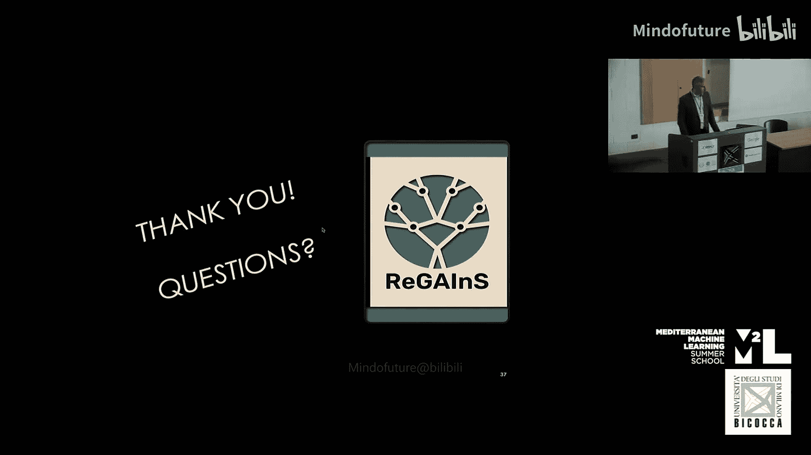
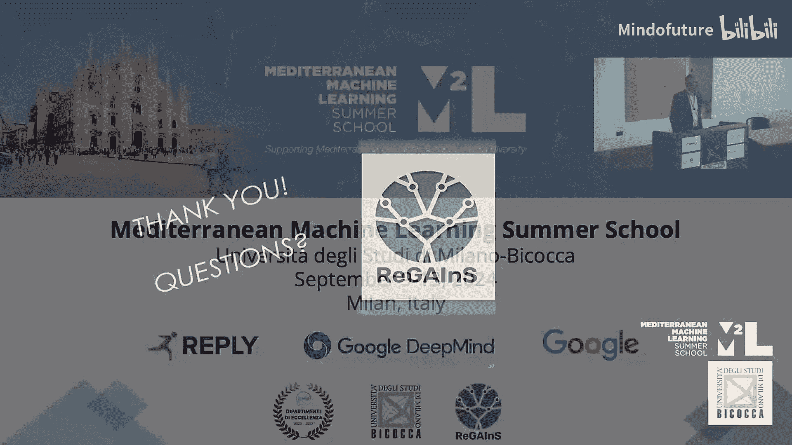

# 【比科卡大学】机器学习讲座 ｜ Machine Learning ｜ Moe ｜ Grpah ｜ Rlhf ｜ Llm ｜ Ai Safty ｜ 2024 p16 P16_面向软件工程的（生成式）人工智能-Leonardo_Mariani -BV1XzScBEEdJ_p16-

Let me reiterate。 and software engineer。 I'm not an AI guy。

 So don't expect a technically deep toll on AI。 rather I will try to frame a little bit what's going on in software engineering and the interaction between AI and software engineering。

 mostly highlight lightinging some results and challenges and I will mostly refer as the title to geneative AI。

 because I think it is generative AI that is having sort of transformation transformational effect on。

 on what we are doing in software engineering。

OK， so呃。Not sure if you agree with this， but I think I can easily convince you that generative tasks。

 different kinds of generative tasks are everywhere in software engineering。 For instance。

 if we consider a standard development process， we start with writing sound requirements and we are used out of these requirements to write。

 generate some design documents， design models， we do。

 write and generate code out of these requirements and and and models。

 we actually write documentation and we we write test cases from documentation and code。

 and this is usually reviewed by some stakeholders and these it。

 So let's say already in a standard development process。

 there are a number of activities which are actually generative task， usually performed。

 let's say by humans。 and the story doesn't only go in this direction。

 but it works in many different direction and combinations， right。You can generate documentation。

 or you may want to generate some documentation out of test or out of code。

 or you may want to reverse engineer models requirements。 Or again， you。

 you can even jump between the different phases。 So it's kind of context where we face a number of gene tasks。

And this is why generative AI is particularly appealing because we have a number of opportunities in terms of applications and challenges。

 And this is having a sort of deep impact on what we are doing in software engineering。

 just to give you some numbers and an idea about this， if we go back to our。

 let's say flagship conference， the international conference in software engineering up to six years ago。

 and we check the program there， there were no sessions about AI and software engineering。

 the interaction between these two two topics。 and if we consider this year conference I could identify at at least onet of the sessions just dedicated to this topic。

 quite easily another 8% of the paper， just from the title also related to this topic and without even considering the content of the paper。

 So I do believe that more than half of the papers are studying the。

Action applyI to number of diverse software engineering tasks。 So this is having sort of， I mean。

 this technology is having sort of deep impact on the way we are working on the development or will be working likely in the future in the development of the software。

So why is so much interesting， I mean， AI generative AI and software engineering。 Well。

 that's quite in a sense， easy to understand。 The promise。

 is that we could maybe automate or semi automate a number of tasks that nowadays we do in our nontrivial quite complex。

 Sometimestime we are the sort intensive， they could be time consuming even repetitive。

 and this could be kind of delegated to some AI or generative AI doing the job for us。

 and we could focus on the most challenging， interesting part of these of these tasks。

 So this is kind of promise or vision that we have and we would like to achieve。

 And then just to make a few examples， this applies to a number of tasks and activities and we could do this in a number of ways in software considering various software engineering tasks span the full life cycle。

 So for instance， if we consider the domain of requirements in engineering。Eliciting writing。

 specifying requirements。 What we do nowadays is performing a number of time consuming task like interviewing。

 interacting with stakeholders in order to obtain the requirements。 And again。

 the promises that out of additional set of requirements。

 we could maybe delegate these task and partially delegate this task to the to an AI that may suggest additional requirements out of an additional set of requirements that we may have elicited。

 So in this case， really boosting the effectiveness of potentially boosting the effectiveness of requirements elicitation。

 And again， about requirements there are yet a number of applications。 For instance。

 usually we have to assess the requirements documents。 we have to identify issues。

 We have to improve the documents according to a number of quality criteria and again。

 this could be done potentially with the help of of an。Yeah。

 as well as assessing the impact of changes in the requirements。

 how these implied generating and changing the arts that that we have。

 all those are quite complicated and time consuming activities that potentially could be performed in the future with the interaction and the help of of an AI。

And this is not， this is just about requirements， but we we already had a talk today about code generation。

 And indeed， there are a number of opportunities there。 writing code is one of the I mean。

 main tasks of the developers are doing。 And again。

 we do have the opportunity is something we already do like generating the code。

 a number of diverse inputs， requirements test comments or checking out evolve the code。 And finally。

 just to make another example in the domain of software quality and testing。

 we do generate test cases to validate our software。 Once we identify a failure。

 we need to understand what the fault is that cause a failure and repair program。

 all those activities could be quite complicated and time consuming And again， here， I mean。

 AI can really help us generating the test and automating or partially automating all these all these tasks。

😊，So in a sense， we are really moving towards a vision。Where engineers， software engineers。

 we regularly interact with some AI to accomplish their task more effectively and and efficiently。

 And this is really what what most of the， let's see。

 people in software engineering are are studying how to do this。But if this is like the vision。

 So what maybe we would like to achieve in the future。

 one question is what we are capable of doing right now。 So this is what we。

 we would like to do in in the future。 But what is the status of the research and the practice。

 how effectively could we do all these activities， So with the current available technologies。

So what I would like to do is just highlight some， let's say details from the trenches。

 So what what is the status based on some studies that have been published about different kind of tasks these studies concern the usability of these。

 of these tools as well， the capability to generate code and and test cases。

 And I would like to use these studies to mention some of the challenges that we we see in the area in order to achieve some of these this vision。

Okay， so the first one is this study appear， appeared this year， which I think is。

Quite is interesting。 The study based on around 2000 items collected from Gitub。

 Those items are either commits per request or issues， mentioning the use of Cha GPT。 actually。

 those are about developers explaining how they completed the task， some task using charge GPT。

This this core post has been collect and analyzed。And what we we discovered not surprising is that people are already using these tools to。

 to complete tasks。 and there are some classes of tasks that appear more frequently than than others。

 like implementing feature improving， trying to improve the development process using this task learning how to solve some problem that maybe someone is not able to。

 to solve by him herself， manipulating data or the environment of of the software generating tests or generating documentation。

 Those are some activities where people are really。 I mean， apparently using this these tools。

 but not necessarily the comments report like positive story。

 comments may report different kind of stories about developers interacting with with these technologies。

 So let's start with some， let's say， episodic evidence， some positive cases reported in this corpus。

 for instance。People often report to quite effectively useLM to achieve language translation or crosspro language translation to complete crosspro language translation tasks which where those tools seem to be already quite helpful to simplify this task very frequently they are used to generate documentation and descriptions people use a lot these tools to generate the comments and put request description in a more practical and efficient way could speculate a little bit that the documentation is usually the kind of artifactact you want to be there。

 but maybe nobody cares much。 So maybe this so successful because you really want the documentation。

 they come to be there about the quality I'm not not sure。

 but any way people apparently based on the Gi discussion are quite happy with these application。

 And again， in the domain software quality they are used to generate test cases or to debg the software。

With some degree of success， apparent。But there are also concerns about how this tool performs。

For instance， one is about code ownership。Developers wonder about people using these tools to obtain recommendation。

 For instance， about some code that should be implemented。

 They're just pushing this code into the repository without us strong understanding of the code that they committed。

 So not having any more the ownership of the code， which means being able to advocate for the code。

 argue why the code is correct or or not。 And this sort of possible negative effect of using these tools to into the development process。

There are a number of cases where these tools are reported to accomplish learning tasks like you have a problem。

 You don't know exactly how to solve。 And then you try to use this tool to get sort of initial solution you can elaborate more。

 But here I would say according to to the evidence we are kind of quite unsuccessful because usually the questions are about some new frameworks。

 new libraries， something new that people don't know。 And very frequently in the training set。

 those models have not the information to provide the correct recommendation to the user。

 And so I mean， there is sort of unclear evidence in this case of very effectiveness。

 And this relates to the other point that is recommending the pre API。Very often。

 once you ask for a piece of code， you may get in the， in the code as's a recommendation。

 the usage of an API that is now deprecated again， because the model was trained with a corpus where that given API was still。

 still used。And this raises to me sort of first challenge for， for you。

 that is apparently our capability to train and retrain these， these models is not strong enough。

 considering how fast technologies moving how fast libraries are evolving and new technologies appear。

 And so we need a better way to obtain models and AI that are able to provide timely recommendations。

ok。Going on， of course， we， we know that those models and tool may generate hallucinations。

 and that is recommending if we consider the case of code。

 recommending using function that actually don't exist。This happens with a relative frequency。

 for instance， this is an example of a recommendation where given library is recommended your code。

 But then the specific function that is used in the code is not a function that exists in the in the library actually。

 And and this means that， I mean， the developer receiving this a recommendation， of course。

 as to realize that the function is wrong at finding the right function to be used in order to。

To write to implement the credit code。 and clearly， this could be kind of annoying for the user。

 but even worseucination may may generate security concerns and security risk。 For instance。

 if if theirucination is about a package and non existing package that is recommended to a user to solve the current problem a malicious user could deploy this information to ask about about this package and how this package is supposed to be stole。

 And then use all this information to implement package and embed malicious code into the package and make the package available。

 Next time， this same previously， non existing package will be recommended to a user at that point。

 the the package exists。 because it has been implemented by a malicious user。

 and there is a chance that someone will download and use this package。

 So there are a number of concerns and I would say this one's sort of another。

Challenge dealing with hallucinations and preventing the related security risk。 right now。

 we don't probably， we don't have a good way of dealing with。With this concern。Okay。

 I would like to say something about the usability using the results from another recent study appeared this year。

This study actually surveys the opinion of more than 400 GiHub contributors who work on AI related projects。

Actually， these contributors use number of tools like compile the 9 shot GT and also some tools training on some proprietary data。

And， I mean， I will not go through。All the findings reported in the， in the study。

 but I will mention some of the usability challenges that have been reported。

 I think are quite interesting to understand how usable those technologies are。

One challenge I will mention is that are still hard to control。

 So there are a number of aspects you cannot really control when you interact with as a developer。

 when you interact with this tool。 For instance， you don't know exactly what part of your code and project is used to provide a recommendation。

 You may want to know these， especially for the tools acting while embedded in your integrated development environment。

 So you don't know exactly what's going on。 But more。Revenly。

 it's not clear how you can express the result， the code or the solution that you want to obtain。

 So how to manipulate the result， providing the proper prompt。

 and a lot of people report that this could be very expensive。 So you ask for some recommendation。

 Then what you get is not exactly what you need and then you have to iterate the rate over and over again。

 making these tools not really usable。 And sometimes it's even difficult to really ask know how to ask for the in the correct way in the proper way。

 And so controlling the the results， how to get， for instance。

 longer or shorter or different code or even controlling when to receive the suggestion。

 So once we talk about usability for some tools， you have to query the tools。

 but some others act like integrating the I D in a sort of transparent way。

 deciding when to provide the recommendation。 And then again。

 you may want the tool to perform and behaves in different in different ways。

And then even the interactions， somehow people seem to pretend the richer and richer way of interacting having sort of dialogue with the。

 with the AI in order to be being able to control the， the the， the result。

And not trivially also try to deal with multiple suggestions。

 number of these tools don't generate a single recommendation， but may generate many recommendations。

 And then you have to， I mean， pick up one or implement your solution out of these number of recommendations。

 And again， it's unclear methodologically how to do these effectively。

And those are sort of open challenges for the， for the users of this tool and related to the to the output。

 again， is still hard to assess the result。 how to know if our recommendation that I receive is correct。

 Maybe's correct is the good one。 But how difficult it is。

 And how can I assess the correctness of the of our recommendation， how to analyze it effectively。

 So this is also why number of developers still believe that is。

Better or in in in terms of cost effectiveness to write the code or to complete the task themselveslf。

 rather than asking to some AI and then wasting time。

 asking different ways and checking the result and again， asking again， entering this， this。

 this loop。AP is also reported as a concern in the community。

 both in terms of you don' know exactly what happened to the content of the prompt when you ask for something you may share some information that you don't want to be somehow public or to be digested in a sense。

 by the model。 and on the other end， when you receive the recommendation you don't really know if you could use essays。

 whatever you you receive as a recommendation， maybe there is some poverty right to be I mean。

 you will violate some poverty right but just reusing whatever you receive。

 And then there is also another aspect that is learning。 So usually when you start using these tools。

 you write these tools to adapt to your style， your coding style， the way you complete the task。

 the way you work and I mean， there is almost little learning capabilities now available。

 So in reaching this tool with the capability to。Adapt to the way developers work。

 That is another important。 Let's say， usability， usability concern。 And those are。

I will say some of the challenges right now for the。

 for the community to make this tool useful in practice。And then what about correctness。

 Those are issues and concern about usability。 But how correct are those， those tools， of course。

 results I mean， very depending on， on the task。 there is no single answer to this， to this question。

 But I would pick up some， I would pick up some studies to give an idea of what's， what's going。

 what's going on and what is the level of correctness of the recommendations we we receive right now。

Okay， first two and first task， I consider is something since quite reasonably simple。

 but non trivial that is obtaining the implementation， full implementation of a method。

 So I know the method I want to implement。 I know what what the behavior， the method should be。

 And then I pretend my assistant to recommend possibly correct implementation for this。

 for this method。I will consider， in this case to， to studies we recently completed about this aspect in the context of implementing Java methods。

Okay，1， in one study， we， we use 10 Java methods selected from some relevant Gi projects for the。

 for this study。 And then we classified the methods we use for this controlled study。

Depending whether the implementation of the method requires some interaction with other methods。

 So you can have some code that is selfcon， you can have methods which have dependencies with other methods in the same class。

 So actually， the the correct implementation interacts and invoke other methods present in the same class or external dependencies。

 So invocation to methods， external to the current class。

 just to see if the assistant have different capabilities， depending on the。

 on these on the presence of this dependencies。The， the way we。

 we have done the study is pretty simple。 So we have taken from the Gitub the method。

 We remove the method implementation。 We preserve the the comment and the rest of the code and passed these to AI and AI assistant we have I mean using the uses spraytrain models at that time of the study。

 we use compile GT bar and T 9。And then we， once we get the generated code。

 we compare the generated code with the original code that that we have the one implemented by the developer and check whether the recommendation was correct or not。

 So this is what we had done。 the results that we obtained were not so， in a sense， enthusiastic。😊。

I would say less than all of the recommendations were correct。

That is significant effort is still required by the developer to check and fix these。

 these recommendations。 somehowco pilotot worked better than than the others。呃。Bard was。

 I'm sorry for bad for the Google people， but maybe Germanyi is better。 It's really better now。

And then it was， I mean， the performance of these tools were particularly poor with the external dependent methodss。

 of course， those are the ones that require more context。

 more context or information that is not really available to to the models。

 So these ones are really hard to， to be generated for these for these tools。呃。And also in terms of。

 I mean， the relative capabilities of all these assistant。

Although compileo was somehow better than the others。

 there is no single assistant that subsumed the other。 So there were， for some reasons。

 some methodss that could be implemented correctly only by one of these of these tools。

 And by the way， here for correctness since the previous tool has been mentioned different ways of checking correctness。

 So so what we have done here， we use the test cases available with the project to check the correctness of the resulting code。

 And then for the ones for the code that passes the test cases。

 we manually inspect the code to double check it is equivalent to the one implemented by the developer。

 So it is like correct according to the human judge judgment in this case。Okay。

 we also completed another study yet about the correctness of this recommendation。

 We like to quickly， I mean， summarizemar in this case。

 we use 100 methods selected from Github and another 100 selected from Li code。

 which is a repository of， of programming programming problems。And in this study。

 we focus on on the prompt and some features of that prompts may have and whether these features have an impact or not on on the result that that you obtain。

 in particular， we consider different ways of asking for the code to be generated and those are sort of synta feature。

 And then we consider a different content。 So when you ask for a piece of code。

 you could provide the example or not， you could provide some explanation about the boundary cases or not。

 you could provide a summary of of what the methods supposed to do。

 So and we systematically investigated all the possible way of asking the questions according to this feature。

 So we generated more than 1 20000 prompts， asking the same 200 questions。 And then we in this case。

 we completed this study with using compile at the time。So what we。

 we have found just to mention in terms of the result in terms of the correlation between the features and the correctness is that。

The way you asked the question was impacting very little in our study。And we had a statistical。

 significant ortho mild impact for the presence of summary and and examples。

But going back to the correctness point。Again， correctness was quite bad。 I mean。

12% of the code generated for the lit code method was correct。

 And 17% of the Gi method generated were were correct。

 So really low performance in this study and in this study。

 correctness means passing all the test cases， which。Don't imply the method is correct。

 that There could be still false， not captured by the available test cases。

 There could be security issues， performance issues not tested by， not discovered by the test cases。

 Indeed， we expect the correctness to be the， the real correctness for this code to be below 10% likely。

So to me， effectiveness is still a challenge when we pretend to have something that is as big as single method implemented by these。

 these tool。 So to me， we are not really there yet based on these on this evidence。

And then I mentioned test generation， which is different task。 In this case。

 You need test case generation。 people are trying to use。 Indeed。

 these tools to generate test cases for the， for the code。And for instance， in one of the studies。

The researcher train about transformer to generate test cases。

 the way it was trained it was first per on a corpus of English test， then on a corpus of Java code。

 and finally fine tune on the task of generating test cases from a given method。

 So the input is the method。 and the output is the test cases for for the method。 And they I mean。

ve done experiments and what they found is that the effectiveness is kind of close。

 but really not yet comparable to the test generators we have Indeed。

 I would say in terms of un test case generation， we have plenty of tools able to generate the test cases。

 which don't use LLMs or geneative AI and which are quite good because we are able to generate test cases。

 the exercise all the statements in a given method， for instance。

 So here performance still yet not really comparable。

 One good point for the test cases generating this way。It's bigger readability。

 They really look like implemented by a human。 We are really readable。

 While with the tools we had so far to generate test cases。

 test cases are quite unreadable in terms of the choice of the identifiers and the way the code is written。

 So this may have an advantage in terms of test maintenance。 So still promising in in a sense。

 So in terms of effectiveness， we don't know yet， probably we should to combine the regular tools to generate test cases with these models to improve the readability of the of the test。

 but it's interesting this aspect of the of the readability of the test， indeed。

EAnd then I would like to mention one specific final aspect about the case generation。

 that is a session generation。As I said， we have plenty of tools that are able to generate test cases automatically。

 especially unit test cases， but not only for instance。

 the testing the slide is something could be generated automatically by by a tool， not using LM。

 But one of the challenges is how to predict the expected results。

 So it's easy to generate a test that exercises the software。

 and then you have some outputs produced by the software。

 But if you pretend to find the false present in the software。

 you need to be able to predict what the result is supposed to be and then the。 So like in this case。

 the question will be what what the tool should write in the equal statement to obtain a correct test case。

 So far this is called the oracle problem in testing and so far was still is maybe the biggest problem in software testing the lack of capability to predict the results。

 if we want to obtain automation in test case generation。 and generate AI is super interesting。

Because it really has the promise to， I mean， somehow solve this problem。

 We could use all these models to predict what the result should be for a generated test。 achieving。

 in principle， the capability to generate。 I mean， the food test case is both the part of that exercises。

 the software and the final asset statement。呃。People tried to do to do this already using different kind of models。

 But I would say the， again， the correctness， effectiveness of these tools is not I mean。

 sufficient yet in the original this is one of the of the attempts。

 a recent study where we obtain sort of 31% correctness in terms of predicting the assert statement that should be appear inside a test case。

And we， I mean， we are like repeating this study on a new data set in this， in this period collected。

 I mean， from， I mean， using tests collected from the wild in the， in the wild from。

 from Gi in recent projects。And then this correctness drops to 10%， probably because again。

 technology technologies moving fast， new libraries components appear and what was kind of correct up to a few years ago。

 it doesn't work as effective as it was now with some new new piece of code。 So in a sense。

 softer community， the testing community is super excited about the possibility to predict the results of test cases。

 this might be a dramatic impact in terms of our work capability to generate the test cases。

But according to the current and empirical results， again， we have not there there yet。

 at least not to move these to sort of， let's say， production。Okay， that was my， I mean。

 quick overview of what's going on。 So， in a sense， Gene I is really sort of game changer for。

 for the software engineering community， really， we have this I mean。

 with this possibility to automate a number of task that we don't really know how to automate right now not as as effective as practical as it could be with using this models。

 and this is also witnessed by the popularity of the approaches in people investigating how to use a in the domain software engineering。

 but also there are a number of challenges。 some of them， I mean， the least for sure。

 is not complete some of some of them highlighted in the context of this talk like the fast moving technology that still models don't really keep the pace with the fast moving technology。

 hallucination and the related security risk， how to control both the input。

 the behavior and the output generated by this。Models solving I concern and making these tools adaptable to the to the user。

 to the developer。 who would like to， I mean， customize the behavior of these of these tools。

 And then， of course， the effectiveness indeed we cannot pretend to just simply delegate the task to some AI some models the evidence tells us that I mean。

 current models are not precise enough。 indeed it's necessary to have a iteration and and probably sort of conversation somehow。

 but we don't know yet how to handle these effectively。 And so this is probably I mean。

 another challenge for the future to design how this interaction between the human developers should take place in order to complete in mean effective way the task that are needed。

And I would say very likely in the future， this may scale to the， to the size of the team。

 like teams might be composed of a mix of developers， AI with different capabilities。

 interacting in some ways。 in according to some models that we， we don't know yet。 And。

 and we will investigate in the， in the future， I think。Okay， so I think this concludes my my talk。

 and thanks for the attention。

