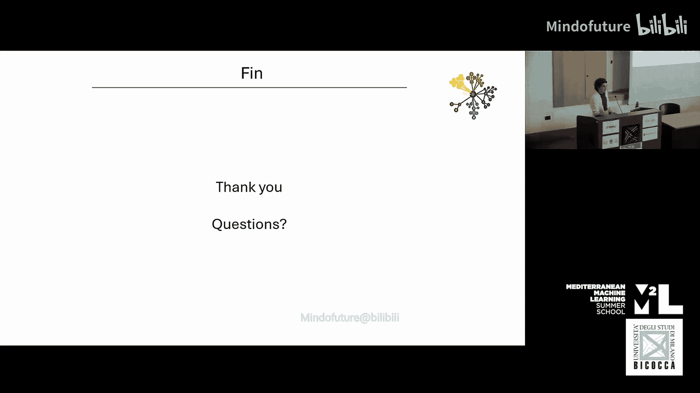

# 【比科卡大学】机器学习讲座 ｜ Machine Learning ｜ Moe ｜ Grpah ｜ Rlhf ｜ Llm ｜ Ai Safty ｜ 2024 p17 P17_图神经网络-Helena_Andres -BV1XzScBEEdJ_p17-

So I'll be talking about graphraph neural networks today。And。To start with。

 I guess the main question is， why should we care about graphs？

Maybe why should you care about graphs So to answer this。

 I'll kind of run you through my own experience and my own journey and how I became interested in graphs and why I think they're so interesting and so useful So hopefully that will help answer that question but before we start I just want to make sure that everyone we're all on the same page and I'm not going to be talking about this kind of graphs or these plots or figures that is's not what we're talking about today so if anyone came here thinking about this。

 that's not the case I'm going to be talking about that kind of graphs those kind of graphs or networks。

sorry。Yeah， okay。Yep， so while they fix that。Thankpefully you'll hear me。

 so I'll be talking about those kind of graphs or neck。And to do that。

 I've kind of created my own IG， my own influence graph that kind of runs through throughout my career and like the people that have influenced me and my own interest in my own work around graphs。

That hope。Will give you a perspective or at least one of the。I don't know。 Can。

 Can anyone hear me anyway if I speak like this or。just louder because I found the problem。

 So now you found the problem， right。Problem fix。 hopefully。 Yeah。

 the idea is to kind of give you one of the different ways you can get into graphs or graph neural networks。

 because there are actually many different angles and perspectives that can take you to working in this area。

 So as you can see， I've kind of added an extra， an extra note。

 an extra entity in our graph in the influence graph， which is the M to L summer school。

 So that's you。 And the idea is that after this lecture， I kind of w to ask you， you know。

 whether I have created some influence on you。 And maybe if anyone has any idea after this on how we can use graph neural networks to make that inference。

 I think that's a good way to maybe get the question started。 right， So starting from the beginning。

 in the introduction， I think they've mentioned it。 But my background was in physics。

 So I started studying physics。 because I was interested in kind of like trying to understand。

 you know， how the world works and so on and so forth。 But then at the end of my undergrad actually。

😊，I think the， the phrase where I resonated the most with was that one。 So all models are wrong。

 but some are useful。 So it's like nice to try to model what happens around us， but also， you know。

 beware that it's almost impossible to try to model and explain everything。

 But basically at the end of my undergrad。 what got me interested in graphs was trying to study and start looking into complex systems and kind of systems that are made of many different particles and specifically understanding how the interactions between these particles affect the model and affect the outcomes。

😊，And。I guess that's kind of like what leads us to。

 to try to explain or to talk about the interactions between。

A certain system or among a certain system。 So to start with， we'll describe， you know。

 how we can represent a graph。 So what a graph is。 A graph is basically a group of certain set of node or the entities in our system。

 This could be literally anything。 in this case， that's kind of the graph of influence that I had in my。

 in my undergrads。 So the node would be people， for example。

 And then the connections are whether these two people you know， interact or not。

 you can create a graph out of literally anything。 as long as you know what kind of entities you want to have。

 And what their connections are。 And so therefore， we have our graph。

 the two main components are the vertexes or nodes and the edges or connections between them。Now。

 we know that our node， our entities in the system can have certain descriptors so we can add certain properties and assign them。

 you know， other description that could be vectorized。 So in this case， for example。

 we could look into the people and then say， right， So what's their interesting graphs themselves。

 What is their experience in working with on graphs And potentially like what's their affiliation。

 so。What this defines is this kind of feature matrix that's describing the features of the nodes in our graph。

 So that would be this X here。Now。To describe the structure that we have in our graph。

 then usually the most commonly used format is by using an adjacency matrix。

 So this is a square matrix where we have same number of rows and columns。

 And each one of these kind of entries represent the connection between the different node in our graph。

 So we'll put a one。 if there's a connection We'll put a0。 if there's none。

And you can kind of see that in this particular kind of， in this particular graph。

 this matrix has some sort of symmetries already。 We'll see how that affects our systems later， but。

The idea that then you can define your graph。 In this case， we have an undirected graph。

 So there's no direction on the edges or the connections。嗯。

You can add more information to your graph and actually add some of the connections or the add some of the directions in。

 in the graph。 And that's what we call a directed graph。 And as you can see here。

 that does affect our adjacency matrix as well。And then finally， there are weighted graph。

 where we can also add on top of that a certain weight or importance on the connection between nodes。

 And that's also kind of added to the， to the adjacentdjaency matrix。So。

Other than these three main types of graphs， there's actually many， many more。 We can， for example。

 look into connected or disconnected graphs。 if there's some of the nodes that are not connected to any of the other nodes in our group。

 complete graphs， bipart graphs。 These are especially important for recommendation systems。

 For example， we have trees。 we have cyclic or a cyclic。 These are， for example。

 properties that are very relevant when you work with molecules and trying to describe theyre characteristics。

 for example， or attributes， simple multigraphs。And then other than that， there's also。

 we can look at more general properties of the graph and then talk about and do a classification on that。

 So we can look at， you know， for example， the distribution of the degrees of the node。

 the degree of a node being the number of node of connections that that node has。

So if we look at general properties of the graph， we can define， for example。

 and say we can define small ball graphs， which， by the way。

 are quite relevant when we look at kind of biological systems， also social systems。

Small wall graphs are those that have a few nodes that are very well connected have very high degrees。

 And therefore， that helps a lot with the connectivity。So anyway。

 many different types of graphs There's a whole world of kind of like exploration in that sense。

 But what do all these graphs have in common。 So kept saying that， you know， graphs are important。

 graphs are interesting。 But the interesting part of graphs is that they add some sort of structure to to our models。

 they add some sort of structure to the problem that we're looking at。And more specifically。

 they are defining a certain domain where we can then ask questions and try to seek for answers。

 And then specifically， it will be interesting to look at the symmetries that this connectivity。

 This structure is adding to， to the domain。 So this is all a bit abstract still。

 I'm not I've not gotten into graph neural networks yet。

But that is kind of how I got started actually， into looking into graphs and getting into graph neural networks。

 So after studying physics， went into。Kin of， I was very interesting graph。

 So I decided to do an en fill in complex systems in basically network science。

 That's when it was called and。At that point， I still haven't even touched machine learning。

 I basically was seeing these systems as， you know。

 way to approximate functions to kind of the models and so on。

 And I think for the next kind of the in the next slides。

 I want to explain and use some of the terms that are the fines in geometric they learning。

 And this is something that came out quite a few years after。

 But I think it really makes that connection between the kind of geometric terms。

 the the description of the domain where we're asking the questions and actually the functions and and the problems。

 the questions that we want to。To answer。So basically， in geometric deep learning， the idea is that。

 you know， we're looking at a certain domain。 And in this domain， there are certain signals。

So what what neural networks do is do an approximation。

 This is like a very highly parameterized function， if you want。

 that is mapping from an input to a certain output。So this input， in our case。

 would be X is lying on a certain domain and to kind of maybe a bit more specific。

 If we look at this example， we have the picture of number 3。

So the picture of number three is kind of the signal that's on top of this great domain。

 It's a greater pixel。 So it's a homogeneous domain。 We have a certain signal on that。

 which is this number3。 And now what we want our machine learning model or neural network to do is to define the label or。

 you know， describe right。 So this is number 3。嗯。So the idea behind it is that， you know。

 we can leverage some of the symmetries that appear in our domain。

 which is this kind of like homogeneous grid of pixels to then help making those predictions。

And we'll see kind of， in this particular case。 Well， I'll give you an example。 This is。

 maybe I'm going a bit too far ahead， but。If we look at number3 and we're trying to make this prediction。

 this mapping， we can actually move the number three in our image so we can move the signal in our domain。

 But we want our function to still map to the same label to the same output。

 So that's what I mean by， you know， leveraging the symmetries。 If we know that in discrete domain。

 the group of symmetries of translations。 is you know， needs to be kind of preserved。

 say when we then make the prediction。 then we can find structures。

 we can find architectures that can do that。Anyway。

 that leads me to the definition of two types of functions。

 So we have invariant and equivariant functions。So we've seen that when we're trying to predict the label of note 3。

We want that to be invariant。 So we want the function that's making this mapping。

 We want it to be invariant to translation。 So when we transform the input。

We don't want that to affect the output of our function。 That's what we call an invariant function。嗯。

And then there's another type of functions that are the equivari functions。And in this case。

 what we what happens is that if we do a transformation like a translation， for example。

 in the input， we want that to have a certain effect that we can predict in some sort of way。

To the output。 So an example on this would be， if instead of predicting label， the label of number 3。

 we want to do segmentation and say， right， where is this number 3 in our picture， then， of course。

 if we move it， we want the function to also tell us that， you know， that number 3 has been moved。

 So that's what we call an equivarian function。And so。The idea is that， you know。

 we can create different functions and we can combine these functions to。

 to for the particular problem， the particular question that we want to to answer in the case of。

 you know， image processing， We have， for example， the symries。

 the group of symries of translation or different， also the formations。

 And so we can define functions that are in or equivari to add to that。

Another important property is scale separation。 So， for example， if now。

 instead of changing the signal， we are actually changing the domain itself。

 So we're making the grid， maybe more coarse grains。

We still can define functions that are eithervari or equivariant to that change and leverage that symmetry when we're training the models。

嗯。And so what I， what I really like about the geometrically learning and framework is that， you know。

 we can combine all of these different types of flavors。Different flavors。

 if you want of functions and then get to any of the most。

Wellknow machine learning architectures that we know at the moment， for example， you know。

 when we know that if we're working with a domain that's a grid， for example， on images。

 we know that the symmetry group that is related to that is a group of translations so that we can define。

 you know， CNNs by combining these different types of of functions。Same with， for example。

 like if we're looking at spheres or the domain is the spheres， a 3D volume， then we can。Basically。

 leverage the thesymmetric proportionations and then construct spherical CNNs。

And I think what I want to focus really on today is the group of the domain of， of graphs。

 So when we're working on using machine learning on top of graphs。 and for that。You may。

 some of you may have seen maybe or like identified earlier some of the symmetries and where they come from。

 But actually， the symmetry group in graphs is usually permutations。

And we'll see next how that affects our networks。 But basically， that's what defines G N N。

 So G NNs are architectures that are very good at dealing with the symmetry group of permutations。So。

How do we define the permutation or how does that affect our graph。

So that takes us to talk about the problem of graph isomorphisms。

 And this is a very kind of like wellknown challenge or question that appears in， you know。

 graph theory， but also in a lot of kind of like or DNA graphal network papers。

 And it's looking at the difference。 How， how can we separate or differentiate two graphs。

 because if you look at， you know， a great domain， that's not much to kind of ask because that's kind of homogeneous everywhere。

 really， But if you look at graphs， the structure of the graph can change。 therefore。

 if you ask a question to one graph， you can get an answer。 But then you don't know if， you know。

 the asking the same question to another graph， you will get the same answer， so。

This is quite important to identify whether two graphs are。Basically。

 the same or not isomorphic or not。 So we define two graphs as being isomorphic if when。

 if we can rela the notes of one graph to make them identical to the other。

So now I haven't labeled the nodes in my graph yet。 And the idea behind this， is that。

Graphs themselves shouldn't really have labels， so when we look at the structure of the graph。

 we don't really care about which node which， but we're just looking literally at the structure and the connectivity of the graphs。

😡，So now that what that means is that if we look at this example here。Actually。

 these two graphs are imorph。Because basically， we could， if we label them。

 we could kind of like exchange this third note and then kind of like flip it upside down。

 and these two graphs are actually the same graph。嗯。So maybe to expand on this。

The idea is that then we can define almorphisms。 So for a specific graph。

 we can look at all the different permutations we can make of the node to map it back to itself。

 So how many different kind of permutations， How many different constructions can we build from the same graph。

Basically to， to kind of evaluate how many different views of that graph with teeth。Right。

 so in order to do that in a practical way， there's a W L test。 There's a ways Waeller Lain test。

 which helps us test whether two graphs are isomorphic or not。So this is not a perfect test。

 and actually it can tell us whether two graphs are isomorphic。But it can't。

Help us see whether to grass are or not。And the way it works is basically we start。

 we initialize the labels in our graph or the labels for the nodes in our graph randomly。

 then we do some neighborhood aggreg， So we look at for each one of the nodes。

 what are their neighbors and basically assign it a new label according to that and then we repeat this process until it reaches convergence that's kind of theoretically proven that it always reaches convergence。

And at the end， what we get is this two distributions。 So one distribution for graph。

 and it's a distribution of the， say， like the note colors， basically。

So if the two distributions are different， that means that the two graphs are non isomorphic。

If the distributions are the same， we actually cannot say， you know。

 there's a probability that they may also still be non isomorphic。 So that's kind of a bit of a。Not。

I know if it's a gap。 But but what that's actually the relation of this with graph neural networks is that we can find like an ex like the like the expressreivity or the。

 the power of expression that our graph neural networks will have will be bounded by this problem here。

 So if， you know， we're not able to differentiate between two graphs。

 then our graph neural networks may also not be。But that's kind of quite。

 I would say more on the on the theoretical side of explaining and understanding。

Graph neural networks。It of gives us a good， a good basis to then now start looking into more the machine learning side of it。

 And I think it's a good time to kind of go back to this。Influence math， because when I finished my。

 my， my Mfield， I sort of， you know， exchanged my hat， started working as a physicist。

 then like changed that for like mass。And now I was quite lucky to get a PhC offer from from a lab。

 but it was a computer science lab so。That kind of also changed again， my。

 my perspective individually。 And actually， when I worked on my PhD， I did not work。 I didnt。

 I initially started wanted to work on graphs。 and I was gonna work on basically using a graph of commmorbities and so on。

But that was not the case。 So I ended up working in something completely different or。

Somehow related。But the idea is that during that time I， I was very lucky。

 and I'm very grateful that a lot a few of the my colleagues in my lab were working on graph neural networks。

 And I would say that that time， at that time， that's when this influence graph was the most important for me because I managed to kind of keep up and do some collaborations with them on。

😊，电嚟佢水。Kind of up to speed with the things that were happening。

 That time is when also Ra neural networks were kind of getting more and more interests， so。

So then that kind of takes us to， right， Let's， let's talk about a little bit。

On the application of this graph network we've seen that， you know。

 you can create functions on top of graph and so on， but。The idea of machine learning， as we've seen。

 is to approximate functions， right， And we want to make some certain predictions。In our case。

 as we've seen these functions， if we operate on top of graphs， well take as an input。

 the feature matrix， So the kind of this X matrix and willll also take as an input the ad matrix。

So now what are the outputs， What are we trying to kind of infer or predict from that so they can be classified。

 I would say in three levels， you can make predictions at a note level。

 so trying to predict some of the properties of individual node in your graph and in that case。

 the output would have dimensionality n by K and being the number of node in the graph K being the kind of dimensionality of your prediction。

We can make predictions at a next level。And in that case。

 we're trying to predict whether two nodes are maybe connected or what is the intensity of the connection between the two nodes。

In that case， our output would be a matrix of nationalality M by K and being the number ofts。嗯。肯定呢嘅。

make predictions at rough level。 So that is when we're taking into account all the notes and all their connections。

 and we're predicting a certain number。Say like a molecular property or， you know。Yeah。

 that's many different kind of we'll see later some of the actual applications。

Going back into the kind of primitive， like the， the invari versus equivari function issue。

 In this case， what we're looking at is functions that will be。

Permutation invari or permutation equivariant because this is the group of symmetries that we've seen that last。

So we look at functions that are permutation invariant。For instance， if we have。

 if we have this graph and we。Attach those sort of label to the node in our graph。

Now we're permeuting these two notes here。8 and nine。

Then we see how that actually affects the adjacency matrix。 that affects also the feature matrix。

But if our function is invariant， if our layer in our neural network is invariant to that。

 then that should not affect the actual output。 So the prediction， if it'， for example， in this case。

 would be at a， at a graph level。 So the permutation of two node shouldn't affect the general prediction on that graph。

And then again， we have also functions of the permutation equivalant。 And in this case。

 if we're predicting at a note level， for example， we do。

 we will see that our output is going to be affected if we perform this permutation。

 So we need to be obviously careful and understand the problem well in order to， you know。

 define and identify which kind what kind of function， what kind。类也不管出什啊。So。Basically。

 I've spoken about this in a more sort of function approximation modeling perspective。

 But actually the， I would say the building block of graph neural networks is this here。

 It's message passing。And message passing is what's happening at each layer of our graph neural network。

So message passing consists on three steps。 I'll explain a little bit more in the next slide。

 But basically， we start with the first step， which is creating messages for each one of the node connection for each pair of nodes will create a message。

Then we'll aggregatebroate these messages。And then we'll update the embedding for the representation of our nerves。

According to the messages and the aggregation that comes from their neighbors。So， the first step。

Basically can be defined as the is the sending step as we've seen。 And so in this case。

 if we look at note2， what will happen is that will generate two messages。

 one for each connection that note  two has， message 21 and message 2。Right I'm keeping it general。

 And this kind of function， a message function can be literally anything。

 That is what actually is going to define the different architectures and the different models that we see in the GN N。

 GNN world。 but basically， it' a function that takes into account。

So can take into account the two notes that are interacting。Then there's the aggregate function。

 So once we've generated the messages， we'll use another function that will aggregate these two messages。

 right， and that function will give us， you know this sort of update or aggregated embeic for note too。

 we still are talking about。If in a case for probably no two。

The interesting part of this is that this aggregate function should be permutation environmentvi。

 So basically， we don't want to care about the order of the messages。 We just want to care about。

 you know， the messages coming from， from the neighbor node。And then finally。

 there's the update function will， which will take the original features of our nodes and the aggregated messages。

That are coming from their neighbors。So in this way。

 what we get is basically for each one of the node in our graph。

 we will perform these three different steps and will generate updated representations that will take into account their original。

Description， So X， I say， and also into account the descriptions of their neighbors。So。

That is the step That is kind of the process that happens in one of the layers in our network。 Now。

 we can stack them up。 And then what that allows us to do is to then gain access to further and further neighbors of the node。

 So we're still looking at node 2 on the first layer。 We can connect。

 We can generate messages that you know， are connected to the first neighbors of this node。

If we stuck another layer， then we'll actually be taking into account node at our two steps way。

 and so on and so forth， we can expand that to basically build a network that's kind of deep enough to access all the nodes in our graph。

 If that's something that we're interested in， although that also kind of brings on some challenges that we'll see later。

 if we， if we do that。But theoreticalically you could。Right， so。Back to the， to the storyline。

 back to the。In my case， like my influence rap。So next step is when I finish my PhD。

 feel like that is kind of a common experience that， you know， you've been working maybe for 3。

4 years in a very specific problem。 You have a lot of knowledge about that。 But then， you know。

 you want to kind of have some time to digest and have some time to expand and look at other types of models and things。

 And that's。Again， like what I， what I kind of did in my postdoc。 And that's what I want to do now。

 which is。Tell you a little bit more about， you know。

 how we can use this message passing framework and generate， create。

Different models in architectures that that are the ones that you may。

 If any of you has worked on graph neural networks， you may have used。So。

I would say the most general one is the message passing neural networks。 And in this case。

 as we've seen， you know， they consist on three different types of functions。

 So for the sending function， we'll have something that will create messages according to the source and the inputosa X I and S J。

 then the aggregate function usually is a mean or some。

 and then we'll have the update functions that are learnable functions。 So in this case。

 we will learn how to aggregate the messages from the neighbors and the original inputs。

I won't expand too much on this because what I really wantna kind of start is building up from the。

好迟啊。Not be a regional rat neural network， but almost。 So the first。

 one of the first models that came up。Was where graph convolutional networks and kind of trying to get to the reference。

 which is at the bottom。Yeah， I'll just put everything out there and then we'll run through。

 run you through it so。The definition of a graphvol network comes from these three different functions that we're using when sorry。

Oh， sorry， sorry。 Is that better oh。Now， I feel bad should I start again。Okay， maybe not。😊，And now。

 yes， now it is。 Yes， Okay， I'll just continue and won't touch anything。 right。

 So the way we defined the different types of graph neural networks is by defining these three different steps on the message passing。

 so。In this particular case， graphcomvolutional networks where one of the O G。

 one of the original kind of networks that that were published that were， kind of， yeah。

 that came out and。For them， some of the properties they have is for the sending message they actually only use at the source node。

 So they only look。Basically， add the definition of the source node。

Then the next step is for the aggregate function。 What they do is they aggregate all the features of the neighbor nodes。

 then basically normalize them by by their degree of the number of connections they have。

 But they multiply them by this weight matrix， which is what we what the network is trying to learn。

 So the network is trying to learn the importance of the feature descriptors to then do this aggregation and then influence or impact the the source node。

 And then finally， so there's the update function， which is basically the sum of the node itself for this multiply by the by the weight matrix added and then adding the this aggregate of their neighbors。

I think the interesting part of this。 And this was kind of like early days。

 was that there were these G CM matrixes can actually be reframed。

 basically just as a matrix product。 I don't know if you can see it there， but basically。

 it's just the matrix product of the adjacency matrix， this， the feature matrix and the。

 the weight matrix that we're trying to learn。😊，So just kind of like to。

 to change a little bit the notation， we can see here that actually the predictions that we're trying to make in our graphs are nothing else than。

 you know， this matrix product where in the adjacent matrix， we need to add the entity matrix。

 So we are kind of also adding self connection loops， if you want， so that we take into account the。

 the representation of each node。But yeah， I think this has some sort of limitation。

 I don't know if you can see it here。 but I guess the main limitation of this is that we actually need to know the adjacency matrix itself。

 So we need to know the graph itself。 So that is what kind of takes us to talk about these two different types of learning that we can do with G NNs。

 So that type of learning is what we call transfductive learning。

 And is when we apply and we learn on top of a specific or a certain graph。 So for that。

 we need to have access to the full graph。 both for training and testing。 And the idea is that。

 you know， some of the models that work on that are G CN。

 there's also some of these other models that were maybe a bit older or like came before as well。

 G CNs know to vague people。 And the idea to make predictions on top of one graph that is well known。

Now， that's not， that sometimes can be useful when we're trying to predict， for example。

 node embeddings or make node classification on a specific graph that we know very well。

But I think the interesting part comes when we try to do inductive learning。 So when we don't。

 we may not have access to all the node or all the edges in our graph。

 or we may want to learn in one graph and then kind of apply that to other graphs。

 And so that's what's called inductive learning。And that came kind of relatively soon after the first G CM paper the same year。

 actually， with graphs age。 there's also graph attention networks。 will。

 we'll talk about this now as well。 But the idea of this is that you can learn in one or several graphs。

 And then basically translate or use those learnings for other graphs and other nodes。Right。

 so I don't know if we， I don't know if we want to stop for questions。

 or maybe if you want there's not that much left。 so we can save the questions for the end。 So。

 but if there's anybody that's very lost or like you don't know what I'm talking about。

 feel free to ask maybe now。Otherwise， I'll take it as we're following， right， so。Okay。

 I'll continue then。 So I'll talk about graphs H now。 and graph H， as I mentioned。He's basically the。

One of the original， one of the first cases of induction or inductive learning in in graphs。 you。

 by the way， you'll probably， I think you'll touch that on the practical session later。

 So you'll have the chance to kind of play around with it and and kind of see what that is all about。

 But I'll run you through the， the main algorithm and how that works。So graphage stands for graph。

 sample and aggregate。 And the idea behind it is that we're now learning this aggregate function。

 So we're not just using learning this weight matrix。

 We're actually learning the function that will aggregate the node embeddings from the neighbors。So。

The idea is that we are initially， when we do this message passing。

 instead of doing the message passing using all the neighbors for our nodes。

 we take a sample of a number of the neighbors in our in our graph。 Then we defined， say。

 like the depth。 So in this case， if we were looking at this initial node。

 we would do mini batch training on only taking a sample of its neighbors。

 So that allows us to kind of retrain the model and look at different nodes at different kind of steps of the training。

Then the next step is doing this aggregation。 So for this aggregation。

 that's what we we want to learn， we can use different。 Also， we can use different functions。

 You can in the package， you can define whatever， whatever kind of function you want to use。

 but you can use mean。 you can use LSD or you can even use pulling so you could use some MP。

 Some neural networks to try to， to learn what is the best way to aggregate to aggregate the neighbors。

 always trying to account for these kind of permutation invaris。

 So we always want functions that are not gonna be dependent on the order of the notes that we take。

So that's kind of a， a good representation that's taken from the。

 from the original paper where you can see that in order to learn， we first are with sampling。

 taking a sample， a sub samplele of the neighbors of our nodes。 Then we aggregate this information。

 We learn a certain function。 And then we relabel that node， according to kind of these aggregation。

 so。One interesting part， I would say of， of this paper was and this model is that it was initially proposed as an unsupervised learning problem。

 So you， the way they train the network is by。Trying to。

 or encouraging nearby node to have similar representations。 So what that means is that。

The representations that we're learning will be encouraged to be as similar as possible when they are kind of closer together in the graph and then as different as possible when they are far apart。

 So that's what the original kind of loss function was taking into account。Now。

 they also explained in the paper that you could。At a supervised learning term in this training function where you can potentially。

 if you know that， you know， you have certain clusters or you want to make a prediction on a supervised problem。

 you could add that to the training loss and actually learn embeddings that are important for that。

And I guess this， I just added it as a， as a curiosity， because going back to the W L test。

 which is this test that we used to， to， to try to identify whether two graphs are isomorphic or not。

 this is。You， we can see this graph age algorithm as， almost as an instance of the W L test。

 If we take into account this kind of consideration。

 So if we take the depth of our graph age model as the total number of nodes in the graph。

 So we have access to all the nodes in the graph。We apply the weight matrices as the identity。

 and we use a hash function that has， that doesn't have any nonlinearities。 We can actually。

 all of this is proved in the paper。 So if you're interested， you can kind of like check that。

 But that sort of takes us back to， we could use this potentially to try to identify whether two graphs are isomorphic or not。

And this is the algorithm itself。 I think I'm probably gonna。Sip that just so that you can， you can。

 I think you will be actually using it in the， in the tutorial in the practical。

 sorry in the practical session later。 So I'll leave this kind of for you to。

 to check if you're interested。And I'll move on to grab attention networks。

 So these are one of I think this is one of the main kind of papers or applications。

 That's where you know， the， the， the world of like graph neural networks took a to a big step forward。

 in my opinion。 and is when we actually， we can。Add to where we can add attention to our aggregate function。

 So now， instead of just learning the same。The same way matrix or the same way of aggregating for all the node in our graph we can take into account。

Oh yeah， we can learn different ways to aggregate according to the nodes that we're looking at。

 So according to the node features。 And that that is something that we can learn can be added by using。

 for example， graph attention network or self attention。

 So there's different ways we can use attention in in our graph or even graph neural network And that is always on these aggregate function part。

 And again， the same， the other two steps of the message passing are gonna remain the same。

 So still the send the send step or the kind of message generation step will only take into account the source node。

 and then the update will be this kind of sum of the original features plus this aggregate function。

So in the graph attention， grab attention。Network kind of paper。

 They propose this multi head attention。 So actually， we can。Basically。

 goingcatenate use or learn attentions that will separate this kind of feature， feature aggregation。

 and then basically concatenate them at the end to learn the new representation。

 This has kind of positives and， and negatives We'll see why we may want to use。

Kind of multiple attention heads or not nexts。 But the idea is that you can use that。

 And that is kind of。If for those of you that have worked with Transers。

 this is quite an interesting application。So。Some of the other models that， you know。

 that are used or that are related to， to graph neural networks basically are very。

 like we have a very large diversity of models because depends on the questions that we're asking the networks and the pen on the angles that we're taking on。

 on research and， you know， we may want to explore one type of models or another， but。

The one of the relevant ones， I would say is the graph is the graph ismorphiesism networks。

When we're basically kind of looking at the problem of graph isomorphisms and。

 this paper is quite interesting from the sort of theoretical point of view。

 because it proves that graph neural networks cannot be or you know。

 have this upper bound of excluivity up to where the W L test kind of can achieve。

 So they basically try to optimize and build models that were as good as separating and identifying graph isomorphisms as the W L test。

Then another paper that I think is quite relevant。 if you're interested in the problem of graph asmorphisms and also kind of taking it to another。

 to another level， if you want， is to look at subgraphs。 So so far， we've。

 we've seen that when we're learning on our networks we performing the message passing。

 we're only taking into account two nodes and their connection。 So now this paper。

 what they do is look at slicial graphs。 So then we can now to do this message passing。

 we can look at more than two node。 so， for example， triangles or even higher order subgraphs。😊。

And then generate neural networks that work on top of those。

 So that does allow us to maybe separate or find this solve in some way。

 this graph isomorphism problem to a certain extent。 And， and yeah。

 so this paper is quite interesting。 if you， you know， want to look a bit more into higher order。

WL tests or looking at kind of subgraphs within this topic。 And then finally。

 there's also another interesting application or another interesting paper is one that works on heterogeneous Gs。

 So so far， we've seen that。 Well， the node and the edges that we were looking at。

 Were kind of like homogeneous。 So we were not really differentiating between notes。

 but we can actually also learn on top of heterogeneous networks。

 which is when we have different types of notes， for example， and different types of edges。

 So what they did on that paper is to basically leverage and learn on metapaths。

 So we can kind of identify subgraphs according to this kind of different semantic representations of the node and edges。

 And then at the end， kind of concatenate the predictions that we make。 But during the learning。

 we can kind of keep it separate and learn on each specific metapath。 So again。

 I encourage you know I think done my best to try to summarize this quickly。 But。

Encourage you to like， read more about and take these papers out if， if you're interested。

And I guess that kind of like takes takes us to maybe the last bits of of this talk， which is。

 you know， at this point， I kind of finish my postdoc。 And then I decided to to move into industry。

 I think in talking about kind of the influence graph and how that affected it。

 I would say now there's no directions on this graph。

 I would say probably the directions would be now kind of the opposite。

 So usually now I work with people that are not as familiar or maybe not as interested as well in graphs。

 But I still get a lot of feedback and a lot of kind of ideas。

 especially in terms of the challenges that we face when we're trying to to implement and apply this。

 So now like for the last bit， I I'll just touch on two of the main challenges that graph neural networks usually face when we're applying them and implementing them with real data。

 So the two challenges I'm gonna I'm gonna talk about over smoothing and over。Squashing。

 so there are two， two problems that were over something。

 So overs moving is when we lose basically information when we perform this message passing。

That happens when， as I mentioned before， we stack like many layers of this message passing on one network。

 And what does that does sometimes is that instead of learning representations of nodes that are you know。

 important and that can help us answer questions， we're sort of disseminating the information and we're losing the kind of individual representations of the nodes So we can kind of see here that that happens and that we can quickly see how that will actually affect the performance when we're trying to predict on。

 on this type of graphs when， when that' happens。So some of the solutions that we can use to avoid that happening is。

 well， first of all， maybe not making the the models that deep。 but if we still want to do that。

 we can use normalization or regularization， which is basically a way to keep or there's a few kind of functions and models you can use for that。

 for example， pair norm where youre basically maintaining this pairwise different distance between the notes across the layers。

 you can also drop edges。 So this happens a lot when you know。

 we have very highly connected graphs because basically it's very hard to learn embeddings and it's very hard to not spread out all the information and loose。

Loose power。 So we can drop some edges。 But， of course。

 that also comes with a cost because if we're dropping edges， then， you know。

 we're losing information that may be relevant from the graph。 We can also add residual connections。

 So that is when we kind of introduce connections between layers。

 So we can have access to some of the representations that were， where you know。

 represented in the in the layer before。 So that does can help us also preserve some of these no distinction。

This 1 I I particularly like， because we can basically on these aggregating functions kind of flash back to。

 to my， to my undergrad。 But you can introduce actually oscillators or other kind of like dynamical ways of aggregating the node information。

 And that also has been proven to help。 You can add。

Gated mechanisms to kind of control the flow of information。嗯。And so， yes， there's。

 there's many kind of different ways we can try to tackle this problem of oversmthing。

 There's no one right solution。 like it depends on the problem。 It depends on your， on your graph。

 on your question and so on。 So there's some research。

 quite a lot of research has been done around that。 So feel free to check it out as well， if you。

Are interested。 And then the problem of over squashing is almost the opposite。 So in this case。

 what happens over squing appears when we have some information bottlenecks or some notes that are actually bottlenecks in our graph。

 And these are， for example， in this case。When we have a note that is almost connecting to parts of the graph that are contain a lot of information。

You can kind of see that if we're trying to transfer and to pass information from one side of the graph to the other。

 and it needs to go through this bottleneck。 Sometimes what happens is that there's not enough capacity and we lose information。

So there's different ways we can solve that。 Again。

 We can add a wider aggregation or this multi head attention approach where， you know。

 we can increase the size of the bottleneck， and then we can allow more information to pass。

 That's one way of doing it。 although that's kind of harder than to train and learn。

 we can modify the graph structure。 So we can， for example。

 add connections between distance distant notes。 So we are sort of。Again， kind of trying to。

 to solve this bottleneck issue if we're connecting and we're allowing the information to kind of pass through more distance node。

 We can also kind of use diffusion， use higher order G NN to sort of diffuse or aggregate the information and。

 and like spread it out globally across the graph。And one particular case that again。

 I think you'll see in the practical session later is to use this expanded graph propagation。

 so we can actually add a layer in our in our G NN in our graph neural neural networks that uses the finds and uses this particular type of graphs that are k graphs。

 And this graphs will have the same number of edges as original graph。

 it just that the connectivity is different。 So in this case the properties of the k graphs that makes them very interesting is that they are various spars。

 but also they are very well connected。 So any note in a k graph can be reached by no more than four hops。

 So by adding one of these layers， what we're doing is again kind of allowing the node to have accessibility to information all over all over the graph。

So， so yeah， I guess like that is kind of more or less the， the。

 the overall vision of graph neural networks。 And I guess like you may be asking， like。

 why did you add your family or like your friends in this influence network？ Well， actually。

 because they， they do influence me many times when especially when I explain all of this to them And you know。

 if they ask me right， So what do you， what do you look， you know， what do you do for work。

 And then explain them all of this， And they're like， okay， But like， what do you actually do。

 Like what is all of this about， like， what is this useful for？

 So there's actually one of my favorite things about graph neural networks is that they can have。

 in my opinion， like unlimited applications so。😊，They're very there's a lot of flexibility because basically。

 you can imagine any system as a network or as a graph。 And then you can apply， you know。

 the right asking the right questions， you can find the right models to， to solve them。

 So some of the applications that graph neural networks have been proven useful for， are。

 for instance， like molecule property prediction。 So when we have graphs of molecules and we're trying to predict physical chemical properties。

 or we're trying to predict toxicity。 this is quite useful for like drug discovery， drug development。

 we also have knowledge graph completion。 So with this massive amount of the information we have at the moment。

 there was。😊，There are some kind of companies there has been some efforts that you know。

 create these knowledge graphs。 so we by using graph neural networks。

 we can kind of access and we can infer some of the information that we may not have on knowledge graphs can be used for also social network analysis。

 cybersecur again， recommendation systems if we're dealing with thisid graphs，3D shape recognition。

 So this is also when we're dealing with kind of as we've seen， almost like computer vision。

 but like 3D， we can apply these methods to kind of measures to volumes and also traffic transportation networks design。

 So there's a lot of different applications really of of these kind of models and by understanding how they work and some of the properties they have we may be able to find even more。

 So I think that is it from me， like I guess the question now is whether I have managed to influence you or to make you a little bit more interested in graphs。

And yeah， I guess that's a question for you， but also open to any questions that you may have。

 so yeah thank you。😊。

