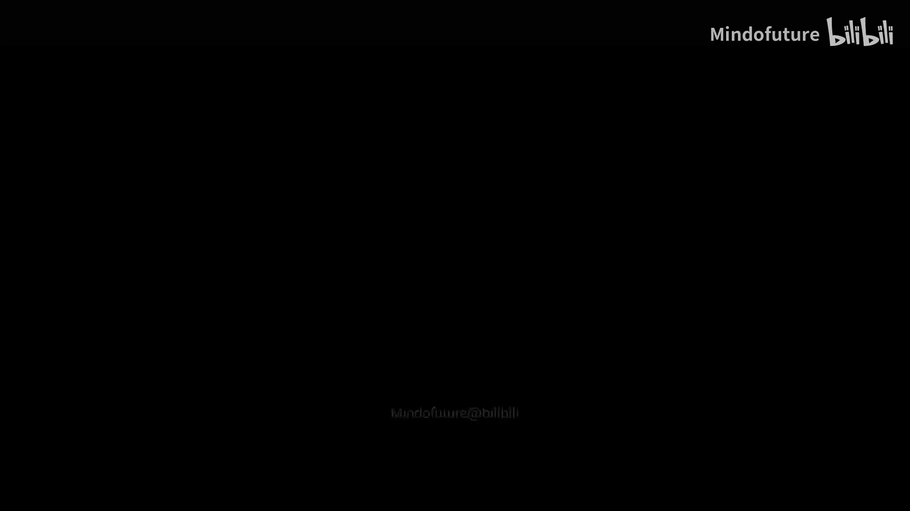
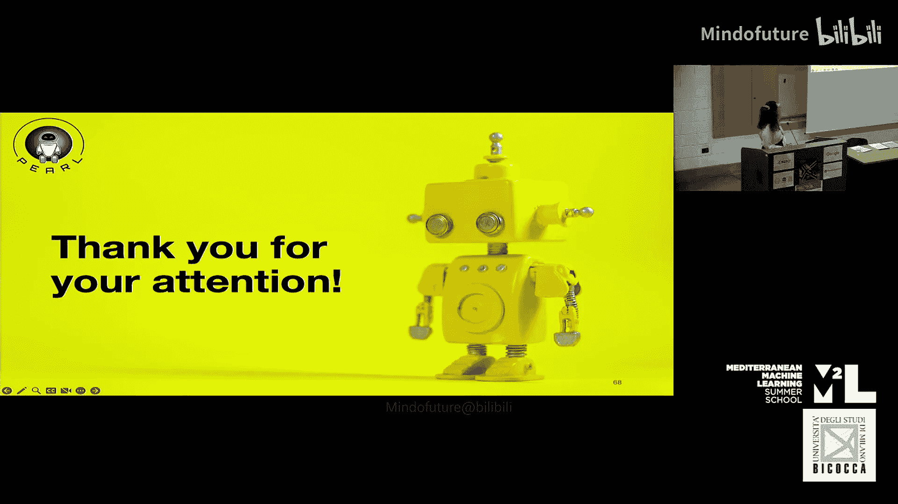

# 【比科卡大学】机器学习讲座 ｜ Machine Learning ｜ Moe ｜ Grpah ｜ Rlhf ｜ Llm ｜ Ai Safty ｜ 2024 p18 P18_机器人学习简明教程-Georgia_Chalvatzaki -BV1XzScBEEdJ_p18-

acquiringquiring this general purpose intelligence requires to model the world， which is very。

 very difficult。 The environments and the tasks can vary and change。

 even basically environments are very nonsationary in the real world。

 The policy structure might be limited。 the optimization solve that we use might be wrong or get stuck in local minima。

 the assumptions that we may may not hold or maybe holding only in a very， very specific domain。

 and usually in robotics， we try to solve this triad of perception。

 planning and control or else sense， think and then act that it is completely separated。

 So model based methods and traditional robotics try to tackle each of these parts separately。

 but in the end of the day to achieve intelligence。

 you need to be somewhere in between and have a system and algorithms that can really。

G everything together so that you can be really reactive， robust and adaptive。

 So this is what we hope to do with robot learning。 And this is an example of， again。

 reinforcement learning algorithms being trained with seem to real methods to do extreme percoure with trained and simulation and then transferred into the real world。

 So we can really also do amazing stuff also with learning。😊。

So let's see some notations that we will use later on。

 You know by now what is a Markov decision process， MDP。 We have the state space， the action space A。

 we may have an observation space or especially in the case that we do not have access to the true state of our environment we have a transition probability matrix。

 we may have an observation model and some reward function In the case that we have， of course。

 a strictly markov decision process， we have only the topple of the state actions transitions and rewards。

 of course， an initial distribution and so on。 And our goal is to learn a policy。

 a controller that will give us the optimal action given a state but in robotics usually we are dealing with Po D P。

 This is where the observation and the observation model may come in， where in this case。

 we only observe parts about the environment and we need to。Infer basically the state。

 And there are different techniques about how we can go around with it。 For example。

 it can be by some sort of filtering techniques like particle filtering that will give you a belief about the state or very simply adding history into your neural network policy in order to allow the network to understand what is happening。

 actually in the past in order to be able to infer the future。 And then infer， of course。

 the action in your policy。But the whole idea is that we make the Markovvian assumption that says that the future is independent of the past given given the present。

 very simply put the Markovvian assumption assumes that your current state is sufficient statistics。

 So you don't need the history， which I just briefly before。

 said that we may be using the history when we have basically partially observable environment。

 But in this case， these are the tricks that we do in order to append a po D P into an MP problem and solve it with some algorithms that we have。

 for example， in reinforcement learning。So first， we will focus on imitation learning and in imitation learning。

 we have some problems because Markovviianity doesn't really hold there。

 the main idea of imitation learning is to imitate some expert data。

 So you first need to collect this expert data that they may be observations or states depends。

 of course， on the environment that you have and some action pairs。

 and then you need to train a function to map these observations or states to those actions that you have collected。

 And here you can see an example of autonomous driving where we collect sensor from our sensors here is a camera。

 we collect the data。 And also the driving from the driving actions from the steering wheel again with some encoders and then we train it doesn't propagate this thing。

 A okay I will use this okay。And then basically， we train our neural network to。

 by doing some sort of supervised learning to match the actions of the expert that it is basically the driver。

It is interesting to see that we were doing deep imitation learning already in 1989。

 with the first autonomous driving car， the Alvin being created in CMU。 And there was， again。

 some retina images from the video passed through up。😊，Deep， okay， not so deep。

 quite shallow neural network。 And， but yeah， this is what it was able to do。

 This is obviously several times accelerated video。 It was， it is not， It was not able to go so fast。

😊，Not that now， I mean， now we have done some progress in this domain。

 but also deitation learning today looks like this。

 There was also some tweet recently about this aloha unleashed。

 It's a system of telelo operation where you have a master slave system or a coupled little follower system where you have exactly the same arms on your side。

 and you are manipulating them。 And then there is the robotic system that basically maps exactly what you do on the system on the other side。

 and you can do things like here putting the shoe on on the human。 And yeah， I mean。

 it's a promising setting。 It's a setting that exists for years because， for example。

 surgeons do robotic surgery in the same way。 And they used it， for example， now。

 for collecting 26000 data for over a year for solving five tasks with low success rate。

 But this is where we are。 And we also have a new models。For learning， for doing imit， for example。

 the diffusion policy， that it is a diffusion model and allows us to do things like this like making a pizza since we are here in Italy。

 I will discuss this both models in a while today。But the main point that I will focus today in imitation learning。

 imation learning contains different methodologies。

 but we will focus on behavioral cloning that it is exactly what I started talking about。

 basically explicitly trying to map the observations or states to the actions that the expert is giving you。

 Other techniques could be， for example， inverse reinforcement learning where you try to learn the cost function or like the reward function of the human based on the demonstrations and then do extraction of the policy。

 but we will just focus on what exactly says clone the behavior of an expert。 And the idea again。

 is that you have this expert trajectories， you collect them。 you do supervised learning。

 and then you have a policy。So how do we do behavioral cloning right now。

 We use usually observations that are images in this particular case is this fun track。

 I think don remember exactly how was the name。 It's not Marioart。 It's a truck， something paper。

 This is the dier paper。 It's this Ros 11 a that I also have in the entire list of papers。

 So you collect the camera images from the game and the steering angle。 is are the actions。

 And this is what you want to map to that it is a range between -1 and one。So if if you are 0。

 you are going straight。 and I have like a video here of how a sample of expert trajectory looks like。

 So you can imagine how it looks。We collect the data。 We have humans playing the game。

 We collect the data， and then we try to do imitation learning。So。

The problem is that behavioral clo is not standard supervised learning in the sense of supervised learning for like doing classification。

 like labeling 0，1 labels。 So what what goes wrong here。 alreadyy， you see that we have， for example。

 an expert trajectory in the standardly， we try to predict the next actions。

 And then we have some errors accumulating And this error take you to a new state that this state it was not seen before in your data set。

 and then you predict an action that has not been the expert action and so on。

 And then you have this divergence of your land policy。

So let's say just a bit why behavioral clinic is not the standard supervised setting in the supervised setting where。

 for example， we do classification， we have the IID assumption。

 we assume that all our data are independent and identically distributed。

 And also we can see also the theory from supervised learning that tells us that when your data and your targets are IID and they are sampled from some distribution。

 the lower the training error， the best， the better the test performance will be。 however。

The data that we have from the in behavioral cloning， they are not I I D。 Actually。

 there is usually a causal relationship about what we see and what we do And this affects everything。

 And we have also other problems， like the expert data only contains the good behaviors。

 We never have seen bad behavior so that we know how we can react to them。Therefore。

 any small mistake during test time will cause these cascading failures with your policy diverging away from the distribution of the expert。

 So in the case of behavior a cloning low training error doesn't necessarily translate into good test performance because this small numerical errors that you might have at the beginning。

 that you are closer to your， to your expert will start。

 will continue accumulating to the point that you will diverge and therefore。

 you will have domain shift or as we also call it a distribution shift that。

We have seen we see also in other in other domains。

 And here you can see an example here is a domain shift。

 I don't know if it is very visible in in in okay， the domain shift is easier to handle in in classification。

 But if you look into the demonstrations where you have also a temporal relation between the samples。

 you can see how easy it is to diverge and in sequential decision making is even worse the problem of domain shift than in for example。

 classification because it can be fatal and it is quite dynamic。 again。

 the problems is that the policy trained only on the expert best data that you have the expert has almost zero chance of seeing a bad state because they are experts and usually with away all the bad samples when we do behavioral cloning。

 because exactly we want to be。To clone the good behaviors， not the bad ones。 And in general。

 we can say that imitation learning is cliff walking once you do a small， you know。

 step away from your good trajectory， you can fall off of the cliff。 And once you make one mistake。

 then you are out of your training distribution and we have this out of distribution shift。 And okay。

 but we could make work， we could make imitation learning and behavior and cloning in particular work。

 If we had。Different types of data。 So if we also include more mistakes or， for example。

 try to correct the mistakes that we have。So one of the approaches that we use is data augmentation。

 So the first idea is to do this intentionally， intentionally to add mistakes on your trajectories and add the corrections of those mistakes so that you can see these data So yeah。

 here we say that the mistakes here， But the corrections help。

 So it it's better than not having at all mistakes。 And when we use also data augmentation。

 So this is the one part on how we can create more data。

 And the second idea is to just augment the data with synthetic or fake data。 that illustrate。

 for example， corrections so you may go and intervene with some way to bring back the tra or you may go to your training trajectories and do specific techniques for adding noise but still not too much noise so that you go completely you know。

 outside of the。Of the track。 considering that you are playing the game。 So， yes， as I said。

 that augmentation example， kit techniques are， for example。

 adding noise from some ga you have some small Gaussian noise。

 Usually it may come from statistics within the demonstrations set。

 So you have different experts driving with different styles。 And you can capture， for example。

 some variants in their behaviors。 And you can use these in some white noise to add。

To augment the data， to create a different types of trajectories， also from other expert drivers。

 And yeah， you can see， for example。This is like the noise profile。 This was the original trajectory。

 the green  one， and the blue one is the one that you created by perturbing this driving signal of the human。

So with this data set now augmentation， we， we， we have an algorithm introduced in 2011。

 The dagger algorithm， the data aggregation algorithm that the main idea was that to correct the to。

 to correct the mistakes that happened during training。

 you need more data and who is the best to give you more data， the best is the human， the expert。

 So the whole idea of dagger is basically a human in the loop learning process where you start initially。

 you have your data。 you do imitation learning， you test your policy。 And wherever it diverges。

 there is a human that it is intervening and。Collects the correct path。

 So it intervenes giving the correct controls for these new states that you visit。

 And then you collect these new interactions。You add them into your dataset。

 So this is initially right， First iteration， you get the demonstrations， you train their policy。

 and now you you query your experts in these cases where you divertge。

 you have a new data and now you add you aggregate these new data points and actions。

 basically the observations and actions in your data。 you do a new supervised learning round。

 and you have a new policy。 you test again， the user intervenes， you aggregate even more data。

 you have a new policy， you do these n times up to the point that you are quite satisfied with results of your policy and。

While dagger is now a 13 year old algorithm， it is still used。

 We still basically rely on humans to collect better quality data。

 especially when you do imitation learning。 And this is basic basic strategy of many big tech companies where they are going onto the train of these。

 let's try to build these large scale behavioral cloning models where they have people that they explicitly give new data wherever you are out of distribution and you are keeping you you keep your checkpoints and you keep training them till you get a very。

 very good behavior。 But yeah， let's see how this will go because it seems that even with 26000。

Data points over a year， as I told you， this aloha setting was not able to reach in the easy task。

 It went around 70% in the difficult tasks，40%。 So we have a long way to go。And obviously。

 our life became better when neural networks appeared because they have the capacity to model away more complex functions and interactions。

 as I also hinted before， one standard methodology here for doing behavioral clinic。

 So you have like your usually some mean square error or some maximum likelihood estimation。

 depending whether you train a deterministic policy or whether you are training just a stoastic Gaussian for example。

 policy。 And because you usually have observations。

 you usually put a history on your as input on your neural network。

 And then you have the output of of the actions。嗯。But still， having the human in the loop。

 as you can imagine， can be quite difficult。And therefore。

 there are different ways where we can provide data in simulation， for example。

 and then distill this information into another model that doesn't have the privileged information of the simulator and then you have basically this teacher student setting。

 training setting that does behavioral cloning which seems to work also quite well， also in robotics。

 as I will show you in a while。 So there are two stages in this kind of a process in the stage one。

 you have a privileged agent that we call usually teacher that learns from expert data in a simulated environment。

 like in this case here on the left part， you can see the privileged agent that imitates the expert that it is either a human driving and simulation or rules that you created So some agent that you have programmed some AI。

That learns to drive， according to rules in this simulated environment。You obviously， collect。

Some images that you hope that they are quite realistic。 and then you train when you are done here。

 then you have a sensory motor student。Right，A sensory motor student。

 What does it mean is a student that only relies on the perception from the sensors and basically its own state。

 While here you have the exact state of the simulator。 but here you don't have it。

 And this privileged agent tries to match the performance of this sorry。

 this student agent tries to match the performance of the teacher。 Okay。

 and then you do behavioral cloning between the teacher， the teacher and the student。

And this is actually a technique that works quite well in robotics。

 especially because we have this domain gap between simulation and reality。

 Here is a paper that had a lot of impact。 It's called Learn Quadruppial locomotion over challenging terrain。

 I will show you the video right away after this slide。 What I want you to focus on。

Is this first two steps on the left。 So the policy training part here you can see that on on the upper part。

 we have a teacher policy training。 and it's actually trained with reinforcement learning。

 So there is a reinforcement learning environment， you create in simulation you give to this policy access to very。

 very privileged information。 For example， here， you can see you can get contact forces。

 contact states terrain end profile， friction coefficients， disturbances。

 all these things are fed that are basically parameters that you have from your simulator。

 they are fed into your policy and you do the reinforcement learning And actually。

 if you see here on on the right， to ensure that this policy is actually quite robust。

 you also use automatic terrain curriculum generation。

 So they actually play around with these parameters here。

 the privileged information that change the dynamic。Of the environment so they start， for example。

 with heels。 they have steps。 they have stairs and they have all these different parameters that they can change and then the agent can have also some information about the environment。

 it trains a policy and then the agent that learns these good locomotion behavior over different types of terrains will get distilled into a student that it is a different agent that only uses the proprioception of the robot。

 so it only in this particular case uses the joint locations and the forces that the agent perceives from its own sensors。

 not from whatever the simulator it says So there are some additional techniques that they do here。

 for example， matching a latent from the encoder here to the encoder here so that you ensure that you are aligned in the physics basically。

That you understand if you want。 But in the end of the day。

 the goal is to imitate to have actions here that imitate whatever this R L agent has learned during training。

 And then these actions are fed into some low level controller。 And then the robot goes on。

 So let's see， for example here。嗯。This video。Okay， there is no voice here。

 but you can see this is an agent that by training it in such a way。

 So doing a rail in simulation with privileged information and adding much variability in the environment。

 they call it curriculum。 It is not exactly curriculum is kind of sampling different environments in different episodes。

Regardless， they are able to do same to real transfer without needing any further training into the real world。

 And I think that this is amazing。 Again， locomotion。

 especially quadruppial locomotion compared to other types of robotic systems has an advantage of having these fourleg being in contact with the environment。

 So at every time， there are at least two contact points that allow you to have stability。

 usually we model this， this agent has been able to learn these things。

 And you' seen this is a paper from 2021 already。 And they have done even more after this。

 also with reinforcement learning。 But they still use the same teacher student technique when they go to the real world。

😊，嗯。Yes。So I have been I started talking about deep imitation learning。

 but currently the way that we do imitation learning is by using generative models。

 and we have tried to do imitation learning with every generative model that existed and was let's say the current trend in machine learning So we of course I can imagine that you know what are generative models。

 right， they are these types of models that try to learn a distribution theta here that matches the distribution of the data。

 ideally would like to match the true distribution but we don't have access to it And then once you learn this generative model。

 you sample from it for example， from this the distribution and you can potentially get new data that you have not seen into the explicitly in your dataset right So this is quite powerful。

This is why we like it compared to this more supervised way of learning policies。And as I said。

 we have used every every type of generative model from generative aversarial networks。

 Vaal auto encoders， diffusion models and also normalizing flows that I will not talk about them。

 But they are also currently quite hot topic in machine learning and also in robotics。

So one important algorithm in imitation learning with generative models is the generative adversarial imitation learning methodology or else Ga。

 where in this particular case。You have three steps that you that you do。

 You sample trajectories from students， and then you have a discriminator。

 I suppose you know how the gun works。 You train write a a generator model that generate samples。

 And then there is discriminator that tries to distinguish whether these samples come from the expert。

 basically the data or that they are fake and they compete against each other because the the generator tries to to make the discriminator。

 believe that the data are the true data， right， So they compete against each other。

 So how do we do similarly in Yale， you have trajectories from from the students that you train and then you have a discriminator。

 which aims to classify the teacher from from the student or your true data from your learn data。

 and you train a student policy， which aims to minimize the。Criminators accuracy。However。

 one problem is that like canja capture multimodal behavior。

 the answer is no because usually it collapses to specific modes。

 And this is the same also for doing imit learning with variation a lot to encoders。

 and this kind of technique was became very， very popular because it allows you also to do more easily learning from images。

 right， So you have a variation a lot to encoder。 It is trained in with the elbow objective。

 Here is the elbow objective。 We cannot， as we said before。

 we cannot match the the exact distribution。 the exact target distribution。

 We do not have access to it。 So we create a different objective where we try to optimize for a lower bound。

 and basically it consists of this two terms DVA objective where you try to basically。

Reconstruct the sample。 So you have an autoto encoder， right， You take the sample。

 There is encoded in some latent representation， and then you try to reconstruct it。

 So here is the reconstruction term。 And this is an additional KL term that tries to keep the distribution that you try to learn as close as possible to some prior and usually this prior some Gaussian distribution or some more elaborate distribution if you can add。

So this VAE structure allows you to give a input， for example， images and output。

 try to reconstruct these images。 And then， for example， by sampling this latent vector。

 you can also decode them into， into actions。And this is where this aloha system and their action chin with transformers technique comes。

 And we will see some other examples here。 This is a paper from last year。 So this is a result。

 So as I said， now they are doing even more complex。

 they are attempting to do even more complex tasks。 So here they。They try to change the battery。

 And on the right， they are cutting the tape right， and exchange it between the two， the two arms。

And all the observations here are coming from from images。

 There are four cameras observing the environment。 There is a top down camera。

 There are cameras on the end effectors， and there are additional other cameras playing an additional camera looking at the system。

 So one on the top， one looking at the system and two on each of the end effectors。

Long story short here。 they created a conditional variational auto encoder where there is a transformer structure。

 So the network is not just convolutional network as in the standard Vs that we were using。

 but it's actually a transformer encoder decoder that tries to predict the next action。

 And this is the difference of this action chunking。

 A chunking is actually a technique coming from not a technique。 actually。

 it's observation from cognitive science about the way that humans do inferences。

 So it says that you don't only consider your next action at the next time step。

 but you usually have a chunk of actions that you predict that you're going to do into the future。

 So you say usually I will wake up。 I will go to brush my teeth。 I will make a coffee。

 So all these are actions without you considering the intermediate states。

 So this is exactly what they。So they train these conditional variational on encoder to predict and ensemble of the query multiple times。

 And for different time horizons。 And then they aggregate and they take the average of this。

 and they play out the first action。Of it。 And then you feed back the action and the new observations that you have。

 and you predict the next。 So this is how this works。 And it works quite well for their setting。

 It's easy to apparently to overfit some specific parameters。 But again。

 it doesn't really capture much of the multimodality of many of these actions。

 And I guess this is also a problem of why this aloha system with this specific model cannot go beyond a specific percentage of success rate。

In my lab， we also have used these types of variational autoenrs。

 But for learning mixture of experts。Also because our our goal was to capture multimodalality。

 So we are explicitly conditioning our variational encoder to learn different modes by having this mixture of experts system and we do human human robot interaction。

 So in particular， in this case， we learn from human human demonstration。

 So we have two humans demonstrating us how to do handovers。

 We train an initial model to encode the trajectory of the human that it is basically your partner。

 And then these conditions and additional variational auto encoder that reconstructs robot actions。

 And this becomes the controller in order to do this experiments that you have seen here。

 some examples。So yeah， these systems are quite powerful。

 especially if you can really structure them well。 Of course， they have a lot of hyper parameters。

 But currently the huge boom in imitation learning and not only in imitation learning is doing imitation learning with diffusion models。

 I think that you have seen diffusion models。 But yeah， very， very briefly when we。

 when we have a diffusion model， we have a forward noiseing process。

 And then we do the refer reverse diffusion in order to remove these noise。

 And this is exactly what we are trying to learn。 What is this function that does the， the denoing。😊。

I will skip this part。 but one paper that really appeared last year this is not blank。 one second。

 no。Okay， one paper that appeared last year， for example。

 the diffusion policy paper has investigated the use of the diffusion model for learning direct actions to apply on robots。

 And here on the top part， you see the discrimination of different techniques for doing imitation learning。

On the left， you see the explicit policy， which is exactly this behavioral cloning methodology that we have seen so far。

 So you have observations。 There is a policy and this maps to actions。

 And usually these can be very restricted in the representation that it can give you。

 it can be just a single gaussian it can be a mixture of gaussion。

 but it is quite difficult to not collapse to the different mode So you need good regularization。

 It can be a categorical distribution just， you know。

 peak place and it just learns to categorize Another way of training policies is with energy based model。

 So you have an implicit function that takes observations and actions and gives you basically a value。

 and then an energy landscape And from that， you can extract the best action that you can take。

 but they are very hard to train the energy based models。 And finally。

 we have the diffusion policy that instead of giving you the energy it gives you the gradient of the energy。

 So。😊，One layer higher， if you want。 And we have a gradient field that gives you towards where should I go in order to take the optimal action。

 And then you integrate this with just Newton， for example， integration。

 and you take the exact action that you need to， to play out。

So the model that they use takes in some observations from cameras， a history of observations。

 And it goes through a network that learns this noisy function。

The difference to original diffusion models is that now you don't have only just the images as input。

 You also have actions。 And the K is the diffusion step。And then you run， you do inference K times。

 depending on how many steps you want to diffuse。 and they also tested different types of architecture。

 CNN based transformer based architecture in their initial work。

 the CNN based was working better just because in the transformer base they were collapsing everything to single tokens。

 So there was not much to learn from the cross attention。

 but now transformer based methods work much better in my group。

 we also have done parallel in parallel work by appending and lifting in some sense。

 if you want diffusion models into the 3D space of 3D positions and 3D orientations for learning how to grasp objects and also how to create the whole trajectory that takes you to grasp optimal and objects and then place it。

 for example， in different environments。 In this case， we used。Point based representations。

 not images， and we were training internally neural representation and SDF assigned distance field to try to capture the latent space。

 the 3D model of the object and to be able then to to do these 3D trajectories that we generate。

This brings me to the end of imitation learning。 And we am already 48 minutes in。

 I think in the array， I will not spend so much time。 But yeah。

 I would like to hear some questions like for two， three questions， if you have。Don't be shy。

If there are no questions， I will continue。With a。With the URL part。Okay， I will continue。

So imitation learning is not enough。 And in particular for robotics， it's not enough because the。

 the world is huge。 You need experts， humans to collect this data。 It is very， very difficult。

 Even if you need to do reinforcement learning to create experts。

 You need people that they know how to create environments and reward functions and everything for every possible situation The real world is very non deterministic is very non-sationary。

 and it's quite expensive to have humans in the loop all the time to judge you and give you new data。

 And yeah， this data are not enough for super intelligent。 So ideally。

 we want these AI embody AI systems to be able to learn autonomously here on the top。

 you see this mobile and Loha。 So they actually put this theop system on a mobile base。

 and you wear it with wheels and you walk around with this whole system。

 And you can imagine is not very， very convenient。AndAnd yeah， I mean， still。

 it seems like people try to push on like collect more data if it is not working。

 collect more data till the extrapolation becomes interpolation， train test on the same day。

 So basically don't sleep。 So I think it's a bit too much。 And like I really， we really。

 I really think that it's somewhere in between learning from demonstrations from a day few data and then refine your skills。

 And I think this is what robots should also do。So， okay。

 the goal of Arl is to maximize this cumulative discounted reward。 what we call return。

 And from these distill and optimal policy and how to act。 I'm going to skip these things。

 I hope you all know by now， what is a value function and action value function。

 What is the optimal one and how we can extract optimal policies。 You have seen to learning。

 So I will go directly to deep Q learning that try to use deep neural networks as function appximators in order to learn how to act。

 so D Q N was introduced。Yeah，11 years ago by Deep mind and it demonstrated superhuman performance in the Atari in the Atari games。

 There are many improvements and extensions after what we call DQN network。

 These are the types of games that it it learned to to solve。

 And the difference here compared to tableular Q learning that you have seen probably also yesterday is that you have a input images usually you take like four frames and you give us input to a network and your outputs are discrete actions。

 So the deepQ network is something that looks like this。 It takes on z four frames。

 It has some convolutional layers that process these images。

 and then there is some fully connected layers that then decode Q values for every possible action。

 So let's say that you have four。ForA， you will have four outputs that are the Q of these four actions。

 And you take the one， the action that has the maximum Q， okay。

I will not go through the way that we do the exploration。

 There is an epsilon greedy doing the exploration， trying to balance the exploration exploitation。

 There are tricks that were introduced to make this algorithm work and be stable like the replay buffer where you are storing the experience that you have encountered so far。

 both the good and the bad experiences so that you can train this cu function that really learn to discriminate which policies are good to follow and which are bad。

 And also there is a target network that creates your learning target， if you want。

 that is just a version of your network that you do not update so often。

 because this is one of the problems in reinforcement learning that you don't really explicitly have labels。

 You have to create your labels from the cues that you approximate。 And this may if you。

The same queue that you are learning from makes the training very unstable。

 so target networks were introduced in order to make the training more stable。

 and it's just a version of your network that you had some training steps before， for example。

 it's just like that。 And with a lower rate， you just copy the parameters of your current network to this target network and you continue on with this optimization in robotics。

 how does Q learning can be applied， it can be applied and was applied quite thoroughly in some environment that were tabletop。

 as we call them， where you have just a single camera on the top and basically you create this action maps。

 action value maps that you can see also here， which are just two values and you assume that the robot will change the state of the pixels in the image。

 So if the robot goes and change。Changes and pushes， for example， in this particular case， a box。

 the box will move。 so the pixels in the image will change。 So this is supposed to be an action。

 Or for example， another use case where Q learning has been extensively use， this grasping。

 even yeah， it is grasping where the MP is basically framed inside the image because otherwise it's just a。

 that you go there， you grasp something and you take it out。

 But if you frame it on the image space when you select something that has the maximum value to grasp。

 you change the image， you change the state of the image because then you remove something。

 So the pixel value there will change。Okay， so this is a discretized space because your。

 your image has a very specific size， and every pixel is a possible action to， to do。

 And this is why it can be solved with Q learning。 So it's not a continuous action problem。

And here is an example of naive my mobile manipulation， if you want。

 So the robot had to perceive and move these boxes into different locations。

 probably take them here on on the target。 and yeah， do different configurations。 Actually。

 they had a lot of different variations of this problem。

 But as you can imagine in high degrees of freedom robots。

 like high dimensional like humanoids or even just a single arm。

 you have to control a lot of different parts of the robot。 So this is not very useful。

 because we need to do continuous control。 And this is where we go to these actor critictic methodologies that allow us to do to train policies for continuous actions and really be able to control the joints of the robots that have can take continuous continuous values。

Now， this is a ra taxonomy of Model 3 Ar。 You can find this was taken from the open AI blog on speedup Ar。

 So we have the discrimination of the valuebased method that is this， for example。

 the QN method that learns explicitly just that you function and from that you extract the policy by taking the actions that maximize the Q。

 you have policy gradient methods that you have seen yesterday。

 and then you have this actor critic methods where you both estimate that Q function。

 but you also learn a policy and you try to continuously improve this policy using the Q function that you that you that you learn。

And one， there are many algorithms。 So it started with let's say DDP G， T T3。

 but I the one that really made a difference， especially for robotics was soft actor critic。

 I don't give you the mathematical details here because it's very involved。

 but you can really look into the paper。 I have also the links in the end of the tutorial。 So。Again。

 it's an actor critic framework。 The actor is the policy network。

 and the critic is basically the Q function that evaluates how good is the action。

 There are two versions of this paper。 This is the first one。 in the second one。

 There was a value function here。 in the second one。 There was IQ function。

The important thing about S is that there was a soft objective that allows this methodology。

 this algorithm to explore with maximum entropy。 So basically， it tries to do many random actions。

Especially in the beginning of the process that it doesn't have any data to try to explore as much as possible the environment and then tries to update the policy。

 but it always regularizes for this how basically random。

 should I remain while I am training my policy such that you don't collapse to a very specific mode of behavior。

 let's say of the environment。 So it really tries to balance these exploration explorationation with this soft objective。

 as we call it。 And it gives you to ho policy。 So it gives you basically Gausian policies that has a bit of randomness that it is quite good in some cases where you want to escape from local from local mini。

 So this is also an algorithm that we have also used in our lab for doing mobile manipulation and deciding where the robot has to move to and when should should the robot。

Inte the arm in order to do and manipulate different objects。 It has， of course。

 other techniques inside。 is's not just the application of soft critic here。

 but it is based on these algorithm in robotics。 like this is why I wanted to say a bit about this。

It is not only about which algorithms we have to use。

 Sometimes you may take an algorithm and it might work directly on your environment。

 but sometimes you may have to intervene because you may don't want to explicitly， for example。

 control every part of the robot， or you may want to blend to create like hybrid decision making algorithms that integrate what you know about the robot。

 because you have knowledge from the hardware and the model of the robot。

 And then have another part that basically describes what you don't know about the world。

 which is very difficult to model。 And then is this is where model free methods are very。

 very useful。Another important algorithm。 And this is coming to the to towards the end。

 So bear with me， it's proximal policy optimization or else P， P，O。 It's very， very popular。

 It trains a policy over an advantage function。The advantage is the difference of the value function in the queue and what it does。

 it tries to update the policy by not changing too much compared to your previous policy。

 So it introduces some sort of clipping methods so that it doesn't make two big updates on the way that it updates the policy parameters。

 and it very effectively trades off exploration exploitation。 It has been used in let's say。

 gamelike environment like this lunar lander setting。

 but also very important approach it was a result of seem is this finger gating from open AI from 2018 already。

But P PO which was an algorithm that was based on theRPO that was from 2015。 if I'm not wrong。

 P must have been 2016， if I'm not wrong， it's still very relevant for robotics。

 especially because now powered by powerful simulators like Isaac Isaac Jim。

 it is able to train in parallel thousands of robots， this is cut out。 I'm sorry。

 you supposed to it's supposed to grasp it and go to the goal。

 or maybe they are just the progresses of different episodes。 Now。

 so we can create this kind of like factory of robots that run in parallel in thousands and they all use kind of Ps and they are underlying a real agent that learns in parallel from all the data that you collect from all these parallel simulations。

 the difficulty here is to define the environment and define the reward functions。

 It really is extremely painful to do this。 It's one of the most difficult parts。 So on the one hand。

 you need to try to understand， okay， what do I control from my robot。

And then you have to define also the environment and the reward functions such that it makes sense and that it is also transferable in the real world。

 Here is， for example， an example， of P， PO being used on navigation with a high speed leggged locomotion where you don't necessarily explicitly control the robot itself。

 But you may give， for example， waypoints and small trajectories for passing through the environment。

Again， we have here the animal robot that we saw before。 So this was a very simple approach。

 They used again， Isaac Jim。 They have like thousands of parallel environments with different terrains。

 and they are able to train the robot to walk from scratch in 20 minutes。 And they。

 let me see if it is in this video。 But they actually， okay， you can actually。😊。

We have seen this robot being trained in front of our eyes in 20 minutes in conferences， for example。

 So it started from a point that it cannot really stand。 And every time it was updating the policy。

 it was able to stand better and then start walking。 And then in 20 minutes。

 it's able to like go overtair and so on。 So it's really。

 really impressive that you can do with parallelization and very， very good simulators here。

 the simulators that are closer to the real world to really， really help us。 So yeah。

 one thing is the word function， but really having good simulators that can kind of go close to the dynamics of the real world is really important。

 other applications of PO is here， for example， Dxter manipulation from point clouds opening doors。

 But still， it's quite challenging for manipulation to arrive to the level of locomotion。

And what's next， What is the next frontier， The next frontier， at least from me。

 from my point of view， are reinforcement learning methodologies with diffusion policies。

 This is a work that we introduced recently where we train policies online。

 with reinforcement learning。By trying to discover all the different behavioral modes or all the different ways that you can solve a problem and then distill them inside a diffusion policy and keep updating and training the diffusion policy just with reinforcement learning。

So yeah， this brings me to an end。 Sorry for the R part being so fast。

 but I'm happy to take questions。 And in the end， as I said。

 the tool just last slides that you got have different references for you to read if you are interested。

😊。

