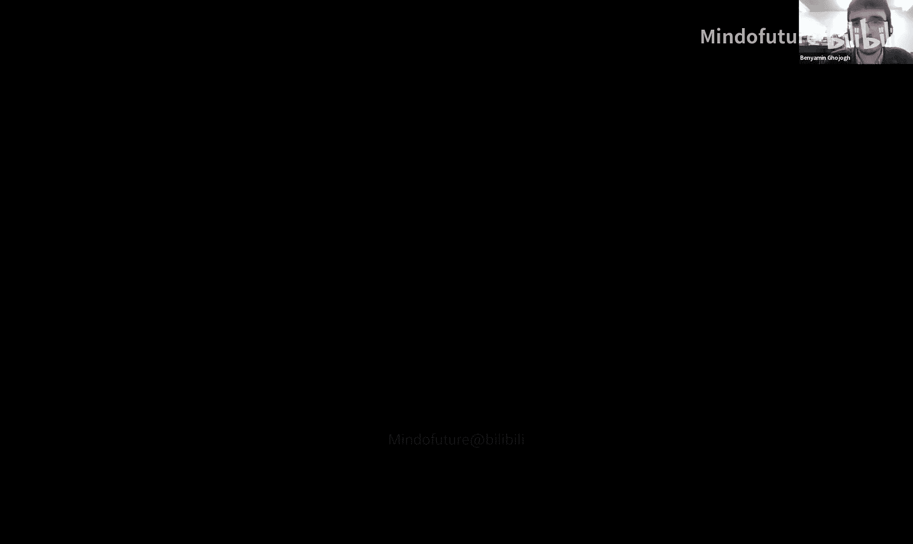
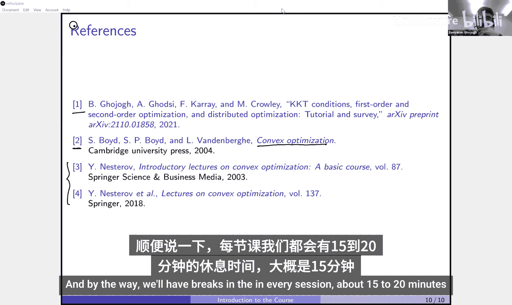
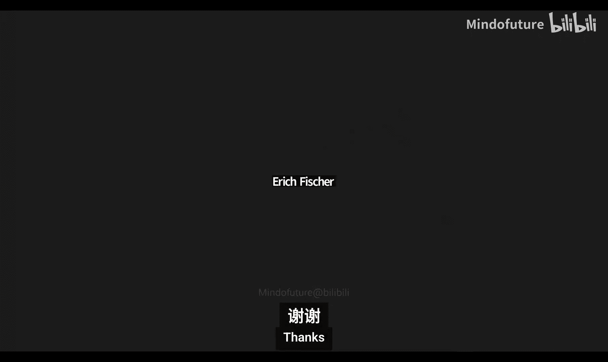
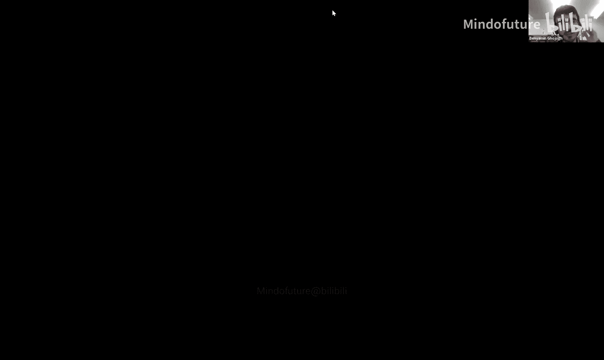
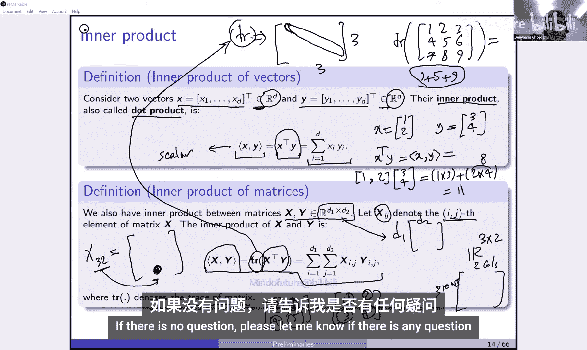
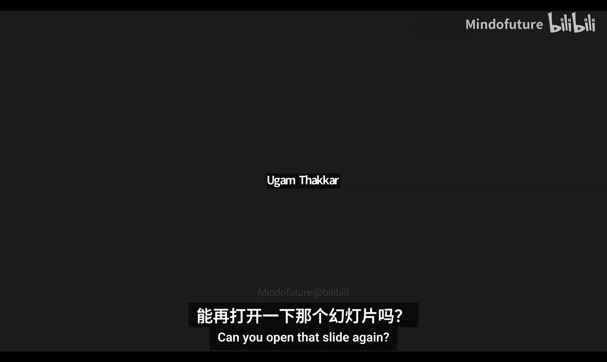
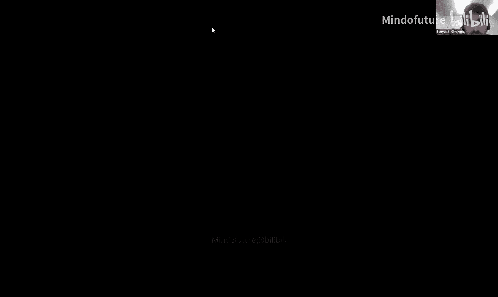
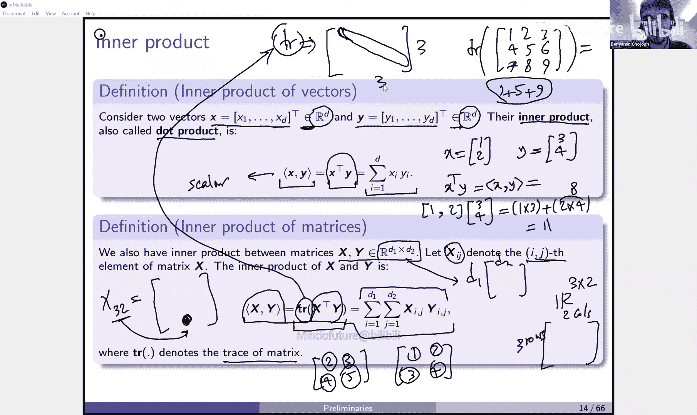

# 【滑铁卢大学】优化技术课程 ｜ Optimization Techniques   W2023 p01 P01_第一讲_(预备知识) -BV1oJCHBcEo5_p1-

确认。Yeah， we hi， everyone。 This is just for recording。 so this is the course optimization techniques。

LienG6140 and Section two at the University of Guelph School of Engineering。Okay， great。

 thank you very much to everyone for introducing yourselves。😊，诶。By the way。

 we we will go and I'll say that please please。This。

Participate in the class and discuss and in the discussions on all of。

 I don't want to be the sole speaker。 I hate the classes where the teacher or the instructor。

Speaks and no one says anything we want to learn together， I will learn from you。

 you will learn from me and so don't think don't look at me as an instructor or teacher。

 look at me as your friend， we all are gathering together。

 we want to learn something I will learn from you too。So you learn from me， I will learn from you。

 we all learn from each other I might have some mistakes。

 you will correct me that's fine I will be happy to be corrected and if I don't know anything I will let you know I don't know this part。

 let me look at it later and I will I will talk about the the next session or we can discuss it in the class and figure it out together altogether so。

I want the class to be cool and fun not just meet a so speaker please I appreciate your participation and ask your questions。

 ask your questions whenever you have a question we only need to raise hand or something you can say I have a Ben I have a question here I didn't understand this part and we will all learn discuss about it and please note that when you have a question and when you ask this might resolve the ambiguity in someone's someone others's head so yeah。

So I'm saying that your questions will help everyone。

That's why I'm saying that feel free to ask your questions， I myself when I was a student。

I used to ask a lot of questions， and I believe asking questions helps everyone to understand much better。

 much better。So， let me。Share screen for the slides。

So。Well what I do。诶。Yeah。I'm using a tool just where I can also。Right on the slide and you will see。

 I think my notes here。 Yeah， like you can see that。

 I will also upload the annotated slides and notes in in the course homepage。

 as well as course Think。So。え。Let's go through the course introduction first。And then。

Please let me know if there is any ambiguity or anything you want to discuss。

 So this course provides the main methods of optimization。 As we said， we。

 we want to we don't want to just cover only theory。 We don't want to cover only practice。

 Well cover both theory and practice。 and we want， we don't want to only cover fancy algorithms or the algorithms which are not gonna be useful in practice。

 So we are gonna learn important the core algorithms in optimization。

 which can be used in both theory。And application in industry。And also research。So， this is。

This course， what this course is about we what do we start with。

 we started with preliminaries and background。We start with sets norms before that， we。

 we have an introduction overall introduction on optimization to optimization。 We say。

 what is optimization。What do we want to do， why do we need optimization and all of these things？

Thereafter we go to sets， norms， functions， local global minimizers， derivatives。

 so if you don't know these， don't worry， don't panic at all， we'll cover these。

We will cover gradient， Jacobn， Hasian。Convexity of sets and convexity of functions。

And I will assure you that you will when you are learning these concepts you will enjoy。

 you will enjoy。Both the methods and also the concepts。

And we will try to simplify definitions and all of these things。 If there is theory。

 we'll try to simplify to understand it， but we will also don't skip the theory。

 We willll cover this theory in order to understand why the algorithms work。

 and then that algorithm is also going to be applied in。Indusstrtry and practice。

We will introduce afterwards the standard problems， convex problem， linearar programming。

 quadratic programming， semideite programming just we'll see what these mean。

And then we go and cover linear programming， the simplex algorithm。

 especially specifically we will focus on tabau method。

Which is one of the implementations for the simplex algorithm。

Well cover individual linear programming we'll say what these are。

 so if you don't know what these are， don't worry， we'll go over them。And integer linear programming。

 we will cover a branch and bound method， which has a tree structure。

Thing for learning for finding the optimal solution。

 So we used a branch and bound method in order to reduce integralteger linear programming or simplify integralteger linear programming to linear programming。

 And then we use the methods， which we learned for linear programming to solve。

TheInte linear programming， in other words， we simplify or reduce Inte linear programming to linear programming willll say how will power those and then。

We will use whatever we learn for linear programming in order to solve the Integer linear program。

We will also。introduce carriage contacter。In short， it's KKT conditions， I think。

You might have heard of it。 KKT conditions are very very famous in optimization。

They might seem scary， but they are not scary at all。 they are very fun。

 will we will go over them and you will see that they are very simple， very understandable。And yet。

 very useful。For optimization。And we'll go over Laangangian function。Also。

 Meth of La branch multipliers will go over these。Afterwards。

 we will cover unconstrained and constrained first order optimization。Previous to that。

 we will learn what unconstrained means and constraint means， so we will cover every concept。

 we don't skip things and assume that you know that already we'll cover those。え？

After knowing what unconstrained and constrained mean。We will you learn first order optimization。

 So we say， what is first order optimization， These are the optimization techniques。

 which are based on gradient and。These upgrade methods will also cover second order items by the way。

Usually if you see many corpses， they only cover unconstrained first order optimization。

 which is whos。Most famous algorithm is gradient descent。

 but we will also cover constraint for our optimization， because that will be more useful for。😊。

For your either for industry or research， because usually you have some constraints。

 either in industry or your research， and we'll cover that how to deal with that if we have constraints。

We'll also cover second order optimization， which is also called Milton's method if it has constraints。

 again， usually we have constraints， its name is interior point methods or barrier methods。

I don't know if you have heard of them or not， but we will cover them and they can be useful in they can use used to be solved to solve all convex optimizations and we will say that we'll see that usually important optimization toolboxes such as CVX they use。

诶。Interior point method， there are second order methods and if you see， for example。

 the course of Stephen Boyd at the Stanford， I will introduce the link to you it's just for interested if you are interested in more things you can look at that too optional。

You will see that Boyd loves Inter point method。 Stephen Boyd is one of the important figures in or scholars in optimization。

 and he's a prof。At Stanford University。Engineering school department。And if you see his papers。

 he uses optimization for doing lots of cool things and he's mostly using Inter point methods。

 he loves that。And then we cover important meta heuristic methods。

 but we'll say we'll see why these are important。 So until here， up to here。So， these are。

These are classical。Methods， classical methods for optimization。And these are mostly based on。

some math behind them。There is also meta heuristic optimization where we say what if the we'll see。

 what if the cost function is too complicated or what if we have too many constraints an example is that for example。

 if you want to optimize the aerodynamic aerodynamic structure of airplanes or something like that these are very complicated optimizations sometimes it's very hard to use classical methods for them then we can use meta heuristic optimization or meuristic methods for these these problems we'll see how they work will see by the way。

😊，TheMaistic optimization is also called。Is some area of soft computing。

Because soft computing has several areas， soft computing has fuzzy logic in it。

 has some connectionist method methods such as neural networks and these things also fuzzy control soft computing also has metaheuristic methods They are sometimes also called evolutionary algorithms or evolutionary methods。

But evolutionary methods are a sub area of materialistic methods。And but we'll cover those。

 so don't worry about that。We will cover some important algorithms in materialistic optimizations。

 including genetic algorithm。Which is inspired by Dar Darwinism， it says that or evolution。😊，Usually。

 every。Generation is in a way better than the previous generations in evolution for adapting to something to the environment。

 So we use such concept for optimization and you'll see it's very interesting。

 Usually materialistic methods are based on some story or their algorithms are based on some story for example。

 we have whale optimization。 So they are based on the story of how whale leaves in the sea or how do we have wolf optimization。

 it says it's based on the story of how wolves can attack some animal or something。

 how do they interact to each other how do they look at each other， for example。

 a wolf comes from in front。😊，And two w come from back and they attack， the target。

 something like that。 Usually they are very cool stories behind the materialistic methods。

 we'll cover particle swarm optimization。😊，And also probably simulated aning so in short。

 if you want to know what particle storm optimization is。Yeah， we will cover that。In more detail。

 the next lecture in this session。But it's just saying that if we have several particles。

 how can they collaborate with each other in order to find the best solution soon theres landscape and we have some particles on it and this landscape has goes up and down and we want to find this the smallest height。

 the shortest height in this landscape these particles search we randomly throw the particles in the landscape they search。

 they tell each other oh I found something here I found something here and then they with help of each other they find the best solution I will explain this in more details。

In some other slides that I have。In this session。Simulated an is also saying that we have it's like something that is very hot and in an environment in engineering。

 I think， especially mechanical engineering people might know something about that Also it is in physics stool so you say you have something very hot you usually you cool it down slowly and you reduce the temperature and by reducing the temperature you become more stabilized and with some algorithm。

 you converge to the best solution and this is called simulated an。I think should have a D here。Okay。

 if time allows， we'll cover distributed optimization。

The most famous algorithm in distributed optimization is ADMM。 It's short for。Alterating。Alterating。

I think， distributed。Let me search it。 I forgot。 what is it short for。Yeah， I' in sorry direction。

Method of multipliers。And we will see what why it has this name， alternating direction we'll see why。

And method of multipliers， we'll see why because its uses， it's based on like range multipliers and。

Based on the method of lag multipliers that N K K T that we already have studied in several。

Previous sessions of that session。Also， so what is distributed optimization is says that soon I have several assume I have several。

Optimization variables。 We will see what optimization variable is。 So don't worry about that。

 We'll cover that。So we have some variables， we can distribute optimization over these variables rather than one variable and we can solve parallelize it somehow。

 make it parallel and that's why it becomes distributed and then it's very related very its idea is very similar to federated learning I don't expect you to know what federated learning is federated learning is a concept in machine learning just it's for your knowledge I'm saying that federated learning says that soon I have。

A neural network or something which learns。It has some parameters which are learnable。

 We want to learn the parameters we can。Distribute data to some node or some servers。

 and then we can。These servers will learn or update the parameters based on the data that they have。

 and then they send their parameters to a central center server。

 and that central server combines them， accumulates them somehow or averages them， and then。

It sends the updated parameters back to the distributed servers。

 so the servers again it's very similar to what one of the one of you guys said big data if you have big data。

 you can divide data to some pieces of data and then they optimize some models in some servers。

 the servers optimize that， send it to some central server， we combine them， we send it back to them。

This procedure repeats。This is federated learning and as you see these servers small servers。

 they don't see each other， they only see the central server。

 that's why federated learning can be used for privacy insecur too。

Because we don't want these to be seen to each other。Only central silver can see them。

So this is federated learning and I the same idea it's almost the main idea behind all distributed algorithms。

In distributed algorithms， there are several things， for example。

 we have some nodes and the nodes communicate to each other somehow and these nodes make graph so based on the connections of each other。

 they make some graph some kind of graph it might be fully connected graph or it might be every node is connected to its two neighbor two neighbors。

 two closest neighbors so we can have some kind of graph and the graph the nodes of graph talk to each other this is usually distributed algorithms are based on that and distributed optimization says okay now we have some variables let's distribute them to some nodes again similar to federated learning。

To some servers， they do their optimization and they send it back to me。

 I combine the combine them in some variable。 and I send a variable。

 the combined variable to them again， they optimize and send it back to me。

 This procedure repeats until convergence。 So this is the idea behind distributed optimization and one of its most famous algorithms is ADMM alternating direction method of multipliers。

😊，Okay， and I'm not sure if we have more time than that or not， if yes。

 we can cover some other cool things too， like sub gradientient， for example， when。😊。

We will see what these mean， for example。Assume your your cost or the function that you are optimizing。

 So if it is a smooth， it's like this， for example。So， it's smooth everywhere。

But what if it's like this。Here， it's not a smooth。Like absolute value function。Right。

 absolute valuelu function is like this。At 0， this function is not smooth。And。

Smoothness is because it's not a smooth it so obvious because very it has a corner here as you see and when its it has a corner。

 it means that the gradient is not defined here。The the derivative。

 the derivative is not defined here， right， So we can use some other concept named sub gradientient。

 and it's also related。It can be related to L1 Nor and all of these things we will cover those if time allows。

 and I think time allows that if not that's fine， we will see how much we can cover。开始。

And so there's some schedule that is tentative。But we can say that again。In weeks。

 we cover preliminaries and then we cover linear programming， simplex method。

 It I'm not very restricted to strict about the fact that on we cover this in this week。

 We cover that in this week， we'll go over the lectures one by one。

 And if we have extra time we will cover more things。 And you don't need to be worried to。

That if extra things are added to the course because this course doesn't have a final exam。

This course has a midterm exam。 So some things initial things will be， you will be。

You will have exam on and then the later things will not have any exam for them。

 they might have assignments for them， but you will learn cool things so you don't need to worry if we add more things there is no there's not going to be any final exam but we have project and I think you will learn a lot in your own projects。

So linear programming simplex method。A taboo method， Inte linear programming。 And then as I said。

 K KT conditions。Mterm exam will have。The around the week 6， it might be a bit。Week five or week 7。

 it will be around week  six。 we'll discuss that。And again。

 onconstrain constantstrain first order method， unconstrain and constrain second order method。

Meta heuristic optimization， distributed optimization。

And if time allows more things such as L1 norm optimization， sub gradientds， non am optimization。

 and all of these things。Any questions so far， why am I the sole speaker。Anyone？

I all looks I'm excited， I've been listening。it all looks great I'm ready to dive in。Okay。

That's great。 Thank you very much， yeah。😊，Does everyone feel the same。

 Please let me know either by saying that or writing in a comment in the chat or whatever。

 feel free to let me know your opinion。诶。We can really those seem straightforward to me so far， Okay。

 that's great。Others have the same idea。Please feel free to let me know if there is anything you I will appreciate your feedback and I will also apply your feedback。

 your opinion on the course outline and whatever we are going cover so as I said we are going learn together I will learn from you。

 you will learn from me， we will learn from each other。Okay， and。

So course materials lecture notes will be provided to you。Of course， we'll have。Organized lectures。

And the。Will have， I have a tutorial paper。 and you， you can see that。 Let me。Let me share screenish。

And by going。Over this， just give me a second。嗯。嗯。Yes。The link is provided in the。Yeah。

In the lecture， also， I can put the link here。The chat， if you' would like to have a look。呃Yeah。Okay。

 let me share screen for that。Yeah。Okay， as you see。I previously had written some tutorial。

In paper I love writing tutorials， you can see my tutorials。

 my other tutorials if you would like on different topics。

 including machine learning and dimension reduction。

 Man learning and all of these things and one tutorial that I had written before with some co-authors。

 some of my professors。is this。You don't need， it's not mandatory to read this。

 It's just optional because we will cover the things I will put the important things in the lectures。

 but if you are interested， you can read more in this tutorial。

 There are many other good tutorials to。 it's not the only tutorial on the internet。

 but this is one of them。 you can。Optional， you can take a look at it。

It doesn't have much about linear programming in it and the simplex method。

 but other topics are mostly can be found in this tutorial。 I hope you enjoy that。

 And if you find any mistake in it， please let me know when will will apply that will correct that and submit another version to archive。

 And what is archive if you're not。Familiar with that is， it's just a public。 I。

 I can say it's a public journal。 It's open access thing that you people people put their research papers in an archive。

 So everyone in the world can have access to that。 And this it's originally for Coronll University。

 So this is archive。 And this is a tutorial paper on archive。

 So this is one thing I wanted to introduce this paper to you again。Don't worry about that， if you。

Don't have time， but to read that， but it's optional。Hopefully， you will enjoy reading that。

And I will also be happy to discuss the concepts in this paper and other papers with you if you would like。

And by the way， it's not just for research。 Don't think think of this tutorial paper just for research。

 I believe that this paper can be useful for。Industry， too， for both industry and research。Okay。

 now let's go back to the slides。Let me share a screen with。For the slides。

So this is a tutorial play paper that we introduced。And again， as I said。

 the linear programming is not covered on in that paper， most just。We have pointed to that。

 It's not details of it。And the。There are for interested students， these are optional。

 not mandatory convex optimization one and two， if you search that。on the Internet and and YouTube。

You will see that it's in the channel of Stanford University Stanford。

 many universities have their own channels。On YouTube。 and， and as I said， previously， Stephen Boyd。

 Professor Stephen Boyd at the University of Stanford。He teaches conx optimization。

 there are two courses and they have put there is a playlist for the two courses back to back。

 Conx optimization one and two， if you search that on the internet。

 one of the first playlists which come up is that playlist which has both courses in it。

And it's a good course to look at convex optimization one of Stanford University covers mostly just the interior point methods the second。

Order message Do you remember here。Here。This。Yeah， this bullet point。

This bullet point was second order and as I said， when we have constraints。

 it interior point method also called barrier methods。

 we will go over them step by step with simple language not complicated but we understand why it is working the most important things that you understand why this is working and how to use it in practice and also will understand why what's the core meaning of that。

And this is mostly covered also in the course optimization one of Stanford。Also。

 some of the preliminaries also are covered in the optimization one of the Stanford again， as I said。

 that YouTube channel。Optimization course on YouTube is just optional。

 not mandatory for interest for interested the students。 And we will also optimization2 of Stanford。

 I can say covers goes to several things。It go， it covers the non smooth do you remember here here。

I said there's not a smooth。 And if it is not a smooth， we have sub gradient rather than gradient。

 It is covered in optimization two of the Stanford。 Also， I remember distributed optimization。

 This bullet point is covered in the。Yeah， it's covered in。Optimization tool is Stanford。

Some first order methods， although Boyd， Professor Boyd briefly mentions first order methods in his first optimization course。

 but in his second course， he goes more deeply in the first order methods optimization methods。

And yeah， these things， and I believe it's very useful。Optional， if you would like to look at them。

Now， additional books。Not mandatory， but I think it's good to look at them。 Boyd's textbook。

 is very famous， especially for people from engineering who work on optimization。

 focusing on convexity and second order methods。 again， this book。

I think it's called conx optimization is mostly for convex optimization one。Okay。

It usually doesn't have， I think it doesn't have convex optimization two of standing it。And it。

 it has。Inior point method isn' it？And also， the books of Professor Yuin Neal。

 He's very good in optimization， especially his book is mostly focused on first order optimization。

 and he has two， he has two。Courses， he has two books， textbooks。

 one of them is indiory lectures on convex optimization， a basic course。

 so he has eliminated many of the proofs and theory in it just。

A less deep look at the algorithms in his book， but if you want to know more about the theory and the theory behind the algorithms and more proofs there are in lectures on convict optimization。

 so he has two versions of one book， one of them is has more theory and U is one of the figures。

 one of the main scholars in optimization。And he's great。ラポ。

And there are some research articles in the literature， you can look at them。

Of course this website we have so classes will be online via Zoom， the link you have it。

And well probably make it a Microsoft Teams group when I was in U Waterloo。

 I was studying here we had。Theza Piazza was very good for question answering。

 but apparently we don't have it here。 So one option is we make a Microsoft Teams group。

The which we can ask questions， make discussions there。 or we can do that in course link too。

 But I think Microsoft Teams is a better option for that。 And we can add。I。

 I can make one chat in Microsoft Teams and add you by adding your emails。

 Please accept it and come to the chat， and then we can ask our questions offline。 Of course。

 you can ask your questions in the class too， but when we are not in the we are not in the class。

 we can ask questions on teams。There is a course website I have made， I put contents。

 lectures and assignments on both this website and also both a course course link sorry course link and here。

诶 you。Yeah， you can look at， but I think the announcements on all of those other things will be in the course link。

But the contents and will also be put。Here on the courseur website。

Well I'll probably upload the videos to YouTube to my YouTube channel， but don't worry about that。

 as you saw， I didn't record when you were introducing yourself。

 so I will not include your personal information in the videos so。I respect your privacy。And。I will。

 yeah， I always said that。So about the course evaluation we have assignments。

We'll probably have three assignments， I should discuss it with the TA， youll have one TA2， Yeah。

 I think we'll have three assignments probably。What I need to discuss with the T tube。

 the midterm exam。Well have。 It will be around week 6 and we'll discuss what will be covered in the midter。

And we have a course project， so 40% of the grade will be course project。

 30% will be midterm and 20% will be assignments and by the way， for the midterm， don't worry。

 I'll not make it super complicated as long as you attend the classes。

 you understand what you are talking about also you solve the assignments。

 we will provide you the answers to the assignments after the deadline。

And you understand assignments very well。 The mid term will be similar。

 It will be easy for you to you don't need to worry about that much。 As I said here。

 the main focus of this course is for you to understand optimization。We don't want to suffer。

 We want to learn and have fun together。And the the course project。You will。

 I think make so you will make groups。based on the number of people。

 I think we can have the groups of three， but let's。Let's wait until the class is stabilized。

 and then we can decide on the number of people per group。 and then you will make groups。

 and you will have。You will pick呃。A project topic。 and you will work on that。

And you will have a report。For that， so you will submit both reports and also you will have a group presentation for your project。

And in the last weeks of the semester during the class time。So the presentation will be 10% and so。

Please， everybody in the group it's good to have all of them speak in the presentation。Also。

 the course project， the report， as well as。How you have done the course project we will evaluate base on that and I hope you have fun doing the course project it will be about 40% because this is a graduate course so course project is important。

Bonus points will have definitely bonus points， especially participation in the class。

Particip is not mandatory。 It's， as I say， it's bonus points from how do I know the participation of people if they discuss。

 because I think I'm not gonna ask people I don't like that if you are here or not。 I wanna。

 I want you to discuss， have this participate in the discussions， ask questions， answer questions。

 if someone ask a question， I will answer。 you also answer。 say I have a comment on that too。

 or if you have a question， a follow up question， feel free and jump to my。

Speech Im and don't let me be the sole speaker。 So I have something here。 I want to say， oh。

 I need clarification here。 This， I really like us to I want it to be a discussion based。 Honestly。

 I think if I only speak， it will be boring。 And I don't want that。

 I want it to be a discussion based class。So， please。Feel free to ask questions whenever you want。

Participate in the classes in class discussions， answer questions。

 ask questions on all of these things， and we'll have bonus points for that。对呀。

Don't worry much about your remarkss， as I said， as long as you attend the classes。

 you understand what you are saying， you ask questions whenever you don't understand something。

That's fine。And do assignments。On time and also understand the assignments and you will do great in this course and you will have fun don't worry much about Mars。

 I want you to focus on understanding， focus on understanding the materials of the course。Again。

 we want to learn important practical optimization methods useful for both industry and academic research。

 both of them。About the theory and practice， we'll learn some theory to understand why these methods work。

😊，And we'll also learn how to use them in practice for practical usage。

 so we'll cover both and it will be useful for both interests in practice and theory。And again。

 ask questions whenever you don't understand don't wanna be the sole speaker。

 there are some preferences that I had mentioned。 This is a tutorial。 This is Boyd's book。

 convex optimization。These are the two books of Nerov。

Which were mostly focusing on first order methods。So okay， and by the way。

 we will have breaks in the。

In every session， about 15 to 20 minutes， maybe 15。 and then yeah， in the middle of the class。

 then we'll continue。 So I think it's good time for break。 But before that， anybody。

 if anybody has a question or anything you would like to say， please let me know。嗯。Anyone？

I was just curious， it's a bit unrelated， but the photo in your background， it's like cuism。

 is that your photo？On the wall， what which。Yeah， yeah。 I， I understand。 I'm in lunch right now。

 Yeah， and this is I thought you might have been in your office that was your it's like looks like Picasso。

 youre a fan。 Yeah， I think it's cubeism right exactly。 Yeah， it's Pablo becauseso。 Yeah， I。

 as you know， it's the style of it's style made created by Picasso。😊，And as you know， yeah。

 thanks for noticing that's very interesting。😊，哎 yeah。Of course。

 this is a copy of the Picassos picture otherwise way， it would be much very expensive。Is is the？

The presentation that's that's online then so each I guess each group member of them present。

Just over zoom and inter then yeah， yeah yes， yes， yes exactly you you will you will prepare some slides and we will decide how how much time we will assign to each group and then。

You will come and present what you you have done， whatever your findings。

 what whatever you have done。 and yeah， it will be simple， not very complicated。So it was good。Right。

Anyone else has a comment or question。Okay。Yeah， sorry， I don't know if you mentioned this， the test。

 will it have any sort of coding in it？The test。The midter test。

 you mean that I think in assignments I will I will put some coding， but in the test。

 I'm not sure yet。I need to think about it， but I will get your feedback on that and maybe decide based on your feedback。

I'm asking the whole class， what is your opinion， Would you like to have coding in your exam。你。Yes。

 we can like。Only if it's like we can use any languages to solve the problem， right。Okay。

 like assignments if can we use C++ or Python， like people prefer Python even I prefer Python。

 but just to again get my hands dirty， we can also use C++。ok。Some people were saying no。

 I think we we'd have to see the the material， I think。

 before we could make that decision because yeah， yeah， I understand。Yeah， yes。

 some people are saying， no， we can say we can have coding on assignments not to be stressful。

What what's your repeating maybe。Yeah， I think because it's good to have coding in at some points in somewhere in the course so you。

You can， yeah， yeah， yeah。 I think you can understand how to use them in practice in assignments。

 But because I really hate to make the course stressful。 I want everyone to enjoy the course。

Maybe we can put them in the coding in assignments and have a midterm exam without any coding。

 maybe something， because I noticed that people are against having some people are against having。

And。Holding in the exam， I understand why， because it's a bit stressful。 It's time limited。 Yeah。

 I understand。But yeah， about the language of coding for maybe Simons。

 would you is everyone comfortable with Python or no。Yeah。

Im I'm comfortable with Python but in assignments I think coding is fine because you can always you know go on GitHub or find someone who's done something similar and then kind of work off of that but in a test when you're under pressure it's very hard to you know like I like to search on the internet and you know there's always multiple solutions to a problem right when you're coding you can do it in five different ways so I think that that becomes very stressful in a test situation but in an assignment you know at least for me。

It's not an issue。Okay， that's。 that's fine， sure。And by the way， for。Okay。

 that's fine we can have maybe as everyone agrees， we can have Python as a language for coding and we have that in the assignments。

 not in the exam。Also one very small question I have because of I w to put the videos on YouTube。

 I think it's not possible to erase all the names on that。

 I that fine that with everybody that maybe the names are in the video or not if you have any comment on that。

 please let me know So。I think that。I'm， I'm not sure whether there is anybody。Yes。

 please let me know if you're not comfortable with that。Let me see。😔，O。Sure， thank you very much。

 But yeah， as as I said， I didn't record the first part where we were introducing ourselves。

 And if anyone has any is is uncomfortable with that。

 please let me know either here or later offline。So I can， but it will make it a bit hard for me。

 I need to use the video editing tools in order to blur or hide that your name on that。

 But that's fine。 I'm totally fine with that。 I want you to be comfortable If you are not comfortable with that。

 please let me know and I will hide that in the videos。😊，え？Sure， great。 And again。

 please participate in the in。In the discussions and ask questions， answer questions。If for example。

 someone asks a question， don't wait for me to answer。

 you also say your opinion or your answer and that I really love these kinds of classes and courses where everybody wants to be in the class and course and don't look at me as the professor or something。

 I'm your friend， we want to learn optimization together。Any other comment before the break。Okay。

 that's great。 I think let's have a 15 minutes，15 minute break and come back on maybe a quarter to 9。

 Is that fine。 Yeah， it worked。😊，Yeah， great。 Okay， have fun and we'll come back， thanks。😊，Thank you。

Thanks。

Maci， I will answer your question after break。Sure， I will answer you。 Thank you。Yeah。Thank。Okay。

 again。Sorry about waiting。 So there are two before we go to the preliminaries。

 there are two questions on the chat。 one of them is。

What program software we will use for assignment so if if you all agree we can I think work on Python Python is a very simple language and very helpful for both industry and research。

I don't know if。Anyone has any。problem with that or not。

 I think it's good that you get familiar with Python。诶。Also。

 there is another question saying that for projects， will you decide group members or we can choose。

 you can choose， I don't force anything you can choose your group members。

And based on your interests。Okay， great。😊，So， let me。Share my Pdf here。😔，诶。Yeah。

Again， these things happen。In virtual classes。when。I don't know why the sheer screen of。

My thing is is not working right now。My tablet thing， which I'm writing on。That's fine。okay。So。

Let me try one more time。Okay。Yeah， I think it's worked。Yes。Okay。I'm happy to work right now。

So let me change the share screen。😔，嗯。Okay， can you see that。嗯。

Can someone say if you can see that or not， what are we looking for？You mean。

 I'm writing it here can you see that Oh yeah， yeah， yeah， I can see that Okay， great， that's great。

Okay， thank you。 So let's go over the preliminaries again， feel free to ask me any。

 if there is any question。What is optimization？😊，So。Optimization problem assume we have a function。

 and what is a function function is something which takes some input and brings some output。

 And in when we say in function in mathematics。We can't have two outputs per one input。

 So for example， its if you consider black box。Where you give it a carrot。

 it gives you high if you give it a carrot again， it gives you buy。So it gives so for one input。

 which is carrot， It gives you two things， two outputs。 It's not that function。 We can have。

it it is it is possible to。Have one output for two inputs for two。 for example。

 you give give give it a carrot or you give it an apple for both of these。 that gives you high。

 It's possible， such as this function that you can see here。This function for two outputs。

 It gives you one input， but it's not possible to have something like this。This is not。The function。

Right， because for the same input， you have two multiple outputs。

 This is not a function in mathematics。 So this is a function。 The function gets an input。

So we say a function F。Gets an input and maps it to some output F of X。

This is a function and this input， which is the argument。诶。嗯。This input can be either a scalar。

 a number， it when you say a scalar means a number。Or it can be multidimensional。 It can be a vector。

 It can be a matrix。 And this function。 also， the output can be a number scalar。 for example。

 in this example， that you see here in this example， you have one input， for example。

 one scalar input， you have one scalar output。So or you can have multiple inputs and put them together to make it a vector so you can have multidimensional input and a scanr output or a multidimenional output。

 you can have different combinations。So。Soon we have a function which we want to find its minimum its minimum or maximum。

 So this is a function。This is a function。 Its minimum is here。This this is a function， right？

Another function is this。We want to find his maximum。

So we want to find this it' minimum or maximum and we call it usually。A cost function。

Or an objective function。Why do we call it a cut， especially when it is minimum minimization。

 when you say minimization， It means that we want to minimize the function。 want to find the minimum。

 Its we should call it a cost function because it's a cost， cost of something。

 and we want to minimize that cost。 for example， the amount of。Penalty that a system gives you。

 you want to minimize that penalty， something like that。

 and you can model that penalty by a function of its inputs。And you can also maximize a function。

 And we can we usually when we want to maximize， we don't call it cost because we usually don't want to maximize something。

 We we， we usually call it objective function for minimization。

 we also can call call it objective function。 And for object。

 an example for maximization is the profit， a profit of the company。 We want to maximize that。

 We want to find its max。So we want to either minimize or maximize the objective function， right？

So again， example for minimization error。For example。

 error of some airplane structure from the perfect aerodynamic structure。

Some error we want to minimize the error we want to find the perfect structure for the airplane in order to minimize its error or some cost maximization such as the profit of the company or anything which we want to maximize。

And。We can get philosophical and say all life is an optimization。😊。

You can see if if you look at it very precisely， you'll see that I'm right。 I'm saying that all life。

 all life， all of your life is optimization。 You want to either minimize the cost of something or maximize a profit or something。

In any aspect of life。And。And also this optimization of life is not simple。

 It might be simple sometimes， but it's usually multidimensional。 It's usually complex。

 The cost function， which you want to minimize or maximize in your life is usually complicated。

 It had its input is usually multidimensional。 You can't say that okay。

 my happiness is only based on my wealth。 No， your happiness is based on your wealth。

 your mental health， your many different things。Your love， whether whatever。

 so your happiness is based on many different factors， therefore these factors。

 you can put them together and make it a vector or matrix， therefore optimization。

Of life is complicated。 Also， all machine learning。All artificial intelligence。

Especially it's machine learning is optimization， why？In optimization optimization。

 what is machine learning in opt in machine learning， have a model。

 a mathematical model and that this mathematical model wants to learn something， for example。😊，You。

In machine learning， you usually do one of these tasks you usually request。Or you， for example。

 classify。Or you cluster something。 I will tell you what these are。

Or you have reinforcement learning。Decision making and these things。

 And what are these simple examples for each of these， for example， for regression。

 you output something continuous So you want to predict some so based on some inputs。

 you want to predict something。😊，This prediction is called regression and usually this prediction is a continuous number。

 It's not discrete， it's a continuous。 it's a range of numbers。

 An example is that you want to make an artificial leg for people who don't have legs to help them then for example。

 you can get the I think ECD right the signals from your the muscles， I think it's called ECD。

 I'm not sure， but you get the signals from the muscles and from a healthy leg and you you will measure the。

Degrree of the knee， for example。 And so you can say that based on this muscle pressure or this nerve signal。

This angle of knee is required and you will make a lookup table。 of course。

 you can't cover the whole range。 you can have a lookup table。

 then based on some of the measurements， you will learn a regression model which can predict for every nerve signal that it gets。

And the interesting thing about regression is that it can interpolate it means that it doesn't only memorize the table that you gave it。

 it can interpolate between these。 For example， if the nerve signal alpha gives some angle。

 if the nerve signal beta gives another angle something in the middle gamma。

 let's call it gamma nerve signal gamma was not seen in the training in the lookup table that you gave to the model。

But it can predict what angle of leg you need that for that。 So this is regression。And as you see。

 we can model a regression by optimization， why because we say。😊，We are saying this to the model。

 Hey， model。When you get this signal N signal， your output should be this angle if you put another。

 if you give me another angle， your error should be increased。

 so you want to minimize this error of regression。😡，If， for example。

 this nerve signal is supposed to give you degree 45 degrees， if you give me 50 degrees。

 you have 5 degrees of error， if you give me 60 degrees， you have 15 degrees of error。

 so try to minimize your error， this is regression。What is classification in machine learning。

 it says that okay。Now I want to output some discrete values in some discrete categories。

 I don't have discontinu as you see classification is a special case of regression because regression was continuous。

 classification is regression but output is only belongs to some categories。And。

These categories are usually finite and the number of them。 and as for example。

 an example is that you want to classify two types all the fruits to either cucumber or apple。

And youll train a model which can classify or discriminate the fruits to apple and cucumber。

 And you please tell me soon I train a model。Which learns cucumber and apple。

 And now in after training is done， I give an orange to it。 What will it predict， do you think。

 What category will it assign to。Um， depending what it's trained on， but most likely the apple。

 yeah yeah， because as I said， soon that the only two classes are apple and cucumber。And as you said。

 the orange that you give is more similar to Apple， so it will say the orange is apple。

 but if you add another class。Yeah， in the chat also someone said Apple， thank you so if you。

Have another class of orange， then it can correctly classify between orange and apples。

 so this is what classification means is an classification is also all all of it is optimization why because you tell the model model if I give you something similar to cucumber。

 you're not supposed to give me the class apple as your output if you do that I will penalize you this is an error so I want to minimize this error saying that if you get cucumber。

 you should output cucumber the label of cucumber if you get as input apple。

 you should output the label of apple， otherwise there is a penalty and I I want to minimize this penalty as you see all classification is also optimization。

😊，Another thing is classrooming。In machine learning， clustering。

 the difference is is very interesting。 Classing means means that I can tell explain it with some simple example As soon you have a baby because machine learning is like a baby。

 you wanted to train it in order to understand because the baby doesn't know anything。

You have a baby and again you want the baby to learn the difference of apples and cucumbers so in a classification problem you tell the baby you show10 cucumbers to the baby say。

 hey baby， this is cucumber， this is cucumber another cucumber you show it to the baby。

 this is cucumber cucumber cucumber now you also show100 apples， different apples。

And say this is Apple， this is Apple， this is Apple， so you are saying the label to the baby。

 you are saying that this is cucumber， this is Apple then the baby gradually learns that oh this is cucumber when I see something similar to cucumber says this is cucumber。

😊，And when I see something， which is Apple， this is Apple， usually babies learn languages。

 it's something like that。😊，In other case that you respect the understanding of the baby itself and you don't tell the names to the baby。

 you just put。Combine the apples and cucumbers on the ground。 and you tell the baby， baby。

 I know you're smart。 I don't tell you this is Apple。 This is cucumber。 You， please。

 based on their colors or their patterns， whether they are thick。

 whether they are round or something like a， separate them into two groups， to two groups。

 The baby puts the apples。Looks at them， says all apples are round。 they put。

It puts the apples together and it puts the cucumbers together so separates them。

 but the baby doesn't know that the name of this group is Apple。 The name of this group is cucumber。

 Actually doesn't care for it。 It says， I don't care whether it's called cucumber or chair。

 I don't care。 I know that the patterns。 These patterns are similar。 These patterns are similar。

 So I separate them。 This is called clustering and it's unsupervised because we don't tell the name or the label to the baby。

 and usually babies learn the patterns in life。In an unsupervised manner or in clustering language is supervised。

 they learn the words， but the patterns of life， kindness or these things and in an unsupervised manner and as you see this can all clustering。

 which I said doesn't use any labels is also optimization you say to the model or to the baby clustered them in a way that the difference of patterns of the things that you are separating their patterns should be similar if the patterns are not similar in within a group you should be penalized so you have an error or penalty or cost function and you try to minimize that in order to have similar patterns within each group again。

 clustering is all optimization。And。You have reinforcement learning。

 reinforcement learning or decision making。😊，It reinforceinment learning in machine learning is nothing but s It's very similar to how you train a dog。

 How do you train a dog。You say， hey， dog。Sit， sit when you hear sit。

 you should sit if or when you when I come to the home， you should come to me。

 So when you see the environment in a way that I come to the house。

 you should come to me So you see this is if this happens， your action should come into me。

 if you hear I say sit， you should sit and how do you train the dog， you reward it。

 You give it a reward。Or you penalize it。 for example， if you say sit and it stands。

 you they penalize the dog， you don't give the food to it， but if you say sit and the dog sits。

 you will give it the food。 Grly， the dog learns that by hearing the word sit， it needs to sit。

This is so based on rewarding positive rewarding or negative rewarding or penalizing or given the positive reward。

 we can have we can train a model like a dog and this is called reinforcement learning and reinforcement learning is also optimization again you have some penalty as you see you always have some cost function or penalty you say okay when I say when you see such an environment when I come to the house you should come to me otherwise if you stand still it's a penalty to you you need you need to minimize the penalty so this is as I said all machine learning or artificial intelligence is optimization again as artificial intelligence is optimization。

 intelligence itself or life itself is also optimization and as you can see that artificial intelligence is imitating or mimicking。

😊，The intelligence itself。 that's why both are optimization。So the variables。

 the inputs of the function that we are having and the function that we want to either minimize or maximize they are called objective variables or decision variables or optimization variables。

 they're in different names for the same thing， for example， the function is a squared。😊，Ex。

Is the argument。Arguments。You can say arguments of optimization or objective variable。

Objective variable。😔，This is the fun Co function。And this， this is the whole function。

 and you either minimize or maximize。 you usually write the argument under minimize or maximize and here the the minimum of x squared is 0。

 So its arguments visually showed by a star X star is 0。And f of x star。

 which means the minimum value of this function is 0。But we' will see some other examples later。

And please feel free to ask me and interrupt me if you want to discuss something。

So the optimization problem can be univvariiate。Mean that optimization problem has only one scalar value。

 as I said。If it is a number， scalar。In this course， I usually show scrs。You not bolt。Not bold。

 And with a small case。Scalar。Yeah。诶。And the optimization problem can be multivariate。

 What does it mean it means it has several dimensions， the variable， So for example。

 we have n of them n dimensions and we can put them together to make it a vector。

And what does it this is transpose。Usually。So this is this vector。X1 to X， N。

And when I want to write it in a line， I usually put it in a row wise and I put a transport。

 which means that it is a column vector。And I show。The victors。Bold。Usually bold， and a small case。

Usually， okay， by default。We can put them together as a matrix。X 1，1。1 n。X， M 1， X， M， N。

 so it can be a matrix。 I usually write matrices。Bold。And with capital case。Okay， here， for example。

 as you see。😊，It's a vector x transpose x。 and what is x transpose x。 So x transpose is this。X 1。X n。

61。X for n。If you multiply this together， it will give you this x1 squared plus x2 a squared。

2 x n squared。 And this is as you see here， it is a quadratic function。I have shown。The figure here。

So you have two variables， x1 and x2， these are the inputs。And it becomes like a bold。

It the ball goes up and this is F of X。We want to minimize this。 itss minimum here is 0。

 So x a star is 0，0。 This 0 is for x1， a star。 This0 is for x2 star， right。And f of x star。

 as you see， f of x here is a scalar。It is at 00， the function is 0 itself。

We can also show it using lines so we can show look at it from above。

 So look if you look at it from above。It becomes like this。

 You can see these are what these lines mean。 It means that on each line。

The value function is the same。So here， for example。

 the value of function is the same then here it means that the bowl is coming up。

And this is a function again， at 0，0。The function is minimal， right？Okay。The optimization problem。😮。

Can be unconstrain。What does it mean， Asum， for example。

 I want to minimize this function or another function。I want to， if it is a scalar。

 I want to minimize f of x x squared。就 is this。Only I have a function and I want to minimize it。

 This is unconstrained。 There is no restriction on x， no restriction on x， right？

But if there is a restriction on its。As you see here， for example。Restriction。Unex。

This restriction or these restrictions are called constraints。Restriction。For example， we say that。

 okay， I have two variables or a multivari variable， so it's a two dimensional variable。

 you can write it。😊，With two scalrs， right， it's a column vector of x1 x2。I have a function。

 x transpose x is a quadratic function。 You can write it here in this way。 This is the vector form。

 This is the scalar form。Subject when we say subject two， it means the constraint。Or the restriction。

Yeah。We have two constraints here。 We have two。ACon here or restrictions。

 one of them says when I want the x1 plus x2 to be less than or equal to 8 always。

2 x1 plus x2 squared be equal to 16。So we are kind of restricting the domains。Of the x1 and x2。

How we are showing it here in this figure。 So for example， x1 and x2。😊，What is this function。

Let's first draw the this function。This function is this line。I can tell you how I obtained this。

So I put0 for x1。 What does it give me x2 becomes8 over 2， right， So here I say what if x1 is 0。2 x2。

 Let it be this。Consider it as a line for now。X2 becomes 4， so it means when x1 is 0， x2 is 4 here。

Now， once I give it x2，0， it gives me x1，8。 It's here。 It's a line。

 We know it's a line because both are scalrs。 They are not quadratic or something。

 So a line passes these two lines， these two points。And when we say。诶。I think there is a。Mistake。

 assume this is equal for this figure。 Sorry about that。 I will correct that in the slide。And。Yeah。

 D Cs。This， I guess， okay。Now for this， this is quadratic， as you see is quadratic in X2。

 what is scalar x1。Set x1 to01s。X2 becomes4。Or-4。These two line， these two points。Now， give x to 0。

X1 gives8， which is here。Now， this is。A quadratic function， which I drew。

 passing through all these three points。How do I know whether I should。It's in anequality。

 Do you see that， So it means that either I'm here。Either， I am here。Inside this quadratic function。

 or I'm outside。How do I know whether I'm inside or outside？We can put a number， for example。

 0 and 0，0 and 0 is less than 16 means that it should0 and 0 is less than 16 correct。

 So it means that this region should include0 and 0， so it's here。So I'm here in this region。

It means that the the， the second constrain is saying that I'm here。 So let me。Ha raised this。

Means that I am here。I'm inside。Also， I'm on the line。 The first con is， I'm on the line。

 Do you see that， So it means that here this is the line。

And I should be here so only here because this part of the line and this part of the line are not inside this。

 so it means that the only feasible or acceptable domain for x1 and x2 is on this region， this line。

 this part。😊，And on this， I should minimize x1 squared plus x2 is squared。So I。

 I should see the function。X1 is squared plus x2 is squared， when is it minimized on this line？

For example， here。And。I think the answer will be somewhere around here。 I haven't calculated that。

 but we can see that it's either here。Or around here。

 because when we become here it becomes8 is squared plus0 squared it's very high。

 at squared is 64 here we have 4 squared plus0 squared right it's 16 so it's either this point or somewhere around close to it。

This is the answer。So this is a visualization I wanted you to understand what constraintsstraint means you can have many constraints。

 but if you the more constraints you have， the more complicated it becomes。

 but note that you shouldn't have contradictory constraints， for example。

 if you have say minimize forVs。X is squared。 assume it's a scalar。Subject to。

 I can write subject to short by S T， okay。X， this x is less than 2， and this x is more than 16。

Consider this。Problem。These two constraints are contradictory， It means that。

It means that the feasible region or the domain acceptable domain for I is。Nothing。😡。

It belongs to nothing。In this acceptable region， where does this function。

 where is it minimized nowhere？So this optimization problem doesn't have an answer because the constraints are contradictory。

The constant should have some kind of overlap like this like here。

 the two constraints have some overlap。Okay。Okay， now optimization versus search。Guys。

 please participate in the discussion。 Do you have any question， Everything is clear。

Can you give me any feedback。It was clear for me。O。The same for everyone。Yeah。Okay， great。So。Yeah。

 someone said in the chat。Yes， great please please ask me question if you don't understand any part any part I'll be happy to answer I do have one question。

 other ever going to trick questions on the tests where there will be an impossible domain and we have to identify that or should we assume that it's just going to be straightforward impossible every time。

No， it， it will be straightforward。 Don't worry about。Yeah， but and。

 but I'm saying that when you model your optimization problems。

 you should be careful about that because you don't wanna have an emptypathy in a feasible system。

 empty dump， acceptable domain。So if the objective problem is simple enough。

Or we don't have too many constraints， even if it is complicated， we can use classical optimization。

 So it's not， I'm not saying implying that classical optimization is not usable for very complicated problems。

 but if it becomes too complicated， we we have the option to go for search。

Rather than optimization using classical optimization， But if it's not very complicated。

 it's straightforward to use simple classical optimization methods such as this， for example。

 this this function here is is simple we can use easily find is minimum here。 So this is minimum。

 you know， this is lower than this， right。This is minimal。 And here also， assume it's a bold。

 So it has two inputs and it has one output。 and this is the value of the objective function。

 this bold。 And here， as you see， this is a minimal。 It's simple。 but it's too。

 if it's too complicated such as this。Too many local minimums or too many minimums here。Also these。

 it's too complicated or too many constraints， too many restrictions， it's useful to use search。

And we have we can do either grid search also called Prote forb search。

 which means that let's divide the domain。Into some parts， small parts。

Infinitesimal parts or something and then calculate the objective function in each part。

 for example here in this example， you can divide it into some regions and you take the middle of the function value at the middle of the region and then you find something the best solution。

 for example here。Some option is you do grid search as you see， you make a grid。

 and if it is two dimensional， for example， if it is two dimensional。

 your grid will be two dimensional， right？Gs like this。Soun each， note of the grid， you will search。

The step of the grid is a hyperparameter， you should choose the step of the grid。

The size of the grid and then you search in the domain sometimes you you seen machine learning。

 for example， they use grid search for finding the best type of parameters using validation set so or Brucefor search some kind of grid force what you can do what one question is it is it possible to apply a transform to the function to make it easier to。

Find the minimum or the maximum like if you apply a transform。

 you could exaggerate certain features of the function and then。

It would be easier to find potentially。Yeah， that's a great question。

 but you should note that when you use a transformation。

 you'd need to know the inverse of it because assume you you transform it and it becomes simple and you find the minimum but。

😊，So there are two， two things I should you should note。 One of them is that okay let me。

Make a note here。Just give me a sick。I think it was。y。😔，No。Okay。Yes。Okay， soon you have。

 you make it transformation， which is a monotonic transformation like logar or something then。

It's acceptable。But if you make a transformation which drastically changes your local mean。

 for example， let me soon， this is a function。You apply a transformation which becomes like this。嗯。

You find after this transformation， you find this as a minimum。

 however as the transformation was not monotonic， it couldn't give you the actualov before the transformation。

 so you should have some conditions on your transformation。

 another thing you should note that in optimization， you usually have two goals。Two goals。

We will see that either you want to find the argument。Or the objective variable。It says a star。

Or the f of X star is important for you。Okay， sometimes when you do， for example。

 assume I want to minimize F of x。Its true。Plus，2， for example。Yeah， let's say this。

This function is minus-1 the squared plus 2。Okay， what is x star is 1 right at for one。

 it becomes minimum。It's its function is like this function is like this。1， this is2。

This is of x x star is1， but f of x star is 2。Usually when you apply a monoonic transformation。

And you solve the optimization problem， it gives you the X star and as long as your transformation was monoonic。

 the X star for after transformation is the same as X star before the transformation。

 then you are done if your goal is this。But sometimes your goal is also this。Okay。

 then you need to calculate F of x start before the transformation so you will have another step so you're not done when you solve the optimization problem after transformation I wanted you to know these two think difference between these two Did you get my point。

Yeah， no， this makes sense。Yeah， so you should note that which one of these is more important for you if the second one is important for you after transformation。

 you find the exist star， but you also need to put it back to the actual function order to give the if of Xor or the cost。

O。Again， as I said， the transformation needs to be monotonic in order not to drastically change the function in a way that the lo mean or the answer is completely changed。

And so again， if you have any follow up question or any question， please let me know。

So we can do search we can search wisely in a way that we can have again meta heuristic optimization rather than grid search or boot force search。

 we can have a voice search， for example， in this function， consider this function。

 f of X versus x and have some you search here， this is the value randomly for example。

 the function value here and you see the function value here。And you say， okay， among these three。

 the value of function here is better。So this is better。 Now， let these。To look around itself。

 because it was the best。 But these two， these two。Move toward that better solution。

So it's a kind of a wise search。We move toward that and this is a materialistic optimization。

 usually the main idea behind all of them is this。 So a good example for materialistic optimization is that assume you have a room。

😊，Where there is a treasure under the ground。And。Assume we don't know where the treasure is are some we are some people or particles。

 In other words， we randomly spread in the ground and we say， okay。

 let's each of us dig some part of the ground。We do that and after some search around each each of us around ourselves。

 we find something I say okay I found something it something another person says I found for example I say I found a pot another person says I found。

I how， what do I say diamond something。 And we say， okay。I found several things around me。

 the best of me was pot。You another person found several things around herself or himself and the best of them was。

 for example， a diamond， another， so we we talk to each other， say， okay， I found this， I found this。

 I found this okay now we say who found the best among us someone says I found a diamond which is best among all of you So we conclude that apparently treasure must be around that person。

So however， we say that by the way， I found some pot me。

 I'm saying to myself I say I I found some pot， maybe some treasures around me too。

 however diamond is more valuable therefore I move a little bit toward myself to the best of myself I found the pot at my left Ive move a little bit to my left。

 however， more toward the best solution in that iteration。

 which is for example the diamond so I move in a vector which is the linear combination of my best and the global best that we found in this iteration。

 and we move all of us with some step we move the next iteration starts， we dig again。

 we dig around ourselves we do this we do this procedure repeatedly until we find some best treasure in the ground collaboratively so this is how we search。

Wly in some landscape。And by the way， the objective function that we are either minimizing or maximizing is also called objective Land or search Land。

 whatever， if we are using search method， it's usually called search Land why because it's exactly like a Land。

 for example， in if the cost function is 1 d one dimensional。

If you see its like a valley or mountain， it's exactly like a landscape if it is 2D。Two dimensional。

It's like a bowl。How should I draw it。 It's like a bowl with valleys。

 It's exactly like ground the earth。 It the earth， if you consider the height of the mountains as a cost。

 then the earth is two dimensional， but the cost is the third dimension or the height of the mountains。

 So you have valleys and all of these things， you want to find the best， the smallest valley。

 for example， that's why we also call it landscape。Now， let's go to sets and norms。So。

We have interior closure and boundary。 Okay， assume that we have a set D。诶。

I call it D and usually I denote a set using fancy letters， capital fancy like this。Here。

If it is a regular if it is a standard set such as this， this is a real real numbers， right？

I usually the font is like this。 and this R D means the D dimensional。Euccleide in the spaced。

What does it mean， for example， theses。Is two dimensionally including in his space。This。

Is three dimensional clearlyide in the space so D dimensionally including in the space means we have D variables。

And the point x in this set is an interior point of this set。 What does it， for example。

 consider this。This is a set。😮，And I consider inside of it as interior， but not the boundary of it。

 as you say， this。It means there exists， means there exists。Some epsilon， which is。Positive。

Where y it's the set of y， it means that all of the points y set of y like this， a point y。

Where y  -6， its， this means the distance of y -6。 So consider。对。As you said。

 so this is the point x for any other point y y minus x is inside the set。

 so it means a difference of them where it is less than epsilon is inside a subset of D What does it mean。

 for example。If a point is on the boundary， then this condition is not satisfied or if it is outside of the set。

 it's not satisfied in simple words， if you don't want to look at this， I'm drawing it here。

 which means that if it's a set inside of it。Excluding the boundary is the interior of this set。

Now some other concepts， so we have the boundary of the set， which means exactly the boundary。

And the what is the closure of the set， the closure。It means that the interior。

 I can also look at this definition interior and the boundary， the union， this is union。

 it means that both interior and the boundary。And。You can also look at it from here。

 it means that the whole Euclidean is space， which is this， the whole Euclidean space。

This is excluding， this is minus excluding in the set for sets excluding。What is this？

This is the whole thing minus D， so this is D， the whole thing minus D is this here。

The interior of this is this exactly。So， the boundary is not covered。

Everywhere minus this means exactly。D， including is boundary。So this is called closure。

 closure means the set， including its boundary， and boundary means closure minus the interior of the set。

 only the boundary of the set。These are the concepts。To know about the sets。Now。

 convicts sit and convictx halt。So what is this， it means that convex set， it means that。

 but let me first tell you this。Its considered two points， x and y。This point。

Is T x this point on a line connecting x to y is tx plus 1 minus ty where t is between 0 and 1。Why。

 Ill tell you why， if would C to 0。This term is 0， this becomes y it means that we are here for t0。

 we are exactly here。If we set T to1。This term is0。

 this means that we are exactly here on x and for t between 0 and 1 we are on the line between x and y if t is less than0 or greater than 1 means we are here。

And if t is all R， it means that the whole line connecting x to y。Passing through Eastern and1。

So this means the line connecting x and y。this means for all。For all points。

 X and y In the set D and where T is between0 and1 as we talkedcked here。

This means that all the line connecting x to y should be inside the。If I look at this figure here。

 for example， consider to any two points， any for odd， any two points inside this set。

 if we connect them together， Tx plus 1 t minus y is inside this set。

 you can't find two points where the line connecting them is not inside the。This is a convicxant。

Nonconvicted。Is like this。 I have found two points。

 at least two points where the line connecting them is not completely inside the set。

 as you see here。So this is a nonconvicted。In other words， in very simple words。

The convex set is a kind of。A bumpy thing， a bumpy， it doesn't need to be round， it can be like this。

This is also convictx， but as you see， it's a bumpy， but if a part of it is not bumpy like this。

This is not convetx anymore because you find two points。Where the line is then。It's a bumpy thing。

 It covers itself。 it's it's as I I think it's obvious what I'm saying。

So convex hall simply means that if you have a non conx set。The smallest set around it。

Which can make it convetx。 This is convex hot。 For example， this。第。😊，This set， which is。Non convetx。

 the smallest set around it， which is。Which makes it convex is this because this part。

 this part that I'm drawing is already convex。 The only part which is a non convex is this。

 So I draw this。 This is a convex hollow of the。In other words， we are convexifying the set。

We are making it convicts。 This is convict's halt。So。Minimum， maximum inum supre。😊，So。

Look at this vigor， I think it shows you everything。

This is the minimum when you actually have the minimum。😡，这是证明你吗？This is maximum。

 I think minimum maximum are very obvious to you。This is Supreme where you don't for this function。

 then it goes to infinity。😡，Right。AndIn infinity， it converges to this line。

 but it never reaches that。😡，So it never has a maximum because it never reaches this。

We call this upper bound， the smallest upper bound on the function supremo。

Maximum is a special case of supremo。 So this maximum is also supremo。

 but this supremo is not maximum because we never reach that。In fe。It means the。

largestrgest lower bound， it never reaches there。Again， minimum is a special case of inma。

But inome is not necessarily a minimum， that's why you sometimes see rather than saying Max f of x。

 you sometimes see in papers or things supreome of x f of x。Why。

 because they want to cover this case too， maybe the function has some cases like this。

 we want to find that too， but if the function doesn't have such cases。

 then you can simplify to this expression。To prim of f of x to maximum of F of x or inform of f of x to minimum of f of x。

Again， I， I already explained that in what is infamo and what is supremo。

 Infaum is the largest lower bound。So， as you see。This means the largest lower bound for all domain of x。

The z， which is the largest lower bound。 This， This is lower bound。And this is the largest。

And supreme is the smallest。Upper bound。Is everything clear， guys？Yes， yep。Yeah， great， okay。

We still have some minutes left， well go until the end and then we'll continue next session。

So we have inner product of vectors， consider two vectors， x and y。So these are， as I said。

 these are the column vectors x1 to xt d dimensional， right？And why， y1 to y D， And these are scrs。

 These are numbers。And this is transpose， which means it these are column vectors and this means they are d dimensionional in the D dimensionsional Eucliide in space right and this means。

They， they belong to this set， they belong to the Euclidean space with D dimensional Euclidean space。

Their inner product also called Dutchch product。We denote it in this way。Or this way。

And this means that the summation of their multiplication of their elements。

 I will give you an example。X is。A two dimensional vector of 1，2。Y is a two dimension of 3，4。

What is xpose y or x Y means that what is xpose 1，2， right。What is y 3，4。

And if you multiply this becomes 1 times 3。Plus， two times 4。It means three。This is a lemon。

As you see thatt product or inner product gives you a scalar， the output is a scalar。It's a number。

Although its inputs are vectors。And。I tell you this， and I think the session will be over。

So in a product of matrices。We have assume we have two matrices。What does this mean？This means。

You clt。It means a matrix of D1 dimension by D2 dimension， for example， if you say R3 by 2。

 it means the matrix with three rows。And two columns。Right。So and as I said。

 we show matrices with capital bold capital letters。And X I J， let it be the IJ element of x。

 for example，3，2 means the third row and the second column here。This is the x3，2。

And what does this mean？We denoteed it with this。But we need a trace and a trace operator。

 tracece is nothing complicated。 What is trace。Trace。Is the。

It's it has some definition for eigenvalues， but I don't want to go to that definition simply。

The summal the diagonal of the matrix， because the input of trace is always a score matrix。

 so if it is three rows， three columns， it is four rows four columns。

 it says score matrix and the diagonal if you sum sum over the diagonal of the matrix it gives you the trace so the trace of for example。

1，2，3，4，5，6，7，8，9。Hes 1 plus 5 plus 9。Okay。And why do we need a trace operator here。

 because x transpose y is a matrix recall here。😊，We have x transse y， but it becomes a scalar。

 x is a vector。 y is a vector。 but x transpose y becomes a scalar here x is a matrix。 y is a matrix。

 but x transse y is not a scalar iss a matrix again， we need to make it a scalar。

 therefore we need a trace operator for it when we have matrices。And trace， as you see。

 its output is the scalar， the scalar。And it means that you multiply the elements of x and y altogether。

 for example， if you have。2，3，4，5， and you have one，2，3，4。 You multiply these to each of these。Plus。

 multiply these to each of these， plus multiply 4 to each of these。

Plus multiply 5 to each of these and they use sum over all of them， it's in a product of matrices。

And as I say trace has some formal definition， but I think the simple definition is that it is proved that it's equivalent to the summation over the diagonal of this matrix。

 So these are the inner products and what just one more thing and it will go over and what。Visually。

 I mean。诶。Visually。If you have two vectors。X y。For vectorctors I'm talking about。The。

These you project the vector Y to x。 it means that it'sdicular write a line。

 which is perdicular and this。V， this amount， this amount is a projection of y until is。

 This is a vector。 again， a vector。 So this is the vector X。The whole thing， this is the vector y。

 When you project y onto x， it means that you make a line perpentaicular and x from y。

You get another vector， which is this。And if you take the length of this vector。

 it's equivalent to x transpose y。Or y transpoics。Doesn't matter。 They are equivalent。

 So you can say inner product is the length of projection of one of the vectors onto the other one。

Again， you can project X onto Y。And get this length。These two lengths are equal。So， yeah， this is。

Inner product and what it means。Any question before we end the session for today？Was it clear， guys。

Can you give me any feedback。Yeah yes was。can you hear me Yeah， it was clear。Okay， great。

I hope you enjoy that。 These are the concepts that you might say， how are these related to。

Optimization， but these are the concepts required for optimization。

And we'll have a lot of fun next session we go over the rest of these slides and then we go to linear programming。

And linear programming is much simpler I think， than what you might think of it's simpler than these concepts。

 it's very its has tables， we'll have fun。 we we add some procedures we will go and say。

 okay we write tables and how to solve them using tables That's why it's called tableau method So it's not very complicated we will cover this and then we'll go over the linear programming and the session afterwards we will go to integer linear programming and afterward。

Ongoing。Okay， great。 If there is no question， please let me know if there is any question otherwise。

 I have one question Yeah， sure。 Can you open that slide again， the inner product one。

Yeah， just keep me a sick。嗯。

This。😊，Yeah， so for inner a product of vectors， the output will always be scale， right？Which one。

 Yeah， yeah。And for the inner product of me， we are using a tracer in order to convert the output into a scalar。

Exactly， so is like is it mandatory to have the output and scalr？

But the output of inner product is a scalar。Yeah， so in yeah。

 like the question is in a product of mes， we are using a extra variable art tracer in order to convert the output to steeler right。

Yeah， but by the way， this is the definition， okay。

 you can compute you can multiply x trans x so you can calculate x transpose， multiply it by y。

 take the trace。Or you can use this。They are equivalent， you will get the same number。

 same number you can multiply all the elements of x and y and sum them。

 or you can calculate x transpose so you transpose x and then multiply it by y and get the trace and only sum the diagonal of x transpose y。

Yeah， you will get the same number output the same value as yes， cool thanks， you take it。Okay。

 any other question。Okay， guys， thanks。 it， It was great。 I think we had great session， and we'll。

 we'll see you soon in the next week。 and I will also。😊。

Go and have a chat with your T A and discuss assignments with your T A。

 and then we'll let you know if there is no any question。Okay， thank you。

 Thank you for attending and listening having you。 Thank you very much。 thank very much。😊，Thank you。

 Thank you very much。Thank you。Thank you。系。Yeah bye thank you。Well， thank you， Er。 Thank you。

。Yeah。