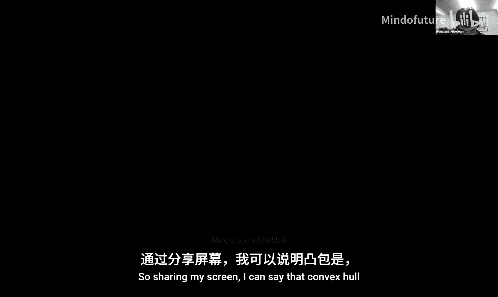
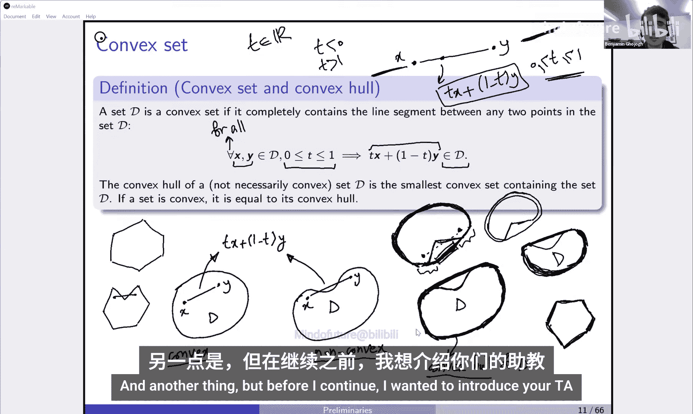
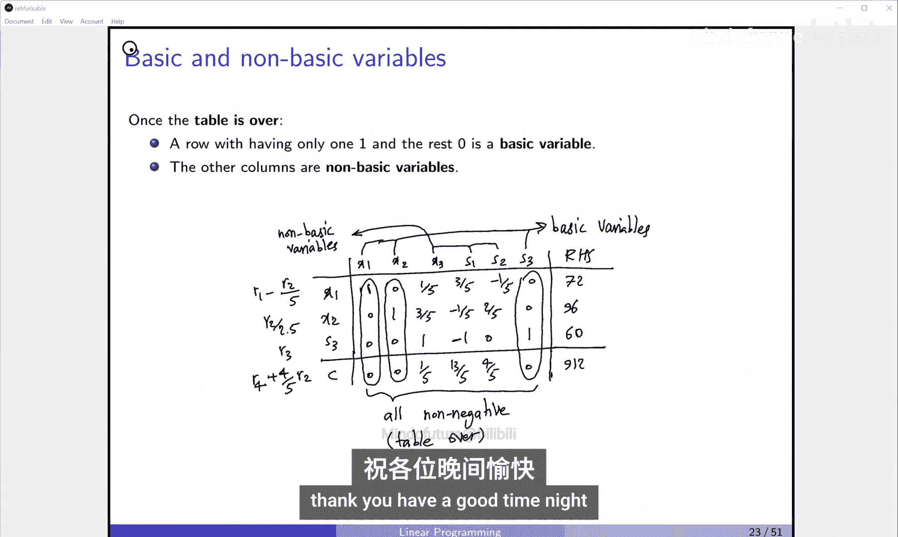
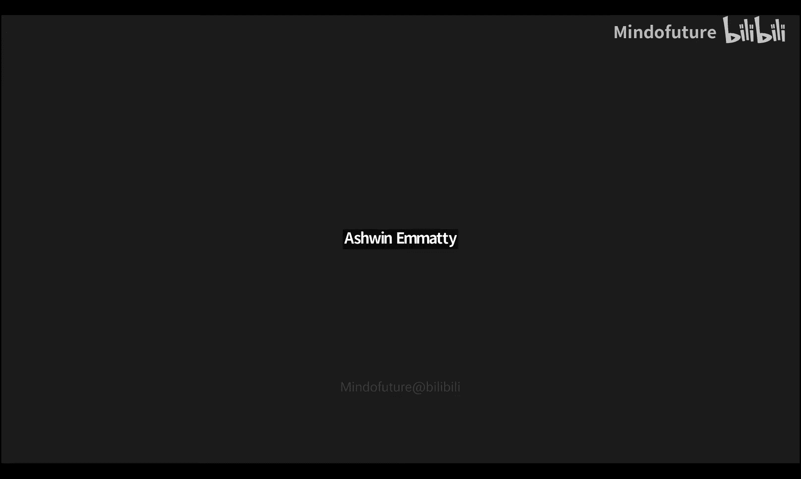

# 【滑铁卢大学】优化技术课程 ｜ Optimization Techniques   W2023 p02 P02_第二讲_(预备知识) -BV1oJCHBcEo5_p2-

Okay。Hi， everyone。 I there any question from the previous session。That you would like。

To ask or discuss before we continue。不。Anyone has anything to say？No。By the way。

 I remind you that asking questions participation in the class and also discussions definitely will have bonus points。

 so I encourage you to please。Participate in the class and ask your questions， answer。

 discuss and anything。Okay， let me so if again， if you have any question， please let me know。

Before I start the。Session。Let me share my screen。No， before I share a screen。

 I should let you know about the assignments and your TA， so your TA is Shafahead Ali。And his email。

Addres， I will put。His information in the chat。So。Oh， someone has asked a question so let me answer。

A question。 And then I will let you know about the T A。 So someone has asked。

 please explain convictx hall once。Sure。So。诶。Sharing my。Screen， I can say that convict hall。

Yes。So what convex Hall is is that soon you we have some。So we have some。Set。

 which might not be necessarily a convex set right So what was the convex set we define that for per for every two point in the set when you draw a line between those two points and this by the way。

 the set it does not necessarily need to be in a two dimensional set it can be multidimenal set。

 So in this slide we have drawn two dimensional set， it can be。Three dimensional sets such as it。

Ball so assume we have a multidimensional set for every two points set you choose in the set when you write draw a line between these two points。

 all the line all the points on the line should lie or should be in the set， then that set。

As a convict。In simple words， a convex set is a bumpy set。 so it doesn't have any。

It doesn't have some deviation such as this。And if we have that。

 we can find two points when we connect them。A part of this line is not within this set。

 So this is not a convex set。 And what is convex how when you don't when when you have a set。

 which is not necessarily a convex set， then you can draw。

The smallest convex set containing that set， then this set will be a convex haul for this set In other words you are trying to convexify the set Of course so if I ask you a question assume you have set a set which is convex you have a convex set。

Can someone tell me what is the convex hall of that set， So you have a set which is already convex。

 What is the convex hall of that set。Anyone。Would that just be the set？Yes， exactly。Correct。

 so thank you。 So it means that when you have a set which is already convex such as this。

This is a convex set right。The smallest set， which contains that set。

And ease convetx is the set itself。So the convicts Hall of the。Convex set is set itself。

 but if the set is not convex， then the convex hollow of that set。Will contain that set。

 but it will be a bit bigger than that， and it will be convicts。 So is， is it clear now， Pensri。

Ben can I explain it again， please。Yeah， yeah。 So using a figure。

 I think it will be easier to understand soon assume you have these。

Do you agree that this is not convicts？嗯。Right， because when you choose these two points and you connect them。

 then it will be con。No， no， if no I'm saying that this is a test for saying that why it's not convict if。

Choose these two points。 You connect them。 You see that this line is not completely in this set。

 Therefore， it's not a convex set， right， Okay Now I assume I put a。

I think the easiest thing to understand is that you put。A rubberbber。

 You know what I mean by rubberer， a rubber。Aro it。Or you put a balloon， a balloon skin around it。

 Okay， and the balloon should be the smallest balloon， the balloon will stick to this part。

 the balloon will stick this to this part。But the balloon will be like this right it won't go inside the balloon。

 the smallest balloon containing this set is the convexhu of this set。

 now as you can see this balloon or this convex hu is convex because you can't find any two points within this set which are not who the where the line between those fall。

Out of the of the convict salt， you get it now。 Yeah。

 so convex solve is something which contains the convex that， right。Which contains the set。

 the set might might be convex or might not might not be and if this。Im sorryrry。

 so can we say like the hall is just like the the perimeter on the boundary？Yeah。

 like like the line segment， but it's like the longest line segment that's not the longest watch。

 sorry what sorry this is like the longest line segment that's not contained inside。

It will contain the set definitely， so the set is a subset of the convicts。How love to sit。

You agree with me。 So this see， this is。This said。Is within this set， right？哦，OO。

That's why I'm saying that the set is a stop。So the comments call like the small this one so it's like to。

Sos not like the rubberper have to be like a straight line or does it have to be？

Does it have to be what I couldn't hear you completely like a straight line No， no。

 it's not necessarily a straight line， but。First off， when you say line。

 you are thinking only in 2D because if it is if it is a 3D， then that part is not a line。

 it will be a hyperplane。 it will be plane。 if it is in 4D。

 it will be hyperplane right So this is one thing that you should note and in this particular case yes when when we have a nonconvex part of this set。

 I think yes， maybe you can look at this part locally and it will be some something like a line or hyperplane but in these parts。

 then it won't be a line anymore because it will have some deviation get you get my point Yeah rubber like the largest non。

Not large， as a smallest， smallest， the smallest convicx set containing that， yeah。Yes。Okay。

 everything clear now。Yeah。Okay， great。And。And why is it important。

 Because sometimes we have a set which is not convex and we want to convexify it。

 So that's one thing。 And another thing。 But before I continue， I wanted to introduce the。

Your TA。 so your TA is Mr。 Shafahead， Ali。诶。I write it。诶。In the chat and his email。

 I also mentioned write it in the chat。For you to know， I will mention that in the course link too。

And by the way， before we go to the course， did everyone get added to the Team group that we have？

I got I got an invitation。

Yeah， yeah。 So we were。So yes， and could， could everyone please check whether you you see a channel named question answering within that group。

And and if anyone is not in the added to the Team group of the course， please let me know。

 you can also send me an email and I will add you。So please let me know。 I need to。Noow that。

And if at least one of you， please kindly check whether you see。You see， the， there is。诶诶。

But theres a channel named question answering answering so you can see that Okay， that's great so。

And yet。Yes， okay。 Milla， you said you haven't been added。

 Could you please send me an email because I might lose the chat here after the class。 Therefore。

 I appreciate it。 if you please send me an email。 Any， anybody whos like Milla is not added to the。

Yeah groupup， a teams group， please kindly send me an email， and I will definitely add you。Okay。

 so and please anyone if you have any question off off class question or discussion feel free to write in the question answering channel and I will answer I or TA will answer also please answer each other so you can answer each other and it will be very I will be very happy if you answer each other and participate in the discussions Thank you very much so。

😊，One thing that I诶。Okay， now let's go maybe to the course， so share screen。

Something that I wanted to say before continuing the last session。

 there was something a formula which I mentioned with hesitation now I want to say it more precisely do you remember interiorer I said look at the figure but then after class I thought more about the formula now I can say it with clearer clearer explanation。

 So what this means is this there exists some at least an epsilon which is greater than zero。

 which means that we have a positive epsilon which usually we show small numbers by epsilon。

Where and what is this， this is the set of the neighborhood of X。

 so for a point see a point x in the domain in the set D in the sets D。The interior。

This point is the interior point of this set。😡，If the neighborhood， this is the neighborhood。

 the neighborhood of I。It lies within the setD is a subject of D。How and why is it neighborhood。

 first off， why is it neighborhood， it means that the set of points y。Where dismiss which or where。

The distance， this is the Euclidean distance， this is L2 norm。Of y-6， these are two vectors。

 and this exactly means。诶。Smation of elements， if， for example， it's D dimensional。

 if it's D dimensional。This means some mention of elements。Why I。Minus X I。呃。It has a square root。

So this is Euclidean distance， right？It means that the Euclidean distance of y minus x or of y and x is less than or equal to epsilon means that。

This is X。This is a neighborhood around it with radius epsilon and this is this set and is all of the points this set。

Is all of the points of y which are within this neighborhood right。

 and this means that this set neighborhood is within the set D and this is D， the soon D。

So this point is neighbor is interior point of D because its neighborhood is within D。

And now let's look at the edge cases where D is on the boundary。Of the。😔，Is it an interior point。

 No why because it's neighborhood。Some of its neighborhood， I mean， this part， is not in sight the。

Therefore， the boundary is not in the interior。 Also if the point is outside the like this。

Its neighborhood。Is is not inside the all of its， if all of its neighborhood for a small。

 sufficiently small epsilon。I if it is in D， then that point will be an interior point and this is a definition of for interior point and if we have a collection or a set of all of the interior points。

 then we'll have the interior set and this is the interior set。

So all of the interior points of a set D is the interior set of the D。So is it clear now？

This is slide。Yeah Ben， one question， yes， the what's the two around the Euclidean distance y minus x the two？

Which。These two， yeah。This is L2 norm I will introduce the norms in this session so if we have if we have for example this this is Lp norm p can be one2 can be numbers I will introduce it in this session so we'll see that when it is when it is two so when we have x minus y or y minus62。

This is。Equivalent to Euclidean distance and Euclidean distance means exactly the length of the line connecting these two vectors。

 So if you have， this is a vector， This is， this is a point， right， This is a point in the space。

 This is another point in the space。 If you connect a line between these two points and you measure the length of this line。

 This will be the Euclidean distance between x and y。

And the al norm of x minus y is equivalent to the E clideion distance of points x and y Okay。

 so and I will introduce the norms very soon。Thank you。

And other sorry is P related to the dimensionality of a set then？No no。

 so don't confuse several things set。Is a set of points within the space， right？And x is a point。

 and every point is a vector。 Do you agree with me with on that or not？ So when we have a。

 when we have a D dimensional space。 So as soon we have x1。X 2， until X D。Right。

 means we have D dimensions， okay？Every point every point in this space， let's call it x。

 I mean bald x， bal x， which is a vector。Right。Every point in this space is a vector y because you can connect the origin。

To this vector， therefore， every point in this space is a vector。 And what was your question again。

 So we have， we can have a set of points。 We can have a set of。 So don't confuse these concepts。

 And you said your question was about P， right。P no is in a definition of the norm。

 which I will introduce it's not necessarily related no it's not related to the dimensionality of data and the dimensionality of data is a number of these axes in this space so when you have two dimensional data it means that it's a plane。

It's like your monitor and if it is one dimensional， it's a line， if it's two dimensional。

 the space is the plane， if it's three dimensional the space you can consider it as a cube which goes to infinity。

And you can have four dimensional or D dimensional。Do you get it。Yep。

 yeah makes sense to me yeah yeah， yeah， MP is not related to diamond， we'll go over。Okay， again。

 if anyone has any question， please let me know。There was one more thing in the last session。

First here。If you remember。I said the inner product is the inner product is the projection。

 the length of projection。 but you should note that when we have someone， someone is not mute。快。

Hello。Yeah。Okay， so I said when we have an inner product is related to。

 it's the length of the inner the projection， but that's true when the vectors are normalized to have length1 when it in general case。

 it's this。 So when we project vector y on vector x will have vector Z， right。

 this is projection because it's perpendicular。 And this Z can be represented as y transpose x over x transpose x times x。

So the length of this set。The length of this projection is y transpose x over x transpose x if and what is this。

This。You can write x transpose x as second normal of。X squared， we will talk about this。

 and this is the normalized。It means that its length is one。 If that's the case， then as you see。

 the length of the projection would be y transpo x。

 So you should note that this this explanation is just for the relation of projection and inner product。

Again， you can project x onto y。 If you do that， then this vector K。We will be more than y。

 and it will be K x transpose y over y transpose y times y， and this is the length of K。

 Did someone ask in question no。Okay。And。So this is one thing that I wanted to correct。

 and another thing is that you should note that x transs y is always equivalent to y transsse x so the order doesn't matter。

 So it means that big y because it's this proof is very simple。 x transfers y is x1 y1。

Plus x2 y2 until x D y d， right？And y transpo6 y1 x1 plus y plus y d X d and the order this doesn't matter in multiplication。

 therefore these are equivalent。So the order doesn't matter in inner product so far everything clear。

嗯。Yeah， okay。What is norm？We w to define more。A function。We usually show norm by this。

 so we have two lines here， something in middle。And two lines there afterwards。

It goes from RD D dimensionional Euclideine space， so its domain is the dimensionional Euclide in space。

And its output is always a scalar， it's a scalar， so it gets a vector and it outputs a scalar。

 we have some norms which get matrix， so it gets either a matrix or a vector and its output is always a scalar。

😊，And the norm of x is shown by this， it's a norm， it should satisfy four conditions first off。

 the norm of x is larger than or equal to0 for all x so it's not negative the output of norm can't be negative that's one important thing。

Also。When you multiply。The argument of this norm by some scalar a。

You can bring the skillar out of the norm， but you need to have an absolute value， why。

 because this norm is always non negative。You can't have this if a is negative。

 you should take an absolute value。AndAnother thing is that。If x input of the norm is zero vector。

the norm will be zero。And vice versa， if the norm is0， its input must be0。😡。

Because it's if and only leave， it means if x is0， the norm of x is 0， if norm of x is0， then x is0。

 so both it's two sided。And， and。Triangle inequality means that norm of x plus y these are two vectors。

 the norm of x plus y。Is always less than the normal x first normal y。😊。

And this is very important thing。😊，So what， for example， something like this。

 it's similar to this case， you want to go from here to here。😊。

does do we call it triangle inequality because of this？You want to go from A to B。

 but there is a point C2。Assume you you put a donkey here。And that there is some food here。

The donkey can go either in this way。Or in this way， toward the food， towards the food。

Then what the path would the donkey choose， can someone answer me？Hopefully just A to B。A to B。 Yeah。

 why， Because the donkey will think about the pass， the length of the pass and will say that， okay。

 of course， A to B is shorter than going from A to C and then C to B。

 That's why it's called triangle inequality because this length。😊。

Is shorter than the summation of this length and this length。

And that's why in either Persian or in Arabic， this triangle inequality is called Aziyatoheard。

 which means the principle of donkey because the donkey also chooses this path。😊。

And that's an interesting thing， Okay， hopefully with this example。

 you completely understand what triangle inequality means。😊，Okay， now let's go to the next slide。

So what is Elpor， so when we have a vector x？Which is d dimensionional from x1 to xt。

 and this transpose means that it's a column vector。The LP norm， LP norm。

Its defined as this when I say this， by the way， it means the definition。Okay。

So the normal the normal。The LP normal of x is this it means that。

Absolute value of x1 to the power of p plus plus until absolute value of x d to the power of p。

 then you take the whole thing， which is the summation of this and you have the power of1 over P。

 So this is exactly this。 This is equivalent to this。You know， yes。

 it is another way to represent this expression， right， so you have roots， the P root of this。

So this， I think answers your question， who asks the question of what LPN norm is， this is LPN。Right。

😊，And peas。Ha condition is always greater than origin equal to one。And it is usually。

 usually an integer for us， but it can floats to， it can be a float number or real number I。

And this is absolute value。Okay， so we have two well known LP norms， which are L1 norm。

 these are the most famous norms。And L tuor。And the alton norm is also called Euclidean norm。

So when we set P1 to1， we will have L1 norm L1 norm。And this is L2 norm for L1 norm。

 so we don't have this root anymore because root the first root is itself。

 so the root goes away and well have a summation of absolute values and these are powers of one。

So we'll have the sum of absolute values。This is Elmanon。So as you see。

 there is a very similar relational。😊，L1 norm and the absolute value， if these1。

If we are indeed one dimensional space， the absolute value。Function is exactly L10。Right。

In if D is one。Al2 norm。Is this and we'll have the second root of x1 d2 to the2 plus until x d to the2 and you have a square root of X2。

 Now I think this is Al2or and what does this mean this means that in the D dimensional space。X1， x2。

 until x D。If we have a point x。And so this will represent a vector connecting origin。

 this is origin to the vector， the length of this vector will be the L2 norm of x。对。

UI think it's obvious， right， because this is exactly the length of the vector x。

 the definition length of the vector， and you can also see this in this way。😊，So this or this。

 you can see this in this way is。the Ln normal of x minus 0。

And now this reminds you of what I said minutes ago。 Do you remember， I said x。Minus y。

Is the Euclidean distance？Euclidean distance。Between x and y， vectors x and y。

And if you set this y to0， you will have this， so it means that the distance of vector x and origin。

 so it is equivalent to the length of the vector x itself。Yeah。是。Everything is clear so far。

Did you completely understand L1 norm and L2 norm？Can someone give me a feedback。Yes。😊，Yes， yeah。

 yeah。 Okay， great。 So Al， you can use L2 norm in order to measure Euclidean distances。

 And why do we call it Euclidean distance， Because Euclidean in Greek in Greece was the first person who thought that。

 okay， if we have two points。😊，On the ground。And we want to see the length of the shortest path between these two points is if we draw a line between these two points and we measure the length。

So measuring the length of the vector connecting these two points together is the shortest path between these two points。

 This is what Euclidean setting ancient Greek Greece。 sorry。

 So this is what we have for Euclidean distance。 That's why it's also called Euclidean norm。

 And as you see L1 norm has。These absolute values at here in the one dimensional， for example。

 you see that absolute value here is not a smooth throw。 It not， It doesn't have derivative here。

 Therefore， L1 norm is not a smooth。 What L2 norm is a smooth。Is a smooth。

 this is one important difference between L1 norm and L1 and 2 norm， so this is not a smooth。Yeah。

Okay。Okay， what is L infinitefin norm， infinite infinitefin norm。

 or it's also called maximum norm or chby shift norm？😊，And that's definition of this。

 So you sum the absolute values of elements or components of the x and you take sorry。

 I think you't you shouldn't take max。 So you you consider the absolute values of these and you take the maximum。

 So the maximum element regardless of the。Sign， I will correct that in this slide。

This is a chbishift not。Or infiniteous in one。Some important norms for matrices。

 so in previous slides we softwarefur vectors。Now we see here for matrices。え？

Consider a matrix x in this space and in previous session I said this means a matrix with D1 rows and D2 columns。

Does anyone know why we can show this matrix with this？notation。In mathematics。

 I want you to understand why we are writing this way。

 because when you understand you see it's so beautiful。

 Can anyone explain to me why we can write it in this way。Any ideas。

 because it's always a combination of real numbers。It' it's kind of what you said is kind of correct。

 but let me reststate it so you can consider these from this side so these d1 rows as one of one D dimension D1 dimensional Euclidein a space。

 you can consider these from this side， so if you look at it from this side d dimensional D1 dimensional Eucliide in a space R d1 if you look at it from this side you will see Euclide in a space with D2 dimensions right。

D2 dimensions from this side， it was D1 dimensions。Now so you have two Euclidean spaces。

 one of them is d1， one of them is D2， now you have an outer product。

 this is outer product don't worry about outer product。

 but I can say that it combines these two spaces into a new space。

Wwhichch is R D1 D2 It means that it's a matrix with D1 rows and D2 columns you can have tensorors。

 you can go so as you see matrix， you can show it in two dimensions， rows and columns。

 you can have rows， columns and heights or something like that you can go you can go to three in other words。

 you can have a three tensor。You can have this， so we have D1 rows， D2 columns and D3。

 So you will have a cube rather than。😊，Something like this。

 you will have a third thing to on top of it。So that's the reason why we can represent it in this way and this。

 but simply you don't need to get confused， it means that a matrix with D1 rows and D2 columns form so what is Frrobinius norm。

😊，You will hear these a lot in different works， either in papers or in industry。

 so for Frrobinius norm。Is similar to Lton norm。For vector。

 do you remember what was L toome for vector？It was second root of x1 squared plus plus xd squared。

 right？But in matrix we have both rows and columns， so x Ij means the I throw and J's column of x。

 you square it and you sum over all rows and columns and then you take the second root。

 so this is a frobinino norm as you see it's very similar to the L2ome， but this is for matrices。

Note that， note。We also。Have。L2 norm。For matrices。With another。Definition。This is out of the scope。

Of dis course。Why do I say this， don't This is not L2 norm。Of matrix。X。It's not Al。

 This is Frobinius。 So don't confuse that。 I just wanted to。Mention this。So far clear。Please。

 if anything is not clear， let me know。So is for business room just al to on？No no。Probinious dorm。

Is similar for ven norm for matrix x is similar to the format of the L2ome for vector x。C。

Robinous storm of this。Similar。To L2 norm for vectors， right？

Do you see the similarity between these two so this equation L2 norm。

 this is L2 nor look at the L2 nor you have one only。The dimension is one to d， right。Yeah。

 you only have， but in matrix， you have dimensions one to D1。

 also dimensions one to D2 because you have both rows and columns。Acept this difference。

 everything is similar between Frrobini Storm and Aloonno。I go back and forth so you can look at it。

 Do you see that。That's what I said so forrobinia stone for matrix is similar to the Lton norm4 vector x。

 but we have some alton norm for matrix which I'm not introducing is out of the scope of this course。

 don't confuse okay so far clear。嗯。What I mean by this。it about INJ。I N J here。

 So what I meant is this and I NJ， I NJ， mean， I is on roseose。J is on columns。

This is animation and rows and some so let me， I think in order for you to understand。

 let me explain with an example。So。Zm x is 1，2，3，4， okay。Maybe， let， let me make it。5，6， okay。

Do you agree this this belongs to R 2 by 3， it has two rows， three columns， right， is that correct？

Yes。Okay。Now， what is the Frrobinian storm of eggs？Second route。of。1 is squared， plus 2 is squared。

 plus。5 is squared plus 3 is squared。 plus 4 is squared， plus 6 is squared。This is Proister。

 so I elements wise I squared them。Then I sum them， then I take the second root。Clear。O。

And if assume you have a vector now。1，3， only。This is a two dimensional vector。

Do you also understand this notation， This means a vector with with two rows on the， right。

Do you also understand this notation， Yes， Okay， and what is the L2 norm of this， please you tell me。

I want to write。One is curve plus three curve。Exactly。Exact， what is the L1 norm of this。嗯。Yeah。

Can you say that。Can you say that。嗯。Do you remember， So this is the equation。

 Please look at it and let me know the answer。 So this is L1 L1 norm。Please look at the L1 norm。

 the summation of what absolute values of elements， right？Is that right， Yes， Okay， so now what is？

The L norm of this vector。1 plus three exactly so assume soon three was minus here。

 also here my was minus。Do you agree with me that all of these Frrobinus norm L2 norm L1 norm were the same？

Because recall that in all of them， for every element。

You take the absolute value C here I can show you an L1 norm for element for each element。

 you take absolute value for L2 norm， you order square it。

 so a square also takes absolute value doesn't matter minus3 squared is equivalent to3 squared。

 right。Yes， you can also look at the definition of LP norm above here。

You can see that also we have absolute value of elements。

You might be wondering why I haven't put absolute value in sorry。Excuse me a second。You might be one。

My tablet had some problems， just keep me sick。嗯。Yeah。I can fix it。 Just keep me sick。😔，Okay。

 I'll fix that so you might be wondering why I haven't put absolute value for here because。😊，X1。

Absolute value square is equivalent to x1 a square。

 You don't need to take absolute value for a square， right。

 when when the power is even an even number。 So this is another thing。

That is is it clear now what L1 norm L2 norm mean？And Frobinnin。Is it clear to everyone？Right。😊，Yeah。

 yes， okay， okay， great。Now we know norms which are very important very important sorry， okay。

 is there a geometric interpretation for a matrix norm？Or a matrix form。Yes， I think it is。

That let me think about it a bit。So。Soon in the we assume we are in。In the space of。

Ass soon we are in the space of this。R d1。Uer product D2。

 And this is a space which I can't visualize。 I can't imagine。

 So the space of which is the out product of two Euclidean spaces， one of which is D1 dimensional。

 The other one is D2 dimensional。 So we have。A space。

 a eucliidean a space by the outer product of these two spaces。And then， in this new。

Space Euclidean a space， I have a point and this every point is a matrix is a matrix。

 so if I change the elements of this matrix， I will have different points in this Eucliidean a space。

And the length of。Vectctor connecting origin of this space to that to every point is the Frrobinus norm of that the point。

 Do you get my point now， Do you understand what tension。Is that clear？Yeah。

 so this is the interpretation as you see forbin is norm L to normal these norms。😊。

And in other words， these norms are so take a look at LP norm。

 also similarly for matrices and all of these。When we say LP norm， it's a kind of distance metric。

 why Because this definition of distance also includes these， these things。

 So you can see a close connection between。Distance metric。And norm。

You can see that this is the definition of norm， you can look at the definition of distance metric and we will see that also has these conditions。

 and so there is a connection。😊，That's why when we say the norm of a vector。

 we are kind of referring to its length or its distance from origin。And the。When we say the normal。

X minus y， the normal difference of two vectors， we are saying that this is the distance of x from y。

And you might if it is L2 norm， this is what we learned in high school。

 this is the length of the vector， the shortest path connecting these two points or the points to origin。

 but when we have LP norm we will have the other distance matrix， so in other words。😡，D。

 let me show it here。 So you have two points。This is。Length of this is a distance metric。

Length of this might be also no， not this but。If if the space is curved， something like that。

 then the length of these these two these might be a distance。

 so you have different definitions of distance， it's not just the high school definition of distance Lp norm by changing P you will have different types of distance between the points and if you have only x it means that the distance of x from origin or the length of x if you have normal of x minus y。

 it means that distance between x and y。Do you get my point， everything clear。Yeah， yeah， okay。

 and did that answer that question， okay？Yeah。Okay。And。

These are two important equations that you should know that L2 norm。

A squared al norm of x is equivalent to this x transpos x well I can show you the proof。

As soon x1 is 1 minus-3， okay。What is。😊，L2 norm。It's one squared plus three squared。

What is it when we square it。It is1 square please three squared。Now， what is x transpose6。

This is 1-3。And this is one minus3。This is x transpose and this is x。 So now you you product。

 you multiply these two vectors or matrices， one is squared plus3 is squared。 As you see。

 these are these two are equivalent。 you can write it in if for general case。

 when we have D dimensions， right。We can write it for D dimensions。So as you see。

These two are equivalent to this summational x1 squared plus x2 square and all of。

And when you have Frrobinia norm。You can write it in this way。So trace of。

 I define trace in the last session。Trace。You can see it as the summation of diagonal elements of x transpose。

 so here this is the summation of diagonal elements of x transpose x。Again， here。

when you have a Frrobinia storm squared。 So do you remember the Frrobinia storm， you just need to。

Square it。So you'll get rid of this second route。This second。Okay。So these two equations。

You can use these interchangeably and as you see， these two are both quadratic。

When you say quadratic， it means squared so you see these as squared。They are a square。

We can also see these squirts here。And these are convex and quadratic and their shape is like this assume in two dimensions if。

 for example， you have these two。These two。You can say x1， x2 are the inputs。

 and the function assume the function is this x1 is squared plus x2 is squared。

 This is exactly the function is。😊，This is the function， this。

Which is x1 a squared plus x2 a squared。And you can see it's like a bowl coming up。

You can look at it from above。And you will see this。And these lines means that on each line。

 the function value is the same the bowl is coming up， the bowl is coming up。Right？Okay。

 so you can see this isd these are quadratic forms。If anything is unclear， please let me know。

And what is units bought？First off， you should note that there is a difference between boldd and a sphere in mathematics when you say sphere。

You are referring to its surface。When you say ball。

 you are also considering you are considering both surface and inside the surface。

 so ball is like the whole thing， including inside of it its interior。

 but the surface is only is its boundary。This is an important difference between ball and surface。

 especially in mathematics。In topology and all of those areas。 So and what is ball ball means。

All of the points indeed dimensional space where their norm is less than or equal to  one。Yes。

For example， assume you have three dimensional space， x1， x2， x3。This is the ball。

We would read this one。Where inside of it is also in it。 So this is a ball。Ball but for different P。

 for different LP norms， this is a ball。In 3D。Or El tuor。For different LP norms or P different Ps。

 we have different shapes of ball and that's an interesting thing。For example， these are all in R2。

But this was in R3。In R2， if it is L1 norm， the shape will be like this。If it is al norm。

 the shape will be like this round。If it is L infinity norm or chbyche norm。😊。

The ball will be like this。And I think it's obvious why this is happening， for example，Oh， you know。

 it was Max。X 1 until。Xp。So for example， when we are here， when we are in this line。Here， x1 is。

It can be one， but we can't have any other elements more than one why because this condition will not satisfy。

 will not be satisfied if here x1 is one and x2 is more than one。

Then the length of the x will not be less than or equal to one， so we'll saturate here。

And if we are here， we' will saturate here。 if we are here。

 we'll saturate in x1 equals minus-1 because x2 can't go further。 Otherwise， this。

 this inequality will not be satisfied。 Also here， you can have the same。Conditions for this。

 for example， when you have L2 norm。This is radius  one， right。

 You can't go more than radius one because this condition will not be satisfied。 We can't go。

You can go inside of it because so this also can say there contains inside of it， it's ball。

 it's not a surface right， it's not a sphere。It's not a circle， it's ball， it contains its side。

 so it contains its side， it contains its side。You have also L1 norm。

 an important thing that you can see in both Cheyshift and L1 norm is that they are not a smooth here。

 here， here， here， they are not a smooth， here， here， here， here， they are not a smooth。

 but L2 norm is very smooth。You can see that here for L toome everywhere you can define derivative。😊。

It's completely smooth。 There is no corner。But here you have corners， L1 norm， L chbych norm。

 these have corners， they are not a smooth， therefore working with L1 norm， chbych norm。

 and these norms which are not smooth is harder than working with smooth norms like L2 norm Frbinist norm is also a smooth norm。

 similar as behavior is similar to the L2 norm。So this is another thing that you should note。

Clear everything。Okay。We have a concept for dualal norm。😊，And do all know。

Its it's a mathematical definition again， this means they' define。😊。

We usually do not do all known with a star here。So this is a dual normal fix。And this supre。

 do remember， we define sume。 You can see it as a maximum。

 but maximum is a special case of supreme because supre also considers the case where the function。😊。

Goes to a point what never reaches that， right？And so this is consider a sets。Its trans is y。

X is the argument of the dual norm and y has a condition on it where the norm of y is less than or equal to 1。

So this is norm。This is the duall。Or that the that's norm。As you see， the definition of dual norm。

 of course， contains the norm itself because this is a dual norm for this norm。

This is the mathematical expression we will see some examples for du norm in the next things。

 by the way， you should also note that。😊，When we say this in the literature。

 it may have two meanings， its either dual norm。Or itss nuclear norm。

Nuclear norm is related to singular values and all of this I haven't defined that in this course is out of the scope of discourse。

 if you are interested you can search it later or ask me off class。

But I'm saying why do I say that because so you don't confuse this， sometimes it might be dual norms。

 sometimes it might be nuclear norm， we haven't introduced nuclear norm here in this course。Okay。

Again， I will show you some examples of Duol norm， but please be patient a bit for that。

So we have holders inequality。And what is it， it means this。This is holders inality it means that。

The absolute value of x transpose y， do you remember， this is definitely a scalar。😊。

Because the if you remember when I was introducing the inner product。

 I said the inner product output is always a scalar。

 The absolute value of x transpose y is less than or equal to。Nor LP norm of x times Lq norm of x。

Where the P and Q satisfy this equation， So1 over P plus 1 over Q is always one。

We'll see some examples， for example。If you set P to1。Q will be one。You know。

 Q will be infinite in this equation。 If you set y， because one over one will be 1。

1 over infinite will be 0，1 plus 0 will be 1。 If you set p to 2。

Q will be 2 because1 over2 plus1 over2 will be 1。Right？If you set P to infinite。

Q will be 1 because one over infinite is 0 plus 1 over 1 is 1 is1。Right？

And PQ is more greater than or equal to one。 This is the holderss inequality。

 A special case I think many of you have heard in other courses。

 maybe is the Kaus Schchwartzs inequality。 This is the most famous inequality in mathematics。😊。

It shows shows off in many， many areas of mathematics and it says that when you set P and Q to 2。

 you will have cushy shorts。😊，Inequality。Okay， so。And it's interpretation。

 geometrical interpretation is that when you take the。In a product of x and y。

 which is related to projection of x onto y， do you remember I said this。

 the length of projection of x and y if we normalize the two vectors。

This is the length of the projection。😮，And why do we take the absolute value because the inner product output might be negative？

So we take absolute value and then say that this is the length of x length of x。

 this is the length of y this this must be why sorry， I will correct that in the slide。

And previous in several minutes ago I mentioned why this is the length of V right we showed that so length of V times length of y is greater than arickfall to the length of their projection onto each other。

And simply， if you put this in this equation， you will have this， you can say when you have LP norm。

When you have Elpor。诶。It's dual， so just give me a second。Yeah， I think exactly P and Q here。

 I should tell you that LP and LQ are do all normal of each other， do all of each other。Yeah。Here。

Do you remember I defined a dual norm？And LP and LQ norm if they satisfy this equation2。

This then they will be dual all of each other。 Therefore。

 you can see that the dual all of LP norm is always P over P minus1 y。Proof is so simple。

1 over P is 1 minus1 over Q。Q Q minus-1。And。If you simplify this equation， you will get to this。

So from this， you can simplify and you will see that Q equals p over p minus1。Yeah。

From this equation， equation2， we can see that the dual norm of L2 norm is L2。

 the dual norm of L1 norm is L infinity， the dual norm of L infinity is L1 norm。

I'll show you the examples here。I said I will show you some examples。This is L1 norm。The do of it。

Would be like this。hi will be this is。Infinity norm， this is Elvoor。

 The dual norm of this will be on it itself again。L2 norm， the dual norm of this。Will be this。

This is Al1 norm， this is infinity norm。You can see that。Also visually。

 you can see that dual all of L infinite norm is L1 norm， do all of L2 norm is itself。Now， cone。

 let's define cone。A set K。Is a cone if it contains origin。It must contain the origin。

 This is important。If it's a convex set。And if。For any lambda which is greater than or equal to0 a scalar lambda。

If a point for each point in the cone， lambda x is also。Within the comb。 And what does this mean。

Soon， this is a combe。 This is an example， combe。This is an example con。Cone is exactly similar。

 it shape is to the cone of the ice cream， right？But it has it might have different angles。

 so this is angle angle alpha， it might have different angles。

 so it definitely contains the origin here。If there is a point， x here。

The line connecting origin to this， if you multiply it to anything by lambda。

 the points lambda also will be inside the comb。As you see。

 obviously visually you can see that when the point is inside the cone。

When you connect the line from origin to that， and you multiply it by lambmbda。

You will see that it still remains in the cone in other words。

 it means that this condition3 means that it goes to infinity somehow。And it is also convet。

 you can't find any two points in this set where the line connecting them doesn't lie within that set。

Everything clear so far。What is convicx set？Convex set we defined that in previous session so when we have。

It sit。Yeah if we have two points， the line connecting them should completely be inside the set。

 otherwise it won't be convexed， do you remember this？This is slide。Let me bring it。Here。In。

 in this slide。Do you remember。Slide 11， we said that the convex set is kind of a set which is bumpy。

 you can't find any two points where you connect the two lines to each other all the line should always be inside the set like for example。

 this is a non convex set。This is a convex set， right。

 because you can find two points here where the line connecting them。

 some of it is outside of the set。Clear。Yes， okay， and and why， why is the cone convicts？

Let me bring it。Why is a cone convict？This is a cone， right content？What。So what。

It's like why it's like a bunch of circles。This it's a it's not a bunch of circles no this is a cone you can see this is so in 2D this is a cone in 3D。

 for example， how can I show the 3D cone。Well， it like it's complex because any。

 any point connected to the origin will never go outside the set。Yeah， yet。

 but the I don't understand why you bring origin here because any two points like x and y here。

InWithin inside this set。The line connecting them is inside the cone。Is it obvious。

When we are saying that the set is convex， it means for any two points。

 the point might be origin because origin is also in。Or any two points， not necessarily the origin。

So， and in 3D， this is a 3D con， right？And the dual cone is this。If we have。This is a combe。

The dual con I show it so。Perpendicular to this one， or also draw。This。Perpendicular to this site。

 so to each of the sides， I draw a perpendicular side。So， if this。Was a cone K。This whole thing。

Is the dual of county。Is it obvious？It's exactly this shape here shown here in this。

So this is the cone K。And this。This whole thing， this whole thing is the dulo。Come。

So these are some concepts because as a preliminaries。

 you'll see a lot of these concepts in the literature and you should know what these mean。

And what is this is a side to that two side it。So you can have again， C。

It satisfies all the conditions of cone if its is x。Lambda eggs also。Is inside of it。

 also it's convex and it also has the origin， so it's two sided cone， but if you have one sided cone。

 then it's called proper cone。It should be closed。Should be solid。

 it should be it shouldn't contain any line so it doesn't have any line in it by because line this is not a line line goes from infinity to infinity and passes through origin So this part of the line is not inside the cone therefore in other words this is a one sided cone and this is a proper cone So when you see the term proper cone it means this is a one sided cone。

Okay， generalized inequality， that's an important concept a generalized inequality defined is this so when we say。

This。What does it mean？It means that。If you bring y from this side to this side， so for example。

 in in in algebra， when you say x greater than。Why， what。

 what does it mean x and S y is greater than 0， right in in simple high school when we said that。

Do you remember。Now。😊，We we can say general， we can general we have generalized inequality。

 where we say that it has an index a subscript K， which means the cone K。

You can also have the same thing， bring Y to the other side。

And this will be this exactly here what I draw here。And what does it mean， what does it mean。

 It has an interesting fact， It means that if you have x in the cone here。😊，And also here。

 if you have y in the cone。The vector connecting y to X should be inside the car。

If the vector connecting y is in the side the cone， then this inequality is satisfied。

 then you bring y to the other side， then you will have this。

It means that with respect to the cone K。X is greater than y。Do you see that here。

 X is greater than y。Now。We go to some interesting things and you'll see whatever you knew as inequality in your head is a special case of this generalized inequality。

When we say this。It means by default， we means the cone is the positive or orphaned and what is a non negative orpha。

 it means that for example， if in 2D it's here only when all the axes are non negative。

So this means this indeed dimensional， all the D axes are non negative。And it means that these。

Particularly means that all elements of x all。Then every， every。Element。

Of x is greater than equal to every element of y。Element voice。So for example， an example。Yeah。Ex is。

1，3。Why is。0，1，0，2。X is greater so we draw it with this way。

 it has some deviation in the inequality because these are vectors， these are not numbers anymore。

 these are not scalarrs， if they were scalar we could simply say like this but when they are vectors we have some deviation in the notation。

Like this。This means that every the first element of x is greater than or equal to the first element of y。

 which is0 here， the first element， the second element of vi is greater than or equal to the second element of y element y x is greater than or equal to y This is what it means。

😊，Again， element wise。Right。😊，When we have matrices， the default is for positive semidinites cone。

And simply， it means that。Simply， it means that。When we have this means that x minus y。

Is greater than or equal to 0。 And this means that x this matrix x minus y。

 This is also a matrix is positive semifinite。 If you don't know what positive semideite means。

 don't worry about it。 These are just introduction。 I want you to understand these concepts。

 Otherwise， I won't bring these in the in this in the exam。 So don't worry about it。

 I will just want you to learn and have and have fun understanding what these mean。

 Poitive semidefinite means that the eigenvalues of x minus y here。😊，Are non negative。

They are either0 or positive。 and the eigenvalues。Eigenvalues and eigenvectors you can search it off later of class。

 but you can say see that eigenvalues show the so when you have usually when you have a matrix you can find is important it shows some important directions。

 those important directions usually are called eigenvectors and the length of those important directions are called eigenvalues。

You can read it offline。But if the eigenvalues are all of them are non negative。

 then it's called positive semi definite。And this means that x minus y is all of its eigenvalues are non negative。

 So this is generalized in equality。 Now you can see what we had we had inequ for scalrs。

 we had this right for if x and y were a scalar， But now if they are。Bold。

 if they are vectors or if they are matrices， we also can define inequality between them。

Inequ between vectors inequ between matrices， this slide is showing how this can work。

 how we can have inequality， so for vectors its elementwise comparison for matrices。

 it's related to eigenvalues。😊，Okay。SoPliminers on sets is over now。

Now we go to some important thing about functions。对。So。え。I think it's good to have a。Break here。

 if you agree， And we come back at maybe。8，35。Does everybody agree with that。Yep， sounds good。

Okay great。Okay， sure。 At 8，35， I'll see you。Thank you。

So I just wanted to let you know that you might think that it's getting a bit theoretical these parts。

Are necessary for you to understand what these concepts are for me it's not important whether I don't want it to be theoretical much the reason that I'm explaining this to you to understand the concepts and please note that I won't examine you on the theory these hard theories I want you to to to be introduced to these concepts and your exam will not be very hard I will make sure to make the exam similar to the assignments so also don't need to worry about that please also say this to the other classmates who aren't present right now so they notes that the exam will not be very hard because。

The reason for the course I think is not to suffer students or suffer anyone I don't want to be suffer。

 I don't want to suffer you The only thing that I want is that we learn optimization together and we just have fun understanding the algorithms。

 the concepts and these things So from my side don't worry about the exam and all of these things the exams will be simple and similar to the the assignments So the only thing that why I'm saying this because I want you to completely release the stress anything and don't think of oh oh my God how I can have all of these theory in my mind I don't want you to do that the only reason that I'm saying this theory or you to understand the concepts and see how fun and cool the concepts of optimization are and it will get easier I think these concepts will are a bit theoretical。

Cd and scary， but I think it's it get will get easier。And the more we go， the more。

 the more you will see it's so simple and interesting。 Yeah， yeah。

 and please don't because I used to be students to student too。

 I I know the stress of exams and these things。😊，Please诶。Don't be stressed at all。 at all。

I will not make the exam hard。Please give me a second， please， okay。So now without any stress。

Try to listen， understand， and with peace of mind。And also please be in the discussions。

 challenge me or let let let's understand something if you don't understand part， shout it and say。

 okay， I didn't get it， Can you repeat And so we go over that So don't worry about anything again。

 please say this to your friends too。Who are not in the class right now。

 I want everyone to understand that this course is not for stress。This course。

 and if we even go through the theory， it's not because of you to be examined on those， no。

 it's because of you to understand what these concepts are and why these work。

 so don't worry about that。Again， please say that to your friends who are not present right now too。

Okay， and。No， no problem。 Okay， thanks。 Yeah。 Yeah。 Yeah， please see me as one of you。

 I don't want to be suffered too。 You don't。 I won't suffer you。

 So I am saying that the exam will not be hard。 Don't worry about that。So诶。Let me share screen。对。

Okay。Okay。I think you're seeing that now。诶 let me。😔，Yeah， okay。

So I think now we are going to preminaries on functions。诶 so。What is convictx function？

So don't confuse convex function with convex set， Do remember we explained what convex set is。

 this is convex function。So a function if。So its domain is the domain， what does domain mean。

 domain is where we can have the input of the function， what is the feasibility。

 feasible region for the input of the function F that's called domain domain of X。I deote it by D。

And if we have this。😊，Do you remember this Al x， so assume x and y， x and y are in this domain。Okay。

 for any， this means for all， for all or for any。For any two points。

In this domain so and what is this alpha x plus 1 minus alpha y， this means that zoom this is x。

This is why。That this is the line connecting x to y。So this if alpha is between 0 and 1。

The alpha x plus1 minus alpha y represents this line y， because if you set alpha to 0， this becomes。

Why this if y， because 0 x plus one， Y if you set alpha to 1。This becomes。Ex。So this is for Als1。

 this is for Als 0 and for alpha between0 and1 have will be under line。And this。This is that。

F of this。ForSo if it's this is X， for example。This is why。So for all points here in this region。

 which is alpha x plus 1 minus alpha y， any point here， if we fit it to the function F。

 it will have this f of this。Is less than or equal to all four F of weeks。

 So it use feed x as input to F。You also have feed y to the f so we'll have f of y1 minus alpha times this alpha f x plus。

 so you kind of have this don't confuse left hand side with right hand side you see the difference right and what this means again left hand side means that a point here。

You put it to the function。 you will， for example， at this point， for example， this point。

 you put it to the function， you will get this。 So this is f of alpha x。Plusas 1 minus all4 y。

What is this， This is F of y， right， this is y。😊，What is this， This is X。So this is f of V。Right， so。

If you times multiply this FOV by alpha。Multiply F0 y by1 minus alpha。 you sum these。

 You will have this line。 You will have this line。This is exactly。

Alpha f of x plus 1 minus alpha f of y。 and as you see。😊，F of this， which was this。

 is always below this line， below this line。 So this inequality or this。

 this is the definition of convex function。 In other words。

 always the function is bumpy in a way that in in this way。

For an example which is a counter example for this is this。😊，四。😊，For example， for this two case。

DidFor these two points。第四。X， for example。This is why。

And let this choose alpha in a way that this becomes f of alpha x plus 1 minus I I。 And as you see。

 this doesn't lie below this line。 Therefore， this is not a convex function。In simple words。

 it's always bumping this way。This is a convex function， So it's like a bold。

 you can see the convex function is like a bold。 This is a one dimensional function。

 why because its input is one dimensional its output is also one dimension you might have multidimensional input right。

 then if for example， if you have two dimensional input it will it will be a bold。

 how it will be like this， so two dimensions x1。X2 and the third dimension for f value of f。

Its for example， this function。Like a bold， this is also convicx function。

So you might have multidimensional input。The function is always the function here we are talking about the scalar functions but the function itself might be also multidimensional here we are talking about scalar functions。

 So as you see here this is a convex function and this is obvious is what it means this is a definitional convex function Al is between 0 and1 right because if it alpha is less than0 or greater than one will be the on this sides of the line we want to talk about inside we want to talk about inside inside。

😊，Okay。And if we change this inequality here to greater than or equal equal to。

 it will have a concave function， concave is the opposite of convictx somehow。If， if this is。

How should I try it if this is convicx？Then Kcave is like this。

So you look at it the other way around， so it's bumpy in this way， so this is bumping in this way。

 this an like an opposite bowl。嗯。Right， this is Kcafe。Now。

 convex function has multiple definitions in the literature。😊。

The previous slide was one of the definitions， the， the most famous one。 This is another one。

 Or you can see say the convex function also satisfies these equations that I'm going to tell you。

One of them is this if the function convex function。It's also differentiable。

 so you can take derivative。Okay， it means it doesn't have a non a smooth part。

 It's always a smooth okay， then。The convex function also satisfies this inequality and what this means I have drawn it here for all X and y in the domain。

So any two points， x and y？He， this is FO Y， this is F of Y。😊，This is F weeks。

This line is a tangent line。😡，On this function， this is the function， right， this is the function。

The tangent line on this function。Which is tangent on this F Y， F of Y。

It itss equation is this F of y plus derivative of F of Y transports。

 This is an inner product So inner product between x minus y and derivative。

 Do you remember this was。 So take。These transpose this means the inner product of these two。

 And it's so obvious tangent always is relative related to is related to the derivative。

The derivatives because this is the slope the derivative is the slope of the tangent， right。

 That's why this is the equation of this line and this is F of and。

When you have a line or a hyperplane。You can be on this side of the hyperplane or this line or the other side。

 If， for example， you are on this side of this。Of this line， then F of x is greater than。Or equal to。

This line， if it is less than or equal to， it means that we are on this side。In other words。

 when we have a convex function， this point is always on this site， this site。Of the like。

Not this sight。The Con example。Okay。Contra example。嗯。😊，Take this。Take this why。This as x。

The tangent will be like this。F of x is here。This is F O Y。And this is a tangent line。

Which is whose equation is this He of Vi is on this side。On this side of this line， therefore。

 it's not convexed。 It need all for every 2 point X Y， F O X should be lie on the other side of the。

This line， in other words。This tangent line should always lie behind or below the function。😡。

This tangent， if you move the tangent， so if you move the point y to the left and right。

 you can see the tangent is always below it。C啊。I I'm moving why。And the tangent imagine the tangent。

 so this is a tangent， for example， one of the tangents another tangent。Another tangent。

 another tangent， all of them are below the function。

If at some point the tangent goes above the function， it means that the function is not convex。

 I think it's also it makes sense and again， if we change the inequality。

The convicts becomes concafe。We might have a third case where it is not neither convex nor concave。

 we might have the curve， so don't think that the function is always either convex or concave no。

 we might have a function， for example， this function。😊，Is neither convicts nor concavefe。

It's a non convictx function。 everything clear so far。Yes。😊，嗯。嗯。Can you give me feedback？OK。

No one is saying anything。诶。Yeah， it is clear Okay， great so。😊。

Now and the third definition for the convex function is this when it is。😊，Again。

 differentiable when we can take derivative。When we can take derivative。Then。😊。

This definition is about the second order derivative。

 so the previous one was about the first order derivative。

 The second order derivative is always positive semi definite。😊。

Positive semideinite and what does it mean positiveitive semidefinite means that all its eigenvalues again。

 if you don't know what eigenvalues are， please read it offline or ask me off class because it's a bit out of a scope of discourse。

 but it means that all of its eigenvalues are non negative。For all。6。 And but geometrically。

 what does it mean， It means that always。Its toward， its face is t up。This。

 when the second derivative is greater than a equal equal to zero or this。

 it if do you remember when we set in the highest school？😊，When the second derivative。

Over a function is greater than equal to0， it means that it's like this。

When the second derivative is less than oraculture0， it misleads like this， it's facing down。

facingacing up。So it means that it's always facing up， so a counter example。😊，An example here。

 this function on this part is facing up on this part。Is facing up on these parts， however。

 it's facing down。So it's not a convex function for all es in the domain。It should always face up。

So it's also a convex function again， if we change this to this。

 it means that all of its eigenvalues are non positive， it are either zero or negative。😊。

Then it will be a concave function。Right。Okay， what is a strongly convex function？

A different differentiable function again， if it is differentiable。It's mu strongly convex。

M song for comics。If do you remember if we had this term， it would be convict。

 then it adds something else to the right hand side。With a parameter mu。

 that's why it's called mu strongly convex。Me where me is positive。Okay， if mu is0， then it's convex。

 but if mu is positive。It's strongly convicts。Another definition for this is this。When y transpose。

 these secondary derivative y is greater than earthquake to mu。Squared L to normal y。

But what is important for me for you to understand is that it' geometrical interpretation。

 what does it mean， it means that when we say convicts， we might have somewhere like this， see。

This is a still convictx， a convex function。Where all of this part。Are the same again。

According to all of the definitions that we talked about。For example， this， if you take this line。

 the all of these are under this line。This is a convex function。

 however it's not a strongly convex function。 a strongly convex function is like this。

 It doesn't have any part。Where it's like this。In other words。

 why is it important for us in optimization because in convex function we might have several minimizers。

 so in all of these points here， here， here， their function is always minimum。

However about in a strongly conx function， you only have one minimum。One point only。Is the minimum。

I think is it clear what I mean by strongly convex and convex function。Yes。Okay。

 please ask me if there is any ambiguity。What is lips sheet's smooth or lips sheets continuous。

You'll use hear that a lot in the literature of optimization。 It's nothingcomp， it says that。

Absolute value of f of x minus f of y for all for any two points in the domain。

 x and y in the domain。Or function。F O x minus F of y， absolute value。

 It means that doesn't matter F F F O x minus F of y or F of y minus F of V。

Less than or equal to L L is a parameter of lipss。Okay， it's called Lies constant。Times。

The second normal of x minus y。And what， what？When we say the lipses continues or leap shifts smooth。

 we can also call it Alice smooth。So three names for the same thing。And what does it mean？

It means that。Gmetric clicked means that。Your the slope of function doesn't go high a lot。

 This is what it means actually， for example here。In this left figure。So x minus y。

 if it is a scalar input， so x minus y is this， right？This is a。A distanceance between X and Y。

This is the distance between F of x and F of Y。😊，Okay。As soon， this is the function。Okay。

This is the line connecting this point to this point。 So this is x f of x， this is y f of y。

 the line connecting these two points。And it's take this is， it's a slope。

 It's a slope is less than or equal to L。This function。Is El smooth？Lipius continues with constant L。

But this function。This function。For example， it goes up。Suddenly， and its slope becomes very high。

Then。😊，You can see that the slope is not less than or equal to L。Or otherwise， L becomes very high。

The upper bound on the slope is very high。 Therefore。

 this is not as eipships that continuous or e smooth。Another example might be。

Not necessarily we don't need to have such cases we can have like something like this。Okay。

 this function of the slope goes becomes close to infinite close sorry close to straight line。

 I mean close to this。So the slope is very high。😡，It's not as Lius continuous。 When we say L smooth。

 it means that there is an upper bound， a limit on the slope of the function。 So this。

 I want you to understand what L smooth Lius continuous means。Okay， clear so far。

So so it just means like it's it's one continuous like。Yes， one continuous time， but there is。

There isn't a very huge slope too。Right， if it's a very huge slope， it is a still。 So if， if there。

 it's not continuous like this， then it's not not Lius continuous at all。 If it is like this。

 it's Lius continuous， but with a huge end。嗯。What about like like a horizontal line， would that be。

Horizontal line， you mean like this。Yeah， a function like this， it is as lipus continues。

It is Alice smooth。 The thing is that because the slope of here is 0。 The thing is that why。

 why is it important in optimization， the L smoothness， Do you know what。

 Because it's very hard to optimize such cases。For example。

 what is the maximum of this function that's why they usually make some assumption on L smoothness and they use Lius continuous continuity in a lot of proofs for optimization。

 they usually assume that and they use the parameter L in their proofs。

 why because if it's not L smooth， it's too hard to optimize。😊，Do you get my point。嗯。If it's not。

 it's hard to optimize it。Its hot can you optimize this function。

 What is the maximum of this function。Oh， oh yeah。 there two two different。Yet what？Yeah。

 like there's probably like two different maximum。Yeah， I'm saying that for example。

 when it is horizontal， it's so easy to solve it， solve optimization for it。

 but when it's go the slope goes very high， it becomes very hard to optimize it。

 that's why L smoothness。😊，Is important in optimization， especially it's used a lot in the proofs。

Get。Okay。Okay。Any other question？Yeah I had a question about the health smoothness so you say it's a constant so does that mean that for a given function it'll be L smooth up to a certain L value。

Yeah， yes， a certain L value。 Okay， we don't say up to we say L smooth， for example。

 L smoothness with L equals something。 Okay， okay， so how， yeah。

 how is that parametered determined when you're doing an optimization problem。Yeah。First off。

 as I said， they usually consider it as a parameter and they use it in proof they usually don't determine its number。

 but I think there is a way I'm not aware of I can look it up。

 but I know that there is a way I heard it somewhere， but I didn't dig through that。

But you' will see that， for example， in gradient descent in several next sessions when we introduce gradient descent we will say that L is the parameter L comes to the step size of the function。

If you can calculate L exactly， then you can find the step function step for the gradient descent however if you can't you can approximate that。

 they usually approximateds calculation I think it's very hard I think it requires some hessian and these things so it's very complicated it。

 but I can look it up and we can discuss it next session， I haven't dig through that。😊，Please。

 if you also find the answer， please let me know。IsIs that fine？Yeah。Y， makes sense。O。But again。

 as I said， they usually use it as a parameter， not a number， a parameter in the proofs。Okay。

 preliminaries on optimization。So we talked about sets。 We talked about functions。 now we talk about。

Optimization， minimum maximum D， a point X。Is in the domain is a local minimizer of function F if and only if。

If it means that it's too sided， there is an epsilon。

 non negative epsilon that for every y in the domain。

The L to normal y minus x is less than or equal to epsilon if that's the case。

 what does it mean it means that for the neighborhood of this means that the neighborhood of the point x with radius epsilon。

 the neighborhood of point x， all of the points y which are neighbors of x。

 we have f of x less than or equal to f of y， it means that in a local neighborhood around x。

 the function value at x is always minimum。Les than the function value at its neighborhood。

This is local minimum。Right。😊，And。So what if it is global minimizer， so that was local minimizer。

 if it is global minimizers， it means that for all of the points in the domain。

F of x is less than or equal to f of y。So for all of them。An example is that。

This is local minimizer for a neighborhood around it。😊，See， this， this is minimal。

All of the function values here are above this。This is also a local minimizer。

This is not a local minimizer， this is a local maximum， so this is local maximizer。

Or a neighborhood around it is maxim。This is neither local minimizer nor max local maximizer。

 this is a local maximizer because for its neighbors。

Its function value is greater than or equal to its values。

 also it's less than or equal to its values。 So it's both local minimizer。

And local maximizer because it's equal to its values and its in its neighborhood， right？

But among for example， these two local minimizers， this is also a global minimizer because in the whole domain。

 this is the minimum， so one of the local minimizers is absolutely global minimizer。Right。

 so a local minimizer is a special case of global minimizer you can look at it in that way。😊。

And if we have a convex function， oh we'll talk about it， okay， in convex function。😊。

Any local minimizer is a global minimizer。 We might have several local minimizers like this when we have convex function。

This is a local minimizer。 This is a local minimizer。 This is a local minimizer this。

All of these are local minimizers。But when we have a strongly convex function。

 we only have one local minimizer and in convex function or strongly in convex function。

 all of the local minimizers are global minimizers。In other case， in convex function。

 we always either have this case。Or we have this case。はい。If it's not convicts， then then for example。

And let me draw it in this way。So it's not convicyx。 This is a local minimizer。

 this is a local minimizer， This is a global minimizer as well。

 but this local minimizer is not a global minimizer。

But as this has happened because it's not a convex function， if it was a convex function。

 all of the local minimizers were the global minimizers and why is it important because when we are optimizing a convex function。

 whatever local minimizer that we find we know that it' this global solution we don't need to search further because we know that at least one of the if we find one of the local minimizers that's it we have found the minimum of the function。

 right。😊，Okay， there is a proof for that， but I think because of the time limitation。

 I'm not going to that proof， you can see it in the tutorial as in our tutorial as well as the next page that I have put in the annotated the slides。

😊，But if we have time， I will come back to it and we'll go through it again it's not in the exam for us to understand it's just for us to understand why's why it's working。

 but let's skip the proof right now you can read it and if you have any question please let me know。

Another thing is that。Well the function， if it is convex and differentiable。

 it means that we can take derivative。 The point X star is a minimizer if this， if an only leave。

This happens。 It means that if a point in in the convetx function， if a point is a minimizer。

 is derivative。 the derivative function at that point is 0。Also， this is if an on leave。

 it means that it's too sided， it's if there is a point。😡。

Where the derivative at that of function at that point is 0。

 That point is also a mini is a minimizer。 So both sides hold。So it's。

 I think it's obvious by why it's here。 for example， this is a convex function。 This is a minimizer。

As you see。The derivative of this is0。 the slope of this is0 here。This is a minimizer。

 the slope of tangent。Of function at that point is 0 here。 This is another minimizer。 The slope is 0。

Okay。In other words， when we have a convex function at the minimum the slope of tangent to the function is 0。

right。And not again， it has for side one。It has a proof if it is minimizer， then the derivative is0。

Another the proof these are optional for you to understand for another site。Side 2。

 when the derivative is 0， then exists as minimizer。 It's pro。

 I think we don't have time for now to go through it。 We might come back to it。

 and we will discuss it。Okay。Some important points in optimization。One of them is a stationary point。

 One of them is exreal。Which has maximum minimum in it and saddle points。ok。So consider a function F。

In a general function， not necessarily conts， it might be convex might not be cont。

 A point X star is a stationary， if and only if。Its derivative is 0。So， whenever。At a point。

 the derivative function。Is0， that point is the stationary point。嗯。And what is a saddle point？

When we have a saddle point in a function by passing through that saddle point。

The sign of second derivative flips。 What is the sign of second derivative if the sign of second derivative is positive。

 the function is facing up。 If the sign of second derivative is negative。

 the function is facing down。So， this actually means that。The facing of the function flips。

 for example here。This is this point is the saddle points here the function is looking down。

 facing down here， the function is facing up at this point。The facing side of the function changes。

 This is a saddle point。You know。In other words， in a saddle point we have something like this。

 it be you can also imagine it in multidimensional domain。If。For example， in 2D。

 it will be something like this。In this point， facing up and facing down。And。

What is minimizer maximizer。If it locally or globally minimizes or maximizes a function。

 we already talked about that。😡，Okay， and if it is minimizer or maximizer。

 we can call it extreme point， so extremetum can be either minimizer or maximizer because it's the extreme of the function。

😊，Okay， saddle point， the saddle point。😊，It's not minimizer because the facing of the function changes。

It's also not a maximizer。Although the gradient at the saddle point is0。

 see here the slope of the tangent to the function。Is zero， but it's not a minimizer or maximizer。

Recall that I said this， if and only if two cited is for the convex function， right？

But if it's not a convex function， it won't be if and only if it won't be only one sided。 So。

 for example here。Here it's not a convex function。But the derivative is 0。 So we can here Also。

 these are derivative are 0。 The slope tangent is 0。So we can say in a general case。

 in a general case。I think we have it here in a general case。Ifix。Is a minimizer or maximizer？

The the derivative is 0。But if the other side is not necessarily true， if the derivative is zero。

 it's not necessarily a minimize or maximizer， it might be saddle points。😡，Okay。😊，That's the case。

 It also has a proof。Based on the fundamental theorem of calculus。We will skip that proof for now。

Any comments so far？能。Everything clear。Okay。Arguments of optimization。Do remember， so for example。

 consider this example， I think it clarifies everything。

The minimum of this function can any can someone tell me what is the minimum of this function。

Is like two one。No， two or one， which one。So this is the。So what。嗯。读。This is the minimum exactly。

 So consider then please note that this is the input of the function。

 This is the output of the function。 When we say the minimum of the function， it means。😊。

The value of minimum of the function， the minimum value of function which is2。 right。

 What is the argument。Of the argument of the minimum of the function。Can someone answer。It's one。

Exactly it s。In other words， the minimum of the function is2。But the objective value。

 objective variable， the value of objective variable at the minimum is one。😊，All right。😊，So。Now。

We draw it in this way。We write it in this way。 So minimum。Of F of X。Where the objective is x。

 but R mean。F F of x when so when we put x here， it means that the objective variable。

 which we defined in last session， the variable of the function is x。Okay， when， when we say mean。

 it means the minimum value， when we say argument which is the argument of the minimum。😊。

We can have Arcmin or arc max， right so again。😊，I think this example shows what arc here means。

There so far。Okay。So here also。Before I show it to you， I have a question for you。

 So assume I have a。I have a function which I want to maximize， okay。

But I only know an algorithm which can minimize。What are your solutions。

 Can please let me know your thoughts。 How How can we use。An algorithm。

Which minimizes for solving a maximization problem。Is the question clear to you guys？These。Assume。

 I have。I think it's better to write it。down。Assume。I have a black box。And minimizer。Okay。

 when we get， we give it the function F， it gives me minimum of F。And a mean of F。Both of them。

 it gives both of them。Okay。Now。I want。 I have a function。Zi。Which I want。To maximize。But。

I think I need to reconnect。Sive me a sick。What happened。😔，Sorry about it。😔，Okay。

 can you see the screen right now，Okay。I have a function G， which I want to maximize。

This function gives me minimal I want to maximize the function G。

 how can I use this black box in order to maximize G？What are your thoughts。By using negative value。

Okay， what do you mean， for example， can you elaborate？Suppose for x is equal to 5。

 It's give me a minimum value。 for x is equal to minus5。 It's give me a maximum value。

 corresponding maximum value。Why do you say expose negative5。

 Why are you putting negative sign for x， This is my question。Your negative thought is correct。

 what you said about negative thing， but I think you used it in the wrong place。

Why are you using it on the objective variable could you use it on the function？On the function。

 exactly exactly so assume。😊，This black box， gives me。So when I give it， F gives me this， right。

This is argument of F。This is mean of if。Now， I want to I to maximize the function G。Right。

 I want to find it。If I give G to the minimizer， it gives me my minus infinity because this goes to minus infinity。

So it doesn't work。 I want this， so I can flip it， flip F flip G in a way that。I multiplied by。

Negative one。嗯。Then if I give this minus g。To this black box， it gives me the minimum here。

And what will it be， it will be a mean minus g， and do you agree that a mean of minus g is equal to a mean of G？

Yeah。Sact。What about mean of minus-2， This is mean of minus-2。

How is it related to mean of G or to max of G？This was Max of G。This is mean of minus。

 I that correct？Is that correct so yeah， it's correct。What is the relation of these two？

T both have opposite inside max of G is equals to min minus G。Exact。Negative mean minus。These two。

Notice these two， these two are important。The same， you can say it for a black box， a black box of。呃。

Their someone said their absolute is equal。 Yes， their absolute is equal。

 but if the sign is important for us， then we need to take care of the sign。

So we can have the same discussion for a black box which is maximizer。

 it gives us max f arc max of f， then we want to minimize the function G again。

 minimum of G is equal to minus max of minus G and arc max of minus G equals to a max a max of G。😊。

Yeah， I think this should be Max， yes。Okay。This is one idea。 There is another way to do it， too。

 can can you， can someone say that。There's another way to use this black box。Can we do it in reverse？

What， what do you mean by reverse， I'm not that I'm just guessing？No no。

 I think you have a good idea， but what do you mean by readers using of the function we are providing the function to the black box first。

Instead， we can provide the variable to the black box。And we'll get the maximum of the function。No。

 that's not the exact thing that correct that's correct。

 but what you said stimulated someone else who said the correct answer Yeah， yeah。

 so someone else said following you up saying that。Let's give the reciprocal。

 reciprocal of the function。 That's correct。 Let， let's talk about that。 So what， what do we mean。

Souk。Again， this is a minimizer。We， we get we give it the function F。 It gives us min of f。

An a mean of F。And we want to maximize G。An art max of G both。 So what can we do， we can say。Mike。

 so this is minimizeizer， this is the same black box。What we give one over g to that。

 It gives us some stuff。 Now， let's discuss what these are， for example。And。Let me。 Oh， yes。Assume。

Yes， I think it's a good idea to write it in this way。 Give me a second。I'm designing an example。

 okay。This is function G。诶。Something like that， okay， one over the squared。

And I want to find this maximize its maximum is what is maximum is infinity。Is arc max。Is 0， right。

Now I what is its reciprocal？1 over G is x squared。But。Right。

If I feed this one over G to the black box， what does it give me？So， it's mean of。1 over g。Is0。

What is argmin of。1 over G。No， argument。 Ar is here， right， What Xs。It's zero infin。哪人呢。

What is the minimum of this function its zero zero what is this argument is's  zero2。Okay。

 how do we relate these to these？You tell me。😔，Max of G， which is infiny。Is one over。

 is that correct？嗯哼，没闹知啊没闹知。Like I minimum1 mi plus I minimum1 mi。

Now let's talk about arc mean and arc max。 Did you understand what I meant by Min Max， Okay。

 so now let's go to arc max， arc max of G。What is it？0。😔，No no no。

 is how is it related to amin 1 over G？It's won upon argument of porn。It's。No， it's directly。

 I think I think it's exactly。 Yeah， why， because Because whatever。Youre saying。 Someone was seen。喂。

😊，Someone also says something in the chat。Yes， equal equal yeah， why。

 because whatever the one over g is minimized in the variable I mean in the variable。

 the G is also maximized in the variable I mean， objective variable。Okay， that's good。 So now we。

 So two ways。To convert minimization to maximize mention and vice versa。okay。

So I think I already explained these two ways。Okay， dimensionality of derivative。And。

Consider a function。So what is derivative， derivative of a function with respect to something else。

 So when you have a function with respect to a variable。Before you read about this slide， listen。

 listen to what I'm saying It is because I want to explain what。derivative fees。See。

 when you have a variable and you have a function。The derivative of that function with respect to that variable means that whenever you change that or tweak you slightly change that variable。

 how much the function changes。Do you understand what it means。

 so how much effect the change of variable has on the function？Okay。

 whenever I move that function a bit how much effect it has on the function。

 this is the derivative of that function with with with respect to or WrRT with respect to that variable。

 right。So now assume assume the function is D2 dimensional。And the variable is D1 dimensional。

 The derivative will be a matrix D1 by D to y， I tell you。I think by these examples。

 it will become clear。First， assume the variable is a scalar。😊，I think it needs to be variable。

 I will correct this。 The variable is a scalar。And the。Okay， assume the variable is a scalar。

F is also scaled。Okay。What happens， It means that the function is a scalar output。

 The input is also scalar。 Whenever I change this input， it changes the output。

 Therefore the derivative is a scalar to。The second example， I think， clarifies it better。

 Assum that now the。X， the input is a vector。And the function is a scalar。

What would be the derivative。When we say that variable is a vector， it means that。

When you change every element of the vector x， it changes the it has some impact on the function F。

 It changes the the scalar F， right。So assume the x is a three dimensional vector。

I think with this note， it becomes clear to what what I mean。As soon。X is 1，2，3。

And the function of I is the scalar， for example。EEx transportpose x。Criry， its a scar。Now。

Whenever you change the first element。This epsilon might be positive or negative。

And you don't change the other elements。This changes。If。Now go to the second element， change a debut。

And don't change the other elements。 This also changes F a bits。Do it for the third element。

 for every element， you change it。This changes F2。Is that correct？Now you told me so。

You have three options for changing X because it has three elements。And three times you changed F。

 therefore the derivative。Is a three dimensional vector。For each of these changes。This is for here。

 This is for here。And this part is for here。So when is the autodi now？

the first example was when it is a scalar。And the output is also scalar whenever you change this。

For example。It changes if。Therefore， the derivative is one dimensional。

 you have only one case where you can analyze only a scalar。Let's go to the next page another note。

As soon。X is three dimensional。2，3，4。F of x is also。A a vector， assume。Let me think， for example。

 this is x1 Im by x1， I miss the first element x2 x3。Asum it is a vector。Were x1 plus x2。

And this is tangent of。X 1 is squirt。 X 3 is squir。So。The function F is two dimensional。

The input is also three dimensional clear。Now， so this is 2D。This is 3D。

I want to see what is the derivative of F with respect to what's the dimensionality of the of derivative。

 So the dimensionality of function is 2。 The dimensionality of input is 3。Now， let's see。First。

 I change the first element。It changes。Let's call it a fun。The second element of FF 2。

 it changes F 1。 It also changes F2。 It might change。The change might be0， for this case。

 the change is zero， but it it in general case， it might change， right？😊，Also。

Now I go to the second element of X， I change it。I think if for you to understand what I mean is。

 let's make it more。I want you to understand what I mean， assume soon it's。It才。All of those cases。

 So this is F1。 This is F2。Now this changes F1， this also changes F2。Go to the third element。Changes。

 if one。Changes F 2。How many cases can could we analyze So every element change of the change of every element of x will change or tweak。

Every element of F。One，2，34，566 cases in other words， three cases for input change of input。

Two outputs we have six cases， therefore， the derivative。Will be 60，6 dimensional。

This is what derivative means that by changing the input， how much effect we have on the output。

 right？😡，So and we usually denote derivative with this partial f of x。With respect to x。

 this means that derivative of f with respect to x。This is。😊，6 dimensional。Sorry， sorry。

 this is six dimensional butt， but there is a bot here。We usually show it， we don't vectorize it。

 we usually show it by a matrix of 3 by 2。We can vectorize it and becomes it becomes a six dimensional vector。

 but we usually have three rows and two columns why the rows correspond to the number of elements of eggs。

And。And the columns correspond to the number of elements of F。So far， clear。Is it obvious？

Any ambiguity。S。Style， what did you say。I said it's clear。Okay， great。 Thank you。 So in other words。

😊，The derivative of a scalar。With is。The of a scalar with respect to a scalar is a scalar。

In this example now， the derivative of a scalar with respect to a vector is a vector。

The derivative of a vector， with respect to a vector。I is a matrix。Rose for the vector of input。

Columns for the vector of output。Now， you told me the derivative of。是。

So here we had derivative scalar with respect to a vector。 we might have a derivative of。

Vctor with respect to a scalealar， well， for example。This is an example we might have this example。

 x as a scalar， howeverof of x is a vector。Pes。And x2。Right。😊。

This input is a scalar outputput is a vector， so the derivative of this。Is a vector。

The reut of a vector with respect to a scalar is a vector。

 The re of a scalar with respect vector is also a vector。

 the re of a vector with respect to another vector is a matrix。

Can someone tell me the derivative of vector？With respect to a matrix， what is it？

So this is an example。If you understand this， you understand what derivative means。2，4，5，6，7。

 This is a matrix。And assume。This， but this is x1，1。 This is x 2，3， X I J。 I mean。

 so now assume the function is。X1，1 is squared， and I don't know summation of。i。1，2，2。Heggs。嗯。i。3。

 the squared， something like that。 I want to say that this function is a vector。

The input is a matrix。We can have different cases， right？So this is a 2 by3 matrix。

 this is a a two dimensional vector is what is the dimensionality of f of x with respect to X。

Can someone say that。If you say this， go with my example， you tweak every element of these x。😡。

And see the effect on every element of F。Right？So what will be the derivative。

 how many cases will you have Can you tell me well how many first answer this question。

 how many cases will you have？😊，This has。2 by 3，6 values。Right，2 by 3。This has two values。

How many cases do you have， Can someone say that。对。😊，Exactly 12。 We we have 12 cases。

 but we don't want to vectorize it。 We don't want to represent it as a vector。

 We want to have it as a matrix format。 So we know rows are for these。 columns are for these， right。

So the dimensionality of this will be what can someone tell me？😊，This will be two。Byuy 3。Byu two。

2 by3。R is for this， two rows and three columns of x。 And these two is for this。Is that correct。

 so it will be a tensor？It will be a three dimensional matrix。

' it will be a cube like a cube matrix is a two dimensional thing。It has rows and columns。

And then you also have a height。Do you get my point。

 is it clear now what I mean by the dimensionality of derivative？Yes。Yeah。O。These are。

What I explanations of what I said， just the same thing。Now this is derivative。😊。

We can take derivative of the derivative。 So when we have derivative。

 it's called gradient usually gradient is for when we have the input is multidimensional When we say derivative is usually like high school derivative。

 it means that the input is a scalar output is a scalar， but derivative is very general。

 but when we want to usually say that when the input is multidimensional， we call it gradient。

 So gradient is the same as derivative， you can look at it as derivative。😊，And this is a derivative。

 and we denote it by either this or this。Which is here is d dimensional because output is a scalar。

 input is d dimensional， therefore derivative is a D dimensional vector。Graients， right。

If we take derivative of the derivative again。So well have a second derivative。

When the input we have second derivative， but when the input is a vector， usually we call it Hassian。

😊，It is a matrix why。Here， Grs was a vector。Because the input is a vector， output is a scalar。

Input is a vector。But note that we are taking derivative of the derivative。This is a vector now。

So the input is a vector D， the input is a vector， the output is a scalar。Sorry， the output is a。

 the output is a vector again。 So the input of a is a vector in Hestian。

 The output is also a vector Y， because the output of the derivative is also a vector。

 The input of now input of it is a vector is not a scalar anymore。

 because the input of it is a gradient。So input is a vector， output is a vector。

 therefore the derivative， the second derivative will be matrix with the same intuition that I explained in the previous slide。

 so we usually have a hesian matrix。😊，We usually have a gradient vector。😊。

And we really have a hessian matrix。And hesian matrix is symmetric。😊，Usually， usually。

Usually the conditions for making it symmetric holes in our cases。If the function is convex。

 a n matrix is positive semi deffinite。It means that all of its eigenvalues are non negative if you don't know what eigenvalues are。

 don't worry about that。 you can look it offline and it won't be in the exam。Okay。Now。

Assume that the input。Is a vector。 Out is also a vector。So D1 dimensional input。

 D2 dimensional output。Right。😊，Then the derivative is usually called Jacobian。And。

This Jacob and the derivative is becomes a matrix now。

 so in the previous slide gradient was a vector why， because the input was a vector out to a scalar。

😊，Therefore， the derivative is a vi。Graients。But now。When the input is a vector。

 output is a vector also。The derivative will be a matrix， a D1 by D2 dimensional matrix。

 then there we usually call it Jacobian matrix， which is a derivative again。

 Jacobian is another name for derivative， but when we have multi dimensionmens， multiple dimensions。

Okay， so far clear。There are some things I think I can leave these for interested readers。

Let me exclude these slides you don't need these are optional don't need to read those。

 but if you want we can discuss it later off class because I think we won't have enough time to go through these just for for your sake if you want to learn about these these are some equations where for example。

 if we have this function， what is a derivative of this with respect to this matrix。

 these are some things that you can use for calculating derivative I leave this to you as optional these slides also。

Which is based on Chroner product。 You can look at these。 I can or ask me later。 if you want。

 we can have a session for discussing these。 But these are I can put leave them as。

Out of a scope for interested readers。Okay。Chain rule， we have chain rule。So when we have a function。

We can have a chain group if the function is a， you can write it as the function of function。

 for example， this function， consider this function。F O V。

A square root of x3 plus x squared minus-6 plus 10。

You can write it as a square root of G x where Gx is this right。 So it's a function。

 A square root is a function of another function。😊。

Then when you can have this derivative of this function， you can have a chain rule。

 it becomes like a chain， it multiplies several terms in this way now you have derivative of f with respect to G times derivative of G with respect to X in order for you to understand it。

 although it's wrong mathematically to say that， but you can see that oh。

 these two you can cancel these out。And say derivative of f with respect in the numerator and you will have the derivative of x in the denominator so to have this to retrieve this。

 although it's mathematically wrong， but you can look at it in this way。😊，So in this way。

 derivative of F with respect to G。This is derivative of second root。

 its formula is this one over two second root of input and its input is G。Now multiply by。

The derivative of G with respect to x。 derivative of this with respect to is is this。 Now。

 you multiply these two terms， you replace x with what it is， and you will get this。 So this is Cha。

 Cha is also important in the derivatives。And vectorize。

This means that when you have a matrix A by B， you can vectorize it to become a vector of a B dimensional vector。

Example。5，6，7，8。You can vectorize it to become 5，6，7，8。Right。😊，Also， you can。

Vectctorize it inverse so， deectctorize it to become again 5，6，7，8， but when you are dectorize it。

 you need to specify the dimension so you will retrieve the exact dimension that it had before。

 right？So also vectorization， you know what it is。 Again， I exclude this。For interested readers。

 you can read it and we can discuss it later。Just an example for calculating complicated functions。

 we using chain rules and where you have the inputs are matrices， the inputs are not scalarrs。

You can calculate that。So。え。There are a few more things， but I think we are getting out of time。

 There are very few optimization problems the forms。

 I think it will be less than5 minutes to explain。 And then we will go to linear programming。

In the next session。 and I think， yeah， I think we are going in with a good pace now in linear programming。

 just before we end this session， linear programming is very simple。😊，So， let me。Show you。

 for example。This。Linear programming is a type of programming optimization where we can solve it using very simple ideas。

 It doesn't have very hard mathematical so way to understand it so it's very visual or you can imagine it so it's very simple so I'm saying that the next session I think it will be an easy session and you will have fun a lot about it how to solve an actual optimization problem So pers are all almost over now in the next session will go to linear programming where。

 for example we have such such an example。😊，Let me show you such an example。

 We have two variables to optimize it， we have some constraints。

 and visually we can show the constraints， we can find the corners， we can solve it。😊，And also。

 we will have some visual solutions， and then we will go and solve it using simplex method。

And one of the methods that we use for solving the simplex method is the tabau method。

 which we work with tables， for example， like this。I'll show you some example like this。

 We'll draw some tables。 and as you see it's very simple and straightforward。

' it's like drawings and withdraw。 and we it has some procedure。 you will say。

 okay first do this then do this。 It's just an algorithm。 an algorithm。

 and it's very interesting and an interesting thing is that in your assignment。

 you will also implement in Python。 It will be several lines of code。

 It's basically I think less than 10 lines of code。 So it will be very simple。

 but you will code it and you will see oh， by your code， you could。😊。

Solve an optimization problem and I think it will be exciting for you to have to code an algorithm in order to solve an optimization problem and I think the algorithm as you see is very simple and straightforward it has several steps So this is our plan for the next session linear program Okay。

 so any question。😊，Can you guys let me know your feedback。😔，Yeah， no questions。Nope。

 looking forward to next class。Okay， great man。Yeah。😊，Thank you， everyone。

 Whatever we said so far was required for you to understand the concepts of optimization From the next session。

 we will see an actual algorithms for solving optimization problems for linear programming and integer programming afterwards we go to non nonlinear programming。

 Someone asked how we can find the last session video。 I was absent。

 So you can find them in the course link I I put all of the links to the videos。

 We have both zoom link which I put and it's kind of a private you can find it is link in the course link。

 Also I upload them in my YouTube channel。 You can search my name in the YouTube my YouTube channel comes。

 I think I can。😊，Also， just give me a second。 sendend you the。嗯。Link here。Yes。Here。😔，嗯。

Let me send it to everyone。So here I put also the videos of the sessions to also in the zoom so you can see either on in your in zoom or YouTube I will put the links in the course link so you don't need to worry about everything I will put on the course link also we have a course homep page although all of the information required information is already on the。

On the。Course link， but you can also find the information on the course， not announcement。

 excluding the announcements in the home in the home page 2， which is this send you。诶。

This is the course homepage。Excluding the announcement。 So the course link will be more complete。

 Okay， okay， everyone， any other question。Again I emphasize that so far whatever we learned was for us to get into the algorithms someone said does this course need any special requirement。

 I think knowing about a little bit about linear algebra and calculus is good that's why sometimes I say I hope you know what eigenvalue and these things。

 although I don't quiz you on these concepts， but it's good for you to know these linear algebra and calculus。

 simple calculus， but other things will explain what why these algorithms work so you don't need to worry about that much。

Okay， and also your coding， it's good for you to know how to code in Python。

 you can practice in this course a little bit so you can get your hands dirty to know how you can actually implement some of the important algorithms and it's be fun for you。

 I think。Any other thing that you need to。Ask。No， okay， great， we can。

 I think conclude this session if you agree， Yeah， and hope to see you next week and we'll discuss the actual algorithms to start the actual algorithms Okay。

 thank you very much Thank you everyone Thank you have a good time night Thank you bye。😊。

Thank you。Thank you bye。

。