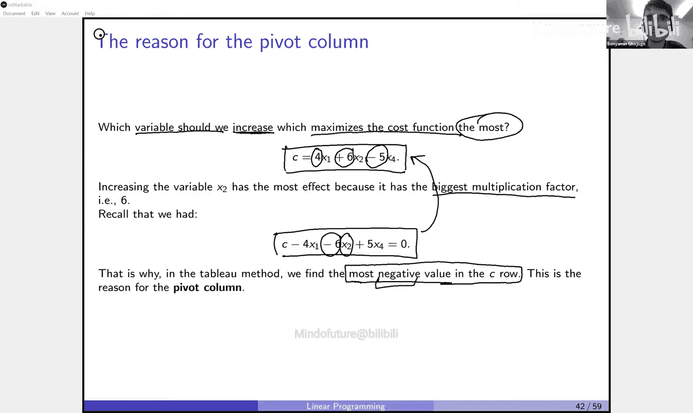

# 【滑铁卢大学】优化技术课程 ｜ Optimization Techniques   W2023 p03 P03_第三讲_(线性规划) -BV1oJCHBcEo5_p3-

Okay， hi everyone and now。Let's start the session。 Sorry for the the problem that we initially had with the Zoom。

 Okay， now let's say does anyone have any question regarding the last sessions。The previous sessions。

No。Okay， let me。 so if you have any question， please let me know and let me share a screen。

O。I think now you can see me。😔，诶。嗯。Great。😊，I wanted to tell you a few things before continuing the session。

 do you remember this norm， the unit balls so here we said this is the L1 norm。

 the unit ball for the L1 norm this is L2 norm and this is infinity norm or chbucheev norm here inside of it satisfies in each of these balls it satisfies this condition for that norm right and we can so and this is for in 2D when these2 D can be three if these3 for example。

 for L2 norm it will be a sphere or 3D sphere I mean a 3D ball also it includes inside of the sphere and this will be a cube it's inside of it and also this will be a kind of a diamond and we can increase the dimensionality and I wanted to show you this so。

When we increase P， the these will so here we are increasing P。 This is p equals1， which is L1 norm。

 So we are increasing P。 it becomes so when we increase P， these will be go toward this direction。

 And this also， so in other words。When we increase P， we are doing this。Also， here。

You are increasing， gradually。Yeah。Right， so P here is one here P is infinite to。

N and although we said P is greater than or equal to1。

 but if we decrease P well have something like that， so we'll go inside。We go inside。

So this is P less than1。And then until p becomes close to0， p tends to 0。

 then it will be something like this exactly。 So this is for unit balls。

 I wanted to show you graphically how it changes regarding the P also。

About the leaf sheet's continuity also wanted to say something and also answer some one of you who asked how we should calculate that。

 so let me bring that first。诶。Oh， yes， I think Si， sorry。😔，え。Where was that。Yes。Here， so。

If you consider this equation， it is inequality。 we can rewrite it in this way that that I'm。

 I'm explaining why it's the an upper bound on the。え？On this slope， do you remember。

 I said when when we were talking about the lipses continuity said this is an upper bond on this is slope。

 And that's the reason because you can rearrange this inequality。

And then you will have this and what is this， this is exactly the slope。Right。😊。

TheThe absolute value of slope so its sign is not important here。

 and that's why L is always positive and as you can see here。See。

 and what is this this is a slope this can also be interpreted as the derivative because derivative of a function is the slope of the tangent function on that it's there an approximation on the tangent on the slope of the tangent function here right so when you tend x toward y this will become this will tend to the derivative。

 this is slope will tend to the derivative because it will be a slope of this function the tangent of this function at this point when you tend x toward y or y towardx doesn't matter so therefore you can see it as the norm of the or norm or length of the derivative so you can see it kind of as this。

If it is 1 D， then it will be the absolute value of derivative。 But if it is multidimensional。

 then it will be the norm of the derivative or the length of the derivative。 Therefore。

 you can see that L is an upper bound on the norm of the derivative。 And for for calculating the。L。

 you can calculate the derivative on the whole domain derivative function on all of its domain so the domain of x you can see what are the feasible regions for x to be so every part of the domain you calculate the derivative and then you take the norm then you can even if its you can plot it or you can have it as a lookup table。

 whatever and then you take the maximum derivative in this domain you can set L to be greater than or equal to that maximum so because L is an upper bound on the norm of derivative and usually as we want L to be a small because the bigger the L the harder it is for optimizing so we we usually like smaller L therefore we can calculate L as a maximum of the normal of derivative so the smallest。

U bound is when it is equal， right， the smallest upper bound。When it is equal。

 this is a smallest upper bound L is greater than or equal to the normal derivative。

 But we can take this smallest L， the smallest upper bound。 therefore， you can see these。😊。

As a formula for calculating L， where X is on the whole domain。Right。

 so this is how we calculate Lius constant。 So this L is also called Lies constant。

 Does it answer your question。Who was asking that？诶 someone。Was asking， does it answer your question？

Yeah， okay， okay， any questions so far。Is it clear？没有。Okay， great。So， now。Okay。It is clear。

 that's great。Okay。So， let me bring。The page where we are continuing。Okay， optimization problems。😊。

So。Consider a function。I think。Yeah， yeah， you are correct。

 So optimization problems consider a function F from RD to R and it maps x to f x。

 then the domain let it be D So x is a part of D and x is d dimensional right。

 but it's unconstrained optimization when we don't have any restriction on the x we already talked about it so we can move on。

What is general optimization problem for constrain so when we have constrain。

 we have some restrictions on。X。We can write it in this way where some functions of x are less than or equal to0 and some functions of x are equal to 0 for for example we have M1 inequalities and M2 equalalities in the constraints right so these are the number of constraints and this is objective function which we are minimizing also you might be wondering how we should handle greater than or equal to0 when because in this say in here we are saying that all constraints are either less than or equal to 0 or equal to 0 so what if it is a greater than or equal to0 for example this case。

Then by multiplying it by minus-1， we can convert it to less than or equal to0 therefore。

A greater than or equal to 0 can be converted to less than or equal to0 and vice versa if we have less than or equal to 0。

 we can convert it to greater than equal to 0 by multiplying the sides by minus1 because it will flip the signine of inequality right great。

So， and you might feel also wondering why I have put 0 always here。

 What if there is a constant here on the right hand side of this inequality or this equalityality。

 Then it's easy if， for example。We have this。Then we can bring this constant to the left hand side and consider this as a new function。

Yeah。So it will be G X0 doesn't matter。 The naming of the function doesn't matter for us， right？

So we can always bring that to the other side or here also。

 if we have y I less than greater or equal to0， then we can bring it here。

And consider it as a new function， for example， theze of。This doesn't matter， right， the naming Z I。

 the naming of the function doesn't matter here。Okay， here we talked about it。Clear。Okay。

 so some examples are these， for example， here， we can convert these to this。

 we brought5 to the left hand side of this inequality。So we have less than or equal to0。

 if it's greater than equal to0， we can make it less than or equal to0 by multiplying it by minus1。

Also here we brought at6 to the left hand side and it became minus-6 so we can have this in this way Now minimization and maximization。

 I think we already talked about that。So we move on to this point。 Okay。

 what is feasible point or feasible set so。Minimizing f of x subject to Y I x less than or equal to 0 and H x equals to 0。

 So this is what we had。And what is the feasible set。

 So the point x for this optimization is feasible if it belongs to this， the domain of the function。

Because a function might have some domain， right。The domain of the function also it satisfies the inequalities。

 so as long as it satisfies this restrictions of the optimization。

 and it also belongs to the domain of the function。😊，Then it is feasible。 What do I mean by domain。

 for example。For lock， assumed F was lock。Right can each speak less than or equal to 0 no？

For domain and what is D here， D means that x is great。

Or we can write it in this way x is greater than0。 It can't be0 itself。Sorry， this is infinity。

 right。So， it means that。It's greater than 0。Live me。😔，Clean it。

So it means that this is not zero including and it can be can go to infinite。 It can be negative or0。

 So this is an example。 and these are some restrictions。 for example。

 assume they have a 2D problem So you have variables and youre looking from above So when you are looking from above the third the height is representing the cost。

 for example， and these lines， as I already have talked about So each line shows that on each line the value of the objective function is the same and it means that either it's coming up as a bowl or it's going down we can't see。

 but we can say we can have a color legend on this plot saying that it's going up or going down doesn't matter。

 It's either a ball going up or a bowl going down if it's a bowl going up then are we want to minimize it find its minimal if its。

A reverse ball going down， we want to maximize it， right？So we can have a feasible set like this。

 for example， this visible set。😊，Is some restriction defined by these inequalities， for example。

 this inequality， we have sub M1 inequalities， right？Assume this this is one of the inequalities。

 which says that I wanted to be here。 always there is another inequality。Which says。

 I want to be here。There is another inequality， as soon。Linear inequality。

 it can be nonlinear inequality too， but here in this example we have linear inequality。😊。

Because these are linear lines， so we can have another inequality saying I want to be here。

 another inequality， saying I want to be here， what is the intersection of these inequalities。

 this region， right， this region， and this region is a feasible set because it satisfies all of these inequalities。

😊，And if， for example， if， for example， there was。😊。

A linear equality which says that I want to be on this line。

And then the feasible set would be only here。which is the intersection of theseequities and these inequalities so these feasible set should satisfy all of these inequalities in intersection of these inequalities as well as being in the domain of the function so far clear and what does it mean when we want to find the solution of the optimization。

 we have to be in the physical set so the point has to be feasible if we find a solution which it is here。

 we say okay the function is maximized or minimized heret we don't care about this because it's not satisfying our restrictions our constraints we have to satisfy the constraintsstrain find a solution which is the best which is minimizing or maximizing functions conditioned on satisfying all of the constraints and be in the domain for example。

 if you say okay the minimum of the log function is minus1。😊，I mean。

 the argument of the log function is minus1， it doesn't make sense mathematically because it can't be negative for luck。

 right？😊，It should satisfy all of these。This isibility feasibility。Now。Let's go to the Okay， here。

So the constraint optimization can also be written in this way。

So if we integrate all of the constraints in the set S。 So do you remember X should B D。

 X should satisfy。Inequalities。Either both less than or equal to or greater than or equal to。

 and I should satisfy。All equalities。Equality constraints， all of these， if we can integrate them。

Into the set S， and we denote it as S， we can write it in this way。

 right so S can be a feasibility set， the contrain set。😊，SoOr feasible set of constraints。

 And for another example here here， as you see the feasible set is non nonlinear。

 it means that our constraints are inequality constraints and equality constraints。

 they were nonlinear， for example， an example for you to understand is that for example。

 our objective function is going like this。😊，But my constraint says this。So this is x1。 This is x2。

And what is this， the constant is x2 squared is greater than or equal to 0。Right。😊。

So this is this is the curve。I'm sorry， X1 escort， I guess。Something like that。 But yeah。

 we can also have， I think， a better， a better thing that I can come up very fast。

 I need to think about this part。 but an A a better constraint that I can think of very fast about it is this。

What is the。What is this， This is x1 squared plus x2 a squared。 This is a radius， right。

And what is this， for example， we want to the feasible set here。

It means that x1 is squared plus x to a squared should be greaterd than or equal to 1。 For example。

 this is one， the radius 1。 So this is the constraint。And the feasible set is nonlinear， as you see。

 nonlinear， it means that the constraint is nonlinear because we have a squared here。

If we have linear constraints， then the constrain would be like this because each of these will be aligned。

A line， it's so obvious that the constraints here are linear。Line or hyperplane。

 right I'm drawinging in 2D， but if we draw it in multidimensional each of these will be a plane or hyperplane。

 so in 3D it will be a plane in 4 d5 d5 dimensional six dimensional we don't call them plane anymore。

 they will call them hyperplane， they are linear okay but here， for example， in 2D。

 if we have two variables， it's a circle。Out of a circle， if we have 3D， it will be out of a sphere。

 a 3 d sphere out of it if it is 4 d 5 d6D multi dimensional， we'll call it a hyperphere。

 it will be out of a hyperphere So when we say hyper it means that we are usually in higher dimensions hyperline hyperline is the same as hyper planee hyperplane hyperphere hypercu and all of these things so。

😊，Yeah。Now。So what is convex optimization problem so so far if you remember we talked about convex set before。

 we talked about convex function， but this is the first time we are talking about convex optimization。

 so this is the third convex city concept that we are dealing with we are introducing it right now。

Whenever we have an optimization problem， where the functions F and Y， so this function。

 the objective function and the function of the inequalities。Okay， are all convex functions。

 so we already introduced the convex functions and now as long as the objective function and the inequality constraints。

 they're functions because this can be a function， right？😊，Like this。

 this is a function of x like this， for example， an example。This means example， right。

 so if all of these are convex functions and the equality constraints are a functions。What is a fine。

 you can see a fine as linear， so this is a linear function。Like。For example。

 f of x equals x is a linear function， or f of x equals alpha x where alpha is the slope of this line。

Is a linear function also。Now， consider this function where we don't pass through the origin。

 right here we pass through the origin。 but when we don't pass pass through the origin。

We call it alpha x plus value， some constant like beta usually we can in the literature。

 we call both of these these and these linear but if we want to be more precise we call it they would call this linear when it passes through the origin but when it doesn't pass through origin it has some bias we usually call it a fine so a fine is linear but when we have bias a fine is more general than linear right So that's why here if we had only a x equals0。

 then it would be linear but when we have b some bias of some constant here。

 then this equality because you can write it also in this way right a x minus b equals0 so we have some bias so this is an a fine function。

 this is also called a linear function doesn't matter they are usually used interchangeably but when we say。

Fine usually mean that there is some bias too， there might be some bias。The bias might be 0。

So when we have these formats of the optimization problem， the objective function。

 and the inequality functions are all convex functions and the equality constraint is an a fine constraint。

 then this is called a convex optimization problem okay and usually the easiest problems to deal with。

In optimization are convex optimization problems， Boyd also says that。😊。

This is a cult from board as long as you can formulate your problem as a convex optimization problem。

 then you're done。You can absolutely solve with using optimization and find its global global minimum of or maximum。

 So see， do you remember we had local minimum local maximum we can also have stationary points saddle points on all of these things。

 but when we have convex optimization problem， we are sure that the objective function is convex also that these constraints are convex and this is also convets right a fine is also convex So it means that everything is convex。

 all functions are convex， it means that we are sure that we don't have any saddle points。

 we are sure that we always have global all local minimums are global for example。

 we are either in this case right or this case this is a strongly convex and this is。😊。

This is a convex， right， this is a stronger convex。In convex function。

 we might have several local minimums， but all of them have the same value。

 so we always have the same minimum function value。

 it means that we always have one global optimum for the function value we might have several arguments means but we have one mean right also in if it is strongly convex。

 it means that we only have one argument and that argument gives us the global minimum too therefore we are satisfied saying that oh。

Now it's an easy problem。 We can definitely find its global solution。So。

Now let's talk about some of the standard problems which are all conx problems so these are different types of convex optimization problems。

 one of them is linear programming so when we say programming and optimization。

 it doesn't mean coding so programming has different meanings in the literature。

 when we are talking about coding like Python coding Java coding and these things programming means coding。

We might have in algorithm， also we might have dynamic programming。

 so we have also programming in algorithm。But dynamic programming is also related to the optimization too。

 so programming in optimization means optimization， so linear programming means linear optimization。

😊，When you in the literature of optimization C program it means optimization and linear program is linear optimization and what is it when the objective function and equality constraints are a fine functions。

 so this is a fine。This is also a fine and this is an a fine inequality。

Everything is a fine here as you see and this is as you see is a special case of convex optimization problem so this is linear programming and that's an interesting thing。

 Everything is a fine so here for example the cost is like this so the cost is linear to C this is cost the objective function the cost is linear when we were drawing in previous slides。

 for example， I was drawing like this cost like this it was a bold coming up or going down doesn't matter okay。

😊，But this is， as you see， completely nonlinear。The cost was not nonlinear。

Although the cost was convex here， but the cost is nonlinear because you can see it's it has nonlinear lines。

 but in linear program I mean even the cost is linear so the cost is is a plane or hyper here。

 it's a plane because you can see the third dimension the height here as the cost So it's a plane if you look at my hand for example。

 it's going up or going down you can have the plane going up like this going up like this going up in that direction。

 going up in that direction going down always， but it is a plane or hyperplan okay if if。

If we had only one x， if the variable was one dimension。Then the cost would be。A line。A line， okay。

Would be a fine a line can be it can have bias to， but when we have two dimensions， two variables。

 the cost would be a plane when we have three variables as input， the cost would be a hyperplane。

 although it's linear but we should imagine it we can't visualize it right so when the cost is linear and as you see even the constraints are linear so here it says that I want to be here there is another line saying that I want to be here。

There is another line saying that I want to be here。

 There is line another line and other constraints I'm talking about here， these。I want to be here。

And other constraints saying that I want to be here。 we might have a line here。

 I'm talking about this now。 It might be a line passing through this。

 saying that I want to be on this line or when I say line you can see it in multidimensional as a hyper planee right when I say line I'm talking about 2D So when we go to multi multiple dimensions。

 then this becomes a hyperplane or a plane in multiple dimensions。

 So when it says it might be say I want to be on this line。

 then the fe set would be only this here the intersection of all of these feasibility constraints。

 So this is what we have。 So this is as you see linear programming in this session will go and see how we should solve linear programming problems。

And as you see， by the way。The feasible set is a polyhedron。😡。

This is a polyhedron right This is in mathematics， this is called a polyhedron you can see it in multiple dimensions to this is in 2D in multiple dimensions when you have some polygon where every edge is is a hyperplane。

 so it's linear you can see such as a cube but you might have more number of edges。

 so in this case then it's called a polyhedron。Qudratic programming or quadratic optimization is another type of convex optimization problem where the objective function here is quadratic。

Do you remember we introduced quadratic form in several slides to go。 when we said that this。

 for example， is a quadratic form。 We might have more general case where we have a P here where P is positive definite。

 It means that or it's its second derivative is greater than0， Okay， and why do we say that。

 why do we say that because when we want to minimize it。

 we are currently are talking about minimization， right。We， this is a quadratic form， right。

 We want it to be facing up so we can find its minimal。 Therefore。

 its second derivative it should be greater than 0。 Why， but is， why is P second derivative。

 Let me prove it to you here。 So consider this objective function。Let's take the first derivative。

 first derivative， what is F prime， which is the first derivative it will be。2。P， X over 2。

So this the derivative of this will be  two p x。 This will be Q because this is linear。

 like when you take the derivative of 3 x， it becomes 3， right， and this is a constant。

 therefore it's derivative is 0。 Let's take another derivative。 So it will be F double prime。

 then will have P。 these two twos cancel out and will have p。

 So it's derivative P transpo x maybe so it derivative is p。 and this Q is derivative is 0。

 Therefore the second derivative is P。Right and for minimization。

 I want the second derivative to be greater than0 in order to have to facing in for the function。

 objective function to face up。 therefore I can find this。

 if we were maximizing this function then p should be less than 0。😊。

So the second derivative would be0， therefore it was facing down so I could maximize it。Right。

 this is one thing I wanted to talk to you about。Also， it's a symmetric， positive， definite function。

 This means this， this means this。And。😊，So it's a quadratic。 and the constraints are linear。

 So the constraints are a fine。 You can say the constraints are a fine。 However。

 the objective function is quadratic。 when we say quadratic means that it's something like a squared。

 like it， it has two xs。Or in one in 1 D it's x squared。 al right， So when this is in vector4。

 So here again， the cost， as you see， when we are talking about a bold。😊，It's a quadratic form。

 right， We already talked about it。 So the quadra， the cost is quadratic。 However， the feasible set。

 the constraints are linear。 So the feasible set is a polyhedron again。Yeah。Right like this。

 it says I'm here， says I'm here， it says I'm here， something like that。

 so we have this is quadratic programming。Okay。So far clear， everyone。

Can you please give me feedback？Can someone say anything clear clear， Okay， great。

So now let's talk about quadraically constrained quadratic programming。Again。

 programming means optimization here。 So what is this， The objective function is quadratic。

The inequalities constraints are also quadratic。When we say quadratic， it means that by the way。

 it can be a fine2 right if you set m to0， then it would be a fine。

 so I'm saying that when we say quadratic a fine is a special case of quadratic。

 therefore you can see linear programming as a special case of quadratic programming。え。

It means that if you have an algorithm which can solve quadratic programming。

 it can definitely solve linear programming too， but not vice versa when you have a problem just for linear programming。

 it might not be able to solve quadratic programming。So in this QCQP。

 the objective function is quadratic， the inequality constraint is all of them are quadratic and the equality constraint is a fine。

😊，And as you see cost here is quadratic， the feasible set is also cur quadratic。😊。

But when I say curvy， this is not quadratic。😡，Right， the quadratic needs to be like a bowl。

It doesn't need to be only curvy， curvy in a way that it's only like a ball。

 it's like like this like it x squared。Right it can be it can spread or it can be narrow。

 but it needs to be like a bold， so this is visible set and this is the cost and both are like a bold。

We can have a line as a fine equality constraint too。Yeah。

What is semi definite programming you you hear it a lot in the literature of optimization。

 semi definite programming also short SDP， you can call it so when you have。What is this。

So C is a constant， and you can trace makes it a scalar。 We already introduced trace。 It's。

 you can see it as a summation of diagonal， right， And C x。 So by the way， x is a square matrix。

 It means that its the number of rows and the number of columns are the same。😊。

And here we are saying that it's positive semi definite， meaning that， meaning that。😊。

Itigen all of its eigenvalues。Are greater than orle to0 and what is eigenvalues。

 I already talked about it a bit， but let me briefly tell you。😊，So when you have a function。

 you can have eigenvalue decomposition， so you can decompose this matrix， when you have a matrix。

 you can decompose this matrix in any， anyway， different ways that are like chaki decomposition。

 there are some famous decompositions， one of these decompositions。 So when you say decomposition。

 it means that you can write it in as a multiplication of two， for example。

 functions or three functions。😊，So study matrices。 You can write a matrix as a multiplication of two matrices。

 two other matrices or three other matrices。 In other words。

 you are decomposing x into three matrices or two matrices。 This is called matrix decomposition。

 And there are several methods for the matrix。😊，Pcomposition。

 one of them is eigenvalue decomposition。 and eigenvalue decomposition gives you eigenvectors and eigenvalues。

 right， So eigen value what is， what are eigenvectors。

 eigenvectors show the important directions that the matrix shows。

 So every matrix shows some important directions in the space。 the eigen vectorctors。

 you can see them as important directions of that matrix。 For example， an example。

 if the matrix is a covariance matrix， Those eigenvectors show the the directions where you have most variance。

 most spread of the of that matrix。😊，So when you have some data， you form the covariance matrix。

 you take the eigenvalue decomposition， the eigenvectors are the directions of the spread of the data。

For example。These are some data points。If you take the eigenvalue decomposition of the covariance matrix of these data points。

 these are the eigenvectors。These are the eigenvectors in machine learning。

 these are called principal components analysis， Okay。

 principal component or PC So and the eigenvalues are the value of the importance of those directions。

 For example， the eigenvalue of this is more than eigenvalue of this because we have more spread in this direction。

 So this is the concept of eigenvalue and eigenvector and these positive semideite means that I want all the all eigenvalues of this matrix x to be the greater than oracle to0 I don't have any negative eigenvalues。

And this is a linear function a linear function of matrix x。 it's like in scalar form。

 it's like three x in matrix form it's like three x， boldal x。In， in vector form。 and in matrix form。

 you write it in this way，3 trace of x， you can also bring3 into the trace。

 So you can write it as trace of 3 x。 This is exactly this。 It's a linear function of the x。

 So this is linear。😊，Where we have a constraint for saying that it positive semiinite and you have also some linear inequ This is linear。

 linear or a fine a fine in inequalities and a fine equalalities， right。

 So a fine a fine objective function。A fine inequalities， a fine equalalities。

 and also what another constraint which says that these x is positive semi deffinite。

When you have this， you can also write it in this way。 Two ways to say the same thing。

 This is also a fine equality。A fine inequality and a fine objective function， right， all of these。

 and this is called semideinite programming。 It means that you are optimizing some for some matrix where the where where the the feasibility is the positive semidefinite cone。

 do you remember we introduced cone to you and now we have positive semideinite cone。

 the cone where all of the eigenvalues are non negative and on this visible set I'm fine optimizing some function。

😊，So this is what semideite programming is this is just for introduction to you。

 I don't want you to solve semideite programming， but you will see that we will learn some algorithms which can be used for solving any optimization problem mostly。

So this is what I wanted to tell you， by the way， another thing we should note that so far until this is slide。

 usually in the forms that we were writing for optimization。

 the objective variable was a vector right or a scalar。😊，Here， the objective variable is a matrix。

 This is a matrix right。Now this is a matrix and as you can see。

 all of those other forms that previous forms that I introduced to you are spatial cases of semi differentite programming theyre usually。

😊，Can be seen or they can be converted to or they can be converted to semi defite programming sos semiite programming that's why it's very important in optimization。

This， it's constant。 And in S this is what I was saying here。 iss a bit。Yes。Oh， I。

 I'm on the next slide， but it doesn't go。 Just keep me sick。 Yeah， okay， so here。

Semi deffinite programming。 And as you hear， this is semi defite。Cone， this is a cone， right。

 It passes through origin。 So the cone， if you remember in previous slides I said。

 it passes through the origin。 So this is a feasible set。 The cost is linear。

The constraints also are linear， so this sorry this is the cost and this is the constraint in equality constraints。

 for example。So also we have a const on to be on the or in the semideite call。

 this is semideite program。Okay。Now， an important thing is that all the standard optimization forms can be reald as semi defite programming。

 so there are special cases of SDP。And interior point method。

 which we' will be introduce in the next sessions or barrier method。

They are two names for the same thing。 They they can be solved used for solving various optimization problems such as SP。

Many optimization toolboxes， I don't know if you have heard of CVX or not CX is a very important and famous optimization toolbox。

 it initially came for MatTlab later it came for Python to might have in other languages too so CVX and it is developed by Stanford people supervised by Professor Boyd Stephen Boyd and they use Inter point method or barrier method in order to solve that and usually they can convert their problems into SDP so that's why it's very important it's an iterative method we will see that Inter point method that we will introduce later is an iterative point so it can be time consuming because it's iterative。

ItDoes't give you the answer in one shot。 It needs the steps to move toward the solution。

 Optimal solution。 And if the optimization problem is the convex optimization problem。

 it has only one。え。When I say local optimum， I means I mean the value。

 you might have several arc means。But the value the objective function the objective function value of those arguments will be the same。

 and you will have only one minimum for that function， minimum value， which is the global optimum。

 right。So these are the important things and some references。Now let's go to linear programming。

 but before that， do we have any question。From these slides。能。Can you。Please。Say your feedback。

 Is everything clear so far。Yeah。Yeah， everything's good。

 looking forward to diving into some questions。Okay， great。 So please。

 please participate in the class and have your questions if even even if I don't know any answer I need or I need to look it up or I need to think about it。

 I will do it and then I will answer in the next session。 For example。

 you ask me about how to calculate is constant， as I hesitated that about that。

 I said I need to go and look it up， I looked it up and then I answer it to you。 So always。

 please ask me questions。😊，Thank you。 okay。So。You can also ask your question in the chat。

 and I will answer that。 So， and this is， by the way， Cvic X mathla software， as I said。

 they have it for Python 2。 Now， let's move on to the。Where is that。诶。Yes， in your programming。Okay。

 there is it someone in the chat。 It's all clear。 Thank you。 Okay， thank you very much。Great。

 So now we are in。Linear programming。 So we introduce linear programming。 Now we are going to see。

How to solve it。Again， linear programming。Linear programming means optimization， linear optimization。

Problem the objective is linear functioning x。 The equal inequality and equality constant are all a fine。

 a fine inequality， Again， a fine means linear， but we might have bias2， but the bias might be 0。

 but we might have bias2。A fine inequality constraints and a fine equalityality constraints。

All of them in x， when we say a finite we mean in terms of x， we might have some constants too。

 but in terms of x， for example， if x is a scalar， three x plus two。Listen or equal to5。

This is an a fine inequality in terms of x but 3 x squared plus2 less than 5 is not a fine anymore because you have a squared here。

 right？😊，And this is， for example，3 x plus 2 equals5hi， this is equal。And this is， for example。

 F of x equals 3 x plus2， for example。Right。So。😡，A standard linear programming standard is usually usually written like this。

 So maximize or minimize you might have maximization or minimization。 again。

 this is a linear function。 Do you know why， Because if you write alpha as alpha1 until alpha n。

And x here。 We have it is x1 until x n。 Why do I put transpose here because I usually write vectors as column vectors And for this is a column vector。

 row vector transpose is a column vector。 So alpha transpose x means alpha 1 x1 plus alpha n x n It's a linear function。

In terms of big stride。And this also is a linear or a fine inequality。 This is a fine。Inequality。

 So these we have as a standard linear program。 But when we say standard usually。

In a standard problem x is all of the variables， so do remember this this generalized inequality that we introduced in previous session。

 this is a vector， therefore it means that all of element y every element is greater than 0 greater than or equal to 0 so it means that x1 is greater than or equal to 0 until x n is greater than or equal to0 and this also this is a matrix G multiplied by the vector x。

 this will be a vector and the vector is less than or equal to h generalized inequality means that element y so assume that。

😊，G X， we write it by Y， whatever。So y 1 to Y N。 So I am denoting G X by y， right。

And this is less than equal to。H1， So the sum H is H1 to H n。This means why one。

Is less than or equal to H1 until Yn is less than or equal to Hn。So this is what it means。

We can also have so but one important thing for a standard problem。

Either it's maximization or minimization。The variables are greater than to 0。

 So usually and you will see even in practical problems， optimization problems。

 usually the it is the case that we have optimization value non negative。

And these are some vector G is the matrix and h is a vector and M shows the number of constraints。

 right， the number of constraints。If it I showed it as n， but it can be M。HM。

Because we might have M inequality constraints。Okay， now let's go to the next slide。So。Equivalently。

 we have this， we already talked about the linear inequality constraint1 until linear quality constraint m because we have m in quality h was。

An m dimensional vector， and x1 to xn。Is greater than or equal to0。

Usually M is greater than or equal to0。Usually because when M is less than the number of constraints。

 we might have some issues。It doesn't matter， I'm saying that it usually happens that might have both cases where M is less than an or greater than。

 but usually we have more number of constraints。And examples， some examples。This is for minimization。

 This is for maximization。 The objective functions are linear。 And as you see， we have two。

Inequality， for example， constraints。ButAnd also， we have this default inequality constraint where the objective variables are greater than or equal to 0。

 right。So these are some examples。Now， some practical examples， I think you will like this part。

So practical example of one for linear programming。And this。For example， this。

 this practical example might be good for management。

 people in management and these things or industrial engineering， Industrial engineering。

 I think you will face this a lot in your job。So a company has two products。For example。

 it can be any number of products in this example is2。 let x1 and x denote the amount。

 amount of first and second products to be produced right with some scale scale might be anything。

For example， kilograms or whatever。え。Or if it's a length based thing， centimeters or whatever。

Therefore， usually x1 x is greater than an oracle to 0。 Do remember。

 I said usually in practical examples， the objective variables are not negative Here you can see an example for it。

 It's the amount of product。 It can't be negative。😊，It can be0， but it can't be negative。

 That's why in the standard problems， usually they consider assume that the objective variables are non negative。

 The company has profits $60 and $30 for the first and second products。 So $60 for the first。

$30 for the second。 So whatever it the company produces $60 profits。Therefore， the total profit。

Is like， is this 60 dollars？Mipied by x1 plus $30， multiplied by x2。 So for every scale of x1。

 the profit is $60。 for every scale of x2， the profit is $30。 totaltal profit is this。

Right in terms of dollars now the resources for these products are limited。

 so we have the following some we have some restrictions。

 These are the constraints we do not want the first product with proportion8s for example。

And the second product with a proportion three to spend more than $48， something like that。

 so 8 times x1 plus 3 times x2 I want to be less than or equal to 48。

 I don't want to spend more than 48 for 8 of x1 and  three of x2 so some kind of restriction。

Another restriction might be the other way around I want to I have the budget to spend at least 245。

 at least for four of X1 and two of X2， therefore this is a budget that they have。

So I can put these two restrictions here。I want to maximize this total profit， right？

 And I know the x1 and x2 are non negative。 So this is we formed this problem。

 which were in words in English to a mathematical optimization problem。

You can do you can do it in anyway in the other way around two so you can have an optimization problem and you make a story for it or do you have a story and you make an optimization problem for it you can do in both ways。

 right。😊，A practical example， too。And this will be interesting for people in physics or in mechanical engineering。

I believe it might be also good for industrial engineers if they work with mechanical engineers so these we can have different practical examples in different fields right we can even have it in machine learning data science in anything。

 so I'm just giving you some examples just as a proof of concept。Okay， we have， for example。

 2D tanks， it can be 3D tanks to I will say how it can be converted to 3D tanks。

 but assume soon we have 2D tanks like this here in this figure which are connected from the bottom。

Ts of water。So let x1 be height of water in one of them。Like this。 This is X one。

And let x2 beat the hydro of water in the other one and let the width of these two tanks for the first one will be 60 or and for the second one is the 30 and with some scale it can be meter or whatever。

😊，Therefore， the total amount of water in these tanks will be 660 times 61。Plus 30 times 62， right。

 This is the total water in in these two tanks and neglecting the water in here。

Because it's very small。Now， so this is。What we have。

 And assume we want to find a setup when we want to maximize the total water we have in this setup with some restriction。

 for example， we might have some physical restrictions。

On water before it comes to the tanks so the water is coming right water is coming from somewhere to the tank we might have some physical restrictions and these physical restrictions might impose these restrictions linear restrictions right if we had nonlinear restrictions then it wouldn't be a linear programming anymore but for this to be a linear programming the restrictions need to be linear again the height of water is always not negative it can't be zero but it can't be negative and we are maximizing this with these two restrictions。

And how can it be 3D if we for example， we have 60。😊，No， we have 30 by 2 by x。

 so x's the height is the height。Third is the width one and two is the width2， right。

 so we have width one， width2 and the height。It's because it's a cube so you can consider the multiplication of width one and width two as the total width。

 therefore you can see this as the 3D tank where this is a multiplicational the first two widths。

 Also this is a multiplication of the first two widths for this tank so we can see that 3D tanks too。

Is that clear so far so as you see we can formulate problems are real world problems as linearer programming？

😊，If the restrictions and the objective function that you are maximizing or minimizing are linear。

 if they are not linear， they will be general case optimization。

 which we will will go through together in the next sessions。And but not now。Okay。

Now let's go to solve the linear programming by visualization。When the dimensionality of data。

 the dimensionality of objective variable。Or the number of objective variables。

 if we consider the objective variables as scalarrs， the number of objective variables。

 or if we consider the objective variable as a vector。

 the dimensionality of this objective variable if it it's either22，1，2 or3， right？😊。

We can solve it using visualization because we can draw it。If it's 1 d。

 I think it's very easy because we only have1 x and F is here。Right？And if it's 2 d。

 we can write x1 here， x2 here， and see F as the height。The objective function as the height。And if。

 for example， here in sorry。For example， and the objective function can be like this can be drawn like this and what does it mean。

 it means that the plane coming up for example。Right， because the objective function must be linear。

And this line means that on this line the the function value。

 objective function value is the same Now if we have 3D， then we can write it in this way。X one。X2。

 x 3， and。immagine。F as a function in this 3D space。For example。

 we know that this is the space and here the temperature is higher than the temperature here。

 so we know we can imagine F as the value function of these 3D space so usually when it's 3D it's harder to visualize solve using visualization。

 but in 2D is the easiest 2 d and 1 d an example here， for example。

We want to solve this problem which have is 2 d two objective variables using visualization and so we draw the first we consider the first constraint。

The first constraint I want to write it。 First， I put x1 to 0。 So x10， then we'll have 0 plus 2 x2。

Consider this inequality as equality for now， then we will take care of inequality。Then。

 x2 becomes 20。It means that when x1 is 0。1 x1 is 0， x2 is 20。 We are here。This is a point。 Now。

 the other way around， put x to 0， x 1 plus 0 becomes。Or equals 40， so x1 is 40。We are here。

 x2 is 0 and x1 is 40。 Now connect this by a line， why because it's an a fine function。

 so we can connect these two by a line。 So this is the the equation of this inequality constraint。

 but when we should see we are either when it's inequality， when it's equality。

 which means that we are on this line。Equality which means that we are either on this side of the line or the the other side of the line。

 how do we know which one we can test for a point， for example。

0 and0 origin0 and 0 is not greater than recall to 40。

 therefore we are on the other on the other side of the line we are on this side。Right。😊。

I have drawn it here。So I don't need to try it here again。So now let's we can do the same for these。

Inequality contraining and we will get this line and again we can put some point in it and see which side of the line we are we are on this side when is we have equality it means that we can be on the line2 so either on the line or this side either on the line or this side if there was no equality it means that we are only on that side and x1 and x2 are greater than oracul to 0 it means that we are only working on the first or。

 this is an orphaned。Where all of the variables are non negative。 So we are working on this or。

 We are not here or here or here， right。Okay。So I should correct this。 sorry， these are not。This。

 shouldn't be in the。I will correct that in this slide。 This shouldn't be in there。YeahConstraint。

 feasible set。 So and this is cost。 cost is coming up。 Why the cost is linear first off。

 But how do we know whether it's going up going down， Where is it going up or down。

 you can see the pattern of this。 The more you increase x1， And the more you increase x2。

 these also increases， It means that it， it's going up in this way。Right。

 it's going up in this way and now。In the feasible set， where is the feasible set。

 I have put it here， so this is the feasible because this is the intersection of these two inequalities。

In this intersection， in this feasible set， where is this function， the objective function minimized。

 we know that it's been increased by moving toward this direction。

 therefore here we are we have the minimum， but how do we know whether it's here， here， here， here。

Okay， when we have。Linear programming as the objective function is linear。

And as the constraints are linear， can someone tell me where should we seek the answer in of linear programming whenever the cost is linear and the constraints are linear or a fine。

 where should we seek the answer， usually where does the answer lie， can someone tell me。

Is it as close as we can get to the origin？No， do you know why， because the zoo。I have dysfunction。

Then close to origin， this will be maximized， not minimized。Right。

 so you should see the cost function for that。 But I'm saying that whatever the function cost function needs。

Assume you have some cost function either going up in this way or in that way it's linear linear。

 the constraints are also linear inequality constraints。

 linear equality constraints are linear assume you for simplicity assume that you only have inequality constraints。

 so you have a polyheedron feasible set， you can also imagine it in 2D only don't go to 3D or multiple dimensions you like in this case you have two variables and you have so you have a polyhedron feasible set and your cost is a plane either going up in this way in this way doesn't matter。

Where in this poly because you should be in this feasible set， where in this polyhedron。

 either inside of it or on the boundary of it。😡，Should we， should we find the solution， first off。

 as answer this question， do you think the solution， the minimum or the maximumim。

Is inside the polyhedron feasible set or under the boundary of the polyhedron feasible set。Okay。Well。

 is in this case， is it not worth that two equations are equal to each other？We the two constraints。

what系 mean。What I mean is this， assume。Soon you have a polyhedron like this， right？

And you have some cost which is going up in this way or the other way around doesn't matter。

 or in the other direction doesn't matter， I don't care。Can you imagine and think about it？

Do you think the solution will be here？Or here。 Or on the boundary。

First answer would be on the boundary。Yes， on the boundary why。Well。

 that's the first place the cost is going to hit。Exactly the cost will be so if it's maximization。

 for example， the cost is going up in this way， right so the cost will is increasing。

 increasing increasing and we will hit the boundary because here the cost is less than here right So the boundary is the where we should seek the solution in here or we are minimizing as soon we are minimizing the other way around。

😊，Here the the value of the objective function is more than here right because again。

 consider the fact that the cost is linear so it can't be the way that it it can to have this behavior going up and going down again。

 It's not linear。 The cost is always going up or going down， its linear cost function right。

 Therefore it's either for example， in this case， minimization， you should seek it here。

In this boundary for maximization， we should seek it here。😊，If it was the other way around。

 it might be like this This is a polyhedron feasible set and the cast is like this。

Increasing in this direction， the max for maximization。

 you you should seek it here right around here for minimization， you should seek it around here。

 Do you agree with me。Yes， yeah， yes， why again， because the cost is linear， it's not， for example。

 here， it's it's not possible for for it to go up and even calm down。If it was the case。

 then we we might have the solution in the middle of the feasible set。

 but when it's going always up or goes down so we should seek the solution on the boundary of the feasible set。

 So this is one case。 Now let's go one step further。

Do you think where on the boundary should we seek the solution？没。Yeah。Well。

 I guess it's like go ahead， whoever's speaking。Advertise。Pa verdicts。Adverts， exactly， exactly。

 I know that some people said the answer。 So it's not just one person。 I agree。 So the averts。

 why do you think it's ats。Because for it to understand you don't you need to only imagine， imagine。

 so assume there is a plane， a plane and you have a polyhedron and this plane is cutting this polyhedron so。

😡，At some points， so the function value is going up， going up。😡，At a vertex。

 it will leave the Se here， for example。The objective is going up， going up， going up。

 it's becoming more and more at here。When it's leaving the polyhedron， it's the maximum。

Here it becomes more than here， but it's not in the feasible set anymore here。😡。

It's less than here here in this part of the boundary。

 this is less than this because the cost is going up and up here on this part of the boundary it's less than here at a vertex point。

If， for example， in a special case， it might involve some rare case where the cost is like this going up。

 going up as parallel to this。Then all of this will be the solution right。

We will have multiple solutions， but again， this part。😊，Has two vertices in it。So always。

 you should seek the solution at the vertex， even in this rare case。

 So here also if you are minimizing it here。😊，Again， first off。

 we consensus on the fact that we should seek the solution on the boundary。

 so you should be either here， here， here， here， here， here， here， here， where。InAmong all of these。

 this has the smallest cost。😡，Right again here the cost is in this the increasing this direct。

 therefore this point is the solution， the cost is increasing this so if for minimization for maximization is this point。

😊，Is it clear to everyone。Yeah。Yes。Yeah， yeah， yeah， great。😊，These vertices of the polyhedron， again。

 this polyhedron must be multidimensional， right， We are only visualizing in 2 right now。

 might be multidimensional。Like a cube or something。

The vertices of this the feasible set of linear programming are called extreme points。

 why because these are all the corners， these are extreme points of the feasible set extreme points okay so the solution is one of the extreme points and that's the beauty that's the beauty of the linear programming as the cost is linear and as the。

Consts are linear we always the feasible set is always a polyhron。Or even a line if， for example。

 we have an equality and assume that the cost might be this， the constraints might be this。

So we might have one inequality constraint， another one here。Another one here， So one。2， three， four。

 five inequality constraints， each of which saying that I wanted to be here here， here， here。

 I'm here。There might be an equality constraintstraint saying that I want to be on this line。😡。

So its still in the polyhedron right but on this line and again line in multiple dimensions might be a hyperpllate。

 it can be a plane right， so it might might be on a plane， not just a line doesn't matter。

So as the constraints are a fine and the。objectiveject function is a fine itself linear itself。

 then we always should seek solutions at the extreme points at the corners。

 Therefore here we only have one corner and we are minimizing it the solution is here if we were mixed maximizing this problem then its solution would be x1 and x2 equals infinity and the cost would be infinity because there is no upper bound on this it can put them infinity because going up But as you are minimizing it。

It's here this extreme point。 and you can for， for visualization， you can is equate this。

Equation to this equation to find the solution of this。Howal x1 plus 2 x2 minus40。Equals x 1 plus x2。

-30。These will cancel out。Its2 equals。10。X2 is equals 10。 And if you， again， in this。

Equation put x1 plus 22 put it back in this equation， 2 x22 times 10。咩。😔，Should equal 40， right。

 again， I'm I'm the boundary。 Im I'm talking on the boundary。 So therefore I can set equal。

 then x1 is 20。So x1 as star is 20， x2 as star is 10。I can write it in the vector for。

This is a solution。Right？So this is the way that we should solve using visualization。

 We have some other examples， and then we will go to the simple algorithm， but before that。

 let's have a break and come back at 8 35， do you agree。Sounds good。Okay， great。 Thank you。

 So see you in 15 minutes。😊，Thank you。嗯。Okay， let's resume and let me share screen again。Yes。

I hope everyone is back。So。Now， here。We have this。Here we have these。

 So another example for visualization let how can I bring it up， Yeah okay。

Another example is this max now previous one， I think， was minimization or。

Previous one was minimization。 Now this is a maximization problem。

So we have these these two inequalities again using the same method。

 you can draw them and see put a point and see which side of the inequality of the hyperplane we are again。

Again， we should be。Greateater than or equal to0。 I will correct that part here。

 we we can't be sorry， we we we need to be in the first or。 I will correct that in the slide。

 So we are we are only here。We are only here in this part right because here here and the x1 and x2 should be greater than or equal to 0 and the cost function is a 40 x1 plus 30 x to therefore it's increasing in this way right this is cost increasing in this way。

 therefore and it should be on one of these So so this is a vertex this is an extreme point right this is an extreme point。

 this is an extreme point， This is an also an extreme point。

We have four extreme points here in considering these two。So and where where is it maximized。

 of course， here， the cost， if you calculate that it will be maximized。

 you can calculate the cost here too。Here and here， so you can if you're not sure。

 you can calculate the cost in each of these extreme points and see which one is the maximum。

 for example， here and you can intersect these to lines and get these answer。Another example。

 we might have more number of。Constraints， for example， here， x1 in x2， this is x1， right。

So this is the cost and this for this one， where is it x1 plus2 x2 greater than equal to08。

 So I have showed you here， for example。No， this is for intersection。 So first off， let me find this。

 So if it will be if put we put x 12 0， then x2 be4 x 1，2 0。 So this is this line。This line， right。

 And we are on this side of it for this， it's this line。This line， and we are on this side of it。

You can put numbers in it and see points in it and see which one is satisfi so you can find where which side you are in this in the inequality and you all。

Sorry， x1 and x2 is greater than I call this is this line this lie。 So where is this line。

 let me find the second constraint。 So if you put x1，20 x2 will be 8， x1，20 is2 oh， this is this lie。

This line is for the second constraint。 We are on this side。 So this line first constraint。

 this9 second constraint， this time， the third constraint。

And the fourth constraint x1 less than5 is this。And the。1 fifth constraint is this。And we also have。

 we are in the first orphahand and as you can see intersection of all of these is here。

So we are the solution is either and the cost is linear too so the solution is either here， here。

 here or here， we can calculate the cost in these areas and see which one is the solution right and for finding these for example here you can put x1 to5 and see put it in this equation of in this line and see what is it also here here here for example here you can intersect these two lines like what I have written here in this explanation and see you can find out the intersection So I think it's very straightforward But before that you should also note that for example here。

 let me right here。So if you are in 1 d， if you have only one dimension， now， for example， minimize。

reix。Subject to。Minimized it's subject to。Let me think。To week。Two weeks， less than。5。

And x greater than or equal to0 might have some other constraints too but。

I want to let you know what how how it will be for visualization when we only have one dimension。

 so this means that this is less than5 over 2， which is 2。5。And is。So we are on this side。

 including the line because we have equal here2 so and we are in the first or therefore we are here。

And。Because x is greater than0 and3 x3 x is a line which is like this。So if it is 2。 half， 3。2。

 half is。7。 half， I guess， yes。So it will be this line。😔，This is three eggs。

And where is the solution， The solution， We want to minimize it or maximize it。

 So if we want to minimize it， the solution would be here。 If we want to maximize it。

 the solution would be this。Right。😊，Because F here is increasing in this way， right？

This axis is F and now， this is the cost function。We can also have in three dimensional vector and I mean。

 three dimensional objective variable in that case， these will not be line anymore。

 these will be planes。Planes， so you will the constraints will be planes if it's equality constraints。

 it will be on the plane， if it's inequality constraints。

 we will be on either one of the sides of the plane。

 either this side of the plane or this side of the plane so we'll have planes intersection of planes。

Right， and if we go to higher dimensions， we should imagine it， we can't visualize it。Easily。

So far clear。😊，Now let's go to the simplex method， so as you assign the picture， the feasible set。

Determined by the constraints is linear in linear program are a fine or linear boundaries， right？

It's because the constraints are also a fine linear。This， this is the reason。 Therefore。

 the feasible set is like a simplex or you can see it as a a polyhron。

 So this is called a simplex or is polyhron。 And I think in if， for example， the we have 3D。X1， x2。

 x3， The feasible set will be something like this。 So intersection of planes。 And， for example。

 all of these constraints are saying that we are want to be inside this polyhedra。

Something like that， right。Each of them will say， I want to be inside。

And so the intersection will be a a polyhedron or something like that where the edges of this polygon are plane are planes。

Therefore， we call it also a simplex。And as we discussed， the solution。

 because the cost is also linear， some linear cost or objective function。

 therefore the solution as we discussed is on one of the vertices or one of the extreme points of this simples。

 therefore one of these that I'm highlighting is a solution。

Is the arg mean or arc max if so this point is has 1 x1 x2 x3 right。

 So this is the a min or arc max and the value of the cost function at this point is the mean or max of the function。

See， again， these points are。 So we start the simplex algorithm is very interesting。

 It says that I start from one of these extreme points， and then I move。

Unlike like this on one of these extreme points， and I move on the boundaries， for example， here。

 as soon I start from here， I move on the boundaries。From one extreme point to another。

So from extreme point to extreme point I move and I try in this movement in each movement I try to improve the cost function if I want to minimize the cost function。

 I try to have less value for function objective function in each movement。

If I want to maximize it by moving from one extreme point to another one。

 I want to increase the value of the objective function。

So I move one by one until I reach an extreme point where I can't move anymore if I move to one of the neighbors neighbor extreme points。

The cost function will be worse。 For example， if we are maximizing when we reach the optimal solution。

 when we move to its neighbor extreme points， the cost will be less when we are maximizing if we are minimizing by moving to the neighbor extreme points we are increasing the objective function。

 Therefore， then we will be stabilized。 will be stable there and that will be optimal solution。

 This is the simplext algorithm。 you can see it's very simple。

 but it's very interesting idea and it was a revolutionary or breakthrough in optimization。So。

It was initially proposed in 1947。And it works on linear boundaries or edges and extreme points of the simplex visible set。

 Again， the feasible set， the poly。Heedron feasible set we discussed is also called simplex。Right。

 because simplex， this is also called simplex。In topology， right？This is a simplex。Pyramid。

 something like that。 So you can have simplex。Obviously， again， the edges are planar。

 obviously the solution is at one of the extreme points。Okay。

The simplex algorithm starts from an extreme point and then moves toward from every extreme point to a neighbor extreme point and go improves the cost function again with Al talked about it one of the methods for simplex algorithm is the tableau method tableau method which it comes from table right because we solve we can solve this we can the iterations of the simplex algorithm which we say going from one extreme point to another extreme point can be implemented by a table by tables and we'll see。

So now let's talk about this， for example， consider this example。😊，First off。

 we when we want to maximize， let's now first focus on maximization， okay only。Now we have this。

 so we convert each inequality constraint to equality cons。

 assume that the constraints are less than or equal to zero。

 less than or equal to something okay for now。We convert that as a first step equality constraint to equality each inequality constrain to equality constrain by adding a stack variables。

 what does it mean for example this consider this inequality do you agree with me that the left hand side should be less than recall to right-hand side therefore if I add a positive or a non negativeg。

 let's call it non- negative it can be0 it might be zero because we might have equal so a non- negativeative variable called a slack variable then I can replace this inequ by equality because whatever difference this has from this righthand side I can put it as for s1 for example 30 is less than 50 right。

😊，But I can write it 30 plus 20 is equals 50， and this520 is the slack variable。

So I converted inequality to equality。Where the slack variable is not negative because it' is less than or equal to。

😊，I can convert each for each of the constraints， I will add a slack variable right and then I convert the inequality equality constraint and the slack variables should be non negative to because we have this standard equal to negative and this positive should be non negative because it might be0 the slack variable might be0。

 I will fix that in the slice2 so here。😊，That was one step。 So this problem that we had。

We had inequality constraints is converted to this。Right。Here we had the variables are non negative。

We are in the first orpha， we also add these。A slackla variables is also non negative。

The objective variables were only three before now they are six why because for each inequality constrain we added a slack variable in other words。

 we increased the number of objective variables from three to6 here right for each inequality constrain we added which is less than or equal to we added a slack variable。

😊，Right， so far clear。Yes。😊，Yeah， okay great。Great。So now here， the cost function， lets call it C。

 let's call the cost function C。It means define， this means define here。 let's call it C。

 and so this this is the cost， right。Or the objective function doesn't matter。

 And then bring the right hand side to the left hand side and equal it to 0。

 So c-61 plus-5 x2-4 x 3 equals 0。And so these were the three inequality constraints。

 and this is the objective。Therefore， we have this。😊，Now， let's write these。

So these were the inequalities and this was the cost right， let's write this as a table。

How in this way？We'll write the slack variables here。Yeah。で。All the objective variables here。

The order doesn't matter but whatever order you choose here。

 we should stick to it until the end because we will have multiple steps。😊。

You should stick to the order， but the order you choose some order， order doesn't melt。And then。

 the cost。The cost here we write it here， by the way。

 the cost that we see and this is minus6 and when you choose the order you should put you should take care of it so this is 2 x1 right 1 x2 plus here31 x3 plus 1 S1 plus0 S2 here plus0 s3 equals this means right hand side。

Right。Hand。😔，Site right hand side is 240 for again， here。A second in quality constraint， you say1 x1。

 look at the second3 x2 again， if you had changed the order of x x3 here。

 you should change the order here2， be careful， so3 x2 plus 2 x3，2 x3 plus0。S1。

 we don't have S1 here plus 1 S2， plus 0 S3 equals 360。 again。

 do it for the third inequality for the cost function。

 the cost function minus6 x1 here we have it So minus-5 x2 minus-4 x3 plus 0 S1。

 we don't have S1 here plus 0 S2 plus 0 S3 equals 0， right。So I wrote this as a table。

 that's why it's called tabau method because it's based on table。Now。In maximization problem。

 choose the most negative value。So here in here in this row in this row I mean in the row of cast。

I should I say in row of cost in row of cost， choose the most negative value。

 So here is minus6 right and draw a sum circle around it。 So this is your pivot column。

Let's call it pivot column。Right， as you see it's a procedure that I'm explaining to you and you will see it's very easy and you will see the reasoning behind this procedure to in a few slides。

 so this is pivot column。😊，And then we do the mean test after choosing the pivot column。

 we do the mean test and what is mean test， so we divide every value of the right hand side by every value in the pivot column here。

Not here here， So 240 divided by 2 is 120， 360 divided by one is 360。300 divided by 2。Is 150。

 and take the mean。Among them， what is this among them to 120。 This is the mean。

 So we draw a line around it。 And this is。And this is the pivot rope。We call it pivot row， right。

 the intersection of pivot row and pivot column gives us the pivot value。😊，So far clear。By the way。

 in the mean test， ignore negative values and0。 So assume you had zero here。

240 divided by 0 would give infinity， ignore that， you can write something like this， ignore it。

 ignore that row。If there is negative value here。Or something like that。

 if there is a negative value here， then for example， it was negative1，360 divided by negative one。

 ignore it。 you would put something like that。 So ignore all of those among those which we you don't ignore take the minimum and take the and this will be the pivot row so pivot column。

Pivt row， so pivot column the order is pivot， take the pivot column， then do the mean test。

Then choose the pivot row， the intersection will give you the pivot value。So far clear。Yes。Great。😊。

Now， make we want to make the pivot value1。😡，And the other values in the pivot column here in these these all of these。

😊，All of these other values in the pivot column 0。We'll see why we'll see why so we want for every row use the row itself。

 so every row。😊，In order to satisfy this， in order to make the pivot value 1 and the other values in the pivot column0。

 we should do what， How should we do that， We should do some calculation in a way that always always use the So on whatever row you are。

 always use that row。Row that row and the pivot row。

 so always use that row and the pivot row and using a linear combination of these two rows try to make that if you are in the pivot row make that one。

 otherwise make that zero， for example here I want to make here in starting from the first row。

 this is a pivot row and I want to make this one。So what should I do using R1 this the same row。

 the R means row short for row， So this is R1， this is R2， this is R3， third row， this is R4 right。

 I mean row row 1 row2 row3 row4 and I want using this R1 the same row that you are in and the pivot row again R1 So only have r1 in hand using R1。

 try to make it one what should I do。Divide these R 1 by 2，2， divided by2， equals one。

 So this is what I have done。 Divide every value of this row by  one by 2。

So2 divided by2 becomes one， one divided by 2 becomes half， one divided by2 becomes half。

 one divided by2 becomes half， 0 divided by2 becomes 0，0 divided by 2 becomes 0。

 240 divided by 2 becomes 120。Right。This is what I'm doing is called， I think。

 elementary row calculations。As you see you are by rows you are doing some calculations in order to make this one and the other one0。

 so now you have r2， so using the row itself which is r2 and the pivot row which is r1 try to make this zero how always put r2 the row itself so you don't wait the row itself when you are on that。

And。😊，Plus， some alpha or one。 Try to make it one。 How do I find alpha。

 You can either do it in your head or if it is hard for you， you're saying that。 Okay， I want。

These one are so one， let me write it here， one， this value，1 plus alpha r 2 here， which is 2。

I want it to become 0， right？ This alpha might be positive， negative was 0， whatever。

 So two alpha equals -1。 So alpha equals 1。Negative half， negative half。 therefore， you will have。

A two。Alpha is minus1 over 2 right minus1 over 2 r1 and put it in r2 again。

 So this is what you are doing。 So calculate this and replace this line This this what does it mean。

 for example， here， Let me see So we have one1 half of this。Half of this or R R 2 minus half of R 1。

1 minus half of 2 becomes 0。 This is exactly what， why we did it， because we wanted to make it 0。

 Now， let's look at this，3 minus half of one。Becomes 2。 half。

Two minus half of1 becomes one1 and half。Z minus half of1 becomes minus half。

1 minus half of0 becomes 1 the0 minus half of 0 becomes 0。360 minus half of 240 becomes 240。

Am I correct， but I might be wrong。 Let me。There might be a mistake here，360- hundred20。 Yes。

 that's correct。 That's correct。 You correct。 Yes that's correct。

 So here now let's move on to the R 3。 Let me erase this。

 but you have this in the video so you can look it up again。

 Let me erase it so you can understand better。So now， let's go to the。Third。

So you have r1 r2 or now let's go to the third row， you have r3。

 always put the r3 itself without any alpha without any weight and now use r3 is itself and the pivot row R1。

 but with some alpha plus alpha Al might be negative or positive you want these to become0 either do it in your head or calculate it。

 for example， if I want to do it with my head I said I want to make2 to0 so I should say2 minus these two So alpha is minus-1。

And alpha is -1， so r3 minus r2。 If you want to write it down， you should say r32 plus alpha r1。

 which is 2 here， I want it to become 0， so alpha is -1。Here， therefore。

 now let's calculate it2 minus2 is becomes 0，1 minus1 becomes 0，2 minus-1 becomes 1。

0 minus-1 becomes -1，0 minus0 becomes 0，1 minus0 becomes 1。300 minus 240 becomes 60。That's it。 Now。

 let's go to the fourth row。 You can do the same。 I want-6 to become 0 using 2。

 So-6 plus 3 times 2 becomes 0。 Therefore， R 4 plus 3 R 1。 I want it to become 0。

-6 plus 3 times 2 comes 0。-5 plus 31 times 1 becomes -2 again， the same for everyone。

 So you have this elementary row calculations in order to。In this pivot row that you had。

 you want that pivot value to become1 and all of the other ones become zero。And why do that。

 do you do that， because whenever you do that， you are in the tableau method。

 you always want to find the variables where it has only one， one，1，1 value and all the rest as zero。

And this variable will be called basic variable we will introduce that in a few slides。

 so basic variables are the variables which has which have only one one and the other the rest zero this will be called basic variable in simplex method in tablu method and the other one will be non basicsic variables and you will see that at the end at the end when you have at the last iteration when you have the basic variables。

 the basic variables will have nonzero。😊，Solutions， values as the optimum solution。

 but the rest will be zero。And we will see that so this is the reasoning why we do that。

 but again we will introduce the reasoning in more detail another thing that you should also note that whenever you are doing this so you calculate the pivot column and pivot row you replace this s so it has some label right you replace the label of pivot row by the label of pivot column so here as you see I replace replace S1 with x1 because the label of this pivot column was x1。

😊，So this is also an important thing which you shouldn't forget。Now。Continuing the table。

Willll do the same。诶。We continue until okay and we continue this procedure that I told you until all values in the0 or the row of cost become non negative。

 either positive or  zero。This is what we do for tableau method。

 so we continue that I think this is the repeat of what we had in the previous slide。

So this is now let's continue that again。I'm repeating this here。

Im repeating it here now I want to continue it here in this table。 again。

 I do the same I take among these， I take the most negative value， which is minus-2。

 This gives me the pivot column。Now I do the mean test，120 divided by half。240 divided by 2。5。

60 divided by 0， I ignore it。Among these two that I didn't ignore， which is the smallest one this。

 so this will be the pivot value。Using elementary row calculations， what do I do， I say okay。

 now I have this， so I want this pivot value to become to become one。And the the rest become 0。

 What do I do now， For example， for this， I have R 1 and R 2。 R 2 is a。R2 is the pivot row。

 So r1 plus alpha r2 should become 0， and I see that this is minus1 over 5。

 you can calculate that all of them。 So here you only have R2 So alpha r2 should become 1。

 So alpha times 2。5 should become1 therefore this is dividing by 2。

5 so you can do the same all of for all rows and you will come up with this come and all of them are non negative now。

So you can't get the most negative value in the0， right？

Now this is the end of simplex algorithm and as you see in each iteration that I said to pick the most negative one and choose this。

 we are moving from one extreme point to another extreme point so that's why I'm saying that the tableau method is an implementation for the simplex algorithm It might have some other implementations to it simplex algorithm is not just this tableau method tableau method is just one of the implementations for the simplex algorithm and by each of these iterations of the tableau method you are moving from one extreme point to another extreme point and as you see you are improving your cost function exactly as simplex algorithm intended to。

 for example here。😊，N me。Go to the problem。This problem， it was maximizing R here。

We started from here。 We want。 We were maximizing this cost restrict with these constraints。

 which we converted a problem to this by adding the stack variables。 We want we are。

 we were maximizing it。 Therefore， we want to increase the cost。 So starting from。

Initially it started with the cost value was0， right。Now， let's go to the next slide。Again。

 next slide0 becomes。720， It improved。 It increased。The cost， the cost increased。Yeah。from。

From 720 here it' improved to 912， so it improved again。It was increased。

And we can't continue because we are at the end， we are at the best extreme point and this is the maximum cost function。

 This is the C a star when you usually say a star， it means that the optum right this is the cost which is optimal and you can see 912 is actually the actual maximum of that function conditioned on those constraints。

Okay。😊，え。Once the table is over。The the row having， by the way。

 when I did all of this again I replaced X S2 with x2 here。As I said， don't forget that。And now。

You can see that here。那。Each I。Sorry about that。 Each color。

With having only one one and the risk0 is the basic variable。Okay， this is a basic。

 so these are basic variables。X 1， x2 S3， as you see。

 because we replace the label of the rows pivot rows with the label of pivot columns。

 they they are repeated here to x1 x2 S3。These are called basic variables。

 the rest of the variables which are x3， S1 and S2 are non basic variables。

These are terminologies in tablet method。In a simplex algorithm， right， and what does it mean？😊。

Add the last iteration here。 So it means that x1 a star， which is optimum， is this exactly 72。

X2 star， which is a basic variable。Here。Is 9 to 6。This is S3。S3。Sties here。Sorry，60。

And this is see a star。See a star。912， these are the optims。 What are the what are the risks。

The x3 S star， which is a non basic variable is 0 S1 a star。

 the first slack variable is optimum is 0 S2 star。Is also 0。At the optimum。

Do you get it So now let's also we will see that why is we can check that whether our solution is correct or not we'll see。

 So as I said this is the optimal cost 912 that we talked about and these are what I wrote down and the risks are non- basics or zero now let's check whether it was correct and or no do you remember this was the cost the previous slides that we started。

 the optimization problem that we started for。And see a star。

Should have all of these variables as a star， right， Because we are at the end。 at the optimal thing。

 So 6 x1 a star，5 x2 a star。Plus4 x3 star and what was x1 star that we found 72 what was x2 a star was 96。

 What was x3 star which was 0 because x3 was a non basic variable。

 So if you calculate this it becomes 912 exactly what we have found we had found for C star here。

Correct。Correct。So we can check whether we solved it correctly or not。Did you understand it？

Is it clear？So far。Okay， great。Now。BigM message。😡，对。This is also something in the tableau method。

So we should use BM method when we have mixed constraints when we have these constraints or equality constraints do you remember in the previous slides I said assume that constraintss are all less than or equal to now assume that we have a maximization problem for now again。

And the constraints， some of them are greater than or equal to or equal to， okay。

 so we have mixed constraints。Now let's assume for now we have mixed answers of mixed constraints of greater than or equal to and less than or equal to okay like this。

 so these constraintss are less than or equal to and this is greater than or equal to and this is the default constraint that we have in standard problems okay。

And by the way， in the tableau method， we always are assuming this， right。

 I didn't include these in the table because I was assuming that this is a standard problem。

So for less than or equal to constraints， we use the slackla variables as we talked before again。

 for this， we convert them to equality and the slackla variables should be non negative。

So here we are saying that maximize these by the way， before that。

 for greater than or equal to constraints now what should we do。

 We can't use the slacklack variables why can't use。Because assume I add this slackla variable。

Then it means that the slack variable should be negative。Like less than or equal to 0 should be。

Should be non positive。 therefore， but we said that the stack variables should be non negative。

 I want the stack variables to be greater than an early equal to 0 y， because if you remember。

 I added the stack variables as additional variables to the optimization problem。 and we by default。

 we assume the optimization problems are non negative。Do you remember。

 so for example in that problem that we had in previous slides， we had three x variables。

 we added three slack variables for three constraints inequ constraints。

 so in total we had six variables where of them were in the first orpha all of them were non negative。

😊，So the variables that we are adding should be non negative in order to satisfy the standard form of the linear programming。

 therefore we can't do that this doesn't work for us。

 so for greater than or equal to constraints we use excess variables E and artificial variables a。😊。

A for artificial variables， E for excess variables。

 so we we use two variables other than one variable and we do some trick so we can for this。

 we can convert it to equality again by this you say by plus some variable minus another variable and then we can assume these two variables are not negative。

😊，But with different values， right， with different values。😊。

We can make it in a way that although these two variables are greater than or equal to zero。

 but this might be negative， therefore this might be satisfied。So this is a trick。

 we use two variables， each of which is non negative， but we still can have equality。

 convert these inequality constraints to equality constraints。

 and we still are standard form of linear programming。And but the additional variables that we have。

😊，We want them to be very small。Why， because。Again， these。

Is like what we had here we want to be negative right so this additional variable that I'm using for the trick。

 I want it to be small as small as possible。 I don't want to be large。 if it's large。

 then this equality might not mean necessarily the greater than or equal to non nonequality inequ for that I want the additional a additional variable denoted by a to be very small。

 Therefore another trick I do。In the cost function， which I'm maximizing， I add minus M。A 4。Here。

 capital M is a scalar， although I in the initially， I said， I usually denote scarrs by small cases。

 but here because of the standard notational big M method， I have to put it a capital M。

 but it's a scalar， So a scalar， but a big scalar。It's very big。A big number。 If it's a big number。

Then a must be a small number。 So their multiplication is a small number。

 and I want to maximize this cost function， right， So I want to maximize this。

 but if I want to add this to the cost function， and I want to maximize the whole thing。

 this should be very small。 Do you agree with me。 So assume this is not as small。 This is very big。

 This is1 million。 So it will have-1 million。 whatever we have here-1 million。

 This is very bad for maximization， I want the value of this cost to be maximized。

 but I'm also having one-1 million。 it's very bad。 it's awful。 I want it to be point 00，01。

 I want it to be very small。 So negligible。 compared to this。 Therefore， I can maximize that。

 So Im saying that by this I'm forcing a to be a small。

 Otherwise this will blow the cost function in a way that it will be awful for。

It cost to be maximized。Note that this is negative， this is not positive， This is not plus MA。

 this is minus ma so this is minus if it was plus ma then a would be large because it says I want to maximize this。

 then let MA be very big so it maximizes the cost。 however I'm maximizing this with minus it means that M is large。

 therefore I have to make a very small。😡，So it's intrinsically or implicitly， I can say。

 implicitly making a very small。😊，By setting aim to be very big。So far clear。Yes， okay。 now。

 so I add this to the cost。I also had these slackla variables for the less than or equal to constraints for the greater than or equal to constraintsstrain。

 I have these additional and excess and all of them are non negative again the default constraint in the standard linear programming and we have these all of these as objective variables now。

Okay， let's form the table for that again， I put all of these with the order that I choose。

 but I stick to the order until the end。I put Sla variables and the additional variables。

 all of them here， I don't put the excess variable here and then。I write them。

 write the constraints here again， as I explained， the first constraint is these。

 The second is these。 The third is these。And the the fourth is this。 So in the fourth， for example。

 we have1 x1。2 x2。Plus 0 S1 plus 0 S2 plus 0 S3 plus 1 a4 minus1 E4。Its 150， and this is the cost。

ARoll-3。 again， I write it in this way。 I bring it to the left hand side。Right， so see。M3。X1 minus4。

 x2 plus all of these three0 is 3，0 s 2，0 S 3。Plus， here it becomes plus because I had。

 I have brought it to the left hand side plus M A4 plus 0 E4 in the cast and something。It's 0。 Okay。

 it's 0 here now。I want this additional variable to become a basic variable。

 therefore I try to make this zero， so I only have one。

 so always when you have additional variable you should do this you should try before continuing the table。

 try to make the additional the column of the additional variable a basic variable。

 therefore you will have one and you wanted to make it0 for that you have R1 R2 R3 or4 r5 right for so you will have R5。

😊，And you only have。D row， because all of these other are0。 You can't use them。 You only have R 4。

Where you have one4 a4。 So using R 5 and R 4， you want to make it0 like what we had before。

 R 5 plus r4 R 4。Here， M plus。Alpha times1 should become 0。 Alpha will be minus M right。

 So these will be minus-3。Minus m times 1 it comes to here， minus3 minus m。-4。え。

inus2 minus m times 2 is minus2 m-40，0，0。 So here M minus M times 1 becomes 0。

0 minus M times minus1 becomes m0 minus m times 150 because minus 150 m。Okay。😊。

So this is the only difference compared to the previous example that we had。Now。

 if there is any question， please ask me， you should understand the procedure。Now， again， as before。

 let's choose in the0， let's choose the most negative。😡，Value， what is the most negative value here。

Consider M as a big number。 Do you think-3 minus M is in most negative or-2 m-4 or M or minus-150 m。

Sorry， you don't consider this among these。 You should only consider among this M is positive。

 So this is not negative even among these two， which is more negative。 This is a smaller， right。

So you choose this， this will be your pivot row pivot column， sorry， pivot column now。😊。

Do the mean test in the procedure。 Do you remember，600 divided by one。225 divided by one，100。

1000 divided by 4。150 divided by 2 and take the minimum among these this gives you the pivot row。

Now replace the label of pivot row with the label of pivot column and repeat the table。

 so here we'll have these now repeat the column now you want to in this pivot column you want to make x to a basic variable in this situation。

 therefore you want these to be0。All of these except this to become one。

 you want to make it a basic variable how again using elementary row calculations that we talked about。

 so for example here we are R1 and we can use r1 and r4 which is the pivot row r1 plus alpha r4 should become  zero。

You can find the alpha， so you can have all of these also for these。Let's talk about this。

 So this is R 4， R 5 R 6。 I don't care about R 4 anymore。

 I 5 anymore because I replace this0 with this。In the previous slide now is so I have。R 6 and R 4。

So what should we do， We have， for example， minus3 minus m。

This should become so here minus2 m minus-4 should this should become 0 and this should become using this so r6。

Let me write it here。 R 6 plus alpha R 4。What is R 6-2 m-4 here。Plus， alpha， what is our for，2。

 This should become 0。 yes， I want to make everything 0， except this。

So what is Alpha 2 Al becomes 2 m plus 4 Alpha becomes m plus 2， therefore I will have r 6 plus M。

Plus 2 times r4。 and if you calculate this， for example， here， minus3 minus m plus m plus 2 times 1。

 it will give you minus1。-2 and minus-4 plus m plus 2 times 2 gives you0。0 these are 0，0。

0 y because 0 times plus m plus 2 times 0 becomes 00 plus m times 2 times 1。

 gives you m plus 2 the same for everyone also here minus 150 m plus m plus 2 times 150 gives you 300。

So far clear。Yeah， okay， great。 So now I， I repeat why， why do I repeat。

 Because I still have negative value here in there0。 I repeat， I get the most negative value。

 This is a positive。I get the most this is pivot this gives me pivot column， I do the mean test here。

 Why do I ignore because this is a negative value， 75。Divided by minus half， I ignore that。

And on these， I take that minimum this gives me the pivot role。

And do the same element Robwise elementary。Calculations， and then I will come up with this table。

 which where in the0， all of them are non negative or positive here。 non negative。 So this。

 as you see， let's go。Over the tables that we had。We are we were maximizing the class function。

 This was 100 minus150 and a very negative number。Became 300。 It's improved。300 became 900。

 it' improved， we are maximizing again， we are moving from one extreme point to another extreme point in the simplex algorithm。

 right？And we will stop here because this is the best extreme point that we have found。

 and these are the basic variables， which are here too。S1， as you see。

 all of them are0 except here S1。E4， you can see it here。 all of them are 0 except here。

 S3 is a basic variable。 All of them are 0 except here。X2， also here。诶。I think this should be one。

Yes。诶。All of them are zero accept here。So。We have these basic variables and I write it here。

 as you see。See， S1 star is， let me write it here so you can see。375 again。E Forer。

Is 300 do this for until this。 Now let's check the answer。

 C star is 3 x1 star plus 4 x to a star because this was a cost function。 Now I ignore M Now。

 because minus M a 4 already becomes a 0 y because I already found a star to be a 4 star to be 0。

So that's why we added that part to the cost function in order to make a very small until a became  zero。

Now I only have this cost function， so3 x1 is star x1 was a non basic variable。

 which was 0 and 4 x to a star4200 times 225。 it comes 900。And this is exactly equal to this correct。

So so using a trick， so additional variables and excess variables as well as the big M method。

 we could handle greater than or equal to inequalities， right。

 although still stay standard linear programming， optimization problem because all of our variables。

 objective variables were non negative。😊，Right。Okay， another example for mixed constraints。

Consider another so here。We have this。If we are maximizing， we have three variables。

Now we have equality。😡，In the previous example， we didn't have equality， right。

 we have less than or equal to， which is simple to handle。We have greater than an equal to。

 we need additional and access for that。And what is now we see how to handle equality。

 We also have this default thing for the standard linear programming problem。

And there is also another thing that I want to let you know in this example， some you have a DC。

 a bias in electrical and engineering ball words， you can look at it as a DC signal or a bias a constant add it to the cost function。

 that's why I call it DC value or bias value， it doesn't matter If you have this drop it for now。

 but don't forget to add it back at the end。So convert this cost to this this DC might be negative or positive2 to be not negative4 or positive4 doesn't matter plus 4。

Drop it for now what added at the end， why because。So whatever function you have like this。

 you are minimizing it or maximizing it is another function you can see as a maximization problem。

If you remove the DC， it becomes like this， you will calculate this， the argument will be the same。

But the mean。Well， you need to add the DC back to get this mean。

So your argument or arc max will be the same， but you need to add back that DC or the bias that you removed in order to retrieve the optimal solution for the actual cost function that you had before dropping。

O。Now， for。Is it clear the bias that I discuss， the bias that I talked about？Right。Okay。

 for the inequality con。We add the slack variable。For the greater dynamicality to inequality constant。

 we add the additional and excess variable for the equality constant， we also add。

Additional constant， there is no need for excess variable。We add the additional variable。

 and you will see that this additional obviously should become zero at the end。😊。

Because this was already equality， what we need to handle is， why because we need to have something。

 some role for this constraint in the table， if you don't have any variable in this constraint。

 then how do you involve it included in the table。So therefore， we add some variable。

 additional variable to this constraint， although it's equality。

 but we know that its optimal will be zero at the end。And these， these again， should be non negative。

 right？So。Let's solve it。Again， we have two additional variables， do you remember？😊，1 for here。

And one for here。We can multiply both of them by M， a big M Y， because we want to this to 10 to 0。

 M is big， It forces both a1 and a2 to 10 to 0。And we write the constraints like this。

 and this is the default thing， right now let's write a table。

So the variables and here we will have slacklack variables as well as additional variables。

So we write them here with some order and we stick to the order until the end。

so here the first constraint，1 x1 plus x2， all of this。

 you know how to complete the table as I told you before now we have this row， so minus。

Do you remember， so see see， I write， I bring all of these to the left hand side。

 see my minus x1 minus plus x2。-3 x3 plus M1 plus M2 equals 0。So I write it here。

As I have written it here now I want a。Now， these two。Are bothering me， because I want， as I said。

 for additional variables， try to make them basic initially。

For here I want this to become zero and every except here and for this I want to this to become zero except here。

 both of them I want them to become basic variables now first let's talk about a1 I want this to become0 how I have so this is r1 r2 r3 r4 I have R for this I'm talking about this now。

R 4 I have only r4 and R2 because these are0。 I can't do anything about them for using them you multi whatever you multiply by 0 becomes 0。

 you cant do anything， so you have R 4。And。😊，R 2， How do I make it 0， I can say I R 4 minus M R 2。

 So these M minus m times1 becomes 0。 So now I do this for all of these。 So here I say-1 M times。

Times 1 becomes minus M minus-11。So here， 1 minus m times0 becomes1。-3。

 minus m times1 becomes this and so on and so forth， right， So we can have。 And again。

 we still have here Now let's work for the a2。 I want to make it basic here。 This is R 5。 This is。

R6 now I in the R 6， I want to make it0。 How do I do that， I say R5 minus M R5 here that we are now。

And we also have here R3 only because the rest are 0。 I can't do anything without them。

 So R 5 minus arm M R 3。If you do the elementary rowwise calculation that I said。

 you will come up with this row。 So your row cost row will be this。 You will use this。

 and these are the rest of the rows that you have。Okay。😊。

Now the now that you have made the columns of the two additional variables， basic variables。

 now let's choose the most negative value in the row in the costtro， what is it among these？

What is it minus m minus-1 minus m plus1， of course。

 this is more negative than this minus-2 m minus-3 and M is positive So it's so this is the most negative one。

 So this is the pivot column。😊，And now you have the pivot column， let's do the mean test。😊。

So220 divided by3， ignore it by 0 ignore it5 divided by 1，5，10 divided by 1，10， This is smaller。

 So you take this， this is a pivot row， do the elementary。Roowwise calculations that we talked about。

And you will get this。You will get this table。That we talked about， again。Sorry， wait， yes。

 you will get this， and I have replaced the label of this with this。C， x3。I do this。

 do the elementary rowwise calculations。Again， as we discussed before， why。

 why because we we can't stop， we still have negative values in the Catro。I do the most negative。

 I choose the most negative value in the cost row and I do the same mean test again I choose the pivot row and do the elementary row wise calculations。

And。I come up with this again for the， these are for pivot rows and pivot columns in this step。

So in the。Next thing I should divide replace a2 by x2 right I have done that in the next slide。

See here I have replaced a2 with x2 as we discussed。

And we finally come up with this table where all of the values in the Castro are。

Non negative because M is a big number M -1 is a big positive number。 M-1 is， of course。

 non negative。 and these are also non negative。 It can be 0， non negative， 0 or positive。 Therefore。

 we are done。 We are at the best extreme point in the simple algorithm， right。

 So these are the basic variables。You can find them here， too。You can find them。Y， here。😔，And here。

 you can find them here to， right。So。You write these and also see Star is 10。

 You can also check as we discussed before， correct。Now。Don't forget to add the D back。

You need to this is these are the actual arc means or arc max， these are correct。

 but this is not the actual maximum cost function you need to add the DC or the bias spec for that you had 10。

 you had plus4 if you had minus4 you had to add minus4 so 10 plus 414。

 this is the actual maximum cost function。So far clear。Is there any question？

Can you please give me any feedback？Yep， clear， it's good， Okay， good。By the way， as you see it。

 it's a simplex algorithm and the taboometer is just a procedure。😊，But will be great。

 But we will see that in the later sessions when we are done with a simple simplex algorithm and linear programming。

 we' see more， more interesting algorithms。 I think they will be less procedure wise algorithms。

 But this is like a procedure。 You need to know the steps and you do them correctly。 So okay。

 now the reasoning， you might say why we are doing this。 Now let's talk about reasoning。

 And I think session will be over。 but the reasoning is important。

 So assume that we have this maximization problem。 Okay， we convert these。😊，To this。

 we're using the slack variables。So you can see， yeah， the slack variables。

 And this is what we have for the default thing。 So number of variables is 7。

 numberer of equations is 3。Okay， so we can have four variables to0 because， of course。

 three of them will be basic variables So so equal to the number of constraints will have basic variables right。

 which will be non zero values they might be0， but they might be non0。

 but the non basic variables will be definitely zero。So we might have seven minus3。

 we have seven variables in total minus3， which are basic variables。

 we have four non basic variables which will be zero。

So we need to find the three variables which are basic variables right and you can choose it's a choose。

 choose3 out of seven， so we have 35 cases for choosing different basic variables out of these seven variables。

But let's go， for example， one one by one， see some examples。 One of the ways is this， for example。

 assume that the non basic variables are these x1， x2， x3 x4。

 all of the actual variables that we cared about in the initial problem。

 let them be nonba variables0， and we find the slack variables that we added and we consider them as basic variables。

 maybe the basic variables are only the slack variables， right， one of these 35 cases is this。

 So the cost will be0。 why because the cost was this。The cost will be 0。And if you put。X1， x2 x3。

0 in these constraints， you will get this。S1 equals 50， S2 equals 42， S3 equals 250。

 and again there are none negative， of course。Therefore， this is a solution， then the cost is 0。

 Okay， now let's look at another。And other。Way that we can choose the three out of seven。

Basic variables so。そ。Assume I take x1， x4， S1， and S2 as 0。

And the other three as the basic variables， So x2， x3 and S3， for example。

 this is one of the 35 cases。So if you put these values to zero in the optimization problem that we had here in this slide。

In this is slide here。And you will get this。You will get this。Okay。And you can easily solve it how。

X2 equals 42 divided by 3。 Now put it here， you will get x3。Now you put x3 here， you will get S3。

And you will check that all of them are non negative， so you will get these numbers。

And the cost you put。X2 a star in the cost， and it will get 84。

Now compare this 84 to the previous one。Which was 0。Of course， we are maximizing right。

 We are maximizing of course，84 is better than 0。 Therefore。

 this solution in this slide is better than the previous solution。Then this solution， right。

 so we we， we can calculate all the 35 cases and see which one。

 which one is better in terms of maximization and we will say， okay。

 those are the three basic variables and the other are non basic variables。 We can do that。

 but we want to do it in a wise way。 We want to do， we don't want to check all of the cases。

 because the more variables we have， the more headache we have， will have more number of cases。

 Which variables should we increase。😊，Which maximizes the cost function the most。Right。

Assume this was the cost function， right？What is the wise way to find the basic variables is that let the basic variables be the variables where we want to increase when we increase that variable。

 the cost functions increases the most， why because we want to maximize the cost function。

And in this cost function， you tell me which one among x1， so slackla variables。

 when you increase the slack variables， the cost doesn't change here here in this exam。

But if a man x1， x2 and x4， if you increase them1 each of them。

 which one has more effect on increasing c can someone answer me？Hello。😊，けんさん。Well， X。

 X2 would have the greatest effect。 exactlyly， exactly， because it's the factor is positive。😊。

And is the most positive number is greater than4， so whatever you increase six times6 will have more effect than times 4 minus5 is even worse when you increase x4。

 it will decrease the cost function so among one of these x2 is better。

Because it has the biggest multiplication factor， which is positive。😊，And recall that we had this。

 do remember we brought all of these to the left hand side， therefore this。That is why。

And do remember in the tableau method in the first step of each iteration。

 we take the most negative value in the cost function。E row in the Cro Castro。 Do you remember。

 And that's why。Why do we get most negative because when before moving it to the left hand side。

 it was like this？😊，So actually， it was， it had the most。😊，Positive multiplication factor。

 When we brought it to the left hand side， that factor had has become the most negative multiplication factor that that's why in when you are choosing the pivot column。

You are choosing the most negative。V in the costtro。You are actually choosing X2。

 you're saying that I want to take care of X2 because I know that increasing X2 will have most effect on increasing the cost。

 so that's why the most negative because you brought it to the left hand side。For pivot column。

 so that was the reasoning for pivot column。😊，Now， what is the reasoning for mean test？For me test。

 you have this。So。嗯。一。I think。We don't have enough。

Maybe let me tell you this and then we will conclude the session so how much do we so here we chose this minus6 which was the most negative one and now here you tell me in the first constraint the worst case scenario in the first cons here。

The worst case scenario is that x1 equals x3 equals S10， and the most we can increase is x2， right？

Because we chose X2 as a pivot column。And if we set these to zero。

 they can't be negative because of this constraint， default constraint。

The worst case scenario is that we set the other one to0 and x will be 50。

 right in the second constraint。What is the worst case scenario？So we set x1。

 x4 and S2 to 0 because they can't be negative。So 3x2 will be 42， right？Otherwise， its true。

 in other words。X will be 42 divided by 3。Here in the worst case scenario， you set x。X4 and S3 to 0。

X 3， x x 4 and S 3， all of them to0， except x2， but you don't have x 2。

 So you will have nothing 0 x 2， nothing x2 equals 250， therefore。Alpha alphapha should be infinite。

 So in other words， when you set these to 0 because you don't have x2 in this constraint。

 your x2 will become infinite。You don't have that。Therefore， this is exactly what we are doing here。

 These are the calculations of mean test。 see here in the worst case scenario。

 I am putting all of them to 0 and I am getting 50 divided by one here I have it here I am setting all of other ones to 0 I am getting 42 divided by 3 So I am finding out what is the most value that I increase I can increase x2 which I chose in the pivot column。

😊，What is the most value that I I increase that pivot that variable to have the most increase in the cost function in the objective function。

 This is what we are doing in the mean test。 and why do we do the minimum of them。

Because we can't increase， so x2， the most that we can increase is either 50 or 42 or infinite。

We should choose the lower bound between them when we say that we here we say that we can't increase more than 42 here we say that we can't increase more than 50 here we say we can't increase more than infinite Among these。

 I should take the minimum， I can't increase more than 42。 That's why we do the mean test。

 we take the minimum， I think the reasoning now for mean test for the pivot pivot column and pivot row choosing the pivot row now is obvious to you is is it obvious。

 I it any question。Yeah， no， makes it makes sense， okay。Great。

 as I said it very fast because we didn't have run out of time。

 maybe I will review this reasoning with more。え。With less pace next session and then we will continue that but before that before we conclude the session and I ask for your questions is that very soon I will upload your assignment and I will have some time I'll give you enough time to solve it and the first assignment will include maybe one or two questions from the preliminaries and also some questions about linear programming tableau method it will solve that and also you will have one programming question where you encode implement these procedure that we discuss today using Python language I think it will be a for loop you get it that we will have a for loop over these iterations and in each for loop you take the biggest。

A negative value in the cost flow。And then you will get take the pivot column。

 you will do the mean test， so it's a procedure in the for loop until and or in the while loop in the while loop。

 your termination condition will be when all of the values in the0 are non negative and then you will return the value you will also check whether your answer is correct or not as we check here and this will be I think an interesting thing that you can implement and enjoy。

So yeah I will try to it as soon as I can， I'm preparing it。

 it's not yet finished but I will do it as soon as I can and you will have enough time to submit it I will also make a dropbox in the course link so you can upload your questions in the folder before the deadline okay great is there any question。

When is it do。When does it do？Just give me a second。YeahI think。So， if you agree。

The due will be February 10 or a bit more。 I'll set it。 I Is it fine with you guys。Yeah， yeah。

 that's fine with me。 How many assignments do we have， though。

ca isn't that Will we have enough time to do all the assignments there will be three assignments。

 but there will not be large assignments so they will be small assignments。

 but three assignments and I think the reason that I'll try to make it a bit more someone said in the chat more。

 please， but I need to give the T time to almost also great your assignments I also have told him not to take take very hard on you as I said in the initial sessions to I'm not going to take hard on you guys so you don't need to worry about that。

 but please try to answer completely in a way that you get the most that you can。 and。Okay， sure。

 but yeah， the reason the my restriction is also on the TA side too。

 so I need to give him some time to grade your assignments to that。

 Otherwise I would give more time for the deadline I would try my best to give as much as I can for the deadline in a way that also TA can grade them。

え。Someone said ask any question about the assignments。 did I answer it or oh yeah。

 the assignments you said how big they are， they are not very big。 I think they are they。

 they are not very small They are not very big。 They are in know， I think， average size。嗯。

Is there any question？By the way in the one other thing that I wanted to tell you one you guys also emailed me regarding that is that your midterm。

 I've decided to put it after the reading week so you have time to read for that more time to read for that so it will be on the 10th8 sorry eighthth week and I think it will be around。

诶。February 28。It will be after the reading week， I that fine？

Is that fine whatever so it'll be the week of February 20th or on the 28th。Under 28th。

 which will be the week of the 28th， right， So because the week of February 19th to February 25 is the week of reading week。

Yeah， I think you will have time freedom to read also for the assignment2。

 which part part of it will be on that time， I will give you more time for your assignments to solve because I know that youre also studying for your midter so I'm completely understand that I don't pressure you for that。

 so I will give you more time for assignment two in order to be have time to also read for your midter。

And I will try my best not to take very hard on you。 Don't worry about that。Is everything2 Yeah。

 the 28s good with me。28， right， 28。Yeah， yeah， yeah。 And please check your calendar。

 You'll see that I think February 20th to 25th is the reading week。 and and that week。

 you don't have a class， yes。Someone has so I actually want to know that the timing for the midterm exam would be this time in the class timing or it would be in the morning。

also thought about that because if we put it in the morning。

 some people might have some conflicting class or some conflicting schedule and other times we can't do that why I was another exam on the 20th that morning。

 I think。Oh， oh， I apologize for that。 But okay， but no， it will be on under your class time。

 And I think I will， we will be in the class。 one thing that I I can say that it's better for you guys to have a。

Have a computer which you can turn on your cameras， but I will trust you。

 I'll trust you if someone doesn't have the equipped for that for camera that or that thing。

 I will understand that but try your best to have a device which has a camera but apart from that I will trust you I dont use the software to check your browser or something I don't do that because I have trust in you and if two solutions are exactly the same then that can be considered as cheating。

 but I'm not a cheater seeker or some some people might seek for catching cheating and these things I'm not that kind of guy you don't need to worry about that but try not to cheat and I trust you guys and I don't expect to any two solutions to be exactly I mean the whole exam to be exactly the same it means that they have cheated obviously but I trust。

You guys and just try to have a device， I appreciate that if you do that。

 which you can turn on one one camera。And I will be in the class in the class time you will have the exam and you will have time and you can ask your questions the class is like we are in the classroom and you are taking the test and if you have any ambiguity or something you can ask and everyone can hear my answer to your questions is it good？

Sounds good。Okay， great。 yeah。 and I think this， and for the assignments， as I said。

 I will try my best to do it as soon as I can。 What exact time of the exam。 Yeah。

 I think that the exam day， the time will be the class time。

 So no one doesn't conflict with anyone's schedule。 I respect your schedule。

 I don't want it to be conflicting with your schedule。Yes。Okay， any other question？Great， okay。

 so please expect from me。 check your course link soon。

 I will put your post your assignment as soon as I can when I haven't done that。

 it means that I'm still working on it。 It's not meaning that I don't want to put it。

 I'm working on it， and I'll try my best to put it as soon as I can， and I'll give it time。😊。

Is that good， Great。 Okay， thank you very much。 Thank you， everyone。

 Sorry for we went over the time for Thank you a few minutes。 Thank you very much。 Thank you。

 Thank you。 Have a good night。😊，Thank you。Yes， good。Someone asked a question。

能。