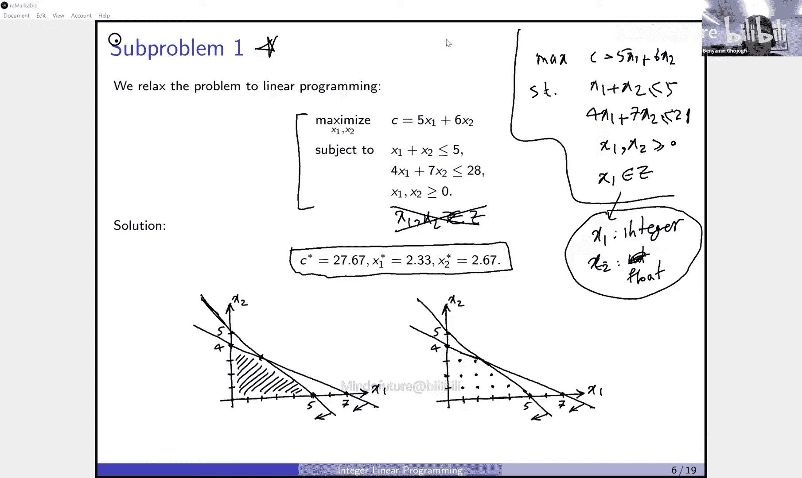
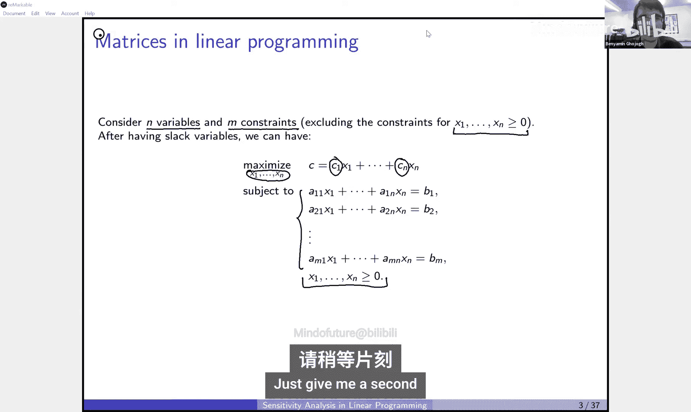
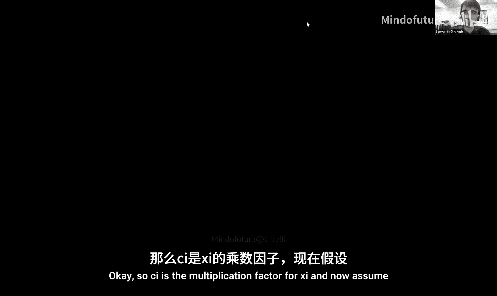
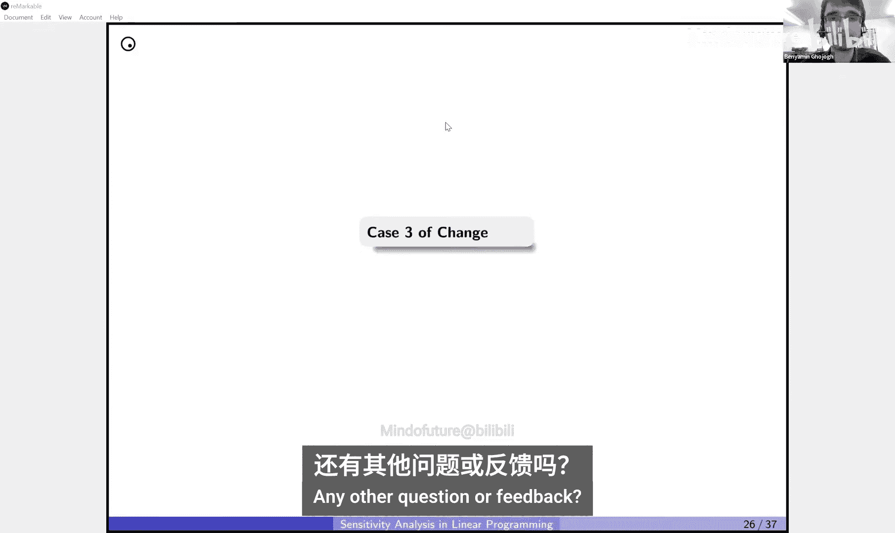

# 【滑铁卢大学】优化技术课程 ｜ Optimization Techniques   W2023 p04 P04_第四讲_(整数线性规划与灵敏度分析) -BV1oJCHBcEo5_p4-

Hi everyone okay。Now， is there any question。About the previous sessions。Please feel free to ask。

What about any question about assignment。Yeah， I think I'm just misunderstanding it。

 but when I was reading it。So could you please repeat could you please repeat hi when I was reading the assignment。

 my first impression for question two is that there's a fixed $3 loss of profit in total means that the profit of the overall problem is fixed at negative three。

 I'm assuming that's incorrect butd like some clarification on how that would actually look in the problem。

So， so the cost or the objective function that you have when we have a lot a fixed $3 loss。

 what does it mean means that。You should apply it in the。Our cast function， right as a constant。

Is that correct？Okay， so that's a constant rather than a constraint on the problem。

It's a con yeah constant。 And as the， the objective function is the。Profit， right， To profit。

 Therefore， you can， you can include it in the in your cost or in your objective function。

And if you remember， we talked about how to deal with the constants in the cost function。

 in the lectures。D remember was I was just confused about the wording of it it seemed very lovely all okay。

 thanks okay， thank you so yeah， whenever even in including exam assignments wherever you think that there is an ambiguity。

 please let me know please don't hold it。Ask and let it be clear。And yeah， also。

 so you can ask your questions now yes， I actually want to just confirm that the assignment。

 we need to do it on the pen and paper and we can just upload the assignment on the drop box。Yes。

 exactly。 you can write it in your paper and I suggest this is just a suggestion。

 you can use ca scanner on your phone。 You just install ca scanner and then scan by ca scanner from from your phone because when you take picture。

 it might not be visible very well。So if you use Cam scanner。

 I think it will be very and use magic color in the ca scanner。

 it will be like you are scanning that。So I think that would be this yeah。Oh pro， thanks。え。Sorry。

 does it have to be like handwritten？Sorry， I couldn't hear you clearly why does。Likes assignment。

 does that mean be like1 original paper？Or。The code are you talking about？嗯。Like this。The assignment。

 the assignment， Yes， you you， you can write it except the code the for the code part， please。

I will explain for the quote what to do。 but for the rest of the assignment。

 just write on the pen using pen on the paper and then afterwards at the end。

 take picture and use ca scanner rate。 This is my suggestion in order to have a very good scan of your paper。

All right， thank you， no problem for them。For the for the coding question， my suggestion is that you。

code in Python and then put。The screen urge。Put your code in a document like Word document or Google document。

 whatever you want， and then print it as a PDFf and attach it to the to your ca scanned solutions。

And also in the document that you're putting your code， try to explain a bit。

 not too much a bit what you are doing in your code， so open a Word document or Google document。

Right， put your code in a box in that and then explain a bit what you have done and then attach it at the end to your to the PDFf of your other solutions so and upload the whole PDFf if you can also upload the dot pie or or if it is Jupyter notebook your Jupyter notebook file in addition to the PDFf。

 that would be best so。The whole solution as a PDF。

 including your code and explanation and one dot P or dot the Jupipyter Note file that would be best。

So。Any anything unclear。About assignment。And by the way。

 I I I have tried to make the assignment straightforward and I'll I'll try to make the exam straightforward。

 So you don't need to worry about that， I think you have seen examples of what you have in assignment in the lectures。

 So if you read the lectures carefully understand them。

 I think it will be an easy assignment for you。But feel free to ask me questions either here or off class you can ask in the Team group chat Q&A chat group chat。

 I'm not sure why people are not asking questions。え？

I'm not sure whether it's a good sign or a bad sign。咩。

But feel free to ask more questions after the assignment。

Yeah， I understand。 But don't push it to the last moment， please。

 I think it would be easier for you to do it gradually。 And if you have any question， ask。

 don't push it to the last moment， Also， please don't submit in the last moment because I'm not sure about the system。

 I have put it 1159。 I hope it's ESD time zone。I'm not sure， but as we are。

 I think University of Guelphin is in ESD time zone， I think by default it's ESD time zone。 If not。

 I'll try to fix it， but even even if it is ESD It's deadline I it doesn't let me set the seconds of the deadline So it's I have set 1159 I'm not sure what second is it 1159。

59 or is it 115901 or00 so be careful， Don't submit in the very， very last moment。

 I'm not sure about the system。Okay， so we talked about the assignment， and I think。

In the next session， I will briefly talk about the project。

 I think next session is a good time to start talking about the project。

Of course it will be team wise， but how many people in each team also what to do and how to let me know your teams and this is I will talk about the details in the next session。

Yeah and。So I think， yeah， that's good。If any other question？Before we start。能。ok。Great， let me。

So sorry， Ola， there is in chat。 Sorry if we are new in Python。Aliisza has S。

Could you please extend the deadline。I was sorry， I。

 I we really can't extend the deadline for several reasons。The I think the biggest reason is that I。

 I need， I will put the response。The queue responds to course links。

 so you can study better for the exam。Have some reference responses。 therefore。

 I suggest please try to submit before the deadline。

And I experience has shown that if we change the deadline frequently， people will be frustrated。

 So that's why it's better not to change the deadline。 This is a deadline。

 So everyone knows the schedule， their schedule and try to meet the deadline about being new in Python don't worry about that。

 So I think Python is very easy， you can learn it in a few days。 even in one day， you can do that。

 If， if you know any other language。Even if you know Matlab or other languages。I think you。

 you already know the concepts of coding。 So you don't need to worry about that。

 Just I think it will take you at most one day to learn Python and what to do the best way for me。

To learn Python and these things is YouTube and YouTube search Python tutorial。

 there are some several hour sessions on YouTube。You can learn anything on YouTube。

 And I think YouTube is a very good source。 So just search Python。tutorial。

Or Python tutorial for beginners。 And it will come。 And just by several sessions。

 I put it in the speed to 2。 So with speed 2， you can watch very fast and you can learn very fast and then try to。

Practice a bit。 And I think you will no know Python。 And this also， this question is not hard。

 This question is not hard。 It's just a while loop。 And some if else conditions and these things。

 It's very easy。Also， please note that I say this from now so you can。Get ready for that。

 Don't be shocked。 I think I will teach you that。 I'm not expecting you to know that。

 I will briefly tell you how to work with that。 But we will have a question in assignment tool。

 We will have one coding question about。Using the neural network for optimization。

So and it will be several lines of code using we will learn libraries and why do we do that because your second assignment so this first assignment was about preliminaries and cake and linear programming in linear programming sensitivity analysis your second assignment will be about first order optimization。

One of the nowadays very important and famous first order optimization methods is neural network。

 right？It will also cover that a bit and I will let you know how to use Pythtorch so you don't need to worry about that。

 but at the end of the semester youll see that you have learned a lot。

 you have learned a lot in different areas of optimization。So this will be worth it。And also。

 your third assignment will be about second order optimization and notice method。And these things。

 still。We will go over these things and you will learn a lot and I am sure you will enjoy that。呃So。

This is okay， any other question no。Okay， great。 So let me share a screen。诶。Okay， great。

 So one thing that I want to let you know before continuing is that in BM method。

 you might be wondering so recall the examples that we cover， we cover two examples in BM method。

 one of them is this。 And you might be wondering how so if you see in the0。 we have minus150 m right。

 here。Then by elementary row calculations， the M is canceled somehow。

You might be wondering what if it doesn't get canceled。 Yes。

 in some of the steps it might not get sample canceled， but usually at the end。

 you will not have m in the0 So its either either because if we have m in the0 we might we might have minus minus m。

 which will be minus very infinity or we might have m which will be huge number a huge positive number and explode the objective function。

 therefore in both cases， it's not desirable。 So usually m gets canceled in some cases。

 M doesn't get canceled。 usually in those cases， at least one of the artificial variables is not0 at the end。

 So we reach some a case that all of these values or in the0 will be non negative and suddenly you'll see that。

By the way， we have some M here and also the some of the additional variables are are non zero。

 So some at least one of these basic variables become additional variable。 So in these cases。

 usually the the optimization problem is infeible。Please note that when this we have a feasible solution in optimization。

 all of the additional variables， additional variables that we use in the big M message should at eventually become zero otherwise。

 in in other words， the additional variables should become。Non-ba variables。 why。

 because we added additional variables multiplied M in the cost function。 Of course。

 they should become 0 to cancel the effect of， even if they are tiny they might explode the cost function。

 right， Therefore， at the end， additional variables must become 0。 If they don't become 0。

 It means that the solution。 The optimization is in。 doesn't have any solution。Okay。

 this is one thing that I wanted to let you know。诶。嗯。Also the reason for Tau method。

 if you remember we said let's briefly talk about it because we had huge pace at the end of the previous session。

 let's briefly cover that again。When we have an optimization problem like this。

 we convert it to this by slacklack variables。And here we have7 variables。

 including the slack variables， but we have three equations， right。

 And this is the default constraint。 I'm not talking about that。

 These are three equations in the constraints。 So it means that in the。In the tableau method。

 we will have three rows。Except0 so we'll have three rows and it means that we have we'll have three basic variables it means at the end three of them will be non zero and four of them will be necessarily zero right so let's choose three out of seven it means that we have 35 cases for having basic variables let's cover some of them for example。

Here， let's take x1 to x4， which are the main variables。

 let them be non-bas variables and let the slack variables be the basic variables and see what happens substitute this x1 to x4 equal to0 in the optimization problem and you'll see that so here if I said x1 x2 x3 x4 to 0 the cost function will become 0 and these equations will be simplified to this。

To this， right？ And therefore， S 1 is 50， S2 is 42， and S 3 is 250， and the cost is 0。 Now。

 let's go to another。A situationituation where we get x1 x4 S1 S2。

 set it to0 and the basic variables let them be x2 x3 and S3。

 Okay let now let's maximize this So the cost becomes 6 x2 because the rest will be0 and the constraints will be simplified to this right and if you from this you can get x2 substitute this in the first constraint。

 you will get x3 and then put it here substitute here you will get S3 and you will have this and the cost will be6 x2 S star which is 84 So now compare this cost with the previous cost。

And you will see that the these costs， the second cost that we found is better。 Therefore。

 this solution is better than the previous solution。

 These are better basic variables than those three chosen basic variables previously。Now。

Let's come here so a fundamental question here is that which variable should we increase which maximizes the cost function the most or which variables should we take as the basic variables right for example in this cost function that we have we want to maximize this cost function right so we can change x1 x2 or x4。

 which one should we increase which has the most effect on increasing C。Of course， yes。

 what which one？X4。X4， does x4 increase the cost x sorry X x x2 x。Yes。

 exact x2 because when you increase x4， the cost will Yes exact。

 So let's increase x2 because it has6。 It is multiplied by 6 X1 is also multiplied by a positive number。

 However，4 is less than6。😊，Therefore， x2 is has the most effect。

 Now when we bring the right hand side of the cost to the lefthand side。

 as we do in the tableau method this means that the most negative number which is multiplied by that variable Let's take that variable as the pivot column right that's why we take the most negative value in the0 why we want to find the in the pivot column we want to find the variable which maximizes or increases the cost the most because we are maximizing right So this is what we are doing in tab that's why in tableau method in the0 for maximization problem we find the most negative number like what we have done here Okay。

 what's the reasoning so that was the reasoning behind pivot column What's the reasoning behind mean test and pivot row So let's see here okay now consider this constrain and con。

And this is a cost， right？X， x2。 Okay， assume that。Give me okay in the first constant。

 the worst case scenario is that x1 equals x3 and S1。

 they are all let let them be0 and the most we can increase is x2。So again。

 after choosing x2 as the pivot column， now let's go these to these constraints one by one。

 consider the first constraint x2 we are considering x2 as the pivot column in order to increase x2。

TheWhat is the worst or best or worst worst case scenario。

 What is the extreme case scenario is that we set x1。

 x3 and S1 to 0 y because they can't get negative right， So the the least amount for x 1。

 x3 and S1 is 0。 So let them be 0。 So we have the most value for x2 in the first constraint。Right。

 is it clear， so assume I put S1 as 10 and x3 and x1 as 0 x2 will be 40 because 40 plus 10 becomes 50 40 is less than 50。

 We want to assign the most value for x2。For the chosen next2 in the PV column。

So that's why we are setting the other ones to zero。Now in the next con。We are considering ex stool。

Let x1， x 4， and S2 be 0。Extreme case scenario。 So the biggest value for x2 will become so 3 x2 will become 42。

 so x2 becomes 42 divided by 3。And now you see we have done this in the Min test exactly here。

 that's why we are dividing right hand side。To this。

And this is the multiplication factor of x2 in the first constraint。

 also we are dividing 42 by 3 and what is3，3 is a multiplication factor in the second constraint。

Also again， in the third constraint。The extreme case scenario is we don't have any x2， right。

 we don't have any x2。Extreme case scenario that we set them to any number。

 but we don't have economic。 So setting x3 and x4 and S3 to any number doesn't have any impact on the x2。

 therefore you can consider0 alpha equals2 any250 if you set x3 x4 S3 to0。

 you will have also0 times0 times x2。 So x2 becomes infinitely So now let's take here。

Consider these X2。This and this， we have these， right， They have these three。

Which we have done in the mean test as well。 Now， what is the biggest increase of X that we can have。

 it will be the minimum between among these right， because if you take infinite。

These two constraints don't allow that。 You can't increase x2 to infinite because of these two constraints。

 Now， consider， for example，50。 if you take x2 as 50， what happens。

 this constraint doesn't allow that。 It says that if I put x2 to 50，3 times 50 becomes 150。

And but this means that and the right hand side is for2。

 It means that2 x1 plus x4 plus S2 will be negative。 How is it possible。

 Because x1 and x4 and S2 are non negative variables。

 Do you remember in the we are talking about the standard of linear programming optimization problem。

 right， That's why because so we should take the minimum among them because the the minimum increase of x2 will have will restrict others to and to increase。

 That's why it's called mean test。 We take a minimum among them。

 This is a minimum that we can increase x2 for increase in the cost function。

Now this explains why we choose pivot row based on the mean test is the reasoning clear？

That was why what is happening behind the scenes for the tableau method， that's why。Is it clear？It。

And as you see in the simplex algorithm。😊，We are moving from extreme point to extreme point and from an extreme point to its neighbor extreme point in order to increase if we are talking about maximization。

 in order to increase the cost function the most， for example。

 if I'm at at one of the extreme points。 and I have two other extreme points。

 three other extreme points， for example， one of the extreme points which is neighbor to me。

 makes the cost function worse it has less objective function than me。 Therefore。

 I don't move toward that because I want to increase the cost function。 Now。

 consider that the two other extreme points， let them have higher objective function value than me。

 therefore move into either of them， will improve the cost function。

 but you tell me which one should I go to。Which one should I go。Can someone answer。

Assume I am in an extreme point and I have two other extreme points。

 the third extreme point for example， it makes the cost worse， I don't go toward that。

 There are two other extreme points if I move to either of them they will be they will improve the cost function。

 but which one do I move to how can I decide which one is better。And if you answer me， please。

I will appreciate that。Okay， let me explain this way。 As at this point， my class is 40。

At one of the extreme points， my class is 30， so it gets worse。 I don't go from 40 to 30。

 I want to maximize that。In another extreme point， my class is 42， in another extreme point。

 my class is 48。Should I go to the extreme point with cost of 42 or should I go to the extreme point with cost 408。

I think I don't have your voice。 Are you answering me。诶。For okay， the cost， the cost 48。 we， we want。

 we need to go to cost 48。 Yes， someone in the co chats has， as the direction with higher a slope。

 not necessarily with higher slope。 the we should go to the。

Because we are not moving toward along the the directions necessarily we want to move along the direction which increases the cost the most。

 as Ashman has said， 48 is the correct answer， right？So， okay。

Now let's go to the dual problem for minimization。Well there is one okay。

 what is dual problem and dual problem will be introduced to you in KKT slides better。

 but here just for the sake of understanding it。When we are。And miniizing a cost function soon if。

We can find the dual problem which maximizes another function G and the solution of minimization of f。

 so the argument of f will happen at the same max of G。

 so whenever we have argument of f or arc G they happen at the same time。If so as you see。

 minimization of one of them is maximization of the other one。😊，If we have a maximization problem。

 if F is this， we minimize a problem， we find a problem， a minimization problem。

 and that would be the dual problem for this maximization。Again， as you see here， there is a duality。

 So either you have a minimization， you convert it to a maximization problem or you have a maximization。

 You convert it to a minimization problem。 So one of them is a dual of the other one。 and。

 and we'll see how we can find dual problem for linear programming。

 Consider this minimization problem。 So so far， we talked about maximization and linear programming。

 Now let's talk about minimization。😊，So when we have a minimization problem。

 let's use dual problem for minimization in order to have a maximization problem and then solve a maximization problem and an example minimization problem is this where the constraints are here。

 for example， greater than or equal to something in the maximization we usually had we usually had less than or equal to right。

 but the objective variables are still non negative。え？Consider that this example again。

 now we want to find the dual problem for this optimization problem。 What should we do？

Consider the first constraintstrain here。Here， right。I multiply it by some variable。

 which is non negative。Some non negative variable， and it will have y1 x1 plus 2 y1 x2 greater thanrick to 40 y1 right and y doesn't it change this direction of the inequality because the y1 is non negative We also do the same for the second constrain。

And we use Y2。And well have these。 So these two will have Okay， now let's sum these together。

 sum the sides of these two together and we'll have these。

 So if we sum the left hand side will get this if we sum the right hand side willll get this right and the inequality are both greater than or equal to So we'll have this on the other hand。

This means the cost of the。Yeah。呃。Minimization problem， right？And诶。

We want this to be the best lower bound for this cost。 As you recall， I said。

 when we are minimizing some function。😡，The dual problem tries to maximize some other function。

 And as you see， this other function is a lower bound is always below this F function。

 So it's a lower bound。 When it's above some some function It upper bound。

 So F is upper bound of G here， G is lower bound of F。 we want to find the best lower bound。

 So consider this to G， So for this F， let one of the G G1 be this and G2 be this。

 Which one is a better lower bound for F。 Can someone answer me。

Which one is the closer lower bound to F？He won。G1， exactly， you know， in technical words。

 this is a tighter lower bound。 This is a tighter。 Thank you。 Yeah， also， someone said G1。

 So it's a tighter lower bound。 we're closer to the function。Here， therefore。

 we want to find the best lower bound， the tight lower bound in dual problem。

 that's why we are saying that let it be the lower bound for the actual the actual cost function that we have in our minimization problem。

 Now， consider these two， I'm repeating them here。I'm repeating those two inequalities here。

 now let's consider these two together so these。Is greater than this。Also。

 the same thing is repeating here these。Is greater than this。Right？Therefore。From these， from this。

 we can this， we can decide this we can it it implies this why y 1。

 the what is the multiplication of x1 is y 1 plus y2。

 and we have also the factor 12 for x1 Also we have two y 1 plus y 2。

 We have the multiplication factor 16， right， and this is。Greater than equal。

 It means that 12 is greater。 you know， in order to have this inequality。

 we should have 12 is greater than a equal to y 1 plus y 2 here。

Also 16 is greater than oric equal 22 y1 plus y2， we have it here， right。And also。

 this is a lower bound。That we want to find for the cost function。 This is the cost of minimization。

 We can call it F。And we can call it cost of G， the dual problem， right。F is this。

 we are minimizing it and the dual problem has a function G which is lower bound and this also this inequality。

 these two inequalities show that these G is a lower bound for F and therefore we want to maximize it because as we talked about it in dual problem whenever we maximize a function G。

 it means that we are minimizing the function F。So we maximize。

The cost function of the dual problem and the variables now are y1 and y2。

 So the variables changed in the primal problem， this is called the primal problem。

 the minimization here or f in the primal problem our objective variables were x1 and x2。

 But in the dual problem we are calling it y1 and y2 we can call it call it anything but we are calling it here y1 and y2 Now we are maximizing for this lower bound。

 we want to find the best lower bound， the tight lower1 that's what we are maximizing it and we also have these two constraints that we found So we'll have these。

Problem。Maximizing these with these two constraints。

 And we also assume that these two variables are non negative。 Why， Because when we were multi here。

 recall here。When we were multiplying the sides of constraints by some variables。

 they should be non negative in order not to change the direction of inequalities。Again， as you see。

 what is it， did we have that？😊，This is exactly linear program in maximization。

That we had in previous slides， right？So you can see that when we had when we have some minimization in linear programming we can simply find the dual problem for that and it becomes a maximization problem and then we can solve it using the tableau method that we already discussed that's very simple。

 So the max this maximization problem is exactly what we had before and don't be confused with the names of the variables So in mathematics。

😊，We have whenever we don't care about the name of the variable。

 we call it dummy variable what does it mean， for example， for example， an example。

 sigma I from1 to n。I I 2，30， for example， I is squared。 What is it。

 It is1 a squared plus 2 is squared until 30 squared。

 Does it matter if I change this to J equals 1 to 30。 No， does it matter if I say J chair。

From 1 to 30， No， so J squared chair squared。Doesn't I don't care about the name of the variable here that these variables are called gummy variables Also here we are solving some optimization problem which has some variables and these variables can have any name you can call the variables x1 x2 you can call them y1 y2 you can call them chair 1 chairer2 you can call them anything right that's why I don't be confused with the name of the variables these are your choices to choose a name of the variables。

😡，Clear so far。Right， okay。Now let's solve this example， for example， the dual problem that we found。

 let's solve it very quickly。 We have the variables。

We have the slack variables so we converted them to the inequalities to equalities by a S variables and we form the table and we get the biggest negative number in the0 minus 40 so this is the pivot column。

 we do the mean test and we get the minimum among them and this chooses the pivot row and then we do the elementary rowwise calculations so we'll have this table let's go to the next slide。

Okay， I have then get， let's get the biggest negative number in the0。 It gives me the pivot column。

 Now let's do the mean test and take the mean among them and so this gives me the mean the pivot row Now let's do the elementary rows calculations。

 I will have this table and I will see that in the0。

 all of them are non negative this is non negative。 All of them are non negative great So it's done。

 optimizationim is done。 and from here we can say that y2 is a basic variable。

 which is8 and y1 is a basic variable， which is4 and the other ones are the。😊。

These two the stack variables here are the non basic variables。

 let's check whether our cost optimal cost is correct or not。

 so if we substitute these into the cost we'll get 400 which is correct。

And there is a theorum in linear programming the that says that strong duality holds for linear programming。

 So let's briefly explain explain what strong duality and weak duality are。

 We will go through them in the K Kt slides。 What here just we briefly mention that。

 What does it mean， Do you remember， I said。When we have a cost， if。

It's dual all G or vice versa if we havet here we are minimizing here。

 we are maximizing we have we might have a maximization of F and minimization of G doesn't matter。

There is a gap here。Right， and as we discussed the dual problem consider this case for now for simplicity。

 the dual problem is always a lower bound for the primal problem So if the primal problem is a minimization problem and if the it dual becomes a maximization problem。

 then the dual function here will be always a lower bound。 So we never will have such such cases。😊。

Always， G is below F。And vice versa， if our primal problem is a maximization problem。

 its dual becomes a minimization problem and it means that the dual function is always an upper bound for the primal function。

Doesn't matter。 I'm saying that it this never happens。 This never happens， right。

So we have either two cases， one of these two cases。Either we have some gap， positive gap。

 or the gap is0。Both in both of these cases。G， the dual problem is a lower bound for F。

 which is the primal problem。Is it clear so far？In both of these cases， right？This is called。

Weak duality。An optimization。 And this is called a strong doology。This is a better case for us why？😊。

Why is it better， do you think。Assume I was going to solve an optimization problem minimization of F。

 but it was hard， I converted to that to a dual optimization problem。

 so I'm maximizing G assume I solve a maximization of G and I get some variables and I find the maximum of G Now if I'm in a weak duality。

 the maximum of G is here right if Im in a strong duality。

 the maximum of G is here in both cases are I have found the maximum of G you please tell me。

From the maximum of G， can I find the minimum of f in weak duality or strong duality？Well。

 I guess in strong duality， it could potentially be equal depending， I guess， like how strong it is。

When we say strong， it means that the gap is zero。Well， then， yeah， it's equal。Equal exactly。

 So in a strong dual， the maximum value of G is equal to the minimum value of F。Right。

 but in weak dual， there is a gap。 So when we find the maximum of G G plus something becomes the minimum of f。

That's why a strong duality is bitter for us if we have a strong duality。

It means that we are relieved a bit。And usually it's very hard to hold， usually we have weak duality。

😊，え？But I think in practical examples， we might have a strong duality。

 so there is a condition that we will talk about the Slater's condition in practical examples。

 we can see that in engineering problems and these things strong duality can be assumed。Okay。😊。

So there is Ethereorum in optimization that we don't go over that it has proof the saying that a strong duality holds for linear programming。

So when you have found the maximization of G。Which is 400。 What， What does it mean。

What is is the minimum of f here？What was the problem， Let Let us go back to where we started from。

 this problem， This problem， right。Minimization of this。What is the minimization of this？😊。

Because of the strong dualities equivalent to maximization of this。With these constraints， for sure。

 with these constraints that we have。The maximum of this was we found it is 400。

 therefore the minimum of that function with those constraints is 400 as well because we have a strong dual。

So far clear。Okay， again， the problem that we have in hand is primal problem。

 the problem that we find for it we convert that to if it is minimization。

 we convert it to maximization， that problem is dual problem， So the primal。

 if the primal problem is a minimization， the dual is a maximization。

 if the primal problem is a maximization problem， the dual is a minimization。So I think。

You can consider them in order to remember， you can consider them as two reversed bowls。

One of them is going up。 One of them is going down and there is a gap。

 and a non zero gap between them。 sorry， a non negative gap。 It might be zero gap。

 It might be a positive gap， but the gap can't be negative。 So it can't be like this。

 It's either like this or this。 This is the intuition behind the。

Primal and dual problems Now let's go to Du simplex algorithm。

 so don't confuse it with a dual problem。For in the previous slides。

 we said that we have an optimization problem， let's find the dual optimization problem for that and then you solve it using the simplex method that we already explained in the previous slides right and the previous session。

However， we are now introducing Duwell's simplex method。Again。

 the difference we are now explaining Du simplex method in the previous slide we said let's convert it to a dual problem and solve it using simplex direct simplex method。

Here you are saying that， okay， what we had solved， we found the optimal cost function。

And because of the strong duality， we said that the optimal of the optimal value for the function in the dual problem equals the optimal value for the function in the primal problem。

 we have found that， however， what if the variables also the optimal primal variables are important for us what we solved in the previous slides。

Didn't give us the optimal primal variables， It gave us optimal dual variables， right？

So now for finding this， we can say that let's use Duall simplex method。And what is it， it says that。

I will explain to you what what it is， but how does it work for minimization for miniizing。

 we also can do do all simplex methods for maximization will cover an example for it。

 but for minimization it only works if all of the。😊。

Multipplication factors in the cost are non negative。And also。

 at least one of the inequality constraints is greater than or equal to zero， I will tell you why。

 I will tell you why。Let let me first explain the Du simplex method and you will see the reason behind that。

So。Here this is a minimization problem， I don't want to convert it to a dual problem。

 I want to solve it directly using Du simplex method so consider this。

This is a pain in the neck right， these were in the standard optimization problem for linear programming because it is minimization in a standard problem we have less than or equal to。

For maximization， we had greater than or equal to right now for the for this inequality。😊。

We have this。We can convert it to less than or equal to which we desire in the standard linear programming problem for minimization by multiplying by minus-1。

Right， we have greater than or equal to less converted to less than or equal to。

So if we do that because of minus1， the direction of the inequality is reversed。

These three become by slacklack variables become these。And here。We also have this。

So because if you remember whenever we have less than or fault2。

 we use slack variables because we can say that this is less than minus 150 because of this slack variable assuming that the slack variables are positive。

 so we also should say S1， S2 S3 and S4。Are less are greater than or equal to 0。

 and here we also have these variables。Right？Now we have this problem。Now let's solve it in this way。

First in the dual simplex method as is name shows， we choose the pivot row。 So in the simplex method。

 we chose the pivot column first and then the pivot row in the dual simplex method is the other way around We first choose the pivot row and then the pivot column for the pivot row。

 we say that look at this it's something like you are transposing the table and in the right hand side column choose the。

Most negative value remember in the simplex method which in the0 row。

 we chose the most negative value now in the dual simplex method in the right hand side row。

 we are choosing the most negative value， so this gives us the pivot row。

And now let's do the mean test in this way， mean test it changes a bit again。

 it seems that you are working with the transpose of the table。

 so you divide this by any non zeroro values of the0。😊，诶。So， sorry， sorry。 You divide。

 apologize apologize。I apologize， Let me repeat this。You divide the non0 values of 0。

 which are these， the nonze values of 0 by the negative values of the Pvetro。Right。

 the negative and you take the absolute value。😊，So minus3 divided by minus1。

 take the absolute value becomes3。If4 divided by -2， take the absolute value is 2。

 So now take the mean among them， which is 2。 So this is the pivot column。Again。

 I think if you consider it as working with the transpose of the table， it will be obvious for you。

 it's similar to what we had but transpose of the table。

And so we chose the pivot column and pivot row and now let's do the elementary rows calculations as before。

 so we have row one， row 2， row3， row4。And we want this value to become one。And the rest becomes 0。

 So I want these to become 0， and this becomes one exactly。 So again， exactly as before。

 henceforth is like before。 So here I should say R 2 plus R 4 time divided by2 big makes this row 0 and these things。

 Sorry， here for this row， for example， here。 I say R 1。Mus R2。For this second row。

 I say r2 plus r4 divided by 2 for the third row I say r3 plus2 r4 and for the fourth row。

 I say minus r4 divided by 2 and for for the0， I can say what you tell me R5。So R 5 plus 2 r 4。

This gives me And now let for determination condition is this again。

 like similar to the transpose of the matrix， all of the values in the right hand side column should be non negative。

Previously we we the termination condition was all of the values in the。0 should be non negative now。

 we are talking about right hand side column。 So now at the end， what is this。Again， like before。

 S1 here。Is a non base is a basic variable 525 S2 star is a basic variable，150。S 3。Is。700th。An x2。

The star is 75 and C A star is 300。 You can also check that C a star is correct。 Now， as you see。

 we have found the optimal variables in the primal problem。using the simplex method for dual problem。

 we couldn't find theum value optimal objective values variables。

 but now using the dual simplex method， we can directly solve the minimization problem and it gives us both the optimal objective function and optimal objective variables。

So far clear。Is it clear so far， any question？Yeah， it's clear。 Okay。

 just one more thing that I wanna， I want you to understand is that in both minimization and optimization problems。

 when we have less than or recall to。We can use the slack variables， right。

 Do you remember when we had greater than or equal to。

 we were using either big m method by using two variables or or we can use this technique multiply it by -1 and we have this。

 however， when we multiply it by-1， the right hand side becomes negative and this forces us to use the dual method。

Because we'll have some negative value in the right hand side column if you remember if you go back to the previous estate in the right hand side。

 we didn't have a negative value。And it's obvious why because whenever the variables are non negative their summation are usually non negative。

 that's why usually in the right hand side you see a positive numbers in an linear programming however when such cases happen and we are multiplying the size by minus one we are making one or several of the variables in the right hand side the numbers in the right hand side column negative and this forces us to use the dual simplex method another thing that I wanted to lets you know that I think it's very interesting before I go to the to that next slide。

诶。I want you to understand the reasoning behind every step。So， here。In BM method。

This is a great technique in optimization in BM method。

Let me bring it because this is important to note。What？Do remember， we had this。

 Let's consider this again。X1 plus2 x，2。Is greater than or equal to 150。

 So we have a greater than an equal to。 We can't use a slack variable。 Why。

 Because we said whenever if we say assume you use a slack variable。Yes。What does it mean。

 it means that because these are non negative。And also this is greater than to it means that S is negative。

What S can't be negative in the standard problem， or S will be one of the objective variables， right？

All of the objective variables should be non negative。 So this doesn't work for us。

 We said what was our technique or trick， What was our trick， We said。

 let's replace S with two variables。Saying that one of them let it be additional variable。

 Let's call it additional variable。 The other one， let it be excess variables。 Now， this can be。

Correct， because both of these a and E can be non negative， but a minus E might be negative。

 So whenever you have some variable here like E that it needs to be negative。

 but at the same time it needs to be positive， you can say， okay。

 I replace this variable with two with some one variable minus another variable。

 let those variables be be non negative， but based on their values， the difference of their values。

 a minus E might be negative。And this also works for when you have an optimization problem。

 you might be wondering so far， whatever we said in the linear programming we are assuming that the variables are not negative。

 right？There is a valid question that what if the optimization variable is non negative is negative。

Or non positive right what if you have an optimization problem where x1 might be negative in those cases。

 you can replace x1 assume you have some x1 less than or equal to0 in the constraints you can say I will replace replace x1 with。

X1 plus x1 minus whatever， whatever name you want to choose doesn't matter。 K minus Z。

 I replace x1 with k minus width or K1 minus z 1。 I assume K1 is greater than or equal to Z1 is greater than or equal to。

 but the K1 minus z1 might be negative。So you see the technique whenever you have some variable。😊。

You it needs to be negative， however， at the same time it needs to be positive why because in a standard problem you have to be you have to have your optimization variables non negative。

 then you can replace it it's a trick， you can replace it with a positive non negative number minus another non negative number。

 but based on their difference of values。That can be negative。

 So this is a good technique clear so far。Yes。Yes， okay。

 that was the the trick used in a big M method as well。Right。Okay。

 let me go to that slide that we were。😔，An。Oh， okay， we are here。So we said that the dual simplex。

 we use that dual simplex method。 We use that for solving minimization problem。

 We can also solve it for maximization problem when to deal with the greater than or equal to constraints。

 Do you remember。In previous slides we said in maximization problem。

 we assume that all of the inequality constraints are less than or equal to if we have greater than or equal to or equality constraints。

 in other words， if we have mixed constraints we use BM method However。

 there is another way to deal with greater than or equal to constraints in maximization problem and that's using dual simplex method for maximization we are going to cover it here Okay what is it so。

Again， the same thing that we had in several slides before so assume that here these are less than or quality to so we can simply use the slack variables for them。

 however we have a greater than equal to inequality here so this is a pen in the neck right what should we do we can convert it to regular less than or equal equal to constraint how by multiplying it by minus1 so we' have this however another pen in the neck appears and that's minus1 in the righthand side and we should deal with it with dual simplex method。

So these can be simply converted to these by slackla variables because it's less than or equal to now this problem is converted to this so these three were simply converted to these by slacklack variables but this needed a multiplication by minus1 and then having a slackla variables and now all of the variables including the slack variables are non negative so this is a standard。

Optimization problem。 Now， let's use the， let's form the table for it。 So this is a table。 However。

 we have a minus1 a negative number in the right hand side column。 Therefore。

 it forces us to use the dual simplex method。 in order to do that， we said that。

We choose this pivot row as we we talked about it before。 So this because it's negative。

 So we choose this。 and then we do the mean test。 So for mean test。

We say five absolute value of 5 divided by -1 is5， but the rest are。0， so we ignore them。

10 divided by 0。 We ignore them 1010 divided by 0。 We ignore them。

 We also ignore these because these are we said in the mean test。 We choose the non， non0。

 let me show you for recalling。 we said。For mean test in here in the dual simplex method。

 divide the non zero values of the0。By the negative values of the Ptro。Okay。So we。

 this gives us only this column。 This will be a pivot column。

 Let's do the we do the elementary rowwise calculations in order to make this one and the rest。isデ0。

We have done it here and then we solve it and CO here now in the right hand side column all of them become non negative so we can see that S1 is S1 stars 26 and so on and we can also check that CS star is correct so as you saw we have two ways to deal with a greater dynamic quality2 constraints in maximization problem in linear programming either we use BM method or we use dual simplex method okay。

This lecture was inspired by the lectures of Professor Shokufeirzai you can on linear programming and you can see her lectures on YouTube I have put the link here。

 Ill also put it in the description of the YouTube channel and yes I think her slides are very her lectures are very good for linear programming。

And this is the reference for the first simplex method that which was proposed in 1983。

 Any question before we move to Inte linear program。能。Ok。So。Let's do。诶。Okay， someone said something。

Not right now， okay。え。So。啊。Integer linear programming now we are done with the linear programming。

 let's go to Integer linear programming。 Do you remember linear programming， We had it here。

So Integer linear programming is the same， but it has an additional constraint。

It says that the optimization variables are integers。Either all of them or some of them。

If all of them are integers。If some of them are integers and some of them might be float or non integers real。

 then we'll have mixed integer programming。Okay。え。And usually， so this is integer linear programming。

 usually when we say in the literature， we say integer programming integer。

 as I we had talked about it before programming means optimization。

 Integer programming means integer optimization， it means that any optimization problem whose variables are should be integer。

 right。In other words its objective variables are discrete， it's not continuous。

 it can be for example，0，1，2，3 or minus1 minus2， so it can't be a value between 0 and 1 or something like that it's not continuous。

 it's discrete， it's domain is discrete。And so integer programming refers to any optimization problem whose variables are integer。

 but however， usually when in the literature they call integer linear programming。

 they refer it to integer programming sometimes so whenever you hear integer programming they might be meaning integer linear programming。

It means that the linear programming whose optimization variables should be integer。An example。

Do you remember we had some practical examples for linear programming？

This is the same practical example， but I have changed the amount to number。

So in that linear program you said， okay， let's as soon we have a company producing two products and let x1 and x2 be the amount at that time。

 said we said let x1 and x2 be the amount of the first and second products to be produced and that amount can be any scale like such as kilograms grams centimeters or meters and these are continuous because the length is continuous。

 the weight is continuous and this is however in your optimization problem。

 it might be the number of products。So one candy， two candies， three candies， something like that。

 then the variables are not negative again， but they are integers。So。

 and the the rest of the problem is the same。So you have these， but the variables are integers。Okay。

 an example is here。Assume that we are maximizing。This problem。And。The cost here。

 these are the constraints。This is a default constraint。

 this is another default constraint for integer linear programming right。

 but however you might have only x1 is integer or only x only integer then in those cases it will have mixed integer programming。

 however when both of them are integer its complete a complete integer programming。

And if you remember， so these are we can draw x1 plus x2。Less than 5 is this constraint。

And 4 x1 plus 7 x2 is less than or equal to 28， so it will be this constraint。Right。

And x is and x2 are greater than or equal to0， so they will be these constraints。

And we know that X1 x2 our integer before that and up to this point。Up to this point。

 our optimization problem was a linear programming problem， which is this， right， however here。

When we we say it's integer， it means that x1 and x2 can be only integer。

 therefore we are only on one of these points。Because here， for example， x1 is 1， x2 is 1 here。

 x1 is 2， x2 is 1。So and we can't go outside of these constraints。

 so we are only here as we drew here， however， only integer values of x1 and x2 within these feasible set。

 so the feasible set will be only on these points that I'm drawing。And only on these points。

I can't be here。 I can't be here。 I should be only on these points， so far clear。Also， these points。

Are in the feasible set because they might be0 to。Right。😊，Yeah， it's clear， Okay， great now。

Two very important questions for you to completely understand Inte linear program。

 The first question， and I'm happy to hear your answers first。Is Integer optimization。

 forget about linear programming an integer linear program。

So we have either continuous optimization or discrete optimization and one case of discrete optimization is integer optimization discretere optimization is more general for example it can be the feasible set is discrete but it is not necessarily integer sets right it can be for example。

 one，2 and half three，3 and half4，4 and half something like that it's still discrete but it's not integer anymore integer optimization is a special case of discrete optimization let's talk about continuous optimization versus discrete optimization。

Or integer optimization doesn't matter。You please tell me which one is harder。

 is continuous optimization harder。Or in discreet optimization。呃Disre。Yes， and can you tell me why。

Yeah， continuous， like we can just look at it and like you can just。呃。Like look it's a curveb， right？

So right yeah。Exactly exactly you're right， so we can move toward our solution with any step that we want right and hoping we reach that so and we are also smooth so as you said we are curvy so we move and the cost or the feasible might not the feasible set might not be smooth。

 but still we can move in the feasible set easily。😊，However， in the integer programming。

 we need to jump。Right。For example， here， my physical set like this， I jump either from here to here。

 here to here to here， I can't move with a fractional step， something like that， is that clear？😊，Yes。

😊，Yes， but why， why couldn't we？Solve the problem like it's continuous。

 so like an example would be in in the image you have it's it's roughly。

Like one two33 so let let's say you get the answer like 3。23。1 like for x and y。啊。

Okay couldn't you round cant you round down and okay then just get the answer three like why why couldn't we do that we we can do that we can do that what you're saying is that basically let's reduce or relax we can use any of these words for it let's really relax or reduce our。

ADcreet optimization problem to a continuous optimization problem。 solve the optimization。

 continuous optimization problem and retrieve the solution of the discrete optimization problem from the solution of the continuous optimization problem。

 This is basically what you're seeing， right。Yeah， yeah so this is exactly what we are going do for solving Inte linear programming。

 so we relax Integer linear programming to linear programming， solve it。

 and then we retrieve the solution of the Inte linear programming from the linear programming So this is exactly a good idea that came to your mind and this is yes。

 how one of the ways to deal with discrete great optimization is's not the only way there are other ways to but one of the easiest ways is that let's relax it let's relax it So relaxation in mathematics is very well used So people use it very much however your relaxation shouldn't in any optimization or any mathematical problem you have or engineering problem you can relax but you should be careful that your relaxation shouldn't falsify some of the constraints of your system right So sometimes the relaxation completely。

😊，Changes the problem in a way that the solution of the relaxation is never related to the solution before relaxation。

 So you should be careful how to relax your problem。 However， as you said。

 soon that if we relax it in a way that it doesn't drastically change the problem。

 then we can retrieve the solution from the continuous solution。Yes， exactly， as correct。So。

The second question is that。Is the optimum value of the objective function。No no now， so before that。

 according to the first question， therefore， Integer linear programming is much harder than linear programming。

 So in general， con discrete optimization is much harder than continuous optimization。 Now。

 let's go to the second question。Now let's only focus on linear programming and inte linear programming。

 I'm not now generally talking about discrete create optimization versus continuous optimization in the second question。

Specifically for Inte linear programming， is the optimum value of objective function in the Inte linear programming better or worse than the value in the linear programming？

Optimum value。So I'm mean CSs star， the CSs star in Integer linear programming versus the CS star in linear programming。

Which one is better So assume I assume I have a maximization linear programming。

 I have another maxim integer linear programming， both optimization problems are the same except one constraint in the integer linear programming the optimization variables should be integer so except that they are completely the same the constraints and the objective variable the CSs star which one will have the higher CSs star。

Can you tell me。To say your guess。Like so you're asking which value is better or worse but wouldn't that depend on。

The wouldn't that depend on the question like if you're asking some some questions would require whole numbers like if you're getting the maximum of people。

 you can't have like say 4。2 people so then。You'd want an in you'd have to solve it using an integer right to get a whole number Yes so that depends on the question assume that the problem can be either continuous or discrete I'm saying that assume consider these two I understand that some optimization problems can are only discrete optimization problems。

 but i'm not talking about that I'm saying that assume I have two optimization problems exactly like this。

I'm copying this here。Everything except the last constraint。These two， so problem one。Problem，2。

Exactly the same， except the last constant saying that X one and extorant。

And when we are maximizing this cost， the same cost with the same constraints。

This gives me C1 a star。 This gives miss C to a star。

 What is the relation between C1 a star and C to a star。We have either C on a star。

Greater than or equal to C to a star or C1 is star less than or equal to C to a star。

 Which one is correct。Even before solving。In other words。

 this is the feibility set for this problem and is sorry the other way around。

 this is theibility feibility set for this problem and this is the feibility set for this problem。😊。

Right。Both have similar feasibility sets， but here we are only allowed to be integer。

Can you tell me if which one will have higher optimal cost？Is it C1 is less than C2？Yes。

 and can you tell me if you're right。 So C1 star， which is in the integralte linear programming is less than a to C to a star which is in linear programming。

 Can you tell me why。诶就。Like I can just visualize it in my mind that like C1 can never be great in the C2 like just by looking at the graph I can tell that。

 but I I can't like mathematics elaboratela I understand you're right you're right your intuition is correct。

 but if we want to see why more theoretically is that。

Do you remember in the last session we discussed that in the linear programming the solution is only in one of the extreme points？

Right。So， here。Here either this or this or this or this is's the ver it has to be a vertex。 Yes。

 exact vectors of the feasibility set， right？Because the feasibility set is a simplex or a polyhedron。

 however， in the integral linear programming this， the feasibility set is discrete and。

In we are now in Inte linear programming， it might not necessarily be a vertex y because it might be close to a vertex。

 So for example。Your feasibility set is like this and your integers are like this as soon。

Your integers are like this。The vertices are not on the integers。

And assume your cost is improving in this way。So if it was linear programming。

 the solution would be this vertex， however， as it is integralte linear programming。

 the solution would be this。Integer point， because this is the closest to this。Even visually。

 you can see that this has less cost than this。Or you can say that if。

The extreme point of the solution。Is an integer， then c1 a star would be equal to C2 a star。However。

 if the extreme point is not an integer。Then you have to choose the closest integer to that extreme point。

 Then it means that its cost is less than or equal to the cost in the linear programming in the extreme point。

 I it clear。Yeah， yeah， so it means that the solution of the Inte linear programming is always upper bounded but it the solution of the linear programming。

😊，Now let's move on and say how we should solve this again， as one of you said。

 lets so we have this problem， we want to solve it， let's relax it。

 let's relax it to a linear programming problem in this way。We have relaxed it。

 so we have dropped these constraints， right， we have dropped it。

This is a linear programming problem。If we solve it。

 we can either solve it because we have two variables。

 we can solve it visually or we can use it use simplex method， tableau method， whatever we have。

 and we'll come up with this。For example， visually we can intersect these two lines and calculate the cost at these four extreme points and see which extreme point has the higher cost。

 right？And so this is the solution， and as you see x1 to star and x to a star are not integer。

Let we called it So problem one。Sove problem，1。So we can， as I said， we can solve solve problem one。

 which was a linear programming problem by a tabau method that we discussed in the previous lecture so we can have these form this and we have mean test pivot row pivot column。

 I'm solving this problem， right？And then at the end， I would have these。

 all of these are all are non negative。So I have these two are basic variables and this is CS star I can also check that this is correct。

I solved it。Now。The trick is this。So I have this stop problem have which was a linear programming which was a relaxation of my problem to a linear programming and I found these solutions。

 however， these two x1 a star and x2 a star are float are non integers are real numbers， right？

Let's divide， let's go to two cases where x2 is less than or equal to 2 or x2 is greater than or equal to 3 why because x2 here x2 is star is 2。

t67。First off， why do I choose x2 not x1， I can choose either of them。

 but I want to find a solution sooner， therefore I choose x2 which has the high higher float number。

 so its float number is 67。Its float number is 33。Right， 67 is has a higher float number。

 I want to tackle that the first tackle the largest float number first let that become integer and then we can work on the other variables So at each point we divided a problem into two problems sub problems where we are tackling the largest float number。

 So here x2 star has the largest float number and then2。67 is between2 and3 with integers。

 So2 and3 are the integers around 2。67。 Therefore once I assume x2 is less than a equal equal to2 or x2 is greater than a equal equal to 3 as you see we are making a3 we are making a3 or we are branching right we are branching this problem into two sub problems and also we are bounding。

The variable which was a floats variable into bounding it by integers。

 that's why this method is called branch and bound， so you're branching and bounding。As a tree。

 you will have a tree structure。Now。Let's got it solve problem too。 So we had this。Do you remember。

Accept this。 accept this， which we just added。Discus and these three constraints were in problem 1。

Right， which was the relaxation of our main problem。

 So our main problem was relaxed to stop problem one， which are these。Now， in this branch。

 we are adding this constraint。This is another linear programming problem， it's not integer。

 it's linear programming。And we can solve it either visually or by tabau method here visually as you can see。

 so we had these two constraints in the sub problemble 1， now in sub problemble 2。

 we are adding a third constraint which is this another constraint， which is x2。

 is less than or equal to 2。So the feasibility set from here is reduced to this only。

Now I'm on these。So we should one of these extreme points is the solution we can calculate the cost so we can calculate the intersection of these lines and find these extreme points and then we can calculate the cost at these extreme points and see which one is has the highest cost So that would be the solution to that sub problem。

So that subproblem gives us this interestingly。Interestingly。

 that the solution of this linear programming problem is integer。Why。

 because the more we go in these three。The more restrictions we have on the feasibility set。

 eventually， our solution has to become integer。 In other words。

 when we restrict our feasibility set in this tree structure at some point in this structure。

The feasibility set becomes so small that。One of its optimal extreme point falls exactly on some integer。

😡，This has happened here in some problemble2。The cost is increasing this way。Aally or interestingly。

 the extreme point is on one of the integers for both x1 and x2。Therefore， we can say， okay， great。

 That's great。 So we， we stop here for sub problemble 2。 We don't continue sub problemble 2。

We don't branch it into two sub problems because its solutions， both of them are integer。Right。

We can also solve the sub problem too by， as you say by Tau method rather than the visualization。

Now let's go to stop problem 3。Here we have sub problemblem 3 which was here which was the cost。

 these are the two constraints and this was a default constraint now we are adding this so these these and these were in sub problemble  one。

We are adding this here。Again this is a linear programming problem we learned how to solve it in the previous lectures。

 for example here you can use either it's a maximization with this we can use either bigM method or dual simplex method right or as we have only two variables here。

 we are we can use it solve it using visualization。Now we had these two constraints。

Another constraint is added which is this x2 is greater than or equal to 3。

With this was the feasibility set， now it has been reduced to only here。We can find the。

extremetreme points。And get calculate the cost and will get the exact value and I think for visualization。

 it would be easier for you if you use ruler an exact distances of the units。

 otherwise you might be confused at some points， especially when the visibilityibility set becomes very small。

 you might be confused so ruler might help。So C a star x1 is star and x to a star are found how x to a star has become integer interestingly right however x1 star is not integer yet therefore M we have to continue to sub problem 3。

 however which one which one should we choose x1 is star x2 star we you choose x1 is star because x1 a star has 75 as float。

 however x to a star has0 as float which one is larger we want to tackle the larger float number if the float value which is this so we divide sub problem 3 branched by an x1 and x1 is175 is between1 and2 therefore one problem will have x1 is less than1 and another one is x1 is greater than or equal to2。

Here。That before going to stop problem4， which I was discussing。

 we can form the table and solve it I haven't continued， but you can solve it for yourself。诶。

Here in solve problem for， as I said， this was， this is the sub problem 3 that we had in the previous slides。

 Now， we say that as we talked about it。 So these1，75 is less than it is between one and 2。

 Therefore， we have these two constraints。 So these。These。These three。And this default one。

They were all in sub problem 3。This is。I did newly。X1 is less than or equal to 1， right？

So as you see in each branch， I'm adding to the constraints。We had these three。We had these three。

Constraints in problem 3， I'm adding this constraint。This constraint as a new constraint。Therefore。

 the feibility set is reduced from this to only this。Now let me solve it either by visualization。

 we can find the extreme points here by intersecting these lines。

 you can find the extreme points and calculate the cost function and the cost value in each of them and as we are maximizing find the highest cost。

 or you can use a tableau method simplest method and find this， right？Sister。Interestingly。

 x1 star is integer now。 however， x to a star now is float。 So in sub problemble 3。

 x to a star was integer x1 star was float。 We branched over x1。

Now x in solve problem for x1 has become integer， x2 has become float again。

So we have to continue on x2 now because the float of this is 0。The float of this is 42。

 which is a larger float。Again， this is the subproblem 4。Right。

 and we can write the tableau method for this。Or you can solve it using visualization。And as you see。

 the more the deep we go in the branches， the more constants we have。

 the harder the tableau method would become and don't worry about that in the assignments as well as the exam。

I will give you in the Inte linear programming。 I will only give you the problems with two variables。

 Therefore， you can solve every step of the in this of this branch and bound method using just visualization。

 So don't need to worry of how I you're going solve the tablet method for very a lot of number of。

Consts in the branch and bound method， you can solve that using visualization for integral linear programming。

Now。So in， so do you remember we in sub problemble 3， we had this。 we。

 we also showed how to solve the sub problem 4。 Now， sub problemble 5。

 What is sub problemble 5 is this。 So the we have this。 We also have this。And this default。

From solve problem 3。This is added here。And now let's draw the constraints to see to figure out what is what。

 So again here as you if you use ruler， that would be better so you can see if there is aibility any intersection between the constraints or not here。

 for example， these。So， this is this。This constraint is this。

 we had this from sub problemble 3 from the parent sub problemble。So。😊，What happened。Yeah。

 we also have this from the parent sub problem。 We have this default because we are in the first orpha。

 Now we are at oh we also。Sorry， this shouldn't be in this figure。 I will correct that in the slide。

 So we also are adding this。And as you see there is no intersectional feasibility set。

 Do you remember in the first session I said you should be careful that your constraints are not contradicting each other because in that way your feasibility set will be empty and your problem optimization problem will not have any solution This has caused this has occurred here at some point in the branch and bound method。

 some of the sub problems might face this issue， they might have they might not have any feasibility set。

😊，In this case， there will say no visible solution for that。No answer。

 so we can't continue this branch anymore。However， we can continue this because here we have x to a star of 3。

42 and it is still a float s number。Okay。Here we are here。Now， among x1 and x2。

 which one has the largest float number， x2， therefore the branch is split over x2 and 3。

42 is between 3 and 4。Okay， so once we say x2 is less than3。Or once we bound it by 4。

 x2 is greater than or equal to 4。 So let's see which one is it。Sub problemble 6 will become this。

 So we have this。 We have these。And these defaults from Subproblem 4， and this is added here。If we。

Put all of these constraints in the visualization that we have here will see that。

 So we consider these two constraints， they are not contradicting。

The intersection of these two means that x2 is equals 3。

Because x2 should be greater than equal to 3 we had it from previous sub problems now we are adding another constanttrain which says x2 is less than equal to 3。

 they are not contradicting if they were contradicting the feasibility set would be empty and we wouldn't have any feasible solution however here intersection is x2 equals 3 so it means here and here it means that we are on this line。

And so the feasibility set。😊，Is， let me see。 Let me see。So x1 is greater thanomic equal to 2。佢诶。Yeah。

 so if you solve it， I think there might be some typo here， but I will look at it。

 but eventually youll see that the solution is this。 Okay。

 but the feasibility set here will be only a line because x 2 equals 3。Now。

Let's go to solve problemble 7， where we have this。And this， from saw problemble 4。

And this is added from here。If we put all of these constraints together。And in the feasibility set。

 we find the extreme points and we solve that。 you will see， or we use the tableau method。

 we'll get this。Interestingly， in both sub problemble 6 and 7。Both of the solutions are integer。

 As I said， the more you go in the tree。The more restrictions you have on the feasibility set。

 the smaller the feasibility set becomes， therefore at some point the extreme points the optimal extreme point falls on an integer solution。

 and you should stop there for that branch。We stop here。

 we also stop here in the other branches we also stopped， so the Branon bound method is over。

 Let's put all of them together。As put all of them together。We have， we have this。

 So we started with sub problem  one。We split it over x2。

Here we stopped because these are integers here we continued because this is still float。

We branched over x1 because it's float。 And then we have sub problemble 4，5。

 We saw that sub problemble 5 is invisibleible。InHere we solved it。 This is still a float。

 We have to continue over this， So x2。And we have this。

 So Bha notes that if we have multiple objective variables such as3 x1 x to x x3。

 we still have a binary tree because at each each sub problem is branched into two sub problems where we are branching over the the objective variable with largest float number right。

 So it's not binary because we have two variables， we might have 100 variables。

 but is still we have a binary tree。Okay， now。Lets so。We should look at the。Children of these three。

 So we shouldn't look at these。 We shouldn't look at this because its solutions are float。

 These are not the integer。 We shouldn't look at this。 Its solutions are float。

 We shouldn't look at this because it's invisible。 We shouldn't look at this because its solutions are float。

 We should only look at this。These are the children， right， the feasible children。

 So this is also a child， however， it's not a feasible child。 So look at the feasible children。

Which have integer solutions。Now we should choose among this。 Which one is the correct answer。

 So you can see we are maximizing the we have a maximization problem， right。

 Which one has the highest cost。This， so this is 27， this is 23。 this is 24。 Of course。

 this is the solution。Right。Yeah。So this is a solution and this is T star is 27 x1 is star is 3 and x2 a star is 2。

 The final solution is the maximum objective has a maximum objective function value among the feasible children。

So again。This lecture was inspired by lectures of Professor Shikufe Muzai。

And you can see her lectures， too， they are very interesting。So any。By the way。

 mix this is a reference for mixed integer， mixed integer linear programming where we have some of them。

Integer， some of the objective variables， integer and some of them float before I ask you for any questions。

Just let me tell you one more thing， so what we discussed here was integer linear programming where the objective variables are integers。

 right？We assume that all of them are integers， however， assume that in this problem。Let me， let。

 let us discuss it。For example， you have some problem like this。How should we handle this assume。

Yeah。So， we were solving this。Subject to x1 is less than 5，4 x1 plus 7 x2 is less than 28。😔。

X 1 and x2 are greaterd directly equal equal to 0。 What we solved so far was x1 and x2。

Belong to Z as Z means integers， right？So we solve this， however assume another example is that。

X1 is in z， but not x2。I'm not sure， but maybe I bring this in your exam so I think it would be easier and easier problem。

 I'm not sure I should think about it， but I think you know how to solve it right？

So it means that x1 is integer。X2。Is not integer， not necessarily integer。 It's generally float。

So what does it mean that it means that when you are branching。

 you should only care about whether x1 has a float value or not。 If x1 has a float value。

 then branch on over x1。If x2 has a float value， it's valid， that's fine。

 so some of your valid children might have x1 integers and x2 float。

 some of them might have x1 integer x2 also integer。Among these children， you will choose the。

Highest cost。 And you should please note that。If x2 has float and x1 is integer you shouldn't continue branching right because that's valid。

 so this is mixed integer linear programming because some of them some of the objective variables are integer and some of them are float。

え。Is it clear so far？Any question？Yeah， it's great。Clear。Okay。呃。So if you don't have any question。

 let's have a break。And let's come back at 9，05。 Is that fine。Okay。Y， okay， great。

 so I will see you back in in 9，5。Yeah，Thank you。

If you agree， we continue。😔，Dgree。It's every。Is everyone okay with agree with continuing decision？

Yeah， yeah， great， Okay sure。😊。

Great now。AndLet me。😔，S screen。Okay， now we have so far， we have talked about。

Linear programming so preliminaryliminaries linear programming and Inte linear programming。

 Now we are going to talk about sensitivity。Analysis and linear programming。Sensivity analysis。

 and afterwards， we'll go to K Kt conditions and afterwards to first order methods and second order methods and so on。

But okay， what is sensitivity analysis， it means that we want to see how sensitive our linear programming problem is to change some change in the problem。

So assume we have solved the linear programming problem and now we change something we make some change in the optimization problem and see how sensitive is the solution is the optimal solution to that change does it change or not and if yes。

 how much and you see this。And this concept is also very useful for people in industrial engineering。

 especially in management and these areas， because for example。

 the manager who will see some examples， the manager might say。

I want to increase the profit or the product of the first product by this amount。

 do you recommend this or not because industrial engineers you to recommend make some recommendations to the to the managers of the company or these things。

 so they are usually they are consultants。So that's why this is an important topic for them。

 they they can they usually have a lot of linear programming problems in their work and they can just see the sensitivity analysis in their problems。

know what to say the and what to report to the manager of the company。O。😊，So first off。

 consider this optimization problem， linear optimization problem。

Then assume we have n variables x1 to xn。M constraints。These are M constraints， right？

As you see M constraints。And assume we're also excluding these default constraints。

 these are also the default constraints in the standard linear programming problem， right？

So we can write this and assume。I write the multiplication factors in the cost function by C1 to cn。

 so C is the multiplication factor of X。Just give me a second。😔。

诶。Yes， Sir。Sorry about that。😔，Okay。

So C I is a multiplication factor for X I。 and now assume that。AI J。

Is the multiplication of factor of。X， J。In。Eth constraint。Right。So Cj Xj。

 we have Cj is the multiplication factor of Xj in the cost。

 and AIj is the multiplication factor in the constraints。And when we say a， for example，3。

2 means that it is the multiplication factor of。诶。X2 in the third constraint。Right。

 also let the right hand side of the constraints be denoted by B。Let let me bring this to up。 Okay。

 so B， let B， I be the right hand side of。Ice。Constraint。

And why have I written it by equality because I assume that some of theseixs might be slacklack variables right。

 so I have converted the problem in a way that we only have equality constraints。now。好。For example。

 this。This problem。By the way， do you see this on top of the screen Oh Oh yeah。

 now I think you you can see the full screen okay。So this problem is converted to this problem by slack variables。

Right， and why have this。So now when we while we had three objective variables。

 I have six objective variables right now。So。In this object， converted optimization problem。

Ass assume that we have already solved a linear programming problem by tableoo method or by visualization。

 whatever method or by simplex method that we know and assume at the end we found out that the basic variables are these。

 these are the non zero。These will have non0 optimal values， and these。These。

 these are necessarily zero， right， These are non basic variables assume。

So I can put the basic variables together as a vector。With any order that I choose。

 but whatever order you choose， you should stick to that until the end。

So now assume I put S1 first x3 and then x1 because these are the basic variables， right。

 I assume I have solved it And at the end， these are the basic variables in the optimal solution。

 and these are the non basic variables。 I put the non basic variables together with some order。

 but it will I will stick to that order until the end。 I will name this Xb for basic variables。

 And is this means define， right。And I will also name it Xn， and these are the column vectors， right。

 this is transpose for becoming column vector。Now let's put the coefficients of the basic variables in the objective function。

 do you remember these were C， right C or CJ？😊，So this was C1， C2， C3， right？Now I put them together。

 however， with the same order as this。So here I put c for S1。

 there is no S1 in this objective function， therefore I put zero for that。

This is the multiplication factor for x3 in the objective function 20。

 the multiplication factor for x1 in the objective function， which is 60。

Also did I call it Cb because there these are for basic variables Also I can have cn。

With the same order as this。 So we have 34 x2。We also have 0 for S2 here，0 for S3 here， right？

And I'm defining some vectors and matrices for you and you will see how we are going to use them。

So again， now a X1。 So I have these。 I have a。 Do you remember a A is the multiplication factors in the constraints。

 Now I put some put them as the vectors。 So these are the multiplication factors for x1 in the three constraints。

So because we have three constraints here right excluding the default constraints， so we have8 x1。

4 in x1 in the second and two in the third constraint， right？

If I choose this order of constraints because these are related to constraints。

 right I can choose any order of constraints， but whatever order I choose here。

 I should stick to that order for all of these。So here also for x2， I put 6 to。1 in。Half。For Ax3。

 I put one。1 and half and half。Or S1， I put1，0，0。Or S 2， I put0，1，0。Or S3， I put 0，0 and1。Right。😊。

Now so these are A's， now the B， let this vector the right hand side of the constraints with this again with the same order that you chose for a vectors。

So，48，20。And 80， I put them here。 I call this be。AndBB is the right hand side of the constraints。

Okay。So I'm repeating those here for you to because I'm going to use them in these two newly defined matrices B and N B is M by m if M here is3 right because we have three constraints excluding the default constraints。

A B is a3 by3 matrix here。And it is， so we put these as columns of a as columns of B， so a is1。

 so it means that what are the basic variables。The basic variables are S1， x3 and x1。

 And why do I choose this order Because I already chose this order here。

You remember in the previous slide， I also have repeated here。

 So I should stick to this order until the end， as I said。 So I put a S1。Here this is a vector。

 this is a vector。This is A S1。Where is it， It's here。 It's a column vector。 So 1，0，0。

 I put a x 3 here。What is it。A X3， Sirr。It's a column vector。 I put it here。A x1。

 so it's with Ax1 here here。 where is it， it's here。I put it here。

So what is B actually this B is in having all of them。😊，Qu fact or multiplication factors。

Of the basic variables in the constraints。 So these are the multiplication factors of basic variables in the constraints right with the same we have for non basic variables。

 we call it n。 So with the same order that we chose before for X N， we put a x to。AX2， where is it。

 it's here， here。AS3 AS2， sorry with this where is it， it's here， I put it here。And AS S3。

 where is it？It's here。 So I put it here。So and what is the dimensionality of n is M by n minus n。

 What is n here， N is also 3。 So that's why N becomes 3 by 3，6。Sorry， I think。

There is a mistake here。Let me， let me fix it。 and must be。安呢。😔，Ass are。M M dimensional vector。

 So this is correct。 And what is this so。Yes， exactly。 that's correct。

 That's correct because here n is6， I was mistaken， n is6 because of these slackla variables， right。

So 6 minus3 is3 and why is it why do we have this so I think the first dimension is obvious because the a vectors are m dimensional because we have M constraints and what why are these because we have m basic variables。

The number of basic variables equals the number of constraints excluding the default constraints。

And we have n minus M non basic variables， the rest of the variables are non basic。So。So far clear。😊。

Yes。😊，嗯。Okay。😊，No。Interestingly， again， if you solve the linear program problem by Tau method。

 at the end， we will have this。This format。And what is this？😊。

If you assume you put all of the non basic variables here， by the way。

 notes that you might at the end when you solve an linear programming problem by tableau method。

 you might have some columns which are non-ba variables at the ends and some of them are basic variables and they might be next to each other。

 for example， you might have non-ba。Basic， non basic， basic， basic， non basic， something like that。

 If you put all of these basic， you can rearrange the columns， right。

 If you put all of them together， So become here basic variables and rearrange the columns in a way that you put non basic variables together。

And you always have basic variables here， right， you remember you have basic variables here because in every pivot row pivot column。

 when you choose， you replaced the name of the pivot row by the name of the pivot column。

 that's why at the end， you will have basic variables here。

Now if you do that you will see that you will have this format， you will have beingverse B here。

 I'm not going to prove this for you， but some intuition behind it why it's going to happen like this so these。

So let me see here。So soon you have you have， this is B， right？😡。

Let me bring it and what was B B capital B， So this is a small B and capital B are these coefficients for the basic variables。

 therefore in order to have the basic variables， so you have kind of B x equals b y。

For basic variables， I'm talking for in order to have each the basic variables。😊。

You need to have the inverse B。 That's why。 So this is the intuition behind this。Kind of。And also。

Some other intuitions， let me think， for example。Right。What is kind of， kind of。

 What is the relation between X， P and X N。It's B in verse n。 You can see it as。

N is are the coefficients， all multiplication factors for the non-basic variables and capital B is the multiplication factors for the basic variables。

 so you can relate these together by beingverse B kind of beingverse cancels B and N brings that to the non-bas variables。

 something like that， but if you don't believe me solve one of the linear program problems by tableoo method that we already discussed。

 go to the end rearrange the columns in a way that you put the non-basic variables together and basic variables together and you will see that these formulas and also hold try to find to write B capital B small B CBC and all of these and you will see that these format is correct。

Acept it from me and also here we will have I always these part will become identity because the relation of XP and XP's identity。

In other words， we'll have b inverse b which is I identity an identity matrix means that its diagonal is a 1 and the rest is0 and here we'll have b inverse n we have here we have be be inverse small B here we'll have this we can write it in two ways either in matrix forming or scr form so here C what was Cb Cb was the。

Multipplication factors of the basic variables in the cost， right？In the cost here so here。

We'll have C transpose B inverse AJ。And we are talking about the non basic variable columns， right。

 therefore AJ， if you put them together as a matrix， they become n。

So that's why I'm saying that either you write it for one of them。

Or if I want to write them for all of the non basic variables at once。

 I can write it as n and this if I write for the J non basic variable。

 I can write it CJ transpose or CJ because。C CJ， sorry， CJ。 and if I want to put them together。

 I would have C and transport。So。For example here， if you solve this optimization problem by tableau method。

 rearrange the columns in order to have the basic variables here。And on basic variables here。

 you will have this， as you see， this is the identity matrix。This is B inverse B。

 let's calculate that。 let's calculate all of these。 So we have B。Here。Thisす。

We already talked about this in the previous slide。We also talked about this。

These are the multiplication factors in the cost， and we also define these。Right。

 now let's calculate this。 So I put this together。 We already talked about it。

 We already talked about it。 Now， let's calculate being inverse。Inverse of this matrix is this。

You can either use a formula or if it is too hard for you in the exam you can use one of the your you can use a calculator don't worry about that。

 but take the inverse of the matrix you will get this also be inverse B。So you have these。

Be in verse multiplied by B， Where is B B is here。B is 48，20。8， right。

 if you multiply these two together， you will get these。So this is B， this is beingverse。

 You will get this。See， that's what I was saying。You will have it here because of this also。😊。

The optimal cost will be CB transpose B inverse B。 We can calculate that。 So where is CB transpose。

 This is CB。 So CB transpose will be。arov vector， it would be 0，20，60。And being verse  B。

 we have it here。24。8，2， so。If you multiply this， it will be zero times。

24 plus 20 times 8 plus 60 times 20。 Why is it happening， What is the intuition behind this。

It's obvious it's multiplication of the。Multipplication of the factors in the cost by the basic variables。

 So these are the value optimal values of the basic variables。

 Do remember because at the end of the tableau method。

 we said that whatever basic variable here is is equal to these value。

 This is these are the values of the basic variables。 and here we have。

In the cost we have C transpo the basic variables plus CN transpos the non basic variables。

 We know that the optimal value of the non basic variables is0。 So this term is canceled。

 We only have this in the optimal value。And for XB。

 we already I just explained it these are the optimal values for XB。

 therefore we have C transpoposedse though the values of the optimal optimal values for the basic variables。

 exactly as shown here。Clear so far。 So we can also calculate these。

 and here we always have zero for these。We can also calculate these by C transport。

 I think I already have explained it here， right， So here， for example。

Now I'm talking about the spark。Or this part， they are the same， right。

 These are the columns of this。 So B inverse A J or B inverse N。 So these are A J。

So what are we already talked about n， we already talked about B inverse if you multiply these two matrices you will have this Also B inverse B becomes I which we have it here。

 we have B inverse n here too that's why you can see this matrix here。Okay， and now。

You will see the use use cases of these in a few minutes。

 just give me a second to explain how we are forming this table and then I'm talking about this。

I can write it in all of them together， right so we already calculated beingverse n so we don't recalculate that。

 I let's put it here。And this is C B transpose， and this is CN transpose， I will have this。

 this is exactly what we have here。Yeah。We also have zero vector here。Yeah。And as we discussed。

In a few minutes ago， we have the optimal cost here。So。

This is a table right now let's go and see how we can use these for sensitivity analysis。

So sensitivity analysis， as I said， analysis how much。

Effect some change in something has under optimization in linear programming。

 we can also have sensitivity analysis， so we can have different cases of change in linear programming。

 What are the changes。One change is that we have change in coefficient or multiplication factor of a variable。

 either basic or non basic in the objective function。Like what。Let me bring some example。Like this。

 change is 60， Change is 30， Change 20。Change 60 to 65。Change 30 to 25， something like that。

So you can either change and this variable can be either basic or non basic。

 so it can be non basic or basic， right？Another change that we can have is the coefficient or multiplication factor of a variable either basic or non basic in the constraint。

 so I mean a， do you remember these were C， these were CJs， these are AIJs。You can change AIs。

Change of the coefficient in non basic variable or basic variable in the constraints， right？

Another change that you can have is that you add a new variable， so for example， you have x1 and x2。

 you add a third variable， so it becomes a three dimensional objective variable and it will be new variable to optimization you add it。

 or you can add a new constraint。😊，So you had two constraints， for example， you are in a company。

 you had two constraints on your production Sudden your manager comes and says， by the way。

 there is another thing that we need we have another restriction on our production For example。

 one of our investors has said that something should be done in this way， not in that way。

 So one additional constraint has been added to optimization and we need to analyze that how it affects our production。

 total profit or something like that so we can have also a combination of these changes right。

So any questions so far clear？Okay， so case 11， what is case 11？😡，So this was case 1，1。

We are changing the multiplication factor of a non basic variable。

 CJ of a non basic variable in the objective function。😊，ok。

Because there is a difference if we change the coefficient of a non basics variable or the basic variable。

 we'll see why we' willll see why an example， the company has profits $60$30 and $20 for the first。

 second and third products。😊，And there are some constraints like this and these and these so we form it as this optimization problem right okay now the company or manager says something some change has been applied。

 the companies for example is able， the manager says oh by the way。

 we can now increase the profit of the second product to $32 or $36。Can you。

 my engineer tell me whether this change is good or not。

 so you go and calculate how so what is multi the profit of x2 is $30， right？

They want to change it either to 322 or 36 and see what happens。

So one thing you can solve three optimization problems。

 you can solve these optimization problems once with 0 once with 32。

 once with 36 and see the differences， or need you don't want to solve it from scratch every time。

 therefore you can use sensitivity analysis， how in this way。So we formed the table as we discussed。

We have XB， we choose some order， we stick to the order until the end。And x2 is a non basic variable。

😊，How do we know that either once we have solved it， for example。

 you were the engineer of the company right you already have solved their optimization once so you know which ones are the basic variables which are which ones are the nonba variables。

 which of the products have the profit and which of the products shouldn't be produced at all because they don't have any profit。

 those are nonba variables so you already know this。In exam。

 either I give you the basic variables as final solution or you should solve it once until the end and find these basic and non basic variables and then start this sensitivity analysis。

So x2 is a non basic variable， we have change big y because x2 is not here x2 is here we have change in c2 in therefore we have change in CN。

 it's a non basic variable， we have change in c2 okay， where does cn appear in this table。

So we don't have CN here。We don't have C here。 We don't have CN here。Don't have it here。

 Don't have it here。 It's always zero here。We only have it here。

 so the only difference that it applies is this this part of the table。😡。

Let's see how we can analyze it， so let's calculate it so as I'm now I'm only talking about one of the variables。

 therefore I use this rather than this。😊，Rather than all all of the non basic variables。

 I use only one of them。 therefore I write it in this way。

 So this is being verse a x2 only so we had this is the only column on the column of。Yeah。

AX2 the column or for x2 in P inverse n。Right。The column associated to x2 and with this order with the same order。

 it means that the first column according to this order， it is the first。确能。Of being verse  n。

So and also I have C transpose， I have c2 see， this this is only changing or this is only changing。

 right？Now let's write it 30 plus Dlta， we don't know that Dlta， I we want to find a delta。

30 plus some delta delta might be positive number might be negative number。

 we might increase the profit we might decrease the profit of that， so if we multiply this。

 so delta is a parameter， if we multiply we will have these， so we will have 5 minus delta。Now。What。

😮，If if this value is non negative， it means that we shouldn't continue the table。

 what was the termination condition in the tableau method。

 it was when we don't have any non negative value， we always have non negative values in the0 right and this is the0。

This is zero， don't care。And only we are caring about here right now。

 so these we know for the other non- basics variables they are already non negative because the optimization was already finished before。

 so the only changes here， if it's non negative still it means that if deelta rearrange this if delta is less than 5。

 it means that if we decrease 30。😊，Decrease it or increase it at most to 35。At most to 35。

 there is no change in optimization， we don't need to continue optimization。

Because the termination condition of linear programming has been already satisfied。Clear so far。

Right。不er。😊，So we can say to the manager manager。If。😡，If you increase profit。

 if you decrease the profit of this x2 or increase it at most to 35， you don't need to do anything。

 do it as before。However。For if you wan to so for 32， that's fine。 doesn't doesn't change anything。

 However， if you increase the profit to 36， I need to recalculate。

 I don't calculateulate from a scratch。 I continue the table I continue the table because I don't have enough time to go and solve from the scratch。

 So how do I continue the table。 I replaced。 So this was the previous zero。Now， I updated， updated。

And why is it minus-1， you can calculate that this again with 36。

 so replace this 36 and you will get minus1。ね。So。You have -1 rather than 5。

Now these also these don't change， these don't change。

 these don't change because they don't have CJ anymore。Only these changes。

 right now let's continue as before assume that we have in this we have this situation in the tableau method。

 get the negative the most negative value， this gives you the pivot column。😊，Do the mean test。

Gives you the pivot row， do the elementary rowwise calculations in order to make this one。

And the rest，0。This is exactly what we have done This is one and finally it will say oh。

 by the way now it has become all non negative， so we only needed one more step of optimization with this change。

 maybe we if it doesn't become non negative yet we continue the table it might this change might require us to solve five more iterations。

 six moretu doesn't we we go until we reach all non negative values for the zero right。

This change only needed one iteration more and we have these S1 x3 x2 and by the way。

 we replaced the name of x1 with x2 as before now you see this change made x2 a basic variable。

And x1， which was a basic variable before， has become a non basic variable now。😊。

So we have these optimal values now and C has increased to C has been changed。

 has C increased or decreased， it has increased， you can say to the manager manager。

 if you increase the profit of x2 to $36， our total profit will be increased。😊。

And also we should start producing X2 and stop producing X1。Right。

 because x1 will give you the zero profit。 we don't care about that anymore until now we were producing X1。

We will produce x1 and x3 Now， from now on， we should produce x2 and x3。Is it clear？

Can you give me feedback， please。Yes， O。Great。😊，Case 12 of change now What was case 12 now we are changing Cj the multiplication factor of a basic variable。

 basic variable in the objective function， so assume this problem again。

 the same problem as before the manager says the company is decreasing the profit of the first product the first x1 do you remember was a basic variable in this problem。

To 58 and 30 so it was 60。 now we are changing it to 58 and to 30。

 What do you recommend to the manager， let's see。Okay， in this table that we have。😊。

Where do we have so what we are changing CB right， we don't have CB here here， here， we have it here。

We know whatever CV we choose， it this becomes zero for now。So we also have C here。

 so these two we should take care。And here let's see so I'm recalculating this now as I have C here。

 I should do it for all of the non basic variables。

 not just one of them because CB is here right at that time I was talking about in the previous case I was talking about one of the non- basics variables so I only was working on one of the one of them now this change of C is affecting all of them。

 all of the non basic variables so I have to do it for all of them。

Now I put this 60 plus delta here previously it was 60 now it's 60 plus delta CNn doesn't change as before。

 we will have this it will be a parametermetric， right？And in order not to continue the table。

Each of these should be non negative。To satisfy the termination cdination of the tableau method in the linear programming simplex algorithm。

This should be non negative。 This gives me this， this should be non negative， this gives me this。

 this also should be non negative。 This gives me this。What is the intersection of these three？

Is this？Right is three conditions Delta should be minus-4。Great between minus-4 and 20。And what is61。

 so 61 was 60 plus delta right here， we had it。So it means that61 should be between 56 and 80y because add 60 to the size of this inequality。

And you will have this。 So it means that you will say to the manager manager。

 if you change the multiplication factor or the profit here is profit。

 the profit of the first product。From 56 to $80， nothing changes as before。However。So， for example。

58 is in this range。 I don't need to change。 Nothing changes。 It will be the same。 However。

 if you change it to 30， I need to re calculate。 I need to continue the table。 How， okay。

 let's do it。I'm calculating this again， now with 30。I will get these。Also have C here， right。

 I had C effective CB in these two。I had effective CBD these two。Now。I'm calculating these two。

So the costs also。Exactly wherever I want to start continuing the table。

 even the cost has changed because of the change of coefficient of the basic variable。

 because the base are changing for the basic variable that obviously changes the cost to。

So the cost has been changed from 280 to 220， also these have been changed to this。

So this is the updated。Again， as before we continue， which choose the most negative value in the0。

 this gives you the pivot column， do the mean test。

 the mean and get the pivot row and do the elementary row calculations。

These are the calculations you need to do it for two steps。And finally。

 you' will say these have become all non negative and what have changed。

 what changes have we do we have So here， for example。So S1， x3 x2。What were it before S1 x3。

 So before these were the basic variables S1， x3， x1。Now we have S1， x3 x2， so C。X1。

 which was the basic variable， has become non basic and x2， which was the non basic variable。

 has become a basic variable， and the cost also has changed from 280。To 200， and。

72 it means that it has been decreased so you will say to the manager manager。

 if you change the profit of the x1 to $30 from from 60 to 30。

Our total profit will be decreased from 28 to 272。Is that correct， so and by the way。

 there is another change to you should tell to the manager manager。We should if we want to do that。

 we should stop producing x1 and start producing x2。Clear。So case2 one。

What is it change of changing coefficient of a non basic variable in the constraint。

 So change AI J in the multiplication factor of the variable。

 which is non basic variable in the constraint。 I think youve got the idea of the sensitivity analysis。

 you will see in the formula of the table that weve discussed。

 you will see whatever you are changing， where does it change the table。

And you will see what should I do in order not to continue the table， so this gives me the range。😡。

And if the range is not satisfied， it means that I should continue the table。

 then I will continue the table and I see the changes and I will report it to the manager so this is this is sensitivity analysis so I think is so simple the idea behind it is this now an example。

The company is changing the resources for X2。Ass this。诶。This， this and this。So let me see。 Yeah。

 yeah。 So what is the difference， Let me see。 Let me see， Give me a second。Yes， compare this。

And this。This was before。This is after。So the multiplication factor of x2 has changed。Also。

 the company is changing the profit of the product to 50。So here in this example。

 we have two changes。 I want to show you how we can have a combination of changes， right。

 So the the company is changing the profit of the product of x 2 right， x2， I think Yes， x 2，2，50。

 it means this。So we have a combination of changes now I want to show you how you can handle that again。

 you will see in both cases how they are changing， so we are we have change。

X B was was was it X2 was in a basic variable， No， no， is， it was a non basic variable。

 So we have change in。诶 c n。We also have so C， we also have change in。AI J 4， non basic4 n in n。

 right so。We are changing we are we should care about this zero especially， so we are changing this。

We are changing this。We are changing Where else can you tell me。Yeah。

 I think we are changing this year， so we are changing。C， N， also N both of them。Let's see。

 let's calculate this。So we have， this is beingverse。This is。A X2， which has changed。

We have changed here， right。We also have this is CB2 C transport C hasn't changed C hasn't changed also I have changed here。

No， I don't sorry。 I don't have。Let let me see。 Let me see。And。C x2 C x 2。😔，I think this must be30。

If it's it must be our correct it in this slide， so you will calculate and see that it doesn't change the optimal solution。

 so it doesn't change the total profit。If that would become negative。

 then we had to continue the table again as before， so whatever change you had。

 either a combination of changes or one change， you see where where do we have changed in this table。

 especially the last the0。Because we the termination condition depends on the0。 And in the0。

 we should have all non negative values。 If it doesn't satisfy that， then we need to continue。

 I think you got the idea。 Let's go to case。2，2， and I think one or two cases will be remained for the next session。

So。So change， for example， coefficient of a basic variable in the constraints， so AI J。In in4 basic。

In B。Right， not in N in B。Okay， an example is that for x1， we are changing the resources， let me see。

 so here we are changing825。Also， we are changing 4 to 5。Also， we are changing 2 to one。

We are changing all of them in the all of the constraints。

 assume that the investors want some change on the restrictions in the company。

 What is your recommendation， Let's see， let's see how it has an impact Also， okay， X1。

 we know that it is a basic variable。Okay， and we are changing for x1。

 so it means that we are changing B。Or changing in B。Here we have a change。

 here we know it's always zero， so we don't care here we also have a change。Okay， now let's see。

So here， C transpose beingverse n， So we have beingverse， this is beingverse， this is C transpose。

 and this is n， and this has changed。X1。B。This was previous B， this was previous B。

 Now we have changing A x1 in B， and where is a x1。Because of this order。

 it's the last column it' the last column。So rather than8，4，2， we have 551。

 right now we calculate that。And CNN doesn't change。 C N doesn't change as before， because the。

 these are the modification factors of the non basic variables in the objective function。

 So it doesn't only have change here。 if we can we compute it， if any of the values become negative。

 we should continue the table。 Otherwise， the total profit does not change。As before。As before。

Let me see。Yeah， I think let this。Two last cases， several last cases be talked about in the next session and in initial minutes of the next session we will cover the very last cases of the sensitivity analysis again the idea is the same as before and afterwards will go over the KKT conditions。

 Kos contacter conditions because the K contacter will see that is the backbone of many of the almost all of the optimization algorithms。

And afterwards。We will see some examples and we'll see logrange multipliers。

And log Gr multiplier method and afterwards we go and see the first order method such as gradient descent stochastic gradient descent and these areas and will have a lot of fun we'll have a lot of fun and I think if we have time I will go over some of the neural network stuff too with you I will show the code and how we you can work with that so you can understand how cool and I think yeah we'll have a lot of fun and afterwards in the next sessions I think in the session after the next session will be reading if I'm not wrong I should take a look at the calendar but if I'm not mistaken week after the next week。

Might be reading W I'm not sure， and then we'll have a midterm session。

After the midterm submission will continue that， but the first session will with the next session will definitely go over the KKT conditions and some of the first order methods。

Okay， any question？Hi Ben， I actually wanted you to ask that a table that we use right now for calculating。

 we need to remember the formula for it。No了C。If you want to solve the optimization problem， no， no。

 you shouldn't you should solve it from scratchW because for that formula that you said whether you need to remember or not。

 you should know which of the variables are basic and which are non-ba。

you can't predict which ones are basic and which so if you have an optimization problem。

 you need to solve it from scratch because you don't know which ones are basic and which ones are non basic。

However， if you somehow know which ones are basic， for example， insivity analysis。

 you already have solved it once。For example， you are in the company。

 you already have solved it once it's in your documents。

 you don't need to solve it from a scratch again， you will continue the tape， you get my point。

Yes I got okay， thank you。 and it's good to have the formula in mind for sensitivity and sensitivity analysis and these things。

 and you don't need to memorize that if you know the intuition behind I briefly talked about the intuition behind the table I think you will figure it out how how you should form the table。

😊，Yes。😊，Any other question？So so sorry， so like when was midterm again。The midterm， I I。

 I think it will be the week after the reading week。 and I think it will be， if I'm mistaken。

 please let me know， but I think it will be February。诶。28， right， I'm not sure that Yeah。

 that's correct reading。Reading week goes from the 20th to the 27th so the the class after reading week is the 28th Oh yes。

 so it means that we'll have the next session we'll have the session after next session so next session will be February 7th and the next session after that will be February 14th。

February 21st is we don't have a class because of reading week and February 28。

 you will have a midterm exam during the class time。Okay。Okay。Any other question？And before we leave。

 just， could you please let me know your feedback so far， How was the course， Did you enjoy it。

 Did you find it interesting and useful。For me，'s interesting， it's interesting。 Okay， great。

 because for me， the most important thing is that you enjoy the course and you learn you learning the course。

Okay， great。 I'm happy。 I'm glad that you have found it interesting and useful。

 and please be aware that I I'm sure that this， of course。

 you will be very useful to you either in academia or in industry。

 So when you have have this knowledge， you will gain some confidence on what you're doing in in both。

😊，Industry and academia we have we are also showing a lot of examples。

 practical examples in industry during the course， for example。

 I'm saying that if the manager says what you should do。

 you should do this so we are covering both cases for both use in industry and academia。

If you have any feedback， you can let me know here or offline。

 I will be happy to apply your feedback。Any other question？Or feedback。

No， okay， thank you very much。 I think we can conclude。This session， thanks and have a good night。

Thank you， thank you， thank you， thank you， Thanks， Ben。Thank you， thank you， thank you， thank you。

 thank you very much。