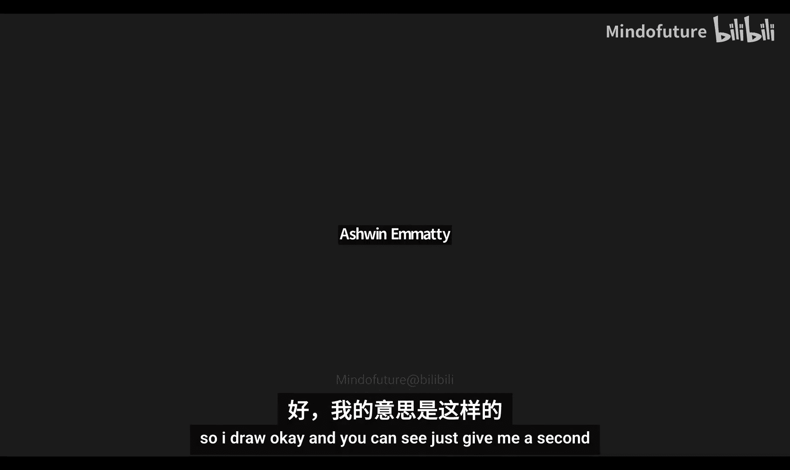
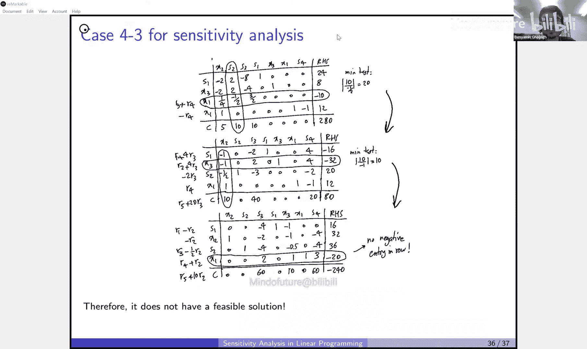
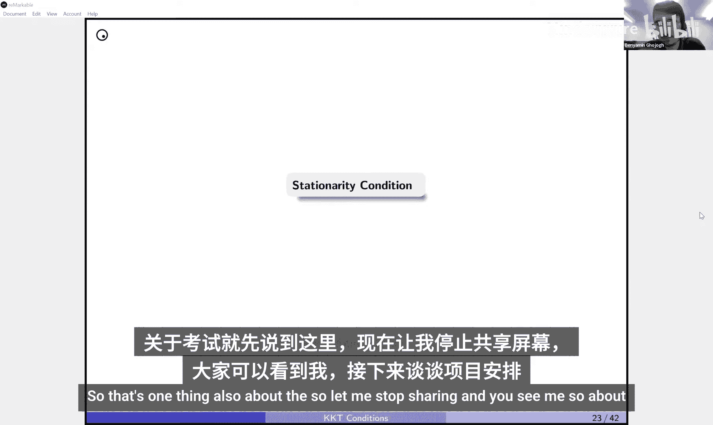

# 【滑铁卢大学】优化技术课程 ｜ Optimization Techniques   W2023 p05 P05_第五讲_(灵敏度分析与拉格朗日函数) -BV1oJCHBcEo5_p5-

Okay， hi， everyone。So first off， it's sad for me that less people are attending。😔，To the class。

 I think it's good for you to attend a class， although the sessions are being recorded。

 but it doesn't mean that。It's not good to be in the class。

 I think you can learn more by being in the class and ask questions， participate in the discussions。

 challenge me and answer questions and these things， I hope that more people attend to the lectures。

 This is my hope， although it's not mandatory， but。I strongly recommend you to。Particip in the class。

And as I had said， participating in the class and having discussions。Particip in the discussions。

 asking questions， answering questions， these will have bonus point。Okay， that's one thing。

 another thing is that。Here， I apologize。 I just noticed that there are some questions in the Q And A of。

Teams， I don't know why。 I didn't。Although I had checked the Q&A。Part， but I hadn't seen them。

 Teams was not showing to me。 but now I just realize that there are。Several things in the teams。

 I apologize。 I will assure you that this won't happen again。 I will try to be responsive。

As much as I can every night， I think I'm gonna check。

Teams and I'll try to be responsive in the same day if it is possible for me。

 So so let me go through。The， the questions on teams。 Yeah let me。是诶。So。嗯嗯。There is Alia has said。

 hi， I have a question。 but what， what's your question， Alirisa， could you。Please。

I think Annie result is not here right now， but yeah。Please feel free to write your question and。

I'll try to answer it as much as I know。After that。Con has said column， I again。

 apologize as I had not seen your I， I asked the last lecture。 so we don't need to cover that now。

 Okay， I can see that。 I figured you had the opportunity。 So I took it there。Okay， sorry about that。

 But for people to have the answer， I will write the answer after the class in in front of your question。

 but this means that even you have said that it， it might make the problem in feasible。

 I don't think so。 So as as you will have it in the cost。Even if the。

 the profit of the other parts becomes 0， then it means that the company will not。

 not only want it have。Any profit， it will lose something。 So it it doesn't make the problem in。

 So inibility feasibility and invisasibility and optimization means that there the domain of the X。

 the domain of the optimization variable。 So if there there is no domain。 So in other words。

 if the intersection of the constraints becomes empty， then the problem is in right， So yes。

 that's the thing。I is that clear column right to you？Yeah。

 we talked about this last time because when I first read it I interpreted that the fixed profit was a constraint rather than an element of the initial problem that was my confusion Okay sure and also Uumm I apologize that I didn't I'm gonna after class I'm gonna answer your message so again I say I'm sorry that I didn't respond to you Ugam but I will respond to you after the class。

Is that fine？诶。Yeah， that's okay。 Okay， sure。 thanks。 Yeah。

 feel free to message me either publicly in the team channel or privately。 I will be responsive。

So that's one thing。 is there any question about the course assignment， anything before we start。

Okay。Any ambiguity， everything is clear。Hi Ben， hi。

 I actually wanted to know that if you're doing the calculationlation for a question using some different two different methods。

 can we have like two different optimization answers or it needs to be the same？

So if the optimization problem is a convex optimization problem， then whatever you use。

You will have the same problem。 So if it is strongly convex。

 you will have the same optimization variable and the same。I mean。

 you will have the same optimum optimization variable。

 and you will have the same optimum optimization function， right。

 if it is strongly conx if if the optimization problem is convex。

So it means that the objective function is convex and the constraints are also convex。

You might have you might using different methods， you might find different optimum。Yeah。

Objective optimization variables， right？Because you this might be like this with where all of them have the same。

Optimization， optimum optimization function。 Let me， let me share a screen so I draw and you can see。

 just give me a second。诶。

Okay， so what I mean is this。So if the cost function is a strongly convex。

Then you will have one arc mean or arc max doesn't matter and one。1 f of X star and one exist star。

Whatever optimization problem that you use。If optimization this is you have a convict optimization problem and your cost is conts。

 not necessarily strongly convicts， It means that you might have。In this case。

 you might have different excess stars but they have the same f of X star。

 so you will definitely find using different algorithms。

 you will find the same optimization function， however。

 your optimal optimization variables might be a bit different if this case happens。

But if if it is convet and the classes like this， you will still have one X star right。

 so thats that's one thing you should note。And also， if the optimization problem is not convex。

 so something like this。Right so you might using different optimization algorithms。

 you might find different local optimums。And that also will depend on the initial point。

 So assume that， for example， we will see soon we will see gradient decent handleos methods。

 for example， you will start from here。It depends both on the algorithm and the initial point。

And you will start here。 So if you start from here， you might end up here。 and you find extra。

 If you start from here， you might end up here。So if the optimization problem is not convex。

 you might it doesn't guarantee you that you will find the same solution using different algorithms。

 different initial points and also as I set here initial point matters right therefore that's why when the objective function is not necessarily convex people in order to find the same solution every time they usually set random seat in their code so every time they start from the same initial point and they will end up with to the same local minimum you get my point so they're setting the initial random point yes random see in your code means that you will start from the same initial point。

So that's one thing， any other question？Thank you， Think of it， No problem。Any other question。

Is everything clear？O。So before we start， I wanted to add two points to tell you before we start is that one thing that do remember for linear programming。

 we were talking about dual problem and I said this that about the duality。

 strong duality and weak duality， I said the gap is non negative， it's either zero。

Wwhich means strong duality or positive， which means weak duality。

 and I showed in using these functions right F and GF was the primal problem G was the dual problem。

What I meant here， I didn't mean that the cost is it was just for general understanding of duality dual strong duality and weak duality。

 I didn't mean that the cost is a quadratic right， So please don't be confused。

 I I'm completely where you should also note that this is a linear programming。

 If we are talking about linear programming。 I mean， the cost is also a fine or linear。

 So it means that if， for example， we are minimizing。Assume that the cost is going down like this。

And based on the constraints， the solution might be here， right？

And if in linear programming I'm talking， the cost is linear G is going up， for example。

 and according to the constraints here， this optimum is here。

 so the gap is this so I didn't want you to come to be confused by why these are quadratic I was only talking about dual not necessarily in linear programming if it is linear programming then the cases like this。

 something like that， so the cost is linear that's one point that you should note。え。

Another thing that I wanted to tell you before going and continue the course is about the integer linear programming。

 I remember one of you guys said that。One thing we can do for integer programming is that we we solve the continuous optimization and then at the end we're round。

The solution to an integer or to the disc discrete value in a discrete。Physible set。However， I said。

 yeah， it's kind of relaxation。 However， you should note that what if we want to do that exactly。

 that's not necessarily true。 I can show you with an the counter example。Specifically， for example。

 in Integer linear programming， let's talk about that， let me add a page here。So。え。

So soon that these are。The feasibility points which are integer， right？And。YeahSo let me think。

 let me think you。So please turn off if， if you have question， turn on your can mic。

 Otherwise turn it off， please， so。Let me think。Yes， something like that。Asum。Sure。

These are the constraints。Right， and so if it was a continuous。Linear programming。

 the constraints were like this。Right， the intersection of the constraints and the solution。

 for example， would be。Just give me a second。I want to show you some example。He。No no。

 I think it's good to have it like this。😔，Soon， the points are like this。

So these are the integer points。Okay， yeah。 I think this is a good example。

 So assume that the class was in a way that the this extreme point was the solution of the。

linearinear programming。 So this gives us x a star x x1 a star and x2 is star， x1， x2。

And the cost was been increasing in this direction， something like that， right？

What what happens if we do what you said。 So let's solve this linear programming at at the end。

 let's round it round it to the nearest integer。 So this is the extreme point that is found by the。

Linear programming。 And if we round it round it to the closest integer， it will be here。However。

 this is not in the feasibleible it set， right？😊，This is not in the feasible set。

 the feasible points， discrete points are only these that I'm baling， making them bold。Only these。

 and also the points。And0。Right， these are only the feasibilities so rounding to the closest integer is not necessarily the correct thing。

 that's why we do the branch and bound。 If what you said was correct， we could do it in one one shot。

 we just solve linear programming and then round the solution to the closest integer。

 but this is a counter example。We can't do that。 That's why we do a branch and bound and using branch and bound。

 we make the feasibility set smaller and smaller until we end up with solutions which are integer。

 It means that the feasibility set becomes in a way that the extreme point which is the solution falls on an integer solution when one of these points。

So this is it clear？😊，Yes， can you give me any feedback， please。No， can I explain it again， please。

So it means I'm saying that one of you said that for solving an integer linear programming。

 let's relax it to linear programming， solve the linear programming。

 and then round the solution of the linear programming to the closest integer， for example。

For example， this point， this exist story is。Let me think， so。Yes， I think。诶。1。8。And this is one。

 two， three， four。😔，4。8， something like that。 Okay， so assume that we solve it and this is one4。

8 and 1。8。 And he said let's round it to closest integer， which is 52。

And what is the closest integer which this is 52， right？However， this is not correct。

 this is a counter example5 and 2 is not in in the feasibility set。

 what is the feasibility set for the integer linear programming in this case。😊，Are these bold points。

Right， this is not in the feasibility set。That's why we are doing branchnon bound。

We can't just do it in one shot。 We need several shots of linear programming。

' using branch and bound。 we make the feasibility set smaller and smaller until。

interestingly an extreme point falls on one integer solution。

 so the feasibility set becomes smaller and smaller that one of the extreme points is integer net and that extreme point is the optimal extreme point。

That was a counter example for just rounding to the closest integer clear。Okay。Great。

So that that's was。That's the philosophy behind individual linear programming Now let's continue with the sensitivity analysis。

O。😊，So yes。I have a question about this session before the previous session， the begin method。

 can I ask it now？Yeah说。Can you go to page 35 to off？😔，M'am， I think。85 above 59。Yes。And。

In the third constraint。R2 minus E2 is correct， yeah。You're right。Thank you。

Thank you for correcting that， dear， right you and can you go to 55 page 55。By the way。

 you know the reason why it's minus right because a minus a minus e can become negative I showed you a technique。

 This is a technique when you your' variable this technique can be used for also negative optimization variables in linear programming because as you remember in linear programming we assume that optimization variables are non negative right what if it is negative we can replace that optimization variable with two other optimization variables。

 x plus minus x minus something like that and by playing around with these values then the solution might be negative。

 for example， an example， minus 30 can be written。Can be written as 50-80。50 and 80 are positive。

 but 50 minus80 becomes negative， which is minus-30。

 So that's that's the technique that we were talking about。 And what was your question again。

 the the next question and thank you for your response。 And can you go to page 55。Let me bring it。不是。

Yes。😊，Okay。In the table， the first row， r1 minus r2， I think is wrong because the pivot row is r4。😔。

有。Just give me a second。 Let me think。So， this is。Let me think。So。😔。

In the table below the face below， you wrote R1 minus R 2。 This is R 1 plus R 4 R2 R4 R 44 Yeah。

 and but this， these， these numbers are correct。 I assume these are correct。 So two。

us half is1 and half。 So 1-1 is 0，1。 Yeah， I think you're right。 Thank you。 That was thety of here。

 So what the table is correct。Right， thank you very much Yeah， thank you。

 Thank you for letting us know about these typos， I will fix them。😊，And I will re uploadload them。

Thank you。 Any other question。No， okay。Thanks， so let's go to sensitivity analysis and finish that and then we'll go to KKT conditions。

So let's recap what we had for since。For changes very， very quickly。

So after we found the matrices and we defined the matrices and vectors， I'm not gonna。

Going to that again。We covered some cases， cases of change and so one so what was the idea behind sensitivity analysis it was saying that how much sensitive our optimization problem in this case linear programming is to change some change or a combination of changes in the optimization problem and this change can be for example。

 the coefficient of a variable either basic or non- basic in the objective function。

It can be a change of coefficient of a basic or non basic variable in the constraints。

It can be adding a new variable， it can be adding a new constanttrain。

 it can be a combination of changes， different changes that we can have， right？Yeah。So case 1，1， we。

 for example。Here we have an example， we are changing this is optimization problem。

We want to change the the factor of x2 from 30 to either 32， 36 and see what's the difference。

 for example， an example is that your manager comes to you and says that the investors are want us。

To change the profit of the second product to $32 or something like that。

 some change imposed by industry， by manager， by the constraints， whatever， some restriction。

And the manager asks you。Do you recommend this change， What happens。

 Should we change the line of the company， the factory。Should we produce it， X2 is still。

 or should we stop producing that， What should we do， And as the engineer。

 you need to know what to do。 Okay， so you are， you assume that you already have solved this optimization problem in your documents。

 So you know that here X2 is。Is a non basic variable。

 So you knew that so far this factory was not or the company was not producing the second product at all because its optimal solution was0。

But now the company is increasing its benefit， let's see what happened。So。

We already have these because we already have solved them， we assume that we have solved them。

And we know that， okay， what， what is。What is 30 it is the factor of x2 it means that it is c2 right and it is a non basic variable x2 is here。

 it's a non basic variable， therefore we are changing this this element of CN and in this table we should see where does CN have effect。

😊，So here we have it we have some effect and let's let's recalculate it。

 So C trans be inverse so we already had the inverse。

 but we cant get the column of x2 because we're talking about x2 right now we don't need to calculate for other columns and this is CB it doesn't change but we need to have it here and cx2 so let's make it parametricically and we say 30 plus some delta delta and it becomes5 minus delta this should be non negative and therefore delta should be less than 5。

 which means that we can if we increase the profit of x2 to 35。

 we still nothing changes the company doesn't need to produce x2 and the optimum solution is the same as before however。

 if we increase it to for example，36 which is less more than。

It means that we need to continue the table。 So in sensitivity analysis。

 we need to check whether we need to continue the table in order to update the optimal solution or not。

Here we are saying that， okay， this is changed to minus1 because if you recalculate that。

 you will see that it becomes minus1。And the rest of the table doesn't change。

 so we do rowwise elementary calculations again and we'll see after one step row the C row becomes all none and negative。

😊，And then we'll see that the cost has improved。Because the benefit we have increased the profit of x2 and also the basic variables now are S1。

 x3 and x2。Is what was the， what were the basic variables before， They were。

S1 x3 and x1 now it means that by increasing the profit of x2 to 36。

 x1 isn't a basic variable anymore， it becomes non-baic。

 therefore we need the company needs to stop producing x1 because it's optimal becomes zero now and start producing x2 because it has become a basic variable now。

So this is。The idea。Now case one tool， an example so now let's change the factor of the basic variable in the objective optimization。

function。And the objective function。 And let's see what so we can see。

 we can calculate now C has changed。And what are we changing， We are changing 60。 So for x1。

 the factor of x1。So it means that you're changing here。

Now C has changed in this table we see that this this is changing and also this part is changing so the cost is also changing we need to recalculate both of them so let's recalculate these parametricically and then we can find the delta。

The condition of Delta for not having any change in the optimization will see that if cx1 is changed from 56 to 80。

 nothing changes。But if we have a drastic change， which is beyond this interval。

 then we need to recalculate and continue the table in such cases we need to calculate both of these parts where the table has changed and then we'll see that in the updated zero。

 not only has this changed， but also we have changed in the cost， right？

And then we continue the table， we choose the pivot column pivot row mean test and then pivot row and do the elementary rowwise calculations。

 we do it until we we reach a termination condition which is all non- negative values in the0 and then it will see okay now the basic variables are S1 x3 and x2 so x1 now is not a basic variable anymore here and the cost also has changed and it has been decreased so you will say to the manager manager if you apply this change。

Our total benefit， our total profit or whatever comes to the company is decreased。 However。

 if you insist to do that， you need to stop。Producing x1 and start producing x2， something like that。

Right。So case 21 of change。Is a change in a coefficient of a the non basic variable in the con。

 So it's now AI J， not C anymore。 So an example here is that。

Now this example is an example of a combination of changes。

 so here in this example we are changing both coefficient of x2 in the objective function and also the coefficient of x2。

Yes， coefficient of x2 in the constraints。 So here we are changing this。6 to 5。

We are changing this one and half to4。2 is the same， and the rest of the factors are the same。

 We are also changing。This 30 to 50。What happens， We should see， Okay， where do we have C2。

 So as x2 was not was x2 in the basic variables， Let me， because I don't remember。 I need to check。

X2 x2 is an was a non basic variable。 So it means that in C N。We should it is in C N right C。

 we should see where in the table we have C。 we also should see where in the table we have so AIJ of x2 has changed and as x2 was a nonba variable。

 it belongs to N。 So wherever we have n and CN in the table we should see we should recalculate that either parametrically or using the numbers that we have and see whether we need to continue the table or not。

 So that's the thing。The idea， and any。A question so far， everything is clear。Yeah。

 everything's good。Okay， great。 So for example， in this case。😊，We are changing。

So if with an nonsistic variable， we have these changes。And so。Here。So this has become 50。

 It was 30 before。 now it has become 50。And we also have C and N here。

 therefore we need to recalculate this here。And。You will see that in this case， it is not negative。

 so we don't need to continue the table。 it means that manager。

We can do what we were doing as before。Okay。Case22 of the change。What is it？诶。

It's a change of in a coefficient of a basic variable in the constraints。 So in the previous example。

 it was a change of a coefficient of a non basic。 Now。

 what if we change a coefficient of a constraint in a basic variable。 So we'll have， for example。

 in this case， we're changing 8 to 5。 We're changing 4 to。5， we're changing2 to one。

And we are asking what happens。 So it means that， and this AI J is in B because x1 was the basic variable。

 So we should see in the table， we should calculate that term。Dist term。

This term again and see if it all terms are non negative or not， if yes， we need to continue。

 we might have a combination of cases to we might have， for example， what if we change。

8 here and two here。So we have change in both B and N， right？So these are the cases you need。

To see where in the table， we need to continue the table or not。 So for example。

 here we're changing these。 So these are changed in B。 And if we recalculate that， So C。

 this has been changed to this。And we need to calculate this inverse again。And if we solve that。

 if any values become negative， then we should continue the table otherwise the total profit does not change and by the way。

 you can use calculator in your exam for calculating inverse of matrices。And don't worry about that。

 okay。So。Case 3 of change。Please feel free to interrupt if you have any question。

Adding a new variable to optimization， so。And now。I think until here we were we talked about it in the previous session now is new。

Adding a new variable to optimization， it means that soon。

One variable optimization variable has been added。 So if we have， for example， two variables。

 it becomes three variables， something like that， it means that the managers， for example。

 says that I want to have another product I want to add another product to the line of production。

 What happens with this profit So we need to check that。And。So for example， here， 603020 as before。

And the company is adding a new product X4 with a profit of$15 or $25。 and the constraint is this。

It means that in these three constraints， we will add plus one1 x 4 plus to this also will have plus one。

X4 to this we also have plus 1 x4 and see what happens and we'll have1 x4 here also which is greater than or equal to0。

 we'll have1 x4 here as the optimization variable What is your recommendation to the manager let's see。

 for example， here。So where do， by the way， when we are adding an optimization variable。

 we should assume that is a non basic variable， right。

 because we don't know we don't have the optimal value for that。

 We assume that is a non basic variable is we are assuming that。Let it be zero。

 let let the company not produce that and see what happens。So。That's why。We can say， okay， I。

 in the end， I will have。An additional column。For ax4 and see what happens。

 So C P transpose beingverse is as before this is beingverse。And this is C transse as before。

 Now we are adding this column in n。Yeah。We don't I'm not calculating for other columns in n as before because we don't need them right now。

 This a x4 doesn't affect the other columns in n So and also C explore4。

We need to consider that see's the profit of x4 in the cost in as here we have here， right。

 So we have this because the its profit was 15 and it becomes5 here。 It means that it's not negative。

And we don't need to， it doesn't change the total profit and we can say manager。

 we don't need to produce that。But if you change the profit。

 then you may need the manager might have a follow up question。 Okay。

 what should the profit of the additional product be。At least。That we start producing that。

 and it has， it changes our profit。 Then you can solve it parametricically， right and see， okay，6。

Assume you can make it delta or whatever and then solve for the delta and you will see or what the manager might have another question。

 I want the profit of the x4 to be the same as 15 that I told you。

 however I changed its factor or factors in the constraints， I changed the restriction on that。

What happens， then you can also put the parameters here。Delta 1， Dlta 2， Dlta 3， whatever。

And then solve parametricically and see what happens。

And you can report to the manager manager if you do this， if you put this， at least in this number。

 then you can start the。Producing that， but I need to recalculate and continue the table to see what will be the production。

 For example， it I guess if it becomes a negative。 and if you calculate that this is my conjecture。

 then x4 which has been nearly added， becomes a basic variable and it get kicks out one of the already basic variables to become nonbaic So x4 becomes a basic variable and one of the already basic variables becomes non-baic。

 it means that manager。Okay， if you do that， then you need to stop producing the other product。

 but your。You can start producing x4。By the way， you might be wondering why adding a new variable。

Always either doesn't change or kicks out another product。 Can can someone tell me why。So。

In this problem， in this optimization problem that we are looking at， right？

Assume that we have these and I add x4。It either。Doesn't require me to produce  X4。

 or it comes to the line of production， but kicks out one of the variables。

 Can Can you answer me why this is happening。Please let me know your thoughts。 It might be wrong。

 That doesn't matter。 We our brain is storming。Did you understand the question or should I repeat it。

嗯。If you could just repeat it， I didn't quite like you're saying to add X4 we're adding another product Yes yes。

 so we are here we are talking about the case where we are adding a new variable right a new product X4。

X4， right。I'm saying that when you are adding a new optimization variable， in this optimization。

It's either。You will end up that x4 becomes a non basic variable。

 So it means that is x4 a star becomes 0。 It means that you don't need to produce x4 at all。

 So then you will tell the manager you w to produce that， but you shouldn't。

 because it doesn't change the total profit or x4 becomes a basic variable。

 but kicks out one of the already basic variables。 What were the basic variables。

So what were the basic LED let me review。 So the basic errors were S1， x 3， x 1， S 1， x 3， x1。

 Let me write it down not to forget。S 1， x 3， x1， by the way， note that。

The one of the basic variables might be a slack variable， right。

 So it means that it might replace S1 then。Still you so you were not producing S1 S1 was a slack variable。

 so you were producing， for example， before you were producing x3， the third product。

 the first product， but you were not producing the second product and a slack variable was some non negative the first stack variable was some non negative value。

However， I'm saying that I'm claiming that。When you are introducing adding x4。

Either it doesn't need to be produced at all， or if you add that and it needs to be produced it will either replace it will replace one of these。

Either S1， if it replaces S1， it means that in addition to production of x1 and x3。

 you need to produce x4， or it will replace one of these， it means that you need to stop producing。

The first or third product and replace it with the production of x4。Why is it correct。

 Why isn't my claim correct？😡，Well when like when you do the simplex method you only have three basic variables so it has to knock one of them out so if it knocks S1 out then you're adding that product like you have to produce an additional product。

Or it has to knock x1 or x 3 out。 So then you'd。You know。

 you'd you'd basically say stop producing x3 start producing x4 so you're only allowed like well based on that method。

 you can only like there's three basic variables so totally basic replace one of them。Exactly， yeah。

 exactly you said what you said was correct。 But my question。

 my follow up question is that why do do you have only three basic variables in this problem。

 Because we have three products。Not necessarily， know。

We have three optimization variables before adding introducing a slacklacks， I agree。

 but it doesn't necessarily imply that you will have three basic variables。Okay。

 why do you have three rows excluding the0 in your tableau method here。

That's how many constraints there are in the problem。 Exact， Ex。

 It's because of the number of constraints， excluding the default constraints。

 excluding this default contrain。 you have three constraints。If you had。4our constraints。

 although assume that in in the same problem， although you had three before introducing the stack variables。

 assume you had x1， x2 and x3 as three optimization variables。

 but you had four constraints excluding the default constraints。

By default constanttrain timem in this。Excluding these。

 assume you had four constraints with three optimization variables， x1， x to x x3， you would have。

To introduce the composite 3。No， no， no， no， no， no， don't confuse with S4。So assume that。

Compare these to。Problems。Subject to。I want you to understand what's going on in tableau method。诶。

So let me replace the inequalities with the slack variables right now。

I'm copying and pasting the same thing here， here， the same thing here。嗯。And some。え。

Let me write down。The default constraint of a standard linear programming problem。So up to now。

 so far， it's exactly these two these two are exactly the same， right？However。

 I'm going add a fourth constraint， assume whatever。It might not have any x3，0 x3， whatever。

And I will have a slack variable for that， too， right。And if it is greater than recall to。

 then I'll have additional or an excess variables。 So the only difference is adding this constraint。

 It means that we have four excluding the default constraint， we have four constraints。

It means that when you so comparing this， when you make the tableau method for this。

 you will have four rows。It in。And the Cil。When you are making the tableau method for this。

 you will have three rows。And a0， although they both have x1。

 x2 and x3 as the actual optimization variables before introducing the stack variables， right？

So the number of rows in the tableau method does not necessarily depend on the number of。

Optimization variables， it depends on the number of constraints。Allright。Is what I'm saying correct？

Okay。Yeah， that makes sense。Okay， so。And we know that eventually。

 the number of basic variables are exactly the number of。rows in the tableau method， excluding the0。

Right。😊，So it means that。Whatever number of constraints we have， that number of basic variables will。

End up with。Right。😊，Is that clear？对呀。Okay， so。At having a constraint will have several impacts。

In addition to introducing a new Slack variable or additional and excess variables。

In addition to that， it will also add the number of basic variables。The count of basic variables。

 so that that's the thing。And that's exactly， so this was a follow up question。😊，To my previous。

Question， which was answered by you。 So you said that my first question was in this school so。

One of you said that the number， you were confusing this question。

 my follow up question with X4 in my follow up question。

 it doesn't care whether it's for we have x4 or not。 So my first question was。

My first question was in this problem， optimization problem， if we add x4。

 it will kick one of these out， either kick one of these out or or it becomes a under basic variable and its why you answered because we only have three basic variables My followup question was why do we have three basic variables in this problem because we have three constraints excluding the default for constraints right And please note that this is not one default constraints。

 This is actually six default constraints So we have x1 greater than or equal to 0 x2 greater than or equal to 0 We're just writing them in one line to be short okay。

Excluding the default constraints， we have three constraints。

 It means that we have three basic variables。 But if we had this problem and we're introducing x4。

 what would happen。So we knew that we would have four basic variables。

And then the answer to the first question would be this either x4 becomes a non basic variable。

 so we don't need to produce that， or it will kick out one of these four basic variables。

Some of them might be slacklack variables， some of them might be actual variables。

So that's the thing。 Did， Did you get the story。Is everything clear。Yeah， okay， great。😊。

So now I think you understood Tau method better。Okay， so here an example。

 x 4 is a non basic variable。 So I think one switch。Here in this case， we have 15， In another case。

 we have 25。25 m we are See if we have 25 as a factor in the factor of export4 in the cost。

 then it would become negative。 and we need to continue the table。 That's the thing。So here。

 for example， if that's the case， because the0 is updated and we have minus5 here。

 therefore we have a negative value in the0 we choose a pivot column and then mean test pivot row elementary row calculations and these are updated。

 So here that was an example x4 has kicked out x1。Now， x1 has become an non basic variable。

 and x4 has become a basic variable。 And why do we have three basic variables Because we have three rows here and it's imp it implied by。

There's three constraints excluding the default constraints。Okay， case 4。Is that adding。

A new con to optimization， right， Okay， this can have three sub classes， sub cases， sorry。So 4，1，4。

2 and 4，3。 So 4， one assume that the current it the current optimal solution。

 So we have a current optimal solution so far， right， now we are adding a new constraint。

 a new constraint。 for example， in that case， we had three， now we are adding a fourth constraint。

 doesn't matter whatever。Either our current optimal solution with the previous constraints and all of them satisfies the new constraint。

 or our current optimal solution doesn't satisfy the new constraint。 however。

 linear programming still has a feasible solution。And what does it mean that its visibility set is non empathy？

😊，Or it doesn't satisfy。😊，And also， it doesn't have a feasible solution。

 means that adding the new constraint。Makes the fe set。Empty， and when does it happen。

 it means that do you remember， we said whenever our constraints are contradictory。

Our feibility set becomes empty， and we don't have any solution。

 It means that adding this new constraint has become has been contradictory to our previous intersection of constraints。

So when that's the case， it means that the feasibility set becomes not empty。

 let's see some examples， for example here。😊，Soon that this was the previous feasibility sensor。

 This is the previous。Visibility set right here。So these were the default constraints and these two are the constraints。

 we have two constraints， and now we are adding the third constraint。Like this。 in the first case。

Our solution previous solution satisfies this constructtrain。So that's fine。

So it means that we don't need to continue， right， because this is satisfying。え。And by the way。

 and in this case。This example here， it is making the fe set smaller and also the previous solution which was here is not satisfying the constrain。

 the additional constrain anymore now the solution has changed。😊，In the third case。

 soon that it's saying that it should be in this case。

 and then it means that the intersection of the constraints altogether is empty。

 so it has become a non feasible problem。😊，Okay， a question， can add in constraint。

 This is a good question。 Can add in a constraint， improve the optimal value of the objective function。

 I mean。F of x is star。 I mean， C a star。 C a star， All right。When we are adding a constraint。

 does it can it improve the CS star， so if we are maximize if we have a maximization linear programming。

 it means that does it increase CS star if you have minimization。

Linear programming does it decrease your star？Can you please answer me。I mean。

 just off top of my head， like looking at the graphs， I would say no。It wouldn't improve。And。

Can you say why I think intuitively obvious， right， The reason is that。

When we are adding a new const， we are making the feasibility set smaller。

So it means that we are having more restriction。With less restriction。

We have more freedom to increase the cost function。

Or if we are have maximization now we are adding a new constraint。

 it either makes a solution as before it or it makes it worse because we are adding a new constraint。

 So we had the same thing in Inte linear programming when we had a branching down。

 see when we are making the feasibility set smaller and smaller， we are making it worse。

 we are making it worse。Why because if， for example。

 consider the extreme case where we have a linear programming optimization problem with no constraints。

😊，Them， maximize x1 and x2。3 x 1 plus 4 x 2。What is the solution。With no constraint， x1， a star。

 x2 a star infinite。And C a star would be infinite。When you are adding a new constraint。

You are restricting that then the solution is not CS star won't be infinite anymore。

 it will be less because of your added con。 So the more constraints you are adding。

 you're restricting the cost more and more。So， this is the case。In in theory。

 I just had a thought in theory it doesn't necessarily have to make it worse， it could also be equal。

 it could be equal or worse because the new constraint could also go through the existing。

The existing vertex or what do we call it yeah vertex？Yes， exactly。

 or or even not necessarily passing through the ver the if as long as the solution is satisfied by the like this case。

 by the new constraint then。That's the kiss again。You know。So you're right。

 it's either the same solution or worse， right？Here is is the same。Here is worse。

Assume that the cost is going like this。Right。Is that obvious。Okay， so that was a good thing to note。

So case 4，1， let's go with through them fast。 I think it's not very hard。 example， the company has。

Profit 60，30，20 the same as before。 Let's see。 let's just have。 Okay， we signed table。

The table that we had is slide8。The solution was this。The company is adding。

 so here it means that x1， star and x3 star were basic variables and x2 x2 was a non basic variable。

 the company is adding a new resource constraint like this， adding a new constraint。

And let's see okay， it's been satisfied by the new constraint， therefore。So， we are putting。

X1 star plus x2 star plus x 3 star， it becomes 10， which is less than or equal to 11。

 It means it's satisfied。 So we don't need to continue the table。 So it means that the manager says。

 okay， I'm adding this restriction And this restriction is applied by investors。

 I can't do anything about it。 So industry usually when the investor wants something。

 it must be happen and it must happen because they are paying So you see， and the manager says， oh。

 please let me know whether I need to change anything to the factor or not。 Okay， youd say， okay， no。

 it already satisfies our optimal solution， already satisfies the new constraints。

 So we don't need to worry manager。 So this is what happens， okay。Now， let's go to case 42。

We signed a table that the solution is， the company is adding this。

 the investors want to add this new constant it means that something the product they say okay。

 for example， so it means that our optimal solution was saying that we are not producing any x2 and the second product was not being produced by the company。

 however the investor says， no， I want the company to produce at least one scale and this one might be one kilogram1 only one or whatever one meter or whatever。

One scale of this second product， because I like that。You need to produce that。

 although it's not optimal， you need to produce that， then we have to listen to the investor。

 so let's add that to the optimization problem and see what happens。

 So a new constraint has been added。 Okay， now a good tech， let's do use the dual simple expensive。

 Do you remember， let's convert this to less than or equal to。

If the constraint was already less than quality， we needed we didn't need to do that。

 But as it is greater than rate quality， let's do this times -1。

 the direction of in inequality is reversed。Then we can add the slack variable。

Or we can do that bigger method， but I think it's simpler here to use the dual simplex method and then。

It's kind of like， as you remember， we were kind of working with the transpose of the matrix。

 Get the negative value in here and then pivot row and then pivot column as before。

 And with one step， we say that we see that all of these become non negative。 Therefore， we can stop。

 Now， let's see what has changed。 So here S4 was replaced by x 2。Now， so x2， as the investor wanted。

 has become a basic variable because of this constraint of obviously。X2。

 even before solving this table， we we knew that x2 would become a basic variable。 Y。

 can you please let me know。Even before solving this continuing this you have to produce it。

 so it has to be a basic variable yes， why， because the constrain says that it has to be at this one。

Right， it can be 1， it can be 1。1。 it's not an integer program。 it's linear program。 it can be float。

 So it's11。1 or 1。3， it might be 10， it might be 20， but it must be at least one。

 It means that it can't be 0 so it it can't be non basic because nonbas means  zero right。

Is it clear now？Yeah呀。So it has been forced to us that X2 should be produced。And as you see。

 producing x2 was not very desirable in this optimization problem。 That's why why。

 because when we solve it， we'll see x to a star has become one。

 the least amount that the restriction was imposing on us。 It means that investor， Okay。

 you want x2 to be at least one。Doesn't matter， I will produce exactly one because the more I increase x2 apparently my total profit doesn't like it。

 So if producing X2 was desirable， then of course it would would become a basic variable in the first place。

As the optimization problem had says， okay， it must be 0。

 it means that it's not very desirable to produce x2， but doesn't matter you want。

 you want to produce。Would the solution not always be the lowest value because if adding if adding a constraint is always。

Going to make your solution worse then adding the least amount is always going to give you the maximum result so in this case if the investor said must be greater than or equal to two well then two would be the optimum。

I think I'm not sure。That's a good point。 I'm not sure about it， but I think you're right。

 I think you're right， But you should note that this is just an example。

 What if the investor says I want x 2 plus x 3 be greater than or equal to1。

Then then you cant say that so as the constant is simple， then I think your analysis is correct。😊。

Right。WhatWhat if the constraints is complicated like student？

Plus x3 is less than 4 or x2 plus x3 is greater than1。Then you can't simply say that。Do get my point。

Yeah， yeah， yeah， I see。They get again， even。With your analysis。

 if the construct is simple like this。You need to continue the table to find out the optimal value because the optimal value for other variables change Also you need to know x which already basic variable is replaced by x2。

 we don't know that you need to solve the table continue the table to see which the already basic variable is kicked out by x2 right。

That' one。You need to solve that because you should tell manager you need to stop producing that。

And start producing X2 how or if X2 kicks out a slack variable， then you say manager。

 you don't need to stop producing other products， but you have to start producing X2。

 something like that。We have used all simplex methods here。Okay。😊，Let's go to case 4，3。So 42。

Didn't satisfy the so what was for？42 didn't satisfy the new solution， but has a feasible solution。4。

3 doesn't satisfy doesn't satisfy the previous solution。

 and we will see that the example that we are going solve doesn't have a feasible solution。

 You will see there。So it means that case 43 manager says， I okay， so far。

 whatever you produce is good， but now I like x1 plus x to be。😊，Great than or equal to 12。

And you see， okay， let let's calculate maybe what you want is not possible。

Not necessarily whatever you want we should do， we should say whether it's feasible in industry to do that or not。

 let's see。诶え。Okay， again， we multiply it by -1 and then add the select variable and continue。Okay。

 here we are solving。 So when we reach here again， if recall the dual simple method that we already discussed before。

 When we reach here， we'll see that。Do you remember。え。No no， we need to continue。

 we need to continue， we continue the dual simplex method。

 I'm not going to go over the Du simplex method again， but in dual simplex method。

 whenever we chose the pivot row for choosing the pivot column and doing the mean test。

 we were saying that divide these by the negative values of in this row。

Here we reach to the point that where we don't have any negative， all of them are non negative。

So it means that we can't continue the dual simplex method。We can't continue the table。

 It means that we don't have any visibilityasibility solution。

 We can't it means that the newly added constraints。Has made the fe set empty。 It doesn't make sense。

 manager， please tell the investor， we can't do that。 Please either change your restriction。

Or let us continue what we were doing， right。then in manager will have a meeting with the investor。

 It's not possible， possible。 It's not feasible。 For example， change your restriction。

 And then in investor says， maybe okay， let's change 12 to 8 and let's see what happens。

 X1 plus x2 B at least8。 Does it solve the issue or not or let me change the constraintsstrain completely。

 Let x1 plus x 3 be at least something or less than something。

And let's see so we then it will be a back and forth meeting between manager and investor and the engineer of the company。

 something like that。😊，Heically， anything。 So the lectures are inspired by Professor Shikufei on sensitive analysis。

 I have put the link here。 I also put the link in the description of the YouTube video。

So sensitivity analysis and linear programming is over。

 is there any question before we move to the next topic。Everything clear。一。Okay， great。So。Let's have。

And let's have a break now， I think， because we are gonna change gear a bit and continue with K KT condition after the break。

 Let's come back in。Okay， right this rounded up。8，30。Right，8，30。

 let's come back and then we'll continue with the K K0 condition。Okay， thank you。Ben。

 I had a quick question if you're just free during this。

Yeah so I guess this this relates just to the wording on the assignment。

 but also there was a very similar question in one of the lectures。So the question basically。

 you have a cost function。And it said there's you know。

$3 profit for x1$2 profit for x2 so which question are you talking about sorry which question let me just bring up just give me one second。

I can bring up the， yeah， we might as well go off off of the actual。Okay， assignment one。

Just opening it here。So this is for question two。So you form your cost function。

Andm I won't you know go into detail so I don't give anything away for anyone。

 but then it said to form the actual constraints， the resources for two of the first product and one of the second product。

Is at most 9？Now I'm confused about this because this would be like 2 x1 plus1 x2。And then。

Which the resources per the second are at most， so less than or equal to nine。Yes， no。

If it's like you have two of x1， but x1 is also a unit， how many units。

 so you're be like you have units times units plus units times units is less than or equal to a dollar value。

 it conceptually doesn't make sense。Do you see what I'm saying like if you change the question that its that it's that it's $ two dollars。

And $1。 then it conceptually。It makes sense。 Do see what I'm saying。 Yes， yes， Ex。

 What I meant was this。 Maybe yeah， the rewarding should be。Co improved here。 Yeah， I， you're right。

 So we should say that。Pair the first product if we have $2。And pair the second product。

 if we have $1， it should be at most $9， something like that。 You're right。 Yeah， is that correct。

 Yeah， Yeah， to so that we have a compatibility of units for in in the equation。 you mean。

 in the left hand side and right hand side， yes。I agree。

 I just wanted to make sure that was the case。 Yeah， yeah， yeah， you're right。 You're right。

 This also the， what you're saying is also important in physics because in physics units are very important。

 The left hand side should have the same unit in the right hand side。

 Even you can find the some equations in physics or derive some equations based on just compatibility of units in physics。

 many people do that。 You can， even I remember I was looking at a YouTube video。😊。

wereIt was talking about one of the Hawkings， very famous。

Equations for radiation of the black holes and using the compatibility of units。

Although it's complicated， but you he draw drive the the equation and it was very cool。

 So you can drive very complicated equations in the in physics using compatibility of units in left and side right hand side。

 Yes， you're right。 absolutely。 Yeah， no， I just I wanted to make sure， I mean， it's still solvable。

 Like if you， if you ignore。😊，Like if you ignore that it's I went through I solved it no no issues or anything。

 but I just wanted to to make sure and run that by yeah yeah you're right sorry about it yes I think I need to have a better wording for the question Yes no worries no worries okay。

Okay I mean， I'm just I'm going to grab a drink， but。

I'll jump back online in a couple minutes Okay sure great， so'll see you at830 sure thank you thanks。

Thanks。Great， thank you。Okay， now。We shift。A little bit of。A little bit of gear now。

 our gear changes toward KKT conditions so far， we were after preliminaries。

 we were focusing on linear programming， Inte linear programming sensitivity analysis and these things now。

We are gonna。go to KKT conditions。And after K Q T conditions， we are going。诶。

Talk about first order methods， and etctera。Okay， so first off。

 please note that KKT conditions are are the backbone of optimization。

Algorithms and many of them kind of use either directly or indirectly the KKT conditions and you'll see that why why they are very important。

There are important conditions in optimization， many of optimization algorithms use this。Yeah。Okay。

 excuse me a sake。Yes， so many of the optimization algorithms use K KT conditions。 Now。

 let's start with the laggrangian function。You' will see that the lagangian function is very important in optimization。

II think I can say it's the most important function in optimization。Okay， let's see what of course。

 is named after La Ge， who was a great mathematician。Okay。

 so please feel free to interrupt and ask me if there's any ambiguity or question。

Consider this optimization problem where we are F of x is the objective function x is the objective variable here。

And we have the inequality constraints m in M1 inequality constraints。

 so what does it mean it means y1 x is less than or equal to0 y2 x is less than or equal to0 until y M1。

P is less start or equal to0， so we have M1 inequality constraints。And M2。Equality constraints。

 H1 x equals to 0 until H M2 x。equ equals to 0。So we have in total M1 plus M2 constraints right and why can we write all inequality constraints like this will show so we for inequality constraints so constraints are either inequality or equality right for inequality constraints we have either less than or equal to or greater than or equal to。

If it's already less than or equal to， it's like this， by the way。

 what do I mean by y1 x is a function？Of x called y 1。 can be， for example， this can be。

It's now henceforth， it's not necessarily linear。So far what we learned。

 the constants were linear now it might be non nonlinear x2 plus3 x。

Les than is less than or equal to one and if x is a vector it can be the elements on the element。

 the constructtrain might be under the elements x1 is squared plus 3 x2 is less than0 or something like y2 might be a tangent function tangent of x is less than0 whatever so right and h also is a function so h of h1 of x might be x3 plus 2 x something like that whatever whatever function is we have。

So it's in general， and it's the inequality constraints can be either less than or equal to or greatered than or equal to。

 right？If it is greater than or equal to， we can simply change it to to an less than or equal to constraint by multiplying by -1。

 it becomes less than or equal to and now rename minus k。2 why。So you can rename that， right so why。

I X define it to be minus K i x。Something like that here we have it。😊，Assume we have x1 plus 3。

X1 is squared plus 3 x2 is less than or equal to and x1。3-2 x。

One is greater than equal to0 whatever we have for these in greater than equal。

 they might several of them for each of them， we just multiply them by minus1。

So we can write all of the inequality constraints to be less than equal。And if we have a max。

 so here we we assume its minimization。😊，We can have a maximization problem if it is a maximization problem。

 we've already discussed it。😊，We can say it's equivalent to minimize of minus f of x。

If we have we are maximizing F。We are maximizing F。If you multipplly it by 1， the F。Sorry。😔。

So minus f is this。 Now we are minimizing minus f。 So their arguments will be the same， but。

Their optimal function， objective function will be negative of the other one， right。

 so we can simply define g of x to be equal to minus f of x and then minimize g of x something like that。

So in general， we can write all optimization problems in this format， minimize of FO。

 even if it is maxization， we can convert it to minimization。All the inequality constraintss。

 we can convert them to less than or equal to zero。And all the equality constant。

 we can convert them to equal to0， by the way， why do we have zero on the right hand side。

 because whatever we have in the right hand side， we can bring it to the left hand side。

 so we'll end up with zero at the right hand side， for example， example， x3。

Plus 2 x2 is less than or equal to1， we bring one to the other side， so x1。

3 plus 2 x 2 minus1 is less than or equal to 0， so that's why。

This is a general case of optimization problem。Right， okay， now some examples for f of x。

 for example， this in vector form， so this is a quadratic form， right？

Or we can do it in element wise x1 if for example， we have three variables。

 x1 cubed minus4 x2 minus2 x3 squared， something like that or tangent， s something like that。

for these， we can have either in the vector form or in element vice form， whatever， for also these。

 we can have vector form element vice form。They can all be the same， so let's go to the next。

Now we want to define Laangian function。This optimization problem that we discuss， which is general。

😊，The Laangian function for this optimization problem。Is this So it's it comes from。

D times M1 times M2 y。 So D is because of the。X soda soon that X。It's the D dimensional vector。

 right？Assume that and we have M1 M1 inequality constraints。 We have M2 equality constraints。

 So this comes from here， this comes from here。 So it means that。

We have x in as the input of the loggrangian function， we have x。Yes。

We have some variables for the inequality constraints and we have some variables for the equality constraints we'll discuss that okay。

Thats this is what it means。😊，But its output， the lagangian function output is a scalar。

 so it takes some vectors but it outputs scalrs， by the way。

 if the optimization variable is a matrix， so here I assume it's a vector if it's a matrix。

 then these the inputs of the lagangrange sorry the inputs of the lagangian would be matrix here we are assuming that they are vectors。

Okay， now what is this， The La gradientian says， okay， puts the objective function here。😊，Also。

Have the summation over all of the inequality constraints。

These are the functions of the left hand side of the inequality constraints where they are less than or equal to。

And multiply each of them， so y1 x with lambda 1， y2 x with lambda2 with a lambda corresponding lambda。

 this call it lambda， this is a naming you can call it anything。

And what we usually by convention call it Lada， whatever， so multiply y1 with lambda1。

 y2 with lambda 2 and sum them sum over all of them。This is the second term in the Laangia。

 the third term。😊，Is plus do the same for equality constraints， so consider some variables new。

 new 1， new2 until new M2 and multiply to the left hand side of the equality constraints where the right hand side is0 and then sum over all of them。

Then you have class between this right you can also write it in the vector form so this can be written as an inner product。

If you assume that lambda is this vector。And one dimensional vector。And new。

Is this M2 dimensional vector， So we have lambda 1 to lambda M1 and put them in a column vector。

New one to new M2 each new one to new M2 is the scalar， each of these is also a scalar。

 you' are putting them together to become a vector。That's why these are these are bold。

 right M2 dimensional vector。If you write it in this way。

 you can write this in in the vector form why you are also as soon as you put y1 to y M1 in a vector to become an M1 dimensional vector Note that here we are assuming y1 output of Y i X is a scalar。

Output of H X is a scalar。 That's why we put these scalrs together and it becomes a vector。

 We can also put these together， and it becomes a vector。

 So you can write them in this write this also in this vector form。Either this scalar form。

Or this vector form， we can write it。So this is a Lagrangian function， this is called the Lagrangian。

 and usually it's written by fancyL。😊，This is fancy L， right？

For Lagangian start of L Lagrange and these variables that we introduced。

 lambda and nu are called Lagrange multipliers， so they have two names。

Either lagrangerange multipliers or dual variables。

 they are used interchangeibly Lagrange multipliers or dual variables。

And they are for inequality and equalityality constraints， inequality and equality constraints。😊。

So the dual variables Rorange multipliers are corresponding to the constraints。

 either equality or inality。It also has the objective function inside of it。As a term of it。

This writing this lage Gen function is also sometimes called in the literature。

 It's called lagrangee relaxation of optimization one。

 So if you want so you have the this optimization problem where you have objective function with some constraints。

You can have a lorrange relaxation to write the laggrian function in this way so you are putting the constraints next to the objective function by summing them well talk about it in a few slides and this is also called the lagrrange relaxation right okay so far clear。

Could you please give me any feedback， I want you to understand。Every step。Yes。😊，Yeah， okay。Great。😊。

So。Now sign of the terms。 So there are some terms in the lagangian。

 So these are the terms we have these terms， right， By the way， these are M plus M1 terms。

 These are M to terms。 So this lagangian is one term plus M1 terms。Plus M2 terms。

 so in total it's a summation of M1 plus M2 plus 1 terms。Right。Okay。Now。And the。Let's look at these。

 Why are they plus， why are they plus， why aren't they negative， let's see。For equality constraint。

 I can simply， I think I already have written it， I don't need to write it here。If I have these。

 if I multiply by minus-1， I have it because0 minus times minus1 becomes 0。

 so I can these are equivalent right， if I replace minus H X with H X because。

You can see it as a new H X right。As， as I said， the naming of the function doesn't matter。

If you put minus HX instead of this， the minus becomes here。So it means that。Or here。

 it means that for equality constraints， we don't care about the sign。The signs。

 so you can write plus new one。H1 x minus new to H2 x， whatever， or make them all negative。

 positive based on your。Optimization problem， you will decide which one is better for you。 Okay。

 for example in。In there is one format of the。Optimization problem which reduces to which reduces to eigenvalue decomposition I don't want this is just an example if you don't understand it。

 that's fine。If I write it minus new or plus new， in one case。

 then you will not end up with the correct eigenvalue decomposition format。

 so you need to have either negative or plus you will decide which one is better for your case so that you have freedom in choosing the sign of the equality terms for the equality constraints terms in the lagangia。

For this simple。A reason， because when you have H of x equals 0， you can have minus H of x equals 0。

Right。However， however。The terms for the inequality， the sign is very important。 why。

 because when you have this， this is very different from this。Because this。

Means a by I of x is greater than equal to 0。Significantly different。

Right therefore the sign is for anequality con is very important important，Yeah。Clear。Okay， great。

 now let's interpret Laangia， so we define the Laangian。 now let's see what does it do actually。

In simple words， let's interpret it less intuitively see what it is doing。😊，So。诶。What is our goal。

 when we have such an optimization problem， what is our goal？We want to first， minimize the costs。

Of course， we want to minimize the cost， but we have some constraints， so we have some restrictions。

 but we want to minimize the cost。 So our first goal is to minimize the cost。There is but。

 but we have some constants。Let's penalize them， so if our solution to this problem to this unconcer problem。

Isn't satisfying some of the constraints， let's penalize that， let's have penalty。All right。

So this is a constraint for each of the inequality， consider one of the inequality constraints。

 right？We want to， this is the penalty for not satisfying y x less than or equal to zero。

 we want to minimize this penalty。Okay， we want to minimize this penalty。

And we know that lambda should be greater than equal to0。

 We'll discuss that the sign will discuss about it in a few slides。But accept it from me for now。

 assume that dual variables are all non negative for now， okay。We'll see why。I want to minimize this。

 this is a penalty。Penalty 4。Inequality。Or not satisfying。Inequality， yy x the standard equal to 0。

This is a penalty for this， for penalty。4。😔，Not satisfying。H I of x equals 0。So， whenever。

We have some constraints。Either we should write it as a constraint or we can have it as a penalty okay。

 now let's add these penalties to the cost， so we were minimizing we were here recall this。

 we were minimizing F of x。However， let's add some penalty terms。

Penalty for the inequality constraints。 and I'm summing all the penalties for the inequality constraints。

Also， this is the penalty for the H O VX， that's sum of them all because we have M2 of them。

This is the penalty for all equality constraints。So， the cost。Penalty for inequality constraints。

 penalty for equality constraints， we can write it in vector form2， right？And now。Rather than only X。

Our optimization variables are x， lambda and all of them， and these are vectors。

 right x1 to x D lambda is lambda 1 to lambda and 1。New is new1 to new M2。

Right so we are adding the objective variables similar to what we had in linear programming we were adding Sych variables here we are adding dual variables。

😊，But what is the benefit of this？Now we are minimizing this， which is uncontraint。

We had a constant problem。We converted that。To an onconstraint。 So this is an unconstraint。

 we don't have any constraint for this， right， minimizing this Laangian。

 So rather than minimizing F subject to some constraints， let's minimize the Laangangian。

Which kind of encapsulates all objective function。Inequality constraints andequality constraints by penalizing or imposing some penalty for not satisfying inequality constraints and not satisfying equality constraints do you get it and now I think it becomes clear to you why we can call it Lagr relaxation because we are relaxing a constraint problem to an unconstraint problem。

ok。😊，And。Why why why this relaxation because relaxation usually in mathematics makes it easier right。

 Why is it easier to minimize the logang rather than this constraint problem can can anyone tell me？

😊，Why is this relaxation easier， makes it easier for us。Can you please let me know。😔，Anyone。

hello can。What only one variable。No， no， we have see we are actually。

 we are adding variables here we only had x。 Now we have x lambda and new。😊。

So in terms of number of variables， we are increasing， however， this relaxation makes it easier top。

😊，Why， why is it easier。Is it because we don't have to stick as strictly to the constraints in the problem because we're minimising it rather than making it strictly equal to or less？

Yes， yes， exactly。 So first off， we are getting rid of the constraints。

 although we are imposing the constraints in the Lagan itself。 This thats one case。 And as you said。

😊，So yes， someone also said there are no constraints anymore。However。

 what is this minimization of Lagrangian doing actually。

 it's saying that so what is the difference of these two？😊，Here。

 if we don't satisfy if our solution doesn't satisfy this inequality。It's dead， it's a debt solution。

 we can't， we don't accept that at all。So， it's hard。Restriction。Either do it。

 either satisfy this or not at all。😡，Okay。Like a hard deadline， some elected。However。

Here we are allowed to slightly。Not satisfy that， the inequality。The more。

We don't satisfy the constraints， the more penalty we have。The more the cost becomes。

 which is not desirable， that's why we are trying to minimize the penalties， however。

 the penalties might not be zero。😡，Right。We have soft restriction here。

That's why it's called relaxation， we are relaxing hard restrictions to soft restrictions。

 so whenever we have actual constraints。😊，They are hard constraints whenever we have penalties。

These are soft constraints。Clear。That's one thing that I wanted to let you know another thing is that some in the literature。

 especially in the literature of machine learning。😊。

These penalty terms are also called regularization terms。So we are kind of regularizing。

Right so this is the function objective function itself， but we have some M1。Regularization terms。

These are also the function of x see here we have x2。 So these are also function of x。

 although they are function of nu and lambda2， but there are also functions of x。

 That's why we have some regularization terms。We are adding them and when we have regularization terms。

 regularization terms are penalty terms， two names for the same thing。

 and it means that we want to minimize the penalty。😊。

And why do we add them because the more penalty we have， we want to reduce that。

 so if we don't satisfy these inequalities or these constraints。

 they will blow the costs to assume this is called the regularized or penalized regularized。Cost。

Right， so this is cost。This is a regularized cost。We want to minimize the regularized cost。

 but if the penalties are not satisfied or the concerns are not satisfied。

 it means that the penalties go up， they will blow the regularized cost。Therefore。

 in order to minimize the regularized cost， we have to satisfy。As much as possible， the constraints。

And as you see these are soft restrictions that's why it's also called relaxation we are making it simpler we are getting rid of the constraints by adding them as penalties or regularization terms in the objective function。

 so this is a good technique for changing。😊，Constraint problems to unconstraint problems if。

You are not very， very hard。Un satisfying andequ constraints。

But this is interpretation of La Grangia， so it's kind of we can one of the interpretation it might have other interpretations to。

 but one of the interpretation is that it's a regularized cost。😊，Right。

 is it clear it has become uncons。ok。😊，Now， let's go to the next slide。 So we。

 so this is exactly what the explanation of what I said。

 So let's not go through this what this is exactly what I said。Okay。

 now let's define another definition， log rangerange dual function。😊，Also called dual function。

 So we can simply set， say， dual function or。L range dual function。

Usually call it G when when the cost it actual cost， they usually call it F doesn't matter。

 It's just naming。 You usually they call it G and it's。M1 by m2。

 y because its inputs are lambda M new。 This is M1 dimensional is。M2 dimensional， right？

And this is defined， this means definition define。Deefine as in theum over the domain of X over the domain of X。

And your variable for infaome is x。 so you are， by the way， mean inm is。minimumim， right。

 where you are also considering the case where we you don't reach the minimum because when you don't reach the minimum。

 that's not a minimum。 that's an infa。Right， so this is more general than minimum。

 you can look at it as minimum， so minimize this lag grandian function。😊，But with X。

 not with lambda andnu。With x， you minimize the Lagrangrangeian function。

 the Laangian function itself is a function of x lambda M。Over x， let's minimize it。

If you minimize that optimal lagangian function， it means that Lambda star， it's our L star。

 El is star。The optimum， minimum。La Grangia， with respect to X， is called the。

Dual function or lock range dual function denoted by G。 And as you see， it's not not a function。

Of x y， because you already minimize over x， so you are getting rid of the variable x because you' are minimizing over that。

So it will be a function of lambda nu。So far clear。

And here I am replacing the Laangian function infium of Laangian function over x。Is it clear？

So usually F is called primalfunction。And G is called dual function。Or log grind to all function。

Right， okay。So。For convictx minimization。When we have convicx optimization problem。

And if it is minimization， your G becomes concave， it means that if you're F。

 because in convex optimization， F is convex， right？

And you're trying to find this G becomes concavefe。If in convex maximization， so if you have such F。

Your G becomes convicts so。In maximization， if it is convex programming。

 it means that your F is like this。 Your G becomes。Your F is concave。

 Your G becomes convex in minimization， convex programming， if F is。

Convex because it's convex programming， your G becomes concave。

 So you need to know these cases for maximization G would would be supremo of laggrrange N， right。

 but we are， as I said in initial in the first slide we if even if we have maximization。

 we can convert it to minimization here we are talking about minimization only。

 So assume soon we are minimizing the primal function F Now the dual function would be minimization of Lagrn。

😊，Okay， primal and dual visibility so far clear， can you please give me feedback？😊，Yes。😊，Yes， yes。

Okay， great， yeah。Great， now do you remember about the feasibility set that we discussed？😊。

Now we are repeating that， but now we are we have a primal optimization problem。

The prim mal function and dual function we discussed about primal function and dual function。

 that's why we have primal feibility。Okay， what is it， it means that。

The solution of this optimization problem。Is the optimal point denoted by Excelor assume that this assumption？

We deoteed it by x star and the minimum the optimum cost would be fs star。

 so f of x star that's denote it by Fs star， right？And this is optimalimum function， right？

Or optimum value for the function。And the optimal point， X star。

 which is the argument satisfying the constraints， is one of the feasible points which minimizes the function F。

 of course it feasible point because it needs to satisfy the constraints。

Satisfying the concerns in problem one。So it means that it satisfies in each of the。

 it means for all， for all。Y 1 to Y M1， it is satisfying inequality constraints for all， for all。

M2 equality constant is satisfying the equality constant， right？And for all of them。

 so it's satisfying all of the constraints， it's called primal feibility。

 so it's feasible and why do we call it primal because we are minimizing the primal function。😊。

So far clear。And these are the constraints in the prim model。optimization。Ok。

Now let's talk about visibility in dual function。😊，So， this was the。

ptOptimization problem that we started with， this is the laggrangian for for this optimization problem or lagangrangee relaxation。

The optimal point exists star。Minimizes the Laangian function。

Because we know that because Lagrian is the relaxation of the optimizationian problem to an unconstraint problem。

It minimizes that， but let's see， okay， on the other hand， CC， consider that。😊，According to E 3。

 what was E 3？The definition of dual function was equation 3。

 which was G of lambda and nu equals in theom of Lagrangian， right？Let's repeat it here。

This is E three。Definition of dual function， I'm repeating it here。

The duall function is the minimum of lagangian with respect to X This is exactly means a minimum of lagroian with respect to X。

So this is the definition。Of dual。Function。On the other hand， we know that Xtor is a solution。

Solution。Of Cri problem。It is satisfying the hard constraints restriction。

 of course it will satisfy the soft restrictions too。Because。When you satisfy the hard constraints。

 of course， the soft constraints are satisfied to， therefore。You can write it in this way。

 You know that the solution of this。Its， iss X star。So you can say。La Grangianov Ex star。

 Lomb de Annu is exactly the dual problem。The dual function， sorry， the dual function。

 it calls the minimum of Lagrian with respect to x， but we know that。

Xa star minimizes thegrangian y because it satisfies the heart restrictions。

 of course it will satisfy the soft restrictions in the relaxation of laggrangian。

So it is a minimum for Lagian2 when we are minimizing with respect to x only， okay？

Which is the definition of dual all function。 Is it clear is。What I have here So。

 these consists of two equations， these according to the definition of dual function and this。

 according to the discussion that I just had， I said X star is a solution of primal problem。

 It satisfies the heart constraints。 Of course it will have satisfyis the penalties。Therefore。

 it is the solution for minimization of Lagrangian with respect to x2。

So combining these two equations gives us the whole thing， it means that2 function。

Itals the Lagrangian of Ex star Lombdo Annu。 Is it clear。Yes。Yes。Okay， great。Now， lemma。First off。

 let me tell you because you might some of you might not have heard of these things Lemo definition and these things。

 So in in parent is I'm saying this。 don't worry about these names。 These are fancy names。

 and these are for organizational mathematical papers， why。

 because when you don't youwrite all of the expressions and proofs and everything back back to back without any sections and these things sectioning。

 it will be very confusing to understand the theory。 Therefore。

 mathematicians have come up with a solution to organize their papers。 they' said okay。

Let's have sections of the theory saying that lema， lema and what is lema。

 lema is that a section of the theory that you claim something and you have proof for lemma， so lema。

 you claim something， you prove it， you have another lemma， you prove it， so see， you have sectioned。

Or partitioned your paper into several parts。 Now it's easier to understand。 Okay， now in this Lemo。

 you want to prove this in the other Lemo， you want to prove this。 Why do you call it Lemo。

 Lemo is usually says that。After solving and proving some lemmas。Then， usually。

You propose or claim Ethereum theorum is a more important lemma， so you have several lemmas。

 and at the end of the paper， for example。You have one theorum which uses the lemmas。

 so lemmas are is going to be used in Ethereorum usually。So you prove something as a。

 you prove something as Lemma 2， but in theorum， you will claim something。

 but in the proof of this E theorum， you will use Lemo 1 and you will also lose Lema 2 in order to prove your theoryorem。

Theorum and also proposition is kind of the same as theium。

So prop and theorum are kind of bigger picture so what is your paper shouting so lemmas are not necessarily what the paper is shouting the paper is shouting something some theory it says that okay I'm claiming this and I'm improving this usually you have one or two theorems in the whole paper but you might have 10 lemmas because you're going to use different lemas in one theorem。

 something like that so the definition is also when you define something so you have definition you have lemma you have theorum or per position Also there is another thing corollary corollary。

 what is corollary in in mathematical papers。Corollary means consequence。 So when you have something。

 lemma or theory， whatever， you might have some consequence based on what we just proved in the previous lemma。

 We have some consequence consequ or in conclusion， we also have this。

 So we usually write a corollary。Poity is another name for consequence。

Usly because they are consequence， they don't usually they don't have any proof because it's consequence of the other limb。

But sometimes it needs proof to。So this definition， I said that， corollary lema proposition theorum。

These are the most things。 Sometimes people write Lemo as claiming。 So they say claim one， claim2。

 these are different naming for different sections。 So now I close the parentes。

 I wanted to know what Lemo and these are。 Okay， now Lemo， dual all function。As a lower bound。O。😊。

For minimization problem。衣服。The dual variable is so what does it mean that all elements？All elements。

Of lambda， it means that lambda 1 to lambda M1 are greater than equal equal to 0。

 Do you remember this is generalized inequality for vector。Okay。

 then the duall function is a lower bound for FS so it means this。😊。

This is the English explanation of this equation of this inequality it means that。

The dual function is a lower bound。4our。FS star， FS star is F of X star。

 Do you remember we defined that。 It means that the optimum cost function。

Optimum cost function is always greater than equal to G of Lada and nu。

Is greater than equal to the dual function。 It means that when you have F， this is F star， right？😊。

Whatever your dual function is is below this FS star， it can't go above that。

So your G is always below that。 So otherwise， in other words。

 G is upper bounded by FS star or G is a lower bound for FS star okay。😡，Let's see the proof。

 but this is the condition lambda should be greater than equal to0， let this。

 which means that for all I， lambda i is greater than or equal to0。Now， consider a feasible extilda。

It's just a name doesn't matter。 a feasible solution， right。

 it means that it satisfies the inequality is their constraints。

Now let's put this extilder in the Laangia。What is equation2 so this is the equation 2 is the definition of the Laangia based on the definition of the Laangangian I put extilda in the definition of the Laangangian right Okay now let's talk about it。

😊，H I of extilda is 0， y。Because we said that is a feasible point。

And one of the constraints is that H of x should be 0 in order to satisfy the constraints。

 so we know that H of x still there is 0 because it's a feasible point it's in the feasibility set。

It satisfies the constraints， all of them。Also， it's a feasible point。

 therefore y of Itilde is less than or equal to 0 because。Y of x， the constrain was this。 Also。

 the constrain was this。 These should be satisfied。 That's why this should this is 0。

 This is less than or equal to 0， right， When this is 0， it means that this term is 0。

So we get rid of this term。When this is less than or equal to and also we assume that lambda is are greater than or equal to 0。

 it means that this term is less than or equal to0。

 all of them when you you are sum in several negative scalarrs， so the sum also becomes negative。😊。

Right， I mean， non positive， non positive scners， the sum becomes non positiveitive。Therefore。

So this is less than or equal to f of x tilde y because you are saying that f of x tilde plus a non positiveitive term plus 0。

 of course， is less than or equal to f of extilde。So far clear。Okay。

I'm saying that here we show that laggrangian or is less than or equal to f of x tilta。

The three arranged。 It says that it means that F of Xtilda is greater than equal2， La Grier。

La Lagian of Itilda。No。So we， we proved this part。Now， let's talk about this。嗯。Lagrangian， of course。

 the infaome of Lagrangian over E。Is less than equal to Lagrangian for extilda。

Because this is exactly the definition of in or minimum。😡。

For understanding inform assumes the minimum。Minimum of lambda is less than a lambda。 Of course。

 I think this is true。 This is obvious for you。 Minimum of f of x over x is less than or equal to f of x for all domain of x。

Because it's minimum。So minimum of Lagrangian is less than equal to Lagrian for a point extilled。

When the minimum is over x right？Okay， so we proved these two。 So we proved this based on here。

 We prove these two right now。 Now， let's see what is this， by the way， This is coin。

 this is the definition of the dual function。 So we proved this to。 This is， this is by definition。

 This is by definition。 We proved this。 we proved。 So we proved this。 We proved this。

 and this is by definition。😊，Now let's see see the whole thing together。 What does it mean that G？

Is less than or equal to f of x tilde。What we wanted to prove， right？So。It means that。

For all domain of x。Then sorryrry， doesn't matter。 So because this site is based based on domain of x and this side is based on the domain of lambda and nu。

 But let's not not talk about the domain。 Let's talk about the the function value。

 So F of S F star means a minimum of F。Is always greater than or equal to。G in everywhere。Obviously。

 this also means that Gs star， which is the maximum of G is less than or equal to FS star。From this。

 we can conclude these， too。Because when G is always less than or equal to Fs star。

 its maximum is also less than or equal to fs star。So far clear。

Now I think you understand what I was saying in dual linear programming。

 the dual function for linear programming in last session， I said this never happens。

Assume you have two balls， the gap is either zero or non negative， zero or positive。

The gap can't be negative if you have two balls can see my hands。 if you have two balls。

 this never happens is's either two balls are like this or the gap is positive。 That's the reason。

We just proved it。So far clear。Yeses。😊，Okay， now see here。Great。

 so see here for minimization problem when we have F， we are minimizing this。

 so this is Fs star right， this is FS star。😊，And G is like this， So we have G there， by the way。

 they are not necessarily convetx and cl cap。I'm just showing， I'm depicting it。 I'm illustrating it。

 It might be something like this。Doesn't matter I'm talking about。The values， this is FS star。

 This is GS star， O。So GS， there is a gap and this gap can be zero， but it can't be negative。

If for maximization， we have the other way around G we are minimizing G， but we are maximizing F。

 again， we have some gap， the gap might be0。But let's focus on minimization right now。

 because we assume that the optimization problem is the minimization， if it' is maximization。

 we can convert it to minimization as we discussed。😊，Okay。😊，Again， consider two bowls。

From the above Lema， so we conclude that， by the way， do you remember in the Lemma。

 we assume that we also use this assumption here here， right。

We assume that lambda eyes are all non negative。Either greater than either positive or0 here。

 we assume that。Therefore， that's why now it clarifies why I said in several previous slides assume that the dual variables are all non negative because of this。

We need to have this assumption。To have this condition。To have non negative gap。Okay。Again。Here。

It means that for inequality constraints， because for equality constraints it that we don't care。

 Do you remember we could multiply the equality constraints by negative one and this negative one。

Let's go back to that。对。嗯。Just give me。 Let me bring it。No， no， it was。 It was here。😔，Yeah， here。

Okay。Here we said that if it is negative， we can say it negative comes here。Or or there is an or。

 we can make it positive。But absorb the negative into the。Dual variable。

And then rename this to minus nu I to something else such as Zta I。Whatever doesn't matter。

 The naming doesn't matter like Z I， whatever。So define minus nu I as Z I。

 therefore the sine of the dual variable for the equality constant that doesn't care much。

 but for inequality constant， the sine matters， they should be non negative。

Because we want to have non negative gap between the primal function and the dual function， Opimum。

 theyre optimum， right？Okay。Now， let's go back to where we were。So this is exactly what we discussed。

 by the way， we assume that okay， so if the inequality is greater than equal to0。😊。

We can treat it in this way。 we can say it's dual variable。Must be negative now。

 the other way around， big why。Because mine is y is less than or equal to 0。

 So when we have less than or equal to 0。Inequalities。

 their dual variables should be non negative when we have greater than or equal to0 in inequalities the。

To all variable should be less than or equal to 0。I'm talking about minimization。

 We assume that you are minimization problem， right？😊，So。

this assumption is for greater than or equal to inequ it is for minimization in minimization。

 if we have this is for less than or equal to inequalities。

 if we have greater than or equal to inequalities， then their dual variable should be non positive。😊。

Right。Clear so far。Right。Okay， I think its it's now when you are understanding the reasoning behind the different things。

 it becomes very interesting to you what optimization is saying actually， Okay， now do all problem。

 so primal problem and do all problem。So we saw that the dual function is a lower bound for the optimum we saw this。

 right？We just proved it we want to now we want to find the best lower bound。

Let's find the best lowererban。Because there is a gap。For example， here， there is a gap。

Let's find the less least amount of gap because here is also gap， right。

 Let's find the least amount of gap。 It means that let's find the gap between FS star and Gs star between minimum of f and maximum of G in minimization and the other way around in maximization Okay so let's find the best lower bound。

Therefore， we are less maximize G of lambda and nu with respect to dual variables。

 why because its inputs are dual variables。 So let's maximize this G with respect to lambda and nu subject to lambda is all lambdas are greater than or equal to 0 because that is of that assumption that we said。

 we said that dual variables for inequalities。should be non negative。ok。

So this is a constrain optimization is this is dual。 This is dual。

 This is lockrange dual optimization problem， or in short。

 it is a dual problem for optimization 1 and optimization1 is the。

The optimization problem that we started with。 I don't go back to the first slide。 Okay。

 so the that optimization problem that we started with is called primal optimization problem。

 So prime the primal function F was used in primal optimization problem。

 The dual function G is used in dual optimization problem。

 So don't confuse dual problem with dual optimization。 This is dual optimization。

This is dual problem。😡，F is primal。So this is dual optimization problem or dual problem。

 this is dual function。F is。Prial function， but minimize F with subject to the constraints is a primal problem。

Okay。Now， the variable， the optimization variable。Of primal problem is called primal valuable。So。

X is here prim variable。The optimization variable of the dual problem is called dual variable。😡，So。

 three。Things we are discussing we shouldn't confuse Prial function， primal problem， imal variable。

If minimize if subject to constraints and X。Other the other three things Du all。

functionunction to all problem， to all variables。G maximize zero with subject to lambda greater integral equal to 0 and lambda and nu。

Right。😊，So。Okay， and let's call the optimum dual variables。

 lambda star and new star for optimum primal variables， we call it X star。

 right Do you remember Now let's call the optimum dual variables which maximize this G。

Satiying this constraint， let's call them Lambda Str new star。

And put them in G with we denoted by GSR。 Ex， Do you remember we denoted F。F of x star by fs star。

 Now denote G of lambda and nuest star by Gs star。 What is it， Its supreum or maximum of G。

Subject to lambta is greater than equal to 0。Right。嗯。Any question？能。Okay。Weak and strong dual。

So I think it has become so clear to you the gap is not negative， it's either zero。Or positive。

If they gap。Is so the gap is this。 means that it means that the gap is either 0。

 It means that either GS star is FS star or GS star is less than FS star。Right。This。

Is called weak duality。This， the gap is0。Is a strong duality。Herear is strong dwell。

And what does it mean， this means this。G of Lada is Strno star， which is maximum of G。

Equals f of x star， which is the minimum of F。And it in my miniization maximization is the other way around。

 right， and this means a strong duality。Let's see some shapes for it， some figures， so。Again。Here。

 do you remember this shape。This figure， FG， this is FSR GS star， a positive gap。 this is weak dual。

When f a star matches。GSR， it's a strong dual。And for minimizes for maximization is the other way around G。

 we are minimizing G， we are maximizing it。And this gap is either positive or0。

 strict duality or struality。So far clear。Can you please give me a feedback so I know how it's going？

Yeah， it's clear。Clear， okay， great。So。Assume that the optimization is iterative。

 so we start with some solution， we will see some iterative algorithms。Soon。

But assume what what do you mean what do I mean by iterative optimization， it means that。

We don't find the solution right away。So an example of finding the solution right away is that assume that。

You have a convex function F， you minimize F， and there is no con。Asse， assume you have F of X。

Minimize F of x with respect to x， no constraint。What would you do to solve this？Can anyone tell me。

Assume you are given this problem， this is convex。And you want to find this， Can you give me？

This how do you solve this？In high school， in high school， you learn that。You have a function。

You want to find its minimal。 It's a con As you have a quadratic function。

 What do you do for finding its minimal。We integrated it。No。

 we the exact with the opposite we take derivative， yeah we differentiate it。

 we take derivative and set it to zero do you remember， Yes。

 this is exact yeah for finding extrem of the function without any constraint。😊。

We take derivative and send it to 0。 If it is convex， we only have we we have one optimum solution。

 especially if it is strongly convex， we'll have one exist star。If it is not convex。

 it might be not convex， it will give us several solutions we check first we check which ones are stationary。

😊，Saddle points sorry saddle points， and we exclude them。And then among them。

 we say which ones are maximum。 We exclude them。 So we only have minimums。 Now。

 let's get the F X star with the minimum。 the least amount of F。

 That would that would give us a solution。 As I take derivative of F of x。

With respect to x and set it to 0。It gives me x1， x2， x3， some solutions x1 is a saddle point。Again。

 extra2 gives me maximum。Because it might be maximum， it might be saddle point。

 might be soadidal point， maximum minimum。Assume that x 3 and x4 are both minimum。X 3 and X 4。

Among these， I get the one which has the least amount of F， right。Assume F x3 is less than F of x4。

 so I get x3 as an answer。If there is no constrain。

 we can simply do that if we can take the derivative and set it to0。

 sometimes F is so complicated that when we take derivative and set it to 0， we can't find。X。

In the left hand side and the rest in the right hand side。For example。

 it when you take the derivative， it becomes this tangent of x plus。Square root of。

Sine of x over x2 plus 1。Equals 0。 How can you find x out of this， Of course， using numerical。

Iterations， you might find numerical analysis。 you can find a root for this。

But finding a root for this is very hard right so if it's finding the root for this equation is not hard。

 you can simply do that if we don't have constraints exactly what we learned in high school。

 but if it is hard to find the root or if we have constraints。

 then we need to have iterative optimization， it means that we start with something。

We start with some solution and we try to move toward the minimum。

We will study several iterative algorithms in this course， Okay， and we go until convergence。

So that's one thing that I wanted to let you know。Okay。And the series。

 so the series of optimal solutions。 So in each iteration， we have some solution。

 right in iteration 0， for example， we have x of 0， then we have x of 1， x of2。

 So we are finding some xs。 We go go go until we converge to x star。example。We start from here。

This is X。This is x 0。We go with some step。This this is x1。 We go go until we reach here。

This is a good。 we， we might not。If it is convict。It's easy to converges to excess store。

 it means that this is。X0， this is x1。 We go， go， go go until this is X star。

 So we are converging into X star。 right， If it's not convexed。

 we might get stuck in the local minimum。Okay。So。We have some， solutions in different iterations。

Likewise， for maximization of the G dual function。We can do it iteratively。So we have no zero。N 1。

 you also have so nu0 and lambda 0 will have no1 and lambda 1 and nus converges to newest star and lambda converges to lambda star。

And in new star and Lada， search G is maximized in x star f is minimized。Right， that's why。In each。

Assuming that。 assumingsuming that。The F is convex。It's an al comicx optimization problem。

 then we will definitely have this。If it's not convex， we might have some oscillations。

 it means that sometimes this might be more than this， but eventually the pattern is the same。

 so the pattern is saying that either the pattern or if it's it's a convex problem exactly it is decreasing F is decreasing until we reach F X star。

 that's why we are saying that in the X star， the value of f is minimal。Also， new。And Lada。

 we are starting with this。 it has some G。 we are increasing that。

 we are maximizing G until we reach some point and there is a gap。

Between F of X star and G of Lada star and newest star， but the gap might be0。If the gap is zero。

 this is a strong dualology。But this is weak toilet。 Is it clear so。Iteratively。

 we are also moving toward the solutions， although if it's not a convex problem。

 it means that we might have some oscillations， right， we might come to here to this point。

 go up again a bit and get go down， down， down， So we might have some oscillations。 But the pattern。

 the overall pattern is decreasing。The overall pattern for G is increasing if it's convex。😊。

Not only the pattern is decreasing， it's actually decreasing。Right， is it clear。Okay。

 now let's talk about the Slater's condition。累吗？Slater's condition for a convex optimization problem in this form。

Assume that you are， we are minimizing F。 You have some inequality constraints and your equality constraints let them be like this because you can write equality con so。

4 eye。1 to M2。You can write it。Write all of them。In this matrix form。Do you know why。Let me think。

And。呃sorワデ。😔，诶。Yes。M21。M 2D。😔，So let this be。M2。My啲。This is a D dimensional vector。This is M。

 M2 dimensional vector。We can write this in this format。

Because a11 x1 until plus plus plus a 1 dxt equals B1。Also， to do it for m2 rows。

 you will have until you will have m2，1， x1 plus plus plus AM2 D X D equals BM2。

So you can write it in this matrix form。Okay， this is one thing。For you will have a strong duality。

 This is what a slaters condition is doing is saying you will have a strong duality。

 if it is strictly feasible， it means that for， for the inequality constraint， Okay。

 for the inequality constraint， it is strictly feasible， So it's not less than or equal to。

 it's exactly less than。So it means that there exists， there exists。At least one point。

 at least one point in the interior of the domain x， right。

 we already defined interior and the domain。There is some point in the feasibility set。

Where the inequality constraint is satisfied without equal。

And also satisfies the equality constraints， so in simple words。

 if you can find a point satisfi which satisfies equality constraints and the inequality constraints without equal for all of them。

 for all of them。Means that for all of the inequality constraints。😡。

The equal is is not on the boundary。Okay， then if you can find at this one point。

It means that you will have a strong dualology， this is a good lemma。😡。

Then it means that if if your problem satisfies these latest conditions。

 it means that you can for finding FSR， you can find GS star。

 you can find formula that dual all optimization problem。

 solve G maximize G rather than minimize F subject to constraints and you will be sure that whatever GS star you have FSR will be that。

Right， so that's a good point。 The strong dwelllity is very important。 However。

 if you have a weak duality。You can can't be sure。 you know that GSR is less than or equal to FSR。

 but the gap might be positive。Okay， an example for a Slater's condition。😊，D。

Minimize x1 is squared plus x when assume that your optimization variables are x1 and x2 x1 is squared plus x2 squared plus 1 subject to these two constraints。

 Okay， this is an example。Let's see if we can find at least1 point x1 x2。

 which satisfy this inequality constraint。This。This I will correct that。

 so this should be exactly less than zero。😊，And this should be0。 Let's find that。 Okay。

 we can solve these two。These system of equations。 So x1 minus x2 minus-2 equals 0。

 so we can write x1 as x2 plus 2。 Let's put it substituted in this。And we'll have this。

 it means that x2 should be greater than minus half。Okay， an example is 0。 x2。 Let。

 let's take x to 0 and then put it back in this。 So we'll have this x 1 equals 0 plus 2。 So x1 is 2。

 Therefore， we found this。I said at least one point， there exists， at least one point。

It satisfies it， therefore it satisfies the slater's condition。

 Therefore strong duality holds for this optimization problem。

 it means that if you find its dual optimization problem and find its GS star。

 FS star equals GS star for this problem。And Slater's condition usually holds for engineering problems。

 for simple engineering problems， usually we have a strong dualality。

 and that's the interesting thing。O。Any questions so far？能。诶屋企。Yes。You are asking some question。No。

 no， I said everything's good， Everything's Okay， great， so I think in the。😊，呃 last。Let me see。😔。

Yeah， let me explain this also。 and then I will talk about。Briefly about the， let me。

 let me leave this for the next session。 So so far， we covered Lagrangian function and is so far。

 we covered preliminaries and then。Linear programming then integralte linear programming and then sensitivity analysis also we covered laggrangian dual function。

 primal function all of these and starting this slide we have KkT conditions but it highly relies on whatever we just talked about laggrangian so Lagrangian is the most important thing in KKT conditions and。

Okay， your midterm exam will be until the end of KKT so the lecture of KKT conditions。

 it means that the end of these 42 slides so a portion of the next session will be in your midterm and thats so it will be preliminaries linear programming Inte linear programming sensitivity analysis。

Lagrangian and K K T conditions。I think will have。One problem from KKT conditions and lagrange the method method of laggrange multipliers。

 and it's very simple。 I have provided an example at the end of this this slide deck。And the。

I'll try to make the question similar to that， so not to have any surprises。So that's one thing also。

About the， So， let me stop。

Sharing and you see me。 So about the。The project。 So my， my my， please， I think that would the best。

I will post an announcement soon。Saying that what you should do。

 But what I'm going to ask is that I'm gonna make some spreadsheet or some paper template for you to make to announce your team members。

 And I thought about the number of people per team。 And so I think we we so far we have， we are 33。

33 students。 And in order to have all teams to present。About 20 minutes。

 including the question answering in the last session。And I think it's good to have。

Maybe maybe eight teams， therefore will have about so So there is so。

Teams of four members and one of the teams can be five members。Is it， is it good？ So if you have any。

Suggestion or anything feedback。 please let me know。 But this is what I came up with。

 I think it's good to have eight teams。 Each team has four members。 One team can have five members。

And then you will choose。 I will announce。 I will say that the details in the announcement， but。

will have。え。Yeah， also people are saying it's good okay great meod Heher is saying good so yeah I think it's good to have members and so now in this project you will also in addition to optimization and cool stuff you will also practice teamwork because this is important for both industry and academia how to do teamwork。

And I。Recommend that everyone in the team should do something in the project。

 It's not shouldn't be that someone or some people work for the whole team you need to work collaborativeborate together and this is what I expect。

 and also at the end of in the presentation of your projects and your results and whatever I expect everyone to talk to have a portion of the talk you can have a collaborative talk or whatever you decide。

 but everyone is good to。Pres and that the presentation will also have a portion of your grade。

But I will not very be very hard and picky on that。

 but I want everyone to present as the findings and also。Whatever you have done。

So the project can be anything related to optimization， so anything that uses optimization。

 it can be for people who like theory， you can work on the theory of optimization。

If for people who like practice， you can work on some practical problem which uses optimization。

 so it it I totally give it to you to choose your。subjectject， but we need to have some proposals。

 I mean， one page proposal， explanation of what you are gonna do。

And I will make a dropbox folder for that。 You will put。

I think that I thought about the deadline for that， too。Let me see look at my calendar。

I think the good thing。So。😔，I think。February 24 for the proposal of one page。

 Not so until February 24。You're gonna have。Time to choose a topic and also find the team members。

 form the team teams and also find the topic that you consensus all all the team members consensus on。

And then write a proposal of what you are gonna do， the details and what you expect to have。

 And these things， again， either it's theory or practical practice。

Depends on you whatever your interest is and then let in the proposals are for me to know that what youre going to do so it's not very off topic。

If it is， I will say that， please change it or please modify it。So yeah， that's the thing。

 And at the end， you will， you will write a report。And we'll have a Dropbox folder for that。

 and also you will present and everybody in the will present in the presentation。

 everybody in the team。And we'll have also at the end several minutes at the end of each presentation we'll have Q&A。

So people ask questions and you're answering these things。 is everything good。Any question？

Sounds good to me how are we going to pick the four group members like are we all just going to I guess chat or are you going to assign？

No， no， no， you， you， you， it's you choose。 I'll give you freedom to choose based on your interests。

 So try to find people who have the similar interests like you。

And you will form the group you can in the teams that we have Team group in general。

Q And A is for question answering。 but in general， you can say hi， hi group， Hi class。

 I have this interest。 Who likes to be my team member。

 You can chat or you can the chat chat privately with each other if you want to do it publicly in the teams。

Gro chat， you can do that。 You can also。Privately message someone on Team or email saying that you want to be my group member and these things。

诶。No， no。 Kashier has asked， so the deadline is 24th February。

To make group and get ready for proposal。 Yeah， yes。 So until February 24， you should have given the。

The names of the team members， as well as the proposals。ポ。Yes， it's more than two weeks。

 I think you have time to decide on all of this， how many members can perform a team for members。

A team， but you are， you are 33。 Therefore， one team can be5。But we won't have。

 it shouldn't be like a team of three and a team of six。

 and it should the number of people in teams should be uniform。 I don't want to be different。

 So all member， all teams will have four one team can have five， okay。Okay。

 I think everything is clear。Any， any suggestion or feedback hi Ben I want to confirm like for the mids like we will have the pres as well for the exams。

Yes， and it's I will try to make it not very hard。 So don't don't worry。

 but try to understand the assignment and or also the lectures。 So don't skip the lectures。

 don't skip the lectures and please understand the lectures。Practice with what we have said。

 also work on the assignment very hard， try and understand it。

 don't leave anything without understanding if there is ambiguity。

 please ask if they're in class or in the teams。And I'll try to be responsive。

So far was the course clear and understandable to everyone？Yeah， yeah， yeah， okay， great， yeah。

 I think the importance is that you understand things because this course can be not understandable。

😊，But we are trying to make it understandable。 And I think when its becomes understandable。

 it becomes very sweet， becomes very sweet。Yes， and that's the thing。

 We want to understand the reasoning behind things so we can enjoy optimization when I learned optimization。

😊，诶。When I understood the reasoning and things behind it at the end。I sat down， in my mind。

 I looked at the land of optimization， by land here。

 I mean I put different optimization algorithms next to each other and I thought how they are connected to each other。

And that was the point， the kind of enlightenment that Buddhism and these things say and enlightenment came to me that。

 okay， oh by the way， they are all connected using KKT conditions and why this is working because of this。

 this is because of it So when you learn these algorithms all together and you put them together and you will see the connection between all of them。

 then optimization becomes very sweet to you。😊，Yeah。😔，Yeah， and Kashir has said yes。

 we try to understand more since this course is new。 Yeah， I think， yeah， again。

 look at the optimization Co course in this way that you learn the reasoning behind different parts。

 And then at the end， you look at all of them together and try to find the connection to understand the connection between them。

 And then you will enjoy that。😊，That's the near one of optimization， I can say。😊，Okay。

Is everything clear， Okay， any question or should we conclude the。Session。Right。Okay， good。

 thank you very much， great， thank you very much。 Okay， have a good night。😊。

Thank you。 Thank you have a good night。Thank you。 Have a good night。拜。Thank you。Thank you。Thank you。

 Thanks， Ben， bye bye， Thank you， bye bye， thank you。

