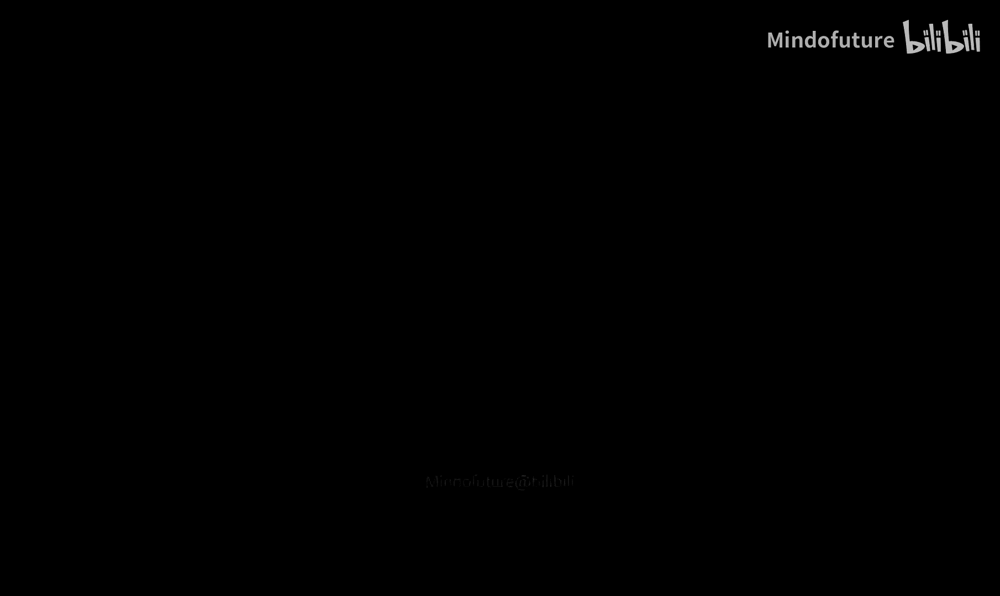
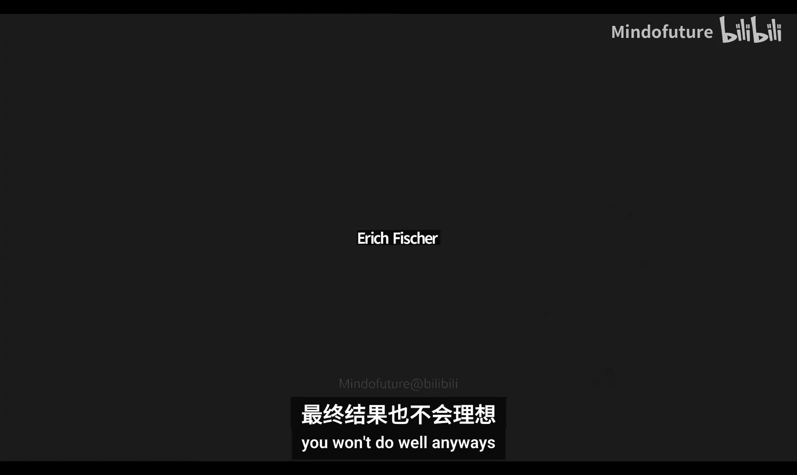
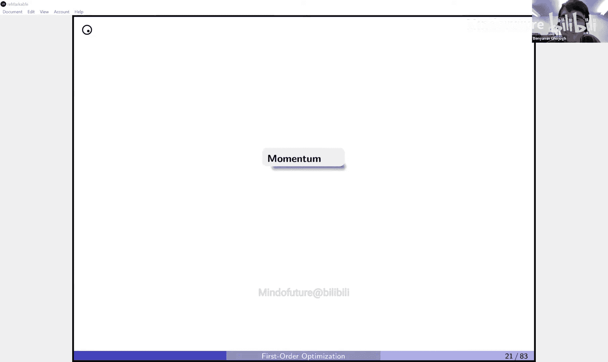
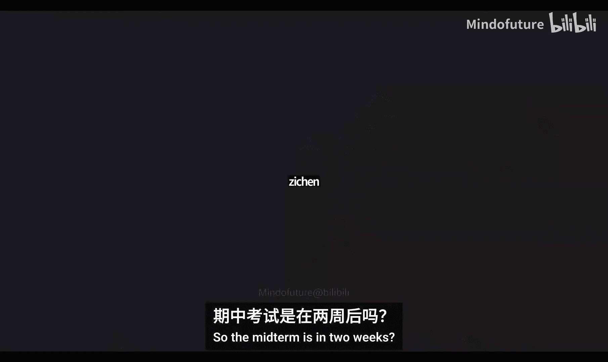

# 【滑铁卢大学】优化技术课程 ｜ Optimization Techniques   W2023 p06 P06_第六讲_(KKT条件与梯度下降) -BV1oJCHBcEo5_p6-

Okay， hi， everyone。诶。Before we start， is there any question about the previous。Session or。

About the assignment whose deadline is very close。Or about a midter。And yabiguiti。No。Okay。So。

Before we start， let me briefly talk about so I made an announcement in course link it's time to form the teams for the course project and also I have made a Dropbox folder。

In the course link for announcing the team members。

 as well as a short a brief proposal of for your projects， just for the proposals will not be graded。

 Just， I wanna know what you're gonna work on。 And we are on the same page。

 That's the reasoning behind it。 So let it be short。

I think the number of paragraphs I said maybe three paragraphs。

 and I have said what needs to be mentioned in the proposal。And currently we are 31 students。

 so we'll have seven groups with four members and one group with three members。 and yeah。

 feel free to discuss and talk to each other in order to。

Find the people who have similar interests to you and you can work either on theory or practice or a combination of both and please let optimization be an important part of it。

 not just a very side part of it。And also feel free to discuss it with me if you need my discussion。

 my opinion on your project， I'll be happy to have discussion with you and talk about it。

So feel free to approach me if you， if you think you need。

There's some discussion about that also so and please upload your team members as well as your proposals before the deadline。

Also， we have a midterm Yeah， someone has asked the question in the chat。So can be five members。

 I and four of my friends want to form a team， is it possible me？🤢，The thing is that Ali is。

If we want to do that， then。One of the teams will be two members。

And I think it's not a good idea to make it， make it team 5 and the the other teams。

 I'm thinking about the other teams。 the other teams will not have enough members to include。

 So please let it be for for at most。Even with that way， we。

 one of the teams will have three members， so。It will， it will be an issue， I guess。Is it okay。

 I I I I this is the situation， What can I do Yeah， because then， the。

 the other teams will not have sufficient number of people。 So that's one thing。

 If you have any follow up， please let me know。Yeah， okay。 Sorry about that again。And also。

IAbout the。Yeah， Milla has said hi， is there hi Milet， I there any question， No， okay， so。F。

 feel free to ask me either。By speech or by in the chat。

 Also another thing I wanted to tell you about the midter。 And so about the midter， by the way。

 next week， we don't have a class because this is the next week will be reading week winter break the week after that so。

It next week will be。Februaryebruary 21。ItsBecause it's。winterinter break or study。Reading week。

 please correct me if I'm wrong。And the the week after that， which is February。

28 we have the term exam， so the class session will be for the midterm exam。

 please everyone needs to be in the class time so I。Expect 31 students to。

Participate in the class time in in that please again。

 if you are even looking at the lectures offline， you you need to be present in the class on February 28。

 every students， all 31 students need to be in the class time， please。If possible， highly suggested。

 please use a device which has camera and please turn on your cameras。 I trust you。

 please respect my trust and don't cheat。 I'm sure it won't cheat。 you are trustworthy。

 and I respect you。So please also respect my trust and you are you can use calculator and even I think I will make an announcement for that either bring a calulator calculator。

 which can， for example， invert invert a matrix or something like that。

 but if you don't have such calculator， that's fine I have found a an online website which can do that for you。

 so I will put the web link of that。For you to， therefore， whoever doesn't have a complex calculator。

 they can easily use that website and I'm not peaky and I want even the exam to be joyful for you。

 so I won't make it too hard It will be similar to the assignment as well as the examples which have been solved in the class I think we have solved a lot of examples in the class time and the material of the midterm will be under until the end of the。

The slide deck for KKT conditions。So a part of this session will be in the midterm。

 just a part of it， and I will let you know when it's done for the midter and also。

 so that's the thing。Yeah， and。By the way， the good thing about the fact that we have the midterm exam during the class time is that if there is an ambiguity。

 feel free to ask and everybody will hear my answer。 so I will answer your questions。

 anything don't keep it to yourself exam is not like that you we can even discuss So during the class time during the exam time So we can say okay。

 there is ambiguity here， what should we do so even if I give a hint everybody will hear that And at the start of the exam time or class time。

 I will upload the。Questions in the course link， you will download that and also so。

Please bring these things first calculator， even if you don't have calculator I will give you a link for calculating inverse of matrices and these things also please bring ruler ruler is recommended not mandatory but for you to visualize for solving linear programming using visualization I think ruler will help also you need to have a paper and pen。

呃 and。Pen or pencil， whatever。And please write it in a way that we can understand。Underable。

 and also please have your phone or some device， which you you can take picture。

 It is also recommended， highly recommended that you， it's not mandatory。

 but recommended that you have a ca scanner installed on your device。 you can take at at the end。

 you can take picture from your response。 and then you can use magic coloring ca scanner。

 It will make make it like it is scanned。And then you can， you will upload the PF。

 And I think the deadline of the exam will be during the class time before the end of the class time。

But depending on how the hardness of the questions， I'll decide on the the。

 but I think it won't be more than the class size。And yeah， at the end。

 you'll upload your solutions and please try to have a stable internet connection。

 So this is the thing Any question or ambiguity about the。

It's it's Eric here I just had a question on so just based on what i'm hearing， I assume that。

On course link you'll post like something called you know exam one or something we' open it and then we'll just work on it。

You know during class time we' work through that test remember we're done we take pictures and hand it in So it's essentially an assignment but we have three hours to do the assignment Yeah yeah something like that yes and also I'm here and for any questions to ask for any ambiguity and I suggest I recommend that everybody also turns on just their camera this is it's not mandatory but highly recommended highly recommended that you guys I know that maybe someone some devices don't have camera and but that' that's what I'm saying that it's highly recommended that you use a device if possible if possible that you use a device which has a camera and you can turn it on and I trust you guys and I'm not a peaky person so you don't need to worry about me I'm not a peaky person I'm just trusting you guys。

Another question I have so what what exactly。嗯Like。

When you say you have a camera like what what exactly are you looking for。

 so like you know how in the first assignment we created like a Python that that solves a problem。

You're saying like we wouldn't be allowed to use something like that。

what do you mean I didn't get your point so like for example。

 like in in linear programming like you can just create a program that solves almost any linear like that just prints out a table。

UmI that there won't be any en codingd question， there won't be an en coding no， no。

 but I'm saying like what it like。What if somebody used that？Yeah， that's what I'm saying。

 I'm trusting you guys not to cheat。So like we're not supposed to be looking at our screen excessively or is no。

 no， no， no， I'm not the the only purpose of camera is just for a bit of it for it to make be like a realistic exam that's。

😊，And I guess yes， okay， okay， yeah。我要听嗯。I think you're all adults and you're trustworthy。

 I respect your you and please respect my trust。 So that's the thing。 And don't worry about to。

 don't worry too much about the grades and these marks because I think so far you have known me。

 I'm not a person who is very hard in and peaky and these things the only purpose of these class for you to enjoy that。

Of courseour， someone has asked， is it open book。嗯。Honestly， I think it's not。

Something which is hard to be open book or closed book because if you learn how to solve linear programming and these things。

 I think。You don't need even the notes because you this is a procedure and you also know the things。

 So some formulas， what kind of formula did we have， but。Okay， let's make a poll what， what。

 what's your opinion， I want your feedback， Would you like it Would the class like it to be open book or closed book。

 I let's have a consensus on that。Yeah。Bas I would I would say open book just because number one。

 I don't think there is any way to control that like I think people might peek on their computer if they had some notes or something。

 but the other thing is you kind of have to know the theory and how to do it so。

If you don't know how how to do you know， like dual simplex or something。

 you're not about to learn in that three hours like so if it's open book and you don't know what you're doing。

 you you won't do well anyways。

Yeah， yeah。 I agree。 So okay。 So let's make it open book。 but yeah。

 it doesn't mean that because if we make it open， we， we are gonna make it open book。

 but please don't think that， okay， as it is open book。

 I don't learn or don't study and I will study the during the exam time。

 I think it's won't be possible or feasible for you。 So please study well before the exam。Yeah。

 but let it be open， but， I'll also make an announcement and mention all these details。But yeah。

 these were the things that needed to be discussed before the exam。 Any other question。We ambiguity。

No。Okay， yeah。 And again， don't be stressed about your marks and these things。 I want the only。

 I'm kind of person I I want everyone enjoy。The classes and the courses。

 so I'm not the person who make it stressful。So that's the thing。 if there is no any question。

 let me start。So。Before we。before we。Continue where we stopped。 I wanted to let you know one thing。

 which I。Kind of forgot to mention in the interpretation of Larangeange。 And do you remember。

 I said you can see it as a。Regularized optimization where you are bringing the constraints close to next to the。

Yeah actual objective function。And that's a kind of soft penalty that you're applying on the constraints。

 constraints are kind of hard penalty。 And I forgot to mention one thing these。

Dual variables also known as log Grrange multipliers these are。Kind of the the weights。

 the weights of how we want to penalize or how how important this constraint is with respect to other constraints and objective function。

So assume the weight of the objective function is  one， you can consider these as weights。

So weight of these constraints， So lambda I is the weight of Yi x and new I is the weight of H X。

 so these are weights。For comparing the importance of the constant with respect to each other and with respect to them。

Actual objective function。 And these weights are usually called， especially in machine learning。

 It's called。 They are called regularization parameters， right？ So， for example in。呃。In optimization。

 you have some FO， but you can have Lambda。Omega x， something like that。

 So where the objective variable is x is this F of x is the cost or objective function。

 and this is the penalty or regularization term and this is so this is also called regularization。

Term and this is regularization parameter。Usually it's lambda is greater than or equal to 0。

 And even interestingly， we saw that the log log range variables need to be greater than or equal to 0。

 So similarity， you can see that you can see lock branch variables or dual variables as。

The the weight or regularization parameters for the relative importance of the constraints with respect to the other constraints and objective function。

 So that's one thing that I wanted to let you know I forgot to mention that someone has asked in the chat what will be the syllabus for midterm exam。

Okay， I will answer that and then we'll start where we stopped before。So the syllabus， yes。

 the syllabus will be until the end of the KKT conditions， so a part of this session Yes。

 I will let you know when we reach that point。Okay， so。Now， let me start。W we stopped。😔。

And feel free to ask me a question if there's any aate。Okay， here。

So we we talked about dual problem dual function， also the gap between primal optimal and dual optimal and the srs condition for a strong duality。

 Also we talked about weak duality and these things Now we are going start with the KKt conditions First off we start with the stationary condition well see what these these are So stationary condition Consider this laggrangian。

Function right so if you remember recall that F of x was objective function。

 these are for the inequality constraints and these are for equality constraints So the as we discussed Lagr function can be interpreted as a regularized cost function to be minimized right。

therefore， we want to minimize the Larangian function rather than minimization。

Of F of x with respect to the。Consance y of x， Y， I X and H X。And this was。

Primal optimization problem。 But now let's minimize the lockangian。

 which is kind of a regularized optimization now。With respect to X， right。

 because the optimization variable was x。え？But it has longda and as also its variables because of those regularization parameters now we can find its minimum by setting taking the everything that's0 to 0 y because do you remember this is either discussed high in your high school or in the calculus of the college or the first year of university when we have a function we want to find in its extreme one。

Extrem includes minimum and maximum。With what do we do and with there is no constraints， right。

 So we take derivative and set it to 0。Hopefully well have a close form solution if we have a close form solution we are done。

 if not we need an iterative optimization。え。So this is also。

 I think some of you might have learned this in numerical。Alysis course。

So we are taking derivative s to 0 because there is no constraints here in this optimization problem and this means derivative of lambda with respect to another notation for that。

 right？Nola X L。So this means take derivative， set it to0。And for that。

 let's take derivative of this term here。If we do that。

 what is that the F the derivative of the first term F of x。Divative of F of x with respect to x。

The relative can pass through the summation， right？So we have and this is also a scalar。

 so it comes out of the derivative， so it becomes lambda I derivative of y of Yi x with respect to x because y because the optimization is with respect to x。

 so we are taking derivative with respect to x。Also here derivative again goes through the summation。

 also this is a scalar comes out of the derivative。

 we have derivative of H x with respect to x and we set it to 0 right so we have this equation 17 this the equation is called stationary condition。

And then you see its completely makes sense because this shows the gradient and why why is it called a stationary condition because it shows that the gradient of laggrangian with respect to x vanishes to0 should vanish to 0。

 but vanish into 0 means that。It is equal to zero， right？呃。And we just proved that in equation 17。

 and by the way。The reasoning behind the naming of a stationary condition is that a stationary point。

 do remember， recall the preliminaries that we discuss a stationary report of a function is a point where the derivative of function is 0。

Where where does it happen either on。Minimum or maximum or saddle point so stationary point。

Recall this figure。Here and here and here。 in all these three。Terative is0， so this is maximum。

This is minimum and this is saddle point。And minimum and maximum were also called extreme。

 so minimum maximum saddle points are stationary points and in all of them the derivative with respect to the variable is0。

 that's why it's called stationary condition。😊，Okay and that this derivative holds for all dual variables。

 that's an important thing。 So why because we took the derivative with respect to x。

 so we didn't take the derivative with respect to Lada yet or new。

 so it holds for all dual variables。And not just for the optimal dual variables。

 not just for the optimal dual variables， but for all the dual variables。Clear so far。Okay， sorry。

 what doest mean like like the derivative holds， like doesn't mean like the function of the equation？

Derivtable what derivative variables。那这风式候。You mean what does it mean to say derivative of F with respect respect to x do you mean that？

This， this sentence。Yeah， yeah， yeah。Oh what does it mean， it means that this equation 17 at time。

These。Holds， this is true。For all new I Lambda I， not just Lambda I star and new I star。

 Do you remember， we had Lambda I star news no new I star where they maximize the dual function。

Thank youm。And my point is that these are not just for lambda I star and new I star。

 These are for all general Lada I and N new I。 Of course。

 this equation is true for lambda I star and new I star also as well， however。

Other Lada I and new I also if you put them in this equation， this is true。Okay，ll thank you。

Any other question？No， okay， so complementary slackness another KKT condition。

So assume that the problem has a strong duality right so we haveix star。

 Lambda star and new starix star minimizing the primal optimization problem。

 Lada Lada star and new star， these are the vectors， so containing all lambda eyes and all new eyes。

And these are these maximize the dual optimization problem， right？According to E 12。

What was a question 12， let's recall that， let me go back。In most of the slides。

 whenever I'm referring to to an equation， I bring it。

 but here there was no space that's why I didn't brought it。 So question 12 is this。

So we said that in a strong duality， the G of Lada strnu star equals f of x star。

 there is no gap gap is in a strong duality。So let's go back to where we were。

So according to the question2， we have this I'm repeating it here and E three。

 question three is this。😊，Was this if you go back and see question three。

 I'm repeating it here and what what was it it says it's the definition of dual dual function geoo Lada nu。

Equals in theum or minimum of the Laangian with respect to the x。Right？

And let's start from F of x star E 12 here I'm putting it here。

So based on that f of x is star equals g of longga nu star。According to this equation 3。

G of Ladoster and new star Im is infamoov， so here here I'm repeating。

La Grandangie entered this term。Is Laangian。But I have Lada new stored rather than Lada Mnu。

 therefore。These are start right， So this is Larangerange。 This is。This is Lagrangian of x。

Blumdoster， no star。Right， so far clear。Now。😡，What do we have here。This is A I have explained A here。

Because I starts a primal optimal function for a problem one， so again。Infeom is a linear operator。

 so we can say in this term informom of these parenthesesis equals informom of f of x plus sigma lambda I star infiom of Yix with respect to x plus some new I star infiom of Hx with respect to x right。

That's fine。And we know that inform of that those functions。

The solution is the optimal primal variable， therefore I'm putting X star in these。So far clear。

So because if you remember， we just discussing the stationary condition that it minimizes the lagangia。

So。We have these so far clear in step A。 Now， step B， I have explained it here。Yeah。

So what do we have here， do you remember？H I x star is0 because。

TheX star is an optimal primal variable， and optimal primal variable must be a feasible point。

 and the feasible point must satisfy the equality conditions。

 is equality constraints and the equality constraints are HO。

 so X star is0 because X star is a feasible point。So this term becomes zero， right？

Now we have F of X star plus summation of Lambda I star and Yi X star， and also again C。

 I have explained it here。We know that we already talked about it last session long the I star is greater than or recall call to0。

So the dual variable for inequality constraints in minimization is greater than or equal to0 for the less than or equal to constraints。

We already talked about it in equation 9 and also as X star is an optimal point and needs to be feasible point。

 it satisfies the inequality constraints， therefore all Yi x stars are less than or equal to0 so all of these terms is a summation right all of these terms are non-positive also these are non negativeative therefore the whole term the whole summation is non-positive less than or equal to0 so it means that so f of x star plus a negative or0 term is less than or equal to f of x star。

So we just proof。What， what did we prove。Let's go back。 So we I'm repeating what we start。

 So we started with。Here we started with F of X star and we came up with to this now I'm repeating it here。

So we showed that f of x star equals this and this is less than or equal to f of x star。

We also showed that you remember And I just discussed it。 So as Lada I。

Star is greater than or equal to0， and Y I x star is less than or equal to0。

 the whole thing is less than or equal to 0 for all of them inequ constraintss。

So I'm repeating it here， so we have these two。And okay， so this means。

This term from one side is equal to f of x from one side is。Less than or equal to f of x star。

 In other words， it's sandwiched。 It is sandwiched between f of x star and f of x star。 Therefore。

 this term must be0 because it is sandwiched between f of x star and so it is equal to f of x star and less than f of x star。

 therefore this term must be 0。And according to E 19， what was 19？Here， which I have repeated here。

I have repeated here， right， according to this equation。

So as we know that the summation is 0 and every term should be less than or to 0。

 it means that every term is0。So for all I， which means for all I from12 M1 to M1 or M1 this。

For all inequality constraints。This holds。 this is true。

 So we just proved that for all inequality constraints。The multiplication of lamb the I star。

And why I X star 0。And this is called complementaryary slackness， we just proved that。

And notes that this is optimal。Optimal dual variable for inequality constraints， and this is optimal。

Ex star is the optimal primal variable。 So optimal primal variable。

 also optimal dual variable for inequality construct。

This and this is also anequality constraint where has it has the primal。

For optimal primal variable in it。 So this multiplication is 0。 And we just proved that Any question。

No， so I'm repeating it here。 It is called complementary slackness。 and it has a consequence。

 And what does it mean。 So if do you remember， we said that lambda I star。In the last session。

 we proved that numberda I story is greater than or equal to zero。

So it's either greater than it means that。Either lambda I star is greater than 0 or lambda I star is 0。

 right， one of these two。So if it is greater than zero。😊，According to this。

 complementaryary slackness， YiX star needs to be0。M visit you。You know that also。

Also we know that YX star is less than or equal to 0 y because X star is a feasible point and needs to satisfy the inequality constant。

 and this also means either YiX star is 0 or YiX star is less than 0。

Right now if lamb Yiix star is less than0 according to the complementary slackness lambda I star must be 0。

In summary。Here， so we have two cases for Lada I star， we have two cases for Y IX star。

This corresponds to this。And this corresponds to this。So whenever Lada I star is 0。

 yak X star is less than 0。Its strictly less than zero。

Whenever y lambda I star is strictly greater than 0， Yi x star is 0。So in other words。

 if the dual optimal is non0。Its inequality function of the primal optimal must be 0。

If the inequality function。Of the primal optimal is 90。Is less than  zero。Its dual optimal must be 0。

Right。I'm just repeat repeating these equations here。Any questions so far？Everything clear。

 we just proved。Okay， now。Let's talk about KkT conditions。 So in the previous slides。We derived。

 so do you remember primal feibility and dual feibility we discussed in the last session。

End of last session。Stationary condition and complementaryary staness we just talked about it today。

If you put all of these together， these are four conditions and these four conditions are called KKT conditions short for K Rochecon Tucker。

And I will tell you。😊，The history story behind Keos Kucka in a few slides。

 So the primal optimal variable was X star。And do all optimal variables where Lada star a vector。

 but you can put。All of them together as a vector from lambda one star to lambda and one star for all the inequality constraints also new。

Start for all equality constraints and so all of the primal optimal variables and the dual optimal variables must satisfy the Kkt conditions。

 so this is a great thing in optimization。 You know that whenever you solve some optimization problem you must satisfy the Kkt conditions and sometimes you can use KkT conditions for solving the optimization problem and that's called the method of lagrange multipliers we can will see it at the end of this slide deck。

😊，Okay。Okay。So。KKT conditions or K contacter， we are summarizing them here。

 we are putting them all together， so stationary condition。

 do you remember it said that the derivative of Lagrangian with respect to X is 0。

We're repeating it here， which we showed that also primal feasibility。

 so primal feibility means that the optimal solution， the optimal。

The optimalptim primal variable which is X star you know that it's also it must be a feasible point。

 otherwise it shouldn't be an answer to the optimization problem， so it must be a feasible point。

 therefore it needs to satisfy the constraints because it's a feasible point by definition。

 so the feasible point should satisfy the inequality constraints as well as equality constraints。😊。

For all of them。For all inequality and equalityality constraints。

 and this is called primal feibility。Do all visibility。😊。

We discussed in the last session that for inequality constraints。They should be non negative。

For all of them or in the vector form， you can use the generalized inequality。 So this means this。

 So all all elements of lambda or all lambda I are non negative。

Either0 or positive and complementary slackness， we just proved that。This。

 and it has also a consequence that we discussed for all the inequality constraints。

As listed above KT conditions impose constraints on the optimal dual variables of inequality constraints。

So you can see that。These are mostly the constraints。

 especially these and these are working on the inequality constraints。

This is also working on the equality constraint。So you can see all of them。

 we proved them and it was very now I think having them in one sheet altogether together makes sense。

These are called KKT conditions。Also。We have some consequences of the KKT conditions in these are slides that I'm going to talk about。

So recall the dual problem， which we discussed in the last session， so maximization。Of the dualo。

A function subject to。And to all。To all feibility remember。

 we said that all dual variables for inequality constant must be non negative in the minimization。

The constrain of this problem is already satisfied by the dual fe。Right。

The dual feas KkT is exactly this constraint。 Therefore， let's ignore that for now。

 let's ignore the constraint of the dual problem because it's already satisfied in the must be satisfied in the Kkt conditions。

 Therefore， this can be simplified to this optimization problem。

 We can have maxim of the dual function。With respect to the dual variables， Lada and nu。

 so we have equation 28 as this。And this gives us lambmbda star and newest star of course lambmbda star must satisfy these dual fe in the KKT conditions。

 we can double check after we find this lambmbda star and newest star which we can double check whether they are non negative or not。

 of course they are because they must satisfy the KkT conditions。

And also we denote G of Lausster and new star by G star。Just to be shorter。ok。And。

 this optimization problem。Is an unconstrained optimization problem right because the constraint we assume that is satisfied by indicate dual feasibility。

And again， for solving that。We can take derivative set to 0 what we learned in high school。

 So let's take derivative of this dual function。😊，And here now the variables are lambda and new。

 therefore， once we should take derivative with respect to lambda and set it to 0 and once we should take derivative with respect to new and set it to 0。

 right。We can see it as a partial derivative。Because we have two variables longer and new。

Two sets of variables actually and now。😊，So。Here。According to E 6， what was E 6？The recall that。

What was that。Should go back。Question 6。Okay， do you remember this？

Go Ladaannu is infaum or minimum of the Laangian with respect to x。

 and as it is minimized in the Laangian。We can say that it is Lagrangian of X star and lambda and nu because we we are minimizing the lagangrangeian。

 Do you remember it it is the minimization of the regularized problem rather than the problem itself satisfying the constraints。

 Therefore， we can say infinite of laggrangian of x lambda n nu with respect to x is the lagangian of x star Lada N nu and X star is the solution to these。

In feome of Larangeian of X， lambda and nu。The solution of this or or a of this is X star。

Right now let's according to this equation， remember this， let's go back to where we were。

So g of lambda and nu is equals the quo of x is s lambda and nu， let's go back。Okay。

So according to this， equation 6 that we just saw， I'm replacing this G of Lada n nu with Lagrian of x star Lada and nu。

 we just saw the equation 6。And derivatives。Are put here again。So this is set to0 and this is set20。

 setting derivatives of Lagrangian with respect to the dual variables here here and here。

Al this gives back。The corresponding constant is the primal optimization problem。

This always is the case so whenever。You have， you form the lagangian。

 We can see an example in a few slides whenever you take derivative of the from the。

And the crunchian， with respect to dual variables， it always gives you back the constraints。

 So this gives you back Y I X。And this gives you back HX。

Because new were for the equality constraints and lambmbda gives was the for inequality constraints YX。

 so it means that it's kind of a verification because it gives you back。

 but it's kind of useless because you already knew that those constraints must be satisfied and you'll see an example of how it gives you back then。

So far clear。Okay。E questionation 23， 29 and 30。So I think I'm repeating them here。

So we had derivative of Laangian set it to zero， this was stationary condition do you remember in Kkt conditions we're also in the previous slide we just saw these two equations now let's put all of these three together and see that so it means that derivative of Laangian with respect to x is0 derivative of Laangangian with respect to lambda is0 where lambda has x star in it derivative of lambda with x star with respect to the nu is also zero。

So it says that the。Prima dual residuals must be 0。By primal and dual residuals。

 we mean this with derivative of Laangian with respect to primal and derivative of Laangian with respect to dual variables must be0。

Now equations 3 and 28 can be summarized into the following maximum optimization problem。

 let's recap what we had here。 so do remember。Equation optimization 28。

 we had maximize geo lambda and nu with respect to Lada and nu。

 and we called it the dual optimization problem in the previous session we defined that maxim of the dual optimization problem。

 dual optimization function， maxim of the dual optimization function is called the dual optimization problem。

So we have this supreme or maximum of G。With respect of Lambda and nu。According to equation 3。

Question three， we I just showed with you in a few minutes ago。

It was this is that according to the definition E three is the definition of dual optimization function。

 What was dual optimization function。Gop lambda and nu is minimum or infimum of lambda Laangian with respect to X。

That's why I'm replacing G lambda I know either in theum or minimum of Laangian with respect to X。

 So as you see， these supreme。Comes from the dual optimization problem。

 This infium comes from the definition of dual optimization function。Now。

 having them together all together， so maximize the dual optimization function。

Which itself has an infa in it if you put them together。

This also gives you Laangian ofix star lambdaine newest star why because this infimome gives youix star and this supreome gives you Ladaine newest star。

 so altogether it will have Laangian of ex star lambdaestine nu star This is the La optimal Laangian function value right and as you see here we have max and mean next to each other。

These are very important optimization problems， especially in game theory， you have mean Max。

 either mean Max or max mean。You can see this also as。In supreme， in supreme or supreme in fe。

Mean Max problems or max problems are used a lot in optimization， especially in mathematics。

 especially in mathematics of economy， and because in game theory and these things why because in game theory。

 what is game theory， briefly， let me tell you in game theory。

 you have several agents or several people or several whatever， several particles。

 several agents who are kind of competing with each other， they might be collaborative。😊。

Or they might compete with each other， they might be aggressive right so if they are aggressive or they are against each other。

 one of them wants to have the profit， but the other one wants to decrease the profit of the other one。

So one of them wants to maximize its profit。😡，Some Lagrange and let Lagian here be the profits of one of them。

 But the other one is against that and wants to minimize that。呃， profit。The other one， the other way。

There might be some cost for one of them。That agent wants to decrease the cost。The loss。

 the other one is against that and wants to maximize the cost of that agent。

 so they are competing with each other。You get this， that's why in economy， because in economy。

 usually agents want to compete with each other。Like duoppoly and these things。

 So when you have two specialty markets which are against each other in the market。

Two companies against you should have a mean Max or maximum optimization problem and under some circumstances。

 mean Max and max under some circumstances are equivalent so when you have mean Max under some constraints you have also maxmin。

This game theory game theoretic optimization problem。

 Max or Min Maxax is also used in GAN if you have heard of generated adversarial networks which were very interesting in artificial intelligence and machine learning recently show that you can generate some new images or some new samples from your data distribution which are not necessarily exist。

 for example， they have used GAN for generating some facial images and these facial images are not for existing people。

 so you see a face an image of a face， but this person doesn't exist on the Earth。

And that's an interesting thing if for again is formulated using Max or mean Max optimization problem because it has a game theoretic approach so you can see。

😊，で？The dual optimization problem as a game theoretic approach as a maximum optimization problem。

 right because？😊，You have the primal optimization problem， which wants to minimize that。

On the other hand， you also have a dual optimization function which want to maximize that。 therefore。

 minimizing a bowl， also maximizing a bowl， you will have a maximum or mean max optimization problem。

 game theoretic approach。Any question so far？能。Okay， no。Great， okay， So where K K。

 some history of K K T conditions。 Where， where did it。

 Why do they call it K K T or K Roche Kon Tucker， It's an interesting history。 So in 1952。

 I have also put the papers in the references。 So in 1952， two scientists named Cone and Tucker。😊。

They published an important paper， they proposed these four conditions that we just discussed。

 and however， later， so by the way， cone and Tucker were from Europe and at that time it was a scientific。

Competing so between Europe and US so US wanted to say wanted to win the scientific match and Europe also wanted to win that at that time。

Therefore， when Conhn and Tuer proposed that from Europe in 1952， people in the US said， okay。

 someone went in US and found a master's Casis written by Kish in 1939。

 which was before 1952 and it was at the University of Chicago， Illinois。

And I have also put the reference here and they saw that by the way， K in his paper in hiss。

 Masters Casus。had already proposed those conditions kind of， but it wasn't published as a paper。

 it was a master Caesus no one had looked at that much and they said oh by the way in US we had already proposed those conditions so finally they had a consensus scientific society had a consensus between US and Europe they said okay Cohn and Tucker didn't know about Kro's master Caesus so it wasn't plagiarism but let's name these conditions after all three of them so it became Kche conhn Tucker conditions so this was an interesting history behind these conditions。

呃。Now。And let's okay， here now we are going talk about method of lagrange multipliers。

 remember I said。A few minutes ago I said KKT conditions can be used kind of as validity check。

 you can check your answers so when you can solve the optimization problem and then check your solution by KKT conditions whether they are valid or not they correct answers or not。

 you can go the other way around， you can use the KKT conditions for finding the solution。

Using the KKT conditions for finding the solution or solving the optimization problem is called methodod of Lagrange multipliers Now we are going to talk about it。

Okay。Consider the optimization problem one， which we started from。

Minimize minimization of f of x subject to YiX。Less than or equal to 0 for M1 inequ constraints。

 and we have M2 equality constraints。Now let's solve this using duality and KKT conditions。

This technique is called method of log range multipliers for this we should do these steps。

 are this is the procedure or the algorithm for that。😊，So let's first write the Larangian。

 as we discussed before。 So what is the laggrangian we put the the objective function。 We also sum。

Over the inequality constraints with 1 dual variables Lada I and with sum over the equality constraints。

And by the way， if your optimization problem was not in this format。

 you need to make it converted to this form we discussed in the previous session how to do that so even if it is maxim if you have greater than or equal to zero constraints and all of these or even when you have non-zero values constants on the righthand side of the constraints for all of these cases you can convert your optimization problem to these standard form right and then you write this Laangian in this way you can also write it in this vector form。

Now we can lets what is the dual function？So do remember we are we said first off。

 we said that we want to minimize this optimization problem here now let's minimize the regularized optimization problem which is the lagangangian so let's minimize the lagangian with respect to x and let's call the argument the optimal objective variable for this optimization problem。

 let's call it x a dagger， this is called dagger right like a cross so x dagger。

 whatever just a naming whatever you want to name it naming is not important right I call it x dagger。

And here， so do you remember previously， I said this means defined in the literature。

 this also means。A sign。Exactly like assign sign encoding when you are coding C C plus plus Python whatever。

 So when you say x equals 3 it means that assign 3 to x right。

 so in optimization also you can write this as a sign so based on based on the context you can understand whether it means define usually in computer science papers this means define or it means assignment you can see that hi。

By the way， there is apparently a question here someone has asked。

 why don't we call it x X star because Azo will see that so Aza has asked why you don't call itix star because we will find X star here in equation 36 we'll discuss that when when we have Lambdaine newest star in the Laangian but。

Kind of you can call that X star， but you will update X star in 36 you can see it in this way。

 but it doesn't matter you eventually we will find X star。

 but as lambda and new are not optimal here I'm calling calling it exdagger。All right。Okay。

So I discuss this and here it means that you can see it as a define or assign both work for here。

So now this is an unconstrained optimization problem。

 therefore we can take derivative and set it to zero， take derivative。

 set it to zero as we had in high school or college so now。え。This。In the previous slides actually。

 as Aliza said， we call it x star， you can call it x star。

 but it doesn't matter naming is not important for me。

 so G of lambda and nu equals laggrangian of dagger or x star and lambda and nu do you remember this is the definition of dual all function because G of lambda and nu was in the or minimum of Laian of x lambda and nu with respect to x。

According to the definition， we have this question 33。Okay。Now let's continue Okay。

 we also said that in the dual optimization problem。

 we are maximizing the dual optimization function here。😊。

And let's call the argument of this optimization problem， optimal arguments。

 Lambda star and new star right， these are vectors。

 are these have lambda lambda eyes and these have new eyes。So we also have this。

 So at the third step， we do this。In the also。Also。

 now let's put these back into the G in order to have the Gs star right。

 So in every optimization problem， we have the optimal objective function as well as optimal objective variables。

 So these are optimal objective variables for the dual optimization problem。

 And this is optimal objective function for the dual optimization problem。In the fourth step。

We have this now again let's go back to where we minimize the Laangian and but now we put Ladaan new star in the Laangian now when we do this so we have only the argument will be X star。

You can see that as an updating exist or whatever。So。36 is kind of similar to。32， right。

 but it has La and newest star in it。Again， it is an unconstrained problem in order to solve equation 36。

 your take derivative。Of this log term。And set it to 0。Here， this is。When you do that，A star。

诶 will be。Will be a number or a vector， a constant vector y。

 because it won't be based based on Lambda and new anymore because Lada is trying to start our values now。

So when you take derivative with respect to the x， this term will be purely based on x。

Because it doesn't have Lada and new in it， Lada and nu are already replaced by lambda as trying new star。

And also it gives you X star and now let's put it back into F to get FS star in other words， again。

 we are doing here the kind of primal optimization problem regularized formats。

And this X X star is the optimal objective variable， and F FS star is the optimal objective function。

So these are the steps we'll have an example for that。

 so don't worry for understanding that we'll have an example。

 but let's recap what we had so the four steps again very fast so when we have an optimization problem。

Step  one， reform the Laangian function。Step 2， we we take derivative。

Of the Laangian with respect to x set it to0， that gives us x dagger or x star。

We put it back into the Laangian。 so this function will be。

Purely based on lambda and new because x is replaced by x stagger。

 So this also gives you the dual function， right。NowNow that you have dual function。

 we can solve the dual optimization problem。Eion 34。 so now it is an unrate problem。

 take derivative with respect to dual variables and set it to 0。 It gives you La and newest star。

 put it back in the dual optimization dual function， put it back in the dual function。

 It gives you G star， so it gives you the optimal dual function。Right， and step 4。

Now you have Ladaster and nuest star。 Put it back in the Laangian。

 The Lagrangian will be purely based on x because lambda and nu are replaced by lambestster and nuest star。

 Take derivative with respect to x set it to 0， because it is an unconstrainrate optimization problem。

 It gives you x star。 Now， put X star back in the a primal function， which is F。

 It gives you fs star。Finally， wanted Fs star and Xtor。 Yes， in this optimization problem。

 in this optimization problem， what did you want， You wanted X star and F of Xtor。

This is exactly what we found here。In equation 36 and 37。

 so this has solved our optimization problem。 This procedure is called method of Larange multipliers。

Any questions， so？Everything clear。Yeah， yeah， yeah， okay， great。 So as you see。

 we have used KKT conditions， not for checking the optimal solution。

 but for deriving the optimal solution for solving the optimization problem。😊，Now an example。

 a simple example， we have this optimization problem， now it's not a linear programming anymore。

 it has a squared in it right so it is kind of a more general optimization problem。Let's solve it。

 this is the first time in this course we are solving a non nonlinear optimization problem。😊。

We have two objective variables。😊，And we have two inequality constraints the inequality inequality and equalityality constraints here are linear。

 but they don't need to be linear right here they are linear So these are the constraints here we have greater than or equal to in order to make it a standard form we need to multiply it by minus1。

So we have less than or to zero also I have brought one to the other side of the inequality to have zero at the right hand side of the constrain。

Also， we have this。To make it standard， we bring two to the the other side。

 so we have zero at the right hand side of the constraint。So this optimization problem has become。

Convert it to x1 and x2， x1 is squared plus x2 is squared plus 1 subject to。

X minus x1 minus x2 plus 1 less than or equal to 0 and x1 minus x2 minus2 equals 0， by the way。

 we have here one inequality and 1 equality constraints。

 we might have several inequality and equality constraints in general。

 So here in this example m1 and m2 equal1。So let's form the Laangangian。Here。

 this is the objective function。 We have only one term for inequality constraints。

 so I call it lambda。But if we had two inequalityality constant， we would have Lada1 and Lada 2。

 right？Also here we have only one equality constant。

 so I call it new only is the dual variable and this is the dual。

 this is a constraint so this is a Laangian function as you see it's a function of x lambda and nu and x has x1 and x2 in it。

 so it's a function of x1 x2 lambda and nu。Let's take the。

What was the first step of the of the method of lagrange multipliers take derivative of the lagangian with respect to x and set it to 0。

 Okay， take derivative of laggrangian with respect to x and x is a vector。

 So the first element will be。Teect derivative of Laangian with respect to x1 and the second element would be the derivative of Laangian with respect to x2 if you don't remember why recall what we discuss in the preliminaries derivative of a scalar because here output of Laangian is a scalar right derivative of a scalar with respect to a vector is a vector。

We have these two terms set it to zero。So we have this。ASystem of equations。

 we can easily solve that。呃，这是。Either use a Kmer F method or these things Or simply here。

 you don't need those methods。 you can。If find x1。And also you can from this。

 you can find x1 from this， you can find x2 if it was more complicated。

 you would find x1 based on x2 and put it in the other equation and it would give you x2 So x1 dagger or whatever you name it x1 a star is lambda minus new over2。

 So as you see here yet x a star or x dagger。Is a function of dual variables because we haven't replaced lambda N with their optimal values。

 Lada star and new star， therefore these star or xtgger is still a function of the dual variables。

Now let's put back the eggtagger in the Laangangia。In this way。

 the Laangian will be purely based on x。lambda and nu。 no， no， no。 sorry。 it is。

 It won't be purely based on lambda and U。 It will be purely based on lambda and nu not x because x stagger now is a function of lambda and nu itself。

 Alright， When you put x stagger in the Laangian。Your lagangian will be purely as you see based function of Lada and the dual variables here I have just calculate some had some calculations。

 simplification of terms， and then you will have this。Right。Okay， now。

The next step in the method branch multipliers you don't even need to memorize that。

 I think the flow is obvious。 Now you have this， So this is by definition if the dual function。

 geo Lada and nu。As you see， it's a function of lambda I。 I have put it replied。Repeatated it here。

 So this is the dual up dual function， dual function。

And now the next step is that we want to in the dual optimization problem。

 we want to maximize the dual function。 Therefore， we take derivative。

Of the dual function with respect to the dual variables。And we have two dual variables here。

 we might have more of them， several because we might have several constraints， but here we have two。

 so take derivative with respect to lambda and set it to 0。

Take derivative with respect to new and set it to0。A system of equations。

 it gives you Lambda star and new star。Right。In here it's so simple。

 but in general it might be a simple a system of equations where each equation has both one and new。

 so you need to solve that。Okay， now we have found Lambestster and new star。 As you see。

 these are numbers now。Let's put them back in the Laangian。

 therefore the Laangian will be purely functional the primal variables x1 and x2。

So these are just simplification of terms。Now we have that we go back to where we started we said that we want to minimize the Lagr general。

 which is a regularized format of the primal optimization problem。Therefore。

 we take and as it is an unconstrained optimization problem。

 we take derivative of the grandian and with respect to the primal variable x and set it to 0。

Here again， we have。Two terms， because it is a derivative of scalar with respect to a vector。

 X 1 and x 2。Set and set it to 0。Again， we have system of equations。Here the system is very simple。

 Otherwise you might have equations。 you need to find x1 based on x2。

 put it in the other equation and solve that。 So here it gives you x1 a star and x2 a star， right。

You found your prim。Optimization variables， X1 x to a star。Now you can put it。Back， so now。Here。

 these are the primal optimization variables， optimal primal variables。

 These are optimal dual variables。 We found them1 by one。 We found them all of them。

 So here in this is， we found Lambndas strnuist star。In this star， we found x minus star x to a star。

 we found all the optimal variables。What is Fs star。

 We can calculate Fs R to star Fs star of is F of X star。 and what was F。

Look at the optimization problem， which we started with。This was F right。F of x as a vector or。

It is f of x1 and x2， right。So we found x1 star and x2 a star。

 let's put them in the F and gives us 3 point。5。So this is the optimal。

objectivebjective function for the prim problem。Fs star。

Now let's find the optimal objective function for the dual problem， which is J star。

So Gestar is Ge Lada Str newest star。And what was geo longduster newer let's go back？You remember。

 recall here Ge of Lada and knew was this。So now let's put Lambdoan new star in this term。

It gives us some value。 So now I'm putting lambmbda star and newest star in this term。

 It gives me3 point hat。Does it ring something in your mind？At the star。Is three point。fi。

Gia star is 3。5。We know that， for sure。G star must be less than or equal to FS star because it is a minimization problem。

 right？We are minimizing F。 We are maximizing G， and we know that。

It's either we have weak dual or strong dual， right， So the gap is not non negative。

G star must be less than or equal to F star。 We discussed that in the last session。Here。

 in this case， interestingly， G star has become equal to a star。

Which is the definition of a strong duality， so we have a strong duality。

But do you know why we have a strong duality？Can someone tell me why this optimization problem？

Why this optimization because our basic was based on。嗯。Is strong。What。

Can you repeat because we have Ex star La star newest star only when we want to at first start with these conditions。

No，We might have an optimization problem， which has， of course， some optimal x and Lada and nu。

 but it might have weak dualality。So not necessarily whatever has a solution has GS star equals FS star we might have GS star less than FS star。

 right？Yeah。The reasoning is because of last session。

This is the repeat of an example of a Slater's condition。In the last session。

 we had an example for the Slater's condition。Let me bring it。

So refer to what we discussed in the last session that the example here。Yeah， exactly。

So in the last session， we said， okay， if we satisfy the Slater's condition。

 it means that we have a strong duality。We收。That yes， this problem has strengthctuaity。

 What did we do， We found simply we found a solution which satisfies the equality constraint and the inequality constraint in it is strict for。

 So it has it satisfies the inequality constraint for less than 0。

 not less than or equal to 0 less than 0。 This is its latest condition。 And we showed that， yes。

 it satisfies latest condition。 So before solving this optimization problem。

We know that GSR must equal f star。Here， and now we solved that within method using method of lag range multiplers。

 you might use other methods to solve that。 But here we solved that using method of lag range multiplers。

 and we saw that， yes。As we expected， by slators condition。Sttrong dualology holds for this problem。

And f a star is actually equal to GS star， if you solve it。

You had solved this optimization problem in this example， and GS star was less than Fs star。

Then something must be wrong。 Your solution might be wrong。If GSR becomes greater than FSR。

 it's absolutely wrong because we either have weak dual or strong dual in neither of them。

 GSR is not。Greater than if a star。If we know that it satisfies str loyalty。

 then we know that they are equal。So。This is the beauty of things。 And now these are the references。

 So this is slater。😊，Slater's paper for Slater's condition in 1950。

Right these are very historic papers， so this is Cayro's thesis master thesis in 1939 University of Chicago。

 Illinois。Department of Mathematics， and this is the paper of Cone and Tucker in 1951。

They were not aware of Cayro's thesis。And what is this， Oh。

 this is a historical discussion of Kaos contact contacter theorem so you can look at this paper。😊。

And yeah， that's it， these are this is kotic conditions， your midterm is up to this point。Yes。

Any question？Before we start the break。No， everything clear。😊，Okay， so。😊，Great。

 let's come back at 835。Thats good。Sounds good， Okay， great，8s 35， I see， Thank you。So now。

 let me share a screen。Okay。We continue with first order optimization。

A little bit change of gear right now。So now first order optimization。First。

 let's see the fundamental theorem of calculus because you are going to use that in the derivation of gradient descent。

That we are going to introduce。Okay。There is a lemma fundamental theory of calculus for multivariate。

Functions I'm not going bring the proof of。This theorum is kind of out of the scope of this course。

 but we have a corollary of that and we are going to prove that。

 so first let's look at this fundamental theorum it says that consider a differentiable function which means that we can take derivative of that is a smooth and its the doming is D so and for any two points in this doming x and y。

We can have this， So f of y equals f of x。F of y equals F of X plus this is gradient or derivative of F with respect to x transpose y minus x。

 What does it mean it is the inner product between derivative of F of x， Y， because it's a vector。

You remember f is a scalar， x is a vector， therefore derivative of f with respect to is is a vector y minus x is a vector 2 because y is a vector x is a vector y minus6 is a vector and this is the inner product of these two vectors。

We also have integral between0 and 1。Let the variable of the integral be t。And teas here。

So what does this mean x plus t minus t times y minus6？

The gradient of f in this point minus gradient of f in the point of x。

 so when you have this this becomes a vector， this is a vector again this is also a vector again this is the inner product between these two vectors you integral over that over t t is between0 and 1。

 it's very similar to what we had in definition of a convex set。

 do you remember we had alpha between0 and 1 similar to that here。The T is between0 and 1。

And you can see it as this term， you can see this term as small o of y minus x small o is is is in the complexity theory。

 So big o small o。 if you don't know， you can take a look at that， but it's an order。

 It means that this is a kind of a function or an order of complexity whose variable is y minus x。

 you can see here。 We have y minus6， we also have y minus x。 So it depends on y minus x。

 So when we usually use small o when we want to approximate something。 for example。

 we see that in Tayloror approximation2。 So it means that the rest of the terms is a function of y minus6。

 it means that So these two terms plus some rest of the terms。As a function of y  -6。

 this is fundamental theorem of calculus， right， Okay， as a matter， there something。

You are going to use now， it has a corollary consequence。

Consider differentiable function F with domain D and let its gradient be eli smooth。

Recall Alice smooth lips continuity that we had in preliminaries。So now。

Let's say that the function is the gradient of function is L smooth， not the function。

 The function is not important here。 The gradient of the function。

 derivative function needs to be Lli smooth， It means that you remember L smooth。

 it means that it's a slope shouldn't go too much higher than L。

 So this is exactly that the definition of L smoothness。For all x and Y in the domain， D。And。

For L smoothness， we had this f of x minus F of y。Is less than or equal to L x minus y norm。However。

 now we are saying the gradient is a little smooth， therefore。

 F of x and F of y are replaced by gradient of f of x and gradient of f of y。

We are not talking about F itself here。And then says that if the gradient is a less smooth。

 then for any 2。 x and y in the domain， we have this。

It means f of y is less than or equal to f of x plus the inner product of gradient of f of x and y minus x plus2 half y minus L2 norm s squared。

And as you see， it's very similar to the fundamental theorem of calculus。

 we are going to use that in order to prove this are you are going to see how we are going to use that in the gradientd distance。

 So proof of this。Let's start with F of Y， I'm repeating here。

 I'm repeating the fundamental theorem of calculus。

 which we showed in the last slide based on equation1 that we just saw and now。This term。Distister。

I replace it with this term。So it means that the inner product of these two。

 I replace it with the multiplication of L2 norms。And this is the cautious shorttz inequ。

We already discussed that in the preliminaries。 We said that。It transpo is y。

It's less than or equal to normal vi。Times normal y Now replace x and y with these two terms。

This is like， eggs。This is is like why。You will have Ca shorts inequality for these two terms。

 therefore we have less than or equal to。Right。So。So far， we know until now let's go to line 3。

 line 3 is that。Do you remember， we said let the gradients be aliuth。🤢，So。We had this。

For any two points， do remember， here we said， let the gradient be esmus for any two points。Now。

 let the two points be。X。Plus T， y minus6 and x。You will have this。

Inequality that we have are shown here。When the two points are these two。Okay。

 now we can simplify this term inside the L norm and we'll come up with this so in other words。

We can replace this term。With this。With less than or equal to， because of the e smoothness。

This was the assumption of the corollary right， we said that let the gradient P。Eliuth。Okay。Now。

As L is a constant with respect to T， also squared L2 normal y minus x is constant with respect T。

 they are not functions of T， they can be brought out of the integral。And will have integral of T。

D T from 1，0 to 1， if this is equal to 1。Right， therefore， we have this。

 This is exactly f of y equals this term， and this is what we had in the corollary。

it is less than or equal to because of this less than or equal to。

 so f of y is less than or equal to this term， which is the corollary， so we proved that。

 but we are going to use this corollary in the derivation of gradient descent you'll see。Okay。

Now let's start gradient Decent。The first。First order， optimization method。From now on。

 we are talking about iterative or numerical optimization。

 numerical optimization or iterative optimization。 What does it mean， It means that do you remember。

 So when we have。😊，An optimization problem minimize F of。If it is unconstraint。

 we already have discussed it several times in this course。

 so when it is inconstraint it means that we want to find its exremo again in high school or college we learn that we can do this by taking derivative of eggs with respect to eggs and set it to zero。

So this gives us。😊，So this can is a function of x right。

 and this gives us some terms based on x so we can find x if we can find x in a closed form。

This gives us optimal。The value for X star。 So this is done。 However。

 sometimes it's very hard to bring X solely to the one side of the equation。One is that is the case。

 we can't have a closed form solution for for example。

Maybe the derivative is something like this tangent of x plus 1 plus x2 over。Whatever， I don't know。

Sign a， sign a skirt eggs。-3 equals。Z， how can you find x in one side of equation too hard to find x star？

We can use numerical iterations in order to find the roots of this。Equation， right？

I think you have learned it in numerical analysis courses that you have you might have passed。

So this is one way。 Now in such cases， we can use gradient descent。

 Consider this unconstrain optimization problem for now， let it be unconstrainant。

 So gradient descent is unconstrain at the end of this lecture slide deck will see how to deal with constrain optimization。

 Constrain problems in first order optimization。 But for now let it be unconstraint。

And we are assuming the general case where we can find X star in a closed form solution。

 therefore we have to do iteratively， well have to find X star iteratively。

 and we have to move toward the Excel star step by step iteratively。Graian Decent does that。

 and we see how。Okay。So gradient descent is one of the fundamental first order methods。

 very fundamental， it was first suggested by Kashi in 1874。

 you can see how old it is and Hadamd in 1908， very old。😊，More than a century ago。 So。

 and its convergence was later analyzed in reference3， which you can see。

At the end of this a slide deck and consider this un constant optimization problem that we just discussed okay。

In numerical optimization for unconstrain optimization。

 we start with some random feasible initial point and this random point must be feasible， right。

 We shouldn't start with an invisible point。 We should be in the feasible set where。Here。

 as it is uncon problem， the feasibility set is only the domain of F。

So whatever the F is defined is the visibilityibility set as it is an unconstrain problem。

 But we should start with a random visible point。 and then its creatively， we need to update it。

 Therefore we can write it in this way。Let K be the iteration index。 So for example。

 we start either with0 or 1 whatever0 and then one iteration one iteration to iteration 3 and it means that x of。

Assuming we start with0 x of 1， by the way， here it means a sign we discussed is here。

 it means a sign。 We can show it by arrow 2 x 1 is x 0 plus sum。Step x2。Is x1 plus some step。

 and we continue until convers。 So this means this， right。 And by the way， this step。

Can be dependent on the iteration， so it can also be cell like this， or it can be fixed。

 We'll discuss that， right。Okay， and we continue until we converge to sufficiently get close to。

The desired optimal point， we might not exactly reach that。

 but we need to sufficiently get close to that。Okay， Eliza has asked， is it explicit， you mean？

What do you mean， Can you elaborate what you mean， Add Theresa。What do you mean by explicit。Here。对。

Okay。I'll wait for you to either talk or chat， and I will answer you。 I didn't get your point。

 So you have said。Okay， I will ask you later。 Yeah， sure。诶。

So we have some step and we are doing it it creatively until we convertverge sufficiently get close to the optimal point Now the step we show it by delta x here sometimes is also denoted by p in the literature so p or delta x as you see this is a vector in general case why when x is a vector delta x also is a vector when x is a scalar deelta x is also a scalar in general case。

 even when sometimes x is a matrix in that case， gradient is also a matrix rather than a vector then delta x will be a matrix2 right？

So depending on what x is okay， now let's find a step size。

 So as we saw here we have some in gradient descent we have some step size。

 if you find the step size， the gradient decentscent algorithm is this only this line。

 this is the gradient descent。Right。And it is an iterative approach until convergence。

 because by convergence， what do I mean by convergence， it means that。

So whenever the distance the difference of x1 and x2 is huge initially。

 but gradually if the problem is not divergent， usually you get close and close to something。

 for example， x1。Might be 2。3 x2 might go if x is a scalar， assuming in this example， x is a scalar。

 it becomes 1。5 something。Eventually， Es， for example，1000。Becomes 1。0001 x 1001 becomes 1。0。0。诶。91。

099 something like that very close to the previous solution。 As you see。

 the difference is getting closer and smaller and smaller， it means that the problem is convergent。

 not divergent。 So we converge to some point and if we continue eventually we get very close to one。

 So it means that x star is one right So in this example。

 So now the only thing which is remained in gradient decent， as you see is very simple is delta x。

 let's find the step size。 Now let's solve this， let's see's how to derive that Okay。

 let the function F， which we are optimizing here in this case we are minimizing。

Be differentiable so we can take derivative and let its great gradient be a less smooth， as you see。

 it rings something in your mind that it is assuming the same assumption in the corollary of fundamental theoryem of calculus。

 right Okay， so its gradient。 let it be a less smooth， not it's a slope shouldn't change a lot。😊。

It's gradient。え？It means that the second derivative should not be huge when we say the slope of the gradient should be upper bounded by L。

 it means that the second derivative of the F should not be huge。🤢，now。Recall equation。Three。

 what did we have in co or fundamental theorem of calculus we had this。

We just proved that a few minutes ago， right， Okay， now we say。If we set x， so as you remember。

 we said this corollary was true for any for all points， any two points in the domain of x right。

 we showed that let one of the points in the one of the feasible points B xk。

 it means x in the iteration K and let the other one be。Yhy the other one be xk plus 1。Which。

 by definition of gradient descent is equals to xk plus delta x。

 right now let's put these two points in the corollary of the fundamental theorem of calculus。

 which I've written here。 If we do that， we'll get this。

We'll get this now let's bring this to the left hand side。

 so we'll have this less than or equal to this term。😊，Okay， so far clear， okay。

Until reaching the minimum we want to decrease the cost function， of course。

 because the optimization problem was minimization of f of x。

 so we want to in each step we want to minimize or minimize the cost function or decrease the cost function in every it。

 therefore we desire that f of the next point minus f of these point be negative。😊，It means that。

Whatever I have at this point in the next point， I want the function value be smaller。

What does it mean。If I rearrange it。It means this， right。

And Im just replacing it by definition of gradient descent with f of x plus delta x。

This is a desired thing in gradient descent， right？Okay。

 now consider this equation 6 that we just showed。We can say that as we want。This to be negative。

And this is exactly the left hand side of equation6 right inequ 6， so it means that。😊。

The one way to achieve this， we might have other ways to one way to achieve this is that we set this upper bound because this is an upper bound for this term。

 right， We can set this upper bound to be negative when the upper bound。Of this is negative。

 it itself is negative to。😡，So one way to make this term negative is to set to make the upper bound of that negative。

Now， we have this。So far clear。Okay， I'm repeating it here。Now。Therefore， what does it mean。

 it means that when we want this to be negative， let's minimize that。

 let's minimize that with respect to Delta X now。😡，Okay。It's kind of a function itself。

 a function of delta x right we can see it as a function of delta x。

 Now let's minimize this function of F delta x with respect to Delta x。

 find some delta x which minimizes that hopefully for this to become negative。😊，Because we want meet。

So， this we have。Hopefully the solution of this will make this negative。嗯。

We are kind of kind considering the worst case scenario or the best case scenario。

 we are finding some delta tags which minimizes that hopefully it becomes negative。Okay。

 this function， as you see， is convex because this term is linear with respect to deltatics and this is quadratic。

We know that even in your assignment， we showed that。

You showed that quadratic is function is a convex function， also linear is convex function。

 So this function is convex with respect to Dlta。We can therefore we can and this is an unconstrained optimization problem so we can take derivative and set it to zero and as it is convex we know that the solution。

😊，Is neither maximum nor a saddle point because it's convictx， right？It must be minimal。

So when we set let's take derivative with respect to Delta x。So， this is a linear term， therefore。

 is derivative as this， and this is a quadratic form。So its derivative is 2。

So L over 2 is a constant， we also have2 times。Delta X。Why。

 because recall that the squared L2 norm is delta x transpose delta x is's a quadratic form。

This tool is because of derivative of quadratic， these two cancels， so we have L deltas。

Let's set now we set it to zero because we want to find a minimum right。

 and rearranging that gives us this we found the step， the step size， this is the step size。

The optimal steps are in the gradient descent。So now if we put it back in the definition of gradient descent what？

Which was x of K plus one。Itals x of k plus delta x。We have this。So， this is。Great and decent。

So far clear。Okay， I'm repeating this deltats here。Also， do remember， we showed that。

 We showed this within the。呃 coron of。Famental theorem of calculus， we showed it here。嗯。

Equation 6 here。We showed it here。Yeah， we have this。 Now we have these two。 Okay。

 let's consider these two together。 This is here。I'm repeating it here， let me think。

 let me think okay， now I'msing it substituting this delta tags into this or putting this deltas into this inequality and I'm getting this。

So here on the right hand side。I'm replacing these deelta x with these。So I get this。Okay。

 and this the left hand side is the same。The right hand side is this where we have put this for deelta x so far clear。

 okay。Now， let's simplify the terms， how。Let's do that。 Let's do that together。 So these。

Is a quadratic form It's similar to x transpose x we said this is a squared L2 normal of x。Therefore。

 I can write it as gradient if of。X K， the squared aloono here。Also， I'm repeating this term。Now。

As this is a scalar。I can bring it out of the norm。 Weve already discussed that in the preliminaries。

 and as we have a squared here， this becomes a squared。

So squared 1 over L and negative is also canceled because of the squared。

So when we simplify these two terms。We can factor out squared L to normal gradients。Of F。

We come up with this， and as you see， it is negative。 So in other words， in other words。Do remember。

 I said in this slide。 Let's minimize this term， hoping that。Hoping that this becomes negative。

Therefore， therefore。This becomes negative。 So the we minimize this term with respect delta x。

 So this upper bound becomes negative， hence。This left hand side becomes negative。

 which is desired in optimization。And we just showed that verified that。Yes， that's the case。

 The delta except we found actually makes the upper bound negative and makes this function negative。

Right？O。So far， any question， ambiguity， everything is clear。Can do you follow。

 Can you give me a feedback。I want you to follow。Can can you please give me feedback。Guys。

 can you okay， great。Okay。So please， please interrupt me if there is any ambiguity。So okay。

 now we have found this step size in the gradient descent。So with this step， we we go。

We can get close to the optimal solution。We can， however， there is a problem。

This can anyone tell me the problem without looking at this slide， so we found this step size。

 but there is a problem。Must there difficulty here。

What's the difficulty in calculation of these steps？Can you guys， please let me know。😔。

So what does this term has， it has L and gradient of f of xk gradient we can take derivative， right？

Yes， exactly。 Asza has set find in L。1ing L is hard。

 Do you remembers one of you guys in preliminaries asked me how should we calculate L。 And I said。

 okay， we should take derivative， find the whole derivative for， for L and function F。

 We need to take derivative and find the largest。Normal derivative。 And then you say， okay， this is。

L， the lower bound on L， right？But that was for F LS smoothness of F now did we have LS LS smoothness of gradient。

 it means that we need to take the secondary derivative and taking the secondary derivative is very hard。

😊，And we should do it for the whole domain and take the maximum and that would be the lower bound on L。

So finding L is hard。Let's replace it， let's relax it。Make it simplified。With some step。是。呃。

If we consider the whole thing， name it as a step。This can be named step size。Eta， correct。

This negative is the same。 This gradient is the same。

 The only thing which is I'm replacing one over L with some Eta。

And we know that EA should be positive。Because it's a canby。え。

Can't be negative because L is greater than equal to 0， right in definition of L。

 we have absolute value。So it's greater greater than0。

 it can't be also0 because L can't be infinite here。So it L should be positive。

 it's also called learning Gr in data science and machine learning。😊。

EO is either called step size or learning rate because you're learning something and it is a rate of learning。

It kind of says how fast you want to converge to your optimal solution。😊。

If you set to be a small value， then you move toward that optimal solution slowly。

 but more confidently。But if you jump faster。you are less confident but you reach to that faster。

 usually especially in machine learning， you can have adaptive learning where adaptive learning rate where you start initially you know that you assume that you are very far away from your optimal solution so initially you have large step size but gradually you decrease your step size so this is adaptive learning rate and we are going to see that okay。

So。If the optimization problem， so this now we have replaced， by the way，1 over L with Eta。

 therefore that this is gradient indcent， Re gradient indcent right where the subsize is positive if sub size is zero。

 it means that we never move from the initial point。Now we assume that it is a minimization problem。

 right， what if it is a maximization problem？😊，Then， the step size would。

The step would be positive Eta gradient of F rather than minus Eta。

Then the algorithm would be called gradient accent rather than gradient decent。

So why do we call it great and decent？We are because we are moving using gradients， by the way。

 in this step， we have gradient and we are moving in a decent。Direction of gradient。

 because of this negative were kind of opposite direction of gradient。 This is gradient and decent。

 but in maximization， we are moving in the direction of gradient。 So it's gradient accent。Right。Okay。

No。Let's get back to equation 6 that we had。Recall E 6 I'm repeating it here。

Using E 10 that we just showed relaxed version of gradient and De， let's use this。😊，In equation 6。

 So let's use this in this。What's this。In this and what will it have this I'm repeating left hand side here。

Okay， on the right hand side， what do we have？对。Let me see， okay。I'm actually putting this。

I'm putting this here。Okay， it means that delta x we have here， we have delta x here。

 let's replace these delta x's with this term minus Eta gradient of f of xk if I do that。

I will have this why， because minus it is the scalar becomes out of the。Squared L2 norm。

 and it becomes a squared because of this a squared。

 So we have Eta squared here and the remaining is remains in the。L2 norm also here。

So minus Eta is because of this minus Eta in the delta x， we will have gradient of f of。X k。

Transpose gradient to f of xk This is a quadratic form I can write it as gradient gradient of f of xk。

A squared Aloonno。Exactly as here。Right now I can simplify this term by factoring out gradient of f of Alormal squared。

 factoring out this term， and now I will have this。Okay， so I。I have this now I'm repeating it here。

 we found this。We just showed this， right。So it says that。

Now in the relaxed version of gradient descent， let's see whether we can satisfy。

This desired thing or not， whether can we， can we。Decrease the function value at every step if we relax the gradient descent to have some step size Eta rather than one over L okay。

Now let's see。嗯。By the way， we know that。This squared L2 normal gradient of f is greater than 0 because we know that it' always greater than。

Or equal to 0， right， because of the squared。But we know that it's greater than zero。

 if we don't have a stationary report because。In a in a station。Why。

LetLet me show you when we have a convex function。Until we reach the optimal point until convergence。

 we are never at the at the。GreatSo in this point， we have gradient of f equal0。

 right at the minimum。 But when until convergence， we are not yet there， therefore。😊。

In all the steps， we can assume that gradient of F is norm。Is greater than 0。

But at the final point we know that it's a equal zero， however。

 if in our function we have some stationary point like this， maybe in the middle of way。

The gradient becomes 0。 So if we don't have a stationary point， if x K。

At that step is not a stationary point， we are sure that it a squared L normal of gradient is greater than 0。

 right， we know that。So here。In this right hand side， this is greater than 0。

For this to be negative because this was desired， right？For this to be negative。

This needs to be negative。Because this term， we know Eta is greater than or equal greater than 0。

 we know that this term is also greater than0， therefore these needs to be negative。Must be。

I'm repeating it here， this must be rearranging that it gives some condition and E。Oh my God。

 we started with gradient descent。 It was dependent on L。In order to get rid of that， we said。

 let's relax it to some step size Eta now step size Eta。Has some condition based on elegant。

Eta is upper bounded by 2 over L。I think it's obvious because in the gradient decent we have therefore there must be some condition and EO in order to have this。

Okay。So far clear。Yeses。😊，嗯。Sorry， I have a question， yes。So for example， minus5 is less than。

Any positive values， for example，-5 is less than 2。And I think it can be positive too。

 should why should it be only negative？Which part are you talking about， sorry， in this slide。

 what are you talking about？The element that you write it must be。 Yeah， yeah。 because this， this。

 do you agree that this is。Positive because we just said that here。

 the step size must be positive by because Eta what because one over L was replaced by Eta and L is also。

positive or non negative， right？So Eta must be positive。 Eta shouldn't be 0 because otherwise。

 we don't have any update in grade and distant。 So Eta should be positive。

 We know that Eta is positive。This term is。What happened。Sometimes this happens in my tablet。

 just keep me sick。Okay， yeah， this term。😊，Eer should be positive。And this is。

 we just discussed that this is positive。 yes when assuming that we are not at a stationary point。

InFor this to be negative， shouldn't this be the whole thing be negative。

And what was your counter example， Can you tell me again。No， it can be positive， for example。

 minus5 is less than two。Oh， yes。 but for this to always happen。

We wanted this always happen because if you set this to two， for example。

 the right hand side that it be two， okay。It might be one。Then， it means that。

And then in the next step of gradient descent， we got worse。Right， we want this to always happen。

 we want this to always happen for this to always happen， the right hand side must be negative。Right。

 be get it。Not completely。For example， let the right hand side be two。Okay。

Do you agree that in one of the iterations， maybe。We have this。 We might have this， right。

Is that clear because the right hand side is too so， so what does this mean？Let's rearrange it。嗯。

 let me。So this is X K plus one。 So this means。F of X K。Plus 1。

 it means that it got worse in gradient in distance， we want to get better at every step。

 But now we have increased the function value by one。So I'm saying that some its。

 yeah we want this always happen， that's why。Okay， any other question？Okay。

So recall equation 11 again。Where was the question 11， We found it in previous the slide， okay。

I'm repeating it here。On the other hand， we can minimize this equation by setting its derivative with respect to Eta to 0。

Right。Now， again， this is an upper bound on this。 So this is upper bound。

We want that we desire this to be negative。 desire this to be negative。 Therefore。

 one way to do that is that let the upper bound be negative in order to do that。

 let's take let let's find the optimal Eta， which minimizes this value。 Again， what we had。

 what we did for deelta x。 Now， let's do it for Eta。

 Let's take derivative of these with respect to Eta。And well have this。Yes。

 so obvious is at is a scalar here， its derivative is very simple。

We can factor out the squared L normal gradient。Let's set it to 0。

 Eta will be 1 over L if we do that。Let's。Cf。So one over， by the way， is less than2 over。

 so it satisfies the question 12。Okay。Now。Let's set Eta to one overall L in this。Equation 11。

 so I'm putting。1 over L in this right hand side。It gives me this as simplified factor route this squared L normal gradient。

We know that it' less than 0， obviously should be because we showed here that Eta should be less than 2 over l and1 over l is less than 2 over l。

Okay。So in other words。We are improving。Yet every it。

 at every it by -1 over 2 L squared L to normal gradient of f。 we are decreasing the function。

E questionation 40。 So we showed that if we set Eta to1 over L。Which satisfies less than2 over l。

We can have improvement in every tradition of gradient descent。Okay， now we are repeating this。

 I'm saying you can make it even better。 Let you can be。

 it can be not any value less than one overall， right， It would be better improvement。But again。

 the lower Eta， the lower step size， the later you reach to the optimal point。😊。

But you have more confidence。Okay， now。We know that this satisfies this， so we have improvement。Okay。

 these are equations 13 that I'm repeating and 40。Equation 13 means that there should be an upper bound。

Depenent on lipes constant L on the step size。 therefore， we know that there is an upper bound。Hence。

 L is required。Again，ed is required。And equation 14 shows that every tri of gradient descent decreases the cost function。

Exactly。This is what we wanted。 and the amount of decrease。

 the amount of decrease is this also depends on L。And depends on the gradient。

 so it depends on both gradient and L。That's why it's called gradient descent because it's based on gradients。

And why is it called first order method， why is gradient decent the first order method because it uses the first order。

😊，D， it doesn't use the second order derivative。 It doesn't use Hessian。 It doesn't。

It only uses gradient， right， that's why it's called first order message so first order optimization uses only first order derivative。

Second order of optimization uses。😊，Second order derivative。

 and it might use first order derivative2， but it uses second order derivative。

And which is harder to calculate。Now。Okay， so as we saw the gradient decent is a iterative。

 so iteratively the updates the solution。 therefore， if we start with iteration0， then one and2。

 so we have some。Points at every T， some optimal points at every t。

 hopefully they converge to X star。Right， and we know that。We are also decreasing the function。

If the optimization is convex。We know that the solution is a global solution。It's either。

Strongly convicts。Or convets and this might happen， right？When we have strong convexity。

We have only one exit star。But when we have these kind case where it's convict。

 but it's not as strongly cont， and this might happen。Then we come， we gradually come， come here。

 here here。 we reach this point。 This is one of the exist stars because we have a lot of exist stars。

 right， Any of these minimize the function。 The first that we reach the algorithm stops。Right。

And by the way。诶。意思。Function is not convex。 For example， it's like this。

This gradient descent will be stuck in the first local minimum that it finds right here it comes here here。

 here， here， here， here， but it comes here。Depending on the step size， if the step size is big。

 it might。It might miss some of the local minimums。 for example， if the step size is big。It stops。

 starts from here， but the step size is very big。 It jumps here。It doesn't even see that。

Then it can continue。So it might miss some of the local minimum roomss depending on the step size。

Right。诶。But we know that eventually we will find some local minimum。

 Either it is a convex function or no。 If it is a convex。

 we are sure that whatever we find will globally minimize。Opt function。

 if it's not convex necessarily， it means that we will find some local minimum。 Alright。

 Local minimum is better than nothing。 Let's find a local minimum。

 And even in many optimization problems such as machine learning。Many。

 usually local minimums are very good。Even especially we'll discuss that in neural networks。

It can be proved that almost local minimums are very close and similar to the global minimum so it's not saying that I'm not saying that when you find some local minimum it's bad No。

 no， sometimes local minimums are the solution that you're looking for right it don't necessarily need to find a global minimum。

So that's the thing。But we know that using gradienting distancecent we will find at this local minimum。

Hopefully， this local minimum is good。Okay。Here I'm showing you usually you can have。😊。

plots of cost versus iteration， something like that F cost is F value， right？So here， for example。

 you have FO。X0， then f of x 1， then f of x 2 until you have f of x star。 So here you have these are。

X is x 0， x 1， something like that these are。F of x，0， F， F of。Pig san or something like that。

And you expect that to be decreasing， right， because we just showed that we want to improve at every。

Step or every iteration of the gradient descent。But we might have some oscillations。

 So if the objective function is convex。😊，We see something like that。But if it's not convictx。

 so here you can see a convictx。诶。Function， and we are， of course， improving at every step。

We might at the end， stagnate。😡，But we are improving， but if it's not。Conveyt necessarily。

 it means that based on the。Step size， we might have some oscillations。

 but eventually we conversege to something。Almost so we might have， for example， here。

 you can see in this example in this step size I'm jumping from here to here。

 so I'm let in this example， let this be like this。Yeah， yeah。 I think this example is good enough。

 I don't need to try another thing。So here， let this be assuming that the step size you don't have。

 you don't usually because in grading this， you don't calculate the Lius constant。

 you get some step size。You assume some step size and you move without Eta without a step size。

 Therefore， not necessarily in every step you， you improve the function。 Sometimes you might go up。

And again down， up down， something like that。 So you might oscillate。

 but the global pattern usually is decreasing。 So here， for example， you're moving to this point。

 then with this step size， you are a bit increasing again you're moving down。😊，So。

 but the global pattern is decreasing and when you have a lot of iterations。

It squashes the plot in a way that you see the global pattern better。

 usually this happens in neural networks you will see。Yeah， a coding of normal Lets work soon。But。😊。

When you have a lot of iterations， then you squash then you will see the global pattern better。

 but you might have some oscillations because it means that your cost is not necessarily convict。

 right？😊，Especially when it's highly non nonlinear and highly non convets。

 it means that sometimes cost functions are highly non nonlinear like this。Yeah。Of course。

 you will have a lot of oscillations when you are doing gradient in decent， right？Yeah。

And but when you have convex function， it's very cleaned。O。Any question？能。Ok。Now， line search。嗯。Guys。

 please ask me some questions。 this also helps me rest a bit because if I'm the solid speaker。

I get tired Also， I'm not sure whether everyone understood or not I anything clear or do we need any discussion or anything。

Can you please let me know。It was clear。 Yeah， okay， one good thing。For me。

 if you talk is that first off， I like it to be a discussion based class。 Also。

 I rest it because I'm a bit tired right now， but okay。If there is no question， I continue。Linert。

Yeah。Okay。We saw the step size of gradient descent。It requires knowledge of lues constants， right？

And also， we may not know the exactly is constant as we discussed。Hence。

 we can find the suitable step size Eta by some search。 Now we want to find some Eta， which is good。

But without requiring which is constant， this search is called line search。Okay。Now， let's see。

These are the terminologies used in optimization。In line search of every optimization， iteration。

We start with。Itta equal closes one。Because。Do you remember， Eta should be less than one over L。

It means that it's a because L usually is a big number。

L is usually less than one because therefore we can start with one and we know that the good Eta is less than one。

And if it doesn't satisfy equation7 with the step this。😊，This was equation 7， if you don't remember。

 this was what we desired in gradient December and we want to improve。

At every step of it gradient decent。Right。And。This delta x is minus a gradient of f。

 So I'm putting it here。 We want this。We check this， so we check what we want。 We desire this。

 We check what we desire with the Eta that we chose。 Let's start with Eta equals one we are a search。

 You are doing some search， right。With with what whatever et we chose， let's check what we desire。

 Does it satisfy If yes， we are done。Our letter is good enough。It's not the optimal error。

 it's good enough。😡，For improvement， right？But it's if it's not。Good enough。

 It means that if this at does doesn't improve because so obvious， it means that。What does this mean。

 It means that if of。Next solution of gradient descent should be less than F of the previous solution of gradient descent。

Right every step we need to improve if it satisfies with this E done， not otherwise， let's hall it。

 let's how Eta。诶。We decrease Eta by multiplying by half。So again， we do it。

 so do it it creativeatively until we are this is satisfied， then we say Eta is good enough。😊。

Let's do that。 and then in the next iteration， we search again for every iteration of gradient decent we search。

For Eta is starting from one。Right this is called line search。

And the Halloween step size is repeated， as I said。

Until we have a decrease in the objective function。

This decrease will happen and when does it happen by the way， when does this decrease happen？

When we actually are satisfying what we found before in the previous slides。

 we said that Eta should be less than1 over L， right。We don't know El now， but we will have it until。

This is satisfied， which means that this is satisfied。Whatever else we have， which you don't know。

EOg has become less than one over l。And this is the algorithm of gradient descent。

Having line search unit it。 let's see。 So in gradient descent。

 we need we start with some random point， random feasible point， right in the in the domain。Of F。So。

 initialize it。We have some iterations。 let it be start from zero。 it can start from one， whatever。

We initialize。Eta with one。So， in this。In this， let me see。In this for loop， I'm doing line search。

In this line 9， I'm doing a step of。Greient descent。Right。just give me a stick。诶。Yes， okay。

I'm doing gradient descent。 And what does it do。 It says that， okay， by the way。

 we have a four loop in line2，4 gradient descent。 these are the iterations of the gradient descent。

 We also have a four loop for the line search。 So so the line search itself has a loop right。

 because do remember， we start with EO1， we haveal it we heldal it h it until we we it improves the cost。

 it means that we also have a loop in for the line search inside the loop of the gradient descent。

 in other words， en codingd language we have a nested loop right， Okay。

 so we do check line search condition that we showed in the previous slide。

 If it is not satisfied howal the。嗯。Step size。If it is satisfied。

 do one step of the gradient descent and then break the loop and go to the next iteration of the gradient descent。

Right。And by breaking the loop， I mean， come out of this loop。

So go to the next iteration of the gradient descent。

But before going to the next iteration of the gradient decent。

 we might have reached the solution of the great optimal solution， check the convergence crion。

 we'll discuss that， we'll discuss that in a few slides。

So check the convergence criteriaerion on whether we have reached X star or not。If we have reached。

 it means that we are converged and return the last solution， it means that we have reached X star。

 so this is the algorithm of gradient and decent with line search。Right， any question。能。No， clear。

 okay。So。We have that with simple line search。We have also a more complicated line search or a wiser a better line search。

 and that's called our mealo line search。Its written as Armiio， Ario line search。

 also called backtrack in line search。So either called Aro line search or backtrack and line search。

 Aro was a。Scientists and optimization。So it is a sophisticated line search better method than the simple line search and what does it do rather than equation 16。

 what was equation 16？The improvement， the simple improvement that we check， whether cost。

 the value of cost at the next step of gradient descent is less than。

This the cost value of cost in the current or previous step of the。Greatre and decent。

Rather than that。So。This is a simple answer， right？The simple check equation 16。

 you are adding to the right hand side some term， which is this， by the way， P is deelta x。

 Another name for deelta X doesn't matter， right。So it means that class C see a constant and。

It it's a positive constant， it's between zero。And half， it's not zero。B is between zero and half。

Also， P P transport means Delta x trans F of x。 It means that the inner product of Delta x because Delta x。

Might be a vector， right？And F of x。So what does it mean？Let's see。By the way。

 the value of C empirically they have seen that should be small， empirically experimentally。

 they have seen that should be small。And it's usually 10 to the-4。 You can see reference 5 for that。

It's very small， usually。And this condition equation 17。

Is called the Aro condition or Armio gold stain condition。 These are scientists。

Which have proposed this。And the。In gradientient so what， by the way， what does it mean。

 this is a equation 17 is a harder or a harderer or more restrictive。

Condition then the simple line search。 It means that not only it should decrease the cost value。

But more， it should be less than F plus something。So， for example， if F is6。

Simple line search says that I don't care if it is 5。9。 It is good enough。

 Armi's line search says no， no， maybe it's 6。 assume that it is 3。Let me think。 Let me think。Sorry。

 sorry。 it's， it's negative。 Yeah， I， I was saying correctly。 So it's because if you remember。

P or Dlta X is a negativist。 It's minus Eta gradient of F。 So it is assume assume it's -3。

 It means that in this example， if F of X is 6。ASim line search says if it is 5。9 is good enough， go。

But Ar mealo line search says no， in this example， if it becomes less than 6 minus3， if it becomes 2。

9， it's good enough， so it's a harder condition， right？

It satisfies later than the simple line search。So it means that we need to search more in this inner for loop for finding better Eta if we use Army online search。

Now we know that P or delta x is this minus Eta gradient of f。 so if we put that in equation 17。

 we'll have this equation 18 it means that。Again， this is a harsher or harder condition。

Another we have other line search message too， another one is a wall condition。W fells also。

A scientist in optimization。For now， we don't introduce wallfa condition。

 but we will see it later for when we are introducing second order message because especially in second order optimization。

 voltage line search conditions are used， but usually for first order we can say， okay。

 line search or our line search is enough。Right。Okay， any questions so far？No。Okay。

 convergence criterion。For all numerical optimization methods， including gradient descent。

There exists some convergence criterion because we never we might never reach X star， right。

 it's very hard to reach X star。 Sometimes we might oscillate close to X star。For example。

 if this is the function。Based on our step size， we are climbing down， down， down， down。

We reach here， maybe based on our step size we go here。Then we come back。

 So we are here here or here or here。 We never reach X star。

 Sometimes we can never reach as X star because of a step size if we are not decreasing X X star。

 if assume that our step size is fixed。Or it's very hard， it's very time consuming to reach Ex star。

 especially when the step size is very small， therefore we say that whenever we say it's good enough。

 let's terminate the algorithm。 that's the convergence criterion right Okay one there are several of them。

One of them is。When we have a small norm of gradients， because。

We know that the gradient is 0 or vanishes to 0 at the optimal point right。

 we know that gradient of f x star equals 0 because of first order optimality condition。However。

 we say that whenever it becomes less than gradient。

 the norm of the gradient becomes less than epsilon， some small number， a small positive number。

It's good enough。 It means that we are close to the local optimum。😡，Terminate the algorithm。

 The reason is the first order optimality condition， which is this。

It means that the norm of the gradient。At the optimal point vanishes to 0， it's 0， right？

Where X star is the local optimum。Also。If the function is not convext this criterion。

 there is a risk for this criterion。What is the risk？With without looking at this slide。

 can can you tell me if the condition is。A normal gradient of F of x。Xk。If it is less than epsilon。

 lesss terminate the algorithm， what is the risk someone has said in the。Convexity， yeah。

 it's related to convicxity。 As that the function is not convicts。 What happens。

Can you give me an example where we terminate the algorithm， but we are not at the solution？Well。

 if it's at the if if it's at like a not the ultimate minimum， but like the local。Yeah。

 but I said that if we reach the local it usually it's good enough we local because in gradient indcent gives us at most a local optimum。

 right， if we are lucky based on the step size， we might find a better local optimum。

 but we eventually reach at the local optimum。 So it's not the problem of gradient indcent。

 we can't expect more than that from gradient in decent。

 It gives us always a great local optimum and this， if it is convex function。

 this local optimum is a global optimum too， right。😊，However， yes as Aza has said。

 it might be saddle point if it's not convictx。😊，In this point here， the gradient vanishs to zero。

 but it's a saddle point， not even it's not a local optimum。It is stop here。So this is a risk。

They get it。So。is yeah， exactly， this is the risk of this criterion。

Another criterion is small change of cost function。Because we are changing the cost。

 we are decreasing the cost function， right？But let's take the absolute value of difference of the cost functions if it's we don't have enough change。

It means that close the apparently we are close to the local optimum。😊。

If the absolute value is less than or equal to some epsilon。Let's just stop that。

Another thing is that a small change of gradient of function rather than small change of function。

Less condition on the small change of。Gradiental function。

 because we know that the gradient is also changing， right。By moving there。

 And when we are close to that。Optimmal point， the gradient hopefully becomes very close to 0。

 It means that。For example， it's0。00001 and the other one is00099， something like that so it's。

Very close。 or 99，98， we are getting close to 0。 It means that we don't have enough changing gradient。

 Let's stop。 Another thing is that we have maximum number of iterations。 We can have， okay。

 we can say， if we do 1 million of steps， then terminate the algorithm or whatever。

 or we can have a combination of these conditions criteria。 for example。

 we can have a combination of these and these。Or whatever。

 we can have a combination intersection of these， whichever happens sooner， terminate the algorithm。

😊，I think we don't have enough time to continue so until momentum we stop。

Was it cool for you guys to learn gradientd in distantent time first order and also method block branch multipliers I think it was a cool session do you agree what is your feedback？

😊，Yeah， it was a good session。Yeah， great。 Yeah， thanks。 So I think we learned a lot。😊。

And we'll continue the session。 by the way， next week， we don't have a class because of the。

Reading week the week after next week， we have the midterm exam。

 Please tell your friends whoever is not here that that everyone should be present in the。

midterm exam in the class time。 So please， everyone， all。

 all the students need to be there in the class。 please let them know。 and yeah， and some as I said。

 But I think using them with Python will be hard。 No， no， Alexa， it's not hard is。

 as you see here in this。诶。I assure you， it's not hard。

This is a nested loop if you can implement this gradient decent in several lines of code as you see it 13 lines of code。

 It's not very hard and I promise you if you try and try to get your hands dirty on that you'll see it's very simple it's very simple don't be afraid of these algorithms when you understand why they work I think their coding is very easy for you guys okay so we'll continue in three weeks so in next week is we don't have a class and feel free to ask them questions if you have in chat also week after next week we have metering exam and in three weeks we continue with first order optimization So in first order optimization we continue with unconstrained optimization at the end we go to the constraint first order optimization。

Then we go to second order optimization， Newton's method and quasi Newtons method and these things。

 and also interior point method or barrier methods。Which are used a lot in optimization toolboxes。

And then we go to some meuristic optimization， distributed optimization and these things。 Okay。

 great。 So any， if there is no question， let's conclude the session。 Any question。

能。Nope， okay， great。 So have a good night。 And I hope you do great in your exam。

 Don't worry about that。 The deadline for assignment is February 17， someone has asked1159。 Yes。

 whatever we have mentioned in the course link。 I don't remember it up on top of my mind。

 Please look at the deadline in the you can see it in the course link as well as on the P D F of the assignment。

 Okay， thank you very much。 have a good night。😊，Thank you， thank you， bye Thank you。 Thank you。

 Thank you。😊，What， what what is。So for the midter is in two weeks。

Yes， and February 28。 and please let your friends， everyone know that everyone needs to be present in the class。

Okay， thank you very much。 Thank you。Bye。喂。Thank you。 Good night。

