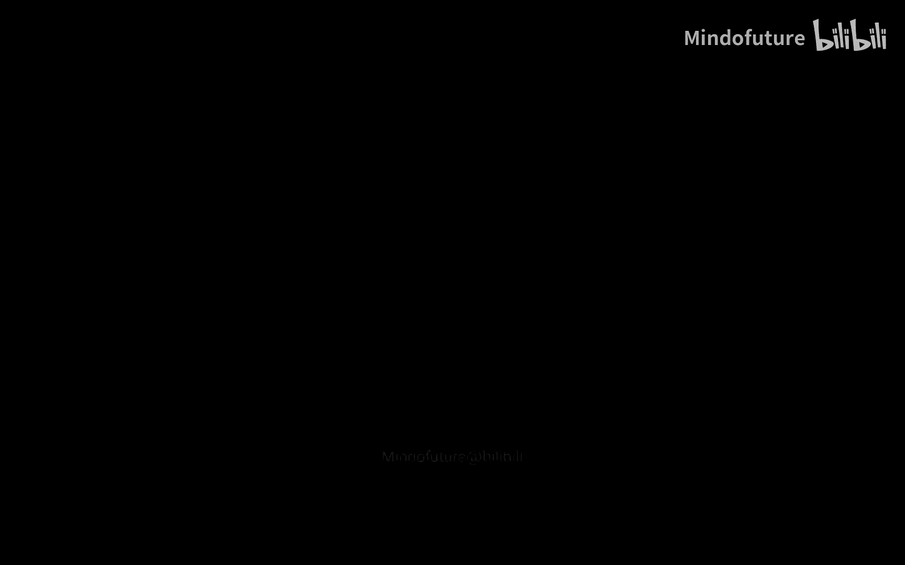
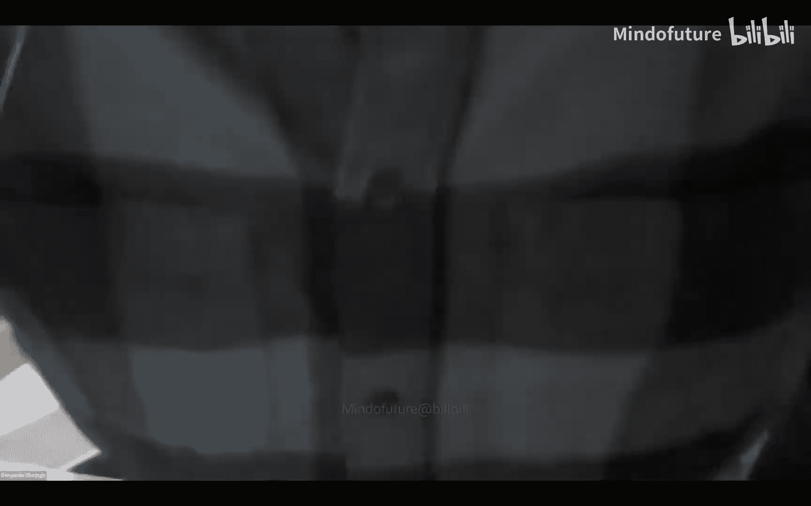
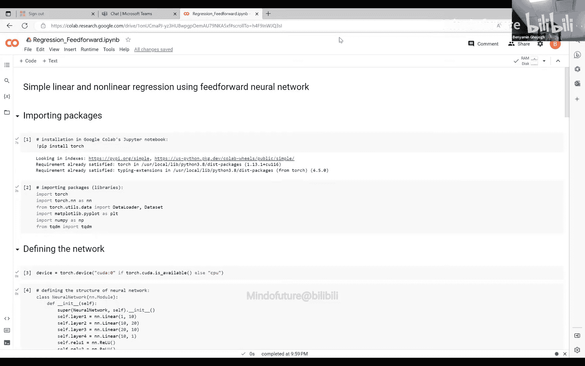

# 【滑铁卢大学】优化技术课程 ｜ Optimization Techniques   W2023 p07 P07_第七讲_(反向传播、AGM、SGD、SAG、Adam与神经网络) -BV1oJCHBcEo5_p7-

Okay， hi everyone。So I briefly mentioned to each team my feedback also some of the teams were not here。

 I had some feedback I wanted to talk to them specifically about their proposals。

 but they were not here， but feel free to contact me and I will be happy to help also so one general comment about the。

诶。The proposals of the projects is that I also mentioned in the announcement is that so whatever problem you're solving。

 please explain first explain the problem and formulate the optimization problem or problems that you're having in your project formulated as what we have a lot of formulations of optimization like right in the we have seen that in the course。

 like minimize or maximize some costs subject to these constraints I read your proposals all of you can write such optimization problem or problems for your projects so please do that is formula it encapsulates all your problem as an optimization problem。

And also have the constraints and this， but before that explain the problem so and also the notations and everything and then write the optimization problem。

Another thing please explain the optimization algorithm that you are going to use or algorithms that you are going to use for solving your optimization problem and also it's pros and cons and the details of that also if when you are using one specific or several specific algorithms for solving that。

 please explain that algorithm briefly。And how it is working。

And it's pros and cons compared to other algorithms and justify why you're using these algorithms or this algorithm for your problem。

Also， please report the results and experiments and try to analyze them。 just don't show the results。

 And this is， these are the results。 The results are very helpful if you analyze them。 So yeah。

 and also don't worry about your。Do your best don't worry about your grades。

 try to enjoy your projects as long as your projects are well enough you will have a good mark for that I will not compare the groups with each other I will consider every project of every group by itself alone and also presents as long as you present I expect everyone in the team to present have a part of the presentation and you will get the mark for that don't need to worry about that。

So that's the thing also in your project， either in encoding or your。

Your problem itself in the mathematical aspects of it or whatever theory。

 if you face any problem after searching on drug， trying with each other， if you still need help。

 you can reach out to me， I will be more than happy to help you。

So as I said at the start of the course， this is a course that we all I are gonna learn together。

 I might not know something and I also might learn by。Being in the loop， so yeah。

 just feel free to reach out to me if you face any problem。

I'll be happy to help that's another thing so then also about the midterm thank you very much also I heard your feedback after the midterm so one of you several of you guys mentioned that so one of the comments actually was that it was about a bit lengthy。

😊，Okay， sure I will try to make the exams shorter in the next semesters in the other courses that I'm gonna offer。

 so I want you to make sure to be sure I assure you that。

Your feedback is appreciated and I will apply them。Okay， sure I will make my exams a bit shorter。

 they shouldn't be that much length to your' right and。And also， as I said。

 don't worry about your grades， do your best and try to enjoy you in the course。I'll try to be。

A good grade too。So that's another thing。 So we talked about midterm about the project。

any any question about either the course or the project or the midterm。

So one thing about the assignments according to the timeline and what we have done so far。

 it seems that we are going to have another assignment and that will be enough because you don't have enough time to have a third assignment that's fine and if you haven't done much good assignment one don't worry please try your best in your assignment two as well as project and you don't need to worry about your grade the grades at the end will be curved but again try your best don't say that I don't do my best and let's see what happens please try your best and you don't need to worry about it anymore just try to enjoy the course but in different parts of it like studying doing the project doing the assignment。

 etc。So that was one other thing that I wanted to tell you。 Another thing is that unfortunately。

 I think。My tablet are remarkable， they have apparently updated the software in a way that maybe my device is a bit old and it doesn't let me share right now。

🤢，I tried a lot， but it doesn't let me share screen my tablet。

That's a technical issue out of my control apparently they have made such an update。That's fine。

 So nothing can stop us if we can try alternative。My things。

 maybe next time I will use an another tool， but for now， I can。

Teach on the PDF and share screen the PDF and explain the details to you。By speech。

 but don't and also feel free to introt me if you have any question。Everything clear。

 no any question。No。😔，Okay， and by the way， why are we only 1010 here。 What are the other one。😊，Yeah。

 don't know that。诶。Okay。Another thing， by the way， if the， as I said in the announcement。

 if the department agrees， I will be probably teaching two other courses in the next semester。

 one of them is deep learning and the other one is statistical machine learning。If。

 if the department accepts that and feel free to take those and we'll have a lot of fun。

 I think in those courses。Currently， they are full， but as far as I know。

 there is a high probability that the department will increase the capacity。

 So if you haven't taken those courses and you wan to take them。Take a look at the course regularly。

 they will probably open the capacity。So that's another thing and deep learning is about deep learning different various algorithms in deep learning we are going to cover very different algorithms from fundamental ones to the state of the art ones so we start from neural of networks and at the end we' also cover various state of the art algorithms such as diffusion models and generative models and all of those also in。

Nural language processing， for example。Attention mechanic and transformers and all of those areas。

 so in different they are useful in different applications。Yeah， from no matter where。

Wwhichhich background you are from， I think deep learning can be useful for you and other course the other course is statistical machine learning。

 I think that is also very a very important course I think both are equally important and statistical machine learning is almost all machine learning minus deep learning and that's a huge area。

It's a huge area。 I don't think that machine learning is all。Only deep learning。

 know it has a lot of things， statistical approaches。so。

Such as baseline models or variational models or。Clasic classification regression models， SVM F， LDA。

 QDA， and also probabilistic models， probabilical graphical models， hidden Markov model， HMM。

And all of those areas， also physical physics based models such as energy based models such asicing model and all of those areas。

 factor graphs。There are many areas that we are going to cover， So from fundamental to。

State of the art and so I think both courses are important either in industry or in academia in both areas。

 they will be very useful and please let your friends also know about these courses and I hope that I see you there and the courses will be in person by the way and we'll have a lot of fun together。

So。Yeah， and any question？No。O。So let me share screen then。嗯。Hello， professor。Hi， actually。

 I don't have doubt regarding the subject， but regarding the assignment marks。

 can you give us the feedback as well for those？Are you talking about discourse optimization for optimization。

 yeah assignment， feedback？え。So you mean you have any ambiguity about your mark， no not ambiguity。

 but where I made mistake。Oh yeah。 you can see T's notes on your submitted PDFf。 Have you seen those。

I think it is not there I checked， but I'll check it once again and if anything I'll ask you。Sure， I。

 I please check and let me know if you can't find that。 But as far as I checked。

 I saw some notes on your PFs， I think with blue colour， G， green colour or blue colour。喂。So yeah。

 and I think you can see the feedback of T。But if you didn't understand any feedback or any feedback of him。

 please feel free to reach out to him。He's very responsive。

 he's a very good guy and if you can ask and if there is still ambiguity and you need me to you think you need me to be in the loop。

 feel free to reach out to me and I will be in the loop and we will discuss it together all three of us me you and the T T has graded you kindly and yeah I think the first the best person to reach out for your marks in this regard is T because he has graded you based on the solution key that I have given him but again。

 if you think I need to be in the loop， please let me know and by the way。

 I have also asked your TA to mark your midterm generously so you don't need to worry much about that but try to do your best in the rest of the semester in the assignment too as well as your project。

Another question。YeahNo， thank you。Yeah我。Andsa youre saying something， Yes。

I have a question about the courses that you want to present for the next semester I want to know that which what majors of engineering can apply for this courses you know。

 for example I am mechanical engineer and I am studying in this major can I for example。

诶 up for them。Do you mean administratively or are they useful for your major。

 which at first administratively？So that you need to ask the department for that， I don't know that。

 but I assume that I assume this is my assumption I'm not sure that people from different areas of engineering and maybe even other departments because even as you see optimization courses in engineering。

 but we have had people from CS2。In this class， as far as I know。So sorry。

 I just want to let you know that there is no restriction except for example， for M students like me。

 I think A result is another M student， they just can select you know limited courses except their you know major such as Me or A resultzo or for example。

 I can from nine courses that I should have to choose I just for example one or two from general courses to two or three from you know my major which are about my major or something like that。

 there is this restriction just okay so yeah asked about the ask for from your you know maybe graduate program assistant about this。

Yeah， so it's the the best person to ask。Yeah， they were the best。

The best person to ask about these things is your the part in the school and also I'm not sure if they also ask this。

 they may let you take additional courses。So they might have a minimum bar。But you can ask。

 I'm not sure， you can ask them， but regarding the fact that whether they are useful for your major or not。

 I think it's useful for any major is because nowadays。

 AI and machine learning are used in different areas， right。

So， that's。Sorry about it。 Okay that's one thing。 Thank you so much for your answer。No problem。Yeah。

 I'll be happy to have all of you guys。In the class， I have had a lot of good times with you。

 So any other question before we start the course。能。Okay。诶。So let me share screen again， as I said。嗯。

诶。I can't write， apparently， right now， on the。诶。On my screen， but that's fine。

So we do you remember so we were talking about。And then。gradientian decent last time。

 and we reached out reached to the point of momentum。 But before that。

 let me correct one mistake that was in the slides。 And it was here， E 17， if you remember。Sorry。

 where is it。 Okay， Re question 17。 So is C P transpose gradient of F。X K， not F。

 because F of X K is scalar and P transpose F doesn't make sense because of this not making any sense。

 I went and look looked it up。 And I found out， okay， there is a typo here。

 So it's a P transpose gradient of F Xk。 So that's， that was one typo。 that needs to be corrected。

 Ill correct that in the slides。It was in the Army line search or backtracking line search。So okay。

 now momentum。So gradient and decent。诶，你。Yeah， great in， gradient in decent with momentum。

 gradient in decent。 and many firstover methods， they can have momentum term。 And what is momentum。

 Moment is we see it here， So in equation， do you remember this， Do you， do you see my cursor。

 By the way， guys， Can you tell me if you can see my cursor， that I'm rotating。😊，Yes， yep。 yeah。

 Okay， great。 So this equation。😊，This is this the update every step of gradient decentcent right and this and why do we have superscript k for delta x because we might have different steps。

 different step sizes in different iterations or different updates。

 so at iteration iteration k delta x is we can write it as alpha a fraction of the previous delta x in the previous step k minus1。

😊，Minus Eta gradient of f。So as you see in equation 19， if you set alpha to0。😊。

Delta xk is minus Eta k gradient of fxk， and if you put this equation 19 here you will have the original gradient descent。

 if you set alpha to0， then it will reduce to gradient descent right because deelta the step size is minus Eta gradient of f。

 this is gradient des set， however， if you have alpha greater than zero here。

 then you have this update， the update has another additional term which is a fraction or a factor of the previous step size。

And what does it say， So it has， it says that I have some。

How how should we call it innereracy or momentum in our step size in my update。

 I don't want to update to a completely new update。

 I want to have a history of my previous update So my current update has an impact from the previous update update。

 So Alelta the delta is so in the previous step and then plus the term that we had in original gradient descent。

 I it clear。😊，So again， we have some additional term which makes a momentum or an innereracy or a history in our update in order to have a history from the previous update in the previous iteration。

 so this is the momentum。😊，The idea of momentum。 And what is its impact if you see these two。

Figures here， without momentum， we have a lot of oscillations。When we have momentum usually。

 usually it becomes smoother and we don't have much oscillation and I think the idea is intuitively understandable why because when you have a log of your previous history in your update you make it smoother。

 you can't change much because you have your previous history inside your current update。

 that's why you don't have much oscillation when at momentum。

And it has been used a lot in optimization。So let' gradient descent is over now。

 let's talk about another first order optimization method and that's steepest descent， okay。

Sepest descent use sometimes sometimes people in the literature confuse or use interchangeably steepest descent and gradient descent。

 but they are different We will see how they are different so a steepest descent is very similar to gradient descent but there is a difference between them and what is that in a steepest de we move toward a negative gradient。

The same as gradient descent， however， this here is a difference as much as possible。😊。

So in gradient distance， we don't do that。So here we go toward the negative gradient。

 we do it in gradient decent as well， however， here we do it as much as possible。😊，To reach it。

To reach the smallest function value， which can be achieved and at that iteration。

 So what does it mean， So here in equation 20， look at it。

If you put equation2 into this equation and if you ignore argument in here。So。Let， let me think。

 Okay， yeah， Yeah， yeah。 Consider this equation。 Consider this equation。 This is gradient decent。

 right， This is original gradient decent。 However， if you change Eta by this Eta K。And it' okay。

 so step size， you're changing the step size in a way that it's kind of an it adaptive step size in the gradient distancecent。

 however， you make the step size in a way that you want to find the smallest value of the function in that direction that you're moving。

😊，So it's like。It's like you're going down a mountain。 And at each iteration in gradient decent。

 you go just a smaller step， right this is how gradient decent works。

 So if you can see my can you see me too， right。I assume you are seeing me So in when on a mountain you are coming down step by step。

 this is what gradient decent is doing right because gradient minus gradient is toward below toward the valley in the mountain。

 but if you go one step at a time very small steps。

 this is gradient decent and with different learning rates probably However。

 if you find the learning rate or eta in a way that at every step you jump in a way that you decrease your cost function。

 the most that you can at that iteration that's the steepest decent by its name is obvious you're going in the steepest that you can。

undimount。 So this is a difference。 So steepest this similar to gradient decent however you find the Eta or layering rate in a way that you want to make the function value minimum at that iteration。

😊，Another way to describe Sest distance is in the last bullet point。So you can see it as a。

You can see this look at this update that we have in the first order message and this deelta x is arg mean of gradient of F the transpose V and Y。

 So why is it that So when you have f of x plus V， consider V as a。Direction。

 so F of x is the current location。 F of x plus V is a if the function value at the next iteration。

 right， you can write it by first order tail Tayloror expansion。

 Do you remember first order tailor approximation， You can write this function。 F of x plus V。😊。

Approximately as F of x plus gradient of F of x transpose V。X and V are vectors， right？

Graent of F is also a vector。So you're saying that I want this to be minimized， right？

This f of x plus V， because in the next situation， I want to minimize that。 Therefore。

 for these to be minimized， you can also minimize this gradient of F transpose V。

 That's why here we are minimizing gradient of F transpose V subject with respect to V with respect to V as subject to having a small V。

 We don't want V to be。Veryre very large。 It's length。 We want to be less than or equal to one。

 So in the in the hyperphere with radius less than one。I want to find V in that hypersphere。

But I think the last bullet point is a bit ambiguous。

 I think the previous bullet point equation 20 is more obvious for you to understand what as steep as descent is okay。

 but they are basically saying the same thing because you're finding the most decrease in the cost function。

Any question？No。Okay， so now we go to back propagation。😊，I think you have heard of back prop a lot。

 If you haven't heard of it I'm going to explain it to to you here。

 Back prop is used in neural networks。 What are neural networks。

 So neural networks or artificial neural networks is trying to mimic。The brain， human brains。

 human's brain in a way that so you have some neurons in a human brain， you also have some neurons。

 right， and the neurons are connected to each other because every neurons sends some signals to another neurons。

 we have a lot of neurons in our brain。 So in order to have an artificial intelligence。

 we are saying that this mimic or imitates the brain using an artificial brain。

Let's make an artificial brain or artificial neural network。 So we have several layers。

 You can see here， for example， we have layer 1 layer，2 layer 3 layer 4。

 and each layer has several neurons。And in the simplest neural network structure that we have here。

 it's called feet forwardward neural network。😊，Every neuron in in a layer is connected to all neurons of the next layer。

 so you can see however， the neurons in each layer are not connected to each other。

 so we don't have connection between this layer and this neuron and this neuron。

 this neuron is only connected to all neurons of the next layer。

 So this is what artificial neural network is right。😊，え？And here， assume you have some input。

 you feed it to the network and you will it will pass through all of these。

 and it will give you an output。 You can also play around with the number of neurons in each layer。

 However， the number of layer， the number of neurons in the first layer should match the dimension of your input。

And the number of neurons in the last layer should match the number of neurons in the。Outward， right。

 that the di dimension of output。 Also， you need to note that these are， there are some weights。

 So these connections have some weights。 we are， and the parameters。

 the learnable parameters in neural network are these weights。 We want to find these weights。

In a way that we map the input to output the best way that we want。Right， so for example。

 I want to feed image one。To this， if I reshape image to be a vector。And I fit it here to input。

 I want the output to give me the label of class 1。If I fit digit2。

 I want the label to be2 at the output layer， so let's learn the weights or optimize the weights in a way that this is done it outputs the correct labels for the input this is what a neural network is and every neural now let's zoom to one of these neurons。

It will be like this。So every neuron。😊，As you see has AI and as input and Z I as output and these xs here are the weights that we are going to learn right So what is this so AI what is AI AI is just multiplying this weight to the output of this neuro。

😊，Again， multiply this weight to the output of this neuron until here。

 all of these connections multiply these weight to the output of this neuron and then sum them up。

Here you can see that。This gives you AI。Right。So this times this， plus this times this。

 plus this times this it will give you AI。And what is Z I Z I passes AI through a function which is usually a nonlinear function and we call it activation function。

 this is just a name， you don't need to worry about it activate a nonlinear function。

 which is usually called activation function right and it's usually nonlinear。😊，It might be linear。

 too， but it's usually a nonlinear function。 And why is it nonlinear， I tell you， O。

 assume that the activation functions in all of these neurons are linear。What happens？

you me can anyone tell me what happens， assume that all of the activation functions here are linear。

Or you don't put any activation function。 What happens？Can you tell me your guesses。Anyone。Guys。

 please give me。Some answer。Outward is linear， not necessarily， why。

 because assume your input is linear， assume your input is a linear data。

Your output will be linear also。But if your input is non nonlinear。😡。

Then your output will be none in2。Right， even if your activations are linear。

So we can't say that output will be linear。Another thing happens。

So what happens is this when you have all of your activation functions linear， the whole network。😊。

Collapses to a linear projection。 It's like you have one layer because all like multiplication of several layers without any non linearity between them is like you're saying that。

Is considered this as a matrix U1。 Consider this as matrix U 2。 Consider this as matrix U 3。

 So it will be u1 times U 2 times U3。Then someone can say， okay。

 why don't you call u1 times u2 times u3， call it V1。

And replace all of them with one layer named Viva。That's correct。However。

 if you have no linearity between them， then you can't say that。

Then you can't say that because because in the middle of the layer， you can't have non linearity。

 every layer itself is a linear projection， right？Then you have some activation function。

 if you remove the activation functions or if you make them linear。

 then the whole thing becomes one layer。😊，And also it can't capture nonlinearity。

 So if your data is nonlinear， then it can't handle it properly。

 You need to have nonlinearity in your neural network in order to handle nonlinear pattern of data。

These are the reasons that we have activation functions。

So sigma I is the activation function at the neuron i so so and x1 means that the neuron1 connected to X i。

 so assume this is x neuron i I neuron。😊，So the first neuron in the previous layer connecting to that。

 the weight will be X I1。The second one will be X2。As soon this goes to nor J。

 then this weight will be XjiI， right？Because it connects neuron I to neuron J。

So I think now you know the notation of the weights and everything。

 Now let's move on to the next slide。Okay， here。Consider the three neurons in three successive。

Layers， layer L， layer I and layer J。Soon these are the neurons with A L， Z L， neuron I AI， Z I。

 neuron J， A， J， Z J。The the way it's connecting this to this is called X IL。

 The way it's connecting this neuron to this neuron is called X J I， right Okay now。We have this AI。

 What was it we'd already talked about it， X AI is summation of all of these weights here times the outputs of these neurons。

😊，I'm not showing all of the neurons here， right， but I'm suming over them。 So sum over L。

 this L might be a lot of neurons here。S over L， X， I， L and Z L。Okay。

Sums over the neurons in layer L。So far clear， if anything is ambiguous， please let me know。

Interrupt me， please， okay。So now。We want to in back propagation。We want to reduce some error again。

 again， as in optimization， because we will see in a few minutes that back propagation is nothing but optimization。

 We'll see that。 So we want to。Minimize some error error， for example。

 in the example that I mentioned for digits。If you introduce digit1。

 reshape the image of digit1 here and input it to the network， it gives you label2。It is an error。

It says that network you made an error。 Why did you give me two for input 1。😡。

If the input is digit 9， it should give me label 9。 If it gives me label 8 or label 1 or label 2。

 This is error。 I want to reduce this error so that the network becomes accurate and gives me correct label for input for corresponding inputs。

 right。So we have some error E denoted by E I want now let's find the derivatives because in and I think so far you have understood that optimization for optimization need derivative。

So derivative of E with respect to X IR， why do I take derivative of error with respect to the weights？

😊，Because I want to learn the weights， my variables。

 my optimization variables are the weights of the network right。

 my optimization variables are therefore Im taking derivative of error with respect to the weights and I want to minimize that。

😊，Okay。So derivative of E with respect to this， by the way， guys。

Back propagation is nothing but gradient descent is equivalent to gradient descent with a slight difference。

 its gradient decent plus chain rule。So again， this sentence is important。

 Great back propagation is nothing but gradient descent that we learned。Plus， chain rule。

 So if you use gradient in decentcent with chain rule， it becomes an algorithm named back propag。

And why do we need chain rule because the weights we have layer by layer。

 the weights are are related to the weights of the another layer right because the layers are connected to each other。

 you can't see。😊，Every weight by itself， this weight gets the summation here again。

 as you see it here。😊，Each weight is connected to other weights。

 and each neuron is taking the outputs of the previous neurons。 Therefore。

 you have to use chain rule。And I think you can guess in order to reduce this error。

 I can by gradientding decent， I can say， okay， XilL here， XilL。What was in gradient descent。

 Do you remember， Xil is Xil of previous iteration。Minus Eta rounddo。N wrong or derivative。

 whatever derivative of E with respect to derivative of X， I， L。 Do you get my point。So again。

 I repeat that。I'm saying I'm using the gradient decent in order to reduce error E。

 I'm saying that XilL。Is X， I L of previous step。Minus Eta the learning rate。

 derivative of E with respect to X I L。This is back propagation， however， you might say， oh。

 but I don't have derivative of E with respect to XilL。 What if X is in the middle of the network。😊。

Aor is at the end of the network。 Exile is in the middle of the network。 How can I calculate that？

 Okay， now chain rule comes in。Okay， let's find derivative of E with respect to X。

 How do we do that iss derivative of E， We can write it as derivative of E with respect to AI times derivative of AI with respect to X right。

 This is Chand。Recall preliminaries。 we talked about it in talked about change rule now。Okay， let's。

Take a look at this or this I have repeated here AI equals sigma L， X I L， Z L， right summation。😊。

The ratio of AI with respect to X IL。 What is it。It set a。

You might be wondering what happened to this summation。The summation is gone， Do you know why？Here。

 I think it would be easier for me to write it down。 However， I don't have my tablet doesn't work。

 but。诶。This is a technical issue， but that's fine。Just try to， I say it by words。So。😊。

X summation of X， I， L Z， L over L is this X， I 1， Z 1 plus X， I 2， Z 2 plus X， I 3。

 Z 3 until the end， right。Now I want to take derivative of AI with respect to X I L。

 but let L is a specific number here， right， a specific index assume L here is 5。

 so I'm taking derivative of AI with respect to X5。What， what was the summation， It was X， I 1。

 Z 1 plus X， Y， I 2， Z 2 plus X， I 3， Z 3 plus X I 4， Z 4 plus X I 5， Z 5 plus X I 6。

 Z 6 until the end。All of those are constant with respect to that X5 except one of the terms。

 and that's Xi5。Z 5， because the other ones don't have any X I 5 in them。

 That's why we only have Z 5 as the result of derivative。 So only one of the terms。

Becoming the derivative， the other ones are constant with respect to that specific index of L。Right。

 so I think youd now understand why the derivative of AI with respect to XilL for a specific L is Z L and the summation goes away。

Any any question？No。Okay， now。What I'm talking， okay now so this is that L derivative of e with respect to AI is derivative of E with respect to AI。

 let's call it denoteed by deelta I。😊，I call it Delta I now。

 so this derivativeri V E with respect to XL becomes deelta I times Z L。Okay， now let's continue。

If layer， I。If layer I assume because we are talking about XilL， right。

 So this layer I is important to us。 If layer I is the last layer。

 Delta I can be computed by derivative of error with respect to the output y。Here。

 consider this because when。😊，We are are at the last layer as soon we don't have layer J。

At after that， right， we only have layer I at the end。

 So I'm talking about the the last layer of the network error is at the last layer。

 So the the derivative of E with respect to AI。Is just based on the activation function right and the error itself。

 so we should see what is the error function， it might be minus squared error or any function。

And we also have some activation function。 Do you remember Sigma I。

So we can because error is a function of Z I。Z I is a function of AI by sigma I right。

 So again using a simple chain rule， we can simply calculate deelta I。

 so deelta I for the last layer is just a simple derivative。Right。

Because this error is at the last layer， however， if we are in one of the middle layers。

 then we need to calculate deelta I by chain rule again。

 so we have chain rule in chain rule so we had chain rule in equation 22。

Delta I itself needs to be calculated by chain rule， so we have nested chain rules。Okay。

If I is a hidden layer， hidden layer means in the one of the middle layers。

 so hidden layer means hidden the middle layer。Delta I is computed by chain rule as this。

 So Delta I was defined as derivative of E with respect to AI right now let's use chain rule。

We can sum over J see j is the next layer， so sum over the neurons in the less next layer。

Some over J derivative of E with respect to A J times derivative of AJ with respect to AI。

 as you see this。This by chain rule becomes the derivative of E with respect to AI， right？Again。

 if we are in the last layer， we can't do that because we don't have any next layer。

 I told you how to handle that simple derivative， but if we are in the middle layer we we'll definitely have a next layer that's why we can summ over the neurons in the next layer okay。

Now， derivative of E with respect to Aj is Delta J by because deelta I was defined as derivative of E with respect to A。

 therefore derivative of E with respect to Aj is deelta J。By definition， right。

 we also have derivative of AJ with respect to AI。 Now we need to calculate derivative of AJ with respect to AI。

😊，Another chain rule， so we have three nested chain rules inside each other。

One chain rule in equation 22， one chain rule in E 23。

This term also needs to be calculated by chain rule in equation 24。

Now what is this derivative of AJ with respect to AI。

 we can write it as derivative of AJ with respect to Z I。😊。

Times derivative of Z I with respect to AI。What was Z I， It was the output of activation function。

 Do you remember。Here。So。That eye is here。 That eye is here。 See in the figure。

 I'm showing it here in the figure。We also have AI here， so Z I is sigma I Z I， right。

 sigma is activation function。So simply。Derivative of Z I with respect to AI is sigma prime by sigma prime。

 I means the derivative of sigma， derivative derivative of sigma with respect to AI is sigma prime。

AI。It's simply calculated because activation function is a known non nonlinear function。

 such as tangent， hyperpoic， hyperpoic tangent， or it might be。Softm。

 or it might be sigmoid function。 So there are some some non nonlinear functions。

 These are just names。 You can look them up。So it's a known activation function。

 it's a known function， we can simply take derivative。So this is done。Now， this term。

Let's calculate this derivative of Aj。 where is it in the figure。

 always look at the figure in order to illustrate what I'm talking about。

 So derivative of AJ with respect to Z I。😊，A J is connected to Z I by X J I。 So we know that A J。

 what is it here， I have written it here。 Look at the cursor。 A J equals sigma I。X J I， Z I。Right。

 we already talked about it。 A J equals。These weights times the outputs of these neurons and sum over all the neurons in layer eye。

This is exactly what we have done here。Now， derivative of AJ with respect to Z I becomes JI and the summation goes away for the same reason that I talked about minutes ago。

Right。So we have XJI。For this term， this term is also Sigma prime AI。Now it's done。By the way。

Let's put E 24。Inside equation 23。So Delta I。Becomes this。 So what was this。

This is replaced by this X J I。Sigma Prime AI， however。

 sigma Prime AI that doesn't depend on index J。 Therefore。

 it can come out of the summation over it J。 Therefore， it comes behind the summation。

And we have Delta J X J I inside the summation。So。We could find Delta I。

We could find Dlta I now let's put it back in equation 22。

Right so now it means that we have derivative of error with respect to every single weight in the neural network。

Right we already talked about it Equ 22 can be used for every single weight in the neural network from the first layer to the last layer or from the last layer to the first layer by chain rule。

 we could find the derivative of error with respect to all of the optimization variables。

So we can now simply use gradient Descent。Simply use gradienting this。 How here you have taught。

This is the formula of gradient indicent。 And we have this。 Do you remember， this was learning rate。

 I think you have heard of learning great in neural networks a lot。

 This is exactly what we have in great Indicent。😊，We might have adaptive learning as we talked about in the previous session。

 right？Okay， so again， back puragation， it was proposed in 1986。

It changed the whole idea of artificial intelligence AI。😊，え？

It was proposed by Hinton and Hinton Etel。え？It was a very good breakthrough。

 and it was it's nothing but。Graian decent and chain rule。It's very interesting。Okay。

 any questions so far？Everything clear。 Can you please give me feedback。Yeses。Yeah， okay， great。So。

Now we have talked about by propagion list， talk about another first order optimization method。

 and that's accelerated gradient method。So。We had gradient descent in the previous century。

 but it was shown in the literature that gradient descent is not optimal in convergence rate。

 It means that it's not fast enough。 It's a slow a bit， and it shocked everyone in the。

In a world of optimization。So there was a mathematical proof showing that it's not optimal in its pacing。

 in its speed of convergence。So。😊，A scientist named Nestro proposed accelerated gradient method or AGM in short。

In 1983， by the way， Nessrov is a scientist in optimization and he is very famous for his many algorithms especially has worked a lot in first order optimization。

😊，And especially he tried to accelerate the first order methods， right。

 such as this accelerated gradient method。😊，He proposed it in 1983。

Why he wanted to make the convergence rate of gradient and decent optimal。

 What what do I mean by convergence rate， it means how fast we can find the optimal solution。

When the commence rate is high， it means that we can reach the optimal solution very fast。

But if it's slow， it means that we are very we are very slow in progress Okay。

 he proposed this and he proved that this is optimal。😊。

This is optimal a con rate for the first order method。 How did that， Okay。

 AGM is also called There are other names for this algorithm。 Netros accelerated gradient method。

 It's also called fast gradient method， F GMM。And you can sell a series of his papers。

 which improved AGM in the references。Okay， what is AGM， It's this。 Consider a sequence。A sequence。

Of gamma K， by the way， K here denotes the iteration index， right？So and it starts with zero。

 so zero is the initial random solution， random point that we choose。

 and then we move from that point toward the optimal solution， right？So K is a。

Some we are at the iteration K， okay。😊，We need to find in this algorithm。

 we need to have a sequence gamma K which satisfies equation 29，26。So every gamma K。

 so every iteration has some gamma。Every gamma K should be between a number between0 and 1。

 a scalar number between0 and 1， including0 and1。And for all of the iterations。

 we need to have this inequality we can have different。

Different examples for satisfying this one of the examples is this I' have shown it here。

So assume at the iteration  zero，1，2，3 in all of these iterations。We set gamma to be 0。However。

 from iteration 4 to the end。We always have it gamma k equals 2 over k。So if it is it 4。

 we have two over four， which is half。If it's equation iteration5， it's 2 divided by5。😊，Six。

2 divided by6 and so on。And if you put this in this inequality。

 you will see that it satisfies equation 26， for example。😊，consider。

Let's consider question first E 0， iteration zero， sorry， So we have。This is product， right。

 This is product。Project of 1 minus gamma 0， gamma 0 is 0。 So 1 minus0。

 and we don't have other terms。 So its the left hand side is 1。

 The right hand side is also gamma 0 is 0。 So one is greater than or equal to 0。 That's correct。

Iteration one。Is 1-0 times 1-0 in the left hand side。 So we have one。Right hand side。

 we have gamma 1 squared gamma 1 is0， so iss0， so again1 is greater than or equal to0。

Let's go to iteration 4， for example。So we have。For all of these terms until iteration 3。

 we have 1 minus0， so 1 minus0 times 1 minus0， so it is1 for iteration4 we have one minus half because this becomes half。

 one minus half which is half， so one times half is at the left hand side。

So it's half left hand side is half。Right hand side。Is gamma 4 squared。

 Gamma 4 is half half a squared is1 over 4。 So left hand side was1 over 2。

1 over2 is greater than or equal to1 over4。 That's correct。So as you see。

 this sequence satisfies inequality and you might might me wondering where did this inequality come from。

 it comes from the proof。😊，The proof of this algorithm that Nero proposed。

 because in order to show the convergence rate， he found out that he needs to satisfy this inequality。

 okay。Okay， now the AGM updates the solution iteratively as this equation 20s7 and 28。

 Do you remember in gradient descent we had only one equation per iteration。😊，However。

 in accelerated gradient method， we have two iterations per iteration， two equations per iteration。

 right？😊，So this is so we have two variables now in gradient distance we only have one we have x。

 but now in AGM we have an additional variable named Y。So we have X and Y。

It's like this2 E 27 says that let's update the next x as the previous y minus Eta。😊。

Graient of if at previous Y。So gradient of f at previous y with some layering rate it reminds you this reminds you of gradient descent。

 but you also have Yk here， and this is also with a gradient in Yk。And in E equation 28。

 when you found this eggs， you put the updated x here。😊，And the previous X here。

 so previous X here updated X here， now you have a linear combination of them。😊，See。

 the updated y is a linear combination。Of the updated X and the previous eggs。

And as you see it might remind you， because we see this linear combination a lot in optimization。

 it might remind you， do you remember in the definition of convex set we also had a linear combination with T or alpha between 0 and 1 something like that it reminds you of that so we we have a question 27 and 28。

😊，Together， you go until convergence， this is AGM。We can see that okay。

 consider if the function is convex and differentiable with domain D and let its gradients be eli smooth。

😊，Equation 2 do recall Equ 2， do you remember E 2， let me briefly show you。Equation 2， what was it？是。

It's this。Corollary or fundamental theoryorem of calculus。 We said that we assume that。

The gradiental function is Elili smooth。Right。Absolute value of gradient of x minus gradient of f of y is less than equal to L。

 This is a definition of L smoothness for gradient for all x and y and D。Now。If we satisfy question2。

If we satisfy equation two。And'll also assume that F the star is the minimum of cost function that we want to find。

 and X star is the solution of optimization problem， which is the minimizer。

Now we also start from x0。After T iterations or K iterations， whatever here T or K。

 I use it interchangeibly， it denotes the iteration okay？

Convergence rate of gradient descent can be proved。

 I don't bring the proof here because it becomes complicated just except from me that the convergence rate of gradient descent becomes equation 29。

 and what is it， I will explain it to you。And also convergence rate of AGM is equation 30。

 Now we are going to compare these two and you will see that AGM has a faster convergence rate。

But let's first talk about the equation 29， what is the left hand side here？😊。

It says that the difference of f minus fs star， of course， it's positive。

 It's a non negative value because Fs star is a minimum value and F is greater than or equal to fs star。

 We know that because Fs star is the minimum of f。😊，So left hand side is always non negative。

 it's either positive or zero。when is it zero， when we reach the optimal， right？

And this left hand side shows the distance of the function value to the optimalum function value。So。

😊，This is showing the convergnce rate because it's showing us with what rate are we getting close to the optimal value of the function。

 or are we reducing the gap between the current function value and the optimal function value？Okay。

 what is right hand side， Consider this， consider this。

It says it's two times L L is the lip constant in y because we said gradient is L smooth， okay。

And we also have this， what is this， this is a squared altitude norm or a squared distance a squared Euclidean distance between x0 and X star。

 What does it mean， it means the distance between the first initial point that we started with and the optimal point。

ix star。What is in the denominator， it is t plus 1 t is the iteration index。

If we consider L and x as constants， we'll see that this is the of the order complexity order。

 this is big O notation， complexity of order of1 over T， it means that。It grows。With one over T。

When you grow T， it the rate grows with one over T rate。 Okay， but let me tell you why。

 intuitively why it makes sense to have this， okay。

Why is x distance of x0 and x to star in the numerator？Can anyone tell me。Can you please tell me。

Okay， I， I tell you as a hint。 So the first question I answer it myself。 So x 0， if we start with。

We in a way that we are very far from the X star， of course。

 we will reach to the optimal solution very late。 so it will increase。

It will increase the time that we reach the optimal solution this is kind of a time how much time we have by to reach the optimal solution when we are very we start very far from the optimal solution it increases。

 however， if we by chance we start very close to the optimal solution。

This distance becomes close to zero， so we are we are faster。All right。

And y is also L in the numerator it's because。Do you remember when L is high if F is the function is L is smooth。

 it means that it's a slope is very high when L was high。

 do you remember when we were talking about lipshe's continuity， when L is high。

 look at my hand it's like this it's very slope is sharp and now gradient is L is smooth。

 which is worse now we are talking about the slope of gradient。It means that when L is high。

 it means that the problem is very hard， the optimization problem is very hard。

That's why we don't want L L to be very high， that's why it's in numerator。If L is a small。

 then will be faster， will be reach optimal solution faster also T。Is in the numerator。

It's in the denominator， sorry。So that's the explanation of 29。

 Now we have similar thing in equation 30， but we have a squared t in the denominator。

 it means that oh it convergence to this solution much faster again。😊。

Consider T to be iterationeration index。 assume iterationeration 10 in equation 29。

 which is for gradient descent， simple gradient descent。

It means that after 10 iterations of the order of one over 10， we have reached to the solution。

 Our speed is one over。诶情。Our distance between F and FS star is 1 over 10， however。

In AGM accelerated gradient method， when T is 10， it is almost one over 100。

 which means that it's much smaller because the distance has become much smaller。

So it means that we have got closer to the solution much faster because the gap is one over 100 which is much a smaller number。

 do you understand is it clear， what's the difference between 29 ands。

 you can see that is much faster。The gap reduces much faster than gradient method。By the way。

 why do we call it gradient method， why don't they call it accelerated gradient decent because it's not decent anymore。

嗯。Gdient decentcent is what we have in gradient decentcent When we change it。

 it's not a gradient decent algorithm we can call it a gradient method because it's using gradient。

 that's why they call it accelerated gradient method， not accelerated gradient decentcent。😊，Okay。😊。

So far clear。😊，Can you please give me feedback？Yes， sir。Cl， okay， now it's to 82020。

 Let's have a break and come back at 835。 and we'll continue with the first order methods。

 And I think in this session we'll see also， will also code a bit of neural networks and we'll see that it's interesting。

 Okay， so see you at 8，35。😊，Okay。Okay， let me share screen。In the middle of， in the meantime。

 I tried。诶就。Fix the tablet issue， but it didn't work again。ButThat's fine。

 We'll continue on least I try to figure out some other way to write on tablet。

 maybe and use another tablet or something。 I'll try that for the next time。Okay。Okay， so。诶。

Now we are in stochastic gradient methods。呃。So another group of first order algorithms for optimization is a stochastic gradient method。

And。So consider that we have n data points。And that these data points be AI。

Each of which is d dimensional， and we have some labels。 Okay， we have some cost function F。

 so it can be decomposed in a summation of n terms。 What I want to say that。

 assume that your cost function is a summation of n terms。

And each term is F and we are going to see that a lot in this category of first order methods。😊。

So we have a bunch of FIs， some examples are this list the squares error for example。

 for so we have some labels for especially you see this a lot in machine learning。

 you have some input like some image or something。You reshaped the image， I mean。

 as you have some labels， like images of digits。 and you have some labels， right。

Whether it's digit one， digit two or something。And。La square says that， okay。

 assume my learning parameters， my optimization variables are Xs。 My inputs are AI。

 So we have AI transpose X U and minus L。 It can be any any other last function。

 These are just examples， right the important thing here is that assume that your cost function is a sum of some Fs。

These are some examples。😊，And you have AI transpose x minus L I。 So by the way， here you are。

 this formulation is like an neural network with one layer without an activation function。

Its linear projection。 And then you compare with some label。 And this half is because we have two。

 And we， when you take derivative， we want this that two in derivative be cancelled out。 That's fine。

 We also might have absolute error。 These are some examples。We can have hinge lu like this。

 This is the definition of hinge la。 we we want this to be max a non negative loss。

 Therefore we take maximum of zero and these。And we are assuming that the labels are either -1 or  one。

 assuming it's a binary classification。It's either -1 or what。

 either in this class or the other class。 we must， we might have also logistic class。Okay。

 these are some examples， but the important thing is that equation 31。

 we have the optimization problem like this， we have a summation of over Fs I from1 to n， some Fs。

 and we might have some normalization factor one over n2 doesn't matter。😊，Okay。

 now the full gradient， it becomes this， right？Because you can take the derivative of summation of Fs is summation of derivative of Fs。

Right， because it the relative is a linear operator。And。So you have this。

 this is the derivative of F。😊，Now。Well， equation 9 in gradient descent。

 Do you remember gradient descent， we had。Minus Eta gradient of F。

 But Eta was a relaxation of a step size。 If the， we don't relax that before that。

 it the step size was one over L。 So we have -1 over L gradient of F。😊。

And this gradient of f now becomes the summation of gradient of F。

 and we also have one over n normalization factor。Behind it。 so it becomes this。

 So if we use gradient decent now。There is a problem。

 There is a problem with having this gradient as a summation of all gradients of Fs is that。

It is time consuming， especially when we have a large end。If we have a lot of FIs。😊。

Then if n is huge， then calculation of this gradient becomes time consuming and even very hard。

 very difficult because at least you need a four loop in order and in each loop you need to calculate the gradient of FI。

 what if the calculation of the each of the gradients be very hard？😊，Then you have N of them。Right。

 so。A serious issue happens with gradient descent when we have a huge end here。

 We have a huge number of Fs。 Therefore， in this case， we need to。

 we can use a stochastic gradient descent。Or SGD And why is it called a stochastic because it has an stochastic approach。

 it's random， I'll tell you why。😊，Stochastic means a random， right？

So it says that let's approximate gra gradient decent stochically。

 and let's sample one of the points at every it， so rather than considering all of the end points。😊。

Let's only consider one all of the Fs， one only consider one over the Fis in each iteration。

In each iteration of gradient descent， let's not compute the whole thing here。

 Let's only consider one of them。 And how do we choose that one randomly， randomly。

And if we sample it with replacement， so we can sample from a bunch of points you can or a bunch of from a set。

 you can sample either with replacement or without replacement。

Sampling without replacement is called but strapping in statistics。 If you sample。

 if you sample without replacement， it's called simple random。Yes。Sorry。

 if you sample with replace with replacement， yes， it's called but strapping。

 If you sample without replacement， it's simple random sampling， okay。

So either with replacement or without replacement， usually without replacement。

 that's why I have rates and bootes strap here。😊，You sample one of the Fs and you do one step of gradient descent。

 This is called e stochastic gradient descent， as you see it's different from gradient descent why because you have sampled F it's not the whole gradient and you have sampled one of them。

Rather than this。You are using this。stochastic， so approximation。

 the idea of satochastic approximation was first proposed in 1951。 you can see how all these are。😊。

It was first used in machine learning in 1998。And。EQuion 33， as you can see。

 it has an adaptive step size。😊，So we can have adaptive step size。

And the step size can be usually is decreasing why。

 because we usually start with a large step size because initially we assume we are very far away from the optimal point。

 optimal solution， but when we get closer to the optimal solution。

 we should we usually reduce the step size because we know that when we get closer to that。

 we don't need to jump we need to update step very slowly small amount。

That's why Eta K is usually a decreasing function by K K is it index。Like one over k， like one over。

Second root of k or or it can be not adapted。 It can be a fixed step size， although it's not ideal。

 but we might have also a fixed step size， which is et all in all iterations。

We usually have adaptive step size in stochastic gradient methods。Okay。Now。

 let's talk about the convergence rate， the stochastic gradient in descent。 Okay， again。

 assume soon the function is is the summation of Fs。It is bounded below what does it mean。

 bounded below it means it doesn't go to a minus infinity。there is a lower bound for the function。

 it doesn't go to minus infinity， and each FiI is also differentiable。Therefore。

 the F itself is also differentiable because it's a summation of differentiable functions。

Let the function F be the domain of it be D okay？And let its gradient be a less smooth again at the equation2 that we had in the first slide。

😊，Okay。😊，And assume that what， what does this mean。

 These are the assumptions just what I haven't brought the proof。 If you see the proof。

 you will see that this assumption is used in the proof。

 It says that let the expectation expectation is nothing but by mean。 It's mean， You know， you know。

 mean mean in some specific distributions like U and distribution is equivalent to average。

 You can see it as average or mean。 The mean of。S squared L2 normal gradient of f conditioned on xk。

 it means that if you know xk， the mean of this term is less than or equal to beta squared。

 so it is bounded from above that doesn't matter if you don't understand that doesn't matter。

Just for the sake of completeness of this the， I have put it here okay。Depending on the step size。

 what is important here to understand is our equations 35， 36 and 37。

 here it says that if the step size。At iteration K is one over K。The convergence rate。

 mean how fast we get close to the optimal solution is。Of order of one over log of tea。

First you might be wondering why we are talking about convergence rates because if you see in the literature of optimization。

 especially for first order optimization， they usually talk about convergence rates。

 so whenever someone proposes a first order optimization method they usually talk about convergence rate。

 this is an important piece of papers on the first order optimization。😊，So order one over log of T。😊。

If E k is1 over second root of k， the convergence rate will be log of T over second root of T。

If it is a fixed step size， it will be 1 over t plus Eta Now let's discuss this what these mean。Okay。

 first off。From between these to which one is faster。I don't know we should draw these functions。

 I haven't drawn this but we can draw that one over log of t and a log of t over second root of T and see which one grows faster。

 whatever whichever grows faster， it means that one is has faster convergence however。

I want you to notice equation 37， when we have a fixed step side。😊。

It means that do you remember this was the gap between F and FS star right because minus fs star was less than or equal to this term。

 It means that by the end we never reach to the optimal solution we always have a deep gap of Eta between us and optimal solution in the convergence why because it's obvious because when we get closer to the solution。

 if we don't decrease our learning rate well always jump around the optimal solution。

 so assume I'm very close to the optimal solution rather than moving a little to reach it I jump over it and I go to the other side of it then I come back again。

 so I jump back and forth around the optimal solution with the distance eta with this distance。

 that's why when you attend t to infinity it means that if you have infinite number。😊。

Iterations this term becomes zero almost plus Eta， it means that you have always some eta oscillation around the optimal solution that's why it's better to use adaptive learning grade。

😊，But if you have adaptive learning rate， of course。

 when you tendt K or T K and T are the same thing here， use interchangeibly。

 it means iteration index when you tend K or T to infinity， the learning rate becomes zero。

 it means that after infinite number of iterations。

 you don't update anymore because you are already on the optimal solution。😊，Right。

 so that's why the gap here becomes zero at the end。If you tend to infinity， these becomes zero。Okay。

 now if Fs are strongly convex mu strongly convex， recall preliminaries that we talked about。

 then the the learning rates change， sorry， the convergnce rates change。😊，In this way。

 if Eta K is one over。Mu K miu is the mi strongly convex。 then the con is 1 over t。If it's fixed。

 again， we have some Eta term here because we always will oscillate at the optimal solution。Right。😊。

Okay。So we had these and the explanations that I told you are here。

 So one thing which I want you to note is that for convex we cite here for convex E 37 when we have fixed step size is1 over t plus Eta for as strongly convex is equation 39 I have repeated them here right now let's compare these two。

It means that as a strongly convicx， it's easier to optimize， you can see it's much faster。

 it's exponential。😊，It's exponential， however， here。We have。

we we don't have ads as we are not as fast as this。 It's much faster。 If you tend T T to infinity。

 you will see that this grows much faster why， because obviously because the strongly complexx is easier to optimize。

That's another thing I wanted you to understand。Any questions so far？No， okay。By the way， guys。

 these are important algorithms that you will hear a lot in optimization in machine learning and also in optimization itself。

 so please listen to me and try to understand carefully if there is any question ask me。😊，Okay。

 now we talked talked we talked about stochastic gradient descent Now we are going to talk about mini batch stochastic gradient descent。

 usually sometimes in the literature they are used interchangeably but mini batches a stochastic gradient descent is different from a stochastic gradient descent sometimes people when they say a stochastic gradient descent they mean mini batch。

 stochastic gradient descent and what is this It means that do you remember in SGD SGD short for a stochastic gradient descent in SGD we have we had sampling one of the Fis in each iteration。

😊，So when we sample one of the FIs。😊，By the way， guys。Here also in in SD， when we sample one of the。

F Is， we all not very accurate， by because we are not considering the whole gradient。

 Do remember the whole gradient we， we are not considering it。In also。

 I want you to note one more thing here because it's important。 Do you remember ingredient descent。

 ingredient descent。 Let me bring it here。 Where was that。No no no。In great in decent。Equation 29。

 the convergence rate was。1 over T， regardless of the step size Eta， right。

 it means that even if you choose。Step size to be constant， you will reach to the optimal solution。

 do you know why you might be wondering why if I don't change the step size and I have it fixed again as I explained you will have oscillation at the last iteration around this solution optimal solution but here in question 29 for gradient descent not e stochastic gradient descent for gradient descent we are one over t regardless of it it means that after a lot of iterations we actually reach to the optimal solution without any gap do you know why？

Do you know why。The reason is that。Your gradient becomes almost zero。

SoSo what was the update step for gradient descent， which was minus Eta gradient of f， right？This a。

 assume it is fixed。 Okay， if even if it is at is big。

If your gradient of f becomes very small because at the optimal solution。

 you know that the gradient exactly at the optimal solution is0 and close to it is close to0， right？

So the update will be very small already。😊，So when you have gradient de。

 when you consider the full gradient。😊，You don't have the problem of oscillation at the end。

 even if you use a fixed step size， but there is a bot here in in stochastic gradient descent。

 the problem of oscillation by Eta happens。 Do you know why Because even close to the optimal solution。

 your gradient is not accurate。 You're just sampling one of the points。

You're just sampling one of the points。 Therefore， your gradient doesn't become small enough。

Is that you might you might oscillate after many iterations closed around the optimal solution。

 therefore it means that。😊，In a nutshell， it means that in summary。

 it means that e stochastic gradient descent is less accurate than gradient descent。

 And it's obvious why， because it sampling its approximating the gradient by sampling。Right。

It's stochically approximating the gradient， okay。😊，So a stochastic gradient descent has a problem。

 but what is the benefit of a stochastic gradient descent compared to gradient descent if it's less accurate than gradient descent。

 why do we use that there is a reason again， why did we start SGD because we said calculation of the full gradient is time consuming and it's hard especially when we have a lot of Fs so these are the pros and cons pros of stochastic SGD it's fast calculation of gradient at every step we are faster at every step？

😊，Our calculation is faster and easier， but the total thing until convergence is very slow。And also。

Sorry， at the end， it's less accurate。 So pros at every step， it's easier to calculate cons。

At the end， it's less accurate。Okay， so we need so how gradient Decent also has its pros and cons。

 It's accurate， but it's time consuming， So we need in the some middle case。😊。

To be not bad as SGD and not bad as gradient descent。

 and the middle case is called mini badge is to gradient descent。

It says that rather let's not calculate the whole full gradient as in the gradient descent and let's not sample one of the FIs as in aD。

 let's group them and sample a group of them。😊，A batch of them batch is the name for the group。

 let's have a batch of them and sample the batch okay and this batch is called mini batch usually。😊。

It's mini batch SD or hybrid deterministic stochastic gradient method。

 so these batches are usually their union becomes the whole data set。

 but they usually they' usually don't have intersection so you might have different algorithms。

 different variants of mini batch SGD someone might say， okay I want to have overlapping batches。

 but usually batches you divide your whole data set into several non overlapping batches to cover the whole dataset set。

😊，Okay， n is the number of Fs or points and b is the back size。Okay。So it's a middle case。

 it's more accurate than SD， less accurate than gradient descent。

 but it's also easier and faster to calculate gradient compared to gradient descent。

 so it has both advantages the advantages of bothvols together。😊，オ。

And you can see here it's similar to。Great and decent， but rather than summation over all I。

 we will have summation over points in the batch only。

So this and mini batch SD is mostly used used a lot in neural networks。

you can see the the interesting results of the AI that you can see nowadays。

 they are optimized by a mini batch SD or another algorithm， which we'll see soon okay。

And what is epoch， by the way， epoC， So as I said， when you have your whole data。😊。

ButWhen you have your whole data， you divide it to several batches， right， several mini batches。

 and usually they usually don't have intersection。The reunion should become the whole data set。

 right， So you usually go， you you usually go one by one， one batch。 and then you go to the next。

 the the next batch and then the next batch， when you cover the whole data。By going over all batches。

 that's an epoch epoch covers a whole little once。Then you continue with the first batch again。

So first batch， second batch third batch until the end， one epoch， you go to the second epoch。

 youll start with the first batch again， you also might shuffle the batches so but at the end in each epoch you need to cover the whole data。

That's called EpoC。O。And you go until several epochs until convergence。

 you get close to the solution， Any questions so far。No。Okay。

 now we already talked about the convergence rate of gradient decent all as well as SGD now let's talk about convergence rate for mini batch SGD。

 which was the middle case right middle case scenario。Okay， again。

 with some assumptions that we talked about bounded below differentiable。

And the gradient B L smooth let the now let the subsize be fixed et。Okay。

 one important thing you can see that。😊，When you have。

When you have the average of gradients over the batch。

You are approximating the whole the full gradient in SGD。

 you are approximating the full gradient by a gradient of Fi only。

 which is a very terrible approximation， but it's fast in a mini batch SGD。

 you are approximating the full gradient by the mean of gradient over the batch only。Okay。

 of course you will have some error。Here ET is the error in that iteration， okay？If ET is the error。

 the convergence rate of mini batch SD will be 1 over t plus this error， when what does it mean。

 it means that。Whatever error you have。At the end， at the end。

 you will have that error of oscillation around the optimal solution。

So if your batches represent the whole gradient very well。

 yourarrow is small and it will reach to an optimal solution。 However， if your batches are terrible。

A approximationxi of the full gradient， you will oscillate a lot around the optimal solution at the end。

Increed to infinity， and you will see。Okay。😊，So and if it is a struggling convets。

 you will have this again， as expected， a struggling convetx is faster because it's easier。

 this exponential here with respect to T。So okay， one interesting thing here is that。😊，If you。

Enlarge your batch to cover， consider the extreme case。 assume your batch is very。

 very large that it is the whole data itself。 So if your batch size is n B equals n。

 it means that you will have only one batch， which covers the whole data。Then this E will be 0。

 of course it will be0 because F was summation of F's， right？😊，If your B is BBT which is the batch。

 the whole data gradient of f is1 over n sigma over I。

 the gradient of F this is the exact full gradient， it means that the error will be 0。

 it means that of course you will be very accurate because your mini batch SD will reduce to gradient descent you will get the convergence rate of gradient descent this is a sanity check for equation 44。

If ET is zero because if you increase batch to become the gradient decent。

 then you will get the coveragevers rate for the gradient decent。So this is a middle case scenario。

 which is used a Latin AI。Okay， another thingme。If we sample batches， so we can do remember。

 I said we have batches next to each other。 You're usually non overlapping and the reunion is usually the whole data。

 But now let's consider other variants。 Let's consider that we are sampling batches。

Rather than making them like this without any overlap， let's sample batches。They might have overlap。

 they might not have overlap， but what I want to say that is sample batches with replacement or without replacement。

 without replacement。Simple random sampling rhythm replacement is called Buist strapping okay。

You will see that when you do sample batches without replacement。

 your error expectation of your error， the mean error。

 squared error that we talked about is the question 46。And if you sample with replacement。

 your error becomes equation 47。For proof， look at our tutorial I have written a tutorial about name is sampling algorithms from survey sampling into Monte Carlo methods。

 this is Ref 18 you can see the proof there but let's discuss these equations and analyze them what do they mean actually it means that。

When you are sampling without replacement。If you increase B to become N。

It means that your batch batch size becomes n。This error becomes 0 because B is n n1 over n becomes 1。

1 minus-1。 This parenthesesis becomes 1 becomes 0。 So this error becomes 0。

 exactly the explanation that I said several minutes ago。

 I said if consider the extreme case that you are increasing the by size。

But this doesn't happen when you are sampling with replacement。Do you know why。

Because when you have a bunch of batches， when you have width replacement。

 you might sample the same batch one more。Back and forth。Subequently you might sample it again。

 you might sample the same batch。 you might sample the same batch。 Okay。

 so it doesn't mean that there。Equations for errors will be different， but now I think you can guess。

 as you see in equation 47， what should we do for this to be for this error to be0 when we are sampling with replacement。

 you need to increase B to infinity。It means that if you increase the bias size to become infinity。😊。

Then， even with replacement。Your error becomes 0。I think now if you think about these two equations。

 you will understand what I'm talking about。Again， you can have usually we have sampling batches without replacement especially in AI。

Okay。Now， if you have any question， please let me know。No。Okay， another group of methods。

Is named a stochastic average gradient method。Okay。His sachastic average gradients or sag。

 It was proposed in 2012。 As you see， we are getting closer and closer to the state of the art。

 We started from the previous century。Now we are getting closer and closer to the state of the arts algorithms in first order optimization。

2012 is not very far away。Okay。😊，It says that let's keep a trade off。Between accuracy and speed。

You remember accuracy speed of。SGD methods were high， but their accuracy was low。

A speed of gradient descent was low， but its accuracy was high。

SAC says let's have a trade off between them and again， a middle case scenario。

How do we do that similar to what a stochastic gradient method was doing？It says that look at this。

What is this， This is gradient descent When we have Fi as the summation of F's。

 this is the full gradient， this term that I am circling。

This full term is the full gradient because it's the mean of gradients。

And this is gradient and decent。What does Sac do， Sac says let's randomly sample one of the points。

 So its idea here is like SGD， right。Let's randomly sample one of the points。

 But update is gradient among the gradient terms。 So what here is the difference from。SGD in SGD。

 we say， let's sample one of the points and use its gradient only。Sax says no。

 let's use sample one of the points。Update the， the， the full gradient。

The update is gradient in the full gradient， so consider the full gradient。😊。

Sational gradient of FI in the previous system， the full gradient in the previous system。

Minus the full gradient of this point in the previous system。

 so you have the full gradient of in the previous system。

 you take the part of the gradient in the previous system of that point。And you replace it。

With its gradient in the current point， in the current iteration。

So you take away its gradient in the previous step and you replace it with its gradient in the currentest step。

This is what SAC does and you see its different from。SGD。Okay。😊。

Its convergence rate is one1 over t Its convert interestingly， it has used similar idea to。😊，SGD。

 but it's as accurate as gradient decent。So it has both a speed。😊，And accuracy together。Okay。

 you might be wondering。Ifs is so。Successful in both speed and accuracy。

 Why isn't it widely used nowadays。Especially in machine learning and AI and these things。

 there is a reason because。Practical experiments have shown that Sag requires a lot of parameter tuning。

 For example， you need to do a lot of tuning for your specific data set for it to outperform。

Other algorithms。That what are the parameters， for example， Eta。

 you need to find which function of decrease which decreasing function should I choose or what steps size should I choose for this to work well perfectly well。

Practical empirically， people have seen that also， as you see。

 psych has the same rate as gradient decentcent。Although in practice。

 they have seen that it usually needs some more iterations。

 although in theory it has the same con rate， but in practice it's usually a bit slower than gradient descent to convert。

Now you see sometimes theory and practice don't match completely， here is an example。Okay。

Any question？能。Now。We are。Okay， now we are in the stochastic variance reduced gradient method or SVRG。

 it was proposed in 2013， a bit closer to us。It's the same as SG， so it's an improvement over SG。

 but for every tradition it updates the solution m times。😊，It puts this update。

This update that we had in question 48 in a for loop。And it does it for m times， it says like， okay。

 at every iteration， I'm updating， let me update several times。😊，Apppparently it works better。Okay。

 SVRG is an efficient method， its convergence rate is also it can be proved similar to SG。😊。

Both second S verG reduce the variance of solution。

 so usually don't have a lot of variance in your final solution。However， again， in practice。

 they have seen that they are using gradient incent because that's easier。Okay。

Now let's talk about adaptive learning rates， E， let's make it adaptive。

There are several algorithms specifically for adaptive learning Gr。😊，Okay。

Because in up to now our adaptive la grades were just some decreasing functions like  one over k。

 one over second root of k or something like that， but now let's have or propose an algorithm which actually calculates the good eta at each iteration。

😊，And there are some algorithms for that， let's look at them。

Three most well known algorithms for adaptive learning grades are Autograd， RMS Pro， and Adam。

I think meant the people who already know machine learning or AI A B。

 they have heard Adam heard of Adam a lot。 Adam is one of the most used optimizers in neural networks and deep learning。

And we'll see them， we'll see all of these。When Im you might be wondering why I'm talking about machine learning a lot。

 I'm not talking about machine learning， I'm talking about optimization。

 These are optimization algorithms。 they are used a lot in machine learning。Okay。 because。

 as I said initially in the course， machine learning is nothing but。

Optimization and some statistics and linear algebra。 Machine learning is that nothing else。Okay。

 other gridd， short for adaptive gradient。We can， as I said。

 we can adapt the learning rate of is stochastic gradient methods。Add a grad or adaptive gradient。

 it was proposed in 2011， as you see close to us。It updates the solution iterly as this equation 49。

 look at the iteration 49。So it's very similar to gradient descent。

 but it has inverse of G is the matrix inverse of G here。😊，Before the gradient， gradient is a vector。

G inverse of G is a matrix。Mattrix times the vector becomes the vector， right？

G is a diagonal matrix D by D。😊，D is a dimension of data。The dimension of x， right？

And so diagonal matrix means that the off diagonal elements are zero。😊，The element J， J。

The JJ element in this matrix G is this。And let's talk about this。 First off。

 what is this Eta or sorry， this epsilon Epsilon is greater than or equal to 0。

 that you put it for a stability。😊，They want to make G full rank why because you want to take inverse of G therefore G needs to be full rank if you don't know what full rank means these are you don't need to worry about this。

 you can look them up later， but when you have a matrix。

The rank of the met should be full for it to be invertible。In other words， it shouldn't be singular。

Okay。For these to make to be full rank， we can one way to make a matrix full rank。

Is adding it is a strengthening its diagonal， so when you have a matrix and you have doubt whether it's full rank or not。

 you can add it some epsilon I I is the identity matrix。😊，TheDagonal matrix。Epsilon I to it。

 It means that you are adding some small value to its main diagonal。

 It will probably become a full rank。 It means it becomes invertible。 Okay。

 you won't get error in your code。Because if it's not full rank， you will get error in your code。So。

 and。What is IT？IT is some randomly sampled point。From one to end。At iteration T， so T， tall or T。

 whatever here it is is the iteration index from 0 to k K is the current iteration index。😊，Okay。

So and at each iteration， you are having one of the points you're sampling one of the points randomly similar to the ideal of SGD。

And also， what is this， it's the gradient of F Tu， so F Tu， because we had Fs， right？😊。

Now let's take it of them， I mean the eye teeth of them。Let's take that。

 so let's take the one of the F's randomly in other words。

 and let's take the derivative of that and that derivative is a vector right。

 let's take the J element of that。😊，Let's take the j element of this derivative。And this is this。

 and let's square it because it's a scalr， right？And then with sum over these because in each iteration from0 to k。

 we have one of them。And this is G， you put it here。😊，If you replace this equation 50 in equation 49。

 it will give you equation 51。嗯。Very similar， as you see two gradient descent。

 but with some difference here， we have this。Fraction。Okay， what is it doing。

 Let's interpret what it is doing it is keeping a history of sampled points。😊，Because it's as I said。

 in each iteration， we are sampling one of the points similar to a stochastic approaches， algorithms。

 So we are keeping a history of them because we are summing over all of them from the iteration zero until now。

It takes derivative for them。 It is taken derivative for them， yes， to use。

 but during the iteration so far， this is the summation over the iteration so far， right？😊。

If a dimension has changed significantly。It means that if this derivative is high。

 it means what is derivative derivative means change， right？So derivative is the rate of change。

When the derivative is high， it means that。Its change is huge。If this term is high。

 it means that this dimension has changed a lot。It means that， but now it is in the denominator。

 it means that if a dimension has changed a lot。😊，You don't。 You should dampen。 You should。

Reduce its update size。 So the learning rate of the dimensions which have changed a lot should be decreased in other words。

 in simple words， it says do your gradient decent， however。

If you have changed one of the dimensions a lot， don't change it anymore。😡。

Let other dimensions change too。So you have a uniform change。

 kind of a uniform change between all of the dimensions in other words。😊。

Give chance to all dimensions。You get it Give chance to all dimensions to change。

 Don't change only one of the dimensions， don't kind of in the machine learning language。

 don't overfi to one of the dimensions。 Change all give chance to all of your dimensions。

 This is the idea of other grid。Another algorithm4。

Adaptive learning rate is root minus square propagation。Or RMS prop。It was proposed in 2012。呃我。

And it is an unpublished paper。 It was， I think， a slide deck by Hinton。And。

It is an improved version of PR Pro Resilience back propagation， which was proposed in 1992。Yeah。

And these are pro using So this is this algorithm uses a sign of gradient in optimization。 Okay。

 now let's see what it is。Inspired by momentum， you remember the momentum term that we had here。

We started this session by momentum。Inspired by this， it updates a scalar variable V as this。So。😊。

What is this， we are defining a variable a scalar variable。And we are saying that updated by this。

 a linear combinational。Previous V， V in the previous step， gamma is some number between 0 and1。

 right， So it's a linear combination of the V， the previous V and。The derivative the gradient。

At the previous， at the previous solution。But it's squared aloonno。So this is a question 52。

 usually gamma is。In a large number close to one， it's a forgetting factor。 And what does it mean。

Let's talk about it。Assume it's 0。9。 It means that。诶。Don't forget the previous V a lot。

And use the gradient in the current solution by 1 minus 0。9， which is 0。1。 so it says that。

Because as you remember。Consider this here。Equation 53 is very similar to what we have in E 51 in other gra。

Look at them， compare them。 I go back and forth so you can compare them。

So we are replacing this with V。And what is V B is defined here。

It's a linear combination of V and gradient。Right here we had in question 51， we had gradient。😊，Of F。

Here we also have great In。Here we also have gradient if but。Plus， the previous V。

 so it's also making a history。Of the previous v similar， so it's kind of。

 I can say it's a combination of ideas of momentum。😊，And othergra。Other grad come idea。

 other grad idea。 plus the momentum idea becomes a RMS prop idea。Right。😊，Very similar， interesting。

And they are working well。 They were working well in neural networks。

 in optimization of neural networks。The most well known and successful algorithm。For。

Adaptive learning rate is Adam。A short for adaptive moment estimation。Adom Opr improves over RMS Pro。

 So RMS Pro that we talked about here， it was itself the combination of ideas of momentum。

And other gra。It then， it was improved later。TheTo become item optimizer。

And I remember Adam Opimr was proposed close to us less than 10 years ago。

 I don't remember exact the exact year， but it says that okay。

 improves RMS Pro by adding a momentum term。Again， you might say， okay， you had momentum in。RMS prop。

 No， we didn't have momentum。 We had the idea of momentum。

 So we had the idea of history that we had in momentum in V in the other gridd。 However。

 we didn't have an actual momentum。 Adamom optimizer says let's have an actual momentum similar to that in a way that here you will see that。

 Okay， consider a question 54 and 55，55， we have it from the prop  R prop。IThat turned it much。

54 is a M I think you can see maybe standing for momentmento， whatever naming is not important。

 A vector m is a linear combination of the previous M。And the gradient itself， C。

 there is a difference between V and M V is a scalar。

 and also it's considering the length of the gradient。

 the squared length of the gradient M is considering the gradient itself。😊，Not the length of it。Okay。

😊，And we have Gamma 1 and Gamma2 because we have two variables now。😊，Okay， now。😊。

We kind of normalize them。M hat And V hat。In this way。

 we just this is just normalization and we put them in the famous equation of 53 or 51。Right。😊。

As you see， all of these three algorithms are very closely related。And this becomes Adam。

So Adam that so far you might have heard of Adam and you say。

 oh you you might have wondering what is Adam， why do people use Adam a lot。

 and you see it's not very complicated， It's just an adaptive learning rate。

It's's adapting the learning gradient ingredient gradient decent and why is it not using neural network because。

Nor back propagation is nothing but gradient design and change rule。

 Now they use Adam for adapting its learning rate， let's see。😊，Okay。😊，Any questions so far？Vyice。

 can you give me any some feedback？Can you please give me some feedback。えい。Are you listening to me。

Hello。😊，O。So in the chat， all good so far it is clear for now， okay， great。So。Yeah。

 please let me know if there is any question。Let me continue。Okay， coding a neural network。So here。😊。

Let's code the neural network I have put it here， I wanted to annotate them。

 but now that I can't annotate them， let's go to the actual code that I have in the Jupyter notebook。

Let me。Let me share my。😔，Yeah， I think I need to share mine。Give me a second。Can you see the coat。一。

😊，Okay， great， so。You can code your Python code either in a dots P file。

Or in a Jupiter notebook file， I think it's dot IP Y N B， something like that。and Jupyter notebook。

 you can install an aconda and through that， you can have Jupyter notebook。

 or you can use different platforms such as Google Colllab for running and coding in Google。

Cding your Jupiter notebook Okay， what is Jupiter notebook it's it's blocks of Python code。

 So if you are familiar with Matlab， it's similar to what you have in command line of Matlab。

 but the dot M file of the Matlab is the dot pi。But what you want to try very fast， some things。

 you want to try them fast and block by block， then you can do it in Jupyter Note。So here。😊。

I'm running this so what is this peep is for installing the packages when you have some packages in Python。

 you usually use peep or condoda。So usually by default people use Conda and if Conda doesn't work。

 they usually use PEepP so try first first after installing Ananaconda and these things tryconda and then PEep but if you are using Google Collab is the other way around usually you use PEep and if it doesn't work then you use Conda because PEep usually is the default thing for the Google Collab and these things so I'm going install torch torch so we have several libraries for neural networks for coding neural networks。

 one of them is pitorrch or torch one of them is Tensorflowlow。

 these are the two wellknown libraries nowadays for neural networks we have some almost outdated libraries for neural networks such as Kes was also related to Tensorflowlow。

Another one was， what was it？は。And。I have forgotten some of their names。What was it， if you remember。

 please let me know。 I don't remember it for now， but theres there were several。Algorithms。

 libraries。Psychic learning is for usually non deep learning machine learning。

 So psychic learning is no， P torch。 I said that。 So P torch and sensororflow are the most well known ones right now。

 So they are developed by。Two big companies Tensorflow by Google and Pytorch， I guess， by Facebook。

 I'm not sure about it。诶。😊，Yes， so。I believe Pytoch is easier because it's very more similar to nupy and Python。

 actual Python Tensorflow is a bit tricky。😊，Now let's install Pytorrch。 I just shift enter it。

 shift enter runs the cell， so it is installing torch in the in my Google collab。Session。

I think it already installed that。 Yes， now I'm importing my packages or libraries。

 So if you are familiar with C， you import your libraries by include。 Do you remember。

 hashtag include in。In Py Python， you import by import， not include import torch。

 So I'm importing the torch library。 Also torch dot and N means that from torch。

You have maybe a class NN standing for neural network， import it， but rename it as NN。

I want to call it by N N。Also， we say from torch library。

 there is a package so from the package torch there is a class or a package u usually it's a path a folder so when you have a package torch you have a folder in it u in the u folder you might have a data do pi so then you say from torch。

t u that data it means that from that data do pi inside the u folder in the torch package import there are two classes apparently in the data do pi one of them is data loader and the other one is data set and what do I mean by class in parent this is let me briefly tell you what class means So class is in programming you might not know that so in object oriented programming you are saying that I think the best example for。

Us to understand classes and object oriented programming is that assume you have some concepts。

 I think the best thing which explains that is the I I ideas of peto in philosophy。

 Have you heard of that。The idea， the ideas world of the Plato in philosophy。

So Plato it says that every object in this world， everything in this world has an actual essence in another spiritual world。

 and that's called the idea， so we have an idea of human。😊。

But Benjamin me is is an illustration of that idea， is an object of that idea so。

Each of you is an object or an instance， let's say instance of that idea in the spiritual world。

 this is what Plato says。In ancient Greece。we almost we might have the idea of rooster。

 We might have idea of any living being， right， so we have different ideas。

Which is the ideal case for that thing， but we have instances of that on the earth。

 This is in philosophy， the ideas of Plato， you can look it up。Now。

 let's use that for explanational object oriented programming。

 We have some concepts like ideas of Plato。And then we we we have some instances of that concept。

 We usually store this concept in the。In the hard drive of our computer。

 in some part of the computer， in the storage of our computer。And then in our Ram， for example。

 we say， okay， let's have we instantiate that concept and bring it into the Ramm。

 So we have some idea or some some concept of， for example， human in the hard drive。Then I say， okay。

 I want to instantiate that and make Benjamin， which is a human。In the， in myran。

I have I make one another make another one named John whatever and when I'm instantiating them。

 I give them attributes。 So each idea or concept in the storage has some attributes and then when we are instantiating them we set those attributes for example。

 human might have the attributes， eye color height with weight。

 whatever and when I'm instantating that I say okay， Benjamin eye color brown or whatever hair color。

 black this is these are the。Statistics or。Characactteristics of Benjamin in this instance。

 and also each concept or has some function， some functions。 for example， for human。

 One function is eating。 One function is speaking。 One function is walking right。

 These have some functions， these functions are usually called method。

Especially in Java these are called method so when I instantiate that in my RA then I can call those functions of that instance。

 So for example say I say Benjamin now talk。Then then then Benjamin starts calling the function talk right。

 by the way， when I was instantiating that I said I'm setting the attributes。

 setting those attributes。Is done in a function， a specific function named constructor。

 why because I'm constructing that instance in the RamM。Right。😊。

This is so we have a constructor method， we have also some regular methods or functions。

 we have some attributes。 we have that concept， that concept is called class in the hard drive。

I also make the instantiate them in the Ram。 Those are called objects that's why we call it object oriented programming。

 These are objects or instances。So this is the whole idea of object oriented programming in five minutes。

 inspired by the ideas of Plato in philosophy， I think is' the best explanation for object oriented programming。

😊，So data set and data loader are two classes now close the parentheses。

 so these two are the classes in this data。 pie。😊，And what are they these are the classes in torch for loading the data because you have some data。

 Yes， you need to load them。😊，To feed them into the neural network。You also have this。

 what is this it's Matt plot Li， this is a library for clotting in Python。😊，We also have。

And numppy import nupy as NP。 when we say as it means that I want to rename it。

 I don't want to write numpy， it's too long。 I want to rename it to NP。 Whenever I say NP。

 you see it as numy and what is that it's usually work for working with arrays。

RightSo when you want to define mate vectors or matrices and these things， you need nupy。

And this TQDM， you can call it Takad why is it called it Takam Because in Arabic Taka means progress and many of its developers where as Takaum so you want to show the progress of your for loop how much time is left for it to be completed when you have a lot of loops then you can use takaum it shows some progress bar on your terminal and also why do you use it here because do you remember I talked about epochs and batches。

 mini batches， so you want to see when your epoch is over。😊，And you go to the next DpoC。

 so the number of epos can be the progress of the neural network。So now let's import them。Now。

 let's define the network。So here we say device if we have GPU on our machine， we use Kuda。

 otherwise we use CPU， right？Why do we， we can use GPU because in neural networks。

 usually you can do a lot of parallel parallelization because you can feed several batches。

 maybe together or something。 You have a lot of ways to make it parallel。

 That's why you can use GPU to accelerate training。 Now， define the structure of neural network。

 Let's define that。 So we again， class。 I already talked about what class means。

 So I define a class named neural network。It inherits from an N dot module， NN or network intorrch。

 module， and what is inheritance， it means that， for example， do you remember I talked about human。

So in I might have several classes。 One of the classes is human。 One of the classes is。Maybe animal。

 let's call it animal， and other classes monkey and other classes， roosster or something。Human。

 monkeyusra， all of these inherit from the class animal because all of them are animals， right？

So you can say that they inherit some， for example， the way that we give birth。😊。

I a categorization of the animals， right， So we inherit giving birth from the class animal these。

 but we have our own specific attributes to。 For example， we can talk。

 but maybe the animals can't talk。 So we have our own characteristics。

 but we inherit some from the class above us。 So here we are also saying that let's have the class neural network。

 Let's inherit its functions and attributes， but we might will also add some new attributes to it。

 And what are they。😊，It says that I have layer one， layer 2， layer 3， layer 4。

 so it's an neural network with four layers。And anN that linear means it a linear or a feet forward layer。

 it goes from one neuron to 10 neurons， the second layer goes from 10 neurons to 20， third， 20 to 10。

For the fourth layer goes from 10 neurons to  one。 So it means that the neuro network took starts from one neuron。

 and it ends to one neuron， goes up。 It enlarges and goes down again。

And we also have some activation functions named Relu。 you can look up Relu and it's like this。

 if you look at my it's like this。It's a non nonlinear activation function we already talked about activation functions in this session。

So we have activation functions between the layers。

 so I'm getting the this is the method forward in this class， it gets the input X。

 passes it to the layer one then from the value one。😊，Gets it， fits this to layer 2 again。

 then Re 2 gets it， fits it to layer 3， then Re 3 gets it。

 fits it to layer 4 without any activation function outputs it。

 It means that the last layer doesn't have any activation function。

 or it has a linear activation function。Why do I do that。

 why don't I put any activation function in the last layer because I want to do regression。

 usually in regressionation。Yeah， I we can say if you don't have any bound on your data。

 you don't set any activation function， but if you know that， for example。

 your data is between0 and1， then you can， for example。

 use sigmoid to bound the output between to become between0 and 1。So I run it。

This is now I made this in the heart or a part of a RA now I'm going to instantiate that later。

 so here in this block I'm going to instantiate this class。And name it net， for example。

 neural network is human。 net is Benjamin， okay。Now print net。

 you can see these are the attributes of this object。Now optimizer。

 we can usually two optimizers are very well known in machine learning in deep learning。

 One of them is SGD。 we talked about this srcchastic gradient decent， one of them is Adam。

 We also talked about it。 Let's use Adam。With so we have initial learning rate and then Adam adapts that。

 right？😊，L R stands for learning rate。 We also here we are defining the last function。

 This is mean squared error loss mean squared or rising。

 You know that it means that take the difference， square it and then mean take the average mean。😊。

Okay， why do I use minus square error loss， You should choose your loss wisely because I w to do regression here。

 MSE is a good loss for regression。 You might have other losses like mean absolute error and other loss functions。

Here I'm using this if you are doing classification。

 you should use other last functions such as crossing tro here and others。😊。

Now here I have the class data。念。In class data， I'm reshaping my data。

To become vectorized and become a column vector。This is a non vector。

 I need to make it a torch vector。And then I'll also cast it to float。

 I want it to be float even if the input is integer。

 it needs to be float for to be understandable by the network。So I have data。And I have vi。诶。

And then， it means that when I have this instance of this class， when I sayL of that。

 what you did return to me， I say Pythtorarch， you need to return the length of the data for me。

 you can return anything else， you need to define it here。Get item means that， okay。

 when I have in this object， I say， for example， I have this object， I say。

 give me the first element。 What should I return， It is asking me， I say Pytorrch。😊。

Return that item of data， also that item of label concatenate them。Give them as a topple。

 So the first one should be point in that I data point in that item。 The second one should be。

The label of that point in that item。So I define that。Now I'm talking about data loader now。

 so I have I may go a few minutes after over the class。

 I apologize for that but let it be completed I think it's worthy is that okay。😊，Guys， is that okay。

If I go a few minutes after over the class。Okay， I're not saying anything。Yeah， okay。 so thank you。

 So this is the okay， now we have batch size。😊，Mi batch size。 Do you remember。

 we talked about a stochastic gradient mini mini batch stochastic gradient this sense。

 So we have some batch size B， We called it denoted， denoted it by B in the slides。 We。

 we set it to 16。 Usually we we put it to be。One of the powers of2， usually 1632。

 something like that， and it shouldn't be very large， usually 32 16 are good。

 and then we define the low data set some function。It gets xtrain， y train， x test， Y test。

And then we say， okay， data， we have data， do you remember， we defined the data class here。

 which was inheriting from the data set of the torch。We say data， we get Xtrain and ytrain。

 we pass it to that， so it gives us a data maybe DS stands for data structure， whatever。

 doesn't matter train data structure， we should pass it to data loader which was a class in the torch do you remember that we imported that。

In the libraries， we pass it we pass it to the data loader， we give the batch size。

 we say okay shuffle it， we say shuffle the data， we usually for the training data set。

 we shuffle it for the test， we usually don't shuffle it， we don't need to shuffle it。

 but for training we' want we want it to be shuffled not to be sensitive to the order of data points。

And we have the train loader， will also do the same for the test。

 but we set the shuffle to be false and we pass get back the train loader and test loader。Okay。

 let's run it。Now， here。Let's see the dataset set。 Okay， I have defined several dataset sets。

 Line dataset。 We can have linear dataset or non nonlinear dataset， for example， for linear dataset。

I have defined it to be like this。 It's like a line。 So these are the red ones are trained。

 the blue ones are test。 I'm generating some random。 It's almost linear。 its function is not linear。

 but it's almost linear in this range， but。And let's talk about a non nonlinear data set。

 And you can see I am plotting it using Matpl。Okay， now。诶。

We call the load dataset set function that we defined here。诶。Let's call it。

 It gives us a train loader and test loader。Now， how many epochs do I want to train？

Let's let it be 1000 Do you remember one of the convergence crerion criteria that we talked for gradient descent it was in the previous session。

 one of the last slides in the previous session we talked about convergence criteria and with one of them was the maximum number of iterations and here it is we are using that criteria we are saying that let's use maximum 1000 iterations or epos here。

So here epoC is a meta iteration， so we in each epoch we have a lot of iterations。

 so we have say we are saying that use 1000 epochs， each of which has several iterations。😊。

And for EpoC， I'm using tagga dome in order to see the progress on the terminal here like this and range says from0 to this number of epochs and has it is a description of this tagga dome Epochs。

 you can write it anything I am defining a list named last list in epoch So in each epoch I have some lu。

 right。And then in each epoC， I should have a loop over the mini batches。 Do remember。

 So each epoch is going through the batches once to cover the whole data set。Training data set。

But the training dataset set has several mini batches， so we have a nested loop。

 We have this loop for the mini batches and in each so train loader gives us whenever it's a generator in the Python if you look at the generator look look it up whenever you call it。

 it gives you the next thing so you can call the generator gives you next the next thing。

 So it gives you。Each time it gives you data batch and label batchge， and it's a step。

So then you pass it to the device， it's either CPU or GPU， it gives you a data batch and label batch。

 then you pass this data batch to the network， this is the instance of network object of object network from the class neural network that we defined above it gives you the prediction of the neural network output of the neural network。

 then you give the prediction and the label to the last function that you had usually by convention in pytorch prediction is the first input for the last function。

 the actual label is the second one。It gives you the loss function。

 then you cast the loss to the CPU if it is in GP， it needs to come to the CPU again。

 you detach it from the device。Then you get its item because it might have it is a vector of one element so you get its element by item。

 then you happened to the list， I want to see the loss and you also hear this is an important step in thing in Pytorch you need to zero the gradient in optimizer in each step because it shouldn't accumulate the gradients now you zero grad for optimizer。

 otherwise it is wrong then you back propagate。😊，The the loss function is this is the back propagation that we talked about。

U and weve sets the Adam optimizer for that back propagation。

 so it's gradient and decent plus chain rule plus the at adaptive layering rates。

Then we have one step of optimizer， so this is。😊，The set back propagation， this is the actual update。

 so this is X K plus 1 equals xk plus delta x this is the update in the gradient descent。😊。

And also you are appending the last list in the the losses so you can draw plot the losses and you'll see it goes down usually usually in big data。

 you will see it better here it oscillates because it's not a big data。And then if I run it。

You can see you see the tag at do or the progress bar。So by the way， in Taraum。

 this is the number of iterations left and this is the total number of iterations。

 this is the time which has passed or elapsse time I think this is the time which has left been left to finish and this is the number of the time per second in each iteration。

 each iteration how much on average it takes。So it's a good so you can see， for example。

 in when you are training big data you can see okay maybe tomorrow at you can estimate tomorrow at 2 pm my training will be over something like that so you run it and then you test it let's test it so you have prediction list in test one important thing in test so you say with torch do no grad you don't you shouldn't have gradients in the test phase so test or evaluate。

😊，So in machine learning， you have train validation and test Val is used for。

Prameterter tuning training is used for training， and test set is used for test or evaluation。

It's better encoding it's better that you don't call test as test it's better to use call it eval or evaluation Y because you might confuse the term terminology test with the unit test that you have in programming if you are coder you know what I'm talking about in programming you usually write unit tests for your codes unit test is different from test in machine learning that's why we usually call it eval or evaluation。

Okay， it's a evaluation phase or test phase， whatever， and we say with no grad because it's E phase。

 not training phase， then we have again test loader we had here train loader here in this time now in this time we have test loader。

😊，We pass the data batch， which is the batch in the test data set to the network。

 it gives us the prediction， and then we contactcate the prediction extended in the list in order to have the list the whole list of predictions。

 Now you we can draw the predictions。As you see here， the blue ones are the actual test。😊。

And the green ones are the predictions， by the way。

 here in the data we have one input and one output。 This is output versus input。

 So for data if this for example， here in this point that my cursor is here。

 if this is the input like about 4。5， the output is about minus 09 something like that right。

 but its prediction is here， but you can see overall it it has learned the nonlinear pattern of the sine function here。

 the nonlinear function here， So it is working it is working， we can also try it for linear data。

Lid me。Almost near data。Let me run it again。Yeah。And why is it so fast Because it's a synthetic data set when you have an actual data。

 it might take more time。To train。 Okay， now evaluation。Now let visualize， as you see。

 it's almost learn the linear pattern of data。 So this is regression you can have any last function you can have for classification regression。

 clustering and anything anything you can use it for as you see it has a lot of applications in different areas of engineering and others you can use it in different for predictions。

 so this is coding of neural network， you can coded in other languages too。And I think， yes。

 any question。Is everything clear。

Okay。So。So， yes， people are saying it's clear。 Great。 Thank you very much。

 So if there is not no other question。Let's conclude the session。And thank you very much。 Thanks。

 have a good night。😊。