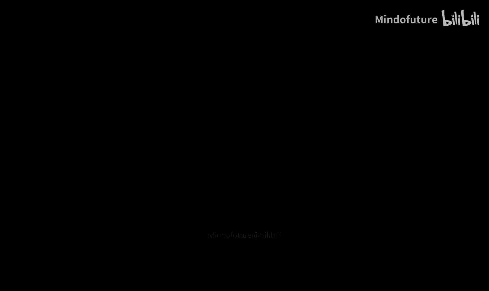
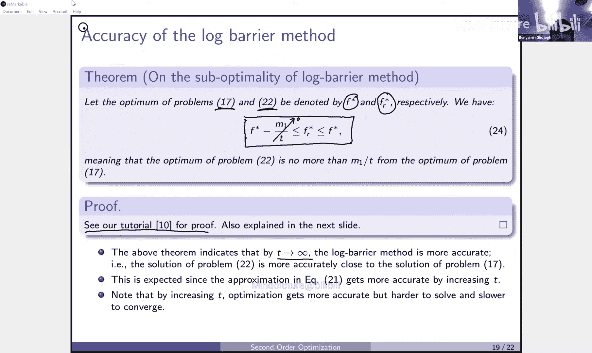

# 【滑铁卢大学】优化技术课程 ｜ Optimization Techniques   W2023 p08 P08_第八讲_(近端方法、牛顿法与内点法) -BV1oJCHBcEo5_p8-

Hi， everyone。So is there any question？About。 the course。The previous lecture or the assignment。

So we have posted the assignment2。And yeah。About the project， the assignment。Everything is clear。

 by the way， the deadline of the assignment。Was mistakenly written as February 25th， it's March 25th。

 I corrected that it was a typo。嗯。I think， shall I start？Can you give me。Some feedback。 Okay。

 I start。Let me。Great， let me share the screen。え。Okay。So。And we in the last session we talked about。

First order method gradient stochastic gradient descent and was also back propagation。

 but now one other category of first order message is left， which is。

W whichch are the proximal methods。So。What are the proximal versus definition？

Proximal mapping or operator its also called either proximal mapping or proximal operator。

 What is that？For assume that function G is a convex function。So we write it in this way。

So Pras Subscript G x is defined as this argument。Of this term， G U。

Plus one over2 squared L to normal U -6。 And what does it mean， So assume we wantan to。

Minimize a function G x with respect to x。 So something like that when we have this。

We are having a change of variable。 we are saying that minimize G of U。With respect to you。

But we add the。Subject where。X should be equal to you。So this is a good technique in optimization。

 We can have a change of variable， but in this constraint of the optimization。

 we say that that variable。😊，The variable x， which was the original variable should equal to y。

In other words， rather than this， we can say this should be minimized。嗯。

Minimize the distance between UN， right？And because we know that the derivative of the squared L2 norm will be 2 u minus x in order to cancel these two。

 we can have one over2 behind that in order to cancel that too。

 so what we are doing we are first we are having this optimization problem。

 we are having a change of variable where we are saying that in the constrain set x equal to u and then we have a third step。

 we are saying that let's convert this constraint optimization problem to an unconstraint optimization problem。

Byoy， adding the。Constraint as a regularized term。We are penalizing the constraints， okay？

So three steps we are having minimize G with respect to x now let's have a change of variable。

 but in the constraint we say that x should be equal to U and then in order to make this unconstraint again。

 we are putting the constraint as a softd penalty so because this is a hard penalty， right？

We are having a soft penalty as a regularization term in the objective function。

 This is the same idea that we had in the Lagrangian function。

 You remember in the interpretation of Lagrangian， we said you can interpret it as a regularized cost function。

It's a good technique whenever you have a constraint in order to make it unconstraint。

 you can softly penalize the constraint。So。😊，Now this is what exactly the proximal operator is doing。

 See it's the variable is x， but we are having a changer variable to you。😊，对。

Then we say g of u rather than g of x and this term is penalizing。

 it's the distance between u and x so u x equal becomes equal to u， something like that。And。

This is note that this is not the function value， but the argument which minimizes that argument。

So the U， which minimizes this term。Is the equal to the prox of eggs？With the function G。

So this is a definition of proximal operator， I think now you understand what it is doing。

It's saying that minimize the function G。With respect to you。

But try to set eggs and you close to each other。O。呃。So in case the function G is scaled。

 we might also have， do you remember in the regularized term， which is a soft penalty。

 we can have a regularization term to weight between the actual cost function and the regularization term。

 we can put the regularization term lambda in the numerator or in the denominator doesn't matter。

As long as it's a parameter。That's enough。So let's put it in the denominator and then it becomes here。

 so the parameter lambda we put it here， so in a general case the proximal operator is this with the parameter lambda and when we set lambda to1 we have this。

Okay， there is a question in the chat。Okay， someone said， hi。Hい it。So。😊。

So we have this proximal operator generally with a parameter lambda， but when we set lambda to one。

 we'll have this。So far clear， any question？No， and by the way。This arc mean returns the U U star。

 which minimizes that and as we set u to be very close to x。

 therefore this makes sense because prox is a function of x。But we are setting you to it。

But U is very close to therefore it makes sense to equate the left hand side to the right hand side。

Okay， now we'll see that this proximal operator has a lot of use cases in optimization we'll see how a lot。

It's a family of methods， actually。So what is proximal mapping we。

 we talked about it in the previous slide。 Now it， we know that we are gonna say that it's very closely related to the。

Mia youidda regularization， which we define below。So Maria。

 youidal regularization also called Mu envelopelo， you can look it up in。Papers 27，28。

In the references。 So this the Maria you the regularization or Maria envelope of the function G is defined as this。

 As you see， it's very related to the proximal mapping。 compareare these to。

So this the difference is that here we have Arc。😊，Here， Maria。The envelope doesn't have arc。

 It's a function value， optimal function value。 and in is minimum a general case。

 a generalized case of minimum， Do you remember， recall that。Preliminaries。

And except that everything is the same， by the way， when we have lambda here。

 this we have lambda here， so we might have lambda here。嗯。

Very similar related and according to Ref 29， the Mari Uidto regularized function has the same minimizer as the function G。

So the minimizer U star， which minimizes G， also minimizes this envelope。

 this Maria envelope of the function。 That's an interesting fact。Okay。Now。In Maria decomposition。

 we also have Maria decomposition。APropoing a reference 30。

Is that we always have the following decompositions， these are called the Maria decompositions。

 these two。So this is。This one we set lambda to one， so you can write x。As the prox。

I perxs of x with function G class prox of x with function G is star。

 and what is G and what is GS star G as a function in some space。

Gs star is a correspondent function in the dual space。

 We already talked about dual space in the preliminaries。 You remember， we had norm dual norm。

 for example。 So if G is a norm， GS star is the dual norm。

Or if G is projection onto a cone G star is a projection onto the dual cone。

 We'll talk about projection in a few slides。 Wait for it but。If G is projection onto a cone。

 G starts projection onto the dual cone， again， we talked about dual cone in the preliminaries。

These are some examples in the parenthees I'm saying that。

So G and G star G is the function G star is a dual function。And writing eggs as the pros of eggs。

In with function G plus pro of x with function G star is called Maria decomposition。

 The left hand side x equals the right hand side， the summation of these two terms。

 And in the general， more general case with parameter lambda， we have this。Okay。

That's an interesting thing we can write any variable x as the summation of two terms。

 pro of x with function G and plus prox of x with function G is star。Okay。嗯。If you have any question。

 please feel free to interrupt me okay。But。Wal with me through these algorithms。

 and you will see the beauty of them。 Okay， in optimization。Indicator function。

What is indicator function， So indicator function and optimization it says that for its。

 it is defined for a set。 So S is a set。And indicator function of whether X belongs to the set S or not。

 if it is defined as this we write it with。I x， whether it is in the set S or not。

 I stands for indicator。 Okay， if x belongs to S。This indicator function is 0。

If it doesn't belong to s， this indicator function is infinity。

You might if especially if you have worked in machine learning。

 you might be wondering we have another definition of indicator function in there is another one which usually many people use that says that if。

呃， if X。Belongs to S。It's one。 so it's a binary function if it。Doesn't belong to S it's 0。However。

 here in optimization， we usually use this definition。So we say when it is it belongs to s。

 it's zero and when it doesn't belong to S it's infinite， do you know why can someone tell me？

Why do you think we have such thing in optimization rather than the。This one。

Can you please give me your。Guesses。Is it so the output is always either zero or infinite。

 where if it's in the denominator， then it'll either be。Zero。

 if it's not S and infinite if it is S and vice versa in the numerator。

But do we have a fraction here？是。That's a good answer， but it might be working if we have a fraction。

 right？We don't necessarily have a fraction here。My question is。

 why does it make sense to have such indicator function in optimization？Why does it make sense？

To say to， to have it blow up when it's not in the set S。And becomes 0 when it sees in the set。

Why don't we say whenever it's in the set S， let it be1。 And if it's not in the set S that it' be 0。

Can you have other guesses。嗯。So。It makes sense。 The reason is this makes sense， because。

We want to use this for penalty。This is a hint。 Now， can't anyone tell me why it's useful for。

To have this definition of indicator function as a penalty。As a regularization term， for example。

Alys， are you with me。So I just joined and I'm trying to catch on， but I'll add my two cents。

 I guess if it's a penalty。Then you you want to add to it right like you want to。

If it's not within the set， so you'd have like a value of one。

 then you're adding a penalty if it's zero， then you're not adding anything。Exactly， but。

You said why did you change infinity to one？So you， your explanation was correct， except one thing。

 you said when it's not in the set， let it be one。 No， let it be infinite。 Why， why do we want to。

 why do we want it to be to blow up。Exactly as you said， when it's not in the set。

 we want the panel 2 to be infinite。Do you get it。So in other words。Assume。

 assume the indicator function was this。0。And 10 or 1，10， whatever。This also makes sense。

But what is the difference between these two？Can you tell me what is the difference between these two。

So live， is infinity not just a larger？Penalty， yes， exactly。

 but why do we want the penalty to be infinity？So， here。So whenever it's not in the set S。

 we are penalizing it， but with value 10。When here it's not in the set as we are penalizing it with value infinity well the speed of training would it would the speed of training not be altered so if you use 10。

Okay。😊，You would have to potentially train longer。Yes。

 this you are discussing on the pacing of the algorithm。That's a good analysis。Escate。

With another perspective， you can say。If it's 10。We have a soft penalty。If it's infinite。

 we have a hard penalty。😡，Do you need do you see the difference。

 the difference is that assume belonging to S with I'm changing this example to another example。

 so belonging to S assume that。Is like， let's have a harsh example so you by a harsh example。

 youll understand what I mean。I say。Okay， for example。If belonging to S means for me， let me think。

soon。And。I want to say an example which is not controversial。 Let me think， I don't know but。

Don't take it personally or controversial。 I just want it to， for the concept to be understood。 So。

 I I' am saying that if I。诶。If I belong to the set scientists。

 then I'm done if I don't belong to the set scientists。

I will penalize myself in a way that in the first case scenario in this case。

If I don't belong to the set of scientists， I will penalize myself， for example。

 I don't eat myself a food， I don't eat myself pizza， I will tolerate hunger or something like that。

In this case， it says that if I don't become a scientist， I will kill myself。用西。

This is the difference between soft penalty and hard penalty， okay？😡，So， in this case。

We are penalizing with some points but what is the the most harsh penalty or hard penalty in this example that I said is killing right because we don't have worse than killing so in optimization we are saying that whether in this case we are saying that try to be belong to the set S。

Otherwise， I will penalize you。In this case， I will say if you don't belong to the set as I will kill you。

Why， because you are minimizing a function F or something。When function F becomes infinite。

 because we are summing this regularization team term in the F function F right in the objective function。

 we are saying that when you make this objective function infinite。

It's exactly opposite of minimizing。😡，Right。Okay。Or if you are maximizing it， then。

This should be minus infinity。 So whenever you have infinite in optimization。

 it's equivalent to killing。It's the worst case。Is it clear now？Can youYeah。

 essentially it's it's making like a discrete difference， exactly exactly。

The difference is between soft penalty and a heart penalty。Again。

 you had we had this concept of penalizing penalty previously。

 So consider the case of Lagrangian and the function， the optimization problem that we had。

 the optimization problem when we had the con。The constraint was a hard penalty。

But when we had a regularization term。In any case， such as Lagian。

 we we wait weighted that with some lambda or something like that。 And we said， okay。

 let it be a soft penalty。So the constraint was heart penalty， that it be soft penalty。However。

 when you are adding that penalty to the objective function。

 you can also make it a hard penalty by saying that if it's not satisfied that it be infinite。

So we can have two kinds of heart penalty， either let it be a constraint when it's not satisfied。

 the solution is inible and it's not acceptable， so it's also a hard penalty when it's in the constraint。

But when you add it。As a regularization term to the cost function。Then it's a soft penalty。

 but you can convert the soft penalty to the hard penalty by saying that that it' be infinite。

 that it' be the worst case for optimization when it's not satisfied。Is it clear in other words。

 in other words？Minimize if。Of x， subject to G of X， for example， less than。0。Okay。Can。

This is a hard penalty。 This is a hard。Consts， right。

One thing we could in order to convert it to an unconstrain problem， we could say， okay。

 let it be lambda geovis。Subject to， I think I， it's better for me to write it in another page。

 Let me。Give me a second。This is an important concept not related just to this part。

 it's related to all optimization algorithms that I'm talking about。嗯。Let me think。嗯。Where am I， O。

I think I jumped to another page to give me a second。Yeah。Let me print。 Sorry about that。😔，は。

When you understand this， you will understand a lot more about optimization。

 That's why I am focusing on this concept。Yeah， I think。It's better for me to add a page here， yeah。

ok。Yeah。Okay， so soon we have a constrain optimization problem。Okay。

We can in order one a good technique in order not to make it unconstrain because solving unconstrain optimization is much easier。

Is what。Is adding this constraint。As an， as a。Regularization term。So when G becomes， for example。

 in this case， when G becomes large。Because G should be less than 0。 So it should be small。

 So when G is large， then it should be penalized。 This is the same idea that Lagrian had。So。

This is a penalizing regularization term， this is regularization parameter Lada。

 and this is regularization term， so we are penalizing this is a penalty term or regularization term。

😊，But this is a soft penalty。This is a hard penalty because why is it a hard penalty。

 because if you don't satisfy that？😡，It becomes invisible solution and you don't accept it。

 so it's hard。Here， if it's roughly。呃，呃。Satisfies G or G is roughly small。 You accept that。

 Maybe it it might be， for example， G might be0。001。 It's not less than 0， but it's small enough。

 you accept that， but with a small penalty， you accept that。 So it's a soft penalty。

 although you don't accept G equals 10， for example， T 10 is much larger than 0。

 but because the penalty for that will be large， but when it gets close to  zero。You accept that。

 you tolerate that， right？You tolerate that， however。We can convert this unconstrain problem。

 which is a soft penalty to an uncontrain problem with heart penalty how。We say that let it。

 let the regularization term be a hard penalty， how by this。

 say the indicator function of x of g of x less than zero， so this is the set。😊。

The set is having g of x less than 0， less than or equal to 0。Now the indicator function。

 when g of x is less than or equal to zero， indicator function it becomes zero。

 that's why in optimization， we say when the's satisfied。

 the constanttrain inside the indicator function is satisfied that it be zero because I don't want to penalize that。

😊，But when it's not satisfied， let it be infinite， so it blows up the whole objective function。😡。

And you don't accept it because this is the worst case scenario for minimization。Now， you can say。

 although it's unconstrained。It's a relaxation of this concert problem。But it has a hard penalty。

A good thing， this。Is approximately correct。 So approximately solve penalty approximates the heart penalty。

 The solution might not be exactly equal equivalent， but these two are exactly equivalent。

Because when you don't satisfy here， it's invisible， when you don't satisfy here。

 it blows up the objective function。So you must satisfy。The con in both in these two cases。Therefore。

 these two are equivalent， although one of them is constrain and the other one is unconstrained。

But another thing might happen。 a fourth case scenario might happen。 sometimes you can't solve this。

😡，In practice， in practice。Not possible。Right， how do you code infinity in practice In theory。

 it works makes sense。They usually approximate， let's now approximate because you can't。😡。

Code indicator function your code in machine。Let's approximate the indicator function itself。😡。

Well see that in this session。When you approximate that。

 you change the hard penalty to solve penalty again。But there is a bo。

 What's the difference between these two soft penalties is that this is more accurate。

Because it's approximating the hard penalty of indicator function。

Usually this self penalty is more accurate than this self penalty。In this soft。

 because this soft penalty blows up faster or more than this soft penalty。😡，Now， did you get it？

So in order to understand indicator function， consider it as killing， murdering in optimization。

So when it's not satisfied， you're killing the optimization problem。

 that's why it becomes a hard penalty here you're approxiating killing with a very huge penalty。

Any question， did you understand the concept of relaxation， regularization， soft penalty。

 heart penalty， all of them were explained in this slide。Yes， okay， great。Now， let's go back。

 This was a parenthesesis。 Let's go back to。This is slide。

 so we are talking about the indicator function， which is an important thing。Now。

We have a projection onto a set。The proximal mapping of an indicator function。 So proximal mapping。

 we introduced。In previous slide， indicator function we introduced in this slide。

Let the convex let the set s， which we have here， let it be convex。

 so the indicator function says whether x belongs to the set S and the one example of set s was G of x less than oracle to0 so set s can be considered as a set of visibility as a set of constraints。

 for example。It can be any。Projection of the point onto the set S。😡。

So the proxima mapping of indicator function， the pro So the proxima mapping。

Let the function G in the proximal napping be indicator function。We will prove in the next slide。

That the proximal mapping of the indicator function equals this and this。Is projection onto the set。

 Why I will tell you。 So assume。And I'm explaining why this right hand side is projection onto the sets S。

Soon this is the set S。 This is the point x。 Okay， what does the right hand side of equation 63 say。

 it says that。When you have a point X and you have a set S。This is find。😮，Argument find a Au。😡。

In the set S， so you must belong to the set S one of these points。It can be on the boundary too。

 or it can be inside the S， so among these points inside the set S， including the boundary。

Find a point which is closest to the point X。Why。😊。

This means the minimize between the distance between U and x。 And this is the L2 norm。

 we already talked about it is the Euclidean distance。 And this is a squared Euclidean distance。

 And this one over2 is just for cancellation of derivative of a squared， right。

So this is saying that minimize the Euclidean distance between U and x。

So which point on this in this set S is closest to the point x？Of course， this point。What I said。

 the sentence I said is the definition of projection。 The definition of projection is。Find a point。

U in the set S， which is closest to x， this is a definition of projection。

 so that's why and we denote projection of x onto the set S by this， for example。

And here is the point U， the projection， and when you connect the point x to the projection of x onto the set S。

 that line will be perpendicular to the set S。Because it has the shortest distance。Right。

 and now this equality， we didn't prove that we are going to prove it in the next slide。

 Why is the proximal operator of the indicator function。

It follows the projection of the point onto the set S。 Let's see。It's because of this。😡。

So this was thelemma， we are going to prove this。 We are going to prove。Thisす。Equation。

This was the proximal mapping that we introduced。 We defined a few slides ago。Now。So。

 let's start with the。The proximal mapping of the indicator function， the left hand side here。

So according to the definition of proxima mapping here。We have this。

 so I'm replacing function G because function G is indicator here。

With indicator function of x belonging to the set S， right？And what is this， we can write this。

 so when this is0 or infinite0 when if x belongs to S otherwise。It becomes infinite。

 So if it becomes infinite， it blows up。😡，The minimization。So we have to satisfy。Therefore。

 rather than U， we can say that u must belong to S in order for this to be0， otherwise it blows up。😡。

And when U belongs to s， this becomes zero， so it goes away。😡，Then we will have only this term。

On the right hand side already talked about it in previous slide that is the prediction。

And now you see that the beauty。😊，We talked about it。 We said that。It's also related to the。

Is hard penalty and soft penalty。 So it's saying that。

You find the closest point to the x in the set S， which satisfies the set S， the feasibility set。

Otherwise， it blows up。😡，Blows up the optimization， so this is a project。So assume。

You find that is a solution to the optimization problem， which is here， but it blows up。

 its in point。Now， indicator function is saying that find the closest point in the feasibility set。😊。

To the solution that you had。Project it onto the feasibility set。Yeah。Any questions so far？No。Okay。

So。Moreic composition， we just talked about it。Yeah。With parameter lambda。

 this is a definition of Maria decomposition。Now we can rearrange it。To have this。Right。Okay。

 now we are going to use this if the function。Is a scaled norm。

 so assume that function G is lambda some norm， if this norm can be any norm。

Like L2 norm L1 norm sum any norm。Then the productss just replace this。

With function G here and you will have this。We'll see why。So。And give me oh， what is this。This is。

According to what we had here。Look at， look at this。 Look at this， which we proved here。

 Look at this。Proox symbol。Operator for the function indicator function is this。Okay。😊，Wait。

 give me a second。Give me a second， too。Yeah。So， when we。Say that because we said G2 lambda， right？

Then GS star， what is GS star？Is lambda。Norma star。 Nor star means the dual norm。

 So now I I' am replacing you Sir with London Nor star。Ex over lambda。

 So this lambda and lambda cancel each other。 So this becomes prox of。

It's over Lambda with a function， Lambda star。Right。And I think。😊，Yes， yes。 And what does it mean。

It means that project it here。According to what we just talked about。

 this is the indicator function whether the input is in the dual norm or not。

 therefore it's a projection onto the dual norm， what what projection onto the dual norm on the norm or dual norm means that you project onto its unit ball do you remember unit ball that we talked about in the preliminaries so when you project onto a norm it means that you are projecting onto its unit ball。

So B is a unit wall of the dualal known because of the same reason that I just talked about it here。

😊，So， I'm projecting。I'm saying that weather es over Lada here。Belongs to the set。

Of the Dang norm or not。Now I'm going to use。Equation 64。

 which is the proximal operator for the norm。 So when the function G is a norm or a scaled norm。

Its proximal operator is equals to the x minus lambda projection of x over lambda and to its dual norm and to the unit model of its dual norm now we are going to use that why is it useful see we'll see in a few slides。

It's a useful equation。 Now let's have， let's find the proximal operator for several of the norms。

First off， let's talk about it if the G is a0，0 function。 What happens， Proximal operator。

 What was the proximal operator。Do remember the proximal operator。

 the definition of proximal operator。Yeah， or proximal mapping。This was the proximal operator， right。

 I'm going to use that， but I'm putting G to0。Setting G to 0。Let's see what happens。

 So I'm setting G to 0。 This is the definition of proximal mapping， but I'm setting G to 0。

 So0 goes away and we'll have this。And what is this， by the way？Find you。Where the distance of UN X。

Is minimized。This is a non negative term because lambda is non negative and this is a squared alno。

 so it's either0 or positive itss minimum is 0 right When does it happen it becomes0。

 when u minus x squared is 0， so when u equals x。Therefore， the solution is X because it's argument。

 right。You might be wondering it's very similar to what we had in projection however。

 there is a huge difference， don't confuse that。In projection。We had argument of this。

 but U was in the set S。😡，As's why project it didn't become x because x might not be in the set S。

 it might be outside of the S， So it's projection of Xon to the set S。Here。Here。

U doesn't have any constraint， therefore you can become X。So when g is0。

 the proximal operator is an identity function。It's output equals its input。Now。对。

Let's talk about the proximal mapping of El2or。Proximal mapping of El tono。By the way。

 you can see a lot of proximal mappings of many different functions。😊。

Such as norms and these things in reference 31 chapter 6， but we are saying some of them。收。

TheProxi mapping of L2 norm。Is this， and we will prove that。 So if the function G is the L2 norm。

 then。え？Ifs proximal mapping is 1 minus lambda， Lada is the parameter here。

 parameter of the proximal mapping lambda over max of al norm of x and lambda times x。What is this。

 It means that when。When the alnor of x is greater than or equal to lambda。

 then the denominator here。Becomes L to normal vi。So we will have one minus lambda over Lormal vi times6 if this al norm is less than lambda。

 this max becomes lambda， the denominator。Becomes lambda。 then lambda over lambda is 1，1-1 becomes 0。

 So this becomes 0。 Now， let's prove this equality。Why is it？The case。

 So do remember in the previous slide， we just showed that the proximal mapping of a scaled norm equals this。

Over north。Now。Let G be the al2 norm because we are going to prove for L2 norm here。

 so it's dual norm， do you remember this this is projection。

 this is projection un the unit ball of its dual norm， what is the dual norm of L2 norm。

We already talked about it in the preliminaries。It's the dual L norm again。

 the dual norm of L norm is dual L norm。So。This is projection onto the altonor and what is projection onto the Ltonor。

 Let's draw the altonor。 Do you remember Altonor units ball of the Ltonor。

In two dimensions in three dimensions， it's a sphere container itself， it's a ball。

So this is out norm， also it includes itself inside of it because it's balld and when we have a point。

For example， this x when it's outside this sphere is this circle。

It's radius because this it's radius is one， right。Then you need。To project it onto this unit ball。

 and what is this projection is because you consider this vector。When you project it becomes here。

 right， let me draw it again。Soon this is the point。 This was the vector。

 but now you are projecting it so it becomes here， so it becomes here。 This was x。But what is here。

 it's x over the l normal x in other words。😊，The length of x becomes one。What is the length of this？

Tis one， why。Because you can write it in this way。This is a constant， so it comes out of the norm。So。

 this is one。Pig projection of the point x onto the unit ball of the sphere。

 It means that you just set its length to one。 no you normalize it and normalize its length。

 So that's exactly here。 But when you are inside the ball。You are already in the set。

 she so you shouldn't do it any， Do anything to it。This is a project， I visualized it here。Okay。

 now let's use it。 let's use it。 So I'm using it here。 I'm seeing that x minus lambda this。

 and what is this we are we just talked about it。😊，So when Xs。So here， when inside of it。

 when inside of it was greater than or equal to 1， therefore。

 it means that when x over lambda is greater than or equal to 1。 In other words。

 when x is greater than equal to lambda。Then we have this。This one minus loda over。This x y。

Let me write it in this way。So you understand better。Bear with me。

 and you will see the beauty of these algorithms。 You need to be patient for why these are important。

 so。When。😊，we have this， so inside the projection is greater than or equal to0， in other words。

 when x is greater than or equal to lambda， well have x minus lambda and this term becomes normalized。

1 over Lambda。Its normalized。These two longs cancel each other。Right， am I right or wrong。

Give me a second。Give me a second。诶。I'm not sure about this。

 but this might I need to think about this Lada here and I will talk about it in the next session。

 there is no time for me to dig into it， but I think there there is there might be a mistake here。

 but doesn't matter。 I think you get my point you will have this。But when x is less than lambda。

What does it， what does it happen， You will have this。Look at here， you will have x minus lambda。

Is this itself？😡，So these two lambdas cancel each other x minus6 is0。Now we prove this。Again。

 I'm a bit doubtful about this Lada， but I will look at it。呃 would。More detail。

 and I will talk about it in the next session。But I think you got the general idea。

This is the proximal mapping of the L2 norm。Now， lets see the proximal mapping goal L1 norm。Okay。

L1 norm as it is， do you remember L1 norm？Is a non a smooth function。

 therefore we have to work on its component wise or element wise。It's not as easy as L2al。

 but let's see so when you have a vector x， a D dimensional vector x。😊。

Let Xj denote the JS element of that，And by the way。

The proximal mapping of x with function lambda L1 norm。Do you remember it it was returning amin。

 which was the U okay and U has the same dimension as x when x is D dimensionional。

 therefore proximal mapping is also d dimensional。And we can denote its Js element by this proximal with J。

 I denote it here in this way。Okay， now the J element of the proximal mapping of the L1 norm。😊。

Is this， We will prove it。Is maximum。Of 0。 And this term。

So this is the absolute value of the Js element of x minus lambda if it's greater than or equal to0。

Then this maximum because becomes itself this itself， if it's less than zero。

 then this maximum becomes  zero。Okay， then we have times sine of xj。

 so if xj is greater than or equal to0， it becomes 1， the signine becomes1。

 otherwise if it's negative， the signine is negative1 minus1。

And we denote this function by s of the lambda xj and it is this why let's talk about the equality of this term and this term let's see so when xj。

The J element of x is greater than or equal to lambda。This。Becomes x J minus lambda。

And as Xj is greater than or to lambda， the whole max becomes xj minus lambda and sine of xj is also plus1 y because lambda is already a non negative number。

 therefore will have xj minus lambda。If the other side， if xj is less than or equal to minus lambda。

 then。This becomes minus xj minus lambda。And we know that。keep me a second， yes。

 this becomes minus xj minus under the whole max and the sign of xj is also minus1。

 therefore we will have xj plus lambda。😊，Now let's see the middle case when the absolute value of x is less than lambda。

 so if x is between minus lambda and lambda。😊，This maximum becomes zero。

And the whole thing becomes you。I have drawn plotted this function here。You will see that。

Why is it here， Because when。We have this case。 We are in this region。

And the function becomes  zero when xj is greater than lambda then we have this line with a slope 1。

When your xj is less than minus lambda。We have this line with S 1。These function。

It's called soft thresholdholding。Function， we denote it by here。S Lada Xj。

 so the parameter is lambda。These are the parameters， right？And the input is a scalar。

Note that we are talking about it element wise。 So although it's a vector， it is a vector。

 but we are talking about it every of its elements， each of its elements。For j from1 to d， right。

 Okay， now let's prove this equality。 Y is the proximal mapping。

 the J element of the proximal mapping of L1 norm equals this soft thresholding， let's see。Let's see。

So。Sooom the function G is L1 norm。Okay， again。Recall the proximal mapping of the norm。 What was it。

Question 64。So we need the projection onto the units ball of its dual norm。

What is the dual norm of hell1 norm， Ricar preliminaries， we already talked about it。😡。

The dual norm of L1 norm is L infinite norm。Or max norm， we also call the chbyshaev norm。

So it's L infinite norm。😊，Its because L infinite norm is a dual norm of L1 norm now let's talk about let's by visualization。

 let's see what is the projection onto the unit ball of the L infinite norm。

 what is unit ball of L infinite norm it's this do you remember recall preliminaries。Okay。

Its this is square。Including it inside of it。Right， so when now we are this is in 2D in 3D。

 it becomes a cube， for example， including its interior here we are talking about one dimension artery。

Therefore， you can see it as only for one dimension in one dimension when we are outside of this projection means that we are here。

 So when xj is greater than or equal to1， so then it becomes one， its projection is one， right。

When it's。Less than -1。His projection is minus1。When is's in this region。Between here。

 so it is we are inside the unit wall， therefore it becomes itself。

 we don't need to the projection because becomes itself， okay？

So now we already talked about it by visualization now let's see。😊。

The Js element of the proximal maximum of L1 norm， according to equation 64。

 so it's xj minus lambda d and now what is this。Replace it here。

So xj minus when xj is greater than or equal to lambda， this becomes1。

 so we will have xj minus lambda。When it's less than minus lambda， this term becomes minus1。

 so we'll have xj plus Lada。In the middle case， well this becomes Xj。So他。Xj。No。

 this becomes sorry xj over lambda inside inside of the projection。

 So xj this becomes xj minus lambda xj over lambda， the lambdas cancel each other， so it becomes 0。

 right。This is the soft thresholdholding。Function you hear soft thresholding a lot when you are dealing with L1 norm in optimization。

Okay， this is the proof。When you am I telling you the proofs of this because for you to understand what these are。

 when you understand the proofs， then everything becomes clear to you。What you are working with。Okay。

So why are these useful， let me add a page here to tell you why whatever we talked about。

 the proximal mapping of the norms useful。😡，So assume we want to minimize。Some function F。Okay。

But especially， for example， in machine learning， we also see that a lot。

 you want to have a regularization term。Or with some regularization prime or lambda， for example。

 this Lada don't confuse Lada with the Lada of proximal mapping， let me call it gamma， whatever。

You say that。Let be al to norm。You say that I don't want these x to be very large。😡。

So I want to minimize the function if， but I want to have some penalty on the size or on the length of the optimization variable。

 I don't want it to blow up。Probably you can minimize f of x， but x becomes。It's a vector。

 for example， it becomes 10 to the6， 10 to the five。Tend to the。11， something like that。

This optimization variable actually might be excess star， which minimizes F。😊。

But it's not useful when you are coding in practice。 It's not useful。

 It doesn't make sense to have such a large x。 then Then you add an regularization term， you say。

 okay， find。An actual optimal value， but I don't want it to blow up。Therefore， you can say this or。

So this is penalizing its al norm， its length。In other case， you might say I wantna penalize。

It in another way， I want it to be a sparse。So when you want to impose sparsity to your solution。

 you usually regularize it with L1 norm。hy。There is another visualization。4our。Justing it。

 recall the Uni of L1 norm。 It was like this。It was a diamond， right？Assume you want to。

Optimize the cost function F。But you also want it to be inside the Unial， for example。

 inside the Uni ball of the L1 norm。 So assume you have a two dimensional function。

And this is the units ball。Or a scaled unit wall doesn't matter of the L1 norm and you want to minimize f。

 of course the minimization of f is here， but it's very large， it's a huge x1 and x2。You say no。

 I want to minimize F subject to being in the unit ball or having a small L1 norm。

 then you will see that you will probably touch one of the corners of this diamond。

Compare it with the case when you are regularizing it with L tunnelor。By the way， this visualization。

 its credit is for， I think。Either T Shirani or Hasty at the Stanford University。

He proposed la ra regression。So。😊，Look it up， Laso regression。Laser regression has a L1 norm。

a regularization term in regressionation， in linear regressionreation。So I'm using his justification。

I don't remember whether he it was tipcirani or hasty one of these two。

 I guess I think it was tiprani， but see here you might touch the unit ball when in L2 norm here。

 which has both L1 for which has both x1 and x2， although it's x1 and x2 are small。

 this is this case。So you're saying that minimize a function F， but here is too large。😡。

I want it to be inside the Unipo of L2 norm， or I want this L2 norm to be small。

So you see where does this function touch here and this is the solution with a small X1 and x2。

 however here。This is for this case， you're regularizing using L1 norm and you will probably touch one of the corners。

😊，And in this corner， interestingly， x1 is0。And x2 has a number， but is also x2 is small。

What one of them， one of the variables， one of the elements is zero。

 exactly zero here it's not zero here x1 is close to0 here x1 is exactly zero。😊。

Why because the probability of the function to touch？😡。

TheThe corner of the diamond is much higher than the probability of this to the solution to become here when it's a sphere。

Although in both cases， x1 and x2 are small， in one of the cases in L1 norm， x1 becomes exactly zero。

 therefore it's a sparse。That's why for sparsity， you can use L1 norm regularization。

But you can use L2 norm for making it a small， but it wont be a sparse， but you might be wondering。

It seems that， by the way， for this to understand better。😡，Increase the dimensionality of function。

To， for example， 100。The diamond will have。10d corners。

 I think you can understand what I'm saying that consider a diamond， increase the dimension to three。

 then it becomes like a two pyramids back to back， then increase the dimensionality to four to five to six。

 you are increasing the corners。Then it becomes when the dimensionality goes to infinity。

 you will have a lot of corners next to each other。

 it becomes like a ball but with a lot of sharp corners you can't touch it every part has a lot of corners sharp corners right that's why especially this justification makes more sense when you have a huge dimensionality of course when you touch one of the corners。

 many of the elements will be zero。😊，Here， one of the elements became zero。

 but when you increase the dimensionality， many of the elements become zero at that solution。

 that's why it's sparse。Is it clear？Now。Yes。😊，Is it clear？Yeah， yeah， it's clear great， Okay。

 now let。😊，Consider this case。You might be wondering。

 it seems that L1 norm is much better than L2 norm because not only。Does it。Decrease。

The value of elements in the solution。But also it， it makes it a sparse。

 Why don't we use L1 norm rather than L2 norm always， Can anyone tell me。Okay。Can anyone tell me。

The reason is this。😊，L to norm is much easier。Eton norm is a smooth alton norm。

 which can take derivative easily。 What is the derivative of a squared alton norm。Its 2 x。

What is the derivative of L1 norm。Very hard。 I think you need soft thresholding that we just talked about。

It's very hard， it's not a smooth。😊，But L to squared L2 norm is a smooth， therefore， many people say。

I don't want to suffer for calculation of L1 norm derivative of L1 norm。 Let me use L2 norm。

 It's good enough it reduces the values of the in the in the。The length of my solution。

But although it doesn't make it sparse， well it's good enough。😡，It makes my calculations easier。😡。

It makes my world easier to deal with that's the reasoning so there is a tradeoff between whether you want to do it as sparse or whether you might you want to do it easier in any easier way。

That's the difference between them， and by the way， there is a bitting un sparsity principle。

 again proposed by hasty Thiraian others in Stanford。😊，What is that principle？

It says that when you have an algorithm， an optimization algorithm。

Ase you regularize it with if one of them is a sparse using regularization or whatever。

 you have this exact optimization problem， but its solution is not a sparse。

 so you have two exact problems similar problems one of them is a sparse version of the other one。

 I bet with my blindfolded eyes， I bet that。😊，With a high chance， the sparse solution works better。

Usually the sparse solution works better， especially in for example， many cases。

 lessso regression works better than a reach regression so in regression。😊。

The L2 norm regularization is called reach recreation。This is lesser regressionreation。

Usually in some cases， not always， but this beinino sparsity principle works well in many cases。

 the sparse solution works better， you can also justify it by Ocoms Razor in philosophy and logic in logic。

 I think you have heard of Ocoms Razor Ocoms Razor says that in philosophy and logic says that if two things explain。

😊，The reasoning for one thing。For one phenomenon。Which one is simpler， choose that one。😡，For example。

 if you are a philosopher， you have two understanding of one phenomenon， you say， okay。

 this might have happened for reason one or this might have happened for reason two。

Which one should I choose in philosophy and logic is I choose the one which is simpler。

 the simpler explanation。An example， this is Okas Razor， an example。😊，I'm hungry。

The reason might be because I haven't eaten for several hours。

 the second reason might be that an alien came and this tricked me and magic me to become hungry right now。

 but that alien was invisible to me which one is the justified answer to why I'm hungry， of course。

 what is the simpler solution， because I haven't eaten for hours。

 there is no alien that made me hungry。You get my point， this is Ocon's razor again here。

 when you have a sparsity， it's like O simplicity， spars make it simple， so it's better solution。😊。

Okay， now let's go a bit faster to finish the proximal methods and then we'll have a break。

HerPxima point algorithm。Recall question 58。Where was that。Yeah， the proximal mapping。

 the definition of proximal mapping with parameter lambda。 Okay， let me。Come back to where we were。

Okay， recall the question 58， I have repeated it here。So， this term。Inside the argument。

Is a strongly convictx， recall preliminaries。 Therefore， its proximal point is unique。As it is。😊。

Sttrong de conveyx， it has one minimizer， therefore this is unique。Okay。

 might you might be wondering how do we know that the proximal mapping is unique。

 it might have several solutions。 here is the reasoning。This is a strongly complex。 Therefore。

 proxi mappingping is unique。 Also， there is a lemma I haven't provided the proof here。

 So the point X star minimizes the function F。If and only if its a star equals proximal。

Mapping of X star with function Dmda F。 So assume the function。G or F， what doesn't matter。呃。

We want to minimize the function F。This is minimized by X star。诶。If x star。

 equals proximal mapping of lambda F x star。It's if an only leave， so if this is true。

 then X star minimizes F also。The other way around， if x star minimizes F， then this is true。Okay。

That's another thing。Now this lemo is used in an algorithm named proximal point algorithm。

 so proximal point algorithm says that soon I have an unconstrained optimization problem。

 minimize f of x with respect to X okay。And assume you can't find its solution by as a closed form solution。

 otherwise you would say， okay， take derivative f of x and set it to zero and it gives you x star。

The same situation that we have in gradient and decent you don't we can't find excess star in closed form solution then therefore we need to do it iteratively in a first order method and one of the first order methods is proximal point algorithm also called proximal minimization proposedosing 1976。

What does it do， it says that do at every iteration do this。😊，So K denotes the iteration index。

 so x k plus1 equals。Proximal mapping of xk， the previous k in the previous iteration with the function F and parameter lambda。

So and according to the definition of the proximal mapping， it's this。

We do it until convergence untilk plus1 gets very close to Xk。

And lambda can be seen as a parameter related to the step size similar it's very similar to the gradient de as you see and by the way。

 recall them。Recall the Maria envelope or Maria yeah Maria envelope that we defined in equation 59。

 it's very similar to saying that we are applying gradient descent on the Maria envelope of the function。

 so gradient descent is on the function itself this is kind of saying that let's apply gradient descent on the Maria envelope of the function。

And what it what is it saying let's interpret67 better so it's saying that at every tra I want to min so because this is minimized right I want to minimize the function F as desired here。

 I want to minimize the function F， but also， but I'm doing the change of variable。

 I also want the solution of this miniization， be very close to the previous solution。😊。

In other words， I am having a history。Similar to the idea of momentum。

 you can see that when you are studying different algorithms in optimization。

 you see a lot of connections between them。😊，So you see many ideas come from different algorithms。

 oh， in momentum， we had a log of history， it's similar here。😊，Minimize a function if。😊。

We change a variable to you， but you let it be close to the previous solution。

 not to have a lot of oscillation。Right。Okay。Now we also have composite functions。

I'm going to explain another algorithm， first order algorithm related to proximal mapping。

All of these are related to proximal mapping so assume soon you want to minimize F of x plus Gevis。

 sometimes you have minimization of f of x plus Gevi， not just F of X an example is。😊。

Regularized optimization， when you have a function。

 an actual cost function and GeVs is a regularization term。Right。So this is a composite function。😊。

Its optimization is called composite optimization problem， you see it a lot in optimization。

 you see it a lot in different areas such as machine learning。😊，And。

X snow f of x is a smooth function and G of x is a convex function。

 which is not necessarily a smooth okay。Then composite problems are widely used in regularization term。

 okay， let's see how to deal with them。For solving the optimization。This， this optimization。

Let's do this， let's approximate the function F of of U with its second order second order tailor approximation。

 but replace the let's replace the second order gradient with one over Eta identity matrix with identity matrix then you will have this so in the second order term replace the second order gradient with this and you will have this。

 so the whole thing becomes like this so your approximating。😊，The function F。Okay， around point X。

This is tailor approximation。Then the solution to this optimization problem can be approximated as this。

 so this is optimization problem argument of F of F plus G。

 but we are having a changer variable x to you again。

 why can we do that because it's a dummy variable？😊，So you can say a mean。😡，Of chair。F of chair。Plus。

 geoture。We don't care about the name of the variable。 Okay， it's a dummy variable。

So here argumental U f of U plus G of U， and then I'm replacing F of view with the tailor approximation that we talked about will have this。

😊，Now， let's。Okay， this term f of x is a constant with respect to the optimization variable u。

 therefore I can replace it with another constant with respect to u。

 which is the squared al normal gradient， okay。I can do that because it's constant and then。😊。

Consider these three terms using the binomial。Yet binomial is square term。

 what is binomial square term is a plus b is squared is a is squared plus b is squared plus 2 aB。

So I can write this as this。But。Right。as it is a vector， we have L to normal squared。

And then I rearrange inside of the L2 norm to this， and I will have this。Okay。😊，We found this。

We proved it in the previous slide。Now， let's talk about it。

This is called this is exactly the proximal gradient method。

 so this is another algorithm named proximal gradient method also called proximal gradient distant don't confuse it with the previous algorithm its name was。

Proximal point algorithm or proximal minimization。This one。

Is proximal gradients method or proximal gradient descent， it was proposed in 2013。

 very close to us by getting closer to the state of the art in optimization。Okay。By the way， Boyd。

 which I introduced to you in this course initially at Stanford University。

 has worked on proximal algorithms a lot， he has a famous paper on proximal mapping。Okay。

Now proximal gradient method or proximal gradient descent， this is this algorithm。

 which we proved in the previous slide， it says that the next x in this so it's iteratively and in each iteration we are saying that。

😊，The set is a k plus 1 to a of this term。This is exactly this。Right。😊，But。

X is the x in the previous iteration and also we can have adaptive learning rate。

 so consider this E to be learning rate and。Okay， let's interpret it now。

 Let's interpret this or these doesn't matter。 They are the same。 Let's interpret it。 It says that。

What is this？😡，What is this？Or this doesn't matter the same。 This is gradient decent this is。

A step of gradient decent， a step。The step of gradient isncent， right。

Which we introduced two sessions ago。This is saying that find if you。Argument U。

 which is close to the solution of the gradient descent for function F。

 so this is gradient descent for function f for f because we have we are minimizing f plus G。

 so let's find a solution which is close to the solution to the solution of gradient descent for function f。

At the same time， let you minimize G。😡，This is exactly minimization of a regularized optimization problem。

 right， So it's saying that。Find a solution for gradient descent of F。

 but also try to minimize the regularization term， which is G。This is proxi gradient in myth。Okay。

 interesting， very interesting。And by the way， interestingly。

 and why is it called proximal gradientd method， Why does it have a proximal term in its name。

 Because this is exactly equal to according to the definition of proximal mapping。

 This is proximal mapping of this。Take a look at the definition of proximal mapping and we'll just see that these two are equal。

😊，So it says that find a solution find a step a step one step of。Grading decent for F。

 and then do apply the proximal mapping on that with a function G。By the way。

I want you to note one thing。Here， in proxima point algorithm， it wasn't for a composite function。

The proximal gradient algorithm was for the composite function。 There is another difference。

Interesting difference between them， too here。are we are seen in equation 67。

 when we are saying argument of this。😊，It means that find its minimum。😡，Actual minimum。

 So you are not doing one is assume you for this argument mean， you can do a gradient incent， but。

You need to do it and this is in each iteration， in each iteration。😡。

But if you can find this the minimum of this term with any optimization algorithm that you want。

 but you need to find this minimum， you can take derivative set to zero if it's closed form solution done。

😡，But if it's not closed form solution， you need to do it iteratively these， then you can do。

 for example， a full gradient descent， what do I mean by a full gradient descent。

 a complete gradient descent。😊，Until convergence。Because it's argument。

So in each iteration of proximal point algorithm， you need to do a complete gradient decent。😡。

So it's an optimization inside another optimization。However。In proximal。Graianient method。

You are only doing one step of gradient incent， one step of gradient iniccent。

 not the whole gradient iniccent。So it's simpler， it's simpler in terms of computation。Okay。

 did you understand what I'm saying。Now， interesting， so far up to this point。

 whatever we talked about。Mostly was about unconstrained optimization。

 first order optimization problem what。Our optimization problem is constraint。

 and we want to do solve it iteratively using first order methods。 We can do it in this way。 Again。

 I talked about it briefly a few minutes ago。Soon， you want to minimize F of x subject to。

Expplan to a feasibility set。This is a constanttrain optimization problem。

 this fe set might have a lot of inequality constraints and equality constraints， right？😊。

Then you can convert it to this。 we talked about it。You will have。A penalty term。

 but as it is an indicator function， it's a hard penalty term。Therefore。

 they are exactly equivalent if you use an actual identity indicator function。

 if you approximate the indicator function， then this becomes approximate。😊，Okay， now。What is this。

According to what， according to。We can solve this using proximal gradient method。Right， why because。

Equation 71， this is a composite function。This is F and this can be seen as G。

This was the proximal gradient method。 Now， the function G is a indicator function now。是。

Let's put it here。So I'm replacing you with the indicator function。

 and we already talked about it several slides ago。

 prax small mapping of the indicator function is a projection onto its set。嗯。

And what does the whole things mean。This is called projected gradient method。Proposed in 2003。

Or gradient projection method， or projected gradient descent。

 these are different names for the same algorithm。呃。Boyd， for example。

 says don't call it projected gradient descent because it's not descent anymore。

Great gradientdient descent is decentcent。 It's better to call it projected gradient method。 Okay。

 what does it say， Let's， let's interpret that。 It says that。Do a step of gradient descent。

For minimizing f of x。But after each step of gradient descent。

 so it's very similar to gradient descent， but at every step of gradient descent。

 your solution might be invisible according to the constraint。😊，Projected onto the feibility set。

 projected back to thevisibility set， for example， assume。😊，You want to minimize this function if。

And this is your feasibility set。You assume you start with the feasible points。

You do with the gradient descent you become here， for example， here， oh。

 you came out of the visibilityibility set， projected back to the feibility set。

Do the gradient indcent again another step of gradient indcent you come here if you are already after a step of the gradient indcent you are already in the feasibility set。

 your projection becomes itself because you are already in the set when you are already in the set projection onto the set is itself。

😊，You don't move。But if after a step of gradient incent， you come out of the feasibility set。

 you need to go back to the feasibility set by projection and why is projection best because projection is the closest point in the feasibility set to your solution？

😊，So you are saying that I I am。How should I say I deviate from the solution of the gradient descent？

It's not good for minimization， but I deviate the smallest amount of deviation because I'm doing projection。

Okay， this is projecting gradient method。We have other variants of projecting gradient method。😊。

Like this。When we have an addition， for example， this was proposed in 2004。え。

We can have an additional variable y， which says that after a step of gradientding descent projected onto the feasibility set but don't put it to xk plus 1。

 but put it to Yk。Let xk plus 1 be summation of xk and some gamma with a parameter and y minus k。

 in other words， let is k plus 1。Have some impact of this projected gradient projection of the gradient descent。

 however， let it be close to the previous solution and in other words。

Did it have a log or a history of the previous solution， again， similar idea to momentum。

Another similarity that you might think of is it's very similar to the accelerated gradient methodth AGM。

 which Uinneserov proposed， it had also two variables， y and x。😊。

There you can see the ideas are repeating in different algorithms。😊，And why do we lock？😊。

The impact of the previous solution for having less oscillation。Like what we had in moment。Right。😊。

Okay， we'll also have projection onto the cone of orthogonal matrices。

This is also useful in many cases， I can say that at least in the areas that I know in machine learning you see it a lot especially in spectral methods。

 spectral dimensionality reduction， spectral clustering。

 in spectral dimensional reductions such as PCA， principal component analysis。

 in feature discriminants analysis also called linear discriminants analysis in local linear em。😊。

In maybe IOMap and MDS multidal scaling in many the well known algorithms in machine learning。

 you will see this constraint that I'm going to talk about also in telecommunications。

 I know that they have a lot of this constraint in physics， theoretical physics。

 sometimes your optimization problems need the constraint of orthogonology。😊，Discussed here。

 so in many areas of science and engineering， you will see this constraint。This constraint。

 I mean x transpose x equals identity matrix， this is the definition of orthogonal matrix and orthogonal matrix。

😊，In an orthogonal matrix， the columns are orthonormal。That's why it becomes identity。

So the columns of the matrix are orthonormal， that matrix is called orthogonal orthogonal， okay。

And transpo x equal identity。So let's see how to solve these problems。

Consider the singular value decomposition if we don't know what it is。

 I'm talking about it right now， SVD or singular value decomposition of the matrix let the matrix Xb D1 by D2。

 it can be a rectangular matrix。😊，So when is D1 by D2？You can have SVD。

 so you're decomposing it into the multiplication of three matrices。U， sigma and V transport U is。😡。

U is D1 by D1。 It's a square matrix V or v transpose is D2 by D2。 Therefore， sigma becomes D1 by D2。

Okay。And U and V are orthogonal matrices， therefore u transpose u equals I identity the matrix and v transpose v is also I and sigma so U and V U is called left the matrix of left singular vectors。

 v is the matrix of right singular vectors， these are just names。😊，And sigma。

Is is a diagonal matrix as it is a rectangular diagonal matrix and its values are the singular values there is a good connection between singular value decomposition and eigenvalue decomposition。

 but I'm not going to talk about it。😊，It's a bit out of a scope。

But you can look at my tutorial on eigenvalue it's called eigenvalue and generalized eigenvalue problems。

In that， in the appendix of that tutorial， I have talked about the connection between eigenvalue and singular value decompositions。

 okay。So， let's continue。Consider the S video of x Now let's what is x transpose x so this is x。

 this is x transpose。Right， when you are transposing， the order is changed。 so we transpose。

V becomes V and comes here， then sigma transpose equals sigma because sigma is a diagonal matrix。

 and you will have u transpose at the end。Okay， so V transpose V we know is y I y because we know that in SVD。

 U and V are orthogonal matrices。😡，And in the middle， we will have sigma sigma。

 so sigma times sigma is sigma is squared。So we'll have u sigma squared U transpose。😊。

And we want it to be set to I because this is the constraint。This is the constraint。

 we want this to be satisfied。Okay。😊，Now， consider this。

Multiply u from the right hand side so from right now in matrix multiplication it's important whether you are multiplying from left or right multiply u from right so you will have these I times u becomes u and you will have u transpose u u transpose u is I because of because u is an orthogonal matrix therefore you will have u sigma squared。

Its you。When does this equality holds， when sigma equals identity matrix， when sigma squared is I。

 so sigma is I。Okay。What does it mean， it means that whenever you want x to build an orthogonal matrix。

 so you have x transpose x equal equals I。😡，Your， the sigma in the SV of X needs to be identity。😡。

When sigma is I， then x is an orthogonal matrix。And its columns are orphanormal， in other words。

 when the singular values of x are 1， because when singular values are 1。

 sigma becomes identical matrix， it's a diagonal matrix。It becomes our identity matrix then it is。

It becomes orthogonal， by the way， sigma in general case might be rectangular， therefore I mean。

Rectangular identity matrix， for example， like this。We might have zero here。

It's a rectangular identity matrix， okay？And so so when your constraint is orthogonality。

It means that projected。😮，In2 this， it means that when you have projection onto the constraint of the orthogonality。

😊，Ps that。Take calculate the SVD of the X。Calculate U， calculateulate V。

 but replace sigma with I and reconstruct x。 So x was U sigma V transpose set sigma to I reconstruct x by U I V transpose。

 Then this is projection of x onto the orthogonal cone。Orthgonal matrices。

 the of the con of orthogonal matrices。That's very interesting。

You might have constrain x transpose x equals lambda I， so scaled orthogonality， in other words。

 let its I don't want its columns to be orthonormal， I want the columns of x to be orthogonal。

 not necessarily orthonormal， okay therefore x transpose x might be lambda I。😡。

Then if you put Lada eye in the right hand side here。Laumb the eye。You will see that your。Singular。

Values must be Lada I， Lada times the id matrix。So that's the thing so it's an interesting thing because you have a lot of in a lot of cases。

 what does it mean， what I explained was this， what I explained meant this assume。

You are minimizing f of x， some function of x X。 And this this time x is a matrix， such as。

 for example， let me think trace of。You transpose。对。X transpose A X， okay。This is a function of x。

 right， and a is some matrix， some known matrix subject to。X transpose x equals I。How can I solve it。

 I can say。Consider it as a composite function。Tracle。X transpose A X plus。Lada。Identity matrix。

Or don't need when we are saying id matrix， I think we don't need Lada anymore。 X transport eggs。

Ps transport x。 So this means x belongs to。Ortthgonal matrices， so X belongs to orthogonal matrices。

Then， use。Projected。Greientience method。For solving that and in each iteration。

 do one step of the gradient descent on this。And then。Take this solution。

 take the solution of the one step of gradient descent。Apply SVD on it。

 set the singular values of that to identity to one。And then reconstruct the solution。

 then go to the next it， again， do one step of gradient incent， then project it again。

Do one step of gradients and then project it again。Now， I think you know how to solve it， right？

Any question？能。No。Okay， great。So we can also have projection on two convict sets。

So soon we want to project a point onto the intersection of C closed convicts sets soon we have some sets。

And they， they should be convics。So you have。Someun sets。I have some points。I can use。

The optimization algorithms that we talked about projected gradient method and these things find in order to solve this problem。

 which is not an optimization problem， it seems not to be an optimization problem。

What is the projection of this point I don't here， I don't want to minimize any function。😡。

I just want to find the projection of these onto the intersection of these sets， so which is here。

 this is the intersection of the point。What is the projection of this x onto the intersection。

 I think the solution will be here， something like this。Right， but I want to find it。

And these sets might be multidimensional and the point might be multidisional， so it might be hard。

 you might have a lot of sets。Okay， let's see， so this is the intersection of the convex sets。

 let the number of sets be C。I can convert it to an optimization problem。

By saying that this is a good technique in optimization， minimize some fake function。

 you can see es or some function fake functions such as one， minimize one。😊。

Can you believe that minimize a constant function one？You can do that or or you can say minimize x。

 but there is a difference between these so I will tell you what is the difference。

 but minimize some fake function， but that the constrain be what we want x belongs to S1。😊，NS2。

Until S C。So we know that if we solve this optimization problem。

 it must be feasible right because we are satisfying the constraints。

 it means that X must be in the feibility set therefore。😊，呃。

So although we are optimizing some fake function。Interesting。

 now we can say if you do projected gradient method。😊，As it's a fake function。

 we don't have the step of gradient and descent anymore and at each iteration。

 we are just projecting onto the constraint and what is the projection onto the constraint saying that we are doing it iteratively。

We can do it in different ways， either do it first project onto one of the sets。

 then project the solution of the bad projection onto the second set。Then the third said。

 so we have some order。Here we have some order， the order matters。

In order not to have dependence on the order， we can say that at each iteration project onto each of the sets。

 then take the average of the projection， of course when you take the average of the projection。

 it might not be in the intersection anymore。Right。

But gradually you convert to the intersection of the sets。And this is called。

Projection onto convexes。 What is the difference between。These two。

 when you set the fake function to some function， which is not related to X or to X。

When you are saying that。Minimize one。Then you're saying。

You're saying that you want to actually find eggs which satisfies the constraint and nothing else。

But when you are saying that minimize x subject to this means that find the smallest x。

 which is inside these。😊，Consttraints， assume in this。

Visualization that I had assumed this is the origin。Okay。😊，So。え。Here。

You might not find this because the length of this vector is larger than the length of this vector。

So you when you are seen and minimize x subject to this says that find the smallest x which is inside this intersection。

 but when you are seen and minimize fake completely fake function such as one。

 then you don't care about the length of x anymore， you find an x which is in the intersection。

 so this is an interesting thing because。It's not an optimization problem， what you're using。

The optimization algorithms in order to find the projection problem。

 which is not an optimization problem。Any question？能。Okay。😊。

Some slides of this slide deck were inspired by the lectures of Professor Kimmon。

Fanau Lucs at the University of Waterloo Department of Computer Science。

 especially the algorithms in the。诶。First order methods， such as。

Gradian descent and accelerated gradient descent and a stochastic gradient descent and those things。

Some of them were inspired by。Professor Stephen Boyd。

 especially the algorithms in the proximal methods。 By the way， I forgot to mention the。

Slides for the portion about the back propagation are inspired by the lectures of Professor Alilioti at the University of Waterloo。

 Department of Computer Science and Statistics。I will put all of these links。

In the description of the YouTube video。Also， you can see that back prop things and all of many of these algorithms。

 their explanation in our tutorial， our tutorial in reference 38。

 Let's review the references very fast。so。You can look them up， but I think the ones that I remember。

 this was the khi because the remember gradient descent was initially proposed by Kashi。

This is not the dates that this is a paper which explained that Kashi talked about great in decentcent。

 also in Hadammar。 So Ka and Hadammar jointsly， we can say。In different times。

 I guess they proposed gradient method gradient descent and they improved that so Hadammar did this in 1908。

 so it's very old。诶。So steepest descent， you can take a look at it by carrying 1944 Ar mealo。

Armeo's paper， do you remember Armeo line search or backtracking line search proposed in 1966。

 Armeo was a great scientist in optimization？you can many of these algorithms first first order algorithms are and also some of the second order algorithms。

 especially in quasiinoton methods， these are explained in a famous book in optimization by Noedal and Wright。

 numerical optimization。The welfare condition， which I said。

 will see more in the second order optimization。A can be seen in this paper in 1969。

Sam is very famous for its theoretical papers， especially in optimization。

 so Siam is a very good journal。And this is the paper for back propagation， original paper。

 1986 by Roel Hart Hton and Williams。It was published in nature。Also。

I don't remember this reference what was it for？And this is the book of Boyd。呃。

Published in Cambridge University Press， this is the。

 I think this is the AGM accelerated gradient method， the paper for that。In 1983 by Yuin Nesterrov。

I guess this is a Russian paper， many of the initial papers or famous papers of Nero are actually published in Russian and they were translated to English。

This also ur necessarytro。This is the book of Uin of。

 which I initially introduced to you at the start of the course。

 focusing mostly on the first order methods。At the。This youre necessary of。

One of these is for accelerated grades and some of them are might be for the variants。

 this might be a variant of AGM or these things I don't remember exactly which one was for AGM。

 I think this one was for AGM， 1983。U a sort of。Also has a smooth minimization of nanom functions。

 you can see what this reference was for in the slide deck。Also， as you see。

 many of first order methods are proposed by Ne of gradient methods for minimizing composite functions。

 composite functions we just discussed in this session。And。What was this for？I don't remember。

 but you can see these are very important optimization and mathematics journals such as Annanals of mathematicalthe Staistics。

 a very important journal。And。This is for a stochastic optimization 1998 by Bto Atal。

And what was this for， okay， this is the famous book on deep learning because backpro is related to deep learning by Goodfell Benju and Corville in MIT press。

 this is my tutorial and sampling algorithms from service sampling to Monte Carlo methods do you remember I talked about the variances of the stochastic stochastic gradient and decentcent optimization I referenced this I said you can look it up the proof there。

诶。😊，This one stochastic gradient method， okay， these are about for a stochastic gradient decentcent algorithms。

This is for accelerating。stochastic gradient descent and also SG I think this might be for SG it was published in NIps。

 a very important conference in machine learning and many of the optimization papers are published in machine learning conferences and journals such as Nps this is adaptive sub gradient methods sub gradientient is for gradient for the nanom functions if we have time will go over them。

And this is the， I do remember when I said， I think。ProPro， which algorithm， which was。Or agrad。

 agrad or prompt， which was used for developing Adam， I said it was proposed by Hinton Eal。

 Hinton and Tiilman。And。Yes， so this is RMSMS Pro paper this is our prop paper RMS Pro was based on our prop paper this was the paper。

 This is a slide deck for the that famous algorithm， I think Ars Pro。

 which inspired the Adam algorithm and it wasn't published。

 so it was just a slide deck at the Department of Computer Sciences in University of Toronto。

 but it was a very famous， important slide deck by Hinton Eal。And。

This is the paper of Adam very important paper， this is the recent paper of Boyd I said Boyd is working on proximal algorithms so published in 2014 Boyd publishes a lot of tutorial papers and important papers lengthy papers about optimization。

 especially in the journal of foundations and trends and optimization you can look them up Maria the composition Maria envelopelo old proposed in 1965。

 you can see this is the paper and I think it's either's it's French or German， I think it's French。

诶。And because at that time centuries ago， a century ago。

 English was not the main language of science， nowadays it is， but especially for example。

 in optimization， Russian was a very important language and also in physics。

 German was like at the time of Einstein and Planck。Max Planck。

 and they were proposing their papers in their own languages。So functional analysis。

 you can look it up by Yoidda， and it's a book in 1965。

This is Maria a paper Maria Yoda regularization published in 1997， again。

 Maria was a famous and important scientist in optimization and mathematics you can see this is also not in English and also some tutorial and first order methods in optimization by Beck。

Yeah， I think this is the last slide in this slide deck， so what is this one？

Okay I don't remember the 32 the 33 about the overfitting and regularization we talked about regularization a lot。

 you can see in my tutorial about regularization in this paper we also have shrinkage thresholding forverse problems I don't remember which one was this for I hope I had cited I forgot to cite the paper of Laso regression by Tiurrani but you can look it up that's also an important paper we also have papers on convergence properties of the gradient method。

え。okay， this paper， this is the paper of projected gradienting method proposed in 2004。

Also projected grant method here in Proos in 2003， so these are the papers for projected gradient method。

This， this is also for projection。 We talked about projection on all of these in in 1996。

 And finally， this is the paper tutorial paper for my tutorial paper for optimization。 So okay。

 let's have a break。If you don't have any questions， is there any question？能。是。Okay。

 first order methods are gone。 Now let's have a break。 And after break。

 we'll talk about start the second order optimization。 Let's come back at 9。9，15， okay。

Himan actually had a question regarding the assignment。Yes。

 sure essentially I want to know like Z in our question we have to find 11 sorry。I heard two voices。

 What， what was it， Okay， Does Eric want to speak first。O。that's fine。

 What was your question Okay So yes， So like in the question。

 we have to find two iterations of the gradientian descent。

We need to find out the optimal point of the like x star。

 so we need to consider the x star as the x2 or do we need to dete the function and then get the x star。

Ex a star， you mean， yeah， the optimal point that we need to get。After two iterations， I mean， yes。

 so we consider the x2 as the x star。Yeah， of course， its static star。

 but I'm saying that assume soon do you remember the convergence criteria that we talked about。

 let the maximum number of iterations be2。Although it's not yet conversed completely。

 but let it be there so start with x0。😊，Yeah then find find x 1。 then find x 2， X 0。

 I already gave you。 Let it be one。 Yes it's one。 Okay， Yes， we can X because Yeah。

 because I didn't want you to solve the whole great incent。 Yeah that was my。 Yeah， Thank you。 Okay。

 thanks。 Any other question。😊，能。O。系。So let's resume the session by the way。

 before we start the second order message， I think you know the reasoning for the name proximal in proximal algorithms。

 right， I think you already know that because in definition of proximal mapping。

 we said let's minimize argument of G plus。1 over2 or1 over to lambda U minus x L to normal S squared L to normal of u minus6。

 So we want to minimize G。We respect to you， but we want you to be close to or proximal to。😡，And X。

But because of closeness or proxiity of U to X， we call this proximal mapping and the algorithms which use that proximal mapping are usually called proximal algorithms。

 that was the reasoning behind the name。😊，Okay。😊，Let's continue。Let me share screen。😔，嗯。Okay。

 so so far we talked about so initially we started with preliminaryliminaries and then first order methods and then sorry linear programming and then in linear program sensitivity analysis and then went to first order methods and now we are going to talk about second order optimization Second order so first order optimization talk uses gradients or derivative first order derivative and second order optimization uses makes use of both first and second order derivatives。

😊，So it uses gradient and as well as hessian。Now let's talk about them。

So first talk about Newton's method， let's talk about Newton's。诶。For talking about Nton's method。

 we need to first talk about Nton Rafson root finding。Method。

 do remember when I think you already have learned that you might have learned that Knowton Rfson method in your numerical method course。

 numerical analysis。 So when you have a function， which is it might be a complicated function。

You set it to0， you want to find its roots， like you have a function， you set it to zero。

 you want to find its roots。But if you can find by setting it to zero。

 you can get x as a closed form solution so you can find x the left hand side alone and right hand side is not dependent on x。

 then it's done you find the roots however。ItThe function might be complicated， for example， tangent。

Hyperbolic tangent of x over one over plus signine of。E， I don't know。

 very complicated thing x is squared plus three x。Equals zero how can you find it in a closed forms solution。

 therefore you have to do it iteratively and one of the ways to find the root of a function is no term Rson so proposed by no term and Rfson。

Together jointly， so it is this， it says that iteratively you start with a point and then you say xk plus1 equals xk minus f of xk over derivative of f of xk so F evaluated at xk and derivative of f evaluated at xk in the denominator。

😊，And this is Neton Rfson algorithm you can see its connection but's very similar to what we have in itive optimization Okay。

 let's see how we can use that。😊，So we had this， this is Neton Roson。😊，Mis。😊，And look now。

Let forget for a while， forget about Nathan Rason assume you have an uncon optimization minimize。

F of x subject to with respect to x。It's an unconed optimization。

In order to find its minimum or maximum or its extreme， what do we do？

What we learned in high school take derivatives set it to0 right。

 we take derivative set it to0 is also this simple idea of take derivatives set to zero for finding the extreme of the function is also called first order optimality condition。

😊，Okay， therefore we need。To find the root of。Gradient of f equals 0。

 So Milton Roughson said that in order to find the root of any function。You can use them from Rso。

 Now the function here is a gradient of function F。

So you can see gradient of F as another function named G。😊，So G equals 0。What do we do for that。

In Newton Roughson， in Newton Roughson says X K plus 1。Equals xk minus G of xk。

Over gradient of G of xk。Now replace G with gradient of F， then you will get this。

So G is gradient of F gradient of G is gradient of gradient of F。 So it's second derivative of F。

 So it's derivative of derivative of F。😊，Therefore， I will have this and this is Newton's method。

This is Melton's method for for solving this optimization problem， this uncont optimization problem。

Okay。😊，But this is for， for。So by the way， we have added this here， we didn't have this。

 this is just for a learning rate。😡，If you set the layering rate to be 1。

 then it will be very similar to the Netonruption method。Daring rate is greater than0， okay。

And this is secondary derivative， this is first derivative， as you see it has secondary derivative。

 so it's says second order optimization。And it's Nton's method because it's very similar to the Nton Rafson algorithm。

Okay。😊，Milton worked on that。 so if now the here。When x is a scalar。

 we can have the second or derivative of f of xk in the denominator when it it's not a scalar when x is a vector。

 therefore gradient of F will be a vector， therefore hessian of f will be a matrix as we discussed about it in the preliminaries。

 then we can't write the matrix in the denominator， we should write it as the inverse of matrix。

 so because in a scalar form you can write it in this way， right。You can write this。

Even if it's a scalar， you can write a denominator as this。Right， now when it's a matrix。

 it will be an inversesive matrix。So this is the Knowton's method for optimization when x is a vector。

Then then gradients will be a vector。 This is a vector。 This is a vector。

 gradient is a vector because f is a scalar， so gradient of a scalar with a spectral vector is a vector。

 recall termminaries， This is a hesian matrix inverse of Hassian， This is inverse of Hassian， right。

😊，And。Now。Briefly talk about Neron's method for uncontrained optimization。

 we already proved that derived that， but now let's a little justify， analyze it。

So minimize f of x with respect to x assume F is a convex function it can so by the way。

 these gradient descent and netons methods， all of these start with assuming that the function is convex。

 but when the function is also not convetx， they work well in practice。

 although they might not find the global minimum or global optimization variable。

But usually the local that find they find is good enough for our practical cases Okay， for example。

 in machine learning neural network optimization， cost function is highly non cont。

 but usually it finds a good solution okay so don't worry about whether it's don't be worried about this。

But iterative optimization can be first order and or second order。

 so this is the general case for updating in the iterative optimization right xk plus 1 equals xk plus delta x。

This update continues until delta x becomes very small and we converge in first order optimization in gradient de we already saw that it's my is minus gradient of F this deelta x or minus Eta gradient of f minus some。

Learing great times gradient。However here we'll see that it's different delta x in which we saw that in previous slides that the updates in the neton method is minus inverse of hessian times gradient let's justify and analyze it so it just in this way F of x we can write its second order tailor approximation as f around the optimal point as soon as it is a convex function we assume that we know that there is some x star。

And around that， let's say x star plus gradient of F of star x minus X star and this term。

 so this is second order Tayloror approximation。But we know that according to the first sort of optimal condition we know that at the optimal solution the gradient is0 because we know that it's either in maximum and minimum gradient of0 gradient is0 therefore this term goes away so we'll have only these two terms and as you see the function is approximately almost quadratic this is a quadratic this is quadratic near the optimal point near the optimal point as this term becomes zero we're almost quadratic so Neton's method is saying that inspired by the fact that near optimal solution we are quadratic so our update can also be a quadratic can use the hessian in it so this is a justification of noteton。

😊，Because we want to find the x star finally， So what we know around that is quadratic Okay。

 we can also sometimes in the literature， they write this equation 7。

 they rearrange it and write it as equation 8 so from the left they multiply the sides by gradient hessian of f Hesian of function so we'll have Hessian delta x equals hesian times hessian inverse becomes identity so minus gradient of f。

😊，Okay。And。Okay， Nton's methods for equality constraint optimization now so far I think you might have might heard of this。

 it was easy Nton's method for our constraint optimization， but what if we have constraints now。

So here it is， so assume that we want to minimize some function f subject to a equals B。

 so this encapsulates all of the equality constraints because the a is a matrix so it we can write the equality constraints as this。

😊，Right， each of each line is a quality constraint。

 so this is currently I'm assuming the constraints are all equality constraints we'll see we'll add inequality constraints later。

Okay， after a step of update， so let the step of update be Delta is also denoted by P。

 So I denot it by P here。The optimization is after one step， the optimization becomes this because。😊。

X becomes x plus P。 Now， this is the updated x。 So I put x plus P in the F and also in the constraint。

 Now， let's write the lagangian of this。 The laggrangian of this is the F of x plus P。Plus， no trans。

 new is the dual variable for the。Equality constraints。

 And as we have multiple equality constraints we might have。 So it's a vector， right。

 So new transpose and this， this is a lagian， Okay now。😊，Let's say。

 let's consider the second order Tayloror approximation of F of。X plus P。 What is this。

It's this F of x plus gradient of F transs p plus this the third term。 Okay。

 now let's substitute this La is this second order Tayloror approximation inside the lagangian we'll have this Lagrangian is so rather than this I'm putting its approximation and will'll get this。

I'm repeating it here。You're pitch it here。Okay， according to KkT conditions。

The primal and dual residuals must be 0。 So we do remember K KT conditions。

 with said that the derivative of lagrange and with respect to x。Should be 0。

 also derivative of La Gra with respect to the2 variables should be 0。

So derivative of x with respect to x， what is it， so its the first term is this。

 it becomes gradient of f with respect to x。😊，This is gradient。

 so its derivative becomes second order derivative。Of F of x transpo P。This。

This is second order derivative， so becomes third order derivative。This， this is new transpose a X。

 Other terms are constant with respect to X。 So new transpose A X derivative of that with respect to X becomes a transpose new。

Okay。And set it to zero。😊，Now， usually when you take derivative。

 it becomes a smaller and a smaller function for example。Maybe x 3 take derivative。 it becomes 3， x2。

 then take derivative it becomes 6， x， then take derivative becomes 6。

 then take derivative becomes 0。 You can see it's becoming becoming smaller and smaller。

 So you can you can ignore the second order the third order derivative。

 compared to the second order and first order derivatives here in this term。 approximately 0。

 So ignore that。😊，If you ignore that you will have this rearrange this equation， you will get this。

Okay。And also take derivative re La grande with respect to the dual variable。You will get this。

 because this。This is a linear function with respect to new but you will get this。By the way。

 we know that according to the original optimization problem in equation 9。

It should be because we know the solution should satisfy the con to be feasible， right。

 we know that AX must be B。Now。Therefore。If we consider a X。Equals B。 So A X equals B。

Is canceled by this minus P， so we'll have only AP。

And this needs to be zero because of KKT condition。😊，So we have these two。

 so we have these and these these two。Therefore， we have a system of equations。

We can write it in this way， we can say in matrix format。

 so this is saying second order derivative transpose P。Plus， a transpose nu。

 equal equals minus gradient of f。The second line is says。A so a is a matrix。

 so this is a block matrix， so this is a black matrix， a black matrix， black matrix， right matrix。

 you can understand what I'm saying。😊，This is also a vector。 This is a vector。

 So this is the concatetnation of these two vectors。 So this is a times P plus0 times new。

 There is no。😊，No here equals 0。Right， okay， now I have it。So let's solve this system of equations。😡。

We can solve that。There are some methods in order to make it faster。

 there are some ways to solve the system of equations in computer faster using Choki decomposition and several decompositions that we have in matrices。

 you can look them up， but there is one session of and optimization in Stanford。

 which talks about these ways to make it faster in optimization one of BoyD。Okay。

 so we can solve that。 So we don't need to worry if it becomes a huge system of equations because we can use Ch s compositionpositions all of those things to make it fast to solve it fast。

 Then this gives us P and new。Because these are the variables right。

 of these system of equations and what is p p is delta x。

 this is exactly what we want in Neton's method。TheThe update deltas。

 and no is the dual variable for this deltax in this in this situation。 So in each iteration。

 we are solving a system of equations。😊，So when we have equality constraints in Knowton's optimization。

 in each iteration， we need to solve equation 14 as the system of equations。😊，And it gives us p。

 which is delta x， and it's corresponding to all variable new。😊，Okay， that's it。So。😊，First up。

 we assume that we assume that in the previous slide that we start from a feasible point。

 so assume in our initial point is a feasible point。

Nilton's method says I don't care even if you start with a non feasible point。

 even if you start with a point which doesn't satisfy the equality constraints， that's fine。

 I can solve it how in this way Nton's methods so can start with a non feasible point we need to tweak the first iteration only a bit in order to handle non feasible point。

So if the initial point for optimization is not a feasible point it means that ax minus b is not zeros。

 which is equation 13 no no no， that's occasion do you remember this was the Ax equals B was the constraint。

😊，As the constraint here， we use this constraint here， here。Now when in the first iteration。

 if we start with a nonf point， we can't use it here anymore because it's not satisfying ax equals B。

 let's see what we should do then derivative of Laangian with respect to nu becomes ax this。

 then we can't say ax equals B to cancel B， then we'll have this， so rearrange it will have this。

Again， that's fine。So we had this， we had this E 12。Now we have E 15 rather than E 13。

Let's put them together as a system of equations。There is a difference in the second line of these system of equations compared to equation 14 Ques 14 assume that the point is feasible。

Right。So this is the only difference， but in the second and third and so on iterations。

 we don't need to use E 16 anymore， we can use E 14 y because we know the updated solution will be feasible。

 will definitely feasible。So。As long as the solution is not， we can check， maybe， maybe， maybe。

Just for the validity check after the first update， you can check most often it is feasible。

 if it's not feasible， you can use equation 16。 as long as you hit a feasible point。

 So assume soon that you start maybe after one in rare case， you might not get visible。

 you go go until you get visible， whenever you get visible。

 you will be definitely feasible until the convergence if your function is convex。 if it's not。

 it might not be convex， then in that case， you can always check whether it's feasible or not。

 if not you can use equation 16。 So in summary in summary， Newton's method says that。

I can handle non feasible I can handle non feasible point2。

And I can use equations 14 or 16 for updates in every solution。As interest， any question？No。Okay。

Interior point and point barrier methods。 So what if we have inequality constraints now？

Let me briefly mention until whatever we can get， and then we'll continue in the next session。

So now assume the general case optimization problem。

 where we have minimization of f of x subject to Yi x less than or equal to 04 m1 inequ constraints。

 we also have several equality constraints。😊，So we have both equality and inequality constraints。

 This is a general case。 Then we should use。Some methods called barrier methods and will see why they are called barrier。

去。Or also called Inter point methods。There are many papers on them。They're very interesting。

Many optimization toolboxes use barrier methods or interior point methods。

 so I can say these are the default optimization methods in nowadays optimization toolboxes。😊。

Because no matter whether your optimization problem is a linear problem。

 you can even use you can even solve linear programming problem but interior point methods， right？

Because it is solving a general case scenario， but usually when it's a linear programming problem。

 you don't need to go and use Inter point method， you have a simpler solution and that's a simplex method。

Right。Okay。😊，So interior point methods were first proposed in 1967。

And they are also called unconstrained minimization technique， UMT or sequential UMT SUMT。But why。

 because they convert the problem to unconstrain problem and then solve it iteratively。

 that's why they're also called unconstrainant minimization technique or sequential unconstrain minimization technique。

The idea is this。😊，Again， we are going to use indicator function。

We are using indicator function for converting constantstrain problems to uncontrain problems a lot in optimization。

 This is a good technique。So when you have this problem， optimization problem。😊。

You can convert it to this。 Let's not touch the equality constraints because we know how to handle equality constraints in Newton's method。

 We already talked about it several minutes ago。 So our only problem here are the。

Inequality constraints， let's put them as a regularization term with indicator function and as it is indicator function。

 these two are exactly equal because this is a hard penalty however。

 we'll see if we have to approximate the indicator function。

 then it becomes an approximation because of coding we might need to approximate it okay。😊。

So we are saying that if it is for all of them。This is satisfied， then this becomes zero。

If at least for one of the inequality constraints， this is not satisfied。

 the whole thing blows up because if you have one term in the summation， one term becomes infinity。

 we don't care anymore， the whole thing becomes book blows up。😊，Right。Okay。So。

This is we know that the indicator function is not differentiable， therefore it's not a smooth。

The indicator function let's draw it is this it says assume。This is Y I X， Y this is the con。

 for example， Y I X。And。Is what should I say， X-3。And this is three， okay。

X minus3 less than or equal to 0。 It means that x should be less than or equal to 0 so。

For indicator function for Y equals x minus3， assume soon x is a scalar in this case。It will be this。

It's a completely non a smooth function。Then we need to approximate it。

 and we'll talk about it in the next session。 We don't have enough time to go over it。

 So I just a brief head up heads up is that。We are going approximate this sharp function with a soft function like this。

Which is a logar function， that's why we call it log barrier or logarriithmic barrier。

 but we'll talk about it。In the next session。 And this is called Inter point method。

 Any question before we conclude the session。Oh， by the way， do we have five more minutes？Let。

 let me go over。 Let me。Talk about it。 I think it's interesting。 Let me talk about it。

So we can approximate this indicator function。By different by differentiable functions。

 many different shaable functions we can use and these are called barrier functions。

One of these one of them is logariththmic barrier。 So we can use different functions。

 which can approximate this， not only log logar them can work。

 Many different smooth functions can work。 One of them is logarithmic barrier or log barrier in short。

 So it's this。 It approximates。This。Constraint to be minus1 over t logarithm of minus Yi of x。

With the parameter T， this is a parameter， and T is greater than 0。

 Usually it's a large number such as 10 to the 6。And it approximates this hard。

Indicator function by a smooth function。 Here you can see this。This is Y I x。

 So Y x should be less than 0， right？ So for less than 0， we want it to be 0。

But when it gets larger than 0， it should blow up。So a smooth function is this。This is log。

 and when we increase T， we have better。Approximation。

But increasing T also blows up this because one。呃。Yeah， yeah， yeah， one over infinity becomes zero。

So this term becomes closer and closer to 0。 so to approximate this zero better。

And this term also becomes close to this。 It becomes infinity。

 So close to this will have infinity times 0， which is not determined。

 But I'm saying that T should be large。 the larger T。

 the better approximation we have so we can replace。

So we can convert this problem to this so we can replace the indicator function。

With the approximation with the log barrier and we'll have this。Well have this。And by the way。

 what is this， this is a constraint optimization problem with only equality constraints。😊。

Then how can we solve it， We solve it in the same way that we solve the notons method with equality constraints。

 We talked about it here in this section。Here。We talked about it， right。Therefore。

We converted it to a problem which we know how to solve it using system of equations。

Maybe we use child security compositionposition all of those techniques to make it faster。

 that's it so could we can solve the general case optimization problem， which is which was this。

Which was this。Which was this。This wed it。 We converted that。

And this is the called interior point method。And if the problem is convictx， then the。The solution。

the they should converse to exist star and news also should converse to newest star because we only have no here。

 we don't have lambda anymore。Because we brought the inequality constant as as a penalty in the objective function。

So we have no for equality constraints and the F values should decrease and the dual function values should increase。

え？And this is this interior point method or barrier methods are used a lot in many optimization tool toolboxes such as C CVx is a very famous tool optimization toolbox in Mats labb。

 Also they have its Python version。え。A accuracyccuracy of the log barrier method。

 this is the last slide in this session。so。Assume that。

Optimum problems optimum for the problem 17 and 20 to what was 17。17 was this？

It was the original optimization problem， I believe。Yes， this is the original optimization problem。

Which was the general case optimization problem。And 22 was its approximation using the log barrier method。

This was 22。 So we are seeing that less compared their solutions。

If the optimal of the original is FS star and the interior point method like barrier is F star R。

AndThen we'll have this。FSR R is sandwiched between FSR and FSR minus n1 over T。え。

I haven't proved proved it here。 You can see that our tutorial for the proof。

s it is in the appendix of that tutorial。 But let's interpret that。

 What does it mean when you increase T。Dis becomes0 almost。

 so when FR star is sandwiched between F star and F star， it means that FR is star equals F star。

But when t is smaller it means that the approximation of the log barrier method log barrier is not good enough。

 therefore you will be sandwiched between FS star minus n1 over t some value and FS star so it might not find the FS star exactly however。

 interestingly FS star FS star we know that is less than or equal to FS star， so the function value。

 the optimal function value of the converted problem using the log barrier method is less than。

The minimum of the original optimization problem。However， when T goes to infinity。

 this becomes exactly equal。 So the accuracy is good enough。 That's why interior point method works。

 La barrier method works。 That's it， so。😊，We will continue the second order optimization in the next session using we will continue with the quasi otons method。

And some other topics which I need to think of the order which order I should tell you。

Any question before we conclude the session？No。能。Okay， I hope you enjoyed this session。

 I think we learned a lot。Do you agree。We learned a lot with this。Yeah， it was good。Yeah， great。

 Okay， thanks。Okay， have a good night still next week。 Okay， Thank you。 Thank you。 Good night。

 bye Thank you good night。😊，系。

Okay。哎，并不件字。