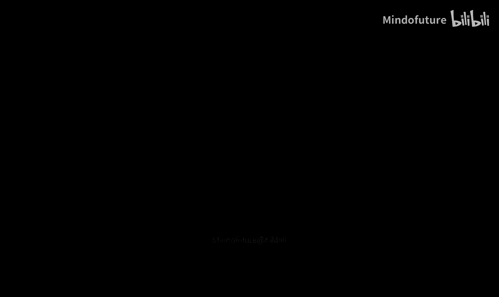
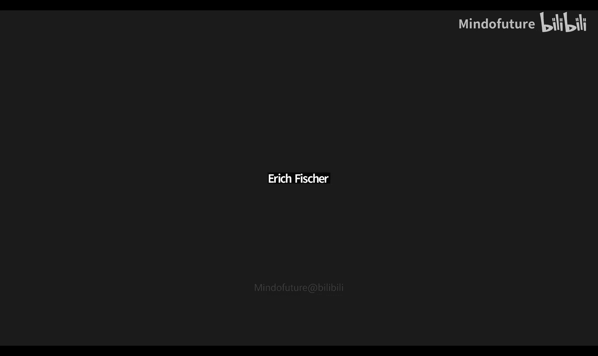
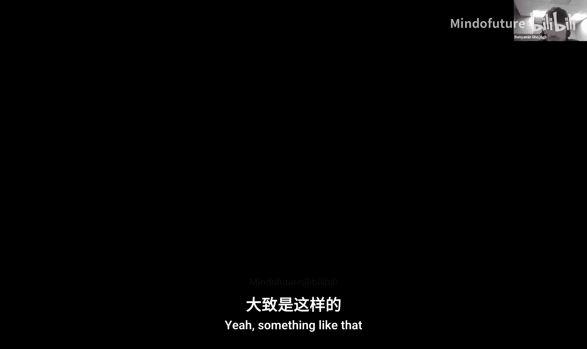
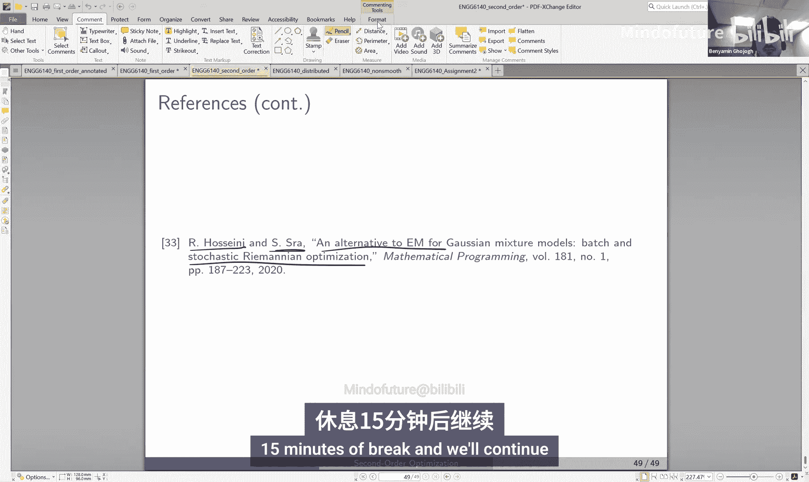
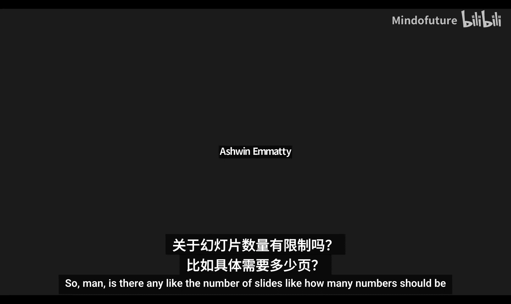
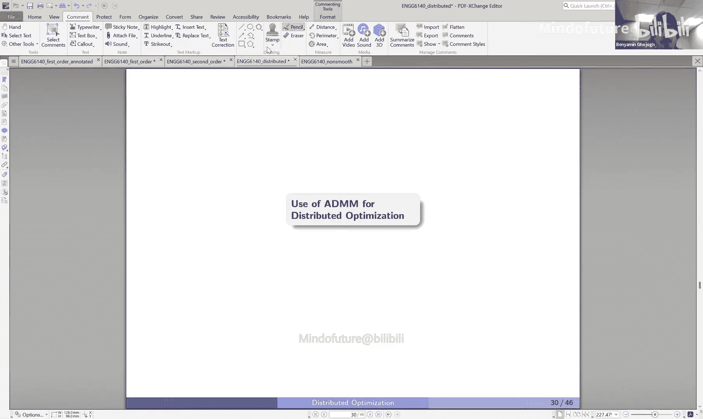
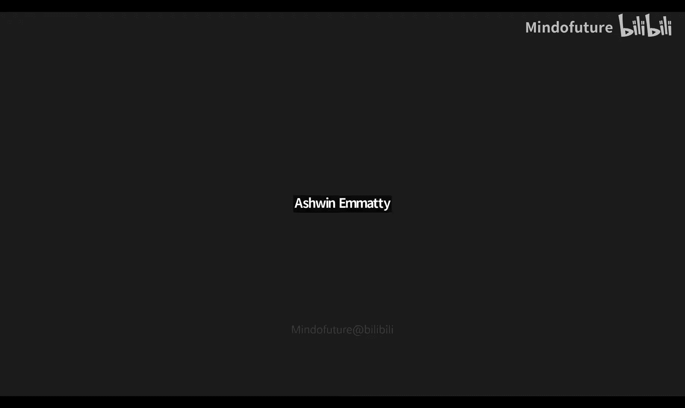

# 【滑铁卢大学】优化技术课程 ｜ Optimization Techniques   W2023 p09 P09_第九讲_(共轭梯度法、拟牛顿法与分布式优化) -BV1oJCHBcEo5_p9-

Hi， everyone。 let's start。So is there any question about。The assignment or the course。

Over the project。Yeah， I的。Question about the assignment question number two。So okay。

 let me bring that。Let me bring the assignment to give me。Yeah。I see me second。Okay。

 question number 2。So question number two， I'm struggling to find what the derivative of that mean standard error loss is。

Just the way it's written is very different like I've looked online。

 a lot of people have different methods， they plug in y equals a x plus B。

 and then they'll take a partial derivative with respect to the y intercept and with respect to X。

And I've tried a whole bunch of different like。Methods and I just I don't even know what direction you want us to go on this。

The那 I think。It is you you need to follow the approach as we have in the slides。

 So the thing is that you remember， so what is question2 the assignment it's， it says that let me。

B it。Yeah， I think I can。Sre。Okay， sure。Let me share that。Thing。Screr。Yeah。

Something like that。 Yeah， so this equation。Yeah， I think keep me a sick。😔，Okay。This equation。

 So this is one over n。Sammation， if I。Ex right， iPhone 1 to n。

This is what we had in the slides for I think it which was in the。Yeah， that's correct， yeah。Yeah。

 exactly。 Let me bring this。Where was that。嗯。Before this。Yes， here it is。Herear equation。31。

 So N here is 4。 we have4。We have four points and for each each of the points we have F。

 so we have F1， F2 F3 and F4 here and x is the optimization variable here， for example。

 if you assume it is an neural network with one layer x。also， so without any activation function。

 So you are saying that for the input data AI and its label L I， which you have provided here。

So we have this F for each of them。And now solves the three things full gradient descent。

 stochastic gradient descent and mini batch gradient descent for full gradient descent。

 you need to calculate the whole gradient how。Here we have it Oh sorry for the for the derivative of。

AI X minus L because it's the mean standard error。You have x and y in the equation。

 so you have two partial derivatives for take over why do you say partial derivative because the mean because it says mean like it's the mean standard error so you have input output and the output is with respect to y。

So you have to take the derivative with respect to x and the with respect y no no y is not a variable y you mean L here right L is not a variable。

 it's an input so both AI so we have pairs of AI LI。As data。

 these are not variables that you you should。 the only variable is X。So see， this is Fi of x。

 So the optimization variable is x。 And as you see here in this slide。You are minimizing over e。Yeah。

 I think if that's the approach then then that's fine the question's actually not that hard。

 it was just when I went online and tried to find similar questions。

Yeah they were just much more complex and use partial derivatives no I didn't make the assignment complicated it's so very easy I tried to make it easy so the only thing is that for full gradient decent you need to use this full gradient。

😊，For。A stochastic gradient descent， you need to use this to see that already in the slide。So F。

 and I have told you which I you should choose for the。Mini， no I I。

I had looked up like I know how to do the full gradient mini batch and stochastic I just couldn't get the original derivative because I didn't know the direction to go yeah okay that's also okay。

 but I think you I think you cleared it up okay great is there any other question。No， sorry。

Letd me close this。 Okay， so if there is no other question on the assignment。

Let me briefly Ben I have one out。 Yes， Okay for the coding part。 I it okay if we use Karas library。

It's better to use pieytor。 But if you wanna， let me think。

Do you know why I'm not happy with the k much because it's very high level。

 So you don't practice coding much。 It's just。AReady to use function。

That's why I want you toca I explained to you the code， right。I explained to you。

 Let me bring the code that we had。 Even we had it in the slides。Here。

Line by line I explained the code the reasoning behind everything so I the reason that I want you to code is that so you use this code。

 you modify a bit， but in this modification you learn what each line is doing。

AndThat that's a practice。 That's why I'm asking you to use pieytorch。Is that okay。嗯。要嘅。But actually。

 I have used CAs previously， so that's why I asked。Yeah， I understandent。 let me think。Okay。

That's fine。 If， if you think youre you're more comfortable with Keris， that's fine。Okay， sure。

 you can use Keis。 But if you want my opinion， I think if you do the pie toing， you will learn more。

 But if you wanna do Keis， that's fine。 And if T A， it doesn't give you great for that。

 let him know that I said that's okay。 So you can yeah claim you're great for that。 That's。 Yeah。

 Thank you。 No problem。So any other question？能。嗯。Okay， great。 So let me continue。Before we start。

 I want you to， because there was one part which I had deal。When I was explaining。

 I w to mention it very fast。 So that was correct。So here we were。

 I was having doubt for proximal mapping of L2 norm。 We are saying that。 Okay， now that we have this。

 So here。What is this， This is。For this part， this is x over L。Over。Second， normal exover。Hell。And。

Yeah， I think something like that。 But there， there is I I。

 I believe there must be a a square here because so when I， when I calculated， I got this。

 So when I this， this will be。This， when you have。Squared， you will have L squared， then。

In the numerator， then when you cancel it， you will have L over L2 normal x。 That's the reason。

 So that that was one doubt that I wanted to clear。Now。

Let's review very fast what we had for Newton's method。

 and then we will continue with the second order optimization。 So very fast。

 if I want to review that。 So we started with Norton Rfson root finding method。And then we said。

 okay， let's that rather than saying finding the root of F O V。

 let's find the root of gradient of F O Vx because of the first order optimal multiity condition。

 which was this。 And then we said， okay， then we derived the Newton's method for Uniivariate。

For univariate optimization algorithm and then onconstraint optimization。 And then here we said。

 okay， let's have it for the multivariate。By using the Hesian matrix inverse of Hesian matrix。

 then we said， okay， we justified it and said we said that the update。

The Netonance method can be written either as equation 7 or as equation 8。

 then we went to Neton method for equality constraints。

 we said okay what if we have equality constraints for that。

 we said okay let's consider the next step in the optimization and then we formed the laggrangian then second order tailor approximation。

 the laggrangian again we put it there， we worked it through using the KKT conditions and then recall the KKT conditions that we discussed and then we came off with this so it's a linear system system of linear equations。

So using that， we can find P P， which which is deelta x in the update of Neton's method。

 so we can handle equality constraints in Neton's method and then。

We said also it can handle starting with non feasible initial point and if the optimization is the convex optimization problem。

 we know that after the first step iteration， all of the iterations will be feasible so we can handle nonfe points in the nottons method as well。

Then we said okay， let's consider the general case。

 so let's add inequality constraints to if we want to do that， then that would be the general case。

 which is mostly used in many optimization toolboxes such as CVX and that's called interior point method also called barrier methods。

Also called unconstraint minimization technique or sequential unconstraint minimization technique and then we said the technique was having the inequality constraints as an indicator function which is a regularization term for the objective function and then this becomes an quality constrain optimization problem which we discussed in previous slides how to solve it。

 so we know how to solve this and but we said that okay this indicator function which blow up to infinity when it constrain condition is not satisfied we cannot implement it in computer therefore we need to approximate it so used we approximate it with a logarithm function and that's why we have a logarithmic barrier or log barrier。

We have other approximations too and those are different so we have several barrier functions。

 one of them is log barrier and why is it called barrier because from the point which the constraint is not satisfied the inequality constraint it works like a barrier。

 it doesn't let thiscode， it's like a barrier。😊，That's why the interior point method is also called barrier method。

And。We talked about this and we said that okay， its accuracy is good enough。

 its minimum value is sandwiched between the actual minimum value and actual minimum value minus something。

 so the minimum cost function that it finds is better than the minimum actual minimum cost function。

 although we usually want x star if star might not be necessarily the case what we want。

 but that's fine。So it it's good enough Inter point method， then log barrier。

 specifically this is for log barrier， Lag barrier works well。Then now we start here。

 we continue the second order。Messses， any questions so far， no。Okay。

 we continue with the second order methods by line searching noteton this method。

 So we talked about line search in first order methods Now let's talk about line searching。

In a second order method here we say， okay we introduced wallfa conditions if you remember when we were introducing line search and backtrack in line search also called Arial line search we said there is also wfa line search or wfa conditions but we usually use that for second order methods and we will study that here it is so line search for second order optimization usually uses checks two conditions and these conditions are called wfa conditions Walfa was a scientist in optimization。

So and we want we use voltage condition to find the step size， of course。

 line searches for finding the step size for the learning rate， right？And at iteration K。

 we call the step size Eta K。So， now。We say， okay， do you remember this， this is the。

Updates for deelta x at iterationeration K recall this equation。Equation 7 or E 8。

 so equation 7 delta x would also denoted by P。 so minus hesian inverse times gradient here we are repeating it here。

Okay， now the welfare conditions are equations 25 and 26。😊，Yeah， so， by the way。

These are gradient of F。 So PK transpos gradient of F and P K transpos gradient of F。

 So here these are two。 you can see that it's， it's very similar to what we had in Aro line line search。

 So that's why the first condition is the Aro condition。

And the second condition is called the carvature condition and what are they， by the way。

 C1 and C2 are two scalars between0 and 1， not including0 and1。

 and C1 should be very small and C2 should be close to1 according to Ref 12 and I think reference 12 is Nocel's book because Noceella andrights book discusses welfare conditionsd and Quaineerton's method very well。

So first condition is called the Arial condition because we had it also in Aro line search or backtracking line search。

 if you remember in first order methods， the second one is introduced here as a second condition in the wall condition and that's the curvature condition。

It ensures that the step size decreases the function slope sufficiently。By the way。

 the first condition， which is the arm condition， which ensures that the step size decreases the function values sufficiently。

And。The curvature condition makes sure that the approximation， this is important。

 the approximation of Hassian remains positive definitely。

So how do we know that because if we choose the learning rate randomly。

 how do we know that the hessian matrix， the approximation of hessian matrix that we use in quasi method that we'll see in a few slides。

 how do we know that it remains positive definite because we know hessian matrix is positive definite。

 what do I mean by positive definite， I mean is eigenvalues are positive？

So our approximation of hisemmetics， which we'll introduce in quasi Neuttons method in a few slides should also remain positive definite and this curvature condition makes sure that it is the case。

And Aria condition gives an upper bound for Eta。This is determined by our condition and the curvature condition gives the lower bound for Eta。

 so they sandwich Eta， so they give a range for Eta an acceptable range for Eta。

Okay now I have repeated the w conditions again here just to say that there is also a strong curvature condition。

 so this is the weak curvature condition， but if you want to be more restrictive in the w conditions for line search we can use the strong curvature condition which is harder do you remember for example our meal line search was harder or more strict than the simple line search also here we have strong curvature condition which is harder than the weak curvature condition mentioned in equation 28。

And also the wallful conditions can be used also for line searching first order methods。

 they are not just for the second order methods， but theyre usually used for Newton's method for second order methods。

Okay， so now we know how to find the learning rate in the。In the second ordnaances how we start with。

 for example， EO1 and we haveal it until we satisfy both of these equations。

Or if we want to be more restrictive to satisfy E 27 and 29。

So as long as the EO becomes small enough to satisfy these equations， that's done。

 we can choose that。😊，Please feel free to ask me if there is any question。嗯。

Fast solving of equations in the Newtons method。 Do remember in previous session。

 I also said that this。In the interior point method and Nton's method， when we have these。

 we can make it fast because for large dimensionality or large number of constraints these matrices become large and solvent equation 16 might be time consuming but in the optimization toolboxes they usually use some techniques such as chaki decomposition and these things in order to accelerate that I said that in the previous session and I said Boyd also discusses that in his optimization1 course so here we are going briefly mention that。

え。Okay， here。 So there are ways to fast for fast solving system of equations in ne method。

 We are reviewing them。 So by the way， in unconstrained ne method， we saw that this is the。Odate。

 do you remember equation 8 or E 7， let me bring it so you see recall it。

 so we said either equation7 or E8， they can be the update for the delta X is the update for the uncons now to this method。

Also。This is for unconstraint for constraint， we also saw in equation 14 that we need to solve this system of equations here。

 let me bring it。Here we saw that or if it is invisible point， we need to do equation 16。

 so it's a system of equations， linear equations actually。And the。

So either it's and also when we have inequality constraints。

 we convert it to equality constraints using the indicator function or the barrier function。

 and then we use the equation 14 or 16 again， so either it is no matter whether it's unconstraint or constraint with equality contrain or inequality constraint。

 we always have a linear system of equations。Right。

 so we we can write this linear system of equation。😊，AndAs this。

So Z here is standing for p and nu p is the delta x and nu is the dual variable here we all only have delta x so Z here represents delta x so either in here Z represents P and nu concatenation of them here it represents a delta x and M here this is M。

This is the coefficient of the Z Also here， this is N Q。 This is Q here。Sorry， this is Q here here。

 Also Q is this minus gradient of f。 So we always have something like this now and our up what we want to find is Z right here we want to find Delta x。

 here。 we want to find Delta x or P。And new。So we want to find Z。

From this linear equation and by the way， M is a matrix that is a vector。

 Q is a vector right Now let's how to solve this system of equation M that equals Q。

 how to find z fast。Note that when then dimensional so the dimensionality of P here is d is the dimensionality of d right when the x is in D dimension the D dimensional vector。

 then delta x or P is also a d dimensional vector。What about no？The dimension of no is the number of。

TheCons， equality constraints， assume I don't know， you can call it Q， whatever。So when， for example。

 here。Here。😡，Here。Or here。Or here。assume。A。E。😊，Q by D。Yes， I think I'm right。

 So then it means that you have Q number of equality constraintss。 So B also。B。It also is。

A Q dimensional vector。And x is a d dimensional vector right so if the number of constraints is  Q。

 then the dimensionality of nu is  Q， so here that total dimensionality of z is d plus Q here。

 that dimensionality of z is just d it means that z is either d dimensional or d plus q dimensional right？

And what does it mean， it means that when the dimensionality of data increases。

 if we have a huge number of dimensions in the data or if we have a huge number of constraints。

 equality constraints or both then these we have a lot of these matrices here in these linear system of equation they become very large and solving this will be difficult。

 therefore we need to make it fast for huge dimensionality and huge number of constraints because in industry。

😊，We usually have a lot of constraints。Assume you are solving， Youre optimizing the aerodynamic of。

I don't know。 airplane。You know， you have a lot of concerns， a lot of constraints。😊。

You have to make it fast， how？历史。Okay。We can use several techniques。

 one of them is decomposition methods and decomposition methods also we have several decompositions methods。

 one of them is L decomposition。😊，So L decomposition。

 so what does decomposition mean it means that when we have a matrix。

 we can decompose it into the multiplication of several matrices。😊。

So we have many decomposition algorithms， some of which are these。😊，For example， one of them。

 you were introduced to that singular value decomposition in several sessions ago I talked about it。

 one of them was eigenvalue decomposition。Which I said the singular value decomposition and eigenvalue decomposition are related to each other。

 One of them is L decomposition introduced here。 So soon you have a。So in the M Z equals。Q。

 the coefficient matrix M here where for L decomposition。

 let's have the Llu decomposition of the matrix M。😊，And L decomposition is this P L U。

 So you decompose M into P times L times U and L is a lower triular triang or matrix。

 It means that it's like this， So it's0 here。And not zero elements here。

 U is upper triangular means that this is like this zero here。And P is a permutation matrix。

 it means that it has one in each column and in each row it has only one。😊，And others are zero。So it。

😊，And these P permututes the columns and rows of L here。 So here if we decompose it into PL。

 there are some algorithms for this decomposition you can say that okay。

 I put this replace M with PL， then I can say use that I can take it as W2。I can take L W2。

 which is LU Z as W1， I define it， and then I solve this linear。😊。

A system of equation in this order in in these steps， I first do the l decomposition of M。

 and then I do the permutation， So I calculate Pw1 because here we have P times w1 equals Q。

So I solved this to find W1。Then after that， so when I have W1。I solve this Lw2 equals W1。

To find the W2， then when I when I find the W2， I put it here， so I solve this to find set。

I wanted that， Do you remember that was either Delta x or Delta x I knew。So you might say。

 why is it faster than solving this？Because it has in each of these steps。

 we either are working with lower triangular matrix or upper triangular error matrix or a permutation matrix which is very sparse。

 so it's very fast to solve this。ok。Another thing， by the way。

 if you see the modern optimization toolboxes such as CiX developed by Stanford and Boyd。

They always are using these decomposition methods in their codes if you dig into their codes for the they are usually using Inter point algorithm and in that they are using these decompositions you might see Cholkski decomposition specifically in their toolboxes so here we are talking about Choski decomposition so。

Now by the way， chake decomposition is only valid for positive definite matrices。😊。

But we know that M is a positive definite y y is M positive definite， for example， here。

 because one of do you remember Ms that equals Q， one of them was for this。

When we have for example unconstrained optimization and we know that M here was the hesian and we know hesian by definition is a positive definite matrix therefore I want you to be sure that M is positive definite here for example is equal to Hessian so we can it's valid to decompposition it by Csky decomposition and then what is chaki decomposition it decomoses into LL transpose where L is a lower triang or matrix。

😊，And that's interesting。 So let's replace n with LL transpose and let's take L transpose Z as w1。😊。

And M Z equals  Q is the equation。 So let's define w1 as transpose Z and let's do it in this order。

 first， do the choiceski de compositionposition of M and then。Solve Lw1 equals Q to find W1。

 I find W1 and then I put W1 into this equation to get Z and these steps are fast because they are working with lower triangular matrices if assume M is a dense matrix。

 a dense positive definite matrix， it's very hard to solve this very time consuming to solve this equation especially when we have a huge M but it's faster to do it here。

Any question？No。Okay。Short decomposition。 Short， by the way， Can you hear me properly。

Yeah can you hear， yeah， great。 Okay， great。 Thank you。 So you sure short。

 the complement is also very mostly used in optimization toolboxes。 And what is that。

 So when we have M Z equals Q。 Now， let M be block matrix。

 So we have it can be assume that the matrix M you divided it into several blocks and 11 M1，2 M21 M2。

2。 And each of these is a block。 So you have sub matrixrices in inside this matrix。

 And you also can divide Z to Z concatenation of Z 1 and Z 2 and also Q to concatenation of Q1 and Q2。

😊，Okay， let's do this so when we multiply this matrix into this vector we'll have these two M11 times Z1 plus m12 times z2 equals  Q1 also M21 times Z1 plus m22 times Z2 equals  Q2 so if we rearrange this so we bring this to the right hand side and we the left multiply the sides by M11 inverse well get this。

Now， let's substitute this Z1 into。Into this equation， to get this。

So m21 times d plus m22 z2 equals Q2。 and then what we are we doing here， Okay， let's factor out Z 2。

And also bring the the term which doesn't have z2 to the right hand side。 so we'll have this。Okay。

 this term。😊，Forget about this， this term。Which is multiplied in by Z2 is the shore complement of the block matrix M11 in matrix M。

 So this was the block matrix M11。 This is called the shore complement of M11， okay。

And sure was also a scientist， so we assume that the blackmatics N11 is not singular because why because we have n11 inverse so we assume it's not singular and so so we its inverse exists so we can take otherwise it will throw erroring when you are coding that so。

Then we can solve in disorder。Calculate， so I'm， I w to calculate a short compliment。

 So calculate M1，1 inverse and 1，2 here。And then。Also， M1，1 ins。Q， why， Because we have it here。

So we calculate these two terms， then calculate m tilde。 So what is this m2，2， m2。

1 and11 inverse and so this is。This is the short complement。

 so we call it denoted by m Tilda to calculate this。

 but these parenthesesis you already calculated in the step  one。😊，Here also calculate Q tilde。

 which is the right hand side of this equation， and in parentheesis we already solved it in step one。

Then so we have the left hand side。😊，Except the Z 2。 And the you also have the right hand side。

 So now you have this solve this in order to find Z 2。 Now， let's put it。Here， back to this equation。

Or this equation。Right。But if you bring this to the right hand side。

 you will get this in order to find that one。If you do this。

 you will see it's much faster than solving Mz equals Q why because you're using the characteristic that M is a block matrix。

And you are using the short complement of this M11 and that's interest。Okay。

Now it's over the decomposition methods are over， so that one way to solve the netons method fast was this。

Another technique is conjugate gradients method。 You hear it a lot in optimization。

I'm introducing it here， so can't you get gradient method？It was proposed in 1952。

it creatively solves equation 30 which was MZ equals Q faster。

 so conjugate gradient method is for accelerating it's just a technique for accelerating acceleration in solving a linear system of equations it might not be necessarily used for optimization but you can use it in other cases too but here we can use it why because we have a linear system of equations MZ equals Q so it makes it faster and then the regular solution spacing shows off better when the matrices are very large especially a good book on conjugate gradient is chapter 2 of the book Ref 17 you can look it up。

And also truncated notons methods。 There are some methods named truncated netons method。

 They also approximate the heian for large scale optimization。

 They usually use conjugate gradient as their approximation methods for calculating the search direction。

 So it is widely used in different algorithms in optimization， such as truncated notons methods。

 Okay。But I'm not going to introduce these methods in this course， you can look it up later。

 so the solution to E 30 which 30， which is Mz equals  Q should satisfy this do you agree when we have Mz equals  Q so left multiply the sides by m the inverse you will get this。

And the conjugate gradient method， what does it do， it approximates this solution。😊。

So it's an approximation method， okay？But its approximation is accurate， almost it's good enough。

According to the first order optimal condition， we know that we as we learned in high school or college。

 the gradient at the extreme should be 0， right at the minimum here should be0。 And so this solution。

The solution to equation 30， which is Mz equals  Q， minimizes these functions。 Y。

 so we know that the gradient should be 0， therefore Mz。us Q， we know that。I'm rearranging。Sorry。

I'm rearranging M Z equals Q to become M Z minus Q equals 0。 and then I'm writing it here。

 and I'm saying， okay， here I want M Z minus Q to be 0。 Also。

 I know that the gradient of F of Z star should be 0 because of first or order optimality condition。

 Therefore， my gradient。Gient of effort that should be equal to M Z minus Q， therefore。

I'm doing the integral inverse of derivative。 My F set must be。

1 over2 z transpose Mz minus Z transpose Q there might be a constant to but I don't care。

 so when you take the derivative of this you will get this。Right。😊，So now I have this F set， this。

Okay， now be patient and you will see how it's done。

Can you good gradient iteratively solves Ms that it is an iterative algorithm？

So it intuitiveatively solves M that equals  Q as this。

So you can see that it reminds you of the gradient decent algorithm， it's very similar to that。

 by the way， it's gradient accent， do you know why？😊，It has plus not minus， okay？

And it's very similar to the。Optimization itself。 So it has an optimization in itself。 A。

 now it starts by moving toward the minus gradient as the gradient de does， why。Give me a second。

 You will see。 So then it uses this conjugate， the conjugate of gradient。

 This is the reason that for the name of this method。 Okay， we will see at iteration K。

 the residual or error for fullfiling equation 30， which is M Z equals Q is this。 So what is this。

We say that we want Mz minus Q to be 0， right here。I wrote it here。

 You can also write it Q minus M Z to be 0， right， So you want this to be 0。

 but as it is approximating that and it's doing it iteratively until convergence。

 it's not exactly0 at because of approximation also as because it is iterative algorithm， therefore。

You have some residual or error。And this residual is  Q minus Mz。Ideally。

 this residual or error should be0 and this residual according to the equation 31 these。He's。

Minus gradient of F of it。And if you see， okay， now I want to find the difference of residuals in between two iterations。

 K plus 1 and k， let's see。RK plus 1， according to this definition。Is Q minus Mz K plus1。

Here we also have。According to this。I have this。 So R K is  Q minus M Z K， but we have minus here。

 Therefore it's minus Q plus M Z K。 Okay， these two Q Qs terms cancel each other and。

 I'm also putting substituting。Equation 32 for Z K plus 1。

 and then every these terms become based in terms of Z K and also these two cancel each other。

 so we'll have this。So the difference of residual is this between two iterations Okay。

 now the initial direction initially direction is this residual so the direction for the here。😊。

Because it needs tom I'm finding de this PK in the conjugate gradient algorithm。

 so initially it uses this minus gradient。😊，And when I said， it's great and accentcent。

 I made a mistake， it's great and decent， why？Because this plus it also has minus here。

 So it's minus Eta gradient of f。 so it's gradient decent。 sorry about my mistake there。

 and if you see that if you replace this here， it becomes Z K plus1。

 equals Z K minus Eta gradient of F Z。 What is it It's exactly gradient decent。

 So it's in its initial step， It is。Gradian descent。

 so it is using gradient descent in its initial step。The but later， it uses another。It uses another。

Equation， which I'm going to explain for other iterations for initially it uses gradient decent。

 but in the next iterations， it uses another equation。Okay。

 also it finds Eta by it it w to find the the best learning rate for。

For its update hereing equation 32 for doing that， it takes derivative of F set K plus one with respect to Eta K。

 So it it it wants to find the best Eta for doing that。

 it takes the derivative and set it to 0 as we do it in high school right according to the first order optimality condition。

 And if you do that， Eta K becomes this。 And according to equation 33。

Because the residual was a Q minus M Z K， so。You can replace these with RK。This is the equation。

Sorry about that。Yeah。This is a。Equation you for the。For the layering grade and conjugate gradient。

 okay。Again， don't confuse this with the optimization itself。

 optimization has its own learning rate found by Wolfer condition。

There is another optimization for a conjugate gradient。

 and conjugate gradient is used for accelerating the Newton's method。

 So the acceleration method for Nuton's method is using optimization in itself again。

And Eta is found by this in its initial step， it's using gradient descent and it's in its next steps it's using equation 34 I'm not bringing the proofs here because it makes the course very complicated but I'm introducing them to you so you know what these are so PK plus1 is the linear combination of RK plus1。

😊，And PK so again you can see it is logging it is logging the history of PK again reminds you of the idea of momentum As I said to you usually the ideas and optimization are shared between the algorithms here you can also see this so it's using the log of previous step update P also。

 but it's using the residual when the residual becomes zero， then you don't have any update。Why。

 because beta is defined as this as R K plus。 So this is。This is just R K。Plus one。

This is the en numerator。R transpose R is squared L2or and the denominator。It's R。Squadel2 norm。

 right？So when r becomes zero， then。This， this becomes zero， this also becomes zero。

 then update is zero， so it means that you found you have the residue has become zero。

 the approximation is exact， the approximation of M M that equals  Q。Is exact。

And you don't need to update anymore， so you have found the good set here。

 you have found the best set。Okay。So it's using solving for Z iteratively。

 this is conjugate graded method and this is the algorithm you can see here。😊。

This is the algorithm of conjugate gradient， which is called inside the Newton Smith for solving Mz equals  Q so we have Mz equals  Q as the input of this algorithm and initially we use the minus gradient。

In its initial step， it's just gradient descent。And then in the next iteration。

 so EO is also we found it by taking derivative and setting to zero。And we also have here。

 this is the step of the iteration in the conjugate gradient this is the residue which we calculate if the residue is small enough it means that the approximation is good enough then break the loop。

 don't continue otherwise you calculate this better and you solve this p for this Delta p is delta x right Delta x or here is Dlta delta Z because the variable here is called Z。

Delta it。Do you remember here here。I'm talking about this P is delta Z here。😊。

You are solving for Z iteratively for approximating Z， approximating Z。

 but in a good way and a fast way in a fast way。Okay， by the way。

 you don't as I said also in the my announcement， I understand that this might seem hard。

 but there is no exam on this。 So with peace of mind try to understand what I'm saying because these are important concepts in optimization。

 I want you to be introduced to these algorithms， but there is no exam on this so you don't need to worry about。

Okay。There is a relation of conjugate gradient method。To Cre of。Subspace， just one slide。

 if you don't understand this is slide that' fine it's optional， it's a bit related to pure math。

 but I just want you to know that there is a relation between cre of subspace and conjugate created method。

 and what is that Okay， when2， non0 vectors x and y are conjugate。 Okay， I'm defining conjugate。

 if x transpose M equals0 for the for an M which is positive definite matrix， okay。

If we have this relation， x transpose m equals 0， then x and y are conjugate。

And that's why this is the reasoning behind the naming of the conjugate gradient method because here we also mentioned are it is using the conjugative gradient。

 it is using the conjugative gradient that's why it's called conjugate gradient method。

 according to this definition。Okay， now we also we know that the order R C of subspace denoted by Kr is a spanned by the following basis。

 What what do I mean by a span span means that these are the basis vectors for this space。

 So a linear combination of these vectors make this space and it's denoted by this。

The solution to equation 30 m that equals  Q should satisfy this， do remember that why。

 because if you left multiply this equation by m inverse， you will get this。

You will get this and compare this with this with these basis。 You will see that。

 So there is a relation。😊，Between Cre of subspace and the conjugate gradient。

 the solution to the equation 30， which is used Newton's method lies in the Cre of subspace and the conjugate gradient method approximates this solution。

 it is approximating this solution lying in the Cre of subspace and every trace of conjugate gradient can be seen as a projection unto this Cre of subspace we already talked about projection。

😊，Again， if you didn't understand this to， that's fine， it's just optional， okay。😊，Now。

Non nonlinear conjugate gradient method。Yeah。O。So as we saw conjugate gradient。

 so we talked about linear conjugate gradient method now this is nonlinear conjugate gradient。

 let's see conjugate gradient is for solving linear equations such as the equation 30。

 which was MZ equals  Q。But we have nonlinear conjugate gradient N CG。

 which are very important and famous and well known in optimization。

 What do they do They generalize conjugate gradient to nonlinear functions。

And recall this equation 30 M Z equals  Q， so left multiply this equation by m transpose。

 you will have m transpose M Z equals m transpose Q。Then rearrange this。

 bring this to the left hand side。 You will get this。 Okay2 and transport Mz minus Q equals 0。

 The goal of N G is to find the minimum of this quadratic function。Yeah。

So what we were doing in a linear conjugate gradient method， we said， okay， let's find this solution。

 the solution to this linear equation system of equation using iterative optimization， right？

And it's a linear method。 however， non nonlinear conjugate gradient method has another approach。

 It says you want this M set to be Q。😊，Similar to what we had in linear conjugate gradientding method。

 I rearrange it to say Mz minus  Q becomes 0 however。

The linear conjugate gradientding method called this residue， right？

I don't and it tried to find iteratively solved for Z to minimize the residue。 however I say okay。

 I minimize the residue in this way I minimize its squared L2 norm， so this is residue， right？

But as you see， this is a quadratic function， it's not linear anymore。

 that's why it's called nonlinear times you get gradient。😊，Okay。

So it's a quadratic and it's using its gradient。😊，The gradient of this function。

 What is the gradient of this function interestingly。If you take derivative of this becomes this。

 you cite here。😡，哦。Very interesting， right。So the NCG method is very similar to the conjugate gradient method。

 linear conjugate gradient method， but it uses steepest descent for updating this solution you will see the I think yes。

 here we will see the algorithm of NCG， but let me introduce it here first。

 so it uses the steepest descent。😊，We already talked about is in first order message for finding the Eta。

😊，诶 and。For its a layer grade， do you remember Eta is the layer rate for updating z， however。

 linear conjugate gradient method was using this equation for finding Eta。

I'm talking about is their differences non nonlinear conjugate gradient method uses stistic for finding Eta also it is using this equation the same as we had in the linear conjugate gradient method。

 so are in this case they are the same。But its finding beta in other ways。

 So it we have several algorithms for finding beta。

 One of them is this R K plus one transpose R plus1 R transpose RK。 So we can write it in this way。

 too。 we cite it for linear conjug gradient method。

 So this is also used in linear conjug gradient method。 recall here。

But we can have other methods for finding beta2 and you can use any of these and they become zero when the residue becomes zero so one of them is the beta one is called Fletcher Reves proposing 1964 the Beta2 is called Pollock Rebier in proposing 1969 the third one is Heten's Stefa in proposing 1952 and the fourth one is die1 proposing 1999 again these have proofs but is out of a scope of this course。

So we have these betas when we can use them in our landing conju grading method。And by the way。

 beta 1 was using linear conjugate grading method in all of these formulas beta gets smaller if the residual of the next iteration gets much smaller than the previous residuals so when。

When residue of RK plus 1 becomes much as smaller than residue of RK， it's good。

 so beta we need we can stop the optimization of the conjugate gradient method and beta becomes very small。

Comes very close to 0。Okay。😊，Now this is the algorithm of NCG， so we initialize it but again。

 similar to linear conjugate gradient in the first iteration we do it by gradient distancecent。

AndBut in the next situations， then we find P as a linear combination of the previous P and the residual and the Eta here here is found by stest decent and that is updated by this we also had this in the linear conjugate gradient method。

Again， done， nothing very complicated。Any questions so far？No， okay， by the way， this part， I agree。

 is's a bit theoretical， but we are， I think the。From now on， it becomes more interesting。

Quas Nes method， let me briefly mention that and then we'll go to distributed algorithms。

 distributed optimization， I think that is very fun。We'll see that okay， so qua the neton's method。

 what is that？😊，Do you remember in the。In。By the way。

 up to here we were discussing how to solve Neton's method linear system of equation fast。

 which was MZ equals Q now we are changing gear to causing Neton's method and we'll see what it is。

Here in Hasitian。So in Newton's method， we have Hassian， right inverse of Hassian。 Where was that。

 Let me bring it。And。Here， for example， we have inverse of Hassian。Right。

 but if youly left multiply the size by Hassian， then you have this， you can rewrite it in this way。

 it doesn't matter。 So we have hessian or inverse of Hessian。

 but multiple calculation of hessian is heart。Is usually hard and time consuming why because for hesian calculation of hessian you need to take derivative twice。

 but for gradient you need to take derivative once this might be the reason that many machine learning algorithms are using first order optimization you might be wondering why back propagation is only using first order optimization and not second order optimization why although we know that second order optimization is faster much faster than first order optimization so there are some advantages and some disadvantages for first order and second order optimization that's important please listen to it carefully so first order optimization is advantage is that is fast because you need to only calculate gradient you don't need to calculate second order derivative。

😊，However。It's slow。 Do you remember。Especially the previous century， they said， oh， it's very slow。

 how can we it accelerate it and someone named Enesster of proposed accelerated gradient method in order to accelerate that because first order methods are usually slow to converge。

😊，However， on the other hand。We have gradient this second order optimization。

 Second order optimization is usually fast。 It's convert if you see look at their convergnce rate。

 theyre faster， they're much faster than first order optimization， however。😊。

they have a big disadvantage and that's calculating the hessian or the second order derivative。

 It is very hard is why because you need to take derivative twice， also。

 also gradient when your variable is a vector， gradient becomes a vector。

 but second order derivative which is hessian becomes a matrix。

 calculation of matrix is much harder than calculation of vector right if your variable is a matrix。

 the gradient becomes matrix， but the hessian becomes a tensor so。😊。

Usually by one order of dimensionalities is it's harder to calculate。 So it's if it's a vector。

 you need to calculate matrix。 if it's a matrix， you need to calculate tensor。So it's time consuming。

 also its resource consuming to calculate hesian， so this is a disadvantage。

 maybe this is my conjecture that that's the reason that second order optimization is not used much in machine learning algorithms and mean many maybe in industry because it's hard for them to calculate hessian。

Yeah。Okay。So that's one thing。 and now Po Newton's method says， okay。

 I understand you're tired of calculating Hastian。😊，Or inverse of Hessian。

 Let me approximate it for you。 Let me approximate it for you so you don't it it's not very so it it's not very hard and tiring for you to calculate the hessian or inverse of Hessian。

 although it's an approximation， it's not exactly accurate， but it's good enough。 good enough。 Okay。

 let's do that。So similar to what we did in equation6， do you remember in equation6？

Here in question6， we did the second order Tayloror approximation for F of V and we for justification of the netons method。

😊，Oncon nu method， do you remember that in previous session we did that similar to that？

Similar to that， we can approximate the function at the updated solution by its second order tailor service。

 so for FO。😊，X K plus1， updated。So it's f of Xk plus Pk because this is Xk plus the update becomes xk plus one。

 right， so we can have the second order tailor approximation by these。

And where piece deelta is the update。Here。えB。BK is the Hessian。

 so you might be surprised that usually in the literature of second Netons method and second order optimization in the literature of optimization。

 they denote Hessian by B not by H。But they denote inverse of Hassian。Be inverse by edge。

At the first time that I saw that I said why do they do that。

 still I don't know the reasoning behind that， to me it's confusing。

 but they use E to denote Hassian inverse， not Hassian。

They denote Hessian by B in pure optimization papers。

 maybe in some optimization papers which are not pure optimization， they denote Hessian by H。

Like in machine learning papers， I don't know， but in pure。

 if you look at the literature of optimization， you will see that Hessson is denoted by B usually and Hes inverse by H。

Okay， that's one thing which which you should note Bk is the hessian at the iteration K。Okay。

 so we can write gradient of f taking derivative from this equation from this equation I'm I take derivative derivative with respect to P。

 so this term becomes great so this term is a constant it goes away。😊，Constant with respect to P。

 this is linear with respect to P。 so it becomes gradient into f of xk this。

becomes this is quadratic with respect to PK， so it becomes Bk， PK and2 is canceled by1 over two。So。

 we have this。This is called the second second equation。In the literature， this is okay。

 setting this derivative， set this derivative to0 for the sake of first order optimal multi condition as we had in high school。

 Okay， so setting this derivative to0 for optimization gives this so we rearrange this。

 we bring this to the other side other side and we'll have this we can lift multiply the sides by B inverse or Hessian inverse。

😊，And will have this where E denotes the Hessian inverse。Okay。And where did you see that？😊。

We saw that in the initial slide of Newton's method。Equations7。

This the delta x is p P equals minus S n inverse gradient of f。I'm rep it to you。

But with a new notation。Okay。Now， note that， yeah， I've said that already。 Now we found this。

Considering the step size P， we can write the step S。

 so I call that here I say that P doesn't have Eta in it。

 usually up to here I called P equals delta x， but now I'm separating them in this section。

 I'm saying that delta x let it be denoted by Sk and Sk equals Eta。😊，PK。

 so Pk let would not have Eie in it， okay。So S or delta equals xk plus1 minus xk which is minus Eta h gradient of F。

 this is the update in in the neron method okay now computation of this hessian matrix is very usually expensive one way to approximate that at every tra is conjugate gradient method which we already discussed in previous slides and another approach for approximating this solution is quasi neron methods。

😊，Which approximates the inverse hisian matrix or the hissian matrix。

 why because you can either use here。😊，Recalllled here again， if you are using this equation。

 you need inverse of Hassian， if you are using this equation， you need Hassian。

So you need either the approximation of inverse of hessian or hessian。Okay。嗯。So， we have this。

what is the approximate the hessian based on the step pK the difference。

 so this is let the difference between the gradient of f at iteration k plus 1 and the gradient of f at the previous iteration be denoted by yk it's a D dimensional vector okay。

😊，So what do the quasients method do， they are approximating the hessian or the inverse of Hasian using these variables。

 using PK， which is the update using the YK， so using this， using this YK。

 the difference of the gradients， and using the previous approximated hessian or inverse of Hasian。

 again， the log of history。😊，The of so they are using the log of history。😊。

The difference of the gradients and the P， which is the update， okay。😊，Let's see。

Some papers approximate the hessten by a diagonal matrix。ok。For example。

 you can look at these papers in this solution， what do they do the inverse of approximated Haian is simply the inverse of is diagonal matrix y this is the reason when you have a diagonal。

Matrix。It's in there。Let it be。 Just give me a second。They'd be ABC。And these are zero。Is inverse。

Is this。A inverse， B， inverse， C inverse。It's a lemma。 you can see， look at that。

When we have a diagonal matrix its inverse is the inverse of itsagon diagonal elements。

 so if you assume that hessian if you relax the hessian matrix to be diagonal then it makes it easy for you。

 although it's not accurate but its calculation becomes much easier because its inverse is just the inverse of diagonal so they can some pair do that some methods use a dense approximation for the hessian matrix not a diagonal matrix anymore。

 some examples are BFGS algorithm or broaden Fletcher gl farb channel。😊，BFGS。

 this is the most famous quasiotton method it was proposed in 1987 and 1996 around those time。

 and these are the scientists who proposed that。Also there is limited memory BfGS。

 this is also very famous， so these two are very famous quasi Attons methods proposing 1980 to 1989 at that time。

 it's a simplified version of BfGS which utilizes less memory because at that time it was the computers were coming gradually and but they were not very powerful。

 so the memory was important at that time so they were trying to design or modify BFGs in a way that it uses memory less okay。

😊，And some other quasi entrance methods are like this， David Don Fletcher Powell or DFP in 1987。

 1991， Broant methodod in 1965 andsymmetric rankank or SR1 in 1991， so you can look up their papers。

In the following we're reviewing this and more explanation on these methods can be found in the chapter 6 of Noael's book。

 as I said， Nossel and Wright's book， especially in chapter6。

 they talk about causing nuance method a lot。Okay。So here we define these two。

 So let ro K be a scalar defined as one over y transpose as what was y。Here。

 why was the difference of gradients and what was s was delta x minus Eta p minus Eta hass n inverse gradient？

So one over their inner product let it be row k at iteration K。And also， I define， sorry。

I define this。Mattrix VK， which is a D by D matrix。And let it be。The identity matrix。

 this is identity matrix minus row。😊，Y K， again， y is the difference of gradients and S K transpose。

 S K is the update。 S is the update。 and these are vectors。 So vector times vector transpose， it。

 it is a matrix。 This is also identity the matrix。 This is a D dive by D。Matrix。

 you can write it in this way to by substituting this row into this equation。 you will have this。

 Okay， so I'm defining， I'm defining these two。 And again， without proof here。

 because out of a scope of this， of course， you can look up there the proofs online。

We have several algorithms， BfgS says that。😊，I approximate B。In this way。

And so this is approximation for the hessian and this is the approximation for the inverse inverse of Hessian。

 so either you want to use Hassian or inverse of Hessian depending on whether you want to use equation 7 or8 in Neton method。

 then you can use the approximate of Hessian or inverse of Hessian and they are based on y which is the difference of gradients and S。

 which is the step， the update and B or the previous approximated Hessian or h the previous approximated inverse of Hessian。

😊，And row， which we defined here and V which we defined here based on these。

They have some approximations proofs you can look them up online。

David or DFP algorithm also has some other things， but as you see。

 there are all of them are using row V HB。😊，Y S， they are using only these。Okay。

 comparing equation 46 for BfGS and 47 for DFP shows that the BfG and DFP methods are dual of each other。

 you can see that why because this B is very similar to H so B in DFP is very similar to H in BFGS H in DFP is very similar。

😊，To the B in B FGs。That's why they are dual of each other。

 and experiments have shown in according to paper 32 that experiments have shown that BFG often outperforms the FP。

Okay。Now Quanet is two other methods for Quanets method。

 a Broant method and a symmetric rank1 method again， they are using YSBH。呃。

They are not using row here anymore， row and V row and V were used in BFGS and D FP only。Okay。

 now here。Again， you can look them， look at proofs online。These are famous algorithms。

 but BfGS and LBFGs or limited memory FGs are the most well known quasi At methods。😊，O。

Now let's talk about LBFGS a bit。😊，Before we concluding this slide deck。

 So we talked about Bfgs now it limited memory version。 The above methods， including Bfgs。

 approximate the inverse Hessian matrix by a dense D by D matrix， right。

What what if we have what is the dimensionality of variable x， right？😊，What if we have a huge D？

Then storing that in matrix is very memory consuming。😊。

When you have inverse of approximation of inverse of Hessian， you need to store a D by D matrix。😡。

Or if you want to use the approximation of Hesan itself， you also need a D D matrix。

 How do you store this matrix in memory of computer if D is large。

 you can't you will have a memory error in your code， therefore。They propose limited memory B FgS。

 LBFgS。え？It was proposed by Nosadal Now you will see that Boy Nussal has focused on that in his book Chaer 6。

 I guess， because he has contributed in that and hes an expert in that foot so it was proposed by Nossal Italian 1980s。

 it uses much less memory than BFGs in LBFGs， the inverse of Hassian。😊，Is interesting。

 They don't use a D by D matrix for inverse of Hessan anymore。

 they use they approximated by a scalar， multiplly the identity matrix， so they just relax that。😊。

The inverse of Hassian to be multiplication of a scalar just a scalar to a identity matrix identity matrix。

 you don't need to even store it in a memory it's identity matrix。

 a diagonal matrix with one as diagonal elements， so only one scalar。😊，The information is one scalar。

 that is this， so they in they say h which is the inverse of Hessian， let it be gamma K I。😊，Okay。

 but this is the initial edge。 so you are updating edge in this way， but let's talk about it。

 So it approximates the D by d matrix by just a scalar。😊，Okay。

 it uses memory of M previous variables。 so it uses the memory of M previous。

 So the difference here is that here in BfGs， we are using the the memory of only previous B or previous H。

 right， only one memory back。😊，But LBF just says let me use the previous of M steps back more steps back。

 M steps， okay， and let's reccursively calculate。😊，So it has a recursive if you want to code it。

 you need to have a recursive function。So it recursively calculates updated direction of solution。😊。

So in other words， it has recursive unfoldings。😊，Which approximate the decent directions or the P or delta x in optimization。

In this way， the number of recursions is a small integer， such as 10。

 so they don't use a huge number of recursions y， because when you have a huge number of recursions。

 you have another problem with the memory and in your computer because recursive function uses stack。

In your memory。 So it becomes very still very fast。 like when you are implementing Fiboacci series。

 right， using recursive functions。 But they usually use small number of recursions。

 So they don't have the problem of， of a stack。Memory so then not much memory is used by M times recursion on equation 46。

 What is 46， we have BFGs。There are so that's why it's limited memory BFGs。

 So they are having its recursion on this equation of BFgs， but m times okay。

The LBF chip approximates the inverse Hasian as this。You can look its roof online or in Noael's book。

Okay， so it's this， so H0 is just a scalar times the identity matrix。😊，And V。

 V was defined here in equation 45。Right。So and row and S were also defined here， row was here。

S was the。我日。Update here， question 42。 So if you put these in this and as you see。

 you have M times of recursions。But M is a small and uses a much less memory because it's just a scalar。

Okay， now I'm showing the LBFG algorithm here。 Why am I focusing on LBFs algorithm because most modern optimization toolboxes they're using LBFGs for the quasi algorithms。

😊，If you look at， for example， manop。😊，It's optimization on Rimanan manifolds This is a toolbox this ads also uses LBFs a lot in its toolbox。

 so many optimization toolboxes are using LBFGS nowadays so the LBFg algorithm can be implemented as shown in the following algorithm this algorithm is inspired by the algorithm mentioned in professorfessor Rashd Jossseis and Subbriitztraaz so Rashd Hosseis in University of Tehran and Subbriitztraaz in MIT。

😊，And which that algorithm itself is based on the algorithm in the Noseals book in chapterpt 6 of Noseals book。

 so here at this as this algorithm shows every it of optimization calls a recursive function for up to m recursions and uses the stored previous M memory to calculate the direction P or for updating the solution let's see so as equation 41 states the initial updating direction in netrans method direction is this。

😊，I the Newton's method direction Okay so0 is it h0 itself is the scalar times identity also what was the question 41 let's go back。

😊，Here， as we had here。播。Initial P， we use this， we use minus has n inverse gradient as we have in the nottons method。

 so we use this。So let's see， so initially edge is just a scalar times identity as we have here。Okay。

 then we have the for loop for the optimization itself and finally we return。😊，The solution。

 but inside of this4 loop， let's see what happens。 This is LBFgS。 so we get the direction。😊。

We get the direction， let's go to the get direction and this get direction as you see is the recursive function Y。

 because inside of it， it calls itself。4 m times。And the criteria that。

Termination criteria for the recursion is M M steps。

 That's why it doesn't go further than M and returns that。 And so we have row here。 We saw raw row。

Where did we saw that here。We defined it here。So we have role， we have Ptilda here。

Then we we are feeding that as the input to the recursive function and we get P hats。

 then we return P hat minus rh times this if you work out this equation， you will get this。

Let you have here。So you need to work out this equation。

And then but initially it returns h inverse P H0p， which is this。And then you have the update。

You have to update here what is this sorry， what is this S as we defined it here。Equation 42。

It's exactly repeated in this algorithm。 We have Y the difference of gradients。

 we defined defined it here。Equation 43。Okay。And we have gamma。Well， which we。

I think Gamma was the factor for the scalar in the Hasian。

Hasian inverse and then Hassian inverse is that scalar times I。That's it。

 And then a story in the memory for M time M steps before。

 So this is the LBFJ algorithm used a lot in optimization toolboxes。 And as I said。

 Professor Rasha was saying， and Suriitztra have used that a lot in their papers。

 If you look the especially in Rimanan optimization， it's used a lot。 So okay。

 before we end this slide deck， let me。😊，Tell you the acknowledgeknowments。

 some slides of this slide deck are inspired by lectures of Professor Stephen Boyd at Stanford University。

 especially the part on the Ntons method， Interi point method barrier method and those things and also the parts on the fast calculation。

Of the linear system of equations in Neton method such as Chosky and conjugate gradient and those things。

 as far as I remember， most of them were in the optimization of optimization1 course of Stanford。诶。

But maybe I don't remember conjugate gradient。 Maybe it was in the optimization， too。

 Some slides of this slide， especially the quasi net methods are inspired by teachings of Professor Reshad was saying at the University of Tehran。

 which I mentioned。Also， our tutorial has some materials in in this slide deck。

 Let's very briefly review the references as far as I remember。

 because some of them I might not remember， but you can look them up where they were mentioned in the manuscript。

 So this is。So this is a book an optimization。 This is a nesttro of a paper。

 urinenestro of a famous scientist in optimization an interior point I agree them again in Si Si is a very important journal for optimization。

 So we have interior point methods。Again， there may be a survey on that。 the right by right。 So Boyd。

 convex optimization of Boyd again， right has a paper on interior point a revolution in optimization。

 C， is's a revolution。It was a revolution because it can solve general general case optimization problem。

 It doesn't need to be linear programming。 It doesn't need to be necessarily quadratic programming or something。

 it can be anything。 Yeah， but if it's convex， it has some guarantees if it's not convex it's usually in practice is good enough although it might not have some guarantees but is usually good enough So Deakin has iterative solution of problems of linear and quadratic programming here we have sequential and constrain minimization technique。

 which was another name for interior point method you remember Ne of the book of necessary of ur of lectures on convex optimization Boyd also Boyd El have the toolbox CBx which is a Matclap toolbox。

 but it has also its Python version for optimization one of the most wellknown optimization toolboxes is the CVx。

And this is our tutorial and optimization， which has the material here。

 also some convert Volfe Volfe's paper in 1969 published in Siam review against Siam。

 a very important journal it cons conditions for essenceN Meth， this is Volfa Cond。

 the paper for Volfa Cond， Nosal and Wright's book numerical optimization chapter 6 talks about I think chapter 6 talks about quasi essence methods。

 BFGS LBFGs， all of these， Nosel proposed LBFGs， Arial paper in 1966 for ArA Cond in line search。

Also， we have an important book on matrix computations。

 which also talks about the matrixcompositions such as tro scompositions LU and these things you can look up in Golo and one van lo matrix computation。

😊，AndIn John Hopkins University Press， also we have the short complement and its applications。

 we talked about it。Methods of conjugate gradients。 So in 1952。

 conjugate gradients that we talked about。Here we have。

 I don't remember what this was for and what is this server tankd neutron method I said they they they also。

 I don't introduce it here， but they use， I think the kindjugate gradient method in them Cre of subspace。

 do you remember Cre of subspace we talked about？1931。

This is the paper discussing the subspace at that time he didn't name that。

 but it was named after Kriof。And function minim Mac conjugate gradient here。

 1964 by Fletcher and Reves and here it's not a paper in English， it's in another language。

 I don't remember what it was for but you can look up in the slides here。

No nonlinear conjugate gradient method， 1999 Si journal and optimization very important。

 so we as you see we have several journals and many of them are important for optimization。

 One of them is Sim journal and optimization， one of them is Sim reviews and one so non nonlinear dimensional reduction also we use that I think is is very a good book on dimensional reduction this is diagonal quasiton method。

 Do you remember I said some papers are using diagonal hessian or diagonal inverse of Hassian for simplicity of calculation。

Here， Fletcher， a famous scientist in optimization， is a book also。Uncon， so I don't remember this。

 but this one quasi ne methods。 So these are the papers for the quasi ne parts。 So this is LB F GS。

 This is the famous paper。By Nosel and Liu in 1989， which proposed LBFGS。

 which is used a lot nowadays in toolboxes。This， I don't remember what this was for。

So a class of methods for solving nano nonlinear simultaneous equations。

 do you remember Broton's method and quasiatum method。

 so these are the quasiats algorithms that we talked about。You can look up in their papers 1965。

1991 convergence of Knet and matrices。 This is also a paper， None in your programming。

 this is a book。Now。And this is the。Paper， which I mentioned the algorithm of LBFGS from by Rashadtosssei and Sitztra。

 It is in MIT。 they have worked a lot on expectation maximization for or an alternative to expectation max for gu and mixture models。

 and in those papers they are using LBFG a lot。 if you can see， you can look at their papers。

And that's it。 Any question before the the break and then well after the break will continue with a distributed optimization。

 Any question。能。Okay， great。 So let's come back at。8，50。Right。😊，Yes。

 15 minutes of break and well continue。

8ight，5。No other question。Okay， great。So now we are gonna continue the session。 but before that。

 I made an announcement in the course link saying that。So we'll have the next session teaching。

TheThe next session after the next session so it's in two weeks。

 the session will be used for your presentations Okay。

 until now until then please try to do most of the work of your project so it can present well your results。

 your your project well， don't until then you don't need reports the reports deadline is I think I mentioned that what what was that then deadline。

 I think it was I'm not sure about it， but take a look at that， but I think it was March 14th。

 something like that。So yeah， yeah， it's the 14th。Yes， until so great。 So March 4， you will。

The April sorry March April 4th， we will present。And the order of presentations， the teams。

 I will just write a code to make random choices， so computer will randomly choose which order of teams to present but all teams need to be present at seven o'clock in the class time and all students are supposed to be present because everyone should present in the the course project and every team needs to divide the time of presentation fairly between all the team members。

And roughly 20 minutes，18 minutes， maybe for presentation and 2 to3 minutes for asking either other teams will ask or me。

 I will ask。 and please don't take it。Adversesly， we are all friends。 And when I or other teams ask。

 we are just asking for clarification for understanding for recommending how to improve your project。

 Okay， take it as a a hint for improvement of your project。

And don't take it as an adversarial thing or something like that。And yes。

 and so I think I said everything。 and according to our feedback， others students feedback and me。

You will have time until April 14 to submit your finalized report。

 And I think the deadline for me to submit the marks will is April 26 as far as I know。

 but I will submit it sooner So， you know， the your grades soon and you don't need to worry about that as it's a graduate course。

 50% of the。Mark total mark is for projects。 So 40 is for report and project itself and 10% for the presentation。

 That's why I'm saying that every student need to be present at that day to present。

 And that's for the 10% of the grade。Any question？So man is there in like the number of slides。

 like how many of specs should be there is I can you commit to it？

Your choice， but did it be restricted to2 18 minutes of per maybe 17 to 18 minutes of presentation and leave two to three minutes for。

Ask to ask questions。don't go over then over than 17 or 18 minutes of presentation。

 please Otherwise I need to stop you because the class time is limited， okay。Yeah， and also。

The template is yours for the presentation before the class of April 4th。

 you need to submit your slides as a PDFf。And in the course link as a part of your presentation mark。

And also。But the template of report I have determined that。

 so we have all the same template for reports and the maximum number of pages let it be five。

 two columns okay。Everything is clear。Okay， and you don't need to worry about that much grading and these things as long as you do a great job。

 a good job， you will get the 5% or close to 50% of the mark already by doing the project and presenting so you don't need to worry about that。

对。🤢，Again， my my goal in my courses。This course and the course is in the next semester and this so my approach is this。

 I teach I try to teach well enough according to what I think maybe my opinion is wrong。

 but I try my best to teach you well to with good quality so you learn algorithms well。

And different algorithms， so you become knowledgeable， but for grading and for assessing。

 I take it easy。I don't want because I want everyone to enjoy the course。 that's my goal。

Because learning is fun to me and we need to learn in a fun way。 We don't we don't need to when you。

 for example， learn something from YouTube。I want you to learn the courses that I teach in this way。

 when you look at the YouTube videos， for example， I look at YouTube videos of Stanford like Boyd。

 or sometimes I look at their courses on physics， theoretical physics。

I really enjoy that because there is no worry for me about the grading， right？

Exactly do the same thing here。Try to learn with fun， without worry for great。Do your assignments。

 projects and these things。 and then so this is my approach I try to teach well， in my opinion。

And then， but I for grading in distance， I try to take it easy。 don't need to worry about it。

 I don' I'm not a hard takingking instructor， okay。Any question？能。Thank you。So， let's continue。你咩。不。

Okay， now a fun thing。Its this is really fun。 This part。

 distributed optimization assume soon you have。😊，诶。Some， I'll tell you what it means。

So problem statement。Soom you have we have several optimization variables。

 So rather than one optimization variables。 let let's have several optimization variables M of them X X1 to Xm。

 Okay and each of them might be a vector or might be a matrix or something like that。 So for example。

 x1 is a vector x2 is a vector or x by the way， they can be scalar because a scalar is a special case of vector right It's a one dimensional vector。

 they can be a matrix doesn't matter and a good another interesting thing is that their dimensionality might differ for example。

 the first one might be three dimensional the the second one might be a scalar。

 the third one might be 10 dimensional as long as。😊，Yeah。

 they are in their summation or in their linear combination they are compatible， for example。

 for example， you might have something like this x1 transpos x1 and where x1 is a vector I I write underline underscore before this because I can't write bold in okay assume it's bold okay this is a vector x1 transs x1。

😊，But x2 let it be scalar。X2 squared。Okay， x2 is a scalar， x1 is a vector。I don't know， maybe let x3。

Be a vectorctor。So we so we have three variables， x1， x to x3。😊，But with different dimensional。

 but we can sum them because this is a scalar， this is a scalar， this is a scalar。

 so that's what I'm saying there as soon you have a set of several optimization variables。😊。

We can distribute our optimization algorithm among these variables。😡，And that's an interesting thing。

 right， why because nowadays we have a lot of we need to make everything in parallel。

 we have a lot of parallel cores in CPU。😊，And also we have a lot of freedom to and also we have a lot of optimization variables because we now that we have complicated computers or quantum computers。

 we can solve very complicated optimization algorithms in physics and theoretical physics or in I don't know。

 maybe aerodynamics is our complicated optimization algorithm problems so we can do that。 Okay。

 so that the M be the number of optimization variables okay。😊，In this case。

 we have distributed optimization because we can work on the optimization variables in a distributed manner。

😊，Okay， now。Let's see alternateating optimization。Okay。

 consider the following multivariate optimization problem。😊，Minimize this optimization problem again。

 the cost is a function of M variables， x1 to xm。Where the objective function depends on M variables。

When we have several optimization variables。We can alternate so this slide is about alternating optimization this is one of the approaches so we have several optimization algorithms for distributed optimization it's a family of methods。

 one of them is alterating optimization introducing this slide and this is when we have several optimization variables we can alternate between the optimizing over each of these variables。

😡，This technique is called alternatenate and optimization。

You can see paper one or chapter 4 in book 2。 So alternating optimization， what does it do。

 It alternates between updating every variable。そう。Updating everywhere while assuming other variables are constant。

 That's an interesting thing。 So see here， for example， X1。😊，You minimize function F。

With respect to X1。But for the other the other variables are just constant。

 considered constant for this y， because this optimization problem in this line is just with respect to x1。

 is not with respect to x2 and x3 and。 So these are just constants。

 and what do I put for this constants I put their value in the previous it。

So now I'm in K plus1 iteration。What is their value in K iteration K？I put that。And then。

I minimize this function。 So this is a function of variable x1。

 because these are just I put the values for these constants。 Now， it's just a function of x1。

 Now minimize that the argument will be the argument of this optimization will be x1。

 I do the same for x2， however， notes that。For the other ones。

 again I put the constant for these constant variables， I put the previous value for x1。

 now I can put this updated x1。I don't need to put x1 k。

 I can put x1 k plus 1 because I just updated x1。 Why do I use the previous one？😡，Right。

 so when you go until。The last one， one by one you are using just the the variables which were just updated before them before this slide。

 So this is what we are having。And you after this line you do it you go and do it again。

 so you have a four loop， so for this， a four loop a loop。

 you do this and then this and then this and then this then we do it again so it's iterative so in each iteration in each do you remember in gradient distance for example。

😊，In each attion we had one update in I think accelerated gradient method we had two updates here in alternative optimization。

 the number of updates is the same as the number of variables because we have we need to update M variables。

 right。😊，Right。And so this is minimization with respect to x1。

 this is minimization with respect to x2 until this is the minimization until with respect to Xm。😊。

And you can see that this， okay， this is the thing that I wanted to， by the way。😊。

What can I do for Armin F here， Can you give me some examples， What is your suggestion。

So I want to consider only this line。I want to do this。What are your suggestions。

 Could you please let me know？I'm waiting for your answer。You can say anything。 It might be wrong。

 That's fine， please say。I want to find。Minimize function F with expected to X1。 What can I do。

We can integrate it。Integrated what for what。You mean take integral？

Why can you elaborate Yeah because I think in order to find the minimal of any function we can like the basic approaches to just integrate it。

You mean there you， I think the other way around derivative Yeah。

 so one thing is that is tech derivatives set to zero， right。

 you mean y but what if you don't get a close form solution。Of course。

 the first thing in optimization which mind which should come to my your mind if the problem is unconstrain。

 here it is unconstrainant， right？Is taking derivative set to 0。If the solution is closed form。

 it's done， it's like high school。Right。😊，But what if you can't？

Isollate x in one side of the equation and the other parts in the other side。

 So what if you can't take it it's very complicated and it can't have a a co form solution。

 then what should you do。Can you tell me。Can anyone say。

So what you should do is exactly what we learned so far。You need to do ittra optimization， right。So。

😊，In optimization， either you take derivative set to 0， iss close from done。If not。

 you need to do it iteratively。Like numerical。Analysis， what you do in numerical analysis。

You have for that。 you have either four third order methods or second order methods。

 We talked about first order methods。 It's either gradient in decent or proximal methods or accelerated gradienting methods or stochastic gradient incent or mini much gradient indcent。

えお。Many things do you remember or proximal message？You can use those。

Or you can use second order optimization like Nton's method。Right， the things that we talked about。

So， each step here。Is an iterative optimization， it's a first order options until convergence because it's argument。

你 get it。So for example， each step can be a gradient decent until convergence is it clear now can you please tell me so we take an iterative approach and minimize it like take it to convergence and minimize it in every every iteration Yes。

 however。😊，So you have a convergence here for x1 k plus 1。

 convergence here for x2 k plus  one until here。But you also have a convergence for the alternating optimization。

 your x1 k plus1 and x1 k plus 2 shouldn't change much。

This until convergence is for the whole alternative and optimization， but in each line。

 as it is arguing， you need to solve it。 however you want。You can use gradient in descent。

 You can use Neton's method if it's closed form， you take derivative to0。You get my point。

 as it is argument， you need to do it until converges。 But when I say until convers as I mean。

Rough until convergence， right， not you might not reach completely to that。Is that clear now？Yes。😊。

Okay， in the comments， yes， okay。Now， now that I said to you， this is the ideal。

 This is the ideal theoretically in practice。 Now， listen it from me。

 which have I have done it a lot in practice， usually if you do it only one a step at each iteration。

 for example， one a step of gradient decent or one step of proximal method or one step of neton's method。

😊，And also do it do the whole thing for until convergence。

 so you don't do every step until convergence， but you take care of until convergence until convergence for the whole alter optimization。

 but you do one step for each iteration for each of these。In practice， it works。😡，So in theory。

 as it is argument， you need to do each step until the end， but in practice， listen to me。😡。

You can do one step。It usually works。 You get my point。Mus step of gradeding December something that。

Okay。Okay， now。By the way， it's usually robust to changing the order of updates。 One might wonder。

 okay， we have order， but it usually is robust to the changing of in the order of updates。 Okay。

 now alternative optimization for decomposable functions。In terms of variables。

 so assume we have this summation of F X assume you have summation so now F is summation of F X okay we saw similar thing in a stochastic gradient in this do you remember okay so then the alter alternating optimization is simplified to this。

😊，Now why， because the other terms of， for example， when you are minimizing with respect to x1， F2。

 F3， F4， they are all constant。😊，So you can drop them。For for x2， F1， F3， F4， they are constant。

 so it will be simplified for decomposable function。Okay。

And above up this means that if the function， its decomposible， then we can do that。😊，Hence。

 alternative optimization is reduced to M independent optimization problems。

 each of which can be solved by any optimization method such as first order method or second order method。

😊，Now。Now， let's talk about proximal alternating optimization。

 It says that do remember proximal operator we talked about。Do you remember that？Okay。

 for minimization to keep the we can use this， we can use this in each do you remember I said you in alter optimization in each of these you can use any optimization algorithm that you want you can use proximal operator for like what you had in proximal gradient descent。

 I think proximal gradient method， do you remember we had that so you can write it in this way and you can say that okay。

😊，I want to minimize this function again for the I use these as constants only with respect to x1 and here with respect to x1 and these things I also add this。

Why， why do I add this？Because because I want to do the proximal mapping。 So this for this term。

 I can add this。I can add this and this becomes a proximal mapping。 so that at each step。

 I can do a proximal mapping。 again， you need to do it until convers theoretically。

 but in practice even one a step。😊，Suffices usually works in practice， okay？Okay。

Now alter optimization for constraint problems， the alternative optimization methods can be can also be used for constraint problems like this。

😊，So you have minimization of f of x1 until X M。 however you have constraints to X I belongs to some set S I。

 each X I， right， so because you have M variables， now we are talking about M variables。

 distributed optimization。 So and you have for each of them， we have some constraints。

 A set of constraints。 S I S I can be this is a feasibility set。

 which can be made by some equality or inality constraints。

 Therefore what I mean is that for each variable， you might have a set of。

Equality and or inequality constraints。Right okay， now what do we do in in this case。

 every line of optimization is a constrain problem。

See argument mean of these with respect to x1 subject to x1 because this is optimization over x1。

 Therefore， we take care of the constant of x1。 X1 belongs to S1 here。😡，Ar of f with respect to x2。

 others are constant。Subject to x2 belongs to S2。And now for each of these you you should use a constant optimization algorithm。

 such as projected gradient method。😡，Such as Nton's method with equality and inequality concept interior point methods for each of these you can do in an interior point method。

 so something like that， again theoretically you need to do it until convergence but one establish usually works okay。

😊，Any constant optimization methods can be used。Practical experiments have shown that there is usually no need to use a complete optimization。

O。Now， now is see other algorithms in distributed optimization。

 dual ascent and dual decomposition methods。Why I'm just building， building up。

To finally introduce ADMM to you， which is a state of the art distributed optimization。

In the literature and many papers and methods are using AMM in them， you'll see that。😊。

D all ascent and Du all the， these are the baseline which we build on to go and introduce ADMN。😊。

Okay。😊，Do all as methods， Consider the following problem。Minimize f of V subject to ax equals B。

 assume we have a equality contrain for example。 Okay。

 what we and let's use the method method of laggrrange multipliers that we discussed recall the slides of Kkt conditions and laggrangian。

 Do you remember what is the lagangian for this F of x plus nu transpose ax minus B where nu is the dual variable。

😊，For the equality constraint， right， and no is a vector here because here we have several。

 you might have several equality constraints。😊，This is a matrix times a vector， which is a vector。

 So we have several quality concepts。 do all function is this。

G of nu is infium or minimum of Laangian x and no。With respect to x recall the definition of dual function the optimal dual problem maximizes this。

 this is a dual optimization problem。 Do you remember it maximizes g nu with respect to nu where as it is not lambda if we had lambda lambda had to be greater greater than or equal to0 do you remember however it's new it we don't care we don't have constrain for that nu star is this arc max of gene nu with respect to nu So the optimal primal variable x a star is this arc mean of Laangian of x and nu star we expect to x。

😊，Okay， for solving equation6， we should take the derivative of the dual function。

 this is a dual function。😊，Take the derivative with respect to the dual variables。

 Do you remember that method of lagrange multipliers So take that derivative of g nu with respect to nu according to equation 5。

Is the derivative of in of Lagrangian with with respect to X the derivatives with respect to nu according to equation 7。

I'm putting it here。So。What is the infaov Lagrangian。Let me think。Oh， yes。 So when you take。

The in the in argument of Lagangian is X star。 Okay， therefore。

 I can put X star in the Lagrangian to get the info of Lagrangian。 So here。F of X star。Plus。

 new transports a equals a star minus B， right？Now take derivative of if this term with respect to nu。

 this term is a linear term with respect to nu， which is ax star minus B and this term is the constant so it goes it becomes 0。

 so a star minus B okay。Now， we found this。Neest star we note that is arc max of g nu with respect to nu and x star is arg mean of the Gr of x newest star with respect to x。

Okay， the dual problem is a maximization problem。😊，Yes， we know that this is a dual problem。

 Do you remember， this is a dual problem a question 6。It's a maximization problem。😊。

So we can use gradient descent。For itly updating the dual variable with this gradient， right？😊。

Because for art， for this。😊，We can we can solve any solve this with any optimization algorithm such as gradient ascent because as it is maximization。

 we need to do gradient accentcent rather than gradient decent right Okay。

 we can alternate between updating so that's the key thing here We can alternate between updating the optimal primal and dual variables so we want to solve this。

😊，Arg max of G and argmin of Laangian with respect to x。

 so we can alternate between these two because we have two variables here。 Do remember。

 in distributed optimization， we have several variables。 You have two variables， X and nu。

 Let's alternate it between them。X K plus1 argument of Lagrian and then update new。In this way。

We'll talk about it。 So this， this is， I think this is normal。

You might be wondering why we have equation 9。 Okay， let's talk about it。 K is the iteration index。

 and Eta is the step size。 Okay， also called the learning rate at iteration K。 Okay。

 equation 8 first， let's talk about equation 8。 What does it do can be performed by any optimization method。

 this are mean of this， we compute a gradient for example， we can do gradient de or whatever。

 we compute a gradient of Laangian with respect to x， if setting this gradient to 0。

 does not give x in close form。 If it gives x in close form， it's done。 Otherwise， we we。

 we can use gradient descent to perform equation8， because it's minim。 So we can do gradient descent。

 right， and it's unconstrain。😊，Otherwise， if it was constant， then we had to do， for example。

 projected gradient method， but now it's unconst， so gradient decentcent suffices。😊。

Some papers approximate equation8。My one step or few steps of gradient decent rather than the whole gradient decent until convergence。

 again， the practical hints that I gave you okay you might you can do one or several steps。😊。

In practice。If using one S step， we can write E 8 as this。This is one step of gradient descent。

 right， where a gamma is the step size or learning rate the gradient descent for this。

 It has been shown empirically that even one step of gradient descent for equation 8 works properly for the whole alter algorithm。

Okay。是。So we saw that we had this I'm repeating what we had in equation 8 at9 here。

We continue the iterations until convergence of the primal and dual variables。

 This converence is important。 We shouldn't do it only do this only for one iteration。

 We should do it for the whole until this x and new converge to some value to a stable values。

 When we get close closer to convergence。 That's the thing。 Now I'm justifying the reason for this。

Or equation 9。 Okay， so when we get closer to con convergence， this becomes 0。 Do you know why。

Because。The dual variable。Tryries to satisfy the equality constraints， right。

 That's why a X should be equal B should be equal to B。 Therefore， a X minus B should be equal to 0。

 So A A X K plus 1 minus B should converge to 0 so that we will not have update of dual variable according to equation 9。

Question 9 or here， I have repeated this here。This means that after convergence。

 we have this almost0 this term。This becomes almost 0 so that the constanttrain a x equals B in equation 4 is satisfied。

 Okay， In other words， the update of dual variable in equation 9。

 this is taken care of satisfying the constraint。 Of course， it should。

 because it's a dual variable for the constrain。Right。

Now now I think this is justified why we have this update。

 so this is a linear combination of previous new a log of history like we had in momentum and some learning rate times the contrain。

😊，When the constant is not satisfied， especially in the initial iterations， the change is huge。😊。

Otherwise， the change go we don't have any change。 new K plus one becomes new K。Okay。

 this method is known as a dual accent y？😊，Because it uses gradient accent for updating the dual variables。

 This is gradient as， do you remember。😊，Because we are using arc Maxs and arc maxs can be done by dual essence similar said。

Is very similar to what we have in gradient accentcent， assuming that this is like gradient。

 Eta gradient is like dual ascent， a gradient accent。😊，ok。Now we have another method。

 called decomposition method。😊，What does it do？😊，Again， consider this optimization problem。

Minimize f of x subject to a X equals B。If the objective function can be distributed and decomposed on B blocks or B。

Varis。So let F be written as this。F1 x1 until F1。X B， something like that。诶。Give me a second。

I think there is no need for one here。 Sorry about that。Okay。Then we can have。B Laangian functions。

Where the total lagangangian is the summ of these functions， What does it mean， Okay。

 let's write the lagangian for this optimization problem。 What is it。

The lagangian becomes F of weeks class。No transpose。A x minus B， right。Now when we have。

F x 1 plus the if F of X。Is F X 1。Until F X， B。So this lagangian becomes a x1 plus new transpose。

 for example， a x1 minus。B plus F X 2。 I'm rearranging this into this。A X 2 minus B， until so on。

So each of these I call it La Grangian II。I define this。

 therefore I can write this Laguian as a summation of these allies。Okay。So in other words。

 I'm distributing the La Grian itself。😊，Okay， we can divide equation 8。Here's the question8 here。

 question8。This， I've repeated it here。Into B updates each for one of the blocks。😡，So。

What was the question L this。 So this argument of Lagrian， I can write it as Ar of Lagrian。 Sorry。

 this I think this should be L。Like argument of L x nu k with respect to X I for all of the eyes。

 So what this line is actually B lines。I'm just summarizing them in one line。 Okay， so x1， k plus1。

 x2 k plus1， okay。And then at the end， we have no。The update of no。

 which we had in dual Ascent as well。 you remember Du Ascent。Okay。

So what is the difference between dual SN and dual decomposition method？😊，It's that we have。B Xs。

 But in dual accentcent， we only have one X。1 x。Here we have B of them， so we have B laccroians。Now。

So we， I've repeated what we found here。Okay， this is called a dual decomposition method developed。😊。

Developed by decomposition techniques， such as。These Danzig Volfe decomposition in 1960。

 Pender's decomposition 1962， La Grrangeian decomposition，1963。

 These are the papers which almost walked in this area。 As you see， you see， Volfe here again。

 Volfe was a very important scientist in optimization。Okay。

The dual decomposition methods can divide a problem into sub problems， see。

It is dividing the problem into sub problems why here。So it divided the Laangian into B Laangians。

B updates here。And solve them in parallel。Why， because these are independent x1 and x Lagrangian 1 and Laangian2 these are independent of each other。

 so you can do this on B CPU cores。😡，Al。And then aggregates them and then do this so do it on BC P cords。

 then aggregate them and then do this a step what does it remind you if you have some knowledge of machine learning。

 this might remind you of federated learning in Feerated learning， you also have several servers。😊。

You send your solution to several servers， they do the computation， and then they aggregate it back。

 they do something， they average it again， and then they send to the server again is。😡。

Usually distributed algorithms like work like this。

 They have several dis servers or several cores or whatever nodes。Or several agents。

 they do the thing and then we aggregate them， do something， we send them back again。

 they do their things， they send it back to us something like that。

 okay usually this is the core idea between the distributed algorithms okay。😊。

Now let's talk about augmented Lagangian method， method of multipliers。Okay， what is that？

Recall equation4 so that was the optimization problem that we were working on， right？

Assume we regularize the objective function in this equation by a penalty on not satisfying the constant。

 do remember？This is now let's have a soft penalty， so I'm adding this。

 this is not a hard penalty if it was an indicator function。

 that would be a hard penalty we talked about penalties in the previous session。😡。

So this is a soft penalty as a regularization term and row over  two is just a regularization parameter。

😊，Although I don't remove the constraint， so this contrain is hard penalty。

 but I add the soft penalty as well。😡，Okay， row is a regularization parameter。😊。

Augmented Lagrangian proposing 1969 is defined as this。 If we form the Lagrangian of this problem 13。

It is this right。 What is the laggrangian of this is f of x plus so this term plus this term is the objective function and new transse a x minus p is for the。

Consts， right？This is exactly the Lagangian for this problem。However。This Laangian。

Is called augmented Lagrangian for this problem。😡，So this is Lagrangian for this problem。

 but augmented Lagrangian for this problem。😊，Why because we are augmenting something here？

Augmented Lae。Okay。So the augmented lagurian is this。Reconll equations eight and9。Where were there。

 O， I have repeated them here。Let look back。For dual ascent。The equations that we had in dual Ascent。

 I'm repeating them here。Right。😊，Recall them now let's use this augmented Lagrangian in these two equations。

So rather than La Grian， here we have， by the way。Do you see the difference of notation rather than L。

 I am using L rh， so the row is now the parameter of the augmented Lary， right？So here。

 rather than Lacrian， I'm using augmented laccrian。And what do I have here。

 I think the only difference is this okay？Oh by the no no。

 there is a difference here here is we have we had Eta as a learning rate。

 but now I change the learning rate to be raw。😊，I don't want to have too many parameters。

 so I make this parameter the same as the parameter in the augmented lagang okay。

So now I have these two row is the step size for updating the dual variable as well。

 we used all send augmented lawr。😊，This method， this method。

 is called the Aed Laangian methodth or methodod of multipliers proposed in 1969。With the same paper。

 I think， yes， with the same paper which proposed augmented lagrrange。Okay。So as you see。

 it's also a distributed optimization grid。Now， ADMM。

 all of these developed into a very important algorithm named ADMM short for alternating direction method of multipliers is one of the state of the art algorithms for distributed optimization。

Oh， okay。Now。What is that？So alternative direction method of multipliers or ADMM proposedosing 1976 has been used in many recent machine learning and signal processing papers。

The usefulness and goal of using ADMM and other distributed methods are twofold。 Why do we use them。

 It makes a problem distributed and parallelizable and several servers。It makes a。

 makes it possible to solve an optimization problem with multiple variables。😡。

When we have multiple variables， we can use ADMM。Consider the following problem As soon we have two variables。

 x1 and x2， minimize f1 x1 plus f to x2， subject to a x1 plus b x2 equals c。

 which is an optimization over two variables x1 and x2。

The augmented Laangian for this problem is this。What is this？This is the。objectivebjective function。

 this is for the constanttrain and this is the augmented term， right？And when you rearrange this。

 this is inside the constraint， do you remember in augmented Lagrangian。

 this was inside the constraint。Okay。Where were we here so we can alternate between updating the primal variables x1 and x2 and the dual variable new until convergence。

Here， do you remember， also in here in。Like in dual all decomposition method we I said。😊，This。

 I said this。 this line is B lines here now in AMM that Im talking right now， B is 2。

 So we have two lines x1， K plus argument of augmented La Grian with respect to X1。

 and this is with respect to x2。And this is the last term which we also had in the previous methods。

Right。😊，Okay。This is ADM， this is ADMM but for two variables。

 but we will improve it in a few slides okay， this is the simplified this is the very basic ADMN。

Note that the order of updating primal and dual variables is actually important。

 so the order of updating the primal variables we don't care much。

 so if you change the order of these two， we don't care much。😡。

As long as you take care of the indices， but usually in AMM you need to update the dual variable at the end。

😊，Okay。Is important that dual variable usually by practice they have seen that they should be updated after the the primal variables。

 but the order of updating primal variables is not much important。 Okay。

 a good survey or tutorial on ADMM is by Boyd actually， it is published in 2011。😊，え。Okay， so now。

Equations 19 and 20， I mean these two。can be performed by any optimization method。

 such as gradient calculating the gradient of augmented laggrangian with respect to x1 and x2 respectively and using a few iterations of gradient decent。

 for example， because these are a mean and these are un contrain so you can do a few iterations of gradient decent for each of them in theory you need to do it until convergence。

 but usually several iterations are enough for each of them。Now let's simplify the equations in ADMN。

The last term in augmented Laangian equation 18， what was equation 18。

 this is the augmented lagangian do you remember？😊，The last term， this。Let's simplify that oh no。

 sorry， these two these。New transports this and this term。I'm repeating them here。

Now let's simplify them。 Okay， I'm repeating this here。 I'm not doing anything complicated。

 So I'm repeating these also here， but I'm adding something and minus something。

 So plus something minus that thing again， these two can cancel each other。

But now they can be used for simplification of this term， let's see。So。I'm repeating this。Sorry。😔。

I'm repeating this here。So this is not changed， but I'm using this here with them。

 So what am I doing is this。 So this。Is repeated here。But I'm factoring now to row over 2。 Therefore。

 this becomes simplified to one over two row， which is here。 So that's done。 We also。

This term is repeated here。These cancel each other， these and these also this term is repeated here。

These terms repeated here。Right， so this is easy。 And now I'm， I'm using this。

Do you remember this formula。😔，But for vectors， for vectors， we need a squared altno。Therefore。

 this term is squared plus。Now， this term is squared plus2， the first times the second。

 or when we have vectors， this thatt product， right， Therefore， we can this say this the first term。

 this is the second term。The squared。And this is repeated here。Okay， that's easy。

And what is this now， Let's see。 Okay， I'm repeating this here again。 However。

 I'm replacing one over row times noon by U。 I'm defining a variable named U。

And I'm repeating this here。 Okay， that's it。And now the last term。

 which is this is constant with respect to the primal variables Xon and next to。

 that's an interesting thing。Okay， these became constant with the spectral x found and x2 and recall that we are are minimizing the augmented log with the spectral x1 and x2。

 therefore， the last term is dropped。So we can drop them from Lagrangon when updating the primal variables。

 hence the augmented laggrangian can be restd as this。😊，F1。 So do you remember。

The first two terms in augmented Larangian F1 plus F2， and we splified these two terms here。

So I'm putting them here， and this is a constant。Okay。Now。This is the augmented Laangian。

For updating x1 and x2， the terms1， x1 and F2 x2 are oh， sorry。So for x1， when we are updating x1。

 again， recall that we are minimizing loggrang which respect switch to x1 and x2， right？

When we are updating for x1， we are minimizing with respect to x1。

 therefore this F2 x2 is a constant， it can be dropped。For updating X2。

This term is constant and can be dropped。Therefore， they are simplified。

 so the constant is dropped for x1。Minimization with respect to exp this is constant and this dropped here。

So only these these two terms are left。For x2， this is dropped， this is constant。

 this is also constant， they are dropped， so only these two terms are left。And we also had it before。

 By the way， recalled that here we had no， but I had a change of variable here from new to U。

That's why I'm updating you here。Okay。If you put。1 over row times v as u and put it in this equation。

 it becomes simplified to this equation， equation 25。Okay， now so we we simplified ADMM to this。Okay。

 now。😊，Again， a question 23 and 24 can be performed by one or a few steps of gradient distancescent or any other optimization method。

Not necessarily just gradient this。 and if sometimes it' your problems。

 we might have constraints here， recall here。😊，Here， recall here， this is。

If youll have constant then you need to do， for example， projected gradient method。You need to do it。

Some algorithm for constrain optimization。Okay， the convergence of ADMM。

 if you want to see the proofs for convegens are non convext and nonm functions。

 it has been analyzed in paper 12， reference 12， okay。

 ADMM algorithm for general optimization problems and any number of variables。😊，So。

ADMM can be used for general optimization problems and a number of variables。

 it can be extended to several equality and in quality constraints for several optimization variables。

 recall that here we started with only two optimization variables。

And we only had equality constraints now it says let's extend it for several more than two variables。

 and maybe we have inequality constraints as well。😊，Okay， like this。General case。

Inmize summation of F X I subject to these。Okay， so we can do that。

 We can convert what what do we do for inequality constraints。

 similar to what we had in Inter point method， we need to do some trick to get rid of the inequ because the inequality constraints are really pan in the neck。

Like what we had in interior point method。 we should usually do something about them。

 but we can handle in we can handle equality constraints。

 But let's do something about the inequality constraints。

 like what we did in inequality in interior point method here， for example。

 we can convert every inequality constraintsstrain to equality constraints by this technique mentioned in papers 13 and 14。

 So these。😊，Can be written as this as another function equals to0。

 So Yi prime Xi equals 0 is an equality constraint， right？But let Yi prime X Ib defined as。😡。

Squad this is squared is for just taking easily taking derivative。

Squad of max of 0 and Y I X if y I X is greater than 0。This becomes y X I， which is not 0， therefore。

 it can't be greater than 0。 However， if it is satisfying in this。

 if it is less than0 less than or equal to 0， this term becomes 0 because maximum of 0 and something less than0 is0 and this equal is satisfied。

Therefore， using a good trick， we could convert this inequality contrain to equality contrain。😊，Okay。

 therefore the problem becomes like this， so these。

 the inequality constraints became equality constraints。😊，So we had this。Now， having dual variables。

 lambda and no， let the these。Lda be for these， and new for these。

And the regularization parameter row that we had for augmented lacroangian。

 the augmented lacroian for this problem is this。😊，So we have M variables we have here。Let me think。

Yeah， I think。It should be London。男得。And new， so we have summation of F X。

 this is the objective function。This。Is for these。Cons and this is for these constraints。

And we also have these two as the augmented terms in the augmented Laroian， okay？Here。

We can simply write them in the vector form or matrix form。

This is the squared al norm also I write these sums as as a dot product so I can say why prime x I'm putting them together as a vector also I'm putting H's as as a vector okay。

Now。So we found this augmented La Granga， updating the primal and dual variables are performed as this。

え。This， so we have， again， this is。M equations。I'm summarizing in one line。So x1， k plus 1。

 x2 k plus 1 and do see。 So I'm arguing the augmented lagangian with respect respect to X。

And then each of these。It's just for one of the these are for the inequality constant which we converted to equality constraints and this is for actual equality constraints。

 right？Note that the Lagrangian is completelycomposable by the eye indices here。Therefore。

 the optimization for every earth primemal or door variable does not depend on other indices in other words the terms of the other indices become constant for every index that's an interesting thing so like what we discussed before here we said that for example for x1。

 F2 x2 is can be dropped because it's a constant we can do it here to we have M variables but for example for x1 K plus 1。

 all of the terms which only have x2 x3 and so on are constant and can be dropped。And so on。So。

The last terms in the augmented La Grangian。Yeah， the last terms in the augmented Laangian equation 27。

And here was。Now Im simply do remember here。We simplified the last terms now I'm simplifying the last terms for this one。

So here， what are the last terms， okay， here？This， these， this and this， let's simplify them。

I wrote a。These terms。If you write them together， okay， let's see。So I'm repeating this here。

I'm repeating this here。Yeah。Give me a second， I'm adding these。Taking it out again。I'm adding this。

 taking this out again。And I'm repeating this。Here。I'm repeating this term here。So it's the same。

 So I'm just adding this and minus this， adding this minus this。Now。If you consider this term。

This term。And these terms。 So these three terms put them together and factor out row over 2。

Repeat this here。Factor out road Rover to， and take these。These three terms。Repeat this here。

That's it。Use the。one。Use this formula。For vector4。Here， so the first term， the second term。

A square L Tuor。Repeating this here again。Plus， row over2 again。The first term plus the second term。

 squared L2 norm。Repeating this year。So now here。I have another changer variable similar to what we did before。

1 over row times lambda， let it be u Lada change your variable1 over row nu， let it be u knew。

So I replace this with these， these with these and these with these。

 and also these terms are constant with respect to x1 x2 x3， so on。So I can， they can be dropped。

Now I put those。So this was the augmented Lagrangian that we discussed。

 We simplified the last terms in the augmented Laguian。

Right this was our simplification which we discussed now let's put replace these with this。

So I'm putting this。As instead of this， this is the augmented Laangia。

 Now the summation of F X I wrote， okay， this what I can write。These elements wise。

 So I can these are vector vector wise。 This， we can write it element wise by summation。

And we have you Lada I。These are the I elements of U La and Yuu。

 the I elements of the U La and Yuu so's almost done this session， let me finish this slide。

This is the last aside in this session。So8MM algorithm， okay， what we did we say。

 So this was the augmented laggrangian we came up to this point， I'm repeating it here。Hence。

 updating variables can be stated as this。So I can have for each of the M so this is M lines actually。

For each of them， I have this term， this is a constant and it can be dropped。

 by the way this is summation of F Xi， but for X only Fxi is the left。

 and the other terms are a constant and can be dropped， therefore summation can be dropped。Right。

And so for x1， we have only F1， x 1 for x 2， we have F 2， x 2 and something like that。

 And we also have you for you， lambda and U nu。We have this， but here we had them。In vector form。

But now we are writing them in element wise， therefore， this is also。M lines， M equations。

 This is also M equations。Okay。So we could use ADMM for general case optimization。

 which was here here。Or with it here， sorry here。With any number of variables and also inequality and equality concerns。

 so we can use ADMM to solve a general case optimization problem， which is distributed。

 which is decomposable and distributed。That an interesting thing， the next session。

 we will continue ADMM。😊，And we。We will go over other topics such as。嗯。

So I need to think about the order of things， but the topics which are left are metaheuristic optimization。

 search based optimization， and non and smooth optimization， non convex optimization。These things。

 but I need to think about the order of their presentation。

Any question before we conclude the session？

No。六。对。Yeah，Did you like this session？诶。What's your feedback about。Okay， great。 I'm。

 I'm happy that you liked this session。 Okay， thank you very much。 And was good。 Thank you。

 Thank you very much。 Have a good night。😊，Thank you。 Have a good night。 Have a good night。

 Have a good night， bye。

Thank you。