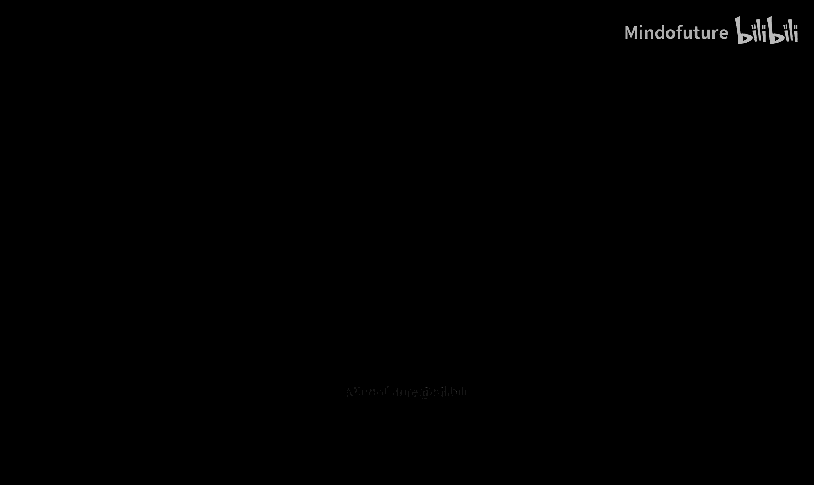
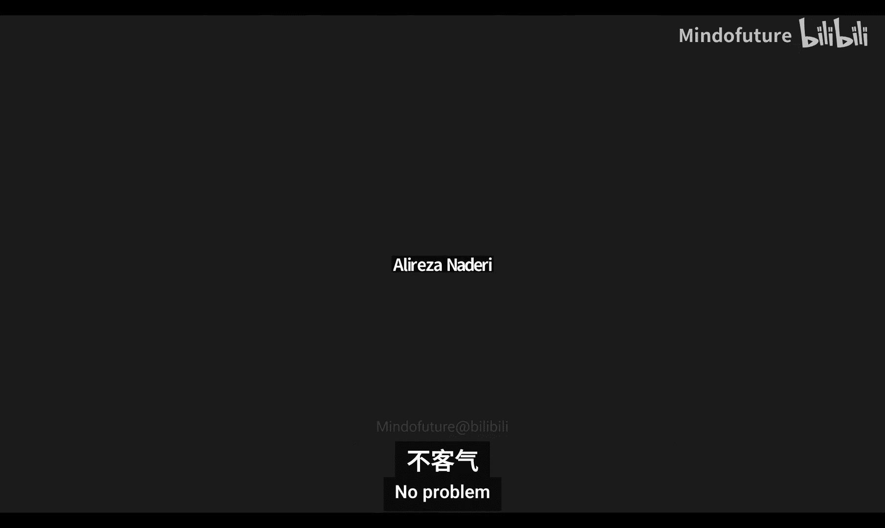
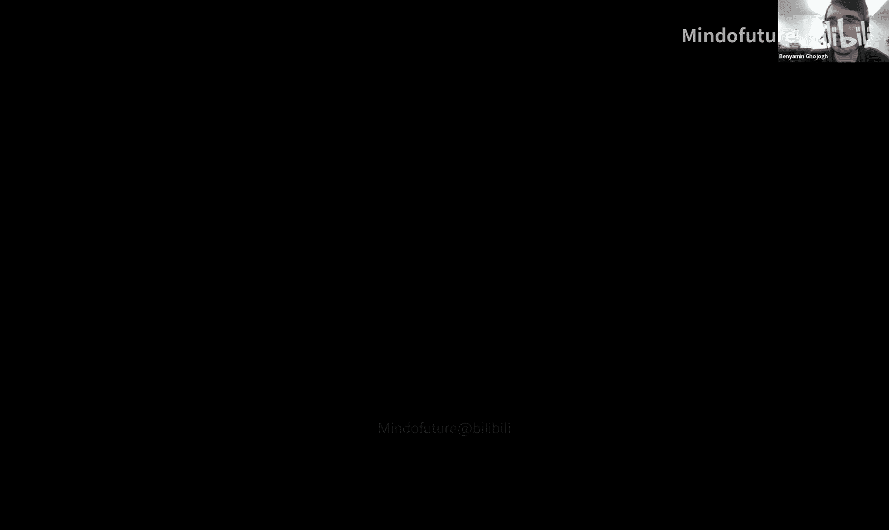
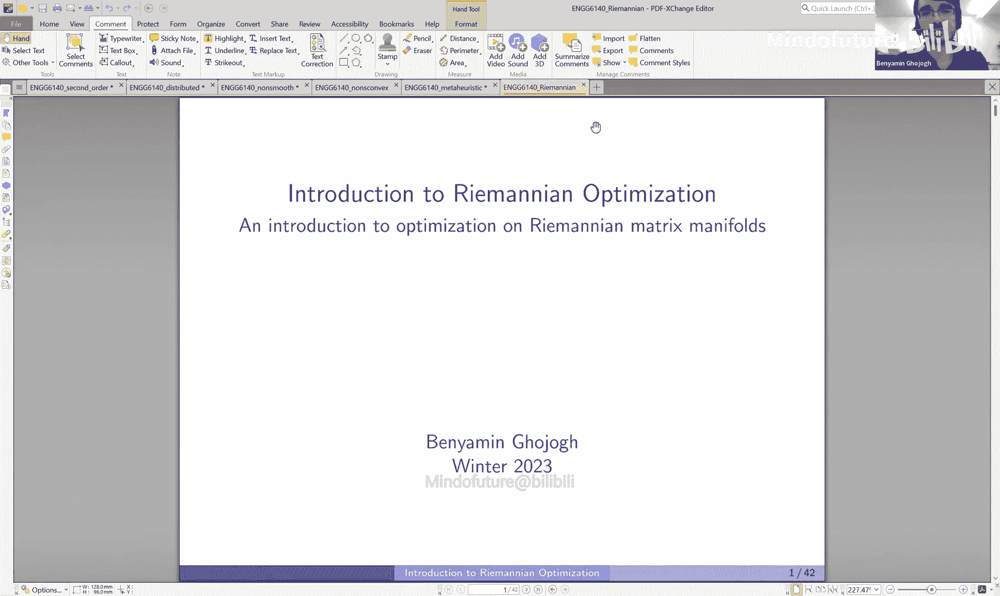
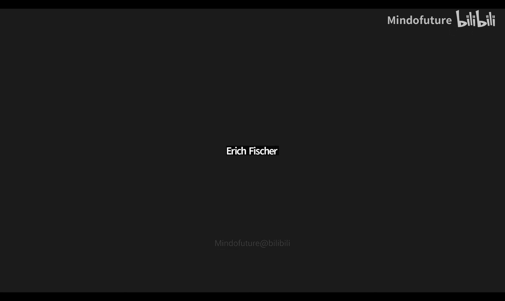

# 【滑铁卢大学】优化技术课程 ｜ Optimization Techniques   W2023 p10 P10_第十讲_(分布式优化与非光滑优化) -BV1oJCHBcEo5_p10-

。Okay， hi everyone。 So is there any question。Yeah， hi professor have question and can you explain more about the slide？

E。I mean， what we should I don't know the meaning of a slide deck。

Slide deck means just a series of a slides。 So a page in the slides that you have。

It's just one slide。 If you have multiple slides back to back is a slide thick。

 You mean a PowerPoint。 we can use PowerPoint too。 Yeah， Yeah。

 so but the reason that I don't call it PowerPoint。

 because some people might use other software to generate a slide deck。

 PowerPoint is not the only software for that。 Someone might use latex for that。

 Someone might use Google slides or someone might use PowerPoint。

 PowerPoint is just one of the software， yes。得二。Thank you so much。 No problem。 So yeah， just brief。

 Lee， as I said before recording， please， your presentation， Yeah。

 I think that would be best if you introduce your problem。

 then define your problem mathematically within an optimization problem So minimize or maximize the cost subject to the constraints you might have multiple optimization problems。

 That's fine。 And then the optimization method that you're gonna use。😊。

And then。咩。A brief introduction to that optimization method。

 especially if it's not already introduced in the course。

 but even if it's already introduced it's a brief introduction that would be nice and then how you are going how you use that optimization method for your optimization problem。

 the challenges that you faced and how you overcame them。

And then the results and the discussion and analysis of the results。

Please don't report the results without any analysis because the value of results would be visible if you show discuss them。

Yeah， any other question， by the way， as I said please I will announce the order of teams to present before the class。

 which is next week。😊，But I would appreciate a lot if every team， all teams。

 including the team which is going to present at the end。

 will be present in the beginning of the presentations because I want every team to listen to other teams and we learn from each other。

Any other question。能。Okay， great。 so let me share by the way， So did based on the calendar。

 So as we are going to use the next session for presentations。😊。

This is the last session for lectures， however， however。

 we have some more stuff which I think they won't fit in this session， therefore I will record。

Maybe one。Or maybe two。With different lengths to one or two lectures。

 I think the other one of them will be bonus lecture。

And there is no exam such just for your for the sake of learning okay and whatever remains I will record them。

 I will put on YouTube and I will share the link in course links so you can learn all the topics that were going cover we covered most of them just maybe some of them will not finish today and well have lectures on YouTube so you can watch them later and then please let me know if there is an ambiguity or question about them okay the reason that I put the presentations in the last session because I respect your schedule and I didn't want that to conflict your schedule。

okay， let me。Share screen。Okay。Did you see the screen。

Do you see that？O。So great。 So before I go and continue the distributed optimization methods。

 one typo that we had， I think a。😊，Here I mentioned in equation 25 in the slides4 second order optimization when we were talking about line search welfare conditions。

I said this is gradient of F。 We had the same typo in Ario line search2。 Sorry about that。

 So 25 and 2860 is are gradient of F。 So P trans was gradient of F here。 I fixed that。

 But in the next slide， I didn't fix that。 So I repeated them here。So， these are gradient of。

So P transpose gradient of f and here also P transpose gradient of F here， also。

 when we're talking about the strong curvature condition。

 this is also P transpoposedse gradient of F。Yes， so that's one typo that I had。

 and I wanted to correct that。And by the way， this was， as we talked about。

 this was the armo condition。 and this was a curvature condition。 Of course。

 Aro condition was proposed before a wallfish。 So wallfe you added another condition named curvature condition to Aro condition and they both were named after called a wall。

 So if we use the first one， Armeo proposed that， but wallfa combined this with another curvature condition。

Atlas the welfare conditions for line search and here。😊，By the way， it's usually used。

 although I have said it can be used from first order methods too but it's usually used in welfare conditions are usually used in second order optimization。

 but and ourmeo condition or backtracking line search or the simple line search is usually used for first order optimization Y。

 because the second the curvature condition makes especially is used for making sure that the approximation of hisian recall here。

 approximation of hisian remains positive semidefinite， especially in quasi utters method。

Because hesian should be positiveite by definition。 therefore， the second。

 the curvature condition usually is taking care of the hessian。 That's whyvol the condition。

 including the curvature condition is usually used for second order optimization。

And our media condition only is gonna usually use for first order optimization。

 So that was one thing that I wanted to let you know。

 And then that's continuum the distributed optimization。 But before that。

 let's briefly review what AMM was。 So we started from alternating optimization and then。

And before that， so we started from alter terminating optimization in then previous session。

 and then。Where we alternate between the variables of the optimization problem。

 then we went to dual essence method and then to dual decomposition method and then augmented Lagrian method。

 and then we went to ADMM so that was the development that we had toward the ADMM algorithm。And so。

 here。We said that， okay。でで。Yeah， here。是个。😔，We said。Consider this optimization problem equation 17。

 And then we know that。We we can update x1 and x to assume that it has only x1 and x variables and then new the dual variable so we could use according to the augmented Larian method we can use this for solving the problem and this was the。

We said that this was the original ADMM， which is two optimization variables and then we simplified that and we came to here。

After simplification， we saw that we can have this where U with the change of variable from new to U and then we said that let's have a general optimization problem where we also have inequality constraints and we might have more than two optimization variables and then we use the trick because as we also saw in the interior points。

Method usually the inequality constraints are a pen in the neck so in the interior point method we also brought the inequality constraints as an indicator function for a hard penalty in the cost function and then we use the noton method with with equality constraints to solve that do you remember that so again here inequality constraints are a pen in the neck。

So we can convert them to equality constant which are easier to handle here。

 and then so we converted this equation to this and then。We said， okay。

 let's use Lambda and nu as a dual variables for the equality and inequality constraints。😊。

Lambda for inequality and new for equality but inequality constraints have been changed to equality constraints already and then we wrote the augmented Lagrangian for that and then this was the this was the ADMM we formed the ADM for that and then we simplified that again we put it back in the Lagrangian so the augmented Lagrian became this and then we had the change of variable also U lambda from lambda to U lambda and from nu to Unu and then we saw that okay here this is the ADMM in general case where equations 2829 and 30 are each several equations。

So this was the ADMM in general。 Now we continue ADMM by saying that how we use ADMM for distributed optimization。

 Let's have a discussion on that。 So ADMM。Is one of the most well known algorithms for distributed optimization。

And if the problem can be divided into several disjoint blocks or several primal variables。

 so if we have sometimes even the problem doesn't have several variables。

 what it is convertible to some problems which have multiple variables and we'll see some examples。

 we can solve the optimization for each primal for each primal variable on a separate core or server。

 therefore it's parallelizable。And for example， equation 284 I what was to equation 28 here。

 we had this， so I'm repeating it here。 recall consider this。

 So hence we can for each of the variables， we can run them on a different core or server and in every traditional of AMM the update of primal variables can be performed in parallel by distributed servers at the end。

At of each iteration， the updated primal variables are gathered。

Or aggregated in a central server so that the update of dual variables is performed Equ 29 and 30。

 which was here。 Do you remember So then。So these can be done in parallel and then we should aggregate them in order to calculate the dual variables again。

 as I mentioned in the previous session， this reminds us of federated learning the idea of federated learning in machine learning is that if we have can we can have several neural networks on different each of which is on a server on a different server and the servers are these joint we have a central server so we send our data to or our weights to the different servers。

 their servers might have their own data so they tune their the weights based on their data and then we aggregate them back in the central server we can take average of them and then send them back to the servers so the servers。

Fe tune the weights and then we collect them， we take the average and we send them back to the servers so this goes back and forth until we have convergence。

 this is federated learning and as is also can be so it can be used for different uses so distributed algorithms can be used either for making it parallel and faster because we don't need to have a huge data in one server we can divide data between servers so that's handling big data and also making it parallel and fast and more efficient that's one use and another uses privacy because if servers don't see each other they only see the central server Of course there are some weaknesses in this system where someone might attack the central server so if we have an attack to the central server this whole system go fails right however ignoring that the servers don't see each other they only see the central server therefore。

Their data is private。So that's an interesting thing。It has multiple uses。

 distributed algorithms have these two use cases。And making optimization problem distributed now as assume so the ADMM was used for distributed problems。

 but even if the problem is not distributed， we can make it distributed。Maybe in a fake way。

 in order to be able to solve that optimization problem using ADMM and all even solve that in a parallel way right so we can make it distributed even if it's not distributed。

 how you see that。😡，We can convert an nondiributed。

Optimization problem to a distributed optimization problem to solve reducing using ADMM many recent machine。

 actually many machine learning and signal processing papers are using this technique if you go and see they use it a lot So now consider univariate optimization problem consider a regular nondisbuted optimization problem with with one optimization variable X So now compare this equation 31 this optimization problem to this optimization problem。

😊，Here。Or here， E 26 here we had M variables， right？😊，So， F I X I。However。

 here we have only one variable x。Okay， now sigma F X not F X I okay。

 and we have also inequality and equalityality constraints now this is not a distributed optimization problem。

 This is a general optimization problem， although the cost is decomposable here Okay。

 the problem can be stated as this， we can say， okay， let's convert F X to F X I。😊。

However so we have M Xs， so X1 to XM M variables。 however， we add constraints to say that X equals z。

So for all I， for all I from1 to M for so it means that it's actually M constraints。

 it means that x1。Equals m， x2 equals m。X3 equals m。And so on。 So it means that。When x1 equals them。

 x2 equals M and x3 equals them M until sorry， not M， apologize。系い。I mean， X1 equals Z。

 X2 equals Z until X M equals Z。It means that。All x1 to XM are equal to each other and it means that they are actually one optimization variable。

 so that's a good technique we can introduce M optimization variables。

 but we equate them to each other or we equate them to one variable and as they are all equal to one variable they are equal equivalent。

So we introduce n variables and use that trick。So this is a good technique that we can use in order to make our optimization problem distributed and then as you see。

 this is in the form of equation。😊，20。Six， simply solvable by ADMM。Okay。Now， let's continue。

Stay here。 E questionation 32 is similar to equation 26， as we discussed。

 except that it has2 M equality constraints other than M E constraints doesn't matter。

 The approach is the same。 Hence we can use AMM。Updates similarly to question 28， 29 and 30 here。

 we had them here。So we can use them。In order to solve the optimization problem with a slight change because the because of the additional constraints doesn't matter。

 So here， for example。Here， we had。M equations， we might have two M equations。

 doesn't matter we have more than M。The number of equations will change。

 but the approach is the same， the approach is the same。And so we introduce M new variables。

 M new dual variables for constraints this that's an important thing you should note that we have added M new。

Constts， therefore， we we need to have a new dual variables。

 so and update those dual variables as well as other variables。 In other words。

 so we using that trick， we convert Y I to Yi prime and we have lambda I for them。😊。

We also for the for this one， we have new eyes。And for this one， then we can introduce， I don't know。

 something else like Eta I。So， we will have a。A set of new dual variables for the additional constraints that we introduced and the augmented logger engine has some additional terms for those new constraints。

 How do they do you calculate the augmented log engine with the same approach that we had here and simplify that。

 So it's exactly the same。And the loggrian and ADM of this are not stated here because the similarity。

 this is a good technique to make a problem distributed use ADMM for solving it and solving it in parallel servers and it's used a lot in the literature So what we talked about here。

Was the univariate optimization problem now as assume。It's multivariate。Okay。Okay。

We might have M optimization variables and now let's see what happens。

Is considering some SI as feibility points， so I'm considering either equality or inequality constraints as some feibility sets so I'm writing the constraints in this way now。

😊，Now this is a general optimization problem x with M optimization variables right。

 and it can be any constraints such as belonging to a set SI。😊。

It can be equality or an equality constraint。 Now let's see what what we can do， We can embed。

The constraint in the objective function using an indicator function。 So assume Phi I。

Is the indicator function phi I X is indicator function for XI being in belonging to the set SI so we can do that and as you see we are introducing a hard penalty so as it is a hard penalty before approximating the indicator function these two are exactly equivalent right。

え？So and it is zero if its not if it's satisfied， otherwise it's infinity。

 the problem can be thenasstated as this。Now， a good thing you should note that is that， okay。

 so consider this optimization problem。😊，So we converted equation 33 to to this problem right now we have another step。

We convert this optimization problem to this how that we are seeing that let Xi here in the regularization term B Z I now。

😊，So we have we introduced M new variables， Z1 to ZM。But here， again， we using the same technique。

To to make the problem distributed， we say that X I equals Z I。 it means that x1 equals Z 1。

 x2 equals z 2。So this means。F 1 x1 plus phi1 z 1 but Z1 equals x1， so we have F1 x1 plus5hi1 x1。

Also， f2 x2 plus phi 2 x2 because Z2 equals x2。There is a slight change is the light difference from this and this。

What is this here， we are setting all x1 to xm to z， it means that all x1 until xm are equal。

 so x1 equals x to x equals x3 until xm， however， here x1 equals Z 1。X2 equals that 2。

 It doesn't mean that x1 equals x2。 No， it means that only were we are introducing some new variables。

 but we want to say that x1， So these two are the same。Next one。

Is Z1 x2 is Z 2 right x and x3 is Z 3， So this is the approach that we have。

 So we are changing one of the terms to be a function of Z I rather than X。 That's a good technique。

 Now we have this。😊，As the constraint， Xi minus that I equals0 for all I。Are equality constraints。

 so these are equality constraints， right？Each of which is an equality constant we can use equation 23。

 24 and 25 as aMM updates for this problem What was 20 so I have repeated them here I have repeated equation 23。

4 and 25 here。😊，え。Which this was used for when we have。Let's go back a bit。Do you remember？

We had equation 3 to 25 for when we have only equality constraints。We started from here。Then。

 we said。We simplified that and we came here and here also we only have a conference。

Here we only have equality constraints， therefore we can use these equations for solving them。

And now compare equation 35 and 36。😊，Hes two。With the proximal operator。

 recall the proximal operator from two sessions ago。😡，When we were introducing proximal mapping。

So here you can see that proximal operator is used with ADMM also。

 we'll see how so if you compare equation 3536 with the proximal operator。

 you can see that there is a close similarity。Compare these with this。

It means that actually ADMM is having a proximal mapping in itself。

 How so we how did we come up with these in the previous session。

 we proved that we simplified ADMM and we came up with equation 35，36 and interestingly。

 they are in the format of。😊，Proximal mapping。 So if we compare these， you will have this。

 So these become simplified to these equations。 for example， that's how do I say that here。

I'm saying that。I'm telling you how I'm coming from here to here。

So for this prox of x with a function G is argument of u G u plus1 over 2 lambda u minus x squared L2 norm okay now what do we have here here。

 rather than u， we have x。So consider U2 be x in this formula in the formula of proximal mapping here。

m I'm saying that look at this。And this。Compare these two。 Okay， so rather than U， we have X I。

And here。We have X Here。 We have U here。We have minus z。Plus U， it means that my。

 it means that minus Z I。Minus u I here we rather than x， we have minus z Z minus u hence this。

And the function is f rather than G。 the function is f rather than G and the variable So the left hand side is the same。

 the right hand side is the proximal mapping。 You can do the same for this compared。😊。

This with the proximal operator to find this， so here the variable here here。

The variable is z rather than u， the function is phi rather than g， and rather than x here。

 we have z minus， no sorry x minus u here because the optimization the variable is z。

 therefore the other two terms which are we have here u minus6， so we have z minus。诶。X plus u。

Right let me write it down because it might need some calculation。Here we have x minus z plus U。

You can write it as。Z minus。Ex。Minus u， right because。

It's a squared L2 norm so we can multiply inside of it by minus1。Doesn't matter。

 Then compare this with the proximal Mac， you will see that this is， you will come up with this。

And we'll come up with this。 Okay， now the third equation I haven't I have repeated without any change。

 So this was simplified to this using proximal operators。 and that's an interesting thing。

Note that in many papers， such as。This is one one of the papers。 We only have M equals one。 What。

 what do I mean here， Do you remember here we had。Samation of F or here。

 we started from E equation 33， we have summation of F X I。

 but sometimes we only have one so we don't have any summation。

But still we can embed the constraint in the objective function。

 and we also can say subject to x equals z。Because we only have one variable， right？😊，呃。

So we have only primal variables except that in those cases。

 and according to the lema we had that the pro do you remember we had in the two sessions equal we have the proximal operator of indicator function is protection。

So as a function， phi i x is an indicator function， do you remember？

We were embedding the constraint into the cost function using heart penalty。

 And we said that Phi is an indicator function。 Here， we also have the proximal mapping here here。

Here the proximal mapping where the function is phi， which is the indicator function， it means that。

Dis function。Is actually a projection， a projection of its variable， which is X plus U I。

Unto the set SI y because phi I is an indicator function for for belonging to S recall this equation。

Right？Therefore， we can simplify the second equation in this。😊，This year。The second equation。

 which is that equals perx of Xi plus Ui by projection of X plus Ui onto the set SI。

And we already talked about projection two sessions ago， an example。

Assume that the constanttrain is having Xi to be orthogonal matrix。

Actually two of my papers I have used this， so I said I want x to be an orthogonal matrix because in my papers x was the optimization variable was a projection matrix and I wanted the projection matrix to be orthogonal。

😊，Then here in the ADMM， in the second thing for Z， I said， okay。

 iss simply saying that meaning that I project onto the orthogonal cone。

 and we already talked about that two sessions ago that we proved that it means that we set the singular values to one。

And then weconstruct the singular value decomposition of the matrix by having singular values set to one。

😊，That's an interesting thing。So in other words。If you have。For example。

 minimization of some function f of x assume x is a matrix。Subject to x transpose x equals I。

Zoom X is。I don't know any functions such as x transpose A a， for example， A is an a known matrix。

 you see this format a lot。 This is used in PC in many things， so it has a close form solution。

 which is actually an eigenvalue problem for my matrix A。

 but I'm not going talk about that still you can solve this iteratively using the ADMN。

Using the same thing that I introduced here， but in the second equation will be projection onto the orthogonal matrix cone by setting the singular values to one。

That's an interesting thing， so although it has a closed for solution。

 you can solve it it creatively。😊，Okay， an example of ADMM。

 so you know one of the use cases of ADMM in practice， I have brought it from my own paper。

 so I proposed a method named image a structural component analysis。

Wwhich is inspired by PCA principle component analysis。

 but I said I want to so principle component analysis uses minus squared error。

 I said but minus squared error in if you are aware of image processing especially image quality assessment。

You know that。There is some major named a structural similarity index or SSIM。

ItIt is proposed by Professor Zhou Wang here at the University of Waterloo。

 it's one of the most well known image quality assessment major， okay。And so I said。And also。

 Zhou Wang discusses that。Mina squared error is not good for calculating the image quality assessment for assessing the quality of image。

 so we need to use SSM or other measures， why because if you have a distortion in your image。

Mcurd error does not replicate what we have in our eye in our eyes， our eyes work in another way。

 they perceive the image or the distortion in another way。

 and SSI tries to replicate or get inspired by what we have in the filters of our eyes。

 visual system。😡，And I said， okay， now let me design a principle component analysis， but for images。

 for image distortions。😊，Using SS sign we all。Next after SSIM one of students of Zhou Wang proposed SSIM distance。

 So SSI is was a major for saying how much two images are similar to each other visually。

 not in terms of minusd error。There was also proposed an SSIM distance。

 which was a metric distance metric， like a minus squared error， but for visual inspection。

AndThen I use SSI distance in the formulation of PCA in order to propose image structural component analysis。

I proposed this optimization problem， I said， okay。

 rather than means so what does print PCA do PCA says assume I have x， I project it onto。

Some Sa space using projection matrix U。And then I reconstruct it back by UU transpose X。

 I want the distortion between U X and UU transpose x to be minimized。In other words。

 what PCA does is this。E minus。U U transpose x minus squared error。Okay， where we want to find you。

And also PC says I want the projection matrix to be orthogonal this is the formulation of PC what I did。

Was replacing the squared L to norm by SSI distance。

 So this was the only difference also also I divide it inspired by what we have in image processing。

 we usually we consider the blocks of the image rather than the whole image by itself。

 so we have a filter a filter kernel which is slideed over the image。 So I said， okay。

 let's divide the image into B blocks。Okay， and and this might say bring something in your mind。

 oh I'm just making the problem distributed， so I'm having B optimization variable whereas rather than having one U。

 which we have in PCA， this have B Us B U matrices。😊，And now here in this optimization problem。

 my optimization variable is not a vector anymore， it's a matrix， okay。

 therefore it means that my gradient is a matrix， mi gradient is not a vector in this problem。😊，Okay。

 because the dimensionality of gradient is the same as a dimensionality of your optimization variable and also I have these。

 so I have B equality constraints and this is an distributed optimization problem let's use ADMM for solving that。

😊，And as you see， I also said this in this slide that ADMM is used a lot in signal processing。

 where was it？😊，Here。In machine learning and signal processing papers a lot because you can make the problem distributed a lot。

 especially in image processing， you usually have blocks of image， right。

So you can see the use cases of distributed optimization that's an interesting thing。😊。

Here for example， and by the way， x here hat here is just the block。

 the I block of the image which is centered so I remove its mean from it is the average of the pixels and then I have this so I convert this to this how I'm saying that let's embed this constraint。

So these are actually M B constraints， but I have the summation over B already here。

 so I'm embedding the。Consts into the cost function as hard penalty where H is indicator function for belonging is variable to orthogonal matrix cone and also this is the。

actualctua cost that I had al right， and I'm using another the same technique that I told you here here。

 so I'm replacing X with Z。😊，Right here with this is that here I'm replacing you。

I'm replacing you with V。And then I'm setting u to V， so it means that u equals V， right？😊。

I'm bringing v to the other side。 So u minus v equals0 and v is just a collection of all V B V。

 So I have V1 to V B and they also I have U1 to U B， and this means U1 equals V1， U2 equals v2。

 etc ceter。And this is the SSM distance that I was talking about， you can see the paper 19 for that。

And。And as I I said U and V are the collections of the V eyess and U eyess。 Now。

 let's solve this using AMM。 I formed the augmented Laangian。Here is the augmented log range。

 and this is the cost。This is a。Do you remember the simplification that we had？Where was that here。

Here， something like that here if you， but we we only have equality constraints。

 so the simplification is easier。 I think the previous simplification works for us here。Here。

 this simplification。So we also have a constant， which is here。Here。We have a constant。

This is the augmented term in the augmented loggrian and this is the constant so as you see I have said。

So I have I I have a change of variable Do you remember we had a change of variable in AMM from noon。

To you， where did we have it。Here， here， for example。We had change of variable。

 so I'm also using a change of variable。Change your variable here。From lambmbda to J doesn't matter。

 The naming doesn't matter。 when you propose your algorithm， you can name the variables。

 You are the owner of the variables， and then you have U V and J。And this is ADMN now let's solve it。

Equation 42， I know it's is simplified to the So equation 41 and 42 can be seen as proximal mapping。

 as we discussed here in this slide in in。In this slide here。

And I know that as Z I is for the embedding of the constraints using indicator function， I can use。

Projection for that。So I solved that using projection onto the orthogonal cone by setting its singular values to one。

 and then this is the result。This is a result， for example。😊。

I made a data set using Lena image Lena is one of the standard images in the image processing so this is the original Lena image and this is the con contrast stretch the contrast you can work with histogram of the image so I stretch the contrast here I added Gaussian noise if you you zoom you will see that there is Gaussian noise here here I increase the luminance sometimes in your images especially in analog images the camera doesn't flashes a lot and you will have luminance enhanced also I have Gaussian blur here salt and pepper here and JPEEC JPEC distortion because JPEEC is a lay compression it's a lasty compression algorithm so it has some last here and then I solve that here are at the end after。

Virgence here， this is you。This is V， this is J。Interest， what was U and V and J here。

 I had this U N V where the primal optimization problems and J was the duall。And as you see。

 J has captured the edges of the image Lena， du because edges usually have a lot of information in image processing。

😊，I think you can see it even intuitively when you see a child starting to draw something。

 they usually don't start drawinging by coloring。They start drying by drying the edges， for example。

 by drawinging a house or something by drawinging the edges。

And then if they want they will add color， so it means that the edges or the high frequency in the image has the most information of the image and the low frequency of is the color also adds information but it's not as informative as the edges so the dual variable here has captured the most informative things in the image which are the edges and U and V if use doom into that and you will look at them carefully you will see Leno here。

 I can see the hats here。😊，I don't know if you can see here， I can see here。

 but you need to look carefully into that。So yes， that was one of the examples of ADMM there you can find a lot of examples of ADMM in the literature and it can be used in industry too a lot。

😊，Some slides of this slide deck are inspired by Professor Stephen Boyd。

And also our tutorial has the materials of this slide deck let's go through the references very quickly。

 the ones which I remember the ones which I don't remember， please look at them in the slide deck。

 so here alternating minis converse to second order optimal solutions I think was one of the methods which were being developed into ADMM we also have a paper on nonconvex optimization for machine learning I think this is a good paper which talks about alternating optimization as far as I remember so we have the composition principle forar program in 1960 this is one of the old methods being developed into ADMM gradually also。

😊，Here mixed variables programming problem and here we have generalized Larrange multiplier method。

 I think this was a paper as far as I remember 191963 for augmented Larian and we have。So。

I don't remember what this was for the method of multipliers Do you remember the method which we hear？

Mod of augmented no here。Augmented Laangian method method of multiplierers was proposed by this paper。

By paper8， and then let me go through these very fast。呃。Yeah。Okay， this is for federated learning。

 you can see it's a good of federated optimizations。

 also this is a good survey paper on federated learning if you are interested in that。

Also here again， another paper for federated learning which is related a lot to the distributed optimization here this is one of the papers in image processing which has used ADMM。

So诶。Oleleg Michaelloch is a professor here and also Edward Wersky is a professor at University of Waterloo Department of Mathematics Olleleg Miloch is a professor at the University of Waterloo in Department of ECE。

And Daniel Otro was their PhD student now hes I think in Brazil。

 I guess he's a professor now they proposed this also this is my own paper and the image structural complaint analysis。

 which I talked about Edward Besky and Zhou Wang had a。

A student named Bruette which proposed SSIM distance。

 it's a very nice paper I really enjoyed reading that you can look at this。

 it's a theoretical paper on that and also this is the art and optimization problem。Okay。

 now this distributed optimization is over。 I there any question before we move on to the next topic。

No。Is everything clear？Not yet。 Okay， so。Let's go to。Okay， someone else sits。Yes， all good， Okay。

 great。😊，Now let's move to nonm optimization， the next topic， so so far what we talked about。

 we assume that we the cost function and the optimization problem。

 they are differentiable right and they are smooth so when it's smooth。

 it means that you can take the derivative until infinite number of orders。

Especially so in in mathematics， when you say C1， it means that for one derivative， it's a smooth。

 but maybe in for the second derivative， it might not be a smooth when you say C2。

 this is a set of functions。Which is。Whose first and second order derivatives are defined and they are a smooth for first and second order。

 But for the third， it might not be smooth against C3， we also have until C infinite C infinite。

 It means that it's a smooth。 Its actually smooth for all orders of derivative。

So usually we assume so far that f belongs， the function， F， the cost function belongs to C infinite。

Now， what if it's not belonging to sayfin？Especially if it especially if it's not belonging to C1。

 then it's actually a very big pen pen in the neck because if。It's C，2。

But we can deal with it somehow because we can take derivatives。 So gradient is defined。Also。

 Hassian is defined。Maybe it's third order derivative that is not defined。But if it's not。In C1。

 we can't even do the first order derivative， which is crucial for optimization。

For both first order and second order optimization algorithms。 Now let's what we should do。 Okay。

 introduction of non smooth function。 So these are examples here。In all of these areas。

 the function is a smooth except here in this point。It's not a smooth right， it's like， for example。

 absolute value function here also it's smooth here， smooth here， not a smooth in this point。

In these cases， we need non a smooth optimization。Okay。Okay。

 now let's see what we should do for these cases。So Lasso regularization。

 I think we already mentioned LaSso in several sessions that go what does LaSso do you remember？😊。

What was Laa you remember guys， So Laa was L1 norm， so usually one have L1 norm regularization term。

😊，It's a lesson。So like this， in equation 3， you can see。 So we have a cost。Plus。

 some regularization term with。L 1 norm，1， Why do we do that。

 We are putting a soft penalty here because we， we want， we don't want x to maybe。

In in machine learning language， we call it overfit。

 We don't want x to be overfitted or our model to be overfitted on X， or we don't want。

The x to explode because when x becomes very big， the L1 norm also becomes big。

 so the penalty is on the magnitude of x， but with L1 norm。

 we can have the penalty on magnitude of x with L2 norm or any norm right。

 but if we usually use either L1 norm or L2 norm， we already talked about that L2 norm has its advantage and disadvantage。

 what are the disadvantages and disadvantages。When we have。L2 norm is。It's differentiable。

 a squared L2 norm usually use a squared for L2 norm because L2 norm might not be。Convets。

 and we can't take derivative of it easily。 But a squared de to norm。Recall this formula。

Squared L norm can be written as x transpose x recall preliminaries that we talked about。

 and this is a quadratic function。So it has very good properties， it's convex。😊，It's a smooth。And。

In this case， it's Uniimodal also。And I think by convictx or we know that it's uni modelal because if it's not uni model。

 it's not convictx。So it's smooth and it's very good， it's very good。 however。

 it disadvantage is that， and by the way， another advantage is that we can take derivative easily。😊。

Because we know that the derivative of this。Is X， right？However。

 the disadvantage is that it's very bad for outsliers， we'll discuss it in a few slides， I guess why。

We'll see that。 But it's， it's very bad for outliers， for anomalies or outliers。

 which are very away from the mean。 As that this is the mean。This is the mean， for example。

 mean or average of your data。And this is L2 norm。When some data comes very far away from mean。

 it means that it's an outlier of this distribution。You can see its L2 norm explodes， it's very big。

So it's very bad for all to know， I think it's easily understandable because when you have x squared because x transpose x is like x is squared。

 right in the scalar world。😊，And compared it to X， which one explodes more for outliers， of course。

 x2。So assume your outlier is some number， if you fit it to x， it's not as big as x2。

That's the thing that's a disadvantage of squared L norm， however。😊，Also。

 L1 norm L1 norm doesn't have this disadvantage。 We'll see why it explodes with slower rates。

So if it's L2 norm， L1 norm is like this。This is squared L norm and L1 norm is like this。

As you see for this outlier， L2or is here。L1 norm here。对。Here， which one is bigger， of course。

 squared L2 norm， So a squared L2 norm explodes more for outlier。

 but L1 norm doesn't explode that much， so it's not that much。 it's more robust to outliers。

As a good thing， Another advantage of L1 norm is that。It is。Is that it is。Spare， do you remember。

 we talked about that using the diamonds that I I think two， two sessions ago or three sessions ago。

 I drew some the unit spell of L2 norm and L1 norm。

 and I showed you that especially in large dimensionality， this diamond has a lot of edges。

Consider a multidimensional space。Whi has a lot of diamond edges and when your cost function touches your diamond。

 many of the other coordinates becomes zero at that point。

It means that your problem becomes very sparse because your solution to the optimization problem becomes the sparse and we talked about that according to the betting on sparse principle。

 as well as outcomescom razor in philosophy or logic。Sparrsity usually works very well。

 So L1 norm also works very well for sparsity。 However， its disadvantage is that。It's not a smooth。

L1 norm in one dimensional in one dimension is absolute value function is like this。

 so in this point it's not smooth， you can't take derivative derivative is not defined in this point。

That's the problem， calculating its derivatives a pain in the neck。😊，Now， okay。

 with this introduction， let's talk about data regularization。The L1 norm can be used for sparsity。

 we talked about it several sessions ago using the unit balls。

Whi was proposed by Tiipcirani at Stanford University。

 Sprsity is very useful and effective because of Betina and Sprssity principle。

 which was proposed by Ticirani and Haty at Stanford University。

 and also according to Alham's razr in philosophy and logic。

 which says that the simpler explanation for a phenomenon is a solution a better explanation。

If x equals is a vector， assume x is a vector with elements x1 to x D， okay？And。😊。

For having a sparsity we should use subset selection for the regularization of a cost function as soon I want my problem to be sparse。

 what we should actually do， we should use this。We shouldn't use L1 norm first L1 norm is an approximation to this and we'll talk to you about it。

 but we should use this。This is not a norm。Sorry， but we should use this。 This is not a norm。

We call it L 0 norm， but with。Quotation， double quote。Why it means that it's actually not norm。

 So this is the how we call it。Els in or norm with quotation Y because it's not a norm。

Because it doesn't satisfy the norm properties， do you remember what were the norm properties recall the preliminaries？

I think there were several of them， the most important one。

 I think which is not satisfied here is triangle inequality， do remember？So L zero norm。

 which is not a norm actually， what does it do？😊，Is formulas here。 It counts。

The number of non zero elements， so here。It's an indicator function what is the indicator function here。

 the indicator function is not like the indicator function and optimization。

 it's0 if xj is0 otherwise is one so when we have a summation over this it means that how many nonzero elements this vector has。

😊，This is called subset selection， this L0 norm with double code， so we use that as a penalty。

It means that we want to have a sparser solution with many zero entries。😡，Okay， according to paper5。

 you can see in the references， the convex relaxational L0 norm with double code or subset selection is L1 norm。

😊，So it's approximation or relaxation of Lsine or norm which is not a norm， is L1 norm。

 which is actually a norm。Therefore， we write the regularized optimization problem as this。😊。

So we convert question one to a question3 because we want the penalty to be a norm。

 The L1 regularization is also refer referred to as Laso regularization Laso stands for this。Okay。

Its least absolute shrink cage and selection operator。 As you see， it is selecting。 Also。

 it is shrinking， shrinking to become。😊，Sparse。And why does it have absolute in its name because it's like absolute value in L1 norm。

 L1 norm in one dimension is like absolute value， and least by because do you remember when we set。

 for example， if the regularization term is a squared L2 norm。

 we usually call it at least a squares problem？So when you minimize squared L2 norm。

 that optimization problem is also called least a squared problem optimization。

 but when you have L1 norm， you are minimizing L1 norm， you call it least absolute optimization。

 something like that。That's the reason for Laso name。Papers 6 and7。

 you can see that I think one of them is proposed by Tip ShiraniDifferent methods exist for solving optimization problem having L1 norm such as approximation by Hober function。

 we are going to explain all of these in the next slides， approximation by Hober function。

 proximal algorithm which we talked about in two sessions ago or soft thresholding do remember we introduced soft thresholding two sessions ago or coordinate discent we also introduce it here and subgradings we also introduced it in this session。

These are different methods， various methods for solving non a smooth optimization problem。

 such as L1 known。Okay。The first one， which was approximation by Hober function。For Hoover function。

 we need to define something named convex conjugate。

Wwhichch is an important thing in optimization involved。

 and then we will use that for Hober function。 How do we say Okay， let's talk about convex conju。

 What is that consider the this figure that we are having showing a line which supports the function F what does support me So when you have a function like this。

 the tangent line to it。Is a support for this because the whole function。

 the whole function F is on one side of this line， so this is a support line。

When we are seeing support line or support hyperplane。

 because in multiple dimensions it's a hyperplane， it means that it's a tangent hyperplane on the function where the function is only or solely on one of the sides of the hyperplane okay。

And that's called a support type plane。 This figure shows a line which supports。

 so this is not a support type plane， This is a support typer plane， right？😊。

If meaning that it is tangent to the function and the function upper bound it。

 upper bound it means that it's only on one side of it。In other words。

 so it's the line is always below it。😊，Or the hyperplane is always below the function。

 In other words， if the line goes above it， above where it is like this。

It will intersect the function in more than one point。

Here it's tangent and it's intersecting in only one point。But when it goes above。

 it will intersect in more than one point。Now let the support line be multi multidimensional to be a support hyperplane okay。

 for having this tangent support hyper planee with a slope y。An intercept beta。

Consider this this is a hyperplane。It's a slope plateed B Y， as it is a hyperplane。

 it's a slope is a vector in D dimensions right， and but its intercept iss a scalar。😊。

So you can write the equation of this hyperplane as this white transpose x plus beta y is the slope x is the variable of the line and beta is the intercept。

And we set it equal to F because we want to find a tangent point where it is intersecting。で。Here。

 I am talking about this point where it is intersecting the function。Okay。

 if we rearrange this equation， beta becomes this。Okay。Now we want the smallest intercept。

 what we want to find the smallest intercept okay for support Hyplane。

 why if you consider this hyperplane youll understand why I'm trying to find the smallest hyperplane is intercept。

 sorry。When你诶。So how should I talk about this Z this， This is a hyper support hyper plane。

 This is a support type plane。Maybe this is a support， all of these are support type ofpins。

 but I want to find the one which has the smallest beta， which has the smallest intercept。Better。对。

The smallest better。 Okay， so be star。Its minimized F so this is the equation of beta。

 this is the equation of beta， sorry about that。This is the equation of beta and I want to minimize that。

😊，With respect to X， I can write it as minus maximize。 you remember recall preliminaries。

 we can convert minimization to maximization， but we need a minus behind it。Minus max sub again。

 its inside should also be minus of that。 So F of x minus y transpo 6 becomes y transpo 6 minus f of x。

Now we found this。I'm repeating it here what is convex conjugate of function is actually related to this It's equation 4。

 the convex conjugate of a function F is defined as this。So when we have a function F。

 we can say y transpose x minus f of x， maximizeim it。 This is supreme。

 Supreme is a generalization of maximum regard preliminaries over the x。

And this FS star is a function of y actually， because we are not maximizing over y we are maximizing over x。

 so x goes away， but it's actually a function of y so Fs star of y equals this and this is convex conjug of x therefore we define now compare these two。

😊，You can see that we can say is F star of y equals minus beta star。Right。

 to have the convex conju get defined above。 okay， the convex conju of the function is always convex。

 even if the function itself is not convex because it is pointwise maximum of a fine functions。

 Do you remember this is a fine function。 This is a fine function and we have multiple of them and we are having a su of the max maximum of these I said we have multiple here in this figure。

 I said we have multiple hyperplanes support hyperplanes and let's find the one So we we have many of these support hyperplanes inside and we are finding the one maximizing over x here。

😊，We have a point why maximumim that find functions it means that it's always a convex function。😊。

Okay， now。So we had this convex conjugate， lemma， convex the conjugate or convex conjugate over the convex conjugate over function。

 So if you take convex conjugate twice。You will have F S star as star Doer than I1 to start。

Then it becomes supermo x transpose y minus F5。A star。

 So the the convex conjugate becomes the function again as an， as an input of the convex conjugate。

 and the variable becomes y。 therefore， the variable of FSR star becomes x again。Right， okay。

 it is always a lower bound for the function。 That's interesting。

 F a star a star is always less than or equal to F。I'm not providing the proof here。

 I'm just showing the lemma。 Okay， you can look up the proof in the Internet if the function F。

It convex， then we have FSR star equals F。 That's interesting。 So if it's not convex。

 FSR star is always a lower bound for F。 but if the function is convex is actually equal。😊。

So by taking convex conjugate twice， you will reconstruct the function again。Hence。

 for a convex function， we have this。So if the function is a convex， then F of Vx。

 we can write it equal to the convex conjugate， so because this is F star star。Okay。

 that' an interesting thing。 now Im I'm going to use this in order to define the Hoover function and all of these things for solving the L1 norm optimization。

😊，Okay， the convex conjugate of L1 norm。Is this。 I'm gonna prove this here。So what does it mean？

For FO weeks。P equals L1 normal X。F star y equals if the infinite norm of chbysha norm of y is less than1。

 so if it means that if we are inside the unit ball of infinite norm， it is0。

 otherwise it's infinity。😊，Okay， now let's prove it we can write L1 norm in this way。😊。

Why can we write it in this way。So f of x equals l1 norm of x is maximum of x transpose z。

 so I'm introducing some variable named Z。😊，But Z should be in the units bar。Yeah。Consider this。

This is the unit ball of Z。So assumeumes that is I don't know two dimensional。

 So x is two dimensional。So we are inside。Sorry， we are inside this units ball， the-1，1。us1，1。Okay。

 now we are saying that x transpose the。When we are saying that， assume。

Let me let me recall that because I thought about it a week ago。Let me recall it。Yes。O。Yes。😊，So。Here。

 for example， here。Because we want to maximize over Z， right， we want to maximize over Z。

 So here this I can't draw with this very well。 sorry， but I'm trying my best。

 So in this point that I'm pointing at。 Okay， so here we have the maximum Z。And soon here。

 if you have this point， what is this point？This is 1，0。Am I right， this point that I am pointing at。

Here， if you have the dot product of x and Z x transpo Z， then it will capture you x1。

But x2 becomes 0。 so because 1 times x1 plus 0 times x2 becomes only x1， so it only is capturing x1。

Exactly like what we have in L1 norm in L1 norm， do you remember in a sparsity， especially it we。

When we are in the edge of the diamond， many of the coordinates become zero similar to this case here。

 So when you are saying that Z transpose x it's making the other coordinate 0 and that's an interesting thing so we are relating L1 norm to L infinity norm here is L1 norm。

 this is L infinitefinity norm and there are dual of each other so using the dual norm of L1 norm I'm defining L1 norm again。

 you can write it， if you think about this equation you will see it it's correct。Okay。

 now using this in equation4， this was equation4 I'm repeating it here。

 which was the convex conjugate。😊，Results in equation 7， which is this we want to prove。 right， Okay。

 why that let's do that。 Let's put this。 So F Y star， we know that is superpremomo over x。

 Y transpose x minus maximum minus F of x。But I replace f of V with the definition here that I have maximize x transpose z over the unit ball of Z。

Okay， now。What am I doing here， Okay， I'm changing the order of x transs that and that transports x because they are both scalar。

 I can change the order and then if you see that you' will see that if。If。

Y the L infinite of y is less than one then this term。

Is actually satisfied and well have y transpose x minus y transpose x inside the supreme it becomes zero。

Otherwise， otherwise。This。This term becomes infinite， why？

Because this is the reason because this might will go away。

 this can be a small number and this can go to infinity。 This can go to infinity。

 therefore it explodes the only way that it doesn't explode is that the L infinite normal y is less than one or in other words。

 when y is in the unit all of infinity norm， then these two terms。

Become equal to each other So super moveve0 is0。 and then this is the proof for this。

 Now we are going to use this you'll see for Hober function。😊，Right before that， okay。Yes， here。

 Hoover function， smooth and L1 known by convex conjugate。

 How we should will see that lemma gradient in terms of convex conjugate for any function if。

We have this。This is a lemma I'm not providing the proof here gradient of F is arc max of x transfers y minus FS star y。

Where y is in the domain of FS star okay。Now we saw that the convex conjugate of F。

 we just proved that in the previous slide。Is this。According to this equation8。

 which I gave to you without proof we have。😊，Gent of F is am of this。For L1 known y。

Put this inside this。So rather than if a star Y have this。if it's0。

 if the y is in the unit model of infinity norm， then we'll have r max of x transpo y because this becomes0 this term。

😊，Becomes  zero。Otherwise， this term becomes infinity and。

It will explode the cost inside the arc max， right，s it's not good。

 So for we'll have this for x equals 0， we have this。Now。😊，Let in this function。Let x be0。

 so it's arc max of0， which has many solutions。😊，Because why can be anything。Right。W can be anything。

 not one thing， because when you are saying max of 0， it 0。 But when you are saying art max of 0。

 it can be for any argument of y。You will have maximum of0 because you are maximizing a constant。

 Therefore， it has many solutions。 Therefore， at x equals 0。

 the function L1 norm is not differentiable。 This is another proof for y L1 norm is not differentiable at x equals0。

 if you want to imagine it in a scalar at a scalar in one dimension。

 L1 norm is reduced to absolute value function。 Of course。

 we know that in absolute value function at 0， it's not a smooth。 But when we go to many dimensions。

 this is a proof y at 0， it's not differentiable。 It's not a smooth because the gradient at this point is not unique。

 Okay， now let's see how we should tackle that。 we can a smooth。😊。

A smooth L1 norm at equals zero using convicx conjugate。

The first technique to handle nonconvex optimization is to smooth the parts which are not as smooth。

 so assume you have sorry for non smooth function， So when you have non a smooth function you want to do optimization you find the points which are not smooth and then you make it a smooth at those points for making it the smooth at those points you need convex conjugate which we talked about and you can use convex conjugate to define hubber function for L1 norm you will see how we saw that the convex conjugate of L1 norm is this。

And let x be d dimensional， so we know that by definition of L1 norm its just sum of absolute values of its coordinates。

We can use the convex conjugate for every dimension。For every dimension。

 now this y becomes a scalar Y J for the J dimension。If so this becomes simplified to this this if。

Yj is less than one。Rather than the infinite normal of y willll say why if the absolute value of yj is less than one。

 it's0 otherwise is infinity。 Okay， interesting。 now， according to equation 6。

 which I have repeated here。Do you remember what what was equation 6， this。This lemma。

 recall this lemma that we talked about， why we said that f for convex function。

 F is equals equals to FS star star， and we know L1 norm or is a convex function。

 therefore equations 6 holes for that。So we can use that。I'm repeating a equation 6 here。 Okay。

 we have this now。I'm putting E 9 inside this equation。And I get this。How。😊。

So I'm saying that this is supremo of why。Super move y， sum over y x transfers y。

 because as we are talking elements ys now becomes x J Yj。😡，And FSR Y。

 we are talking about elements Y， so it's FSR Yj。According to this equation 9。It's maximum of x Jj y。

 because F star yj should be0， otherwise the cost explodes。So it's maximum。

 I'm changing superpremon to maximum maximum of x J， Y J when。And this is the。I'm using these here。

Right， because only when absolute value of voyager is less than1， this term becomes zero。Okay。😊。

But this is not unique for xj equals0。Hence， we add a mu。

 strongly convex function to the above function to make the solution unique at xj equals 0 Also。

 Why isn't it unique at xj equals 0。 Let's talk about this。So consider this the right hand side。

 I'm talking about I think is a bit， let me。Erase some things here so you can see it better。Okay。Now。

 consider this。The right hand side when set x to 0， it becomes max maximum。Of zero。The constant zero。

For y， J。Les than one absolute value of yj， less than one。

 It's a max maximizing a constant with respect to Yj。 It can be any yj inside the unit ball of Yj。

 right， Therefore， it's not unique。 Let's make it unique。 at Xj equals 0。

 So we can add some term to this annual C。 This added term is named proximity function defined below。

Okay。是。Approrxiity function Py for a closed convicx set。

Is a function which is continuous and strongly convicts。We can change equation six。

This was equation 6， which I have repeated here， we can change E 6。Okay。To this。

So what am I doing So I'm have supremo again here x trans was y the same if star but I'm adding this term。

 I'm adding this term the third time in equation where mu is greater than0。

 Do you remember it's very closely related to mu strongly convex like which we had in preliminaries Okay。

 now recall equation 9 equation 9， which we had here。I I have repeated it here using equation 10。

 which we have in this definition of pers proximity function， we can have this now let's talk。

 I'm deriving for you the Hober function deriving it。😊，So。And we have。Absolute value of X J。

Let's see， let's see what what are we doing。 So equation 10 is this。 So I'm saying that。

The right hand side is the right hand side of this equation， supermomo y x but this is element y。

 so x transs y becomes xj Yj and FSR y becomes FS star Yj， and this is mu。PY here。呃。Here yes。

 I'm using Yh squared is it needs to be a convex function and。Here。

 so what is F of x for element J because we are doing element wise is absolute value of xj。😊。

For only element J。Now， using E 9。This becomes when does it becomes0。

 otherwise the cost becomes explodes when when yj is in absolute value of yj is less than1 according to this constraint。

 Okay， that's correct。 now we can see that this is equivalent to this Y because when xj absolute value of xj is less than or equal to mu。

What happens？If absolute value of xj is greater than0， let me mu。I I need to think about it。

 but I'm I'm sure that you can go from here to here， okay。This is the Hober function。

 this is the Hober function。😊，TheThis approximation to L1 norm， which is differentiable everywhere。

 including at xj 0 y， because recall that we use this proximity function。 We added that。 So at 0。

 it also becomes unique。 It wasn't unique at 0， but。By adding that new term， which is here。

We made it also unique at zero。This is Hober function。

 this is called Hober function proposed by Hober who was a scientist。

 now that Hober function is the moral envelope of the absolute value。

 moral envelope we define that in the proximal mapping slides。Hover function， I'm defining it here。

 so so far we are deriving the Hober function now this is the Hober function。

 Hober function and pseudo the Hober function。This is the Hober function。

Which were derived in the previous slide。This is thes Hober function。

 which is an approximation of the Hober function itself again。

And muu is greater than zero according to the proximity function here。

The derivative of these functions， I'm going to show you what Hober function is like in this slide。

 but let me first define it。 The derivative of these functions is easily calculated。

 and that's an interesting thing。 Why did we use Hober function。

 Why would we define because we said that L1 norm We don't have derivative for it at0 Let's make it a smooth by Hober function。

 and now we know that the derivative of Hober function is already calculated， It's very easy。

 Its formula is very easy It's like this。😊，For example， the derivative of Uber function。

 derivative of this is this。😊，What is this if absolute value of x is less than some value mu？😡。

It's x over mu， if its absolute value is greater than mu， it's sine of mus。

 sine of x if x is positive， sine of x is 1， if x is negative sine of x is minus1。😡。

Now let's see the Hoover function。Okay。This is Aloonor， a squared al2or。This is L1 known。😡。

Recall the discussion that I had several minutes ago saying that for outsliawers like this。

E squirt alton norm explodes。What L to what L1 known is a small。Interesting， L1 norm is is small。

 but the squared al norm explodes for。呢。Outliers， also outlier might be here。Right。

So L1 norms robots to outliers， also it's L1 norm is good for a sparsity， however， here at zero。

L1 norm is not a smooth L2 norm， however， is a smooth。Okay。Now let's see the Hoover function here。

What is B。Comparison of L1 norm the absolute value in r1。

 because here we are assuming that we are only one dimensional， right， one dimensional。

And the Hober function。 This is the Hober function for different here。 I'm talking about this figure。

 Hober function for different mu values so。😊，Let me see。 Let me see。 The orange one is Elvin norm。で。

No， so not the orange one， so I apologize。The blue1。Is L1 norm。Okay， according to the legend。

 I'm saying that。And'm I'm increasing mu by this。 So mu is increased。Here mu is increased。

 So by going down in this figure， I'm increasing mu。 It means that。When your your mu is a small。

 your approximation is more correct， more exact。😡，But when you increase mu。

 your calculation of Hober function is easier， however， you lose accuracy in approximation。

So less mu is more accurate， but the calculation of the。😊。

Hover function and its derivative is harder。Because of this， it， for example。

 is derivative When you set mu to be a small number close to 0， then。This hardly happens。

 but this happens a lot。 The second。Condition， it means that you're almost in most cases。

You are actually approximating the derivative correctly why because do you remember the what is the derivative of the L1 norm except zero。

 it's actually this。😊，It's a sine function。But at zero， it's approximating it using this。

When mu is close to zero， it means that the approximation range here is a small。

 so your approximation is more exact。However， when you increase this range by increasing the mu。

 it becomes easier to calculate however the approximation is lower and as you see interestingly here at0。

 although L1 which is a blue curve is not a smooth， however， the Hober function is a smooth。😊。

At that point， and it's interesting。 Okay， now let's see the figure C。

Comparison of L1 norm or absolute value in r1 in scalar。And the pseudo hubber function。

 So this is a So this。Blue1 again， blue curve is L 1， nor。

And these other colors here in figure C are Suhoover。 So figure B was Hoover。

 figure C is Suhoover function。 And also here， let me see in the legend。

 I'm increasing by going down in the figure。 I'm increasing mule。Okay。Again， by having a small mule。

 the approximation is more correct， and as you see。

 there is a slight difference in the behavior of Hober and pseudohuber functions。

In the Hober function is always a lower bound。嗯诶。On the L 1 norm， however， for some mue values。

 Suhober might go above L 1 norm， but in many mu values。It's actually a lower bound of L10。

 but for some new values it might go about there。 So that's one difference between Hober and pseudohober again。

 at0， you can see that。Although L1 norm is not a smooth， Hoover and pseudo Hoover are smooth。Okay。😊。

These two functions are smooth， so they can approximate L1 Nor smoothly。

 This figure shows that Hober function is always upper bounded。

 As I said that we can also see the approximation of Hober function is better than the approximation of pseudohober function。

😊，Yet， Hober is better than pseudo Hober in terms of approximation accuracy， however。

 its calculation is harder than pseudo Hober y compare E 11 and E 12， Of course。

 E 12 is easier to calculate。😊，What is approximation is they accurateate。Moreover。

 the figure shows a smaller positive mu is better approximation， okay， we talked about that。😊，So far。

 we talked about how to smoothen the L1 nu。I understand that some slides of this slide deck are hard and difficult a bit。

Don't think that is only hard for you。 It's hard for me and others too。

But these are the some because we are in the last sessions of this course。

 these are the advanced topics of the optimization。

 so we are getting into the harder topics of the optimization and there is no exam on that so try to learn them with joy。

Okay， now。Soff thresholdholding and proximal methods。Then the other way to handle。

To handle non smoothness， I say this and then will'll go for a break， okay。

The soft thresholdholding and proximal methods， how do proximal mapping was introduced in two sessions ago。

 do you remember？😊，This was the proximal mapping。 Okay。

 we can use proximal mapping of non a smooth functions。

To solve none smooth optimization problems by proximal methods introduced before。

 so we can use proximal mapping。For example， we can solve an optimization problem containing L1 norm in its objective function。

 which is not as smooth。Using the proximal mapping of L1 norm， which is soft thresholding。

 recall two sessions ago， which we that the proximal mapping of L1 norm is soft thresholding。

And we showed that it's this， this is a soft threshold。😊，We should do it elements wise。

 proximal mapping of。The JS element of proximal mapping。Is this。And we can write it in this。

 We showed that these， these two are equivalent。 We， we discussed it。

 and we named it to be soft thresholding。 And it's an element wise function。 Okay。

 it says that for if the value of that element is greater than lambda。😊，Approximated with this line。

 if it's less than lambda， Appd with this line， if it's between minus lambda and lambda， let it be 0。

And as you see。This range。From minus lambda to lambda is actually approximating the absolute value or the L1 norm around 0。

 Again， this range should be small。 So the smaller the lambda， the better the approximation。😊，Right？

😊，So this。Is a better approximation than this。Yeah。

Because it actually needs to be something like this when Lada is exactly zero。

 it needs to be like a line。But we， if we set lambda to be 0， then we， will not have a。

I'mSa thing that will recover， I think L1 norm which is not as smooth as zero。

 so we need to have some lambda， but lambda should be small Lada should be small to have a better approximation and also I think you should know two things about two things which are common about these methods first thing they are doing element wise。

😊，An interesting thing which you should note is that when it's a non smooth function。

 usually different approaches like proxima methods or Uber function， or these things。

 theyre applying they are being applied on the function elements voice。

Why because it's easier to handle nanosmth functions element wise rather than the vector y or matrix y Okay so let's work on the scalars。

 the scalar values of the elements。 that's one thing which you should note in common between different methods also another thing they have a range So around the smooth non a smooth point here in L1 norm0。

 maybe in another function is some other point you usually have a range and some parameter which defines how large this range is。

😊，And usually the smaller the range， the better approximation you have。

And that's an interesting thing okay。So here we have。😊，And yet， proximal methods。

 such as proximal point method。And so now using this proximal mapping。

 you can use proximal point method or proximal gradient method。

 Do remember we introduced these two sessions ago in proximal mapping algorithms。

 you can use any of these but using proximal mapping go L1 nor， Okay， that's interesting。😊。

For solving the regularized problem 3。😊，Like minimize a cost function regularized by L1 norm。

 which is optimizing a composite function。 we can use proximal gradient method do remember。

Recall that。It says that for composite functions， we can use proximal gradient method where we are using the proximal mapping of the regularization term here。

 the regularization term is L1 norm， so we can simply use the soft threshold。Interested。Okay。

 before we continue with the other methods for handling non smoothness， including coordinate discent。

 let's have a break and come back at nine， maybe。AndIs that fine？Yeah。Okay， great。 See you at 9。Okay。

 let's continue。对。So。Okay， coordinate disscent again。This method。

 similar to other methods which handle none non smoothness。

 they work on elements or there elements wise。 In other words， they are coordinate wise。

 So they work on coordinates。 This is another algorithm for that。 Assum that this is the。

vector x for solving minimization of f of x with respect to x coordinate method。

 you can see paper 10 updates at dimensions or coordinates of the solution one by one and not all dimensions together at once so again it's using alternating optimization introduced in the slide deck for distributed optimization do you remember recall previous session we said alternating optimization alters between several variables right now here coordinate said decent uses alternating optimization but the variables now are the coordinates。

So once it updates the first coordinate and considers the other coordinates to be constant。

 equal to their previous value and then。It considers the second coordinate。

 the other coordinates to be constant equal to the previous one， but the x1。

We use the updated X 1 here because X 1 is already updated here。 Also， for x 3， for example。

 we use X 1 K plus 1 x 2 K plus 1， but X 4K， X 5 K until X D K。 So we do until。These x for X D。

 all of them are X IK plus one。So we do it and then we go from scratch again。

 we do it iteratively in each iteration， we we have these updates。

So this is coordinate method and we do it until convergence of all dimensions。

 x1 to xt note that the update of every dimension uses the list update of previously updated dimensions。

 the order of updates of the dimensions does not matter much okay。

And the idea of coordinate this state is similar to the first of is's using alter optimization。

 and also it's similar to the idea of Gi sampling。Where we work on the dimensions of the variable one by one。

 do you know keep sampling， Does anyone one here know gi sampling。So in Gi sampling， we also sample。

Well for example， if we have several dimensions or variables。

 so we sample for one of the dimensions and then。Each for each dimension or each variable。

 soon that we have a mixture， how should I call it a multivariate distribution x1？

This is Gi sampling x1，2 x。D or X and whatever doesn't matter。 We have several。

Varis for a multivariate distribution and P stands for Pdf of the distribution probability density function。

 Pdf， okay， and then we want to sample from this multivariate distribution。

 Keep sampling says that okay， you can sample for each dimension of this multivariate distribution for each variable of this multivariate distribution one at a time。

Using the same approach that we have here in coordinate method， So first sample for x1。

And then sample for x2， then until you sample for xd and then go again back to x1 and then x2 and x3 and go do it itererationatively until convergence after some burn burnout iteration。

 you then can accept the samples of the gi sampling。This is in statistics， if you want to look at it。

 just it's a fun thing。So its ideas similar to so you can see in science。

 many ideas are shared between even the fields of science。

 so here it is optimization give sampling is from statistics。They are related to each other。And。

According， so if we use a step of gradient descent so for this。Arments， each of these is argument。

 right， We can use any。Optimization algorithm。 again， we need to， for each of these。

 we need to use solve until convergence。 Do remember， because it's a mean。But so if for example。

 for each of these we need to use a gradient descent until convergence， but again。

 as we talked about it for ADMM and distributed optimization。

 we don't need in practice it has been shown that you can do it one step， for example。

 each of these can be a one step of gradient descent or something like that。

So we can use one step of gradient descent or several steps of gradient descent for every of the above updates。

 And if you use one step of gradient decent for it。

Every update in this equation 15 for each of these lines， you use one step of gradient descent。

 then the coordinate method becomes coordinate descent， its name is coordinate descent okay。

 if we use proximal gradient method， a step of proximal gradient method for each of these lines in coordinate method。

 then the algorithm becomes proximal coordinate descent。Okay。

 we already talked about proximal gradient method two sessions ago。😊。

We can group some of the dimensions or features together。

Gro some of the features together and alternate between updating the blocks or groups of features。

 So rather than one feature or one dimension at a time， let's do it block by block。If we do so。

 it's called block coordincent。Okay。The convergence analysis of coordinate descent and block coordinate descent。

 you can see them in papers 15， 16 and 17。And also they show that if the function f is continuous。

 proper and closed， these were defined in preliminaries。

 the coordinate descent method convergence to convergence to a stationary point。

 Do you remember stationary report， we also define that in preliminaries。

There exists some other faster variant of coordinate descent， such as accelerated coordinate descent。

 You can see papers 18 and 19 for that。 They are faster。 similar to stochastic gradient descent SGD。

 you remember we talked about that several sessions ago。

 the full gradient is not available here in coordinate descent to use for checking convergence for you remember in gradient descent。

 for example， we can one of the term convergence criteria was the norm of the gradient。 However。

 we set in a stochastic gradient descent， we don't have the full gradient so we can use other criteria for convergence check or have a aggregation of some of the。

😊，Gdient， some of the the gradients of some of the sampled points here。 we have the same issue。

 We should use other convers criteria， such as maximum number of iterations or these things for convergence also we can also for convergence in coordinate this we need to every dimension to converge。

 So all dimensions to converge to some stable number。

Although the coordinate discent methods are very simple。

 it's very simple and have shown to work properly for L1 norm optimization used people have used a lot for L1 norm but they don't have they haven't sufficiently attracted the attention of researchers in the field of optimization。

 people in pure optimization and many of them such as noedal or even Boyd and these things they usually don't talk much about coordinate disscent。

 apparently they might not like it much because I think it has less solid background in mathematics。

 that's the reason but in practice it has been shown to work well。Suffly but。Okay。

 now L1 norm optimization。we want to use coordinate asscent for L1 norm optimization。

 It can be used for L1 normal lesser regular optimization。

So because every coordinate of L1 norm is an absolute value。

Do you remember for a D dimensional vector， the L1 norm is a summation of absolute value of coordinates。

 and the derivative of absolute value is a simple sine function， you remember。

It's a simple signine function。Which is this。-1。This one。Okay， this is a simple signine function。😊。

One of the well well known L1 norm optimization methods is Lasser regression。

 proposing 1996 by Tiiphirani， which was this。Okay， this is the laserer regression。 Let's solve that。

 Let's solve that where why， why are the labels So we want to un do regression in regression。

 we have some labels right， and x is just a matrix and each。😊，It's N by D， so。Yes。

 n number of points and D is the dimensional two of data。N is a number of points。

 beta is a vector of be1 to beta D。 This is I'm explaining the formulation of regression。

 This is a regression， but regularized regression with L1 norm is called laserso regression。

 And the regression coefficients are beta Also lambda is a regularization parameter。

 It's just for weighting。😊，The lesser regression is the sparse because of L1 is a sparse usually。

 which is effective because of the reasons that we talked about before。

Let's see be the objective function equation 16。 So let's see be this。See。😊。

The objective function can be simplified as this。 So we can simplify C as this。

 So this is half because of that。 And if you。I'm using this。

Squad al to norm is x transpose x rather than x now put y minus x better， and you will get this term。

Okay， I'm using this formula。And it's a quadratic function。

 And then here we also have lambda beta L1 norm。 Now let's consider the J element of this objective function。

 Why do we do that Because in coordinate distance we are working on element y or coordinate y So CJ。

 the J element of c is this。诶。Notes that we are talking about x here， X J， right。

 So we have M beta J。 So x。 So here rather than。Let me hear， here。 Give me a second。First off。

 these L1 norm becomes absolute value。 I know that y transs y， I'm not talking about elements of y。

 but elements of x and better。 So y trans y is the same as before here。Here。Let's x minus J。

Be defined as。X， but we drop the X Js。 Okay， so we have x1 to X T。

 but let X J be dropped and better minus J also be this。

 But better J is dropped is the same as better， but better J is dropped。

 Then you can write this in this way。 So what are we doing here。Yes。This is element wise of this。

DC is element wise of this。 So this term is element wise of this。Okay。Let me see。Let me see， here。嗯。

I don't remember why it was this for do you remember if any one of you have found。

Out let me know here， otherwise I will think about it and I will say the reason for this in the recorded session that I'm going to upload to YouTube and I will send you the link。

I will think about this term。I don't have it on top of my mind right now。

 and I will explain it to you in the next next session， but soon accepting this term from me。

 this is the J element of C。 Now let's continue not to waste time。And then for coordinate descent。

 we need gradient of objective function with respect to every coordinate。 Okay。

 the derivatives of other coordinates of objective with respect to beta J is 0。

 That's an interesting thing， so。Incoordinate disscent。Here。When we are optimizing over x1。

 the function is constant with respect to x2 x3 until xd。The only variable。

 which we care about is X1 here Also， we care about x2 here。 we care about X D。

 right Now we are considering the Js element， J coordinate， so。We are by the way。

 the optimization variable is better， right？So we are talking about beta j now we are what we are only for Js element。

 we are optimizing over beta J and the other coordinates are just constant。

With respect to beta J and their derivatives become 0。 Now。

 let's take derivative of cost function with respect to beta J。

It's for the same reason that I just talked about derivative of c with respect to be j equals derivative of Cj with respect to better J。

And。So。Take derivative of this with， with respect to。Better， Jay， let's do that。This is constant。

 so it becomes0。 This is a linear function with respect to beta j。Which we have it。Here。

Dist term and dis。So it transfer is why I have it here， right？And here。

This is quadratic with respect to Betaj， so it becomes x transpose。Xj transs Xj。Here。

Its derivative derivative of this。 This is also quadratic with respect to beta。

And its derivative is x transs x， which is this term。

And this is the absolute value of beta J is derivative is s。Right， now we take derivative derivative。

 What do we do， We set it to  zero for optimization。 Am I right。😊，If you compare this line。

With the soft thresholdholding function defined here， which we also derived two sessions ago。

You will see that。This is actually betaj is a soft thresholdholding of this function， interestingly。

So now even in coordinate disscent， software resultinging comes up。So beta J。

 which is the J's element of beta in the regularization， optimization problem 16。

Is actually the soft thresholdholding of this term site。This is a soft threshold interestingly。

 so coordinate descent at the end also reduced the soft thresholdholding for that。😊。

So coordinaterant decentcent for L1 norm optimization finds the soft threshold solution the same as proximal mapping。

WithSeveral slides ago， we can use this soft thresholdholding in coordinate disscent。

Where we use beta Js in equation 15 rather than x Js。Question 15 here。So， now。呃 in。Yes。

We can use this soft thresholdly and coordinate disscent。 So now this is for the J element。

 right we should do it for all elements。 So each each of these lines become just an optimization problem。

 and interestingly for these regression lesser regression。

 every line of coordinate descent is has a close form solution， which is soft threshold。

 if it do remember。😊，I said， I have said it several times in this course。

 when you have an optimization problem， the first thing which you need to think about is that take derivative city to 0。

 If it has a close form solution， it's done。 However。

 we might do another step to check whether what you found is a maximum minimum or saddle point。😡。

So for that， you need to take the second derivative and see the direction of second derivative。

 whether it's facing up or facing down is if it's facing up， it means that at that point。

 it means that it's minimal if it's facing down， the second derivative is negative definite。

It means that it's a maximum， otherwise it's a saddle point。😊，But anyway。

What I said is that take derivative ability set it if it's closed form， done， it's finished。

If it's not closed formed， then you need to do it numerically， iteratively like first order message。

 second order message that would be discussed here。😡。

We wanted to do coordinate descent for regression。 We said， okay， let's take derivative， set it to 0。

If we couldn't find a close form solution， we had to do it iteratively using like this， however。

We saw that each of these we don need to do a coordinatecent for we don't need to do gradient descent for each step。

We found the close norm solution for each of the dimensions for each of these lines， then it's done。

 Each of them is softholding for L1 norm regression。

Maybe for another problem with not a smooth problem， coordinate descent it doesn't have。

Close form solution， and you need to do it iteratively。Okay， that's one thing interesting。

Any questions so far？No，O。Sub gradientient methods。

One of the most important things in optimization is sub gradientdients。So so far。

 weve talked about gradient now when the function is。Not as smooth。

 we need to define sub gradientient。 It's a generalization。Of gradient。

 So gradient is a special case of sub gradient。 Okay， now let's talk about it。 Let's talk。😊。

So subgrading， we know that。The convicx conjugate， which I talked about。Minutes ago， is this， right。

It's always convicts， we also talked about it。Because it's a point wise maximization of a functions。

If the convex conjugate F star y is a strongly conveyx， if it's a strongly convex。

 then we have only one gradient according to equation8。What was equation8， let's recall that。

This is a equation， hey， do remember？We， the lemo that we had， we had。 we said that。

Graadient equals arc max So x trans was y minus F star Y。 I said I don't bring the proof here。

 but this is， there is a lemo for that。 Okay， now。I'm repeating equation 8 here。

 I'm saying that if F star Y， which you can see it here， you can see it here。

If a star Y is strongly convex， then the whole thing has only one solution arc Max。

So gradient of F has we only have one gradient。However， if the convex conjugate is only conts。

 not a strongly convex， not as strongly convict， then this equation 8 might have several solutions。

We might not have only one gradient of f， so here the left hand side of equation 8 is a gradient of f。

 the right hand side of something is the convex conjugate， right？

Is something with respect to something having the convex conjugate in itself？

If the right hand side has several solutions， then it means that the left hand side。

 which is gradient is not unique。So gradient might not be unique。😊，Actually。

 this happens exactly at the points which are not as smooth。😊。

For the points which does not have a unique gradient， it means that those points are not as smooth。

 the function is at those points is not as smooth， we can have a set of sub gradients interesting。

 so the right hand side of this equation8 has several solutions。

 therefore it means that the left hand side is a set rather than one gradients。

 so we have a set of gradients， but we don't call them gradients anymore， we call them sub gradients。

😊，So we have a set of as subgradings are sets。 I will talk about that。

 So consider a convex function if。With domain D， the vector G。Is a sub gradientdient of n。

 I'm defining it。At the domain of Bs， if it satisfies this。😡。

So f of y is greater than or equal to f of x plus g transs y minus6 for all y in the domain。

 for all y。😊，What does it mean visually you can see it here。😡，So assume at each of these points here。

We only have。At each of these points， we only have gradients。 One grid why， let me， let me show you。

 for example， at this point。At this point。The tangent is this。

 the slope of this tangent is gradient or derivative， right？Let's talk about another。Point like this。

Like it here。The tangent is this。And we only have one slot。 We don't have several tangents， however。

At this point。Which is not a smooth。 We don't have a tangent anymore。

We can have tangent at the right hand side of it， which is this。Also。

 the tangent at the other extreme， which is this so we have。One extremereist slope here。

 one extremere slope here， but we can， we can move this tangent。From here。To hear。So like this。

 what I have drawn here。So you can have a set of lines。😊，没有。

A set of tangents or we can call it lets call it tangents。

 a set of tangent hyperplanes or lines here it is2 1D， so it's a line， otherwise it's a hyperplane。

 set of hyperplanes or tangents。Whi whose slopes are upper bounded and lower bounded by the left hand side by by the sides of that nano smooth points if it is in 1 d。

 we only have two sides， but if it's multiple dimensions， we have a lot of sides right。

 So it has a range of slopes。But it has bound。 It can't go。All the way。 So， for example。

 it can't go like this。It can only go from here to here。All right， the lines。Herear to here， only。

So the slopes of these lines are actually a set of the slopes and they are called subgrads subgradings。

 okay。😊，And so this is the definition and this is the visualization for sub gradientdient now let's talk about this。

😊，Sub gradientdient is one of the slopes of one of these lines。😡。

A set of these slopes or a set of these sub gradients is called sub differential。

So these are the terms。I'm defining them。So the sub differential of the convex function with domain D at a point x is a set of all sub gradientds at this point。

 So this has a slope。Let's call it S1， so it's a slope with G1。

 which is the sub sub gradientient G1 we have S2 G2， we have a lot of them， right？

A set of all of these。Is a sub differential and we denot it by partial F O， partial F O。

 It's a set of G vectors G。By the way。The line I'm calling it vector G。 So this， I'm saying that。

When I was saying slope I was thinking about 1 d， but in multiple dimensions it's a vector it's a vector right it's not a scalar so that's why G is a vector in general case scenario it's a vector so we have several slopes actually we don't have a scalar slope as the thing and G transs this is a what is this。

Recall E 17， definition of sub gradientdients。So Gtransse y minus x。Is。

So I'm rearranging this equation 17 by bringing f of x to the。Left hand side。

And so it becomes G transpose y minus 6 is less than or equal to f5 minus fx， right？😊。

This is exactly the definition of sub gradient。 So it means that the set of sub gradientients simply it means that the set of sub gradientients。

 Okay， so that the and the subdi， which is a set， is a closed convex set。

 recall preliminaries every sub gradient is a member of the sub differential， Of course。

 based on by definition of sub differential that means that G is belongs to subdi。😊，Of Fx。

 an example sub differential is shown in this figure。 All of these is a set of sub differential。

 okay。Sub differential for L1 norm， an example of sub gradientient is a sub differential of absolute value。

Now let's talk， so this is an example for sub differential。

 let's talk about sub differential of L1 norm as an example of nanosm function。😊。

For x is greater than 0， the sub we only have one gradient。 So one important thing。

 which you should note is that。When at the points where the function is smooth like this point。

Like this point， we only have one tangent and one slope in multiple dimensions we have one vector slope G。

 so the sub differential has only one member and that's a gradient。

So the sub gradient is the gradient at the point the smooth point and and the sub differential is a set of one member which is the gradient。

 however， at the point where the function is not a smooth。

 we have the sub differential has a lot of members and each of which is a sub gradientient。😊。

At the smooth point， it has one member which is the only sub gradientient which is equal to the gradient。

 So at the smooth point sub gradient equals gradient and the sub differential has one member Okay。

 like this here。😊，We know that this is the absolute value。Again， elements wise elements wise。

 I'm talking about elements。😊，When x is greater than 0， the slope here is1。苏慧。When x is less than1。

 the slope here is minus1。This exactly sine function， right， the derivative of this is this1 minus1。

好。But at 0。It's not a smooth。 Therefore， we have a set。Between -1 and 1。 do you know why。

 let's talk about it， Let's talk about it。 I want to tell you， let's find the sub gradients at 0。

What are the extremes， what is the range of these the sub gradientds。

 one of the extremes is this line。One of the extremes is this line。

 so we can have all lines in the in this range。 If my pen works well， I can draw。For you。

All of these lines。From here to here。So I can look at my hand from here to here。

Boed by the two extremes。There are slopes。each of a slope is a sub gradientdient and the collection or the set of these slopes is the sub differential and as you see the slope from here to here is bounded between minus1 and 1。

That's the reason。 and as as。I'm talking elements wise。😡，The set is a set of scalrs。

 So every point real number between -1 and one scalar。But， but if we were talking about。

Multiple dimensions， which are not we are not talking about multiple dimensions here。 But if we were。

 then the set would be a set of vectors rather than set of scrs。

 Here is a set of scalrs because we are talking about one dimension。 Okay。

 the sub gradient of absolute value is equal to the gradient for less than 0 or K does。 But at 0。

 we have a set。 we can compute the sub gradientd of L 1 norm because we have this。

This is the L1 norm。😊，Forulation definition， recall preliminaries。 We can， we take equation 19。

 which is this。The sub differential for L1 norm each element as a sub differential of the I dimension。

Denoted by。So partial F I X， Y。Hence。😊，For f of x equals L1 normal of x。

 we have this where these times denotes the Cartesian product of sets， doesn't matter。

 so we have Cartesian products of several sets。In simple words。

 if you can consider the sub differentiali for L1 non elements wise， like other algorithm。

 like other methods for the nanom functions， right？Okay。Subgradient。 again。

 we can have the first order optimality condition using sub gradientds。 Do you remember these。

When we say first order optimality condition and optimization is exactly the rule that I call it what we do in high school。

 what do we do in high school， take derivative set to zero。😊，It is in fancy words。

 it's first order optimal multicondition y because we are taking this first order derivative and to0。

Now let's generalize that for none am， so let's generalize what we had in high school for none a smooth function。

😡，First order optimal multi condition with sub gradients， what is it it says。😊，It means that。

When0 belongs to the set of sub differential。So it means that。😊。

I want one of the sub gradientds to be 0。😡，One of the sub gradientds in the sub differentialential at that point to be0。

 So we it means that in other words。At the optimal point， which is the minimum or maximum， whatever。

Z is one of the sub gradientdients， of course。Here， for example， consider these and these two。😊。

In this function it's the smooth and we only have at the optimality point， which is this。

 we only have one gradient， which is0。And this is correct for the smooth function。 Now。

 let's talk about not a smooth function here again。 this is the opttic。Uptti about point， a star。

 We know that all of these slopes。Which I'm drawing in this range。From here to here。

All of these slopes are this in this subdi， but there is one one slope which is important to me and that's this。

This slope is zero。😡，So it means that this point is actually a minimum point。If it's convex。

 we know it's global minimum， if it's not convex， it might be a local minimum。

 but we know it's a local minimum at least。😊，Right， and that's an interesting thing。

According to E 17 that we are showing the proof now， let's prove this。

I told you the intuition of this now let's see the proof going to question 17。

 what was the question 17？😊，Here。😡，The definition of sub gradientient， okay？I'm repeating it here。

We have this。If we have G equals 0。Because when we say this。

 it means that's one of the subgradients I want it to be0。Now let's set G to be 0。

What happens this term goes away。So it means that fy is greater than equal to fx star， what is it？😊。

It exactly means thatix star is the minimizer of F。Right。

 it's a minimum because for F of x star is always great。

 less than or equal to f of y if it's not convex in a local neighborhood of X star。

 we have it if it's convex in all domain of x， this happens， it's a global minimizer。😊，Right。😊，Okay。

Now。😊，Sub gradient in some example functions。 Let's see that the following lemma can be useful for calculation of sub differential functions。

 some useful。Some useful properties for calculation of sub differential of functions。 some of them。

 I just briefly mentioned them for a smooth function at or at points where the function is a smooth sub differential has only one member。

 we talked about it， which is a gradient。 So at the smooth point， we only have this。

Linear combination， if F is a linear combination of some functions with weights greater than or equal to0。

 then the subdiential again is a linear combination of the subentials of the functions。😊。

A fine transformation。If F of x is equals some f of F0 a x plus b。

 then the sub differential of f of x a can so it is a fine so it has a it's a linear operator so we can say a transport a transports sub differential of a x plus B。

 so this a。😊，Is also multiplied to the subdi when we have this。Point wise maximum。

Suppose we have f of x maximum of F1 to Fn where Fs are differentiable， okay， let I。

Of x B where F equals f states which function has the maximum value for the point x。

Let me show it with some figure， for example。Like this。Soon we have three lines。

And what it is saying， I think I is。This， the maximum。Of these inter intersections of these。

 So maximum value for the pointings at any point， other than the intersection point of the functions。

 these are the intersection points。Of the functions， which is other points are a smooth。

 but the intersection points are not as smooth。 The sub gradient is the gradient itself。

The gradient at the intersection points of two functions， which is not as smooth。 For example， this。

 we have the this is the。So gradient again， this is a linear combination between the gradient of one of them and the gradient of the other one。

😊，Of course， it's obvious why。Because， for example， in this figure， we all of these points。

The slopes of all of these points is a sub gradient so and they are bounded by the two functions by the two gradients from this point。

 this line and this line they are bound the slopes are bounded between these two。 That's the reason。

In other words， it's an interpolation of the gradients of the two intersecting functions。Okay。

 sub again， the subgrading method。Now， so far， we talked about sub gradientient and sub differential。

 Now we are introducing an optimization method named sub gradientient method。

 sub gradientient method， which was proposing。paper 20 is used for solving unconstrained optimization problems minimize F of X with respect to X。

 where function F is not as smooth。That is not differentiable everywhere in the duming。

 in its duming。What does it do， it iteratively updates the solution as this very similar to what we have in gradient descent。

 so I can say sub gradient method。😡，Is the extension or generalization of gradient and descent for nanomth functions？

诶。You can see， I think if you analyze it， you will see that gradient Descent is a special case of subgradient method。

 why？😊，Because grade if you replace a sub gradient with a gradient。

 it becomes a gradient decent All right， So where G is any subgrade， that's an interesting thing。

 any sub gradient of the function in  point x aitration K， that's I so。😊。

We know that in the smooth points at the points where the function is a smooth。This equation 21。

this G becomes gradient of F。And this equation 21 is the update in the gradient descent， however。

 when we reach and on a smooth point。At that point， then we have sub differential sub differential。

 which is a set of sub gradientds， so we have a lot of sub gradientds at that point。Take one of them。

 maybe randomly。And it works， it works， so you take one of them， update your solution。

 if the updated solution is the smooth， then do gradient descent again otherwise if the next point is also non and smooth。

 take one of the sub gradientds。And it works with any sub gradientiental function， of course。

 in the smooth points we only have one sub gradientdient， which is a gradient。😊，Okay。

Comparing this update with the update and gradientding this it says that it's a special case of that。

 Yeah， Grd is a special case of subgradient method because yes， sub at that point。

 subgrading is gradient。 I already talked about it。 Okay， now here。😊，We also have C。

 We are having the generalization of the first order methods that we talked about for none and smooth functions。

 So we had gradient de。 We generalized that to sub gradient method。 we have。

We had a stochastic gradient descent now we have a stochastic sub gradient method， by the way。

 why don't we call it stochastic sub gradientient descent or why didn't here we didn't call it sub gradientd descent because at the non smooth points it's not a decent direction anymore。

Because when you're taking one of the sub gradientds， it might not be a decent direction。

 De means that。So as gradient accent means that at the direction of the most growth of function or the most increase in the gradient。

Decent is the other way around because we have minus gradient。

 that's why we call it decent direction。However， in nanom points。

 we are taking one of the sub gradientds， it's not a decent direction at that point anymore。

 that's why we call it sub gradientdient method better than sub gradientdient decent here also we are calling it subto sub gradientient method。

😊，In paper 21。So， here。You can see we are taking G IK， so。

And we are considering only one of the one of the points rather than do remember we have a full gradient in stochastic gradient descent。

 but we don't take the whole gradient。 we take one of them。

 So we take one gradient of F I rather than gradient of F here we also don't take the whole G。

 we take one of the one of them Gs one of the points in a stochastic sub gradientd method。

 compare it with this SGD， you will see that SGD is a special case。

 So stochastic sub gradientd method。 We can have also mini batch stochastic sub gradient method。

So we take a batch and one mini batch。Which is an intermediate case between a stochastic subgradient method and sub gradientdient method。

 do you remember and full sub gradientdient method？

We also can have extensions of stackG and SVRG and all of these for using sub gradientient。😊。

That's interesting。 so we can solve non a smooth function using these methods。

Well also have projected subgradient method。Now， so far we assume that the optimization problem is unconstrained and the function might be none as smooth at some points here you are saying that what if the optimization problem has some constraint and this is the feasibility set。

Whereas its a physical set， If the function is not as smooth。

 we can use projected sub gradient method paper 22。

 which generalizes the projected gradient method introduced before the recall。Two sessions ago。

 similar to the updating the projected gradient method。

 do you remember this was the projected gradient method。

 so we had a step of gradient descent and then we projected after every step of gradient descent to the feasibility set。

Projected sub gradientdient method does that it iteratively updates a solution as these similar to that。

 however rather than gradient we have sub gradientd。

 so in a smooth points sub gradientd reduces to the gradient。

 but in none a smooth points we take one of the sub gradientdients in the subdiential。😊。

Some acknowledgecknowledments， some sides of this slide tech are inspired by the lectures of Professor Stephen Boyd at the Stanford University。

Also， some of some slides of this slide deck， especially the parts for the coordinate descent and laer regression are inspired by the teachings of Professor Muzhu at the University of Waterloo Department of a Stas and our tutorial also has an optimization has some materials in this slide deck Let's go through the。

References very fast。 the ones which I remember。 So this is my tutorial on regularization。

 You can look at it for different regularization and overfitting and these things。

This is the book of Hasty Anti Tihirani and Friiedman at the Stanford University。

 which is a very good book Elments of statisticalt learning。

 This also discusses Laer regressionreation， Also betting on sparsity principle was proposed in this。

Initnitially in this book now this is about talking about Ocoms razor。

 especially in data science and knowledge discovery。Stephen Boyd and Esal their book。

 Convex optimizationim。Also。Here， oh， this is the paper which discusses that the convex relaxation of yeah。

 I think convex relaxation of El z norm with double code is L1 norm。

 this is the paper 5 as an interesting Tcirani， this is the paper of Tpsrani。

 which proposed Laso regularization for the first time， Hasing and Tipurrani again。

 they have a book a very good book about sparsity， a statistical learning with a sparssity and Lasso and generalization recently published 2019。

😊，This is Hober。😊，Do you remember Hober in 1992， he proposed Hober function。Again。

 Boyd Eel have some papers and proximal algorithms for proximal mapping and all of those things coordinate decent algorithms。

 this is a survey by right about coordinate decent methods。

 coordinate decent algorithms for lessso penalized regression， it's good paper also。

Proximity functions， we had proximity function， we talked about that。

 I think for Hober functions as far as I remember here you can see it。

Here Gis distribution and Gi sampling。 I told you， I think this is the paper。

 which proposed in 1984 proposed Gi sampling and Gis distribution or Balzman distribution for the first time。

 almost。This is my tutorial paper for server sampling。

 you can see that for sampling algorithms especially used。

 you can use it for stochastic gradient in descent mini batch gradient in descent。

 you can analyze them well with this paper， also convergence of coordinate descent method for convex differential minimization。

😊，This paper discusses convergence of coordinate consent algorithm。This is a。😊。

Eror balance and convers analysis of visible dis points。

Also convergence of block coordinate dis do remember， we talked about block coordinate diser。

 you can see it in this paper。These efficient accelerated coordinate disscent， do you remember。

 as we said we can have accelerated coordinate disscent， this is its paper。😊。

Acceleated parallel and proximal coordinate discent。

 I said if we use proximal mapping and coordinate dis well have proximal coordinate dis。

 this is its paper 2015， these are a state of the art almost you see that？

Against Si journal of Un optimization， one of the most important journals in optimization。

 minimization methods for non differentiable functions。😊。

It's a book also non differentiable optimization and polynomial problem C。

 non differentiable or non smooth optimization is an important field in optimization。

 many books on them。Also on the projected subgrading method。

 I said when we have constrain optimization problem where the function is not as smooth we use we can use projected subgrading method。

 this is a paper propos in 1998 and also at the end this is our tutorial and optimization which also discusses these methods。

Any question guys before we conclude the session？So this was the end of a， not a smooth optimization。

The the remaining topics are non convex optimization， which is not very long。

And then meta heuristic optimization for non convetx， I will talk about in the next session。

 which I will record for you。 I will talk about just。Sequential quadratic programming。

As as far S sorry， sequential conx programming SCP。And trust regions also。

 I will talk to you about materialistic optimization also。

Including the gradient genetic algorithm particle form optimization， simulated an。

 and at the end I'm going to talk about Neder Me S algorithm。

 which is used in Emin search of MatTlab。😊，If it's one of the most important functions in Matsla for optimization it's this is also a heuristic algorithm。

 I will talk about that。 I will also record a lecture。

 It's a bonus lecture and Rimanan optimization so you can。This is an advanced topic。

 but I think that you will enjoy that so you can optimize on the Rimanian manifolds。

 Rimanian matrix manifolds I will talk about this。 I will record them and feel free to reach out to me if you have any question on those and I will be happy to answer you Any question。

😊。

So then are these recorded sessions will be in the course link。

Sorry what so these recorded sessions will be in the course link。I will I will。

 I will record them put in my YouTube channel and I will provide the links in the course link Yes okay thank you。

No problem。By the way， guys， please feel free to rate me and rate my professor。 Also。

 there is a feedback of the department。 you can give your feedback anonymously in both rate my professor and in feedback system。

 I see that in feedback system， only two people have given feedback about me anonymously。

 I don't know their name and also en rate my professor。 there is no feedback。

 I will appreciate it if you please give me feedback。

 I wna know what you think about the course and me and how I teach。 Thank you very much。😊。

Should't even do that you。 Thank you very much。 I appreciate it。 Any question。No， okay。

 so see you next session next week with your presentations， good luck with that。😊，And yeah。

 thank you。 I think I， I enjoyed this session。 I hope you enjoyed too。 Thank you。 Have a good night。

 Thanks， Ben。 Thank you。 Thank you。 Thank you。 bye， bye。😊。

