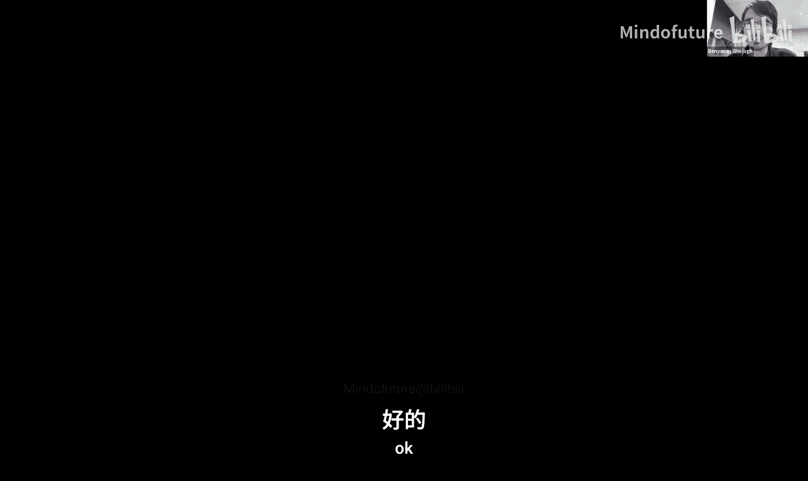
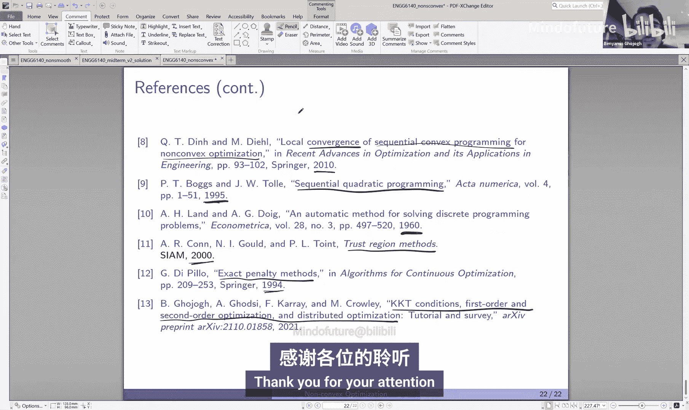

# 【滑铁卢大学】优化技术课程 ｜ Optimization Techniques   W2023 p11 P11_第十一讲_(非凸优化与序列凸规划) -BV1oJCHBcEo5_p11-

Hi， everyone。 Okay， I'm。in this session I'm recording this and I'm going to upload this to YouTube。

 so this session I think the lecture 11 will be divided into two parts。

 first part about nonconvex optimization and then the second part would be will be about metauristic optimization and search based optimization。

And we'll after that， we'll have a bonus lecture， which will be about remanian optimization。

Let me share the screen。嗯。

Okay。So。Before we start this session， I want you to I want to mention something about do you remember in the previous session。

 I had them an ambiguity when I was explaining this slide in the non a smooth optimization。

 So when we went came into the slide 21 in the previous session。

We had this cost function and we said， okay， let's consider the J element of that denoted by CJ。

And we want to。Because we want to take derivative with respect to BJ， and we know that only CJ。

 we should care about only CJ because the other ones will will be just constant would respect to BJ。

But the thing is that。I was a little a little bit confused about the last term here。

 So I thought about it now I'm， I can explain it better。

 So when we have these the consider the J element。 Of course， this is not in terms of beta。

 therefore， will be we have y transs y here， this。We will consider only the J element。

 therefore well have this term， which is xj transs y beta j and note that beta j is a scalar。

 therefore it doesn't matter whether it's on the left part of the x transpose j or on the right。

And also here。This term now the discussion is is on this term。 this term。

 if you consider the J element， so we can consider the J element of x here and also the second x。

 So we'll have this。 this quadratic form beta J Xj transpose X J beta we also。

Can consider the J element of one of them and the rest of the elements in the other one。

So we can have xj transpose only xj of the second one or xj transpose and the rest of the elements excluding the J element。

 that's why so the J element of these can be considered the summation of these two terms。

Either Xj transpose Xj or xj transpose the rest of the x second X。

 that was the explanation that I had to give you， which I was confusing in the previous session。Okay。

 also， before I start the non convex optimization， there is something about integer linear programming in the branch and bound method for integer linear programming。

 which we discussed during the midter with the。Students， but it was a good point。 And I want to。

I want to mention it in the lectures， too。 So that was a problem。

 maximize a cost function subject to these。Constrain。 and， of course， we can solve it。

 So we'll have something like this。 At the end， we'll have these sub problems。

 So what we are doing is that we， we consider。 So as shown in these three。

So we solve we relax this to be a linear programming。

 so we disregard the X J and x1 and x2 belonging to the integer set。

And we if we solve that using the simplex method， we'll have x1 star 8， x2 star is 2。25。

 and C star will be 35。25。Then we'll consider。 so x2 here is a float number。 therefore。

 we can consider whether to into two range， which will split that into x2 is less than 2 or x2 is greater than 3。

And。Again， we are as we have only two variables， we can simply solve it using the visualization method。

So by visualization， we can find the extreme points in the feasible set and then evaluate the cost at the extreme points and as it is a maximization problem find the maximum the extreme point。

 which has the maximum cost value。And if we do that， we'll have in stop problem 2。

 which is this problem。Which is this problem shown here。

Will have x 1 S star equals 8 x2 S star equals 2 and C S star equals 34。

 And in S 3 will have x 1 star S 3 is this。This visualization。Yes well， where， if we solve that。

 we'll see that。S 3。Eals x1 star is 6。5 x2 star equals 3 and C a star equals 34。5。

 and then again we can split more so we can split to x1 less than 6 or x1 greater than 7。

St problem 4 and 5， I'm showing them here in these， these figures。So this is sub problemble 4。

 and this is sub problemble 5。If you solve them， you will see that x sub problemblem 5 doesn't have any feasible set so the intersection of the constraints is empty。

 so it's invisible subproblem 5 and subproblem 4， its solution is x1 is star equals 6 x2 is star equals 3。

25 and c star equals。34。25。 Again， we can split sub problemble 4 into sub problemble 6 and 7 by saying saying that x2 is less than 3 or x2 is greater than 4。

And I'm showing their visualizations here in these two figures。

 and if you solve them you will have x1 is star equals 6 x to a star equals 3。

 C star equals 33 per sub problem 7 will have x1 is star equals 4。

5 x2 star equals 4 and cs star equals 33。5。But the thing is that the a very important thing。

 which you can consider in Inte linear programming is that。So here， when we reached sub problemble 2。

We could stop traversing the tree and growing the tree。For for further levels。

 we don't need to do that。 And we know that the solution。

 the best answer is actually sub problem too。 Do you know why。

 Because as we discuss in the session about Integer linear programming in the branch and bound method。

 we said that。The more we go in the the down in the tree。The more constraints you are adding， right。

 like here， we are adding constraints。So the more constraints we are adding to the problem。

It means that we are restricting the feasibility set more and more。

 The feasibility set is becoming smaller and smaller。 In the best case， it doesn't change。

 but it might become smaller。So it means that the cost will be worse。

 So if we are maximizing the cost by going down to in the tree as the feasibility set is getting shrinking。

The will have less and less cost if we are minimizing， the cost will increase。So。😊。

The higher the the closer we are to the root of the tree， the better cost will have。But for example。

 in sub problem 3， we can't stop because the the。Solutions are not integer。Points， however。

 here in stop problem 2， x1 is star equals 8， x2 is star equals2。Both are integer， satisfying。

The constant saying that X1 and x to our integer。And we have some costs。 Of course。

 this cost is worse than the cost in sub problemble one。

 which is the relaxational problem into linear programming。

Or the same reason that I mentioned because the feasibility set has shrunk。Therefore。

 will have worse cost than this。Again， we know that we can stop it the compare to N S3。

 We know that S3 can be continued。 However， we don't need to continue that。

Because we know that the solution to the sub problemblem3 or the solutions of the children of the subproblem 3 is worse than this level of the three。

And as in this level of three， we have found an integer solution for the variables。

 we know that this will be the best answer and many all of these children。😊。

Even if we found integer solutions for them， they are。

They will have worse costs than these sub problem to。 again， for example， compare here。

 this also verifies what I am saying。 So I see a star here in sub problemble 6 is 33。

 but then sub problem。2 is 34， course 34 is larger than 33。 So we don't need to continue that。

 It means that。If you don't consider this。Interesting point。

 It means that you might go and grow your tree。And it's for very for a lot of levels， for example。

 here， you can， you you， if you don't consider that this point。

 you need to continue sub problemble 7。 again， you might have a lot of branches， right。

 and maybe sometimes you may not find pure children， which are all integers。but。

And the thing is that integralteger linear programming using branch and bound is not that much hard because you can always。

Stop at a level where you find an integer solution。

Where the variables are integers and you know that the children of that level will have worse cost that was an interesting point in interesting thing you should note in integer linear programming branch and bound method in order to have better efficiency and also time complexity of your algorithm you don't need to continue the tree that's much far。

Okay。😊，Now let's talk about non convex optimization start that。呃。What is non convex first。

 let's talk about a non convex optimization function and optimization。What does it mean。

We might have a non convex cost function。Recall the preliminaries。

 we talked about convex and non convex functions in the preliminaries in the person second sessions。

on， for example， this， this is a non convex。Function， this is also a non convex function。

 probably because， for example。If you consider these two points。If you draw a line between them。

 this part of the。function is above this line。 So we know that。Or for a convex function。

 any two points that you choose on the function， if you draw a line between them that the function will be below that or at most it will be on the line。

 but it shouldn't be above the line。Here also， if you consider these two points， for example。

This part is above that。 These two points also these part is above that。

 So it means that these are non convex functions。 Also clearly this， this is a non convex function。

 So again here this is the cost of F and for example。Here， we have。X 1 and x 2。

 So we have two variables in this figure， and the third。A dimension is showing the cost value。

So if we want to minimize that， we want to find this point。Which has the lowest cost value。

 If we want to maximize it， So we want to find this point， which has a largest。Function value。

And these are for these cases， we need non convex optimization because convex optimization assumes that the function and the cost is。

Convex， do you remember in the preliminaries， we also defined and introduced the convex optimization。

 convex optimization。If you remember the cost is convex also the is the cost is a convex function。

 the constraints are also convex sets。 So the feasibility set is a convex set。IfIf either。

The cost is non convex or the feasibility set is non convex。

 Then the problem will be non convex problem and we will need non convex optimization to solve that。

 And by the way， the credit of this figure is。Paper 1 reference one。

 which we'll see in the references， and that's a paper which about visual visualization of the last functions in the neural networks and it is published in in the Nps conference。

 which is a very important conference in machine learning。Okay。So。Here。

 consider this optimization problem like this。MayM function F subject to Y I。

 So the we have M1 inequality constraints and also M2 equality constraints where functions F。

 Y and H are not necessarily complex， okay。Then they introduced optimization methods can also work for non convex problems that do you remember so far。

 whatever we we were introducing， they were convex optimization methods， however。

 I can say that although they were convex optimization methods and they were introduced for convex problems。

 but in practice they usually，Work almost well for noncon problems。

 although it depends on the problem。 So， for example， in machine learning and signal processing。

 I can say that they work almost well。 And the reason， for example， for neural networks。

 I will tell you， I think the next slide， why they。And it usually work well。Because in in a nutshell。

 I can say that in many problems such as machine learning and image processing signal processing。

 usually the local minimums or maximums are good， good enough。But maybe in a problem。

 the local minimum or local maximum is not good。 And you should absolutely find the global opt。

 Then in those cases， maybe the non the convex optimization methods don't work well for the non convex problems。

 because they will find。A local optimum and that local optimum might not be good enough。

But in the in practice in those applications where a local optimum is good enough， then you can say。

 okay， the convex methods maybe work good enough well enough for the non conx problems because the locals are good。

 good enough。Also， the convex problems that if you apply them on non convex， the convex methods。

 which we introduced so far， the convex optimization methods。

 if you apply them on non convex problems。As I said， they might find good， good results。

 but they do not guaranteed to find a global optimum。 They will They will find a local optimum。

 and that local optimum might be local or global。Okay。

They can find local minimizers or maximizers depending on the random initial solution， of course。

 for example consider this optimization problem。If your initial solution。

 because usually you choose your initial solution in the iterative optimization problem。

 either in first or second order。When you want to start your iterative optimization。

 you will start with a random solution right， but and this random random solution should be in the feasibility set so soon here you start with this point with this point。

嗯。With this point， on x。If you do that then and you will move toward this， for example。

 you are using gradient decent， so this is the minus gradient gradient is in this direction。

 so minus gradient will be in this direction and depending on your step size you might come up and end up with in this point。

Which is a local minimum if you choose your initial point to be here。Then。

You will probably end up to this point if you choose your initial point to be here。

Then you will also find this point。 So if your initial point is here or here。

 then you will find a global minimum here。If your initial point is here。

 you will find a local minimum and if in some practical examples。

 usually your local is very good enough。Like this。So this point， of course。

 is global minimum and this point here。Is your local minimum， However， it's good enough。 See。

 see the difference between these two。Is a small。 But here， for example。

The difference local and global is huge。 Therefore， it depends on your application。

 That's what I'm talking about。The optimization landscape of neural network is highly nonlinear。

 similar to what we are showing here in this figure。 It's highly nonlinear and highly non convicts。

 but back propagation works very well for it。 So you might be wondering。If the。

Optimization landscape of neural networks is very highly non linear highly non convicts。

 How does how do neural networks work well。For machine learning。

 computer vision and different applications on natural language processing。How do they work well。

 Because they usually in neural networks， the local minimums are good enough， like this case。

And you will see why you will see this intuitive。 I will tell you here why。 first。

 before saying that。Let me tell you talk about this a bit。 So the optimization landscape。Why。

 what do I mean by landscape， I mean， So when you like here。

When you have some variables and you will have cost。

So if you look at it it's like a landscape with valleys and also with mountains， something like that。

 So that's why you can call it landscape， although it might be a multidimensional landscape。

 so in this case you have two variables and the third the third dimension can be seen as a cost。

So it will be like the landscape on the earth。However， you might have three dimensions。

 three dimensional variable。And your class will be in the fourth dimension， so you should imagine it。

 you can't visualize it on paper。But yeah， or you might have multiple dimensions and your you will have one dimension for the cost。

 And in this case here on I'm also assuming that the cost is scalar usually。So far。

 we assume that the cost is a scalar， but again， the cost might be multidimensional， right？

If the cost is a scalar， the dimensionality of gradient will be the same as the dimensionality of。

Your input， your your input。Optimization variables。 So for example， in this case。

 your gradients will be two dimensional。Because the cost is also a scalar。

 but you have two variables， but according to the discussion that we had on the dimensionality of derivative in the preliminaries。

 do you remember。If， for example， the cost is the cost function is two dimensional and also your。

嗯送边哎。Yes， your optimization variable is three dimensional。 So assume you have three dimensional X 1。

 x to x3 optimization variable also two dimensional costs。 So if your F will be F 1， f 2。

Then your gradient will be a matrix。Matrix of three by two or two by3 depending on what transpose you use。

 but so it will be a matrix。Yeah， that's one thing I wanted you to know。

 So that's why we call it landscape。 we can call it landscape。

 especially in the meuristic optimization， and they usually use this terminology a lot。

 optimization landscape。 So optimization landscape of neural network is highly nonlinear and nonconvex。

 but that per works very well for it。 but my I have a good question here。😊。

Assume that usually the last function in the neural networks， there are usually。

Con actually convet last functions， such as minus squared error。

So consider this B is the batch size I'm using a mini batch， for example， I'm using mini batch。

 that's stochastic gradient decent or even atom。So here I have some batches。

 mini batches like B is the mini batch size and Yi is the output of the network。

 the vector and L is a1 hott encoded label， for example， for the I data in the mini batch。

Or what so you want to minimize the difference between the output of the network and the desired label can be 1 hot or whatever you have。

So you can use it， for example， for a regression problem。诶。My point is that。This is a convicts。

Function。With respect to， for example， YI。So why do we say that the land optimization land escape of。

A neural network is highly nonlinear， highly non convets and for example， like this， why。Worse。

 did mini aur quadratic like this。Completely convex。

The issue is that you' you shouldn't be confused about it because this is this minusd error or this figure。

This is quadratic or this is convex with respect to what with respect to the。Y I， or L I。Right。

 with respect to L， it is convex with respect to Yi it is convetx。 however。

 the optimization variable here is neither Yi nor li optimization variable。In the neural network。

Is the weights of the neural network It's not assumed you have。

Several layers and in each layer between the neurons of the any two successive layers。

 you have connectors and each connector has a weight。Right， so you have a lot of。

 you will have a lot of。Weais， not for example， if you in the simplest case。Som。

 you have only two layers in your neural network。And each of these lines will have a weight。 So。

 for example， in this neural simple neural network， you will have one， two。So， two times 3。

Stick sweets。So your optimization variable will be in this neural network will be six dimensional。W1。

 w2 w3，W4， w5 w6。But you might have by increasing the number of layers and the number of neurons。

 you will have much more weights。So but。Your optimization is with respect to these。

 So you are saying that minimize。This costs let let it be denoted by C mini C with what your optimization variable is w I from1。

 for example， in this case to 6， your optimization variable is not Yi。

 your optimization variable is not L LI is the given in the data set， which is the label。 Of course。

 it's not a variable， but Yi， you might think it is a variable because this is the output of the neural network。

 but you are not optimizing。Your optimization variable is not whyi。

Your optimization variables are the weights。By tuning the weights。

 you will generate some Yi to have a small last function， last value。Right。

 so you will tune your WIs in a way that the Yi becomes very similar to LI。

And that's why the optimization landscape of the neural network is non convex and nonlinear。

 even when the last function， which is used is a convex function with respect to y output of the neural network。

 that's fine。So that was one thing。AndOkay， also now in this paragraph， I'm explaining why。

And why the。Usually in the neural network， the local minimums are good enough。

 so we can simply use back propagation， which is。As we discussed before。

 which is just gradient descent plus。Chain group， right？Of course。

 it will converge to a local minimum and that the local minimum will be dependent on the initial random weights of the neural network。

But why usually do they work well， even with different random weights， it's because。

This is the reason every layer of the neural network。Wlls data to the feature space such as kernels？

Okay， so。I think it's good for me to visualize it。In this way。So consider this neural network。So。

 it goes。From 2 to 3。 and then again from 3 to 2。Okay。This， this is layer 1。This is layer 2。

So in layer one， we go from two to three。2 and 3 are just examples。 For example。

 it might go from 50 neurons to 1 50 neurons。 But it's increasing。 That's my point。

 So it's when it is increasing， it is like。Ks in machine learning。 What do kernels do in a nutshell。

 I can say that they。All data from Euclidean the space to high dimensional healber space， okay。

In simple words， they increase the dimensionality of data。For better separation of classes。

 So when you have， for example， consider my hand that these two。

This is a class and my fingers here are also another class。🤢，So by increasing the dimensionality。

 these two classes to the third dimension， these two classes are separable。

 linearly separable by a plane， but here before。Increasing the dimensionality。

 they couldn't be linearly separable， right， because you can't draw a line or a hyperplane between these two classes to separate them。

 But by increasing the dimensionality， now they are separable。

 So kernels try to increase the dimensionality for better discrimination of classes or better representation of data。

诶。Now in layer2， you go from3 to2 or from more neurons to smaller neurons。

And this can be seen as dimensional to reduction。Why because we are reducing the number of neurons。

 So it means that we are reducing the dimension of data。

 So every layer is either this or this it's either。

Going from less number of neurons to more number of neurons， which will be seen as a kernels。

Or from more number of neurons to less number of neurons， which can be seen as dimensional reduction。

 So just you can see。An neuralal network as a stack of kernels and dimensional reduction。

 but between them you will also have linearity， linear activation functions。

 We discussed these a bit。In the session about。Back propag neural networks too。Now， let's see。

Every layer of neural network， so it's either kernel or dimensional reduction。

 so it maps data to some feature space， some feature space here。In high dimensional feature space。

 in high dimensional feature space， all local minimums。These are almost global minimums。

This is an important sentence in high dimensional feature space in hybridber space。

 usually local minimizers or almost global minimizers。

Because the low column minimum values are almost equal to the in that space， so in high dimensional。

In high dimensional features， we usually have this case。

 So the difference of the local minimums are is usually small。

 so we'll have something like this almost。We will not have such cases， usually。In。

High dimensional features space。This usually happens。 That's why， no matter which。

Initnitially random point weights we choose we usually end up with good solution because they usually have the difference between these FS stars is a small。

It's not always the case sometimes so they first off they are different a bit。

 so it's not saying that usually when you start training your neural network。From scratch again。

 with different random seat， of course you will have a slightly different solution。

Because you might end up with another local minimum however they usually are the same。

 and I'm not saying that this never happens， but this is rare。This is rare。 This is more often。

 This happens more often in neural networks。 that that was the reason。

 And you can see a paper 3 for that， also paper 4，5。

6 will see the references at the end to understand why back propagation optimization works well in highly nonconvicts。

optimizationptim。Okay。Another thing which I want to say， okay， has was explained。

So now let's talk about nonconvicx optimization。The already introduced first order and second order optimization methods can work fairly well for non convict optimization methods problems。

For the reasons which I discussed by finding local minimizers depending on the initial solution of okay okay。

However， there exist some specific methods for non convex programming or non convex optimization。

Divide it into two categories so we have two types of non convicx optimization methods。

 either they are local optimization methods or global optimization methods。O。Local or globe。

Local optimization methods are faster。But， they don't guarantee。

To find a global minimizer or if it's a maximization problem， a global maximizer doesn't matter。

But in global optimization methods。😊，They guarantee to find a global minimizer or maximizer。

 and they can certify that also， whether it's global or not。But they are usually slow。

To find the answer。 So is there is a trade off between these two categories， you want to be fast。

Or you want to find the actual global minimizer。Okay。

 an example for local optimization methods is it's sequential convex programming or SCP。😊。

It's an example。For local optimization methods， it's based on the sequence of convex approximations of the non convex problem。

So we have convex approximation of non convex problem and we do it sequentially， a sequence of them。

That's why it's called sequential convicx programming。 And this is。

 it's closer related to sequential quadratic programming。 If the problem is quadratic programming。

 recall preliminaries。Then we can use sequential quadratic programming， which is a method。

It's used for constraint and non nonlinear optimization， okay。

An example for global optimization methods。😊，His branch and bound method。

 which was proposed in 1960s。And it is paper 10， it is an example for the global optimization message it divides the optimization landscape。

 it divides that into or the feasible set。😊，Into local parts， by a binary tree。

And Sos optimization in every part is closely related to the branch and bound method which we use for Inte linear programming in the initial sessions of this course。

😊，It checks whether the solution of a part is a global solution or not， so it checks that。

 whether it's a global solution or not。😊，Here。Ignore this because I have added that to the static。

 so I'm going to explain both sequential Coms programming and branch and bound method。By the way。

 another approach for solving highly non unVx optimization is meta heuristic or search based optimization。

 which we'll explain later， I think in the second part of this lecture which will be in another video。

 I will explain that introduce that。😊，Okay， so we either should use local。

Or global optimization methods such as sequential convex programming or branch and bound method。

 or we can use meuristic or search based optimization also meistic or search based optimization。

 they don't necessarily guarantee that the solution is global minimizer similar to what we have in local optimization methods。

 However， global optimization methods such as branch and bound method。

 they can guarantee finding the global solution Okay now let's talk about sequential convex programming a bit。

By first introducing the convex approximation。嗯。So what we have is this。😊，呃。Recall E one。

Where we are minimizing a function f of x subject to it。

 and these are the constraints we have M1 inequality constraints and M2 equality constraints。

Denoted by Y I and H。Respectively。So sequential convex programming or SCP。

 itly so it's a creative solution optimization method it creatively solves a convex problem where at every tra it approximates the non convex problem one。

 so this is a non convex problem because maybe F is non convex Yi maybe non convex or H maybe non convex it means that。

Either the cost is non convex or the feasibility set is a non convex set。と。

But sequential Comx programming iteratively in each iteration， it approximates it to be convex。

 so it relaxes the problem to a convex optimization problem。And it solves that sequentially。

 but there is a so based on the current solution， it restricts the variable to be in a so called trust region。

 so it uses a concept named trust region， which we willll introduce。😊，中。

In order to make sure that we are not very off topic。

 we are not going somewhere that which is not trustworthy。

Because we know that the optimization method that you are tackling is actually non convictx。

 we are relaxing it， so we need to have a trust region。To not go off much。Get a trust region。

 make sure that the variable stays in a locally convexed region of the optimization method。So again。

 what does trust region do， it makes sure that the variable， the optimization variable。

St which is the solution of deit， it stays in a locally convex region so locally。

Local econist region of the optimization problem that's why it's a local optimization method。

At iteration K of the SCP， we solve this optimization problem。 so at each iteration。

 we are relaxing this problem to problem two to equation2 here。😊，So F hat of eggs here。

Is the convex approximation of FO V？Why I had to eggs。Is the convex approximation of YIX？

An H hat X is a convex approximation of H X。So we do it for all the all of the constraints and the cost function we approximate them we have convex approximations of them and we'll see how we can do the convex approximation and what is here。

You are also saying that the E needs to be in the trust region， in the K iterationeration。

 So T is denoting the trust region at the iteration K Tk。

Why do we do that because we want to make sure that the variable stays in a local economics region and the optimization problem？

This approximate convex problem， which is equation 2 here。Is also solved iteratively itself。

 So this also。Is solved iteratively using one of the previously introduced methods such as the interior point methods。

 So we can use any of the optimization methods， which we introduced so far to solve equation to why。

 because we know that equation2 is a convex optimization problem and whatever we introduced so far in this course where convex optimization methods for solving convex optimization problems。

And we know that E  two can be solved by them， such as by interior point method or like barrier method。

So we can solve them。And an interesting thing is that here we are doing in SCP。😊。

We are doing it iteratively and at each iteration we have to solve equation to something like that。

And it means that we have nested loop， so we have one loop for SCP for iterations of the sequential Comx programming and it each and it and in each iteration of SCP we also need to solve a conx optimization problem which itself is solved by an iterative optimization method such as interior point method。

 which is an iterative method right， so we have a nested loop。

There exist several approaches for convex approximation of the function in the following we introduce some of these approaches for now in the next slide here。

 we are going to explain the how we can do the convex approximations。

 how we can find hat of F hat of X from F of X or Yi of x from Y and H hat of x from Hix， right？Okay。

 let's do that。For that， we can use Tayloror Ser expansion in this way。And the non convex functions。

 F Y and H。Can be approximated by a fine。Functions。Or first order tailor service expansion。

 Do you remember a fine is just a linear function which might have a bias right。

 therefore it's first order tailor service expansion。

 which is a linear thing and and we can use that you know to make it conx because we know why why do we know it's a convex because we know a linear function is always convex。

A line or a hyperplane is always convex， a convex function。So。And for example。

 the function F is approximate that as So F hat of x can be this。What is this。

 This is the first order Tayloror service expansion of F of X。

Right and this is a great so f of xk at the evaluation of F。😊。

At xk plus gradient of f xk transpose x minus xk， so this is the first orderer serves expansion around the point xk。

Okay。😊，Or we can use more accurate approximations like quadratic functions。

 which is the second order tailor service expansion。To make it convex， for example。

 the function F can be approximated by these。So again。

 this is the second order Tayloror serve expansion of the function F around the point xk。

Excus a solution。Of the。Problem at it K。So this f of xk gradient of f of xk time transportpo x minus xk up to up to here。

 these two terms is the first order Tayloror series expansion， but we will have a third term。

 which is the quadratic term for second order Tayloror series expansion and what is P here。え一つ。

Projection so projection， do you remember we had projection。

 we introduced that in the session about proximal methods。Several， I think three sessions ago。

 so P is this projection of the Hessian onto the symmetric positive semi defite cone。So first off。

 we need to have hessian here because it's the second order derivative in the second order Taylor serves expansion in the third term we need。

 so in the second term we need to have gradient in the third term， we need to have the hessian。

In the first term we have the function， the second term we have the gradient and the third term we have the hessian。

But hissian we need， we know that needs to be positive semideite by definition。 therefore。

 if it's not， we need to project it onto the cone of his semi defite and。p诶 co。How do we do that。

 How do we can we do this projection simply we can。

What is the definition of positive semideinite matrix， it means that it eigenvalues。😊。

Are part are non negative。 They are either0 or positive， right？

 So for this projection onto the positive semi defite cone。

 we can simply have the eigenvalue decomposition of the matrix P here or the hessian here。😊，And then。

Is set the organvalue。Which are negative to be0， so we can have for the eigenvalues。

 we can have maximum of each eigenvalue and 0。So if the eigenvalue is negative， we make it zero。

 if it's zero or positive， we use that。There， then we reconstruct the eigenvalue decomposition in order to have the。

The matrix back， this is the projection onto the positive semi definite cone， okay。

And the same approaches can be used for approximation of FYi and H。

 so this was the approximation for F， we can do the same for Yi H。

 we can have either first order or second or the tail service expansions of these to have Yi hatch and H hatch right so and why by the way is the quadratic form convex because we know that the quadratic quadratic function is a convex function so either a fine function or quadratic function approximation makes the functions convex。

Okay， now so。We can have another method for another approach for convex approximation using the particle method and what is that？

We can approximate the functions F y and H in the domain of the trans surgeon using regression。

This approach is named the particle method。Paper 7， so。Consider this。

What are these the end points which lie in the trust region。 So soon you have a trust region locally。

What is the trust surgeon？A local convetx region around the point。 Okay。

 and soon we have endpoints in that trust region。 We can use least squares quadratic regression。

So why do we say least the squares squared？This is this is exactly the lista squares quadratic problem。

 Why is it quadratic because we have。Power 2 here。 and it's list the squares regression because we are minimizing these quadratic form。

 And what is this to make the functions convex in the trust region。 So we are saying that。

Consider this。This。This is a quadratic。😊，The problem。With unknown P， B and A。

 these are the parameters。Or the optimization variables， we want to find these。

And we want this quadratic function to approximate or regress the function F the best。

So this minus this is the error of this quadratic function from the function F。

 and we have the squared error and we want to minimize the squared error over the m points。

We're subject to when we know that the P。Should be positive semiphony， al right。Okay。😊。

Then the function f is replaced by this so after solving this and finding P and A and B。

 we can simply say， okay， this now is a good approximation of F。

 therefore we can replace f with exactly what we have here with the found parameters P， B and A。

So P is a matrix P is a vector， and a is the bias scalar bias。 By the way， why should we have。

P positive semideite， because， of course， this needs to be。A positive semiite for this to be。

A convex function。 So because this is the quadratic function and the quadratic function needs to be。

Facing up in order to be unvex like this。Right here。

If P is negative definite or negative semi definite， then the quadratic function will be facing down。

 which is not convex anymore， it's concave actually opposite of convetx， it's concave。And therefore。

 that's why we need to have p to be positive semideinite in order for this to be facing up this quadratic function to be convex。

Again， don't forget we are having convex approximation so this approximation should be convex。Okay。

Again， we can do the same for Yi and H， so here we'll have Yi and H in this in order to have approximations of YI and H in particle method。

Another approach to have convex approximation。Is quasi linearization。So what is that？We we can have。

 we should state that the function if。We should state it in this way so we can say f of x。

Itquals a of x times x plus c of x。Okay， now let's see what these are。 For example。

 we can use the second order Tayloror series expansion to do this， for example。Again。

 we can write if as。X transs P X plus B transs x plus the bias A。Where P is positive semi different。

 so this is a convex quadratic function facingcing up。

So we can this is a second order Taylor search expansion， therefore we know Pb and A， right？

Recall here here， this is we know what P B and A are by in the Taylor search expansion。

We can rewrite or realstate this as this。Why， because here， consider。

In this will be equal equal to one over。2， expose。P， note that P is a symmetric matrix。

 therefore p transpose equals p。So this will be transpose p transpose。

 but p transpose equals p itself。Plus x， it is multiplied by x plus b transpose x。

That's why we can write these two terms as this， and we also have plus a。Now。

 let's consider a to be this comparing this with this。Gives us to take， let's mix us get。

1 over 2 p X plus B transpos to be a。And C x to be A to B6， right？Okay。😊，And they。

 of course depend on the Taylor series expansion of F。Hence the convex optimization function convex。

 sorry， approximation of function F can be this。Can be written as this。

The same approach can be used for a Yi and H， so we can do the same for YI and H in order to have this approximation。

It's interesting that。should note some difference between these approaches。

In the first approach using Tayloror service expansion。

 also in the third approach using quasi linearization。

We already know A and B and P from the Taylor series expansion， right However， in App 2。

 which is a particle method， we find A and B and P using regression by solving this optimization problem。

So this is a subtle difference between these also。Why do we call this quasi linearization because we are writing a quadratic form like。

😊，A linear form。So consider a to B。A it's like a x plus B in this form， right。

 if you consider a of x， although a of V itself depends on x。

 but if you see a of x capital a of x as a black box， then it seems to be like a linear function。

 but it's not an actual linear function because a itself has x in it。

So it is an actual quadratic function。 as but as we are showing it in a linear format。

 we can call it quasi linear， right， That's why it's called quasi linearization， okay。😊，Now。

 so we introduce three methods approaches to have convex approximation of F Y and H using either Taylor series expansion or particle method or quasi linearization。

Now let's talk about trust region。Trost region。Do you remember what was trust region here with instead talked about it trust region makes here？

Make sure that the variable stays in a locally convexed region of the optimization problem。Right。

With which we are also having。In this。Optimization problem。In every tradition of。

Sequential Coms programming， we have a trust region。Okay。

 let's see what how we can formulate a formulation of trust region。 The trust region can be a box。

By a box， I mean a cube， a hyper cubebe in a multiple dimensions， right。

 a box or a hypercue around the point at that iteration。です。What is this。

 so this is a trust region aration K。😊，What does it mean。It means that。X。What does it mean？For。

 first off， let's consider one of the dimensions， so J goes from 1 to d so here we are talking about elements wise。

Each element， the JS element or Js coordinate。X J minus X J K， so。All of the points。

Who chase coordinate。Has a distance less than rh I from the J coordinator of xk xk is the point at or the solution at the K iteration。

 Okay， so xk is known。But now we can find the points which are close to it by having a box around it。

 so assume that。For example， in 2D。嗯。This is。R one。老 one。人。If x1， So this is。This is x 1 k。This is。

X2 k， So X K。As coordinate  one and coordinate 2 in 2D， right？So， here。

In the first dimension we'll say that except all of these region。This region。

Where points are by row 1 away from x1 k。Also for x2 for the second dimension， we are saying that。

 okay， assume this is row 2， this is row 2。Accept the region here。All of the points here。 Now。

 the intersection of these two is just this box。 That's why you are saying。It's a box。

Or a hyper cube now you go to multiple dimensions and you will have hyper cube right so this trust region can be a box or a hyper cube and xj and xjk we said that this j element of x and xk and note that x and xk are vectors the dimensional vectors Okay row I is the bound of the box for the J dimension shown here。

 for example。Okay。Another option for trust region， so it can be either box or it can be eipse。

 so we can have quadratic trust region。Rather than hyper cubebe， we can have ellipse。

Around the point we have quadratic transfu like this。 So all of the points。

Which are in the neighborhood of Xk。Inside an ellipse， so for example。This is x in two dimensions。

 For example， it can be something like this。 This eipse might be， in some cases。

 if you consider row to be the same for all。Dimenssions， then it will be like a sphere or。

As it is also we are considering inside of it， it will be a ball， right？But anyways。

 it's either it's either es or。A ball around。The point X K。

 So the trust region can be hypercu or es or。ball。 and this P also is a symmetric positive definite because it's shown an ellipse and row is a radius of ellipse。

Okay。Now， so after formulating the trust region， how can we update the trust region in the it iteration okay。

 because the trust regions of iterations are different note that T。Of has a superscript K。

 it means that in each iteration， we might have different trust region。 Now we need to update that。

 Okay， the trust region gets updated。In every tradition of sequential convex programming。

In the following， we explain how the trust region can be updated Okay， recall equation one。

I think I have repeated here to here。 Okay here。 So we are minimizing the function F。

With M1 inequality constraints and M to equality constraints and these are not necessarily convetx so this optimization problem is a general optimization problem which might not be a convex optimization problem then we can embed the constraints in the objective function like this do remember one way one technique in optimization was staff penalty where we are embedding。

The constants into the con cost function， similar to the approach that we had in Lagrian。 Okay。

 so now minimize。Phi of x， which is the regularized cost function where the cost is this and we have a regularization term or a penalty term。

This is。Inequality constraints， and this is the equality constraint。

 And do you remember this technique。So。We had this technique we introduced that。

 I think in the sessions about distributed optimization。

 I said there is a good technique for converting inequality constraints to equality constraints by saying that that's Y prime of Xb。

Defined as。Maximum。of y i。X and 0。Equals0。So this is an equality constraint。

And why is this equivalent to this Because if Yi is less than0？Then it will be0。Satisfying this。

Inequality， if it's greater than zero， which is not satisfying this inequality。

Then we will not this will not be equal to zero， so it will not satisfy this equality constraint as well。

That's why these two are equivalent now。😊，We have converted this to this and then we have put it in the penalty term。

We also。You can write this in this way where we are having a quadratic。

Format of this equality constraintstraint， by because we want to have quadratic。formss of these。

Constraints， penalties， because quadratic has a simple derivative。

 and Lada is a regularization parameter。Also this is called this technique is called exact penalty method proposed in 1994 because it penalizes the violation from the constraints。

 so this is the technique that this is the soft penalty technique or regularization technique。

 which is here we can call it exact penalty method proposed in 1994。

For large enough regularization parameter， which gives importance to violation of constraints。

 of course if you。So Lada the regularization parameter is giving weight。

To the violation of constraints with respect to cost。So the more the lambda。

 the more you care about violation from the constraints。え。So for large enough regular parameter。

 the solution of problem 9 is exactly equal to the solution of problem 1。 And that's interesting。

 So theoretically， it has been shown maybe in this paper 12。诶。

If you solve this for large enough Lada it is exactly equal to this and hence the name exact here。

 exact penalty method。Okay。Now， recall。Equation2， what was this。

 this was the convex approximation of this problem where we had the approximation of F y and H as F hat y hat and H hat respectively。

 and we also had these for the trust region。Okay， we also had this in the previous slide。

 which is this equation 9 and have repeated it here。谢。Now， similar to this。We can define this。

 What is this， So here it's the same as this， but I'm replacing F with with F hat。

Why with Y hat and edge with edge hat。Right。So。I'm defining this for this problem。This。

Was defined for this problem， which was non convex。 But this is defined for this。

 which is a convex approximation。 Okay， aitration K of sequential convex programming。

 let x hat K be the solution of the convex approximated problem to assume that at itration K。

 its solution。This the solution of this problem， which is the convex approximation of the actual problem。

 let its solution be denoted as x hat k。Okay， using any method such as the interior point method。

Okay， we calculate now。We know that we can simply find X hatK using any of the methods introduced so far in this course。

Such as interior point method， we can now calculate the error。😊，Cause， we know that。

There is a difference between Phi hat x ads。 so feed these。To these， P hat。Also。

 we know that if we solve this problem， actual problem， this will give us some Xk。

We can feed it to this by x so we'll have。诶。Buy X， K and P hat X hat。Right， so there is some error。

And we know that this should be decreasing， this should be decreasing。诶。Yes。

Now let's see we have defining two things。诶。Delta hat and Delta， What is Delta and what is Delta。

So in both of them， the first term is phi of xk， so this is phi。Defined here。And xk。

 what is xk is the solution。It次是。It's a solution to the actual optimization problem。Aiteration key。

What is X hatt， X hatt is a solution to this optimization problem， approximation。

By hat is defined here。But the difference is that in in Delta hat。

 we have phi hat x hat here in the second term in the delta， we have phi x hat。

 So we are fitting x hat to the phi here。 This is the difference between these two。Okay。

This is called predicted decrease， this is called exact decrease， and they both should be decreasing。

O。Again， I have repeated the sentence here， we calculate these two。Two cases may happen。Okay。

What are these cases？We may have progress in optimization， we have progress in optimization Eve。

We have this。What is this。So， a。Delta hat is less than or equal to Delta。Where a is between0 and 1。

 such as。Point1。In this case， we accept the approximated solution。嗯。So give me a second。嗯。哪啲个仔。Yeah。

 I paused a bit and thought more about it to explain a bit better this part so that。

What I said was almost correct。 But let me recap recap what I said。 the thing is that。Here。Here。

 okay。So we have this function as five weeks。What is this， It's just ir regulargularized。

Cost function of the actual problem， which is my which is a nonconvict optimizations problem， right？

I fly your V。We also are saying that let's have the five weeks version， but for the。

convetx approximation of the。Functions， so we have F hat y hat and x set and let let it be denoted by p hat of x。

 okay。So so far， good now。We are assume that we are in the iteration K plus one， okay。

So we are iteration in iteration K plus1， and assume soon we have the solution from the previous iteration of K in the sequential convex programming。

RightSo we have some solution superscript from the previous solution from the previous iteration of sequential convex programming。

Okay， now we are in iteration K plus one。So。Ex。Superscript K， we have it from previous situation。

We have bioioVs defined here。This is a function just ignore this minimization for now。Okay。

 we also have phi hat of x defined here。 This is another function， right。

 and these are the tailor series that maybe expand approximations of these or other methods or approximation of these Y。

 I， H I and F here， Okay， now。What is X hat。That is exact。

 we solve this in iteration in this iteration。 Let's solve this in iteration K plus  one。

 Let's solve this optimization problem。 This is a convex optimization problem。

 We can solve it using any method introducing this course， such as interior point method。

 because it's a convex optimization problem。 That's its solution B。😊，Except。Okay。Now。

We can calculate。ね。Delta， hat and Delta here。How， so we know the functions Phi and Phi hat。

Here weve beat X hat， which you found here。Into Phi hat。

 we also have Xk from previous iteration with fitted to function phi。都。this is a scalar。

 This is also a scalar Delta hat is a scalar。 It's the error between biovix and phi hex hat。

 You also have this delta， which is we feed Xk from previous iteration to phi。

Function phi we also feed x hat， which is the solution of this。To the function phi again this time。

 this is also an error， a scalar error error， Dlta。 Okay， what are they showing actually。

 I have repeated them here again。What are they showing。This deelta hat。Is showing。The difference。

Between。What is phi Phi is actually a reformulation of the actual optimization problem where we are embedding the constrain。

Into their cu， right。Fly ahead。Is the reformulation。Of the approximated optimization problem。So phi。

 you can see it as the actual optimization problem reformulated。B hat。

You can see as the convex approximated optimization problem reformulated。Okay， of course。

 we want phi x to be similar to phi Hatics。 Phi Hatics is the approximation。

But we can have two types of errors again， as we have here， we can have file。 So file of Xk is the。

Cost。Up to now cost up to the solution of the previous solution iteration。Okay。

 that's why we in the first term of both of these errors。

 we have phi of xk However we can have its error or its difference from phi hat x hat or phi x hat so we can feed。

The solution of。This optimization problem。To either fly hat or fire。

Right we have an approximated solution， but we can feed this approximated solution to the actual problem or to the approximated problem。

Sing。Okay。Delta hat is the error from the， from the。Evaluation of that。

Approxiation in the approximated functions。Delta is the error from the evaluation of F。

Actual problem。This from the evaluation of actual problem at the approximated function solution。

 okay， that's the thing。Now， let's see。Course。Here we are saying that if Delta alpha Delta hat is less than Delta。

And alpha is between 0 and 1， for example， 0。1， it means that if deelta hat is less than。

 for example，10 times delta。😊，Okay。Then it's good， so if a scale of if deelta hat is less than a scale of。

Delta， this error。It's good。 Why， Because boy hat X had。Has more。Approxiation level than phi x hats。

 Do you know why， Because X hats， we know there is the approximated solution phi hat。

Is the approximate problem？😡，ストイツ。Eror into error。 erroror of the solution。

Into error of the approximated functions。😡，This is Phi hat X， but Phi X hat is has one error。

An error which is the app solution， so P hat X hat has error into error back or propagation of errors y because X hat is some error in itself。

 p hat also has some error because of approximations of functions。However。

 phi x hat phi is the actual optimization problem regularized。But x hat only has error， that's why。

If the approximated error， which has error into error。😡，Has less error than some some scale of。

This actual error， which has only one。Order of error。Then it's good。 Then it's good。Then。

 accept this。Exhat。For this iteration， K plus1 accepted。And also reward the trust region， you say。

 okay the trust region was good， therefore let's expanded， so multiply this。

 do you remember role was the size of trust region either in the box or in the radius of the quadratic trust region right here or here。

Expandrow， it means that in large。Enlarge trust rate。It's good it's trustworthy less and large yet。

 however， if。These deelta hats。Which is a harder error， so。Which it has errored into error。

Is larger than some scale of some scale of。Delta。Right， larger than 10 times because alpha is 01。

 So it means that Delta hat is 10 greater than 10 times Delta。 It means that if。The error。

 which has erroring into error。It has propagated error itself is larger than a scale of this actual error。

 which has only one order of error。 Then it's not good。 Then it's not good。 reject the solution。

 reject the approximated solution， which was X had。And have the previous solution。

 copy it to be the solution of the iteration K plus one。

 so copy the iteration of the solution of iteration K to be the solution of iteration K plus1， right？

And。rick诶。Punish the trust region。Making it smaller。By multiplying it by gamma。

 which is between 0 and 1。 So row becomes a smaller。

 It means that the trust region becomes a smaller， right， So in summary。

 the trust region is expanded if we find a good solution， otherwise it is made a smaller。So。

In summary， if we。Find it。An approximated solution。Which is actually decreasing the error。 It's good。

 It's a good solution， accept it。Enlarge attro Street。If it's the approximated solution X had。

iss not decreasing the error well enough？Rejected。Copy the previous solution to be the solution of this iteration and make the trust region smaller。

Of course， by making the trust region smaller， you're changing the this optimization problem and your Xha solution will be different again。

So don't tell me that。How is it different， how will it be different in the next K plus2 we also have the same X hat and will get the stock in this case no。

 because when you make the trust region smaller you your constraint here will be different and when you solve it using the interior point method for example you will have another hat therefore hopefully that Xha will fall into this case。

 which is a good solution and you accept that。We get it and by the way， comparing Delta hat and Dlta。

 I think we usually expect that Delta hat。Is larger than Delta。Or it's worse than that I can say why？

Usually， because it has error into error， it has prop of error into it， it has solution X。

 which is approximated solution into other approximated functions。

However here we only have approximated solution。Okay， that's why here we are kind to Delta hat。

 We are seeing that if Delta hat is less than some 10 times deelta。

You are kind to Delta because we know that Delta hat is worse would be worse than usually worse than Delta。

 so if it's less than 10 times Dlta， then it's good。If it's worse than 10 times delta。

Then it means that is bad。Okay。That's it Okay， I think we needed to talk about this。

In details so you understand the concept of trust region and also the sequential convicx programming。

Now sequential convex programming is over。Let's start the branch and bound method。

 which was an example for。Global optimization method for solving non convicx optimization problems。

The global optimization methods。Guarante that they will find a global solution， they can certify it。

 but they are usually slow。In contrast to the local optimization methods。

 such as sequential conx programming， which we discuss。

And they are the local optimization methods are fast。

 but they don't guarantee that they find a global solution。

 but this is usually slow branch and bound， but it guarantees that it finds a global solution。 Okay。

 it's closer related to the branch and bound method。

 which would introduce for integer linear program。It's see。It was proposed in 1960。

It is a global optimization method branch and bound I'm talking about。It is a slow， but it finds。

The global optimum， okay。The idea of this method。 Okay， it says divide。 This is the idea。

 the idea of this algorithm。Divide the feasibility set， so we have some feasibility set region。

 right？Into two convict sets。Or rectangular or hyper cubic regions。Okay。In high dimensionals。

 you can see that hyper cubic。In each region， then。

Find an upper bound and a lower bound for what for Fs star。 So if assume is a cost function。

 you assume you want to minimize the cost function。So you have an optimization landscape。

 it will have some feasibility set because of the constraints。

 divide the constraint into the feasibility set。Fored by the constraints into two regions。

In each region， find some upper bound on FS star and lower bound so sandwich FS star in some range and say that FS star can't be above some upper bound and can't be below some lower bound and we'll talk about how to find that upper bound and lower bound in each region。

Okay， now。When you do that， choose the better region among these two。

Which region is better to continue branching？Go into that region and do it it creatively and split it again。

Do it iteratively so its as you see it's a recursive procedure。

 so when you code it you need to do it recursively。And do it until convergence。 of course。

 it's a tree because you can implement three using recursion。Encoding， okay， now。

 approximation of lower bound。So for approximation of lower bound， what do you do。

Lowor band of Eest star in a region。It can be the solution or a convex relaxation of the optimization problem。

 why？Because we know that。The solution to the。Problem， which is which maybe be non convicts。

 is worse than。The solution to the convictx relaxation of that optimization problem。

 So in other words， when you have a non convex optimization problem， when you relax it to be convict。

 your solution， if you， for example， if it is minimization， your solution will be。

Better will be less than a star。So soon you have problem one， it is non convicts。You relax it。

To be problem。2。It is convicts。Relaxation。Of P1， okay。This gives you a。F1 a star。

 So this gives you F2 a star。If it is a minimization problem。Or minimization problem， You know that。

F to a star is less than or equal to F1。 It's better。Because it's a relaxation。

 it convicts relaxation。If it is a maximization problem， you know that。

The F2 star is greater than or equal to f1 star， so it's better again。

So Comax relaxation makes the optimal cost better， that's why。Now we are here。

 we are talking assuming that this is a minimization problem。

 therefore or lower bound we can consider the solution of convex relaxation of the optimization problem in that region to be the lower bound on FSR because of this。

Okay。For upper bound of the optimal value of a star in that region。

 it can be any point in the region why， because this is by the definition of the。😊。

Global minimum of Fs star global What is the definition of global minimum of of function F。

 which is Fs star， it means that。F star。Is less than or equal to f of x for all x in that region。

In the duming， right， this is a definition of global new， So if you take any point。😊，In that region。

 in that domain， of course， it's greater than or equal to FS star。

So any point you can take it as the function value at that point can be upper bound。Okay。

 so now we talked about these， how to。Have the upper bound and lower bound in each region， okay。

And also another thing which we should notice is that the more we progress in the algorithm。

The closer or the tighter， the lower band and the upper bound get to each other。So， initially， maybe。

If you assume， I did not lower bound by L and upper bound by U。 Initially。

 you might be here and L might be here。 So these are scrs， right， because these are F values。Sorry。

The difference between these two is huge， but gradually when you go。

Progress in the iterations of the Brenon bound method。U and L get closer to each other。

 so they become tighter。So， this range。Becomes a smaller， or this sandwich becomes a smaller， right。

 okay。Until。😊，Until they can reach each other。And that would be the actual F star。

Because we will have when we have FS star between L。And you。 And when you。

And when U and L are equal to each other， it means that the FS star。

 when it's sandwiched between two equal numbers， it's exactly that those numbers。Right。

 that's the thing。Okay。Now let's see the branch and bound algorithm in detail in detail。Yeah。Okay。

 so。Start。With with the feasibility set as the region。 so consider the region that you want to split。

To be。The feasibility is set。Defined by the constraints of the optimization problem， O。

 calculate the lower bound L and upper bound U of the feasibility set。Right。Step the overall。

 So we define overall lower bound and also overall upper bound denoted by L overall lower bound overall and U overall upper bound overall。

To be the lower bound and upper bound of the feasibility set。

How do we by the way calculate the lower band and upper bound of the feasibility set using these two？

Points that we talked about or lower bound， we can consider the convex relaxation。For upper bound。

 we can consider any point。So do that and then L overall and U overall are initialized to be L and U in the feasibility that Now we have a loop over iterations we have because it it is an iterative method right split the region。

TheThe region， so initially the region is feasibly set but。Later on。

 the regions becomes smaller and smaller。D the region。Into left and right regions。

 So by left and right here I'm just for the sake of notation。

 I'm saying that but it's not necessarily left and right because in multiple dimensions in high dimensions。

 we can't define it in left and right， I mean， into two regions， okay。But for the simplicity。

 I named them left and right regions。 Okay， and why do I call it left and right。

 Because it's actually a binary tree。 So assume this is the region， you go。

 you can represent it by a binary tree。 it is split into two regions where the union of these two regions is this and they don't have an intersection。

 So it means that。That thisjo union of these two。Regions， sub regionsg is the actual region， right。

Divided into these two regions。I call it left and right regions again。Calculate， okay in。Yes。😊。

The lower bound and upper bound of left and right regions。

 so in each region calculate the lower bound and upper bound。

Let the lower bound and upper bound of the left region be denoted by L left and U left respectively also for the right region we denote them by lower L right and U right for lower bound and upper bound respectively okay。

So we have these for。Scalalar values。Update the overall lower bound if the largest lower bound among left and right regions is larger than the overall lower bound in simple words。

 in simple words。Let's update the L overall， which was initialized by this。

 the lower bound of the feasibility set。To be maximum of L left L right and L overall。

 what does it mean， it means that。Between L left and L right， which one is better。Of course。

 the larger one， the larger one。 that's why I called it。诶。Larrgest lower bound among left and right。

 why。Because it means that。For tighter range， remember。

 we want the range between lower one and upper bound to be tight。 It means that for tighter range。

 we want larger L and a smaller U。We want larger lower bound。

And a smaller upper band to make it tighter。 Therefore， I like the lower band to be larger。

For so when I am comparing the lower bundle of ref region and right region， I take the largest one。

And then I'll also compare it again to the overall lower bound。 And again， I take the largest one。

 So in simple words， I take the largest among L left L right and L lower。 I update that。

Do the same for the upper bound。 But it in this case。

 take the mean again for the same reason or tighter。Bound between lower bound and upper bound。

 tighter range。I want a smaller upper bound， therefore。

I get the smallest upper bound among left and right region and also do it the smaller。

The of overall upper bound and then。 So in simple words。

 I take the smallest of minimum between you left U right and U overall and update you overall。Okay。

 it means that the。By these two， means that gradually。

The distance between L overall and U overall is decreasing why because U overall U overall is getting a smaller and smaller and L overall is getting larger and larger。

If U overall and L overall their distance is less than epsilon。

 of course L overall can't get larger than U overall in the best case。

 L overall will reach to be equal to U overall so there is always a gap which this gap might become zero but。

😊，As long as it becomes smaller than some small epsilon value then terminate。

 So this is a convergence criterion criterion or termination criterion。Hep。Okay， terminate and then。

So if this happens， terminate。AndAfter termination。😊，If it is minimization， return。Elift。诶。Oh yeah。

 if it's minimization， okay。And if it L left is less than L right。

 lower bound of left region is less than lower bound of right region， return L left。

If lower bound of right region is less than。Lor Ber left region， then returned Lright。

And it's X X star corresponding X star。 So L left and L right are F star， right。And also。

 they have correspondingent X star。 So X star is a optimum optimization variable。 and F star。

 which is either here L right or L left， is the optimum。😊，Function value， cost value。

And this is for minimization and why do we do that by the way， of course？😊，For minimization。

 we want smaller FS star。 That's why if L left is less than L right， we return L left。

And its corresponding X star if L right is less than L left， it means that its FS star is a smaller。

 so return that and its corresponding X star。 That's the thing for maximization。嗯。Do， do the reverse。

 We don't。 We should。Return。And for maximization。y。It。Yes。

 you you should then the comparison should be the other way around。

 so if L left is larger than L right， then you need to return L left and its corresponding access star。

Okay， that's the thing。And， by the way。As the， the range is。This。Drangeage has become tight。

 so you might be wondering why are we returning lower bound rather than upper bound？For two reasons。

 first off， there is no much difference between upper band and lower bound because they are getting very close to each other。

 Second， it's better for minimization。 We usually want to return。The lower bound。

 smaller FS star for maximization， you might， if you want to return an upper bound。

 then you need to compare U left and you are right It depends on you。

 But I think you got the idea what I mean。そ。For maximization， you care about。

A left or U left which U or L of the region， which has larger UNL or FS star for minimization。

 you care about the region。Which has smaller UN L， because UN L are in the essence of FS star。Okay。

 that's the thing， by the way。W the we。We in branch and bound， we can continue in the region， so。

Yeah， I think I need to mention here in one of the these steps that。

You choose when you are going to split a region。😡，You should choose between the children。You should。

 you can choose the one which has。诶。Better solution。 So you don't。 This is my guess。

 but I might be wrong， but I think I'm right that you should choose the region， which has a smaller。

诶。Cost function if you are minimizing， but you can always in order to make sure and guarantee that this is a global solution。

You can go over all of them。 branches took to cat to have a complete binaryry。Three， if you do that。

 then you can guarantee that you will find the optimal global solution among all of the children at the end。

 right？But if you don't want to guarantee that。 and if you want to be more efficient and faster。

 then maybe you can continue in one of the branches with， which is the best。

Branch the best regions in each。That's the thing。 But if you want to make sure。

You sacrifice the speed。 Of course， this is a slow method because it's a global optimization method。

 and you can go have a complete tree。Okay。Okay。Yes so I talked about sequential comics programming as a local optimization method and also branch and bound method as a global optimization method before I finish that。

 let me say I have also a。It was one of my first papers。

 I have a paper related to branch and bound method。

 but I proposed a three based optimization and I called it to TBO short for three based optimization。

With four me heuristic。A method So I said if you search three based optimization its title is three based optimization。

 a metal algorithm for meta heuristic optimization。

 so the branch and bound method here is for a classic optimization but I said。

 okay what if we have meta heuristic optimization like a a PSO or genetic algorithm which I will explain in the next session next part of this session。

And I said， okay， let's have a tree or branch bound， but in each child of the tree。

 let's solve an a materialuristic optimization method。Of course。

 in that case we might get to stock in one of the local optimums， therefore I did it stochically。

 so I had a probability。On whether I accept that or not。

 and I need to do it for several trees for several different trees to make sure that this is a good solution。

You can look at that that you might find it interesting， that was one of my first papers。O。

Acknowledgement。Some slides of this slide deck are inspired by the lectures of Professor Stephen Boyd at the Stanford University。

And also our tutorial has the materials of this slide deck。Which is paper 13。

Okay let's look at the references in this slide deck。

 so this paper visual is in the last landscape of neural nets， it was published in Ns so as I said。

 the last landscape the optimization landscape of neural networks is a highly non nonlinear and highly nonconvets for the reasons that we explained。

And you can visualize them this paper as discussed it also。This is our paper on。Carnels。

So reproducing kernel Hilbert space Mercer seium， eigenfunction。

naron method and use of kernels in machine learning。You can look at that。

 I cited this for explaining。 Do you remember， I was saying that when in in layer of neural network。

 when we go from smaller number of neurons to more number of neurons， it's like kernel。

 So you can take a look at this to know about kernels。

 Also this paper is saying that why in neural networks， almost all local optimal are global。

 Do you remember I talked about it。Okay， this paper theoretical this paper hugs about optimization landscape in shallow neural networks。

 This is a very good and interesting paper which discusses why neural networks work。

 Have you heard of people saying that we don't know why neural networks work We actually know this is a theory you can go and see this paper is published in I transactions and information theory。

Published in 2018， it discusses the optimization landscape of neural networks。

 is using probability bounds and also pack learning and these things。Also。

 this paper was generalized to deep neural networks， so this was for shallow neural networks。

 but this became deep here in and it was published in the conference Nas conference by some other people。

And this。And let me see a convergence theory theory for deep learning via oh。 Yeah。

 this is also talking about the。Optim of the。Deep learning。

These are the papers which talk about why neural networks work in the optimization world。

Using probability bounds and， etc。This is the。Paper of Boyd talking about sequential no sorry this is the lecture lecture of Boyd talking about sequentialial convex programming and I think it's very useful you can take a look at that also you can watch his YouTube video about sequential convex programming explaining this slide deck。

Okay， and this local convergence of。Sequial Comx programming for nonconvicx optimization in 2010。

 so it talks about the convergence of a CPU sequential Comvex programming。And。

Do you remember I said sequential Comx programming is closer related to sequential quadratic programming？

And that was proposed in 1995。Also， this。An automatic method for solving discrete programming problems。

1960。诶。What was this for。Yeah， this was the branch un bound。 the paper， which。え。

Propo the branchn and bound method， that's interesting thing。By land and doic。also， this is。

A paper in Cion about trust region methods。 So you can see that as kind of a survey。

 Well this is exact penalty methods。 Do you remember the here we talked about saying that this is like the soft penalty method where we said where when we increase Lada will have the solution of this will be exactly equal equivalent to this and that's called exact。

诶。Exact。Penalty method， and this is its paper。Paper 12。Proposing 1994， this is also our tutorial。

Paper and optimization， which has some of the materials in this slide deck。

You can take a look at that。Okay， this session is over， which was about non convex optimization。

 and we talked about。The two families or two categories of methods for solving non convex optimization。

 which are which are local methods such as。Sequential convictx programming and global methods such as branch and Bo Me。

There is another way to tackle nonconvex optimization problems。

 although it doesn't guarantee that it is a global solution and that's materialistic or service based optimization methods。

 we'll talk about it in the next video。Part2 of this lecture。And the。Yeah， that's it。Thank you。😊。

For your attention。