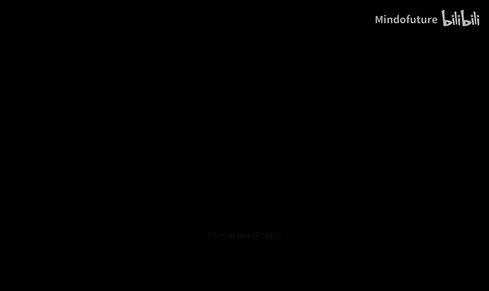
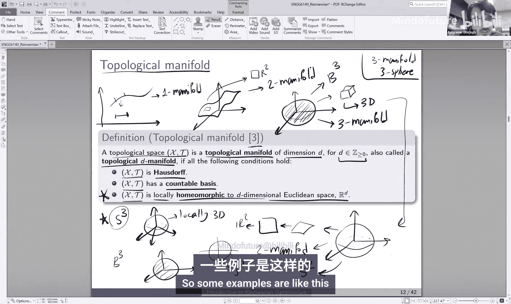
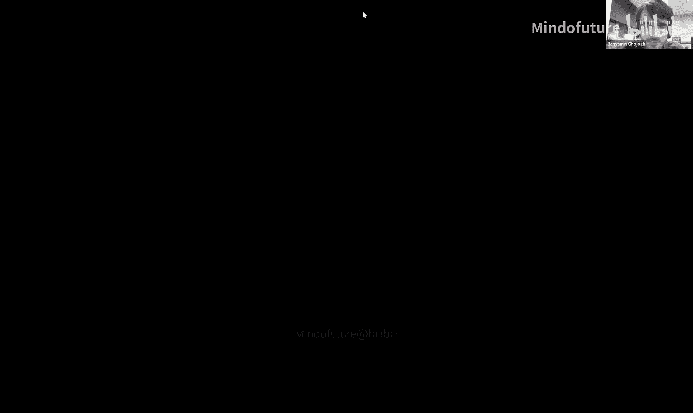
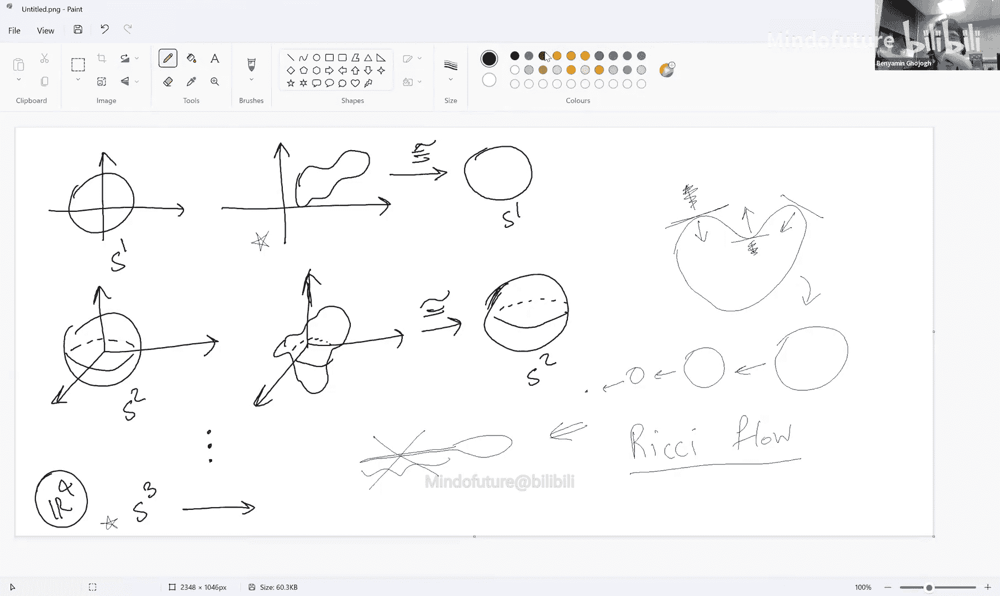
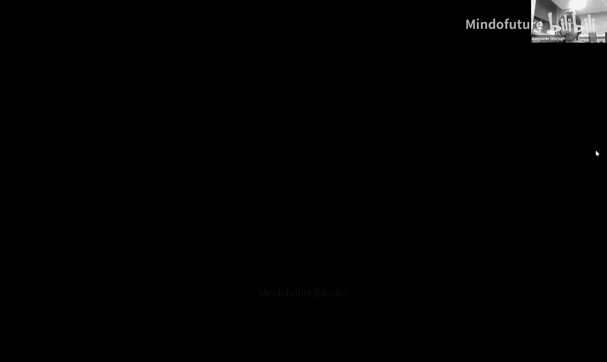
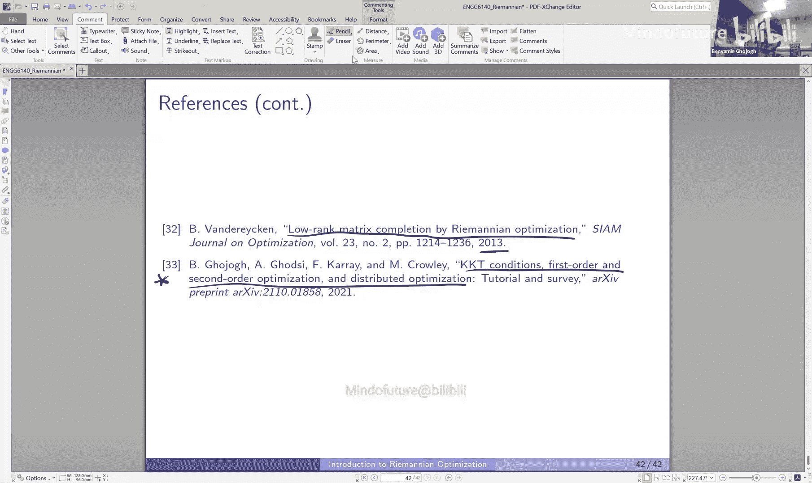

# 【滑铁卢大学】优化技术课程 ｜ Optimization Techniques   W2023 p13 P13_黎曼优化导论_黎曼矩阵流形上的优化 -BV1oJCHBcEo5_p13-

Hi， everyone。 in this lecture， I'm gonna talk about。嗯。Atimization。So。

Introduction to Rimanian optimization。An introduction to optimization on Rimanian matrix manifolds。

So what is that first off？Let me talk about Romanian manifold。Victoror space。 What is a vector space。

A vector space also called the linear space， is a set whose elements often called vectors can be added together and multiplied or scaled by numbers called the scalars。

S in simple words。We can scale the vectors。By some scrs， and then we can add them together。

So we can have additional linear combination of vectors in this space。This is called a vector space。

 Of course， a vector space。Contains the origin。 Why， because a vector minus itself。

Is the zero vector， which is the origin， and it needs to be in this space。Euccle in the space。

Is a vector space， but with the Euclidean distance metric defined over it。

 it means that when when you have two points in in this vector space。

Every point can be represented as a vector， why because。

Every point can be seen as a vector connecting the origin to that point。When then you can say， okay。

 I can calculate the Euclidean distance between two points or equivalent equivalentvally between two vectors。

 right？And theide Euclidean distance metric between two points is the。length of。

The is the length of the line connecting these two points together。

 So the length of this line is called。ね。The Euclidean distance and this Euclidean distance can be calculated by。

Eunor。Yeah。Of that by the L2 norm of the vector connecting one of the points to the other one。

Smooth manifold in simple words， it is a differentiable curvy hyperurface。So。

What do I mean by hyperurface。So in。In one dimension，1 D，1 dimension。AH， it is a line， a line in 2D。

It is a。Like a plane in R2， right？In 3D。It can be a plane。Like this。A linear plane。Or it can be。

Non nonlinear。A nonlinear surface such as this。Right， and 4D。Will have。We， we can't visualize it。

 and we need to imagine it。 So surface is not necessarily。Lar， you can see it as a plane。

Or a hyperplane， which is not necessarily linear。 A hyperplane is a special case of a hyperurface。

 right Okay then。Generally speaking， a curva hyperurface， we can see it as a smooth manifold。

And it's differentiable where you can it means that it is a smooth and you can take derivative in all points in that manifold。

Okay， in mathematical definition， it needs the concepts of topological space， chart and homemorphism。

 which we are going to talk about in this lecture。😊，Rmanian manifold， denoted by M。

M standing for manifold。In simple words， it is a real because。😊，The manifold can be complex too。

 This is a real manifold。ASooth manifold means it is differentiable。

And it has a ramonian distance metric on it。 What is that。It's a distance on the curvy hyper surface。

 So when you have a curvy hyperur， you have two points。

What is the shortest line curvy line connecting them on the manifold。

 So it's not a straight line any more necessary。 It can be like this。A carib line like this then。

The length of this curveav line connecting these two points on the manifold。

It will be the remainingman distance metric between these two points。

So when you can calculate a distance metric on the smooth manifold， then that's a Rimanian manifold。

This is in simple words， in mathematical definition， it is a real smooth man real manifold first off。

 it's real。😊，Second off， it's a smooth。Equipped with equipped with is a terminology used a lot in differential geometry。

 it means that it has it has。😊，A positive definite inner product。

 so you can calculate the inner product of the vectors in the tangent the space of the manifold we are going to talk about these in a few slides。

 so you can calculate the inner product in that manifold on the tangent the space at each point。

And this inner project is called the metric of the manifold。

 So we are going to explain the details of。The mathematical details of these in a few slides soon。

Okay。没。You cleaned in。Optim。So， I have had a course。On optimization techniques。

 you can see it in my YouTube channel。In that， of course， whatever I said was Euclidean optimization。

 usually。The regular optimization that we have heard of is Euclidean optimization where we are optimizing the Euclidean space。

 for example， the cost function is a function from a the Euclidean space to a scalar。Like this。

我 went的。A assume that the dimensionality of death。Optimization variable is D， D。

 D It is D dimensional goes from R D to R scalar。 It might， by the way， the input might be a matrix。

 not necessarily a vector， or the output is not necessarily needs not necessarily to be。

A scalar it can be vector or whatever， but it goes from Euclideanous space to another Euclideanous space。

 So it's a mapping from east to F weeks。The optimization problem can be seen as this minimize the function F of V。

With respect to X， which is in RD， right？Or equivalently， we can write this equation one as this。

Minimize f of x with respect to x subject to x belonging to RD RD is a dimensionional Eide Euclidean space it means that x is a de dimensionional vector in the Euclidean space。

So I have brought these as a constraint， usually in Euclidean optimization。

 this is a default constraint， so when we have only this constraint。

 we can consider this optimization as an unconstraint optimization problem。😊。

So if the optimization problem is constraint， we actually have inequality andequality constraints when then we have a feibility set defined by the intersection of the constraints。

 and that will have this minimize f of X with respect to X subject to Xs belonging to the feasibility set。

😊，Okay。Now， so far， whatever I have said in my course。

I covered optimization methods in the Euclidean space。

The Euclidean optimization methods can be now slightly revised to have optimization on possibly cur Rimanian manifolds。

 So rather than having optimization in the Euclideanus space， we can have。

Optimization under Romanmanian manifolds， which are possibly curvy because Euclidean a space is flat。

是。And notes that Eucldin a space is a special case of Romanmanan manifold， which is flat。Right。

So we can generalize the Euclidean spaces to Euclidean optimization algorithms to remain optimization algorithms。

In remindering optimization， you can take a look at references one and two。

 which are the books in this field。What do they do， It optimizes a cost function， while the variable。

Lies on a Romanmanian manifold M。 So he the variable is in the manifold， is on the manifold。

 it belongs to the manifold， rather than belonging to the Euclidean space。

 it belongs to the manifold。The optimization variable in the Romanmanian optimization is usually a matrix rather than a vector。

😊，It'sUsually a matrix， therefore Romanmanan optimization。

 is also called optimization on matrix manifoldles。

It's also called optimization on matrixtri Manifolds。Okay。So here。We have this， we say。

The function in Romanmanian optimization。Is the mapping from the manifold to the real number to this scalar。

So the domain of the x is a manifold rather than the eucli in a space and as it is usually a matrix。

 not it doesn't need to be a matrix， the manifold might be a manifold of vectors but。

As usually it is a matrix I have denoted by capital bolt， but in the Euclidean optimization。

 I denoted by the。A small case bold showing it is a vector。

This is a usually matrix x to f of x now I minimize the function f of x with respect to x belonging to the manifold them。

😊，Right or equivalently， I can write realeststated as this。

Minimize F of X with respect to each subject2。X belonging to the M so I can see it as a constraint。

Compare this equation 5 with E 3 or sorry with E 2。Compare these。With this， and I will see that。

Euclidean optimization is a special case of ramondan optimization where Manifold M is the Euclidean space。

Right。Okay。Now there is a good technique。😊，Sometimes we have a Euclidean optimization problem。

We can convert it to a remote optimization problem。Some constraints。Are in are the constraints。

 those constraints are actually some manifolds， some well known manifolds， for example， for example。

 if I my cons is like this minimize。え？Let I don't know。

 Let FO X be x transpose a X where a is a positive semi definite matrix known matrix。

With respect to each subject 2。X transpose x equals I。I use identity to matrix。

Something like that we have this form optimization problem in many especially eigenvalue problems such as in machine learning we see it in principle component analysis。

 similarly we have it in fier disc analysis， so we have this form of optimization a lot in theoretical physics we also have this kind of optimization so。

😊，this constraint x transpose x equals I means that the matrix x I want to be an orthogonal matrix。

 It means that I want its columns to be orthonormal。Meaning that the inner product of the columns。

 different columns is0， but the length of the columns are is1。So。This。

Actually is a well known manifold， manifold of orthogonal matrices is called stal manifold。I think。

Well see it in a few slides， shuffle manifold。And therefore， we can say。

Rewrite this as restd as this minimize。Trace of x transpose A E with respect to eggs subject to eggs belong to the manifold of achile。

So in this technique， I converted this Euclidean optimization problem to a rimanan optimization problem。

If the constraint， for example， says that I'll want eggs。To be to， sorry。As soon。

 consider another constraint， X be positive。Definite matrix matrix。 It means that it eigen values。

 I want to be。I want this argumentvalues to be positive， neither negative nor zero。

 Then this is actually。😊，SPD manifold。Mean SPD manifold is symmetric positive， definite manifold。

So I can write it， minimize trace of x transs aix subject to X belongs to the SPD manifold。

Another thing that is that。诶。If I want to find projection onto a subspace。

 so Im learning a projection matrix， a linear projection matrix。

It is used a lot in various machine learning algorithms for linear projections such as in PCA。

Priinciipple component analysis then in these cases。😊。

I can have grass Manion manifold Gr Manion manifold is a manifold projection onto the cyber space。

Okay， and then you'll see that many machine learning algorithms are using are form formulating the optimization problem as a Gmanion manifold。

😊，So especially it has been used a lot in action recognition。😊。

You can see that I can convert my many of the Euclidean optimization problems to grass Manian optimization problems。

Okay， sorry， tool Rimanion optimization problems。To many of them can be converted to Ri optimization problems。

 Some examples are Steal， Gr Manion， S P D Manifold。 we。

 we are going to review them briefly in a few slides。Okay。So this is a good again。

 let's read this good technique that I explained if the optimization problem is constrained。

 we may define the constraint as a matrix manifold of that constraint， such as a SchphaL manifold。

 which is the manifold of orthogonal matrices， manifold for x transpose x equals I and use equation 5。

To solve it。O。Now。Again， let's compare Euclidean optimization and remain an optimization。

 Eucliidean optimization F is a mapping from R D to R。A map from x to f of V。

 and we are minimizing F of V with respect to x subject to x belongs to the RD D dimensional created in space。

 So for example， if the is2 two dimensional， then you can show F as one of the dimensions。

 This is the cost value， I want to minimize it， I can look at it from above。It will be like this。

 These are the at each curveavel line， the function value is the same。

 so I can say F is a mapping from these two dimensional or d dimensional space2。Acalar。R。

In Romanmanian optimization， likewise， we have a map but from。Maifold M Rimon and Manifold M2 scalar。

Or x to f of X， you can write it as minimize F of x with respect to x subject to x belongs to the manifold M。

 So we can show it like this。 This is a curvy manifold M。

The function value I can show it in this way。 So， for example， here。

 it's like similar to a quadratic function Here is its minimum and it's increasing on the manifold。

Something like that。 So you can see this F。😊，As a map from these。

 manifold to a real number to a scalar。Right， compare these to。And you willll understand what。

What we are talking about。Okay。What do we do in Romanmanan optimization。

 so in Euclidean optimization， assume we are looking from above。I'm starting from some point。

 some initial point in the D dimensional space。 and then I'm。Having iteratively。

 I'm going toward the solution。 for example， like in gradientding descent in first order methods。

 I'm gradually moving toward the solution， right， Also， remind optimization。

 we start from some point。Initial random point on the manifold。

 and I move on the manifold toward the solution toward the and what is the solution。

 One of the points in the man on the manifold。Which where the class function is minimized at that point。

Right， this is Rimaa。Okay。Now， let's talk about topology and smooth manifold concepts。

 These are some concepts which you can find in differential geometry and algebraic topology。Okay。

Tology and topological is space。 Let's define them。You can take a look at references 3 and4。

Let X be a set。With some set。A topology on Is is a collection T， by the way， collection。

You can see it as set in my opinion， I might be wrong。

 but as far as I know collection and set can be used interchangeably in pure mathematics。

 but there might be a slight difference between them。

 but I look at I myself look at collection as a set， so it's like a set or collection T。

 a topology on x is a collection T of subsets x called open sets。

Why do I call it open set open set is a set where it doesnt belong， it doesn't has its boundary。

 but closed set has its boundary to， so open set is only its interior， excluding the boundary。But。

Cl set is the union of the interior and the boundary。 Okay， so open sets we are talking in topology。

 we are usually talking about open sets so open called open sense satisfying these three things。

 So first off these collection tea。The empty set and the whole。Set x belong to this collection tea。

Also。If there are key open sets in this collection T， so this T。Has contains the opens。

 some opens like these， okay。If K opens belong to the collection T， then。Their intersections。

Also belongs to this collection， in other words， finite intersections。But K is finite， right。

 finite intersections of open sets are also open。Belonging to means to tea。

Means that they are open right an example is that consider these。

 assume I want to calculate the intersection of u1 u2 and U4。What is their intersection is here。

This is also an open set， so it is in T。Okay。If。🤢，U alpha belongs to T， where for all alpha in a。

 What is a， It's the index set of topology。 It means that。

The index set means that the indices of these open sets， which are in the collection T， for example。

 if T collection T has four open sets then。A is1。 the set of 1，2，3，4。So it's the set of indices。

 so for all indices， it simply means for all indices of the open sense。😊，For all you。1， U2 U3， U4。

 and et cetera in the collection T。Their union is also in the。Collection， in other words。

 arbitrary unions。Of open sets are also open。An example is this U1 U2 U4， Consider this。

 what is their interect， What is their union， It's this， right。😊，This is also an open set。

So it belongs to T。X was the set。 T was the collection of the open set。O。

And this pair pair of x and T， and what was T， by the way， T is a topology on x。

 T is a topology on x， we defined it here， which satisfies these has these characteristics。

But the pair X and T is a topological space associated with a topology T。

And the topology T is the topology on the set X。The pair X and T is a topological space， okay？Now。

Another important concept is h storage space。I can take a look at references 3 and4。

 a topological space X and T is halforf if and only if， so it's two sided if and only if。Or。

Two points， x1 and x2 in x， this x is the set x。Where x1 and x2 don't equal to each other。

 So they are these joint。 there are two different points。We have this。 What is this。

 It means that there exists。2 opens U and V such that x1 belongs to you。😡。

X2 belongs to V and U and V， their intersection is empty。In simple words。

 what is this I have visualized it here， for example。😊，There went for every2。 x1 and x2 in the E。

You can find UNV to UNVs， open sets。😡，Where U contains x。 So x belongs to you。 and V contains。X2。

 so U contains x1， v contains x2， and U and V， their intersection is empty。

 They don't have any intersection。In， in simple words means that the points are separable。 So here。

 the points of a hostile topological space are separable and distinguishable because you。

 you can find。Their neighborhoods， some neighborhoods of them or some open space containing them。

Which with， with some gap between them。They don't have an intersection。

 so it means that they are separable and distinguishable， right， This is Hatorf space。Okay。Now。

 homemorphism and diiomorphism。Hoomemorphism。This homomorphism is a very important concept in algebraic topology。

It is a transformation。It is a transformation from one topology to another topology。

Without tearing up。The topology， so you don't tear up the topology， you can deform it。

 you can deform the topology， but you don't tear it up。It is a study algebraic topology。

 So two the two topologies before and after homemorphism and transformation are called homemorphic to each other。

And it's symbol。Is this， it's denoted by this。What does it mean it means that in algebraic topology。

 you can see it somewhat like equivalentence right， it means that in algebraic topology。

 as long as you don't tear up the topology that you have。You can deform it。

Deformation doesn't change your topology。The topology before and after deformation without tearuring up remains the same。

 they are equivalent。They are homomorphic。 An example。

 a famous example is cop and a donut or tourist。Tourus in algebraic topology means that。

Something like some manifold like this orthology like this， which have some holes so we can have。

A tourist with two holes like this， or a tourist with。3 holes like this。

 A to with one hole is like a donuts。That's why it's also called donut。

A cop and a doughnuut or a torus with one hole or homomorphic。 Why， let's see。

So here I can deform Co to become a donut without tearing it up with without what do I mean by tearing up。

 It means that I。I make them。 I'm it means several things。 one of one thing it means that。

Ting up might mean that I。Complette tear it up to become too disjoint。Tologies。Or I add。

 I force forcefully add some hole in it。Right， it doesn't have any hole， for example， it's like。

A ballald。But I tear it up， so I add a hole in the middle of the ball and it becomes like a donut。So。

 I know that。A ball and a donut are not homomorphic to each other， why。

 because I can't deform a ball to become a donut without without making a hole in the middle of it and tearing it up。

 therefore， however， cup and donut are homemorphic y or equivalent in terms of algebraic topology because soon this is the cup。

Here is not a hole。 I can fill it up。 I can increase this height。

I can deform this and increase this up height without any tearing up so I can feel the cup completely。

And then I can shrink this part。To become like this I'm just deforming it。 I'm not tearing it up。

And then I can shrink this completely so it。It becomes like this， comes like a donut。

So gradually you can see I can make this to this and this hole in the donut or the torus is the hole for handle of the cup。

Right， okay。Now let's talk about dimorphism， dimorphism is a homemorphism transformation which is smooth and differentiable。

 so as long as the whole homemorphism，😊，It is a smooth。So the toppology。

Before and after homemorphism is smooth and differentiable so you can take the。Derivative。

On every point in the topology， then it's diiomorphism， for example。Consider this。

 This is not a smooth in this point， right。It has a corner。A cup And this。Are actually homomorphic。

Because you can convert this to this。 However， they are not deiomorphic。

 So they are not converted to each other by deformmorphism because this is not。

Differentiable anymore。 It's smooth anymore。Right。No you。Now， topological。Maniffold。Reference 3。

 the topological space X and T。Is a topological manifold。😊，Of dimension D。

Where d is a positive or where d is a non negative integer，0，1，2，3，4， whatever。

This topological manifold of dimension D is also called topological D Manifold。

 so I think you have heard of this a lot in mathematics，3 manifold。Or three a sphere。

 if you take a look at papers， you see a lot of these is three sphere，3 manifold。

 It means that this is a topological。A manifold of dimension 3。

 or this is a topological sphere manifold with dimension  3。Okay。So what do they mean？

E ethological D manifold。It means that this topological space is hostile off。

It is it has also countable bases so we can count its spaces。

And it is locally homemorphic to a D dimensionional Euclidean in space RD。This is an important thing。

 I think the third one is very important and needs discussion what does it mean first off it means it is locally。

 what does it mean。Let's see some examples。So I set， for example， three manifold。And threeospher。

Okay， some examples。Dis curveve。This is locally。If you take it， look at it locally， locally。

 it is one dimensional， right？localally， it is like a line。So locally， it is a one manifold。Although。

You can embed it or show it in 2D， but locally， it is  one。1 manifold。Consider。

A plane or the surface。Showone or embedded in 3D。But locally， if you take a look at it。lo可呢你。

I'm trying to look at this part。Loccal， it is like this。 This is similar to。

A square or something like R2。 So locally， it is two dimensional， so it is too manifold， although。

We are showing or eming it in 3D。Okay。诶。Another example。A ball， A ball， which contains inside of it。

Showone in 3D。Similar to earth。Yeah。What is it？Take let's take a look at it locally。

A local part of it。It's like a cube。If you take a part of the earth。

Take some mud some mud from the ground。That's a part of the earth。 That's actually a 3D thing。

 a 3D object， right。Or 3D， you can see it as a 3D ball or 3D cube， whatever。

 that because 3D cube and33D ball， they're homomorphic to each other。 So I don't care。

About the shape， about the deformation。 That's why I I don't care in algebraic aology。

So locally it is 3D， so actually the earth or this ball is3 manifold。Although it is embedded in 3D。

 so you can see this is a2 manifold embedded in 3D， this is a 3 manifold embedded in 3D。😊，Now。

 compare these with this。In 3D， rather than a ball。Did it be a sphere。

 What is the difference of ball and sphere in mathematics。

So or in algebraic topology ball contains the interior。It's boundary and the interior。

 but the sphere is only boundary。 It doesn't have its interior。 That's why in for norms。

 we say unit balls， we don't call them unit as spheres because we also consider their interior Okay here。

What is it locally。So it's like the surface of the earth。 There isn。

 We don't have the inside of the earth any more。 It's like the surface of the egg。

 something like that。Then。Lly。It is like this。 I can deform it to be like this。

 and it is art two actually。Hoomorphic 2， Euclidean two dimensional Eucidean Euclidean in space。

 So locally it is 2D。 It means it is a two manifold。Although it's embedded in 3D。

 so see this is3 manifold embedded in 3D， this is2 manifold embedded in 3D。😊。

Now I think you can see what I mean。嗯。And but for seeing how locally what I mean， you need to zoom。

 you need to zoom and become like an ant and put yourself like an ant on the manifold and see how because an ant can see the global structure of the manifold。

 so you need to go and see it locally， you need to zoom like an ant to become very small。

 The ant on this curve only sees a line。 the ant on this curve and this sees this。

Surface are to a surface， the ant in this sees actually a cube。And on this see the surface， right。

That's why this is called this is a two manifold sphere， this is also written as S2。

This is a three manifold of balls。 This is called as B3。B3， what S2。So this is important。

When you say you see the papers or literature S3， it doesn't mean， it doesn't mean。

3 dimensional sphere where you can visualize it， no， it's actually。😊，Like if4， it's。

 you should imagine。You should imagine。嗯，Yeses。For。Yes， locally it is 3D。

 but it is embedded in four dimensional so I can't visualize it anymore， you need to imagine it。

 you have a four dimensional a space and this sphere is locally locally 3D。😊。

You shouldn't confuse it as being embedded in 3 d S sphere in 3D no。

 It is as locally 3 d as sphere embedded in 4D， however， B3。You can visualize it easily， it is。

A ball in 3D。B2。Is a ball into this like a circle， but it has interior。S 2。Its just a circle without。

No， no， This is S1。 This is S1。 This is S 2。 S1 is a circle without its interior， because locally。

It's like a line。So that's an important thing in algebraic topology， which you should note。

And that's related to this。 So when you have a manifold topological manifold of dimension D。

 it means that local it is the D dimensional。 It might be embedded in D plus1。You clean in the space。

 so you can。You should note you should note the difference here。Okay， now chart。

See in the reference 3， consider a topological manifold M。A and T， because do you remember。

What was So topological manifold？We had a topological space X and T。

 then from that we defined a topological manifold， which itself was a topological space satisfying these。

So now consider topological manifold X T we denoted by M， it is locally homomorphic to RD。😊。

Locally dimensionional， meaning that all eggs in in the eggs。For all of them。

 there exists an open set U containing x and a homomorphism phi from U to phi of U。

Where file view is an open subset of RD By this visualization。

 I think you will understand what I have said here。😡，So， simply， it means that。

Consider this manifold。M。So， for example， in this visualization， this manifold is locally 2D。

These two here， okay。Then consider a point x in this manifold。And then。

I can have an open set U on this manifold containing x here， U containing x。

And then I can have a map file。From this open set， you。To five of you here。

And this five of U is homomorphic 2 Rd Here it is R2。I think it's obvious， right。

 because local it is 2 d， so you can imagine this to be in an R2 Euclide in a space right。

 although this is Kvy。But you can deform it to become flat in the two dimensional space。

 So this is Phiu。You can do the same for V and other open set containing eggs。And you will have。

By mapping Psi and other mapping， it will have Psi V。And this intersection also has been shown here。

Right。B of U intersection V ors of U intersection V。And。Interestingly。

 you can go back and forth between these two。How。😊，For going from here to this。I can say。

What do I do。I first， so I want to go from this to this， from this phi of U tosi of V。I can。

 I should say first， apply phi inverse。 So go to this manifold again from here。

 go to manifold and then apply psi on it to come here。 So for going from this to this。

 I need to go first go。To the manifold by Phi inverse。 and then by psi， I come back here。

I can also go from style of V to file of view。 How style of V to file of view， how。

I need to take the sine verse first to go to the manifold and then take the fo of that。To come here。

So I can go back and forth between these two。And what is c infinite。

 So C1 means its a smooth for the first order derivative。

 C2 means it's a smooth for first and second order derivatives。

And so onc infinitefin means that it is smooth。For all orders of derivatives。Also， here。

F is the mapping of the do remember the cost function from this manifold to the scalar。Okay。😊。

And now let's go back to what we were saying。 I think now you understand there exists an open set U containing eggs and the homemorphism。

Why from you to failure of you， why is it homomorphism Because this is carav on the manifold。

 but here it is flat， so you are deforminate to become a flat。

Where Fire view is an open substitutestive RD， such mapping is denoted by this。And this is it。

Notation of homemorphism， right， and the topple U Phi。U was this。 And this is the Phi mapping。

 The top of U Phi or the per U N Phi is called coordinate chart or chart in short4 manifold M。

 So this Phi and this mapping， this U and this mapping Phi。Is one chart。

 Another chart is this V and this map in Psi。😡，Right， so we have many charts， not this one。

So this is a chart， this is a chart， and we can go back and forth between the charts as I explained。

Okay。Okay。Smooth atla。Reference 5， a smooth atla a or topological D manifold M。So a manifold。

 which is locally dimensional。It's a collection of charts， collection of charts， U alpha， phi alpha。

Or M manifold M。So collection or settle charts。 Do you remember I said we have many charts now consider a collection of charts。

YouI find it means that u1， phi 1， u2 phi 2 here， for example， I denoted phi 2 by psi doesn't matter。

 and naming doesn't matter。 So u1， phi 1， u2， phi 2， u3，5hi phi 3。TheWhere they cover M。

 it means that their their union covers the whole manifolds， something like this。

 Consider all of these open sets and the manifold。Their reunion becomes the whole manifold， right？

And any two charts in this collection are as smoothly compatible。 Exact the what I said。

 you can go back and forth between these。😊，Chars smoothly。So I can。

Go from this to the manifold and come back here。And it's a smooth， stay infinite， right。不想。

Note that two charts U U Phi and V andsi are smoothly compatible if the mapping this is a deformmorphism。

Hoomemorphism， which is also differentiable， right， It's and smooth。Okay。So when we have these two。

These collections of charts。 So these are the open sets of the charts。

 and they also each of which has a mapping。A homemorphism。

This collection of charts is called a smooth Atlas， I think by name by its name。

 you will understand it easily Atlas means that it's covering the whole thing， right。Okay。Definition。

 maximumim at last reference5 is smooth at last a。😊。

Or a topological D Manifold M locally D dimensional is maximal。

If it is not contained in any other smooth atla for them。Okay， this is a maxim ats less。Now。

A smooth manifold， and Romanmanian manifold。Now， so so far， we， we talked about what。

We started from topology and topological space。We talked about house storage space and homemorphism and D。

 and then we define topological manifold， which is topological space with some characteristics。

 right？So， so far。We were had defined topological manifold。 Now let's define a smooth manifold。

A smooth manifold M。Of dimension D， which means low quality dimensional。

 also called a smooth D manifold。Is actually a topological demanifold。But has some other things to。

 together with a choice of maximal smooth Atlas A and M。So smooth manifold is a topological manifold。

 but with some maximumim smooth atla。😊，Okay， now we have defined topological manifold。

 then a smooth manifold， now let's define Rimanian manifold。Rimmanian Manifold is a step ahead。

Rmandan manifold M is actually a smooth manifold， but with some other characteristics。

 what is that is a smooth manifold which has a metric or inner product G。😊，First off。

 don't confuse this metric with distance metric， distance metric is something else。

Satisfying having three or four characteristics， including triangle inequality， right？

Like what we have in norms。 So that's one another thing。

 That's distance metric here in Romanmanan manifold means inner product on the manfold。

 So when you have two vectors on the manifold， you can calculate。Their inner product。

 similar like this。So you have two vectors on the manifold。Locally。

 these two vectors are in the tangent space at this point。

 I will define the tangent of space in a few slides。

So you can calculate the inner product of these two。Or Dutcht projects of these two vectors and that。

Defined by the metric。And the manifold。So remanant manifold is a smooth manifold with some metric。

Some in your product。And interestingly。The inner by the metric， when you have the metric。

 you can calculate almost everything on the manifold。Inner product on the manifold。

 we can calculate the distance on the manifold。 So note that the distance is not Euclidean distance anymore。

 It's remaining distance。 So it's the length of the car V line connecting the two points。

On the manifold。You can calculate the geodesic， which is the shortest curve we learn on the manifold。

😊，是。The because you can come from this point to this point along the manifold in this way to assume the manifold is is scvature like this。

However， there might be another path and the manifold from this to this。

 which is this is shorter than this， so you take this as a geoistic。

And the remaining distance is the length of the geodi between two points， right？Carurvature。

 so you can calculate the curvature。On every point on the manifold， assumeoom， for example。

 consider a one manifold， a one dimensional manifold like this。Let me。Have another figure。This point。

Has a positive curvature。 Thiss。 This point has a positive curvature。 This is negative curvature。

 for example， this is negative curvature， okay。😊，And。

This point has higher curvature than this because。It is sharper kind， it has higher curve in it。

Than this。 And so I think by this， you understand what I mean by cur。 Now。

 extend this to be two dimension， locally 2D or locally 3D， whatever manifold。

So we have some curvature， and this is curvature shows how up and down the manifold goes。

So you can calculate all of these using metric and this metric， by the way。😊。

Can be seen as a matrix of it and it has some formula。For different manifold。

 it has its formulas different。 It expression is different。 So you can at every point。

 you can plug the point in the metric， and it gives you。The metric at that point。

 so you can calculate the metric at every point on the manifold。Okay。Rmanian Manifold concepts。

 before saying that， I want to mention one thing which is about interesting in topological。Maifold。

Yeah。Yes， so one thing which I wanted to say is that。There was a。A con a conjecture。Po conjecture。

 Po Cur conjecture in algebra topology and differential geometry。What was Poker conjecture。

 It said that when you have。What in dimensionional when you have a dimensionional locally dimensional topology which doesn't have any hole in it。

 okay， you can deform it using homemorphism。To become。An SD manifold。

 it means that to become a locally de dimensionalpher， that's an interesting thing。

So some examples are like this。 For example， let me share a screen。

With another thing。

Like this， for example。😊，Lally one啲。Consider this。This shape。I'm talking。Sorry。

 I'm talking about this， this shape。It is locally1y， I can deform it to become like S1。Like。

 so these， this is homomorphic to S1。Locally，2D。I can have this form。This is locally 2D。

 I can deform it without making many tearing up or holes。It's homomorphic to S2。

 So's locally two dimensional a sphere。 I can have the same in3 S3 S4 and all dimensions。

 So this was the conjecture of Pocare。 Pocare was a scientist in mathematics。Okay。And then。😊，呃。

So it was proved over， I think a century by different mathematicians for different dimensionities。

 First off， I think it was proved for dimensions more than four or5， something like that。

 And then someone proved for dimension 2 and one。 I think one was obvious。For lower dimensions。

 I think is intuitive and very obvious， but in higher dimensions， you need to imagine it， right。

In it was soldd for all dimensions except。In locally 3D。 So in S 3， like I have written it here， S 3。

So if you have。A locally 3D manifold， you can't visualize it。

 you need to imagine it because it can be embedded in four dimensional euclide in space r4。

So it is locally 3D， you can deform it。😊，By a homomorphism mapping to become a S3。

A manifold or a three dimensional， locally three dimensional sphere。You need to imagine it。

 you can't visualize it， okay？So it's locally 3D。And then。诶。

The scientists couldn't prove that apparently， as far as I have research。

 apparently in four dimensions， Jeck topology has very weird characteristics。呃。

It has been seen observed in other things in algebraic topology2， apparently in four dimensions。

 there are very interesting characteristics okay。😊。

That's why maybe it has become very hard because S3 can be embedded in R4， right， four dimensions。

Then no one could solve that。 and after a while。So， someone named Hamilton。Proposed reachie flow。

What is Richie flow。 So he named it after Richie， who was a scientist before him。

 But Richie flow is saying that。When you have a curvature， go to the other side of the curvature。

Like in your opinion musician as you go to the。Other direction of the gradient。

 So you go to the minus gradient。 You go to the other side of the curvature。 by doing this。

 you will see that。you reduce your topology， for example， like this， something like this。

Consider you have this topology。It means that。The curvature says that it's in this direction。

 but it says a go to the other side of the curvature， so go in this direction。

 move this point toward inside。And this curvature， its curvature is in this side。 Don't go to this。

 go to the other side。 So move this to this。 And also， move this toward inside。

 So wherever we have a positive curvature， we go inside， wherever we have a negative curvature。

 we go outside。 So gradually you will see。😊，It becomes like a sphere。Also。

 it shrinks because after a while， it becomes a smaller。

 smaller is smaller until it becomes like until it becomes like a dot and it disappears right So this is the procedure of breachy flow。

What we are doing here is called Reie flow。Written as this。 Very cheap。Flow。

And he proposed that Hamilton， and then a scientist named。Gregoory Pearlman。

Who was a Russian scientist？え。Because Russia has a lot of good mathematicians。

He took this richie flow and actually proved this Pokka conjecture for S3。

For three locally 3D manifolds and how did he do that， he said。

 okay I so Hamilton also went up to this point that okay， using the reachy flow。

 I can say that I have some locally 3D topology or manifold I do the richy flows so it gradually becomes like a sphere right and。

It becomes smaller and smaller。 And when it disappears。

 it means that it is equivalent or homomorphic to the sphere， however。

He noticed that sometimes you have some singularities。 So when you apply the reachy flow sometimes。

诶这 po机你看。We have some sharp。Singularities ages， these are the singularities。Then， pearl man。

It could try to find a solution。To say that， okay， we can have， we can have the surgery on these。

 So these are the concepts in algebratoology。 You can have surgery on these single tones。

And they are also he proved that these are finite。Though they are not infinite number of them。

 And then he could actually prove the。Hka conjecture。 It's very interesting。 He put his papers。

 two papers on archive。 He didn't publish them because he wanted this to be open access。

 and everyone see that sees that。 And I， I think he did a great job。

 I really support him in that way。 Also， he didn't accept that。😊，诶。

many awards such as Field' medaledal for his own reasons。But yes， he was a great scientist。

Who proved upon car architecture results， So this was one of the most famous conjectures in algebraic topology。

That was proved。 I think it was proved around in the decade of 2000 to 2010， so。

It took about six years for scientists to approve per's proof。Something like that。 Okay。

 let's continue。 This was a parentheesis。Or how algebraic apology is cool。

 especially the reachy flow。

ok。So let me share the screen and continue the lecture。

Now let's talk about Rimanian manifold concepts。Were concepts， so we have tangent space。

 we have metric， and we have norm。Hundd space T X M。 What is it。

The is the space of tangent vectors on the manifold M at0 x。It means that this is a manifold。

 as soon this is a manifold here。😊，For the sake of visualization is locally 2D。At every point。

 we can have a tangent space。Or you can see it as a tangent hyperplane。On the manifold， which is。

It is tangent on the manifold at that point。So we write it as TxM。

 so it is tangent on M manifold m at0 x。Alright。And。As you see， this is， for example， locally 2D。

This is the tangent， the space is also locally 2D， it's a 2D hyperplane。In general。

 when the manifold is locally de dimensionsional。The time in the space is also locally dimensionional and that is a D dimensionsional hyperplane。

Okay。That's one thing。Rmanian metric G。So it's G Z it takes two tangent vectors。

 two vectors in the tangent space or tangent vectors。And it outputs a scalar。

So Zta and Eta here are two tangent vectors and the tangent space is at point x。

So these are two vectors in the tangent the space at 0 x right this is the metric and the metric simply calculates the inner product of these two tangent vectors。

And， of course， as we have in。And Euclidean space， we can define norm using the inner product or here using the metric。

So the square root of the。Meric of a vector and itself。You can see it as the normalzeta at  point x。

Why because you can see norm as the square root of。 inner product。Of the vector with itself， right？

Okay。Now。The length of the curve。Consider this is the curvety。I want to calculate his length。

So I can divide it into several points， and I can have piecewise linear。诶。

Lines in order to approximate these length so I can have the summation of。These linear lengths。

 and this is approximately the length of this curve。 The more points I have。

 the better approximation。N is a number of。诶 lines。Approxmating it。So when you increase n。

 it is a better approximation。And so we can set the length of the curve x。😊，And t， for example here。

 t is0 and at the n t is1， so you can see t as a parameter of the curve。Is approximately sumational。

The length of these each of these lines to  xt minus 60 plus 1。Something like that。

So t goes from 0 to n。Consider these are。The number of lines。Yeah。

This approximation becomes exact when you limit n to infinity。

Because this approximation becomes more accurate by increasing n。Then。I can also multiply。And divide。

These sp Delta T so they can cancel each other。The same。And then I can use the remindmands Tom。2。

Convert limit of summation to integral。Do you remember。What those remains， some for example。

 we want to calculate the integral under this curve。 How do I do that。I can have several rectangles。

Under it。And， let's。Decrease the width of these rectangles or in other words。

 increase the number of rectangles like here we are increasing the number of lines。

 increase the number of rectangles by limiting the number of rectangles to infinity。

Then this summation converges to the integral of this curve。 This is exactly remainsman's sum。

So here。Interegral， it becomes integral these and what is this。

 this is like the definition of derivative。Where where deta t goes to 0 right。

 so it's derivative of xt with respect to t or denoted by this。And in general。

 when we go from points。Point A to point B。 We can write the replaces 0 and1 with A And B。

 so you can see。The length of the curve x with parameter t is the integral of normal。

Derivative of x with respect to T Dt T goes from from A to B。So this is the length。

Of the Krvy line on the manifold。Okay。Now。Geodesic， gradient and Hassian。Jodesic。

 it is locally minimizing。Carves。Between two points on the manifold。

 simply it is the shortest carryry line connecting two points。

Or locally minimizing you are locally minimizing the curves between two points under the magnitudeifold。

Okay。对。对。And Rimanian gradients。Is the direction of steepest descent？Of the cost function。

Or maximum growth of the cost function on the manifold。

 What was it is the generalization of Euclidean gradient to Roman in space Roman manifold in what was the Euclidean gradient。

 It was the direction of maximum growth of the cost function， the the direction of。Derivative， right。

Now Roman gradient is the direction of maximum growth of class function on the manifold rather than in the Euclidean space。

So gradient。Denoted by this， you can write it as these two or these。Basically， it means this。

And what is this， by the way， this data is a vector in the tension in the space is。

Delta T is a curve， and this is a derivative of curve。With respect to parameter t of the curve。

And we talked about T here in this slide。Also， you can denote different notations。Okay。

 this is the reutable F F of x。In along the direction， Zta， tangent vector Zeta。Okay。

 Rimanian hissian。Is again， an extension of Euclidean hessian to Rimanian geometry。

 it's a derivative of one of the directions Zeta， one of the directions Zeta in the tangent space。

It can be seen as a derivative of derivative， so it's second order derivative can see as this。

Bf of xzeta because。A partialial gradient of F of X in the direction。

 Zeta B denotes the hessian matrix。 It is interesting that， in the pure optimization。Papers。

 they usually denote Hessian by B and inverse of Hassian by H。

 So H in pure optimization papers doesn't denote Hessian。

 but inverse of Hassian B Hessian and partial。Theta is a fine connection。

 you can see a fine connection as derivative of one of the directions in the tangent space that we have written here。

😊，Okay。Yeah。Now Romanmanian concepts， other concepts， logarithm and exponential maps。

 so we have logarithm map and exponential map， what is it？So in Euclidean space， we have subtraction。

 right？Like this。We have two points。XN and XM， we can subtract them and it gives us a vector connecting1 point connecting XM to Xn。

We can generalize subtraction in Euclideanus with to ramanan geometry， and it gives us logarith map。

 so logarithm map is the generalization of subtraction。In the Romanmanian geometry。

 what does it mean it takes two points on the manifold。

 It gives the tangent vector in the tangent the space。 Like here， we have two points。

 It gives vector。It also takes two points on the manifold。

 it gives the vi a tangent victory in the tangentent space。And is denoted by these， like this。

So it gets two points X N and X M。 it gives the。The tangent vector Dlelta or。

Let it be these and this tangent vector Zeta。Belongs to the tangent space of X M， not X N X M。Okay。

Now， now consider the addition in the Euclidean space Xn equals xn plus delta。

 so it takes some point。And some vector。And then， we add them。It gives us a point。是。

It gives us a point， then it means that here XM is a point， Dlta is a vector， Xn is a point。

So I can generalize this addition。To become exponential map in the Romanmanian geometry。

 and what is that So you take get a point on the manifold M。

A tangent vector in the tangent the space like this。 We have point vector。

 point of vector and gives us a point on the manifold。

We denoted by this exponential map of delta at the point XM， it gives us Xn。

Or this exponential map of Zeta at  point xM gives us xn wheres Zeta。Belongs to the tangent。

 the space of X M。Okay。So， in simple words。Logo the map is the generalization of subtraction。

Exponential map is the generalization of addition。For the Romanmanian geometry。你ello。Rmanian。

 some other concepts， Romanmanian concepts is retraction。诶。

Another concept that we are gonna talk about is retraction。 And that is that。

 what is that exponential map， What does it mean， So it said we said that it means addition is like a generalization of addition。

And it means that assume this is a manifold。I want to move from this point to this point。

 on the manifold。In the direction of Zeta， Zeta itself is a tangent vector。In the times。

 the space of。At point x3。So if I move on the manifold like this。

 curvy and the curry manifold in the direction of Zeta like this， this is exponential math。

 and as you see， it's very hard。It's very curvy， so it needs differential geometry。

So we can replace or approximate it。Approximate the exponential map by retraction。

 What is retraction， Retraction says that rather than going on the curvy manifold。Go。

In the flat tangent space in the direction of Zeta。 and then project this point。Unto the manifold。

 so rather than going in this cur direction， go straight and then project。This is retraction。

Protection is a mapping from the tangent space to a point on the manifold。

It's denoted by these transactionsals。Victor Zeta at point x。

It gets the point x on manifold and the tangent vector in the tangent space。

 it gives a point on the manifold。You can see it as projection of the point， this point。

In the tangent the space onto the manifold。Okay。So， this is。Retract。Okay。

Another concept is parallel transport and also Romanian curvature。 Let's talk about them。

 What is parallel transport。 It's moving or transport。Move or transport a tangent vector。

Under the manifold， on the manifold， in a way that it stays parallel with respect to the connection。

In simple words， let's visualize it。 it means that for example， come from here。You have these。

Tangent victors。都。With respect to this curve， it remains parallel as you see and then。

Becomes like this becomes like this。 You come back to here。 So there is。

Some angle from this and between this and this。 So when you start from a point。

 you go on the manifold in some。Direction and come back to where you were。

If you have curvature on the manifold along that curve。Along that path that you move。

You would have some angle。So if consider the flats you clean in the space。If I move。On this path。

In this you click in a space like this。I have these。Let me。Yes。Let me try it。

So I will have something like this。As it is。Flat。These are parallel to each other。 Par transport。

 and at the end。Where I will match exactly where I started and the angle between these two is0。

 the angle。Is you。Why do they stay the same， parallel the same because it's flat。

But these are not staying the same。In parallel to each other because there is curvature here。

 it's curvy， okay？And this alpha shows the amount of curvature， so it's an indication of curvature。

 actually， the more curvature we have， the more angle we will have。

Zero angle means that there is no curvature in this path on this manifold。

So this is the concept that Riman found out， and that's called is called Rimanan curvature。

 So as soon we do par transport on a tangent vi on the manifold and return back to the starting point。

 If the starting and ending tangent victors do not match exactly it means that the manifold has curvature。

 This is the ideal Rimanan curvature。Okay。Now let's talk about vector transport。Pel transport。

 which I talked about， is hard to compute。It needs differential geometry。

 We can approximate or replace parallel transport by vector transport。 Do remember。

We exponential map was hard to compute needed differential geometry。

 we replaced or approximated that by retraction。Pillot transport is hard to compute。

 let's replace or approximate it with。Victor transport。Okay。Pectctor transport is a mapping。

From a tangent space to another tangent space on the manifold。So it's denoted by this Tx1 x to Zeta。

So we are mapping a tangent vector。To another tangent vector in another tangent space from x1 to x2。

 and these are two points on the manifold。Zta belongs to ten0 displayplaces of x1。

The output of the vector transport belongs to the tangent of the space of x2。You can see it。

 see it as this， so you want you have some vector Zeta in this tang space。

 I want to go from0 x to y here。Voyn also has its own tangs space what is this。

A tangent vector in the tangent respect of y。What is the corresponding。

vector to this Zeta in this tangent space。 that would be the vector transport。

 So if you vector transport Zeta from x to y， you will get this because this。

 its correspondence is this， right。This is called10， so you can use this。

Victor transport to approximate parallel transport。I think if you also take a look at these。😊。

You will see that it's kind of。Having a vector transport。

 this parallel transport can be seen as vector transport。

 So in this vector is in this tangentent space， this vector is also in this tangenta space。Al right。

Okay。So you can see it as moving a tangent vector in a tangent space to the corresponding tangent vector in another tangent space。

Now we have talked about the concepts， let's start。Briefly talking about remannant optimization。

 So whatever we had， Euclidean optimization。We usually had first order or second order。

 you create an optimization， we can extend those。Generalize those to have first order and second order remainman in optimization。

Simply because Euclidean space is a special case of Romanmanian space， right， Romanmanian geometry。

Okay。Rmanian is stochastic， gradient descent。I stochastic gradient decent？

What all gradient decentcent。They have called it， called it the stochastic gradient decent。

 But I think what they are doing here is gradient decent。

 The stochastic gradient decent means that you have several points。 You。

 you take randomly one of them in each it， but doesn't matter。 The concept is important。

 gradientad decent Euclidean space is this， right。Every point update of every point is xk minus lambda gradient of f of xk。

 right？So you move， your update is this， this is your update。

Minusda Lada is the learning rate and k is the Tra index here。

You can also bring these to the other side to write realeststated in this way。

 But what let's take a look at this。 what is， what does this mean。It's actually meaning Xk。Plus。

 minus lambda gradient of F。X系。All right。😊，Now， recall。This is slide， we said。诶。

The generalization of addition in the remaining space is exponential map right here we also have addition。

To this plus。We can write it in this way remind a space。 So xk0 xk， and this is the direction。

 This is a vector in the tangentent space， minus lambda gradient f of xk。Right。

 in tang to the space of Xk。So。this simply means xk plus you can imagine it as plus minus lambda gradient over f of xk and this is the left hand side the same。

So this can be generalized to be like this in the Rimaniana space it was it gives us the update in each iteration of gradient descent or stochastic gradient descent in Rimana space。

 it was proposed in 2013 in paper 7。Okay。😊，This is addition， sorry， where addition。

In Euc cleanan spaces generalized to take exponential mapping remonial space。

For simplicity we can but as we talked about this in this slide。Exponential map is hard to compute。

 we can replace it by retraction。So we can replace this exponential map by retraction to be simpler。

Both work for。Rmanian gradient and distant。This was an example。

 we can have other Rimanian first order optimization methods， this was an example。

Now let's talk briefly about second order remainingmon optimization。

Such as this Rimanian Newtons method。We know that iterative optimization algorithms are like this Xk plus 1 is Xk plus sum delta is some update。

 right？And data x node in gradient descent is minus lambda gradient of f right here。

In Newton's method。It uses Hessian in updating this step。

 it uses both Hessian and gradients and Delta x is this。Minus hesn inverse gradient。

For proof of these， take a look at my lecture in optimization techniques in one of the lectures in my YouTube channel I have talked about。

ANton's method。So。You have this。 you can also left multiply the sides by hessian。

 so Hessian and hessianverse cancel each other will we can realstate this equation 10 as equation 11 doesn't matter okay now。

We can generalize this equation 11 to have Rimanian。Neutton method recall Romanmanian Hastian。

 We had it here。 Do you remember。Herear in this slide。I'm repeating it here。Interestingly。

 they are very similar。If you compare， in the this is Knowton's update。In the Euclidean space。

 and this is Rimanan hissian。This is Romanian Hastian。Right B。 and here also， this is Hessian。

 This is Euclidean Hessian。Delta x is the update。 This is Zeta。Is the update the tangent Victor。

And this is a gradient， okay。So remindman Nes method if you compare this equation 11 and theses。

We will get this。So you have B F of x， Zeta equals minus gradient of F of x。

So this is Roman Ne's method。For arm constrain， second order optimization。If we have。

Constraint optimization problem。We need to use interior points method algorithm。

Which also uses Newton's method in it， you can take a look at my lectures for Interi point method on my YouTube channel。

Also， we can have quasiotance methods quasi methods。Try to approximate the hisssian， because hissian。

It's usually hard to compute so we can approximate either the hesian or inverse of hessian or the nottons method。

And one of them one of the famous quasi ne methods is BFGS。诶。

Po intelligence methods including BFGS approximate the inverse heian matrix by dense matrix D by D。

For large D， storing this matrix is very memory consuming。So。In 1980s。

Limited memory BFGs or LBFGS was proposed by Nosal Eal。Which uses much less memory than BFGS。

 because at that time computers were developing and memory was very important。

I have talked about LBFG and BFGs briefly in my lectures on YouTube， so you can take a look at them。

 but if I want to briefly mention them here， LBFG algorithm can be implemented as shown in the following。

This is the implementation， which is inspired by the algorithm in Noedall's book， Cha 6。

 Noedal and Wright's book。As Nostel has proposed， LBFGs， he is very expert in this area。

 so he has explained BFGS LBFGS and all of these quasiation methods in chapter6 of his book。😊，So。

Here。In simple words， I can say that I have briefly mentioned in that lecture video。

In my YouTube channel， but I can say that we have a recursive function。For LBFGS。

 up to maybe 10 previous history。 So we have 10 folding。

Of the Hassian and as the we don't go in in the stack of the recursion a lot。

 we only go for 10 previous memory in the stack。 We don't use a huge stack If we use a huge stack。

 then it won't it will use a lot of memory， it won't be a limited memory anymore。

But as we are using a small amount of a stack， it's not using a huge memory。In the recursion。

 in the computer， and therefore。诶。It's not an issue in the for memory。

 but why is it limited memory because it's approximating the inverse of Hastian by a scalar times identity matrix。

So it's diagonal matrix and it's a scalar times I the matrix。

 it means that it's approximating the whole heian by a scalar。

And it updates it using some recursion like this， okay。This is LBFGS。

I have repeated here too this is Euclidean LBF just in 1980s to 1989 by these by these。诶。

Papers 8 and 9， by Nuedl。Okay， you can and Rimanian LBFGS extended this Euclidean LBFGS to Rimanian geometry it was proposed in 2020。

 you can see it as an extension in paper 10。And what does it do， it says that。😊，I have。For example。

 let's compare this still。Compare line，6 here。Xk plus 1 equals xk minus Eta。PK。

 so this is replaced by retraction or exponential map as we talked about it here。Cry。And also。

We have， by the way， as。From goinging from one point to another point。The space is changing。

 the space of the tangent Victor is changing。So， we need to have。Like here。

 we need to have vector transport。From x T to Xt plus one。

 from one of the x in this situation to the x in the next situation。

 otherwise we the two vectors are in different spaces and we can't do any arithmetic on them。

So we need to have vector transport from one space to another space in the Rimanian LBFgs。

 but in Euclidean LBFGS， we don't have these issues because all of the vectors are in the same space。

 even in different points right， we have only one Euclidean space。

 but in the Rimanian geometry we have。And at each point， we have a separate tangent space。

That's another thing which you you should note。 We also have here the vector transports。

 also the ad joint vector transport。 You can see the adju vector transport like。

The inverse of vector transport， although it's not mathematically completely correct。

 is not exactly the inverse， but you can imagine it to be like the inverse， so。

Going from this point to this point is the vector transport going back from this。

The tangent is switch of this point to this point。Is called。

 you can see it as a joint vector transport， although it's not completely correct mathematically to say that。

Okay。😊，And。Important Romanmanian matrix manifolds。So。

One of them is Schel Manifold denoted by STP and D。

What is it it's defined as a set of orthogonal matrices。Like this。So M denoted by ST P and D。

 Schfel was a scientist， by the way， ST P and D means that。The set of matrices。

Of dimension D by times p， so with d rows and p columns where x transs x equals id matrix。

 it means that where x， the matrices x are orthogonal matrices or their columns are orthonormal。And。

As they are D by P we dennoted by STP and D so we have。P columns。Each of which is the dimensionional。

And each of these P columns。Has the length one unit length。

And also the inner product of these D dimensional columns。With each other is zero。

So they are perpendicular to each other， orthogonal to each other。

The caution of a vector space V by a subspace N is a vector space obtained by collapsing n to0。So。

It's a subspace and， but you collapse that to zero， so you will have the rest of them。

So whatever is the rest of the space， excluding the subspace N is the caution， right？

The obtained space is called the quotient to space， and it is denoted by V。

Slash n and it's is read as V mod n or V by n。ok。😊，と。For defining grass Manion manifold。

 we need quotient manifold and stifle manifold Gr manion manifold or grass Man manifold denoted by GP and D。

Can be seen as the caution space of the shffel manifold，PND。Reference one， you can see it as this。😊。

So manifold， graspman and manifold isteal manifold PDd， mod isteal manifold PP。😊，Yeah。

The Grassmanion Manifold GP and D is a space of all p dimensional linear subspaces。

Of the D dimensionsal vector space。So。So every element of this manifold can be the linear column the space of the projection matrix x from a d dimensional into a space of p dimensional subspace where P is less than or equal to d。

 So let me explain this in detail。 What do I mean。Consider。The projection matrix x x transpose a。

 What does it do？Exranpose a projects， the columns of a。Onto the column space of x。

So it's a linear projection。So assume it A has some columns。Okay， and I also has some columns。

 Is itself has some columns。We can。Have we can form。A space by linear combination of these。Columns。

In other words， that space is spanned by the columns of eggs。

And if the number of columns is less than the number of rows in x。AndYes。

ThenThen that column space would be a subis space because p is less than or equal to D。

So x is D by P。 if p is less and or equal to D， it means that we are reducing the dimensionality of a。

So we are projecting it onto a subath space， okay， a p dimensional subath space。

 So from D dimensional input， each column of a is d dimensional。え。So because x is D by P。

 so x transpos is P by D and a is D by n， for example。

So you are projecting each D dimensional column in a onto a p dimensional。Column is space of X。Then。

These projection matrices in linear projection， the set of all of them is a grass mine manifold。

 so grass man manifold is closer related to linear projection。😊。

Or projection matrices onto this column space or onto the subspace。Okay。😊，Can now。

Gress Manion manifold can be seen for linear projection， as I said。

 in many machine learning methods it has been used also such as PCA FDA you can see them as Gr Manion Manifolds because they have linear projection on them also every layer of neural network before the nonlinear activation function。

Is a linear projection， right？You can see the weight matrix as a linear projection matrix。

So you can see every layer of neural networks as a grass Manion manifold。😊。

Before the activation function。Okay。Stemetric， positive definite。Maniffold or SP D manifold。

 we denoted by S plus plus。S plus means。X belongs。To positive semi defite。Cone， it means that。

Its eigenvalues are either zero or positive。They are non negative。

But S plus plus means x is positive definite， its eigenvalue are positive， neither negative nor 0。

Right， so SPD manifold。I is symmetric and it's also positive definite。

And so it's symmetric and a positive definitely。All of its eigenvalues are positive。

 neither negative nor zero。We have a lot of examples of this in real world in science。

 such as covarience matrix。😊，It's a positive definite matrix。

Or the weight matrix in quadratic functions， such as x transpose W X y。

Because if w is positive definite， this quadratic function is facing up， so it's convex。

If W is negative definite， it's facing down its concave。So for for this to be able to minimize。

 we need w to be positive definite or if we want to maximize this， w needs to be negative definite。

Because we can minimize this or we can maximize this， right？

The weight matrix in the generalized Mahalnobis distance。This is generalized Mahalu's distance， W。

This is the weight matrix。 If you set w to I， this becomes a Euclidean distance。

 squared Euclidean distance， right so。What does it mean。You can see this。

 it can be proved that you can see generalize Mahanobi's distance as first have a linear projection onto a subspace and then apply Euclidean distance in that subspace okay。

This projection matrix needs to be positive definite or positive semi definite y。

To be both convex so because we want the distance to be convex and also to satisfy triangle inequality。

 to be a valid distance metric， otherwise it's not a distance metric。

It needs to be positive definite to satisfy triangle inequality。Okay。There are some toolboxes。

Papers and references， Let's look at them。Important toolbox is for Romanmanian optimization。

One of them is manopped。In Mat's labb。So Manop short for manifold optimization。

 the most famous optimization toolbox for Rimanan optimization， The other one is P Manoppt。

 the Python version of ManOt。Yeah， these are the websites of these toolboxes。

 The other one is stockman。It's in Python， it's for a stochastic manifolds。

 a stochastic manifolds or noisy manifolds。The other one is geotts， geomatts。

 shorts for geometric statistics， maybe。This is in Python and mostly for machine learning remain optimization for machine learning the other one is geoOt short for geometric optimization。

 it is in Pytorch， Pytorch itself is in Python for deep learning。The the other one is。R lip。

It is in C+ plus， this is the manopped version in C++。😊。

So pi Minop is ManO version in Python R sleep is the manO version in C++。

The other one is Miist within MatTLb， it has implemented Rimanian LBFGS and also mixer models using Rimanian optimization。

O。Yeah。Now， some important papers and books in this area。First off。

 there is a page in papers and codes， papers with codes， it's a website。

 which lists many of the papers categorize them and it shows their Gitub pages too， right？

They didn't have any page for Rimanian optimization， I actually made that for them。

And I added some of the reminder optimization papers to that and then afterwards。

Many Romanmanian papers were automatically added to that category。

 and they also gave me because of these contributions。 They gave me their first contribution award。

And I have their award in my house， it's interesting。Also。The books of John M。 Lee。

 Anth topropology and manifolds。But there are two important books。

 introduction to topological manifolds and introduction to smooth manifolds。First。

 you need to read topological manifolds and then a smooth manifold because the smooth manifolds are topological manifolds with some additional characteristics that we discussed in the slides。

These are two important books published by a Springer。Two very good books on remand and optimization。

Optimization algorithms on matrix manifolds by Apil or puree Anton Apppsil。Reference1。

 this is the most important book in the field of Romanmanian optimization。

The other one is an introduction to optimization and smooth manifolds by Nicolola Puumma reference to this is also a very important book。

 which is more recent in Romanmanan optimization。Some important papers。

A brief introduction to manifold optimization。You can see it as a survey in 2020。Rmanian， B FGS。

 or R B FGS。It was proposed in 2010。Proving convergence of RBFGs。In 2012 and 2015， these references。

Analyzing the properties of RBFs in 2013。Also， as vector transport is computationally expensive in RBFGS。

 it's very hard to compute。Conscious RBFGs was proposed。In 2016。

 which ignores the carvature condition in the wfa conditions。Weallfare conditions proposed in 1969。

Are two conditions for line search in second order optimization。

For Armeo condition and curvature condition， armo condition itself is used in backtracking line search。

 also used in first order optimization。Carvature condition。

Make sure that the approximation of hesian in the quasi neut methods remains positive definite。

Because hesian by definition is positive de， okay？Then。诶。They said， okay。

 the curvature condition requires vector transport。

 So they said let's get rid of the second condition welfare conditions and only consider the Armeo condition proposed in 1966。

But how do we make sure that the approximation of hissian is positive definite？

Let's check a cautious condition proposedosing 2001。

Before updating the approximation of hessian in the quasi Ne method。

But because BFgS is a quasiat method， right？The conscious RBFgs has been used in Manocped toolboxs nowadays in20。

The Manupt was proposed in 2014。Cascious RBFGS was proposed in 2016 when it was proposed in 2016 they updated the ManN Up toolbox。

To have cautious R FGs Now with is arc， it has cautious R ofGs。Or LBFGS and SPT Manifolds。

You can see them in these papers in 2015，16 and 2020。mostlyly by， they are talked about by。

Professor Subitsra and Professor Rashhatossni。Some other extensions of Euclidean BFGS to Rimanian spaces。

There is a thesis in 2007 in a university in Australia。

Which also talks about some direct extensions of Euclidean BFG Suriman and BFgs， see Ref 30。

 chapterpt 7。Also vector Transport free remainedan LBFGs in 2021， this is our own paper。I wrote this。

Paper， we propose this a method。With my friend Reza Gos and also with Professor Rashttosseni at the University of Tehran。

And some other co authors so。What is this paper， It says that。We know in RLBFGS。

 we have a lot of vector transports， right？But they are very computationally expensive。

And time consuming。So let's find some mapping in the tangent space。

In a way that we don't the vector transport becomes the vector transport operator becomes identity。

Identity map， so don't need to do anything。And also， interestingly。

By our mapping in the tangent space， one of which was Chosky decomposition。By our mappings。

In addition to making the vector transport identity map。We also made the inner product。

 or the metric G。Similar to the inner product in the Euclidean space。So we killed two。

Bds with one stone。We made the vector transport identity and we made the metric like the Euclidean inner product。

Okay。Also， some important scientists and scholars in the field of Romanmanian optimization。

 some of which are here， there are many of them， some of them are here。Apsil。

 pure Antoni Abpil in U C Lovian in Belgium。 Many of them are actually in Belgium。

 It is author of book1， The most important scholar in this food is Ail。

The book1 is the most important book in the Romanmanian optimization。

 he also is proposalr of Manopped toolbox。Rdolphus， Seepulre in Ku Lovin in Belgium。

 coauthor of Ab in Book1， Robert Mahoney in Australian National University， Australia Australia。

 also some people are doing it， coauthor of Ab in Book1。Nicholas Bumal， he is in EPFL in Switzerland。

 authorov book to the second best book in the field of Romanmanian optimization。

 he is also the Co author of Appse in Manop toololbox。Sver。Moable。In Minus， Paris， P SL in France。

 he proposed Rimonian e stochastic gradient decent。 Do you remember， we have。Gre indescent。

 Euclidean， gradient in decent。 He extended that to Romanmanian， Gr Indescent ring Wolf gang。

In Carl Franciss University Cross in Austria， many people in Europe are doing that like this。

He has the proof of convergence of RBFGS。Bart Van dedraken。In University of Geneva in Switzerland。

Again， in Europe。Proposer of low rank matrix completion by Romanmanian optimization。

Professor Sue Briitztraaw in MIT USA。He is very good in optimization， also remainman in optimization。

Professor Rash Tossini in in University of Tehran， Iran。

He has proposed Mies toolbox also has worked a lot in SD manifolds and mixture models using Rimanian optimization。

Rsia Tossi and Subvitra collaborate a lot。Maitash Herendi in Monash University in Australia。

He proposes a lot of machine learning algorithms and signal processing algorithms using remand and optimization。

Soren Hberg in Technical University of Denmark in Denmark。He has proposed a stockman toolbox。

 You remember， it was for stochastic manifolds or noisy manifolds。 Also。

 he has used machine learning using Romanmanian optimization。I also thank my friend Ria Gods。

 Sa our paper together， who introduced the field of Romanmanant optimization to me。

 I also thank Professor Rashatossi， who helped him understand this for， too。

Some acknowledgeknowledments， the slides of this is slide deck。

Are inspired by the teachings of Professor Rashad Rosseni at the University of Tehran。

 He also gave a virtual talk about Romanmanan optimization entitled Manifold Op in Data Analytics at the Sheriff Optimization and Application Laboratory in Department of Mathematics at Sheriff University of Technology。

😊，In in Iran。And the。Some slides of this slide deck are also inspired by the presentation of Professor Soin Halberg at the ACM Asian Conference on Machine Learning in 2021。

 entitled Defial Geometry in Generative modeling， How do I know this talk because we were presenting our paper？

Victor transport。Free Rimanan LBFGS in ACML 2021， Mi and Rea Bodos。呃。

Also one of the coauors was Professor Rishd Hossini in that paper when we were presenting that。

 one of the talks was by Professor Sten Hberg in this area。

 I talked that especially the the things which are about extensional。

Subtraction and addition to become look at than map and exponential map respectively and also the curvature of the length these I took these I was inspired for these things I was inspired by his lecture。

The electal， Professor Soren Halberg。Some of the concepts on topropology and smooth manifolds。

In this lecture， the ones which I talked about topology。

 smooth manifolds and these things in differential geometry and algebraic topology in this lecture are inspired by the teachings of Professorpiro。

 a Carigans at the Department of Pu Mathematics in the University of Waterloo。

 His course a smooth manifolds。 He kindly LED me sitting his course of smooth manifolds。

 and I learned a lot from him。I thanked my friend Reza Gods and Professor Reshat Osseni。

 see our paper together and Victor Transport free Romanman and L BFgs。Who introduced this film to me。

 also our tutorial on optimization has briefly introduced what Romanmanan optimization is。Some。

Her references， important references in this area。Okay。

So one of them is this is the most important book in the field of Romanmanian optimization by Abil Ehow。

And published in Princeton University Press。Optimization algorithms and matrix manifolds。

The second best。A book in this field， which is more recent。

Is by Bool an introduction to optimization and the smooth manifolds。In 2020 it wasn't yet published。

 we could find it in his homepage， I don't know whether it has been published now or not。this book。

 introductionuction to topological Manifolds by Jay Lee。Also。

 another book of him introduction to a smooth manifold， both published by Springer in 2010 and 2013。

 First read these and then these because。You need to understand aological manifold to then understand a smooth manifold。

Then General topology， This is also a book in 2017 by Kelly。

This is the paper low rank tensor completion by re optimization。Also。

 this is the paper of a stochastic gradient distance。In Rimanian manifolds， to remember。

 Rimanian gradient descent is this。Paper proposed in 2013。What is this。So this is Noso 1980s。

 and these papers together they are proposing in 1980 and 1989 by Noseo Eal。

Proposing a limited memory BFGS or LBFGS。Updating quasi matrices with limited storage and the limited memory BFGS method for a large scale optimization。

These are LBFG algorithms in Euclidean space。Okay， this one。

The paper of Professor Richardshatosi and Professor Suviitztraaw。

 an alternative to Em for Gosen Mier Models batch and stochastic Rimanian optimization。 What is this。

 This paper has extended Euclidean LBFGs to Rimanian LGs。Also， they have proposed some method to。

Solve gas and mixtureer model without expectation maximization。Uses and remind and optimization。

This is the book of No settler and Wright's numerical optimization。

 a very important book in Euclidean optimization。Chapter 6 of this book talks about causing autoous methods such as BFGS and LBFGS。

This is a manop toolbox by Boal and Eppsil and sculpture。Lising people。And Mira。

This is Pine Manop Foolbox， Python Virgin of Manop in 2016。This is a stockman toolbox in 2021。

This is John Staadt's toolbox in 2020。This is Joe opt toolbox。In 2020。This is wrapped lip toolbox。

Which is Minop toolbox in C++ in 2017， and as you see， Apppil is also a co authorthor here。and Miist。

What is this， it's an estimation toolbox for mixture models， but it uses。Rmin LBFGs。

 it has implemented3min LBGS 2。This is a brief introduction to Manifold optimization。

 a kind of a survey or introduction to this area。This is Rimanan BFGS algorithm with applications。

 this is also a good paper in 2010。By Ab。え。Let me remember this。Yes， So yeah，24， okay。

The 24 this paper， This is a paper of Ca。え。RBFGS， which is all in 2016。

 which is also used nowadays in ManO。I talked about it briefly。21。

 this is optimization methods on reminded Manifolds and their application to the shape space P in some journal and optimization。

 which is a very good journal and optimization。 This is a very important。

Paper proving the convergence of。RBfgS， Rimanan BFGS algorithm。Also。

 a broad class of quasi methods for re optimization， this is also talking about the。

Convergence of Romanmanant BFGS， both of these talk about that。

These talks about the properties of thefGS algorithm， Roman BFGS algorithm。In 2013。Again。

 24 is cautious RBFGs。This is the paper of welfare forvolfa conditionsd in1969。

 paper of Aro in 1966 for Aro condition used in backtracking line search。

These and the global convergence of BFG method for NA。This talks about the convergence。

Proof of BFGS algorithm。就他生么。Zubbriitzra and Rashatossani。

 conic geometric optimization and manifold or positive definite matrices。

 so it talks about Rimanan optimization for SPD manifolds in 2015。Again， a paper weigh them。In 2016。

 talks about。Especially these twos these two papers talk about remanan optimization on a speedy manifolds。

This is optimization approaches and smooth manifolds。 the the thesis that I mentioned。

 which has also。Kind of proposed a direct extension of Euclidean BFGS to remain BFGS Cha 7 of this。

 I guess， as far as I remember it。Curious， I mentioned that Chad。

 So it's a direct extension of Euclideium be to remainman in species， Chapter 7 of these thesis。嗯。

In Australian National University。This is our paper。Coathors。

 two of the co authorsors are Ragos and Rishatosinni。

So we have proposed vector transfers for Riman and LBHs for optimization on symmetric positive definite matrix manifolds in ACML 2021。

Yeah。This is a low rank matrix completion by Rimanian optimization。In 2013。

 and this is our tutorial paper per my tutorial paper on。optimizationptim。ok。😊。

I hope this has been useful for you。Thank you。

