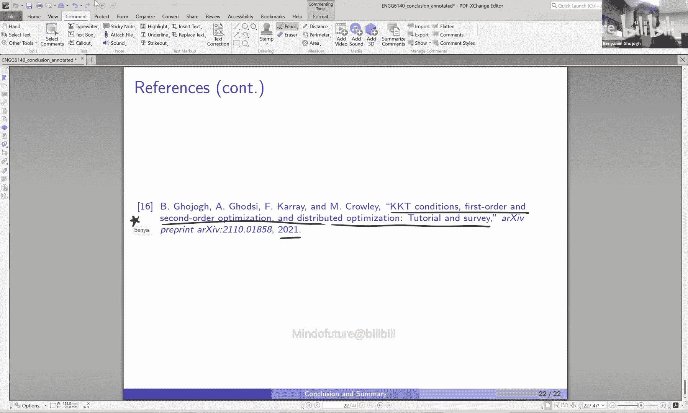

# 【滑铁卢大学】优化技术课程 ｜ Optimization Techniques   W2023 p14 P14_总结与结论讲座 -BV1oJCHBcEo5_p14-

Hi everyone， this is a conclusion and summary lecture for the course optimization techniques。

Let me share the screen。Okay。So。As I said， this is the conclusion of a summary lecture for the course。

If you。Haven't seen that。A bonuson lecture onredant optimization before this lecture。

 please take a look at that。First off， some additional notes。That we had。

Well we we didn't we couldn't cover in this course， but they are worth looking at。

So the first one is a family of methods named Co plane methods and what is that so cotton plane methods also called localization methods are a family of methods which is start with a large feasible set containing the solution to be found so we have a large feasibility set do you remember what was the feibility set the set of constraints determined by equality and inequality constraints。

 so we start with that。诶。And。ItIt is determined by inequality constraints。

 equality constraints and the domain of the。Optimization variable。

We start with that then iteratively where we reduce the feasibility set by cutting off some piece of it。

So an example is this shown in this figure credititive image is for reference one。

 so we have a feasibility set。In this case， it's just a polyhedron and then。

We divide this visibility set to two pieces， so as it is to the only line is it required for division。

 but in higher dimensions， we need hyperplanes or some other high higher dimensional。Boundaries。

 so we divide a feibility set to two parts like here， first part and second part。

And then we with some algorithms， we decide or guess which where the solution should be。

 So if we know that， for example， the solution must lie。In part one。

 then we get rid of the other part， and then we our feibility set reduces to be only part one。

 So this is in this way we。At every iteration， we are making the feibility set smaller and is smaller in a cutting plane methods。

 So， for example， a cutting plane method that starts with a polyhedron visible set。

An example it might not be necessary。 it doesn't need to be a polyhedron feibility set then it finds a plane or hyperplane at every trace which divides the feasibility set into two these joint parts。

 one of which contains the ultimate solution。The solution that you want to find。

It gets rid of the part without the solution so we。

Throw away the part which which won't have the solution。

And this reduces the volume of polyhedron or the volume of the feasibility set。

This is repeated it raly until the polyhedron feibility set becomes very small。

 very small and converges to the solution。 So it becomes a smaller and is smaller until it becomes very small and。

Goes almost to the ultimate solution that we want to find。

One might be wondering how it's like a chicken and egg problem， why。

 because if we already know where the ultimate solution is。Then the problem would be solved。

 So why do we need to make the feasibility set smaller and smaller to reach to that ultimate solution。

 The thing is that when we are dividing the feibility set into two parts every time。

We don't know where the ultimate solution is， but we can guess which part of the feasibility set it lies in。

😡，So using some algorithms， which I'm not going to mention their details here。

The cutting plane methods know that the ultimate solution must lie， for example。

 in part 1 or in part two in this division in of the feasibility set。But we don't know where it is。

 If we know where it is exactly， then the problem would be solved when we didn't need to。

Start with the feibility set and converse to that。If we already knew the solution。

 that would be done。However， we can know where which part it lies in。

 It must lie in so we can get rid rid of the other one。 The other part。

 That's the philosophy and idea behind the cotton plane methods。

And this is somewhat generalization of the bisection method。

 bisection method also called minor research method。

It is a root finding method so we want to when we want to find a root of a a function。

 we we can have binary research and you might have learned it in your numerical analysis courses。

 but later it was used for the binary research or bisection method was used for convex optimization。

So the bisection method， what does it do it halves the feibility set。

Hls it and remove the part without the solution at every t。Okay。Binary search method。

 What does it do， It halves the feibility set into two exactly equal parts and then removes the part without a solution。

 An example of bisection method or binary search method is the the game that many of us have done As soon I say I have a number。

between one and between 1 and10， for example， or 0 and00 in my an integer number in my head and then you guess it the fastest way to guess this number in my head is that you do the binary research algorithm and after every guess that you give me。

 I can say that the number in my head is whether above this number of above the number that you suggested or below that。

😊，So。If you want to converge to the number in my head， in the fastest way。

 the fastest way is to use a bisection method。 Some people don't use the binary research or bisection method and they they might not reach to my to the number in my head。

 or it may take a long time for them to guess my number。 So binary research is the fastest for that。

For example， I you might say。 so what is the middle number between 01 thousand00 is 50。500。

 then you say whether it's 500。 And I say， okay， no， it's above that。

 So you remove the whole range between 0 and 500。 Then your range becomes between 500 and 1000。

 Then I you say what is the number between 500 and000 exactly in the middle of it。 It's 750， right。

And then you say whether it's 750， for example， I say it's below that。

 So you remove the whole range between 750 and 1000， and your range becomes between 5 and750。

 Then you have it again。 So in this way， you will converge to the number that I have in my mind。

 So that's the idea behind my binary search algorithm。 So you can use that for root finding method。

 assume that your root。So you can start with a big domain and your root。

 the root of the function lies in this domain， and then you make this domain smaller and is smaller until it converges to the root of the function。

 you can use the same method for optimization where you have some minimum or maximum of a function and you start with a big feasibility set and then you have it at every time and until the feasibility set becomes a smaller and a smaller and converges to the to your solution。

 And this is an example of this binary research algorithm or。Optimization。

 So we start with some lower bound and upper bound， L and U。Iteratively at each iteration。

 we find the middle point between lower band and upper bound， so we haveal it。

At every tu we found the middle point and we check。We at that point， so。Whether at that point。

Our gradient is negative or not。 If it is negative， then we set the lower bound to be exo L was here。

 U was here。 Okay， we haveal it。So this is the middle， so this equals this。This is for a scalar case。

 but you can generalize it to have to have it for multi multidimensional case then in this case。

 you will say whether the gradient at this point is negative or not， if yes。

 then you need to get rid of this and set L to be this。

RightSo your feibility set becomes only this part， which is a smaller。Otherwise。

 you will set this to be。 You will get rid of this part。And your feibility set becomes only this。

 So this was the previous L and your new U upper bound。Is the X K plus 1。

And then new feibility set is this， so you have it at every time until you converge and you can check the converges criteria。

When is， for example， one coners criterion might be the number of iterations。

 the other one might be whether the gradient becomes almost zero or not because of the first order optimality condition or whatever what I said because we know that at the solution。

 ultimate solution， the gradient must be zero， right？

And and if it is converged that then you return the middle point that you have found because it becomes a small。

 too small that L and U become very close to each other。

 So their middle point is almost the solution。Some of the important cutting plane methods are center of gravity method。

 so these are some algorithms for in the cutting plane in the family of cutting plane methods。

 center of gravity method， maximum volume eipsoid M V。Ctin plane method， chbyship center。

 cutting plane method， Ana center， cutting plane method or ACCPM。

 You can take a look at references 3， even 4 and5。So what the difference between these is how you divide the feasibility set。

 so note that in bysection， bysection method is a special case of cutting plain method because you know that your division point of the feasibility set is exactly the middle of the feasibility set because you are you havingal the feasibility set however。

😊，In cutting claim masses in general， there are different ways to。Cut your feibility into two parts。

 And the， the two parts don't need to be equal size。 So how can we。

Define the cutting plane or the cutting point in the feasibility set then there are different algorithms to do that one way is to choose the center of gravity。

 the other one is maybe maximum volume ellipsode the other one is the chby Che center of the feasibility set or analytics center analytics center so you have different ways to find the center and then from that center you divide the feibility set into two parts。

Similar to sub gradientdient methods， cutting plane methods can be used for optimizing non smooth functions so you can use the cutting plane methods for the sake of non smooth optimization as well。

Okay， now。诶。Another thing which we haven't covered in this course and is worth looking at is eipoid method。

 eipoid method。It was developed by several people。We can take a look at references 6 and 7。

 It was proposed in 1976 and 1977 by the papers 8，9，10 and 11。

It was initially applied to linear programming in a famous paper in 1979， reference 12。

It is similar to cotton plane methods。In cutting some part of the set feibility set iteratively。

 So it is in this sense， in the sense of cutting some of some part of the feasibility set iteratively。

 it's very similar to the cutting plane methods。What does it do at every t。

 it finds an ellipsoid centered at the current solution。So when you have this current solution， xk。诶。

We have。An eipoid den it by E centered at Xk and P。He's just the。

You can take it's a parameter of the ellipsoid。Which is the matrix here in the middle of this equation。

 So this defines the interior of of an ellipsode。And this P needs to be symmetric， positive definite。

And we have P inverse here， and this is the set Z for all Z minus xk transpose p inverse z minus xk。

 so this is a quadratic form， it should be less than or equal to1。

 this is the equation for the interior of the eipoid because it has a less than or equal to so interior and the boundary。

Of the ellipsoids centered at the point Xk， that's why you say it's centered at the current solution。

So this is the eipoid at every t it finds this eipoid。

 you can see an example in this figure credit of these image is reference 13。

 so we have the current solution Xk and this is the eipoid。Karen solution the ellipoid。

Epsilon K centered at Xk， this is the aipoid。And this is this can be the next the e of the next situation。

 so what does it do as you see？It removes。Half of the ellipsoid， which does not contain the solution。

So similar to the idea of cutting plane methods。It's saying that let's take the ellipoid centered at the current solution and then get rid of half of the ellipsode which doesn't have the solution。

How is it different from the cutting plane， cutting plane message， it uses a hyperplane。

That's for cutting the feasibility。 So that's， that's why we call them cutting plane methods。

 However， what ellip method2 does is that。It just finds an ellipsoid centered at the killing solution。

Hows it like this。Exactly like this that it has halved these ellipsoid and then it says that it finds out where the solution lies。

😊，In and then it removes the other half。By the way， in both cutting plane methods and eip methods。

 we can use the direction of gradient for guessing whether the solution is in which part。Because。

Assuming that this is a convex solution， convex optimization problem。

 then if the in the direction of gradient， we know that we are getting away from the solution。

 So minus direction of gradient。It should be the the direction of this solution。

 That's why when we have that visibility set。Then we can find out which side of the。

Isible to set over here in this case， the eoid we should move toward and which help we should which half of that we should get rid of。

Again， another。Eipoid is found at the updated solution。 So we do it iteratively。

 This is repeated until the eipsoid of the iterationeration is very small。

 So the eipsoid becomes smaller and smaller， right， And it converges to the solution。

 So this is the idea of ellipsoid methods in optimization。Another thing which is worth looking at。

 which we didn't go through much， is the mini Max and maximumim problems。

Consider a function of two variables x1 and x to F of x1 x2， and the following optimization problem。

 minimize。With respect to x1， maximize with respect to x2。

 and the objective function is f of x1 and x2。 So first， we maximize with respect to x2。

And then we minimize with respect to x1。In this problem。

We want to minimize with respect to one of the variables and maximize with respect to。Other variable。

 This optimization problem is called miniax problem Y， because we are saying the minimize。

 maximize F， minimum of maximum of F， right， So mini max， minimum， maximum， mini max。Of if。

If we have the other order， so we first minimize with respect to maximize with respect to x1 and then minimize with respect to x2。

Compared these two equations， this one was minimized with respect to x1， maximize with respect to x2。

 This one is maximized with respect to x1， minimized with respect to x2。

And this is called maximum problem y because first we have maximum or maximize then minimize。

 So maximum minimum， Max Max。The other one was mini Maxax， and this is Maxim problem。

And under certain conditions， the mini max and maximum problems are equivalent if the variables of maximization or minimization stay the same。

So here， for example， maximization is with respect to x2。Like here。

 let's consider this case maximization is with respect to x2。Again。

 here maximization is with respect to x2 minimization here is with respect to x1 here also minimization is with respect to x1。

So what does it mean， it means that we have simply。Change the order of these two。

 If you do that under certain conditions mentioned in Ref 14， which is a book。

These two are equivalent。Note that。If you change this x to x1 and this x1 to x to then they are not equivalent under any conditions。

They are equivalent under some conditions。 if the variables stay the same for the variable of maximization is x2 here here is also x2。

 The variable of minimization is x1 here is also x1 al right， okay。

I think intuitively also understandable。So the only thing which has changed between these two is the order of maximization and minimization and under some conditions。

 they are equivalent。So this， the left hand side in disk is saying that first maximize the function with respect to x2 and then minimize it with the spec to x1。

 the right hand side on the other hand says。Firstst， minimize the function。

With respect to x1 and then maximize it with respect to x2。In the minimax and maxim problems。

 the two variables have conflicting or contrastive desires。 One of them wants to maximize a function。

 while the other one wants to minimize it。So they have conflicting desires， right。

 hence they are widely used the field of game theory as important the strategies。

 you can take a look at Ref 15。 why in game theory， we shall have some agents。😊。

Which are either competing with each other or sometimes they want to collaborate with each other。

And in the case where the agents want to compete with each other。We can use mini Max maximum in y。

 because some one of them， for example， here in the left hand side。Assume this is a payoff。😡。

Payoff of something。 the agent 2 x2 wants to maximize this payoff。 However。

 agent  one wants to minimize this payoff。Consider as an example。

 this payoff might be the payoff of only x2。 So it's good for x2， but bad for x1。 Therefore。

 x 2 wants to maximize it。 X1 wants to minimize it because x1 is the enemy of x2。

 or a competitor of x 2。 So in game that's why it's has it has a lot of。😊，Use cases in game theory。

 some examples of game theory is， for example， in machine learning generative adversarial networks GNs where we have a generator which wants to generate some fake data。

And we have some classifier which wants to distinguish the fact data from the original data， okay。

And the generator wants to fool the discriminator or the classifier。

 such that it generates very good and realistic data that it fools the classifier or discriminator and the discriminator can't find out whether that's fake generated data or an original data。

And in this way， for example， Zoom F here is the。Css entropy or some some classification loss function for the discriminator to discriminate the fake generated data and the original data。

Soね。We know that the discriminator assume it' x1 wants to minimize this last function， however。

 the generator wants to maximize this last function because it's the enemy of the discriminator。

In this way， that we this is an example in machine learning。 Another example is in。

Economy where mini Max and maximum are used a lot because when you have a duoppoly in finance and in economy。

 So there are two， for example。2 or multiple。Agents which are competing with each other an example is。

 I don't know， such as Google and Microsoft。So they want to compete with each other。

 One of them wants to maximize its pay off。 The other one wants to minimize that payoff。

 something like that。 So they are competing with each other， especially in duoppoli in economy。

 You can see that。Okay， now let's have a summary so the additional notes is over。

And now let's have a summary of what we have learned in this course。

The course provided the main methods of optimization first off。

 yes okay we started with preliminaries including sets， norms， functions， local and global minimizer。

 derivatives， gradient， Jacobbian， hessian， convexity of sets and convexity of functions。

 we covered these things in preliminaries， right？We'll also introduce the standard problems such as convictx problem。

 optimization problem， linear programming， quadratic programming， semidefinite programming。

 and these forms in the preliminaries as well。Recovered linear programming。

We introduced this simplex algorithm and it implement its tableau method implementation for solving the linear programming problem。

 Also， we introduced integer linear programming， which is linear programming where the variables or some of the variables are discrete and integer。

And we also covered。The branch and bound method for Inte linear programming。

We introduced k contacter or KKt conditions。 we also covered Laangian function and the method of Larrangee multipliers。

 you remember。We also covered unconstraint and constrain first order optimization。

So for unconstrained first order optimization， we covered gradient descent。Back propagation。

Accelated gradient method or AGM， s stochastic gradient descent， SGD， Sag atom。

neural network and these things， we also covered proximal methods in order to to tackle constrain first order optimization such as projected gradient method。

We also covered on constantstrain and constantstrain second order optimization。

 second order optimization we need。Both first order and second order derivatives。

We covered Newton's method for Ar constraints second order optimization。

 also covered interior point method， also called barrier methods such as log barrier method for constraint second order optimization。

And we also covered decomposition methods and conjugate gradient methods for accelerating Newtons method for second order optimization We also introduced quasi Newtons methods such as BfgS and limited memory BfGs LBFgs for a。

😊，Or approximating the Hassian or inverse of Hassian in Neton's method。

We also went through distributed optimizations such as alternating optimization。

As well as ADMM or alternating direction method of multiplierers in order to solve complex multivariate optimization problems right okay we covered non am optimization and we covered all of these for nonmth optimization。

 approximation by convex conjugate and Hober function。

 so we said that let approximate the non am parts of the function by some smooth function such as Hober function for Hober function we introduced convex conjugate to define Hober function。

It also covered proximal algorithm。Stuff thresholdholding， coordinate descent and sub gradients。

We also covered non convex optimization， including so we divided non convex optimization methods into local methods and global methods。

Local methods are faster， but they don't guarantee the global solution。Global methods are slower。

 but they can guarantee and verify the the global solution。 So for local optimization methods。

 we covered sequential convicx programming， which also had。

AT region in the in it for global global optimization method， we covered branch and bound method。

 which has a tree structure method。We covered important search based or meta heuristic optimization methods for handling highly non nonlinear and highly nonconvext optimization methods problems。

 and among those we covered some of them such as genetic algorithm。

 particle swarm optimization or PSO simulated anlink and also we covered Nder meat Sx algorithm。

 which is used in Eine search of MATLb。Finally， we introduced Rimanian optimization for optimization on Rimanian matrix manifolds。

 and that was a bonus lecture in this course。We also in this session。

 we went briefly went through cotton plane methods and eipsoid method and mini max and max problems。

 right？Okay， now let's talk about dealing with an optimization problem now that we have learned all of these when we have an optimization problem。

 how can we deal with it and how can we solve it？Assume we have an optimization problem。

Where we want to minimize or maximize a cost function and we might have several equality and or inequality constraints。

 So first off， we are minimizing or maximizing some function or cost function or objective function and we might or might not have constraints if it we don't have constraints it is an unconstrain problem。

 if we have constraints， it is a constrain problem。Among the constraints constraints。

 we might have equality constraints and or inequality constraints， right？So we have several cases。

 first off， it might be minimization or maximization also in each of these。

We might not have constraints。Or we might have constraints if we have constraints。

We might have only equality constraints。 We might have only inequality constraints。

 We might have a mixture of both equality and inequality constraints。 Okay。

 so all of these cases might happen。If the problem is on constraints， such as this miniization。

 minimize f of X with respect to x， then what do we do The first thing which you should do in optimization。

 take derivative it and set it to 0。Why this is because of first order optimality condition It says gradient of f of F at the solution minimize minimizer x star needs to be0 or needs to vanish to 0 This is also you can see it as one of the as a consequence of one of the Kkt conditions and this is high school rule。

 do you remember in the course whenever I refer to this first order optimality condition I said what did we do in high school we take derivative and set it to 0 because in high school we also whenever we wanted to find an extreme of the function。

 minimum or maximum of the function， What did we do we used to take derivative and set it to0 because we know that gradient is0 at these points Okay so take derivative set it to0。

If you can find。Exa star。In a closed form solution， what do I mean by close form。

 it means that the left hand side， for example， is x and the right hand side is an expression。

 a mathematical expression without x in it。So you could find X alone。In a close form solution。

 then that's done。You might have a set of exit stars。😡。

Some because we might have some minimums and maximums。 like if it's not conveyx， we might have。

 for example， here， three minimums and one maximum。 So it's if it's convex， then we know we only。

If it's a strongly convex， we only have one。Minimum， if it's convex， you might have several minimums。

 but all of the function value in all of the those might be must be the same if it is convex。

 okay so。Exa star gives if we can find it in closed form solution。

 then we need to check whether it's a minimum or maximum or a saddle point， why because。

This is maximum。 This is minimum。 This is a saddle point In all of these。 The gradient is 0。

 How do we know which one it is because we might find several x stars。 One of them might be minimum。

 one of them might be maximum， one of them might be saddle point for we can take second derivative calculated。

 and at that point， x star， we should check a second derivative of at that point。

 if it is positive semidefinite， or in a scalar case， it is positive， greater than or equal to 0。😊。

For all of access in the neighborhood at that point。So what do do I mean。I mean。

 at that point and all of the points near that point in the neighborhood with some radius epsilon。

 right？If we know that this second derivative is greater than or equal to0 or in the if it we are multiple we have multiple dimensions。

 then it means to be positive slightly be definite if that's the case， it means that。😊。

You are in this neighborhood and as its second derivative is greater than or equal to0。

 the function is facing up。😊，Therefore， this must be a minimum。If the second derivative。

Is less than or equal to 0 or is。N negative semi different。In this case。

 it's the function at the neighborhood around that point is facing down， so it must be。A maximum。

 a local maximum if at some points in this neighborhood。

 the function is facing down and at some points its facing up， for example， in this case。

In this neighborhood is facing down， it' in this neighborhood is facing up。

So in this neighborhood at some points it's facing down， at some points it's facing up。

 then that point is a saddle point。That's why I set for all points。In this neighborhood。

 if it's greater than equal to 0， it means that it's facing up for all points in this neighborhood and it's a minimum。

 okay。If we can't find a closed form solution like this。Then we need to do numerical optimization。

It's the same as root Findy when， when you want to find the root of something， what do you do。

You set it to 0， you set the function to0。 Hopefully， you can find it in a closed form solution。

 If you can't find it in a closed form solution， the root。

Then you need to do to use numerical analysis。 What have you learned in your numerical analysis course。

 You do it iteratively until you find。 And there is a close connection between root finding algorithms and optimization Y。

Because in root funding。Algorithms， you want to find the root of f of x equals 0， right。

And root in optimization， you want to find the root of gradient of f of x equals0 because of the first order optimal multicondition。

So if you replace the function F with a gradient of F。Then。

The the optimization problem is just a root finding problem， right？Therefore。If you can find。

The solution a close from solution， done。You need to also check this to check whether it's minimum maximum saddle point if you can't find a close for solution。

 then you need numerical analysis as you have done in your numerical numerical analysis for rootfin algorithms。

 so you need to do it numerically or iteratively。😊，Then it divides into two。😡，Fami of methods。

 whether first order optimization or second or optimization in first order optimization。

 you do it itratively in numerical optimization， but it needs only first order derivative。

 gradient of it or gradient。If you have second order optimization。

 you need both first order and second order and first order derivative is called gradient usually and second order derivative is called hessian usually。

😊，Right。So now you see the connection between。Root finding algorithms and numerical optimization。

 right numerical， why do we call it numerical optimization because it's like it's using numerical analysis and its。

 it is iterative。O。If the problem is constraint。Such as this。

 minimize a function for weeks with respect is subject to M1 inequality constraints and M2 equality constraints。

 And each of these are functions of。呃。The variable X， then we can。We can do several things。

 One thing is that we can convert。で。Constraint optimization problem to an unconstrained optimization problem。

 how we can embed the constraint into the objective function using penalty or regularization term。

Then we have two cases in this case， whether we can have soft penalty or hard penalty for soft penalty。

We can say， okay。Put each of these。Inequality and equality constraints as penalty terms or regularization terms。

For penalizing deviation from these constraints and you can also have some weights like here。

To wait how important the deviation is with respect to the function itself。 So here we have bda eyes。

 We have no eyes here。It's similar to the formal lagangangian of these functions because laggrangian is kind of interpreted using soft panels too。

Right then you are mini it and these are the regularization terms。Here we have M1。

Inequality constraints and M2 equality constraints。

 why because here we want to minimize H2 to become0 here we also want to minimize。

Yhy I2 to become less than or equal to 0。Right。So you can see these terms。

As some penalty term for x belonging to the feasibility set S and this feasibility set。

 you can see as an intersection of these， all of these constraints。

And I have put the weight or regularization term et all for it， doesn't matter。

 I have defined this soft penalty in this case， if it is satisfied。

 so if all of these constraints are satisfied， x belongs to the feibility set， then it's zero。😊。

The penalty is 0。 If it's not satisfied， then。This function needs to be an increasing function with respect to not being in the feasibility set。

 So the more we are deviated from the。Visibility set or the set of constants。

 the more this function should get。The more the output of this function should be。

The more we have deviation， the more penalty we have。ok。However， we can have hard penalty。Then。

The penalty term needs to be a hard penalty term， so it needs to be an indicator function。

An indicator function in optimization usually is defined as this。

 So if x belongs to the feasibility set， So it it satisfies the all of the constraints。

 then this indicator。Gives 0 similar to the pen soft penalty。 However。

 the difference is for not being in the set， feibility set。 If it's not in the feibility set。

 the hard penalty or indicator function in this case says it should blow up to infinity。

 So it blows up the whole regularized objective function because this is a regularized objective function。

 This is objective function。 This is regularized objective function。 Also here in soft penalty。

 Also this is objective function。 This is regularized objective function。

It is regularized by the penalty term。However， in the hard penalty case。

The regularization term is an indicator function， which is hard。

 it blows up the regularized objective function to infinity。

 which kills the optimization problem for minimization because minimization。

 infinity is exactly the opposite of minimization。If you are maximizing it。

 then that should be become negative minus infinity because that would kill。😡，Maximization， right。

So we also can have approximation of heart penalty because this is not easily implementable in。😡。

We can't implement it easily in computer。 therefore we need to approximate it because it's like this function like this。

Then what should we do， We need to approximate it with some。Mounction。Like this。

And that can be implemented by logar rhythm。Or other functions。

Then done those are barrier methods because it's like a barrier， but we are approximating it。

With some function which can be implemented in computer。

 And one of the barrier methods is is look log barrier or logarithm barrier method， because。

It can approximate this indicator function by loger。

 and these barrier methods are used in interior point methods for second order optimization and widely used in optimization toolbox。

 right？Okay。If the problem is linear programming。If fine costs or constraints。

 then we can solve it using the simplex algorithm。Any of these implementations such as Tau method？

So when the cost function is a fine or linear， linear with with bias is kind a fine， a fine function。

Also， if the constraints。Are a fine functions， so the feibility set is just a polyhedron。

Then we can use linear your programmer。And for that。

 we can use simplex algorithm Linear programming can be solved by other algorithms。

 such as Inter point method 2 simplex algorithm is the simplest one。If the problem is。

Integer linear programming。 So a fine cost and constraints。

 But some or all of the variables are integer， then we need to use branch and bound method。

And in each the top problem in the tree of the branch and bound method we need we can use simplex algorithms such as the tableau method for solving that。

RightBy the way， if the linear programming has two or three variables。

Only then we can use the visualization。For solving the optimization problem。Okay， in general。

 if the optimization problem， not just in linear program， has only two or three variables。

 maybe we can solve it by visualization visualization is the easiest way to solve an optimization problem with two or three variables。

 right？Okay， if the optimization problem is not linear， but not very complicated。😡。

We can solve it using method of lagrange multipliers， which makes use of KKT conditions。

Do you remember？We solved an example in the KKT slides。

And that was not a very complicated algorithm problem， why， Because when it becomes very complicated。

 then the Kkt。Conditions become very complicated and the system of the equations becomes very complicated to solve。

If it's complicated solving the system of equations in the method of lag branch multiplier is very hard。

If the optimization problem is unconstrained。Then we can and it doesn't have a close form solution。

We can do use either first order optimization methods or second order。First order methods。

Unconstrain first limited， they are slower， but they are easier。Compared to second order method。

Which are faster， but harder。 Why second order the first order method that only needs gradient。

 So it's easier。But it is slower。 its convergence rate is a slower than second order method。

 Second order the methods， they are faster。 Their convergence rate is much faster。

But they are harder， why， because。They need to calculate both gradient and hessian and calculation of hessian is hard。

 that's why they usually approximate the calculation of hessian by quasi methods and these things。

Also， note that。The convergence rate of first order methods was slower。

 that's why they tried to accelerate those methods。

 such as accelerated gradient method proposed by Yunesov， do you remember。😊，But again， still。

 Neton's method is faster to convertverge。And that's why in many machine learning algorithms。

 nowadays， they are using first order methods， why such as in back propagation and neural networks。

 because they don't want to calculate the hesscent and second or dropped derivatives。

 a head a pen in the neck， it's a headache， So first order optimizations such as gradient descent back propagation accelerateded gradient method。

 stochastic gradient descent sag atom neural network on constantstrain proximal methods right。

St in order onconstrain methods such as ne myth。 However。

 if the optimization problem is constrain and we don't want to。

Converted to an unconcerant problem using embedding as soft or hard penalties。

 which we discussed here。If we don't want to do that， we want to actually solve them。Using the诶。

Fsibility， Sir。And constraints， then we can use constraint。

First order and second order optimization methods。Ontrain， okay。So， again。

 first order methods are slower， but easier， as second order methods are faster， but harder。

 Some constanttrain first order methods， which do it iteratively。

Our projected gradient method and constrained proximal methods。Right， wait。

For constraintsstrain second order optimization， we can use interior point method。

 lag barrier method， and these things which are used in toolboxes， right such as CVX。

We can also use decomposition methods， conjugate gradient and quasinots method to make second order optimization easier and faster。

 right？😊，Okay。If the optimization problem is distributed or with multiple variables。

 then we can use distributed optimizations such as alternating optimization and ADMM or alterating direction method of multipliers。

And also， we can make it paralleled why， because it's a distributed algorithm。

So we can parallelize it on different servers。 It's closer related to also federated learning and machine learning。

 Do you remember。If the cost in the optimization problem is none as smooth。

Or non differentiable at least at one of the points in its domain or feasibility set。

 then we can use non a smooth optimization。😊，For example。

 we can approximate it by convex conjugate and hubber function。

 so we can approximate the non smooth parts of the function by a by a smooth function。

 such as hubber function。We can use proximal algorithm。Dough thresholding。

Orordinate descent and subgrads。If the optimization problem is non convets。The cost is。

 so what does does what do we mean by non convex optimization problem。

 we preliminaries if the cost is non convex and or。If a cost is not a convex function。

 and or the feasibility set or the constraints are non convex sets。

Then we can use non convictx optimization。So we can have two approaches。Local optimization methods。

 which are fast has to converge， but they don't guarantee to find the global solution。

 such as sequential convex programming， which at at each iteration， it approximates。

the optimization problem to a convex optimization problem。

 so it convexifies the problem or or it relaxes the nonconvex optimization problem to a convex optimization problem。

 but it has a trust region to make sure that we don't deviate from the actual solution much。

 but also we can use global methods which are slower to convertverge。

 but they guarantee to find the global solution and they can verify it also such as branch and bound method。

Using the tree based。I agree。We can also use non convex optimization。

Or search based optimization meta heuristic optimization in these cases。

 So if the optimization problem is complicated or highly non convetx。

 we can either use non convex optimization or meta heuristic。

 also called search based optimization right if it's highly non convex or highly nonlinear how also if。

😊，In these two cases， we have to use Meistic optimization too。

If the gradient of the function is hard to compute。

 because we know that the classic optimization algorithms。They need to use gradient。why。Even from。

Starting point， we take derivative and set it to 0。We need gradients， if not close form solution。

We need to do it iteratively by first order or second order optimization。

 Both of which require gradients， right， Therefore， we need， we need to have gradients。

 If the gradient is hard to compute， then we can use materialistic because search based methods usually usually don't use gradients right。

 or when the function is not known。But it works like a black box。

So we have F whenever we give some input， it gives us F of in this case。

It gives us an output for each input but we don't know inside of it。

 it's exactly similar to a black box and it's used in reverse engineering too because we don't in reverse engineering。

 we don't know inside of function， but we can always test it with some point and it gives us some output right so。

When it's like this， then we have no choice but to use materialistic optimization or search based why because in this case。

 we can evaluate the function， but we don't know what it is。

And meteistic optimization methods or search based optimization methods。

 they usually evaluate the function at some solutions， so we have some candidate solutions。😊。

And we evaluate。The objective function or the fitness function or whatever you call it add those candidate solutions and their local searches too。

So we only evaluate the function value。So in these cases。

 we have to use search placement optimization。Some examples of meistic or surface based optimization are genetic algorithm。

 particle storm optimization， or PSO simulated an Neder meet simplex algorithm。

Used in E search of Malab and DC。If the visibility is set。😊。

Or set of constraints can be seen as a Rimanian manifold。Then we can use Romanmanian optimization。

 Take a look at our bonus lecture and Romanmanian optimization。 An example is that。

Minimize trace of x transpose a X。With the expected matrix x subject 2 x transpose x equals identity matrix I。

This is used a lot in machine learning for where a is a positive semi definite matrix。

 This is used a lot in many fields of science， such as machine learning， For example。

 PCA and many of the spectral dimensional reduction methods have these form。

 and this is actually also。😊，Using linear algebra so because this is the optimization problem for eigenvalue problem。

For eigenvalue decomposition， Also， you see this in theoretical physics。

 you see it in telecommunications， too。😊，上来。In this case， this says want what does it mean， I want x。

 the matrix x to be an orthogonal matrix， so I want its columns to be orthonormal。

Perpenicular to each other。 But their lengths， I want them to be one。Each column。

I can see this is the definition of stel Manifold actually。😊。

So I can convert this classical optimization problem to a Rimanian optimization problem by saying that minimize traceso x transpose A。

The object to X belongs to the manifold of atele。Which is a Romanmanian manifold。

We have discussed this in the lecture of Romanmanan optimization take a look at that another example is eggs belong being positive semideinite or positive definite。

Then it belongs to the， we can convert it to a remanant optimization problem by seeing that x belongs to the。

Demetric positive definite manifolds or SPD manifolds， right？

Another example is grass Man and manifolds。So this is a steple mindful grassman and mindful for speedy manifold。

 Crasmanian mindfulfold is。For project matrix onto a subspace。 So whenever we say。X transpose a。

 which means that we want to。AProject， the columns of a onto the column the space of x or the space is stand by the columns of x。

 You can see this x as the linear projection matrix。It is closer related to the grassman in Manifold。

And it's used a lot in linear projection has a lot of uses in， for example， machine learning。

 you can see PCA as this。😊，Prncipple components analysis and many， many other。He even regression。

 linear regression can be seen as a linear projection。

If you take a look at the formula for linear regression， I think。😊，It was as far as I remember。

 x transpose x inverse x transpose。Why something like that？ So you can see these， the whole thing。

AndI might be wrong in some details， but it was similar to this form。 Okay， why is the。

Matrix of the labels and x is the matrix of the data。So you can see the whole thing as u transpose y。

 so you can see the whole thing as a linear projection thing。Right。Okay。

Now that we have seen all of these see things。😊，You can see the KKT backbone。

 so I think now that you know the theory behind many of these optimization algorithms。

 you can see the nearvaana moment or the enlightenlightment moment of optimization and what is that。

😊，That the backbone of bit。Most of the optimization algorithms is K Kt conditions and lagrangium as an interesting sentence。

喂。Backbone of most of the optimization is KKT conditions at Lagrangian。

This is the enlightenment moment of optimization。 Let's take a look at that。

So when we were dealing with an optimization problem， we take derivative to20 these。Do you remember。

 we know that the derebuttable Lagangian。With respect to primal variables and dual variables should vanish to0。

 should be  zero。Also， so you can see because Lagrangian。

 you can see it as a soft penalty of the object to function。

 also in the first order optimality condition， you have this。

 so derivative of f of f at the primal variable should primal solution should vanish to zero。

 so it's related to KkT conditions。First order the optimizations take order all of them。

You can see in the derivational menu of them。We use K K T conditions。 We use Lacrian。

Take a look at whatever we have learned in this course。I remember that almost in all cases。

 we use the laggrangian of the function。In derivational Inter point algorithm。

 which was constanttrain secondary optimization used in many toolbox。

We used K Lagungian and K K T conditions。 I remember when we were。

The arriving the method of lagr multipliers also was based on KKT condition。嗯诶。I remember。对。

In distributed algorithms， the revisional ADMM。It was based on KKT conditions and Laangia。

Many of them， if you take a look at whatever we learned。

 go back and see we are using Laangian on take conditions。 So they have shown some shared。嗯。

Knowledge between all of these optimization algorithms。And now take a look。

 S back and take a look at all of the algorithms that you have learned and review them in your mind。

 You can see that they are all connected to each other。 They are sharing ideas with each other。

Even in many algorithms do remember， do you remember， for example， AGM。

 take a look at AGM accelerated gradient method， what was it doing？It had， I remember it had x and Y。

 so it introduced some additional variable。 you saw that in many of the other algorithms。

We also saw that in the alternating optimization， so because it was up alternating between x and y and AGM。

Time。I'm saying that there are connections between algorithms。

 AGM is connected to alternative optimization。Also。

I remember some other algorithms had this similar idea。

 Many of the algorithms were using the log of the history。Similar to what we have in momentum。

So they have shared ideas in that case。 So if you take a look at them。

 they are using sharing ideas or。Coordinate decent。

Maybe you can see it as an alternating optimization because you're alternating between the coordinates right。

 you can see different families of algorithms have some shared ideas。

 Some have some connections with each other。 they have。Ideas。Shared between them。Okay。

 now acknowledgement。Some slides of this slide deck are inspired by Professor Stephen Boyd。

The eippsoid method and also the cutting plain method。 Boyd has some good lecture notes on those。

 You can take a look at them at Stanford University。

 Our tutorial also has some materials of this slide deck。Terial 16。Okay， some references。

 let's review them in this slide deck。 So boyd。And whenon where at Stanford。

 this is the lecture point lecture notes for cut plane methods， you can take a look at that。Also。

 this is a book numerical analysis because when I said do you remember optimization， algorithms。

 if we can't find a close on solution， we need to use numerical analysis。

So you can take a look at that also。Analytics centers。

It was one of the algorithms for cutting plane methods。 Do you remember for cutting plane algorithms。

 family of methods， I mentioned some of some of the famous methods in that family of methods such as these analytics centers。

 not one in again， analytics centers。These were proposed in 1993，1995。And another one。

Analytic centers again，1995。Eippsoid method。1980。Aipoid method。In 2009。Ct tough method。

With the space extension in convex programming problems。What was that， Let me take a look at that。

 to remember。8。Okay，8 to 11。 there are different papers which propose ellipsoid method，8 to 11。

 Let's take a look at them。8ight。😡，So cut off method with a space extension in convex programming problems proposed in 1977。

Also， these papers。So。Informational complexity and efficient methods for the solution of convicts extremereal。

Problems in 1976， this is also e method。So another one evaluation of the informational complexity of mathematical programming problems in 1977。

Okay。Seem many of the authors are the same。 Also youing yielding。

 So one of the authors who proposed aip method was Sho。 Sha is a famous scientist in。Optimization。

Another one is Yuing Eal， and also Nemirovsky， Namirovsky， Yudin and Nemirovsky。

So this one is evaluation of the informational complex of mathematical programming problems in 1977。

 the other one is optimization methods adapting to the significant dimension of the problem。

 1977 all of these proposed ellip method。😊，so this one。In 1979。

 a polynomial algorithm in linear programming。What was it for，12。 Let's take a look at that。 said 12。

Was when we used aip method in linear programming， do you remember？Okay。Right。S。It is a famous paper。

RightIn Russian Academy of Science Sciences， another lecture note by Boyd Eal， an ellipsoid method。

 So this is a good lecture note of the Stanford University by Boyd for the ellipsoid method。

 You can take a look at that。 Also， this one。诶。Yes。

 this one is a book on minimax minimax and applications in 2013 by Du and Parals。 So do you remember。

 I said under some conditions， minimax and maximim are equivalent。

You can find those conditions in this book。Also， there is a paper and some thoughts on the miniax principle in 1972。

 I think it discusses that it can be used in game theory as a good strategy as far as I remember Okay。

 this paper is also our tutorial paper on optimization。 You can take a look at that。

And I think it's a good tutorial。Okay， thank you very much。

 I hope this course has been useful for you。

