# 【精译⚡机器学习教程】PatrickLoeber p03 p2 Logistic Regression in Python - Machine Learning From Scratch 03 - Python Tut -BV1F3fJY5E7e_p3-

Hi everybody。 Welcome to a new machine learning from Sc tutorial。 Today。

 we are going to implement logistic regression using only built and Python modules and Nmpy。

 If you haven't watched my previous video about linear regression。

 I will highly recommend to watch it first since I explain some of the concepts a little bit more in detail there。

 but I will try to cover all the important concepts again in this video。

 so let's talk about the concepts of logistic regression。So。As you remember， in linear regression。

 we model our data with a linear function， W times x plus B。So this will output continuous values。

 And now， in logistic regression， we don't want continuous values， but we want a probability。

And in order to model this probability， we apply the sigmoid function to our linear model。

 So the sigmoid function is one over one plus the exponential function of minus x。

So this is the smoid function and Min and x。 in our case， is then our our linear model。So。

 and this is this will output a probability between 0 and 1。 So if we plot the sigmoid function。

Then you can see this is between0 and one。So with this function。

 we can model a probability of our data。And now， with this。Approximates it。Output， and we can then。

We must then come up with the parameters W。 So our weight and our bias。And how do we do that？

 So again， I already explained this in the previous video。

 So we apply a method that is called gradient descent。 So first of all， we need a cost function。

 and here we don't have the mean squared arrow anymore。

 but we use a function that is called the cross entropy。So this is the formula。

I will not go into detail about this， but I will put some further readings in the description。

So with this formula。What we do， we want to optimize this with respect to our parameters， W and B。

So we use gradient descent， and this means we start at some point and then iteratively update our parameters。

 So we have to calculate the derivative。And then go into the direction of this derivative until we finally reach the minimum。

So and then we also need to define a so-called learning rate。

 so the learning rate determines how far we go into this direction with each step。

 so this is an important parameter， it shouldn't be too high since then it might jump around and never find the minimum but it also shouldn't be too low。

Sorry。And now with this gradient descent。What we have is we have our update rules， So our。

Our weight is our new weight is the old weight minus because we want to go into the negative direction minus our learning rate times the derivative。

And the same is for our bias。And then here are the formulas that we need for our derivatives。

 So these are the formulas， and they are actually the same derivatives， like in。linearar regression。

 so you can check the math behind it yourself。 I will also put some links in the description。

And this is all we need now to get started。 And now we can implement our logistic regression。 So。

 of course， we use nuy again。 So let's import nuy S and P。

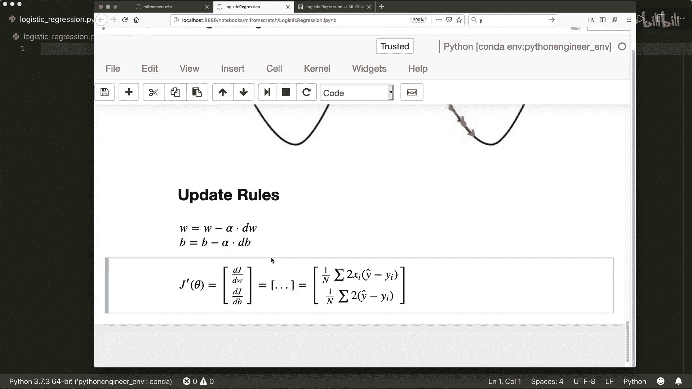

And then we create a class called Lo regression。And this will have an in it method。

 So we have an in it。And in it looks exactly the same as for linear regression。

 So I will put some learning rate in here that will get a default value。 So 0。

001 usually the learning rate is very small， and it will also get a number of iterations。

 So and its and with a default of 1000。So this will determine how many iterations we use for our gradient descent。

 and then I will store them。 So I will say self LR equals L R and self。And its equals and its。

And then， I will simply create some。Weights， but set them to none at first。

 So our weights are none and our bias is none， simply that we。

 we know now we need to come up with them。And then we define a fit method。

 So here we follow the conventions of the psychic Learn Library again。

 so this will take some training samples and the values， the training labels。

So this will involve the training step and the gradient descent。And then we have a predict method。

And here we get new test samples that we want to predict。

 So these are the methods we want to implement。And our input inputs here。

 So x is a nuy N D vector of size M times n， where M is the number of samples and n is the number of features for each sample。

And why。W is a10 vector or also of size M。 So for each training sample， we have one vector。So。

Now we can go on， so first of all， we have to in it initialize our weights。

 so let's say we want to in it the parameters。And for this， we get the number of samples。

And the number of features。So， this is x。Shape， so this will unpeick the shape the first dimension into the number of samples and the second dimension into the number of features。

And then， we in it our。嗯。Wes。Just with0。 So we create a vector only with zeros of size。

 number of features。 And we set our bias to 0 at first。You can also， for example。

 use random numbers for the initialization， but 0 is just fine。And after that。

 we used the gradient descent that I talked about。 So we iteratively update our weight。

 So we use a4 loop。 So let's say4 I。 And actually， we don't need this。

 So for underscore in range and then self dot and its。

 So this is the number of iterations we want to have。

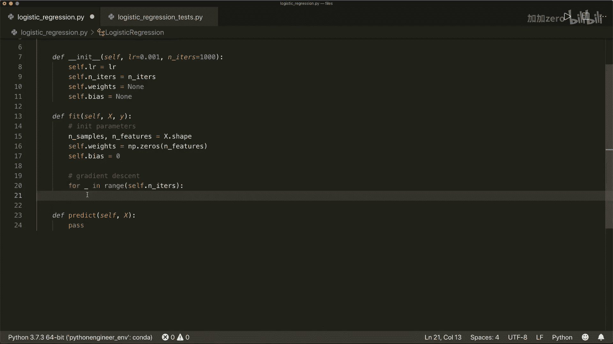

And now let's have a look at the formula again。So first of all。

 we approximate our y with this function。 So first。

 let's apply this linear model and then apply the sigmoid function。

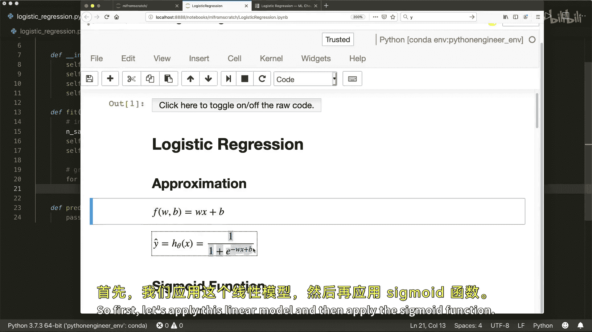

So， let's say。来呢啊。Model equals This is w times x plus B。

 so we can use the nuy dot function to multiply our vector。 So multiply x and self dot weights。Plus。

 self dot bias。And then。We apply the sigmoid function， So let's create some help or method。

 some private method， sigmite。That gets some X。嗯。So， and here。

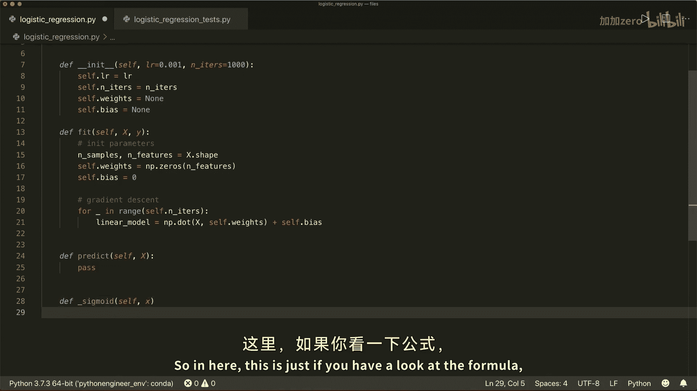

This is chest。If we have a look at the formula，1 over1 plus the exponential function of minus x。🤢。

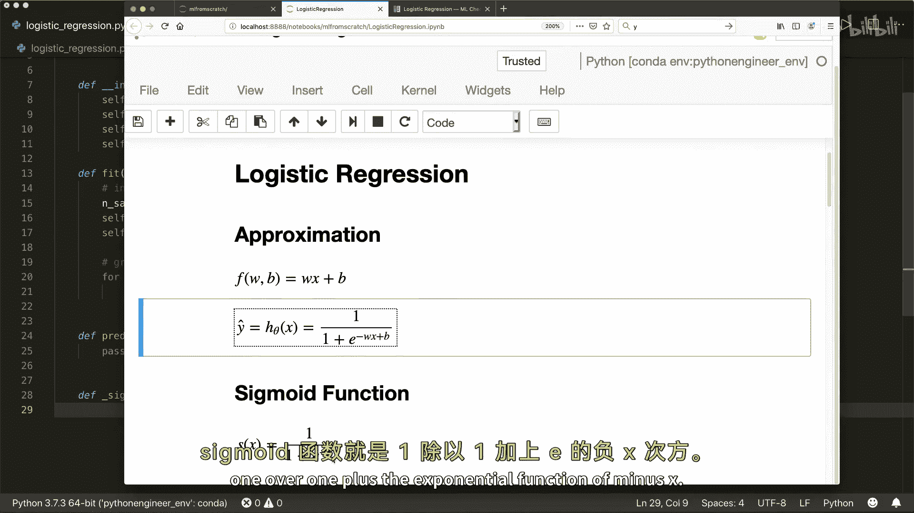

So we can write this in one line， one， return one over1 plus NP P dot。

 or let's make parenthesesis around this，1 plus NP P dot X。And then， off minus x。And then。

This is all we need。So now we apply the sigmoid function here。

 So we say why predict it equals self dot。Sigite off。And then our linear model。

 So this is our approximation of y。 and then we need to update our weights。

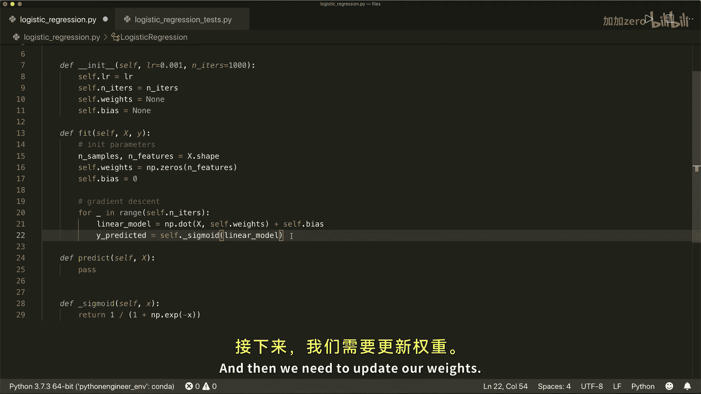

So。We have a look at the update rules。 We first calculate the derivatives。Of with these two formulas。

 So let's say。

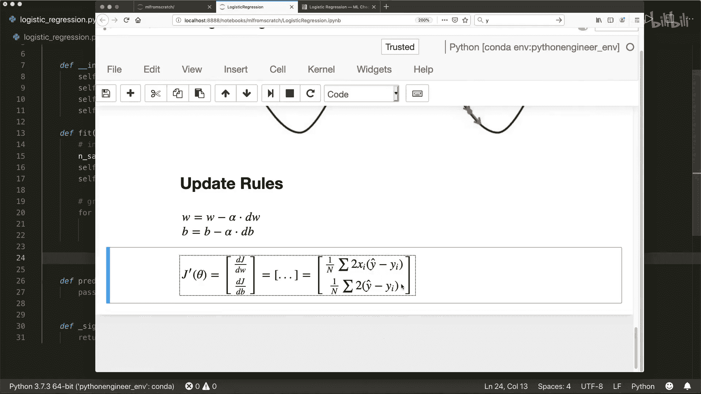

DW equals， and this is one over n。 and then the sum。

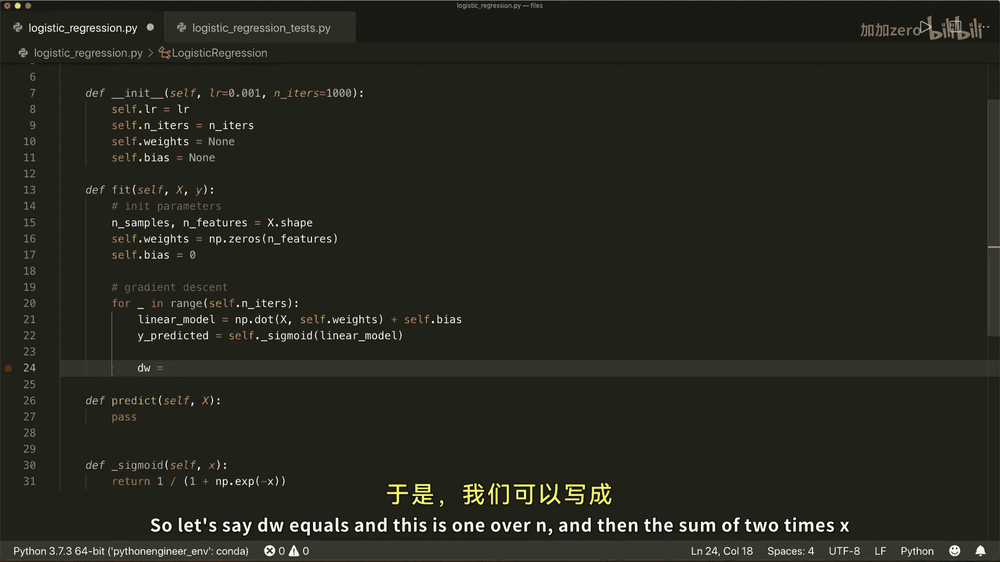

Of two times x times the difference of the predicted y minus the actual y。So， we you have。

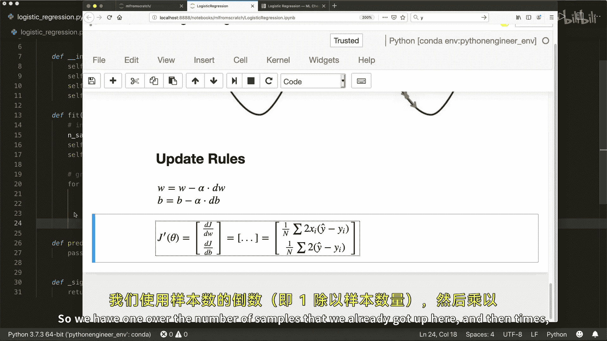

1。Over the number of samples。That we already got up here。And then times。 And then we have the。

Product， and then thes sum over this product。 And this is nothing else。

 but also the dot product of vector。 So we have to can use numpy dot dot。

But now we have to be careful。 now we。Want to do this along the other dimensions。

 So we have to use x dot transposed。And then the do product of this and y predicted minus the actual y。

So please check the dot product for yourself。So this is the derivative with respect to W and the derivative with respect to the bias is the same。

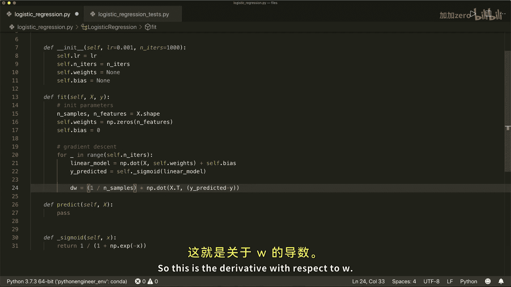

But only without the x。 So this is just a sum。 And by the way。

 I left the two out because this is just a scaling factor that we can omit。 So this is one over n。

 And then the sum of this difference。

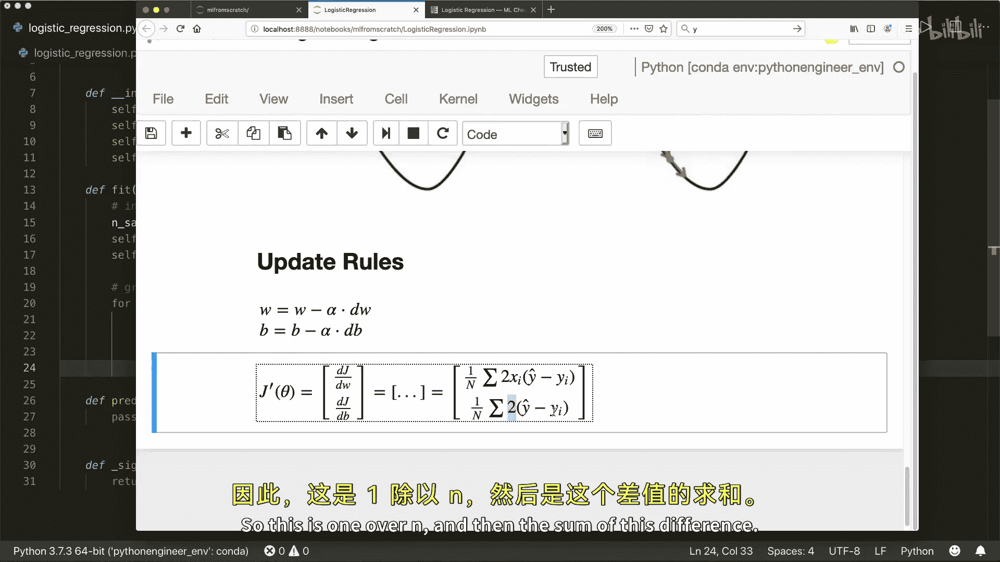

So， we say。D B equals one over number of samples。And then times N dot sum。

 And then here we simply have y predicted minus the actual y， so。These are our derivatives。

 and then we update our well our parameters。 So we say self dot weights minus equals self dot learning rate。

Times the derivative and the same for our bias。So minus equals self dot learning rate times the derivative。

And this is all for our fit method。 This is the gradient descent。

And now let's implement the predict method。 So here we do the same thing that we did here。

 So we first approximate our data with a linear model and then apply the sigmoid function to get a probability。

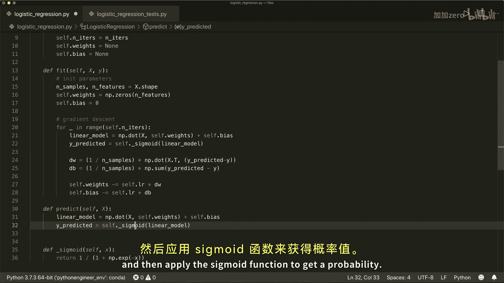

And now。What we want is we want to say if it's either class 1 or class 0。

 So we look at this function。And we say if it's larger than 05， then it's class 1。

 And if it's lower than it's class 0。

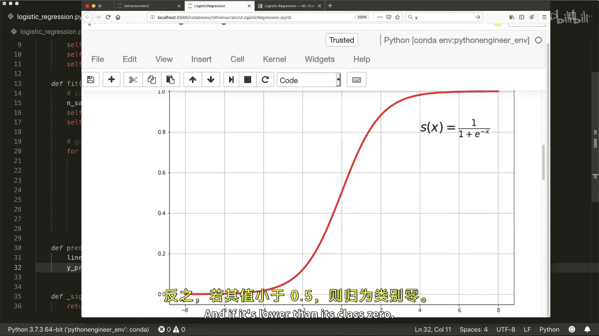

So， let's say， our。Why predicted。Class or classes。 This is for multiple samples equals。

 And then we use list comprehension。 and we say it's one if。Our I is larger than 05。And otherwise。

 it's or else， it's0。And then we do this for y for each probability in our y predicted。

So now we have0 or ones， and then we。Just return this。 So return the predicted classes。

And this is the whole implementation that we need。 And now we can test it。

 So I already wrote a little test script where I used the psychic learn modules to to load some。

Some test data， so this is the breast cancer set， you can Google that。

 so this is a popular two class problem。And then I will split the data into training samples and test samples。

Then I will create some logistic regression model with our from our file that we and our class that we just implemented here。

 and then I will fit the data or training data and the training labels， and then I will predict this。

And predict the labels for the test data。And then I calculate the accuracy。

 So how many of the labels are correctly。Assigned。So if you've watched the video about the K andN algorithm。

 then you already have seen this。And now let's run this。So here。Got an unexpected keyword argument。

 learning rate。🤢，嗯。Oh， sorry。I just call this LR。And this is the number of iterations。🤢。

So let's run this again。And then we see our accuracy is 0。92。

 so or almost 93% of our test data is correctly assigned。So we see that it works。

 and I hope you enjoyed this tutorial and see you in the next tutorial bye。

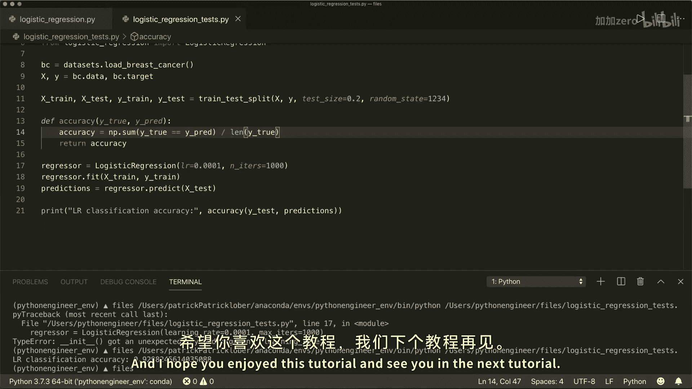