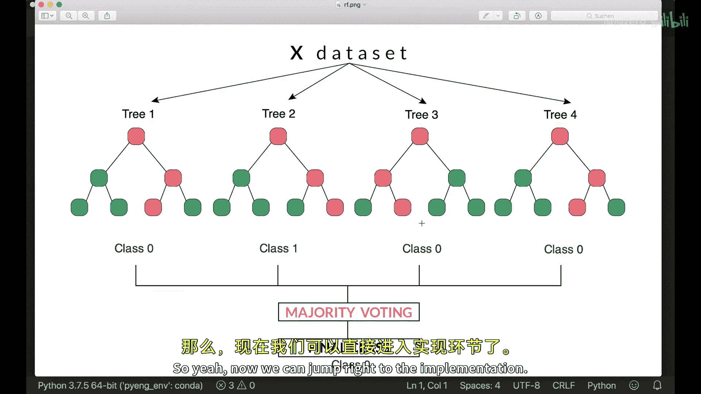
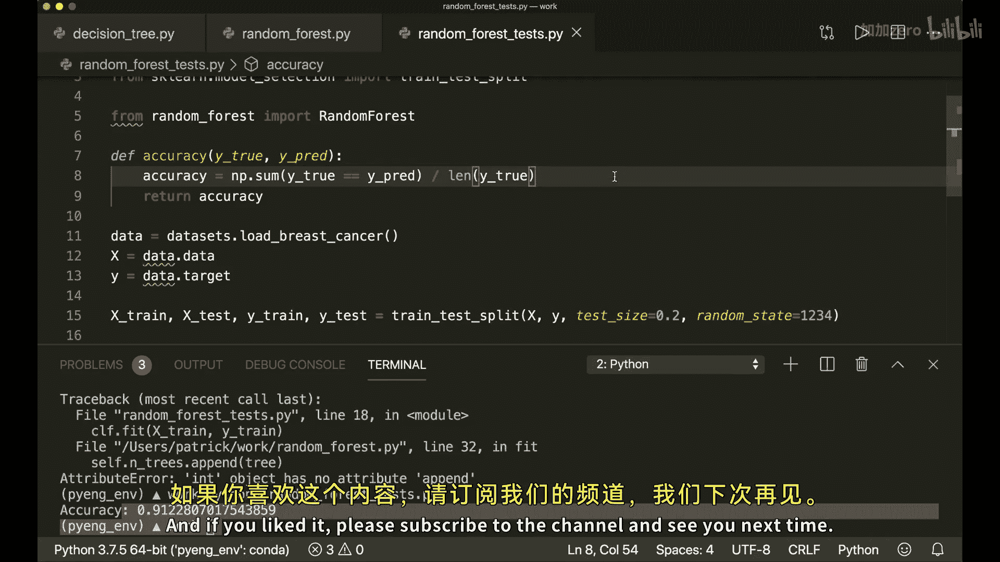

# 【精译⚡机器学习教程】PatrickLoeber p10 p9 Random Forest in Python - Machine Learning From Scratch 10 - Python Tutorial -BV1F3fJY5E7e_p10-

Hi everybody。 Welcome to your new machine learning from Sct tutorial Today we are going to implement a random forest using only built in Python modules and Nmpy。

 The random forest algorithm is one of the most powerful and most popular algorithms。

 so I'm very excited that we can finally implement it in this tutorial in the last tutorial I explained how a single decision tree works。

 So if you haven't watched the previous tutorial yet。

 then please do so because our random forest model and also the implementation is based on the decision tree model from the last time。

So if you have understood the decision trees， then the approach of the random forest is very easy to understand。

If we have a look at this image here， then this shows the whole idea。

 so the idea is to combine multiple trees into a forest。

 so we train multiple trees and each tree gets a random subset of the training data thus the word random we then make a prediction with each of the trees at the end。

And we make a maturity vote then to get the final prediction。So this is the whole idea。

And the random forest has some advantages compared to only one tree， for example。

 by building more trees， we have more chances to get the correct prediction and we also reduce the chance of overfitting with a single tree so typically the accuracy of a random forest is higher than with a single tree and that's why it's so powerful。

So， yeah， now we can jump right to the implementation。 So， of course， we import。

Nampy， S and P。And then we also import the decision tree class from the last time。

 so we say from decision tree， import decision tree。And now we can start。

 We create our class decision 3。And or sorry， now， now we have the random forest。

 So now we create our random forest class。And this will。Get an in it。So。

 and this will get the number of trees we want to have in our forest。

 So let's say a number of trees equals 100 by default。

And then it also gets all the parameters from our decision tree initializerizer。

 so it gets the minimum samples required for a split。 it gets the maximum depth。

And it gets an optional number of features for some more randomness。

So let's just copy and paste this here。 and then we store all of them。 So we say self dot number。

Of trees equals and trees， self dot min sample split equals min sample split self dot max depth equals max depth and self dot N。

Fats equals and feats。And then we implement our predict。And our fit methods， so。

The predict method has the。Test data。 and we start with the fit method。 So we say fit。Self。

 and this will have the training data and the training labels。

And one more thing that we want to have， and I can put it here first so we want to have an empty array of trees where we want to store each single tree that we now are going to create。

 so we say self dot trees equals and this will be an empty list。And then in the fit method。

 we want to make sure that the list is empty again。And now， we start。🎼Training our tree。

 So we say four underscore because we don't need this in range self dot number of trees。

 And now we create our tree。 So we say3 equals decision 3。And this will get all the parameters。

 so it gets min sample split equals self dot min sample split。

Then it will have the max depth equal self dot， max depth and the number of features equal self dot。

Number of features。And。Now， what we want to do is we want to give our tree a random subset。

 So let's define a global function here。 Let's call this。 This is also called bootstping。

 So let's call this。Boott sample， which will get X and y。

 And now we just or first look at how many different number of samples we have。

 So n samples equals x dot shape。So as always， this is a Ny and D where the first dimension is the number of samples and the second dimension and number of features。

And now we make a random choice。 So we say indices equals numpy random choice。

And here we put in the number of samples as integer。

 This means that it will make a random choice between 0 and the number of samples。

 So our indices lie in this rate range， and the size will be of size number of samples too。

But we also say replace equals true。 So this means that some of the indices can be there multiple times and others get dropped。

 So we randomly drop some of the samples and use only a subset。And then， we return。The x。

Of these indices and also the y of these indices。So now we only have these selected samples。

And now we can train our tree with this。 So first we say x sample and y sample equals bootst sample with X and y。

 and then we say tree dot fit。X， sample， and y。Sample。

And then we simply append this to our tree list。 So we say self dot。T start a pent。3。

And now we are done with the training phase。 and now when we predict it。

 so we make a prediction with each of our trees。 So we say tree pres tree predictions equals。

And here I will use a list comprehension and then convert this to a nuier array。

 So here I say tree dot predict。X。43 in self dot trees。

 So for each trees now we make what we call the tree predict method。

 And now we want to do the maturity vote。 But now we have to be careful because what we get here is。

Let's say， for example， we have three trees and four samples。

And then let's say our first tree for simplicity just does once as predictions。 So for each sample。

 it will have a one here。 and the second tree just makes zeros。 So we have zeros。

 and then the third tree also just predicts one。So， and then again， this would be。An array。

 This would be an array， and this would be an array in this array then。

 But and now we want to do the maturity vote。 So now what we。Actually。

 one is we want a races that look like this。 So we want to have 1，0，1，1，0，1，1，01， and 10，1。

 So this one。This one from all of the trees。We want to have the corresponding predictions。

 So we convert it to this structure。 And there's a very nice function from Nmpy that is doing exactly this。

 So we say3 pres equals Ny swap。As。嗯。With this three predictions， and then we swap axis 0 and axis 1。

 So this is doing exactly this。And now we can do the maturity vote。 So we say why prediction equals。

 And now we predict the most common label for each of these three predictions。 So now if we have or。

1，0，1，1，0，1，1，01。 So now we go over them。And make a maturity vote then over them and then over them。

 So we use this comprehension again。 and we say， most common label。

Of a tree prediction for each tree prediction in three predictions。And then we convert this to a nuy。

Array and return it。And now the only thing left that we need is the most common label function。

 and we also needed this in the decision tree class。 So here we have the most common label function。

As a class function。 So here， as you see， we need this a lot of time。

 So it might be better to do this as a global function。

So we put this here and you might even put it in another file and call this from a helpback class or something。

 but we just put it here so。I will not explain this again if you don't know how this works。

 then please watch the last tutorial so we don't need self anymore。

And we also need to import from collections。Import the counter module。

And now we can do the maturity vote and now we are done so I have a little test script here to test our class。

 so I will import the breast cancer data set from the Eca learnn module。

 then I will generate some training and test labels， then I will create our random forest instance。

And here I just use three trees because training might take some time and we didn't optimize our code so。

In our video I just use three now， then I will fit the data and I will predict the test data and then calculate the accuracy so let's run this and hope that everything is working。

And。We made a mistake， so we say self。Oh， we want to append it to our trees， of course。

And now one more try。Fingers crosseds。And now we have the accuracy。

 so now we see that our model is working and yeah， I hope you understood everything and if you liked it。

 please subscribe to the channel and see you next time bye。

