# 【精译⚡机器学习教程】PatrickLoeber p14 p13 LDA (Linear Discriminant Analysis) In Python - ML From Scratch 14 - Python T -BV1F3fJY5E7e_p14-

Hey， guys， welcomee to a new machine learning from Sc tutorial。 Today。

 we are going to implement the linearar discriminant analysis algorithm or Sha LD using only Python and Nmpy LDA is a dimensionality reduction technique and a popular preprocessing step in machine learning pipelines。

 LDA is similar to the PCA technique that I already showed in a previous tutorial。

 The approach and the implementation of PC and LDA have a lot in common。

 So I highly recommend that you watch this video first。

 And now let's talk quickly about the concept of LDA before we jump to the code。 So the goal。

 as I already said， is feature reduction。 So we want to project our data sets onto a lower dimensional space and find a good class separation。

😊，So here we have the difference between PCA and LEA， so in PCA or principal component analysis。

 we want to find new a onto which we project our data such that we maximize the variance on the new axis。

And now in LDA， the big difference is that we know the feature labels。

 So this is a supervised technique。And here we want to find new axis such such that the class separation is maximized。

 So if we have a look at this image here， we have two different classes and then we could project our data either onto the Y axis or onto the X axis。

 and now in this case， the Y axis would not be a good choice。

 but the X axis is a good choice because here we still have a good class separation。

So this is the concept of the LDA。And here I listed the differences again between PCA and LDA。

 so in PCA again we want to find the component axis that maximize the variance of our data。

 and in LDA we want to do this two。 so within one class within the green field and within the blue field we still want to have a good variance between the single features but also additionally here we are interested in the axis that maximize the separation between multiple classes。

 so this difference here basically should be maximized in the new axis。And yeah。

 LDA is supervised learning。 So we know our labels and PCA is unsupervised。

 So this is an important thing that we should remember。

And now let's jump to the math here we have the socalled scatter matrix。

 and we have two different scatter mattresses， the within class scatter and the between class scatter。

 this basically represents what I was talking about here So that within class scatter makes sure that our features within one class are good separated and the between class scatter makes sure that the two or all the class are good separated and if we translate this to the math and we have to deal with the mean values and the variances so the formula of the within class scatter is the sum over the scatters and each scatter of one class is the sum over and then the feature value minus the mean value of all the feature。

Only in this class and then times the same transposed。

 and then we sum over all the features in this class。

 So this is basically the same as in the PC algorithm where we want to compute the covariance matrix。

 So this is almost the same formula is for the covariance matrix。

 except that we don't have the scaling at the beginning。 So this is the within class getter。

 and then the between class getter here the formula is the sum over all the class。

 and then for each class we have the number of features in this class or sorry。

 the number of labels in this class and then times the mean value。

 So this x bar is the mean the mean value of the features in this class minus the mean value in total。

 So the total。Of all features。 and then times the same transposed。

 So these are the two matrices that we have to compute。

 and then we calculate the inverse of the within class scatter and multiply that with the between class scatterter。

 And this is our eigenvalue and eigenvector problem that we have to solve。

 So this is the same as in the PC。 I will not go into detail again。

 So please make sure that you know what eigenvalues and eigenvectors are。 So basically。

 what we have to do then is for this formula。 We have to calculate the eigenvalues。

And then so let's have a look at the whole approach again here So here I summarize it。

 So first we want to calculate the between class scatter and the within class scatterter then here we calculate the inverse of the within class scatter and multiply it with the between class scatter then of this we calculate the eigenvectors and eigenvalues。

 then we sort the eigenvectors according to their eigenvalues in decreasing order and then we choose only the first k eigenvectors that we specified So only the k dimensions that we want to keep and these eigenvectors are called the linear discriminants that's why it has this name and then we transform our original data points onto this k dimensions and this transformation is basically just a project。

With the dot products。 So this whole approach is the same as in the PC A algorithm。

 except that we have to solve the eigenvalueian eigenvector problem for a different formula in the beginning。

 So that's the approach。 And now let's jump to the code。

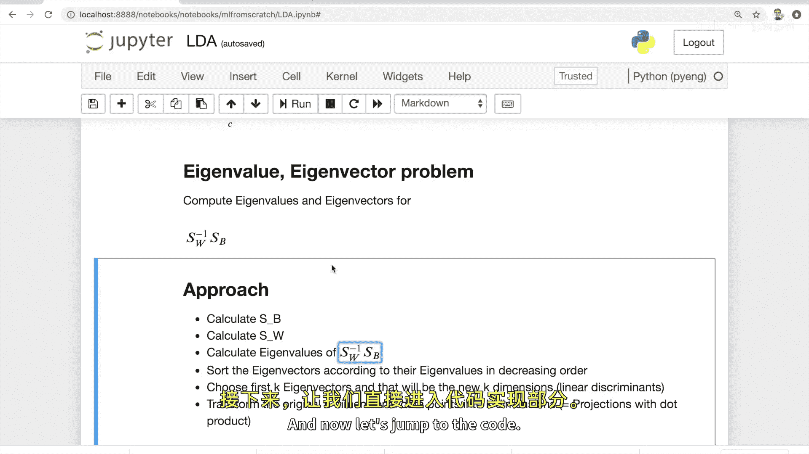

So， of course， we import nuy S N P。 and then we define our class。 And let's call this LD A。

 And here we define our in it， which has self。 and it also gets the number of components that we want to keep。

 And here we simply store it。 So we say self and。Components equals n components。

 And we also create a variable that we call self dot linear this。Priminence。

 and this is none in the beginning。 And here we want to store the eigenvectors that we compute。

And then we define our fit method。 So here we have self， and then we have X， and we also have y。

 because remember， this is a supervised technique。And then we also implement not the predict method。

 but we call it transform。 So transform。This is the same as in the PCA。

And here we want to get the new features that we want to project。So let's implement the fit method。

 So here， first， what we want to get is the number of features。

 and we get this by saying x dot shape and then the index1。 So index 0 is the number of samples。

 And here we only want to have the number of features。

 Then we also want to get all the different class labels。 So let's call this class labels。

 and this is equal to nuy， and then we can apply the unique function of y。

 So this will only only return the unique values in our labels as a list。

 And now we want to calculate the two scatter mattresses。

 So S underscore W for the within class gather and S underscore B for the between class。

So let's do this。 And first of all， I want to calculate the mean of all our samples。

 because we need this later for one of the formulas。 So we say mean。Overall。

 equals numpy dot mean of x。 And then along the axis0。 And then let's initialize our two mattresses。

 So we say S W or S underscore W equals nuy zeros。 So we want to fill this with zeros。

 And we want to give this a size of the number of features times the number of features。

And the same thing with the between class scatter。 So we initialized this with zeros。 So later。

 we want to test this， for example， with the features of the iris data set。

 So this has a size of this has， I think it's 150 samples and four features。

 So this has size 4 times 4。 And this is the same four times 4。

And now we have to apply the two formulas。 So we have to sum over all the classes and then apply these two formulas。

 So we can do this in one for loop。

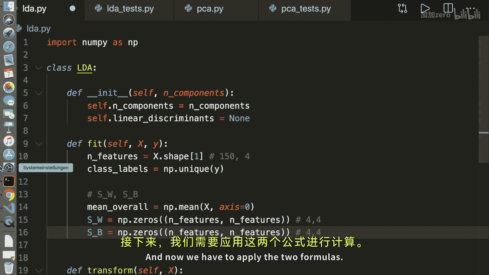

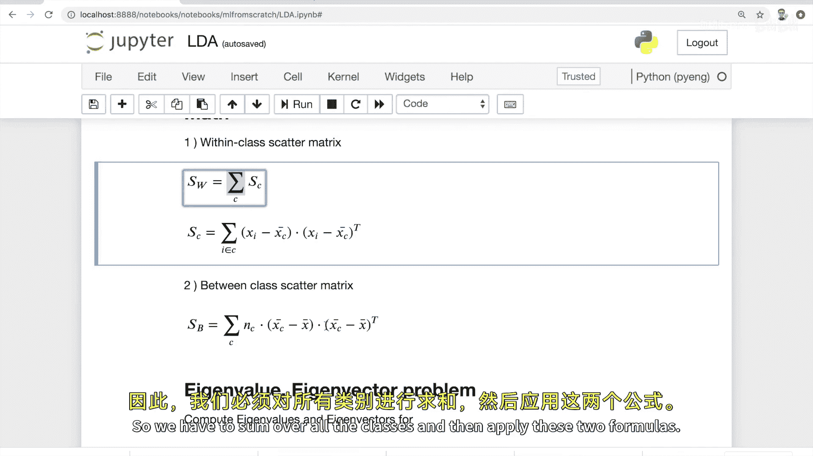

So， we say for C in。Class labels that we computed。 And then what we want to get first is we want to get only the samples of this class。

 So we say X， C equals X， where Y equals equals C。 So where we have this label in the current iteration。

And then we want to get the mean from these features。 mean C equals。

 And this is Ny dot mean of X C along x is 0。 So the same as we are doing it here。

 but only for the features in this class。

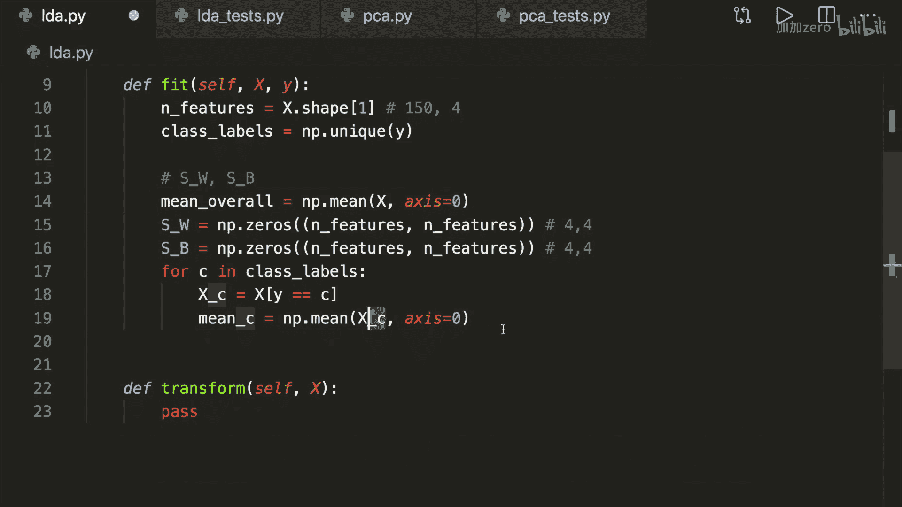

And then let's have a look at there， within class。Forula。So here。

 here we have our feature and then subtract the mean value。

 And then this is basically the dot product times the transposed。

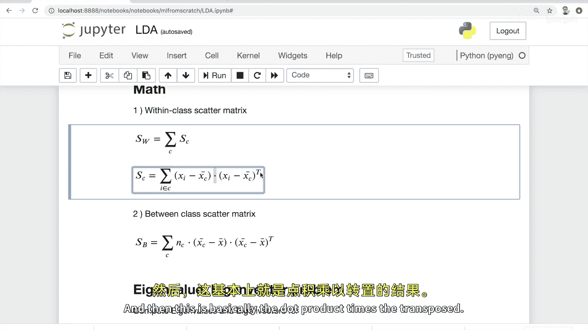

And so let's do this。 So here we say our S within plus equals。

 because here we sum over all the classes。 So plus equals。 And then here we say x C。

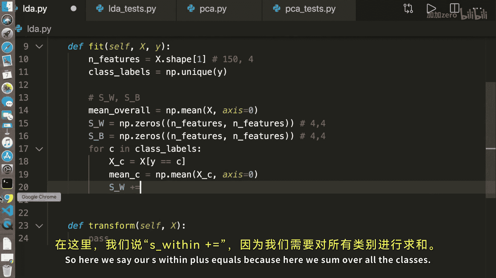

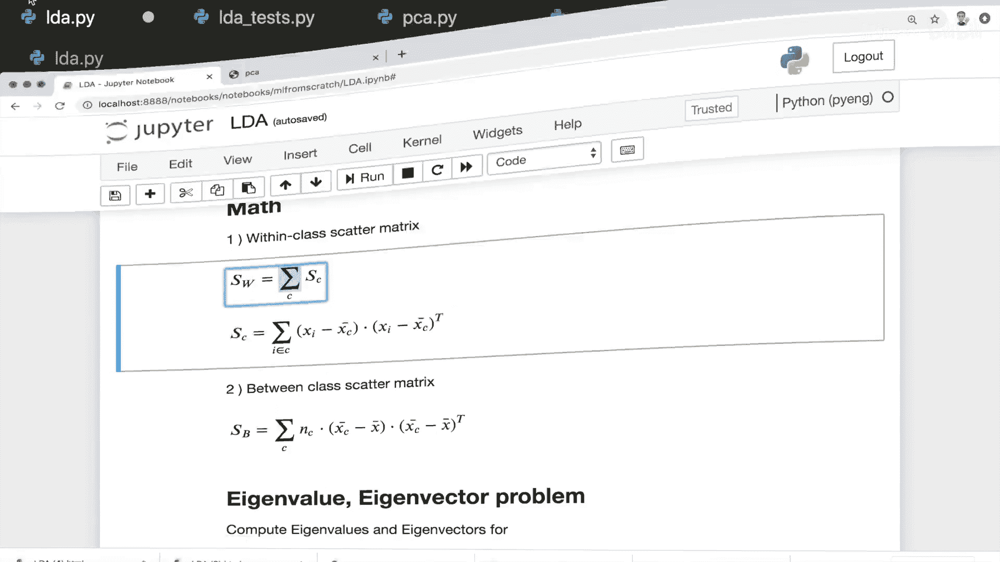

Minus mean C。And then I transpo this and calculate the dot product times the same as we are doing it here。

So。Here， we have to be careful。 So if we have a look at the formula again and we see that I have to transpo term at the end。

 and here I transpose the first term。 And this is because here we are having one more sum。

 So we do this for all the samples in this class。 And here we do this sum in one operation with the dot product。

 So with our numpy operation。 And then we have to be careful with the sizes。

 So what we want at the end again is a four times4 matrix like here。

 because we appendice to these matrices And in the beginning。

 our X C and our mean C has the size number of samples in this class times 4。😊。

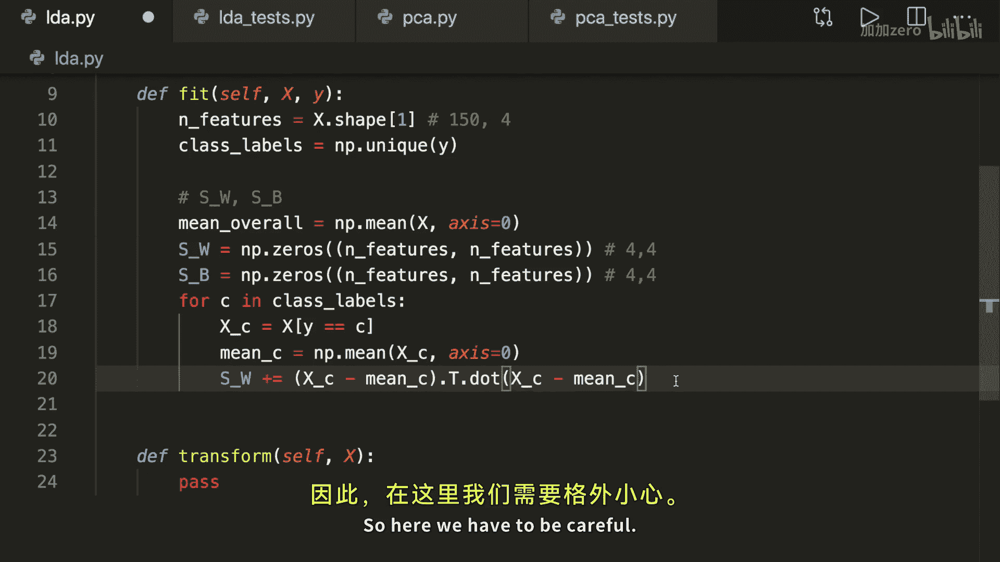

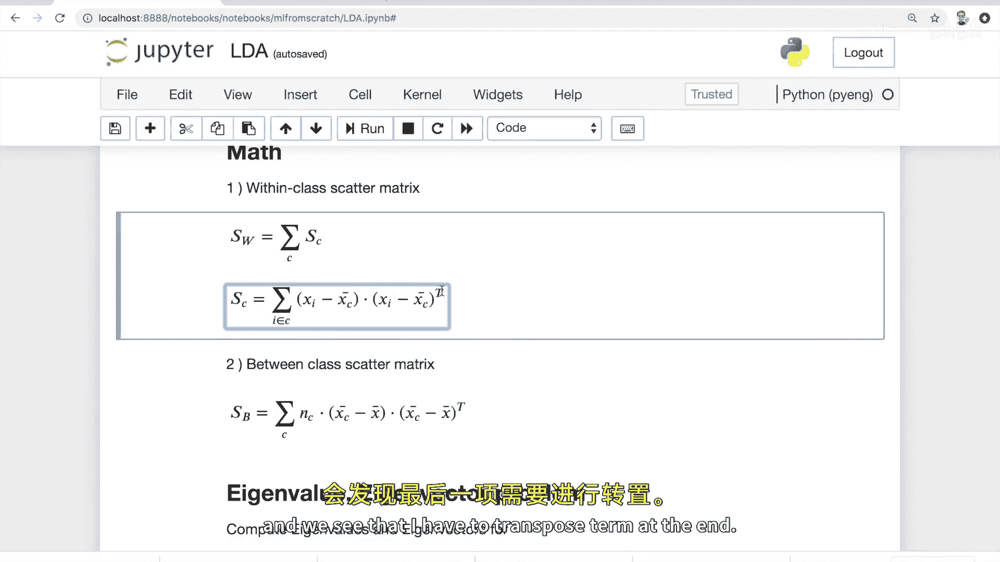

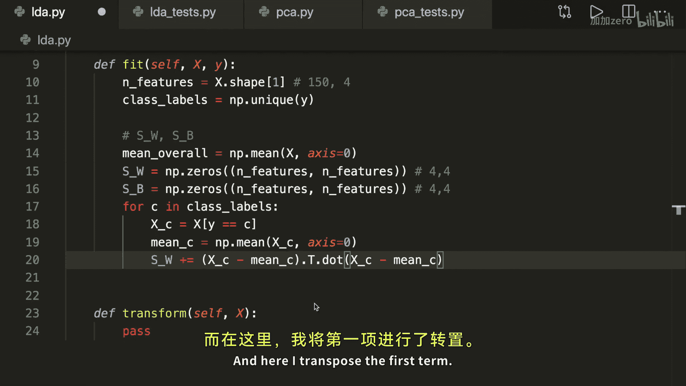

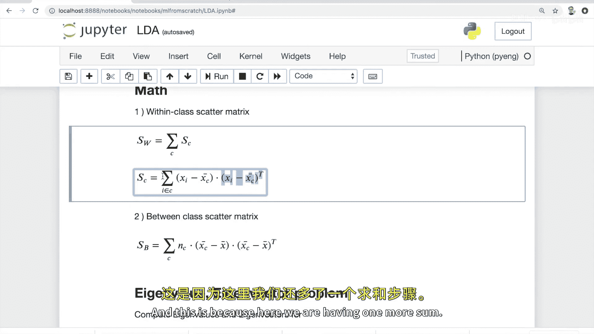

So we have to turn this around。 So we have to say this is size 4 times number of samples in this class。

Because when we multiply this or when we compute the dot product with this one here。

 which is not transposed。 So here we have the number of samples in this class times 4。

 And then if we multiply this。 then we get a matrix of the size 4 times 4。

 So these are basic rules of matrix operations。 be sure that you understand this。

 So the last dimension of the first matrix must match the first dimension of the second matrix。

 and then the final output size is composed of these two sizes So this is why we have to transpose the first term here。

 So this might be a little bit confusing。 make sure to double check this for yourself。

And then we have the within class scatter， and now for the between class scatter。

 what we want to get is the number of samples in this class。

 we get this N C by saying this is equal to X C dot shape。

 and here we want to have the index0 because we want to have the number of samples。

And then here again， we have to be careful because we have to reshape our vector。

 So let's say our mean div。Let's have a look at the formula again。 Here。

 We calculate the mean of this class minus to total means。 let's do this。

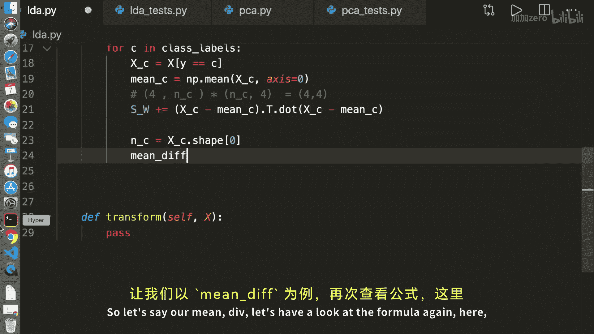

So this is， let's say we have the mean of this class minus the mean over。

And this is only one dimensional， but we want to， so this is， if we have a look at the shape。

 then this would say four comma nothing。 but we want to have it to be 4 by one。

 So we have to say reshape。 And then the number of features times or by one。And this is because。

 again， if we have a look at the final multiplication。 So the same way as we are doing a here。

 we want to have a matrix of size 4 by one and multiply it with a matrix of one by4。

 So this is basically4 by one transposed。And then we get a 4 by four output。

 So this is why we have to apply the reshape here。 And then we say S B。Plus equals。

 And then here we have the number of samples in this class times。 And here we have the mean di。

Dot the mean di。Transposed， and these are both of our matrices。 So we finally have the matrices now。

 And now， as I said， we have to get the inverse of the within class scatter and then multiplied with the between class get。

 So we get the inverse。 Also inverse also with numpy by saying numpy L alk。Dot in of S W。

 And then dot， we multiplied with the between class scatter。

 And let's call this a and store this in this matrix。 And then for this。

 we have to solve the eigenvalue and eigenvector problem。

 So we have to calculate the eigenvalues and eigenvectors。

 And now the following code is exactly the same as in the PC A algorithm。 So please check that。

So we get the eigenvalues and the eigenvectors by saying， this is numpy。Lin Ac dot Ig of a。

And then we sort the eigenvectors and the eigenvalues。 And for this。

 the same as we are doing it in the PC algorithm。 So we transpose the eigenvectors by saying eigenvectors equals eigenvectors dot T。

 So this makes the calculation easier and then we sort the eigenvalues。

 So we say indices equals nuy dot arc sort off。 and here we say the eigenvalues and to make it a little bit nice so we actually want the absolute value of the eigenvalues。

And then we want to sort this in decreasing order。 So we use this slicing and use this little trick from start to end with a step of  -1。

 So this will turn the indices around。 And then we have it in decreasing order。

 So now let's get our eigenvalues in decreasing order by saying eigenvalues equals eigenvalues of these indices and the same with the eigenvectors or eigenvectors equals eigenvectors of this indices。

 And then we want to store only the first n eigenvectors and we store this in our linear discriminants that we have here。

 So we say self dot。Linear discriminants equals eigenvectors。 And then from the start。

 So the biggest eigenvector with the biggest or the highest eigenvalue。

 And then two self dot number of components that we specified。

So this is the number of dimensions that we keep。And now we are finally done with the fit method。

 So this is the whole fit method and then under a transform。

 the only thing that we do here is we project our data onto this new components and the transformation is nothing else。

 then the dot product so we can write this in one line and return nuy dot。

 and then we project our data onto the self dot linear discriminants and since we are transposing it here。

 we have to transpose it again here。 and then we are done。So this is again the same as in the PCA。

 Please double check this for yourself and now we are done and now we can run the script。

 So here I have a little test script and this is basically the same as in the PC tests。

The only thing that I exchange here is instead of PCA。

 we create the LEA and want to keep two components and then we call the fit and the transform。

 and we do this for the IIS data set and then I plot the new labels that are project projected onto the new two dimensions。

So let's run this。 So let's say Python LDA。Underscore test up pi。 and hope that everything's working。

 And yeah， so here we see our transposed features in only two dimensions now。

 And we see that the classes are very good， separated。

 So here we have the three different ir classes。 And we see that this is working。

So our LDA feature reduction method works。 And yeah， please again。

 compare this with the PCA algorithm。 And I hope you enjoyed this tutorial。 If you like this。

 and please subscribe to the channel and see you next time， bye。😊。

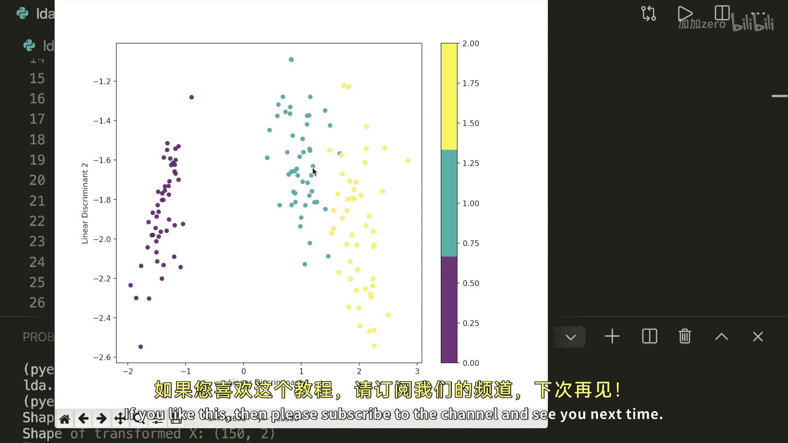