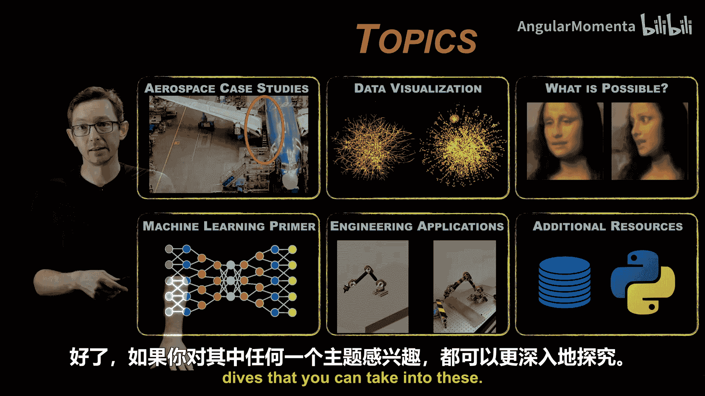
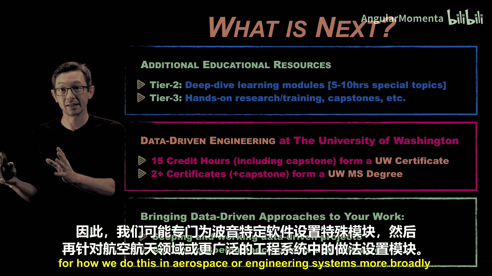
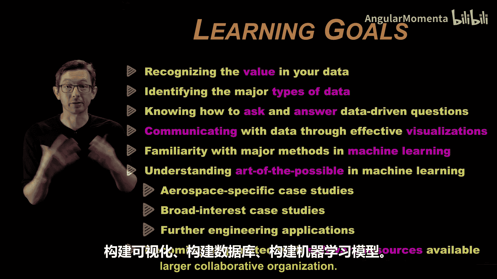
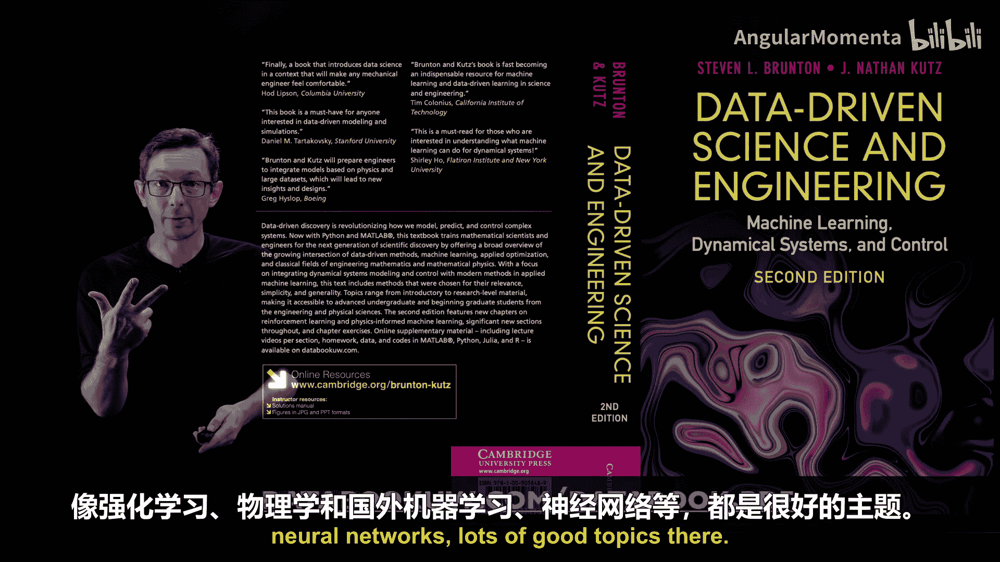
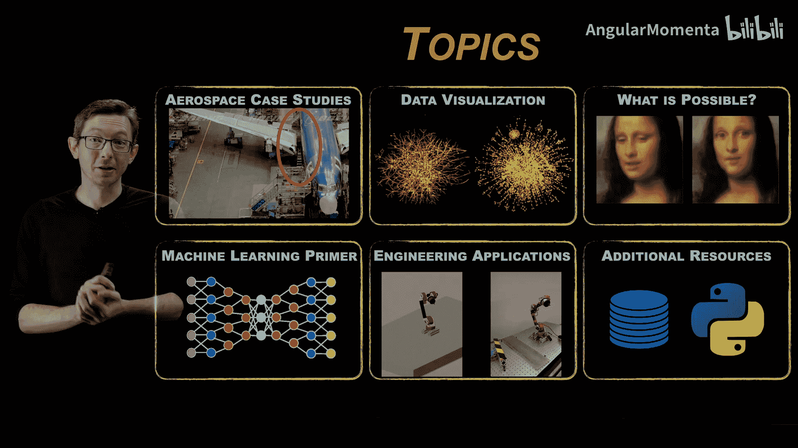

# 【精译】数据密集型工程导论-p01-01-机器学习和人工智能在数据密集型工程中的概述--BV1J8G3z1EHF_p1-

Welcome， I'm Steve Brenton from the University of Washington and I'm really excited to introduce you to a new focused short course on kind of an introduction to data science and data drivenriven engineering。

 specifically tailored to the aerospace industry so this is a collaboration between University of Washington faculty and engineers at Boeing to get people rapidly up to speed in the modern exciting new technologies being developed in data visualization。

 machine learning， kind of data science in general， so let's get started。This is the overview video。

 so I'm just going to walk you through the various topics we're going to cover。

We're going to start by motivating why is this such an important time now to integrate data intensive engineering with the aerospace industry。

 so we're going to start with motivating examples， aerospace case studies。

 so things like advanced manufacturing， flight test evaluation， design of aircraft wings。

 things like that。We're going to talk about data visualization。

 so this is usually our first line of attack when we are working with a data intensive problem is to try to visualize the data to understand it。

 so this is the process of kind of asking and answering questions with data。

 telling a story with your data and really understanding what might be possible again。

 what problems you might be able to solve based on the data that you have。

So I want to point out kind of the aerospace industry is sitting on a massive wealth of data。

 historical data from aircraft that have been produced and tested and that are flying today。

 maybe service records and service data， and all of that data has value。

 so understanding the value in your data is another big part of this and visualization can absolutely help kind of assess that value and tell a story。

We're also going to talk about what is possible kind of the art of the possible with modern machine learning technologies。

 and this is going to start off zoomed out not in the aerospace industry or engineering in general。

 but just what is possible in the world of machine learning today in image science in natural language processing and speech translation in processing audio and image signals more generally。

 so what is possible is going to give us some context for how has machine learning kind of revolutionized existing hard fields of computer science and applied math。

 image science， and that might give us some context for what are some opportunities in aerospace sciences。

Once we see what's possible in machine learning in general。

 we're going to zoom in to understanding what are the kind of nuts and bolts。

 how do we decompose this big idea of machine learning， this big massive rapidly developing field。

 into simple building blocks that we can understand into kind of basic math and basic building blocks。

 so that we can then understand how do these machine learning models get built， how are they trained。

 where do they work really well， where do they fail。

 and that again will tell us how we might be able to use these with the kind of data we have in aerospace engineering。

After that we're going to dig into more advanced engineering applications。

 so you know kind of what is possible is a summary of kind of the popular version of machine learning in the natural world。

 then we're going to dig into what are current today applications of machine learning and data visualization and data driven engineering and science in engineering applications in particular。

 so not just for image recognition and natural language processing but things like making a robot arm move to control a robot arm or design a new super alloy。

 things like that， so engineering applications。And finally if you actually want to take kind of this information that we're presenting。

 what are the additional resources that you can use to bring this into your kind of daily work routine and your daily life you know what are the ways to collaborate with your colleagues and to do version control and to build databases。

 things like that so this is going to be a couple of hours you know something between two and four hours hopefully digging into these six basic topics again I want to really emphasize data visualization and machine learning are two of the most useful and exciting aspects of what you can do with your data so we're going to spend a lot of time on those。

But there's going to be a ton more material， there's going to be a lot deeper dive material after you have this kind of very rapid overview okay。

 so if you're excited about any of these topics， there will be way deeper dives that you can take into these。

And so I want to kind of give you a little teaser of what's next after you've taken this kind of short intro module。

There will be， we think of this as kind of the tier one。

 the first tier in a learning platform where you can build up your skills and become really proficient at data driven engineering and machine learning and visualization。

So after this tier1 there will be tier2 and tier3 kind of modules that we're building out and so tier two are going to be these deep dive short courses。

 boot camps and modules， you know essentially video series five to1 hours on special topics。

 things like machine learning for fluid dynamics or know optimization boot camp1， two。

 three and four there might be four of those you know advanced data visualization。

 things like that so there will be a ton of these tier 2 topics that are developed as these deep dives into these various topics of interest and then the third tier there will be opportunities for handson research and training and capstones kind of taking these tier2 modules。

 these ideas and integrating these into your actual work into the actual projects you're working on on a daily basis and those are kind of the different levels of learning。

So in this first tier we want you to become familiar with the language。

 we want you to understand the value in your data， things like that。

 we want you to know what is and is not possible what's easy and hard。

 and then in tier two you're going to learn the actual kind of nuts and bolts math tools。

 how you actually build these models and things like that。

 how you do these visualizations and then in the third tier actually applying those to your problems that's where kind of the most advanced learning will happen。

And we're really excited we are currently building out degree programs at the University of Washington based on these tier one。

 tier 2 and tier3 modules， so we're building certificates at the University of Washington and the College of Engineing。

 these 15 credit hour certificates on topics like data intensive engineering or you advanced Ma learning and optimization for aerospace systems。

 things like that。And so these tier 2 modules you can essentially stack these five or 10 hour short courses into 15 credit certificates and then if you have two certificates and a capstone or some culminating research experience you can add those two certificates into a master's degree in the College of Engine at the University of Washington so really exciting opportunity to not just build these skills but to also get kind of credentials and credits for doing that if you're interested and all of this are almost all this most of this is going to be freely available online。

 so if you just want to learn these topics that's great we want to make this open to everybody in the world if you want credits and certificates and degrees for this that will be an option also。

And again， we've done this in collaboration with Boeing University of Washington and Boeing。

 and so one of our key focus points on this entire effort is to make sure that we can help improve how people are doing their jobs in kind of a daily fashion so bringing data-driven approaches to your work in engineering broadly is what we're trying to do here so how do you scope and work data-driven projects。

 how do you work on teams where you have data scientists and traditional engineers。

 what are specific tools and software you can use in your daily life and so we might have special modules just for Boeing specific software and then for how we do this in aerospace or engineering systems more broadly so we might have some modules that are specific。

And we've essentially designed this entire platform around certain learning goals so the first tier this two to four hour very short introduction。

 this focused introduction， we have some learning goals。

 we actually tested this on a few live workshops with a couple of hundred engineers。

 and so we've kind of refined these over the last few months。

 things like recognizing the value in your data， even if you're not going to be a data scientist in kind of your daily work if you're not going to be building machine learning models。

 if you collect data or data passes through your work。

 it's helpful to understand the value of the data you're collecting or working with。

 in this larger framework of a collaborative enterprise。Identifying the major types of data。

 so not all data is created equal， there is you know image data， there are acoustic data。

 some data is handwritten notes or you know typed in error logs that might have typos and things like that so understanding the types of data is important。

Knowing how to ask and answer questions with data and this could involve machine learning。

 this could involve data visualization， but how do you ask and answer data driven questions。

 how do you tell a data driven story。Communicating your data through effective visualizations。

 this might be one of the most important pieces just in general for everybody。

Familiarity with major methods in machine learning。

 we want you not necessarily to know how to build all of these models but what they are and what they're capable of。

 so specifically what is the art of the possible in machine learning。

 what's easy and what's hard in aerospace more generally speaking and in kind of engineering at large。

And then finally， we want you to be acquainted with what is the kind of software resources and more general resources to actually do these tasks。

 to build visualizations， to build databases， to build machine learning models。

 in a larger collaborative organization。

I'll point out a lot of the underpinnings and kind of mathematical methods we're going to talk about for machine learning in engineering and for datadriven engineering in general is in this book that was written by myself and Nathan Cutz this is not just a shameless plug for our book I want to point out you can download the free PDF you don't have to buy this you can download this PDF and use it today right now if you want but this provides a lot of the kind of foundation and underpinnings that you might want to know if you want to dive deeper into into machine learning and data-driven science and engineering and a lot of our modules and short courses will follow chapters from this book。

 things like reinforcement learning， physics informed machine learning neural networks lots of good topics there。

And I'll also point out we are going to put these videos online so you're going to find these videos on my YouTube channel or Cririka manahars or Bing Brunttons or Nathan Cus。

 we're going to have these on YouTube， but more than that there are many。

 many more videos beyond just these short courses and modules。

 so if you want more background material or if you have interest in other topics there'll be a lot of opportunities to kind of broaden what you're learning here。

Okay， so that is the very short introduction to this entire series。

 I'm really excited to take you through this with my colleagues。

 I am going to start with some aerospace case studies you soon and then we're going to start building out these various pieces of this first tier one focused intense module all coming up thank you so much。

😊。

