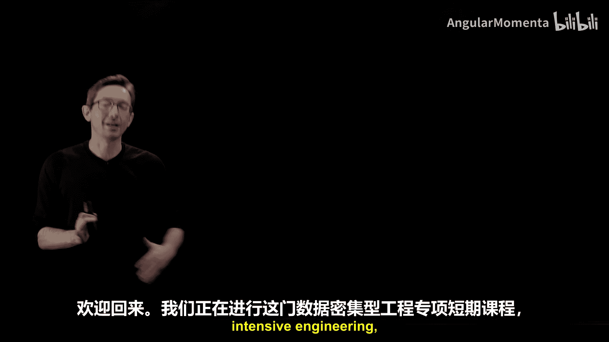
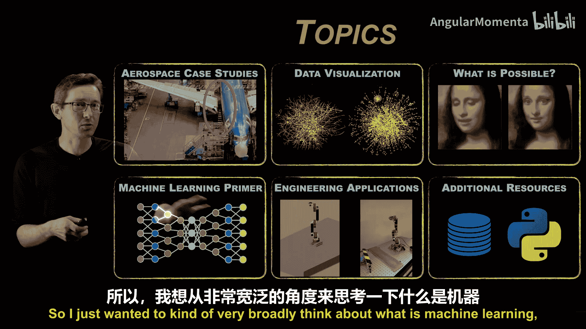
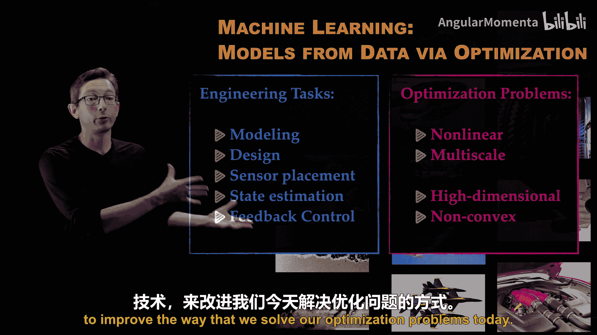
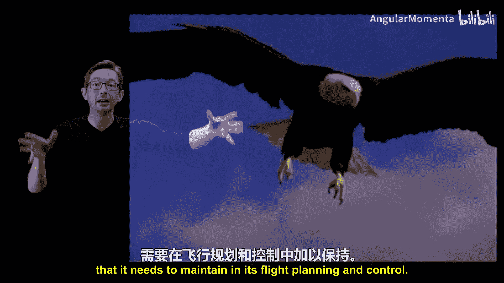
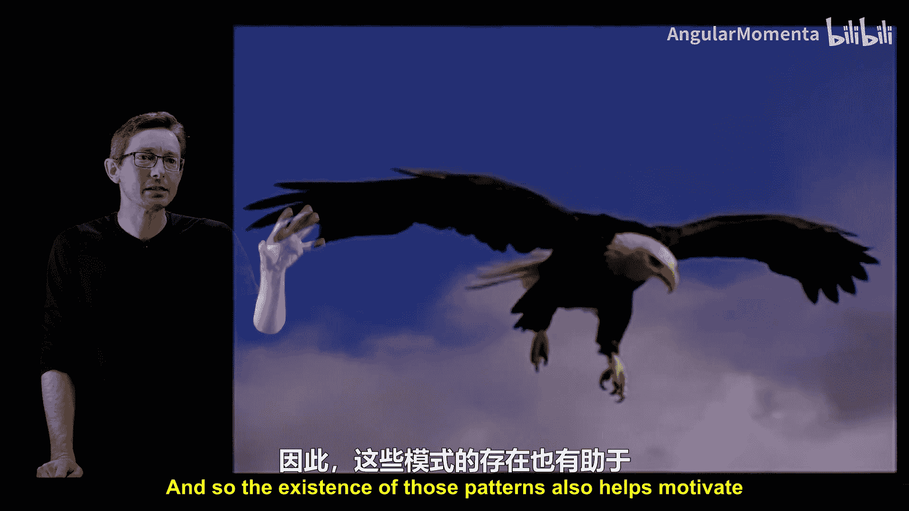

# 【精译】数据密集型工程导论-p02-02-机器学习和人工智能在数据密集型工程中的应用：动机和案例研究--BV1J8G3z1EHF_p2-

Welcome back。So we are working through this focused short course on data intensive engineering and we are talking about these six broad topics。

 data visualization， machine learning specifically motivated with engineering and aerospace engineering applications and I want to talk a little bit more about just kind of what is machine learning so machine learning is one of the big new things that's happened in the world in the last 10 years and every six months it feels like there is rapid rapid progress so I just wanted to kind of very broadly think about what is machine learning because this is a topic that's on everybody's mind and I want to very early on tell you how this fits into engineering。

This is not 100% true， this might only be 90% true。

 but I think it's a very good working definition that machine learning is the process of building models from data using either optimization or regression algorithms。

 and the reason I say it like that is because this demystifies the process of building machine learning models we have been building models from data with optimization and regression for at least seven decades in engineering since the calmman filter in the 1950s realistically though we've been doing this for hundreds of years if if not millennia so our earliest astronomical models were models built from data and maybe they weren't written down as optimization problems。

 but they certainly were tuned from observational data so you know the earliest crop cycles were tied to data in the stars and the planets kind of the motion of the celestial bodies so we've been doing this forever。

And that's why I want to pose it this way because that kind of demystifies what machine learning is。

 but in addition， there are a lot of new things that have happened in the last 1020 years。

 we have way bigger data sets， so models from data our data has exploded because of advanced sensors。

 cheaper storage， cheaper data transfer we have so much more data than we did 10 years 20 years ago we have much better applied math and statistics。

 algorithms to do these optimization and regression tasks we have much better high performance computing architectures。

 much faster computers because of Moore's law and progress with graphics processors and tenser processors and we also have large scale investments by large companies in the billions of dollars to provide free open source software and models to train to train these machine learning models so it's old and new at the same time。

Now， how does this fit into engineering lots of our engineering tasks that we think about on a daily basis。

 things like modeling， design， optimization， sensor placement。

 if I have a wing and I want to put five sensors on it。

 where do I put those five sensors to get the best estimate of the flow field on that wing that's a very hard problem state estimation and an ultimately feedback control。

 maybe manipulating the behavior of my engineering system with feedback All of these tasks in blue are really hard optimization problems Now they're really hard optimization problems typically because the physics of the system you're dealing with is nonlinear So let's think about we're talking about a fluid flow over an aircraft。

 that's a very nonlinear physical process and it's multiscale in space and in time。

 So a fluid flow is highly multiscale。 you have big coherent structures and then medium and smaller still and tiny。

 tiny little edies。 you have all in these scales， it's multiscale in space and in time and so the combination of nonlinear and multiscale means that。

Optimization problem you have to solve for these engineering tasks are high dimensionional and nonconvex。

 high dimensionional means there's lots of degrees of freedom to optimize over。

 maybe if you're thinking about the shape of a wing， there's many。

 many variables you could use to define the geometry of that wing and it's hard to optimize over all of those variables and it's highly nonconvex。

 meaning there's lots of local minima and it's hard to find the best solution。

Now that can be a pretty daunting set of challenges in pink that has kept us busy as engineers for decades is trying to solve these tasks by solving these really hard optimization problems but I want to point out this is exactly what machine learning has gotten really good at is solving these kinds of optimization problems with increasing wealths of data so if you think about training a deep neural network that's again a high- dimensionmenional nonconvex optimization problems and with enough data and fast enough computers we're able to solve those problems so this is really exciting is that we're starting to get the tools to solve these optimization problems with machine learning。

And that's going to be a key technological enabler to help us get advanced capabilities in these engineering tasks of modeling。

 design， sensor placement estimation control and many， many more。

 these are just the ones I think about on a daily basis so you know I think a lot about fluid flows which again are nonlinear and multiscale。

 but so are many other processes a manufacturing process if you have a factory floor and you are building a large aerospace system that is a nonlinear and multiscale in space and time process that leads to high-dimensional nonconvex optimization problems。

And what I want to point out is that the aerospace industry is comprised of optimization experts building an aircraft。

 building a jet engine， these are highly strict multi- objectivejective optimization problems there are competing objectives。

 very tight design parameters and so aerospace engineers are optimization experts typically dealing with these very challenging kind of nonconvex high-dimensional multi- objectiveive optimization problems and so I think that is a clear opportunity in the aerospace engineering to really adopt these advanced techniques in machine learning to improve the way that we solve our optimization problems today really exciting。

😊。

The reason we think this is possible in systems in general， this is a cool fluid flow system。

 this is cloud formation past Guadalupe Island， a satellite imagery。

The reason we think this is possible to build these models in the first place is because patterns exist in your data。

Almost universally true， if you have highdial data， if it's not already compressed。

 there will be lowdiional patterns that emerge in your data。

 whether that's data from the cloud formation past Guadalupe Island， when I say low-dial。

 you can see with your eye this very clear periodic pattern that you could probably model with just a couple of degrees of freedom。

 even though simulating this complex system would require our you topend supercomputers to resolve even some of the scales。

 so even though this system is very high dimensional in the way that we represent it in a computer or in a movie know this is a megapixel resolution movie。

 there are these lowdiional patterns that emerge and that's the cornerstone idea for kind of all of machine learning and data intensive science。

 is that you can pull out these patterns from your data and use those for actionable decisions。

Now this is also true when we think about you an eagle flying， biological flight。

 I've been using this video as a motivating example for my entire career。

 and I like to joke that I'm going to keep using it until our ability as engineers to build something this advance until we have the ability to build something this advance as engineers。

 which is another way to say I'll probably be showing this for the rest of my career too。

This eagle typifies a lot of what we think about when we think about what we want an intelligent system to have。

 the capabilities we want to have so when we think about machine learning。

 I often like to go back to biological learning for inspiration and motivation and some idea of what might be possible if we improve our ability to learn from experience from data。

So this eagle is interacting with an immensely complex turbulent gust field。

 you can almost feel kind of what it can feel， you can see its feathers moving。

And it is able to expertly interact with this turbulence to maintain lift and drag and turning moments in this case to gently land on a rock。

We have no evidence that es have received you know a PhD in fluid mechanics。

 they don't have access to the full three dimensional measurements of its velocity field in its wake what it has。

As a fairly sophisticated set of sensors， it has really good sensors on its wings。

 these feathers it can feel the flow over its wings。

 it has an exquisite inertial navigation and vision system。

 and it has the experience of its life and presumably the codified experience of its ancestors as well。

And so。This is what we call proof by existence that it is possible to interact with immensely complicated flow fields and have extremely advanced kind of performance capabilities。

 very robust performance capabilities， without full measurements of everything and without necessarily having a PhD in control systems or fluid dynamics。

😊，The reason we think this is possible again。Even though simulating the system would be beyond our abilities。

 even with the world's biggest supercomputers， we can't simulate all of the scales of the fluid and the compant surface of the wing and the feathers and the neuromuscular mechanical control system in its brain and body。

We think that the eagle can enact this extremely robust control because it doesn't have to care about all of the fluid degrees of freedom surrounding it and all of the degrees of freedom in its wings and its muscles and its feathers。

 there are lowdiional patterns in that flow field in its body and those are the things it needs to pay attention to and care about for its daily life for maintaining lift and drag and turning out of all of the possible fluid vortices that it's experiencing。

 there might be large leading edge vorticity that it needs to maintain in its flight。

 planning and control。

And so the existence of those patterns also helps motivate kind of what we're trying to do in machine learning in general。

And this is not just eles flying we actually this is kind of a meta learning lesson we at the University of Washington think a lot about flight in general。

 both in human engineered aerospace systems like an aircraft。

 but also in biological systems like this moth， so this is the ho moth。

 it's about the size of my hand。And researchers at the University of Washington and across the world have shown that all flying insects have on the order of a0 strain sensitive neurons on their wing that they use in their daily life when they're designing flight controllers and what's remarkable is that these sensors that the moth can react to gust disturbances to gusts of wind faster than this information can go to its brain and back to its shoulder muscle。

 which means that it's doing local distributed sensing and it's doing local computations and control in its shoulder muscle。

 and it's kind of bypassing its higher level brain functions。

This again is proof by existence that you can do distributed sensing and computations and control in an extremely simple platform with extremely high robust performance。

And what I'm telling you here is not just about the moth。

 what you're going to learn throughout this series are the mathematical foundations of how to find these patterns。

 why these patterns exist， how to identify them and use them to do efficient sparse sensing and low-dial computations and advanced control and those mathematical algorithms and underpinnings that we learn in blue sky research because we're interested in how insects fly。

 that same exact math of sparse sensor placement on a moth wing also apply when we are designing Boeing wings or wings in general。

 and so this is a really cool project set of projects that started at the University of Washington and led to a very fruitful collaboration between UW and Boeing where we use this exact same sensor technology to streamline manufacturing processes at Boeing when the building aircraft wings and fuselages and joining them together and so you're going to hear a lot more about this specific era。

Space case study， but i just want to motivate that。

Kind of the more foundational math and understanding you have of this machine learning process。

 the more we can do and translate this into into aerospace and engineering systems in general。

 so this is kind of a cool success story you'll hear about soon。And specifically Cth Amanohar。

 this is an artist's rendition of that process that we improved using that kind of moth sensor technology。

 Crithha is going to walk you through all of the steps of that process and how this technology got built and translated into actual production technology at Boeing。

 so saving them a lot of money， saving them a lot of time。

 helping them build high quality aircraft with the sensing technology that they have。

Okay good so I think that's kind of what I want to tell you about now maybe in the next sequence。

 I'll tell you how you form teams of expert engineers and how you work on these teams。

 but for now I just want to kind of leave it at there are huge opportunities with this growing wealth of data with these much better algorithms with these higher performance computing architectures to build models that you can use in you know designing and producing and testing and certifying aerospace systems so that's all coming up really excited to kind of walk through this All right thank you。

😊。

