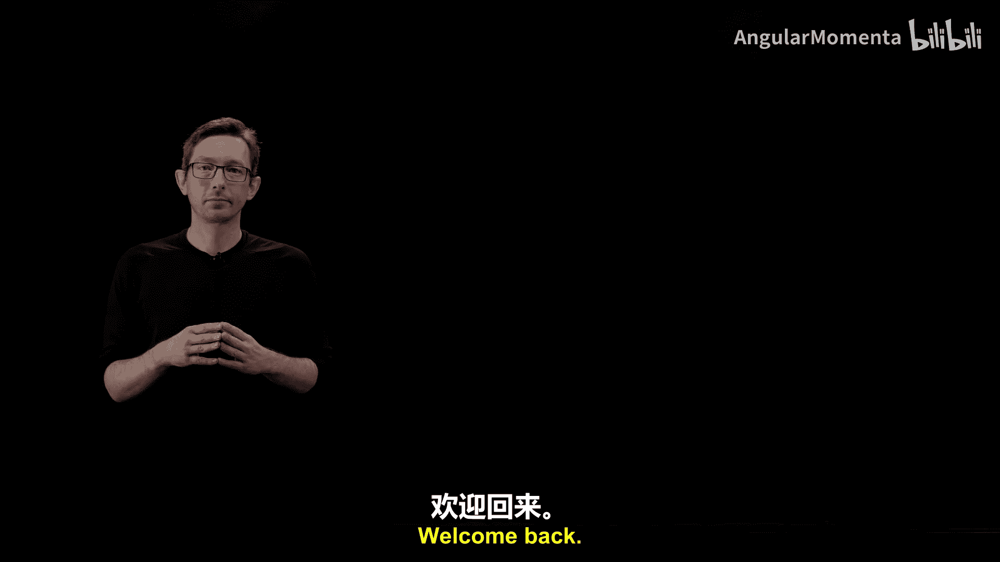
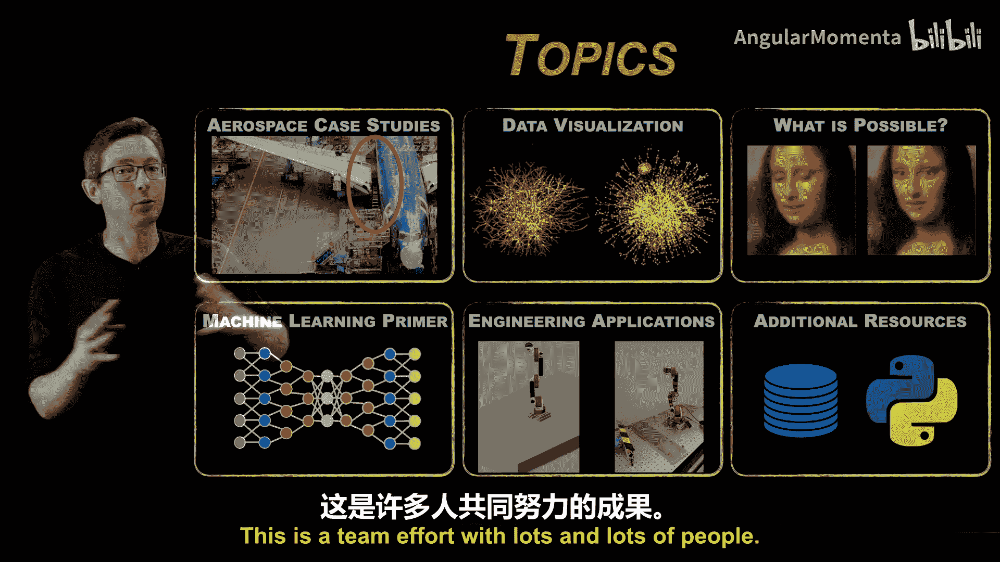
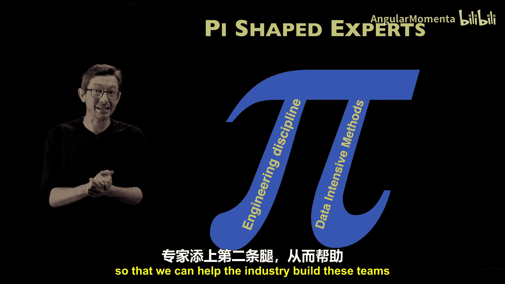
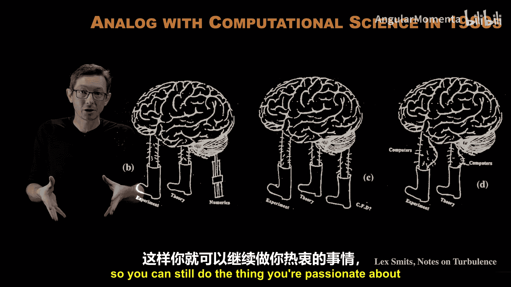
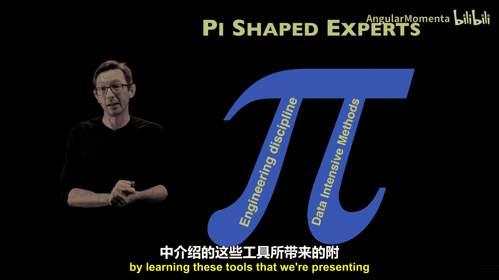

# 【精译】数据密集型工程导论-p03-03-机器学习和人工智能用于数据密集型工程：Pi-形工程师团队--BV1J8G3z1EHF_p3-

Welcome back。So we are talking about this kind of focused。

 short introduction to data intensive engineering， topics like data visualization， machine learning。

 specifically motivated and demonstrated in engineering and aerospace engineering examples。

And I want to talk a little bit about you know aerospace is not a go it alone field。

 you can't build a large aerospace system all by yourself in your basement。

 this is a team effort with lots and lots of people and so we like to think about you know how does data science and data intensive engineering fit into this larger collaborative environment。

And there is an example we talk about at the University of Washington called Spock on the Bridge or putting Spock on the bridge。

 so for any of you Star Trek aficionados， you of course know that one of the kind of interesting things about Star Trek。

Is that their chief science officer， Spock is not in the bowels of the ship， you know。

 doing engineering maintenance like。You know， fixing fixing the engine。

 Spock is on the bridge with Kirk making decisions， helping， you know。

 he's in the decision making process。Providing his expertise as a scientist and so that's kind of the idea is that we want to have our data intensive engineers。

 not just be in a data science farm somewhere off site that you call when you need them We want data scientists to be on the teams that are solving problems Okay so we're talking about building teams of problem solvers that have classical engineering experience and data intensive experience。

It's kind of an interesting parallel to control theory over the last four decades in the olden days when you would build something like a large aerospace system。

 you would build it。When you put it together， not all of the systems worked as designed。

 and then you would call it controls engineers to kind of fix those problems。Now in the modern era。

 controls engineers are in the design process from the early stages to help make sure that those issues don't happen in the first place and systems are designed to be controllable starting you know from initial design stages that saves a lot of time。

 a lot of money and it allows us to have higher performance higher robustness products in the end。

 and there's a definite parallel to kind of adding data scientists into the loop in these decision- making processes。

So we often think about what are called pi shapeped experts。

 this is in contrast to the classical T shapeped expert that you know we typically educate in engineering departments and aerospace companies typically hire the Tshaped expert。

 you have a lot of domain depth in an engineering discipline like materials or aerodynamics or control systems。

And you have a lot of breadth， so you've seen a lot of those other neighboring topics so you can talk to your colleagues and form teams to solve problems together that's the traditional tea shaped expert。

Increasingly， there is this need for the pi shaped expert where you have a second leg of expertise in a data intensive method。

 where data visualization or machine learning。😊，That is up to you。

But having these two legs really allows you to build these very strong teams of experts that have。

 you know kind of the classical engineering expertise， but also the data intensive expertise as well。

 so we are essentially developing this curriculum to help add this second leg to this pi shapeped expert so that we can help you know the industry build these teams that put Spock on the bridge in that decision making process。

Now there's an analog to the rise of computational science in the 1980s so in the 1980s when computers were coming online and becoming cheap enough that you could actually use them in a widespread fashion there was a lot of question about how computers were going to integrate into the workforce into how we do things in general so these are from Lex Smith's notes on turbulence and specifically he is illustrating this in the context of how our computers going to change what we do in the field of fluid mechanics or turbulence research。

 which up until then had been resting on these two legs of experiment and theory。😊。

So there's a question of you know are numerics going to be a crutch that hold up this framework。

 or is it going to be a third leg that you know looks really awkward。

 I don't think I would want to walk with three legs and the conclusion is that computers are not going to first off they're not going to replace experiments in theory they're not going to be a crutch or a third leg。

They're essentially going to be the muscles that allow you to do what you have been doing。

 but better， okay， they're going to add capabilities to the existing fields of experiments and theory。

And so I think that there is definitely an analog with the rise of machine learning and data intensive methods。

 these are not going to replace what we do today， they're not going to replace simulations。

 they're not going to replace experiments， they're not going to replace theory。

They are going to augment our capabilities because all of those fields generate data and machine learning and data intensive science in general is kind of a unified framework to understand and pull value out of that data。

 so it allows us to actually tie together the data from experiments and simulations in a way that we couldn't do previously lots of new opportunities in that way。

 but just like in the 1980s there were people that werere know essentially saying this is going to replace experiments。

 we're never going to do another wind tunnel test again that never happened。

 we still do wind tunnel testing and we run simulations they work together。

Machine learning is not going to replace these classical fields， they're going to run together。

 it's going to help us do more than we could before。And just like in the 1980s， when this started。

 you actually had to hire computer scientists to run the computer systems at large organizations。

 today we expect all of our engineers to have basic computer proficiency to do our daily jobs。

 whether or not you are a computer scientist， even if you run experiments。

 you're still expected to know how to use a computer to collect the data and postproces and analyze that data。

And that same thing is going to happen with machine learning。

This will rapidly become a standard daily tool set that all of us are expected to be semiproficient with。

 We will still have experts in machine learning， you know developing the systems and really pushing the limits but we're all going to need those basic muscles of machine learning to do our daily work just you know in a few years And so again。

 that's one of the things we're really focusing on here is how do we build in that basic proficiency as fast as possible so you can still do the thing you're passionate about what you actually want to do but you know kind of have this additional。

Proficiency and expertise in data visualization or machine learning or some data intensive field of engineering。

Okay， so that just gives you a little context about kind of an additional dimension of the value added by learning these tools that we're presenting in this short focused module。

 okay， thank you。

