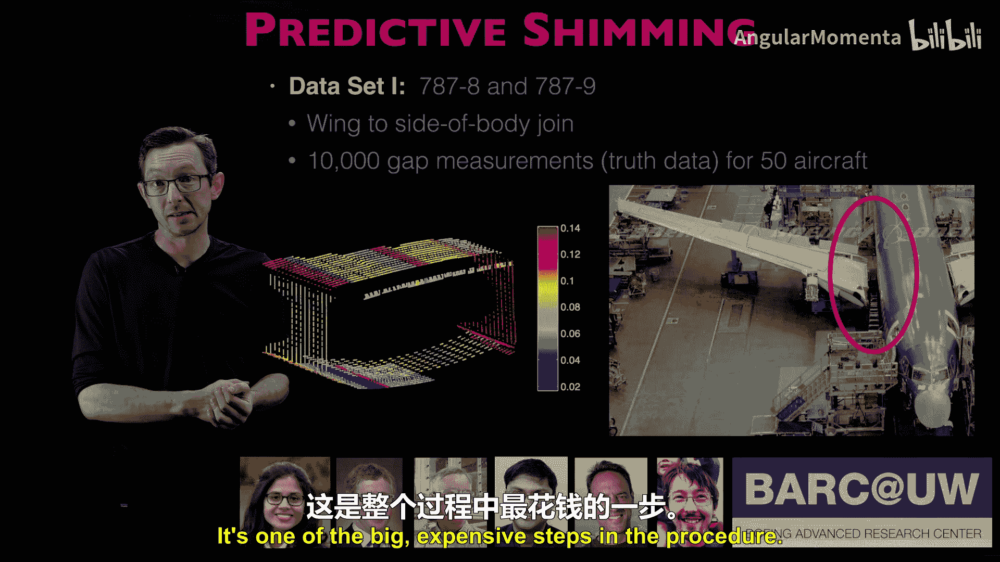

# 【精译】数据密集型工程导论-p04-04-案例研究，飞机装配的预测垫片，波音_华盛顿大学合作--BV1J8G3z1EHF_p4-

Welcome back。So I really like motivating the need for data visualization and machine learning and kind of data drivenriven solutions for engineering systems with case studies with examples in the past of things that have actually moved the needle in industrial engineering by adopting data drivenven and data intensive solutions。

 machine learning models and data visualizations and things like that。

 so I'm going to walk through some cases， mostly work that has to been done between University of Washington and Boeing in the aerospace sector I think all of this is work that has been published before。

 so I'm not going know none of this is proprietary knowledge。

 but just some really interesting collaborations and you're going to hear more about this particular application on predictive shimming from Critheica Manahar who is the lead researcher on this project you're going to hear more from her kind of a deep dive into this case study。

 but in a very high level I wanted to introduce you to this， this was a big success story in。

The use of data driven methods in a collaboration between Boeing and UW and this happened at the Bar lab at University via Washington。

So the idea here， and I didn't know about predictive shimming or what predictive shimming was until I joined University of Washington as a faculty。

Fascinating topic， apparently all modern aircraft， every single one of them to my knowledge when they build all of the parts are built to extremely exacting tolerances you know machine precisions are very。

 very tight and all of these pieces are well designed and wellmand but when you put together huge aerospace structures like a large wing of a 787 or a  triple7 these errors start to add up so that when you put the entire structure together。

 there are small gaps all over the structure Now these things are super over engineerered。

 they're very， very strong， very， very tough so it's not necessarily so much of a safety issue as it is if you want high aerodynamic performance and you want good fatigue life and you want your materials to last for as long as possible。

 those gaps really shouldn't be there and so when you're going rivet these parts together and join all of these parts you want all of those gaps to be filled in。

As close to perfectly as possible， so everything fits snugly together okay makes sense。

In the olden days I'm going to tell a slightly apocryphal story but I think it's approximately correct in the olden days。

 let's say in the 70s， what you would do is you would essentially dry fit the aircraft。

 you'd put the pieces together， you get somebody to crawl inside of the you know some access panel and measure all of these gaps。

 write them down in a book， they'd come out， they disassemble the wing or the aircraft。

 and they would have to make by hand a shim for every single one of those locations where there is a gap。

 you know for example， where the skin of the wing fits onto the supporting substructure。

This is extremely expensive， this means you're essentially building the aircraft twice。

 okay that's like twice as expensive as building at once。And in the modern era。

 now that we have fancy computers and really sophisticated metrology measurement equipment。

 this is essentially done digitally in a computer， so now when you're building an aircraft wing or joining the wing to the side of a body。

 this is a really important structural join， you will use an expensive measurement device a metrology equipment to measure all of those pieces。

 get the point cloud measurement of all of those pieces。

 they're digitally fit together in a computer and then those gaps are essentially estimated by dryfitting in a computer。

That certainly saves a lot of time over dry fittingtting these in the real world。

 but this still adds hours and hours and hours to the critical path of manufacturing of an aircraft。

 this means there are an extra you know X amount of hours that you have to do all of those measurements。

 run those supercomputer simulations to dry fit things。

 then build the shims and then assemble the structure， still very expensive。

So working with researchers at Boeing and the University of Washington。

 we essentially used fairly standard data science methods。

 essentially finding patterns in those shim gap data across many。

 many aircraft across 50 different aircraft that had been built and had been measured in the painstaking way we learned that there were these patterns in how those shims were distributed because again these are manufactured to very high tolerances and the manufacturing processes are very reproducible so when there are gaps often those gaps are reproducible and so we essentially designed an algorithm that allowed us to learn those patterns and then based on those patterns dramatically reduce the amount of measurements that were required to characterize a new aircraft in the future so now a new aircraft is coming down the production line。

 you have to do less measurements and that dryfitting procedure in。

instead of needing a supercomputer now you can do it on a much cheaper computer much。

 much faster and that reduces a tremendous amount of time off of the production of each aircraft because you need to take less measurements。

 it literally takes less time because you're measuring less points and there's less time on a supercomputer running all of those points trying to figure out what the shim gaps are。

I'm kind of compressing the story， Crirythca is going to tell you way more about how this data was collected。

 what the data looks like， how it was cleaned and visualized。

 the algorithms we developed to actually enable this solution， but at the end of the day，😊。

This reduces the time it takes to make aircraft that saves a lot of money potentially and it all relies on the fact that there are patterns that exist in the data and those patterns allow us to do smarter。

 more efficient computations so visualizing this is actually a visualization of the gaps where the wing joins the side of the body this is where we were zooming into so visualizing extracting the patterns and then developing algorithms to use those patterns to streamline the manufacturing into the future this was a big success story in our collaboration with Boeing and this is one of the first examples where I was really bought into kind of the power of what you can do with historical data。

 expensive historical data to streamline future production and manufacturing Now it's kind of an Easter egg we did this on the 787-8 and9 you'll notice this is not。

787， that's because we couldn't find a nice picture of the wing to a body join。

 any of you who caught that good on you， but this can be essentially applied to lots of different examples on the aircraft。

 it can be applied to the know fuselage elements or to the N cell of the engine or the rudder or the stabilizer or the wings。

 lots of different applications of shimming on aircraft。

 it's one of the big expensive steps in the procedure。

And I also want to point out。This was not just some blue sky idea we had that we could just save Boeing a lot of time and effort in how they joined their pieces together in a manufacturing plant。

 a lot of the fundamental mathematics had been investigated earlier in the concept in the context of insect flight or biological flight in general where we know that insects like moths and fruit fliesies and dragonflies have strained sensitive neurons on their wings that they use to estimate and infer important features about their aerodynamic environment that are relevant for for their daily lives for their flight。

 and so similarly because there are patterns that exist in the fluid flow over a moth wing they don't have to measure every single location on the wing that can choose specialized locations that inform the most important information for their daily life。

I just think this is super fascinating so that's what I'm telling you and those mathematical algorithms and underpinnings of finding those patterns and using those patterns to design optimal sparse sensor locations that streamline computations is directly transferable to this manufacturing scenario and that's one of my favorite things about machine learning and pattern extraction and data science and datadriven engineering in general is that the mathematical underpinnings are essentially the same for all of these different problems so if you make a breakthrough in one area oftentimes that translates directly into a completely different application from mothwings to Boeing wings。

 very， very cool we were kind of blown away that it worked and very pleased that some technology we developed actually helped move the needle in terms of this very。

 very important manufacturing process one of my favorite examples。😊。

