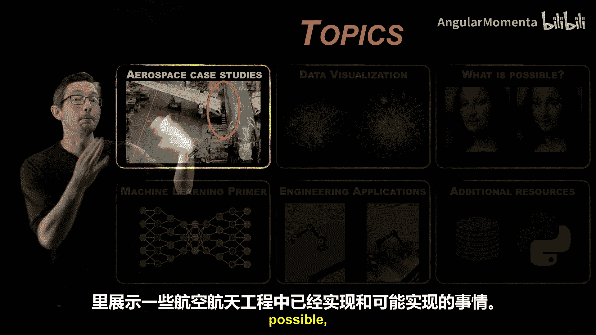
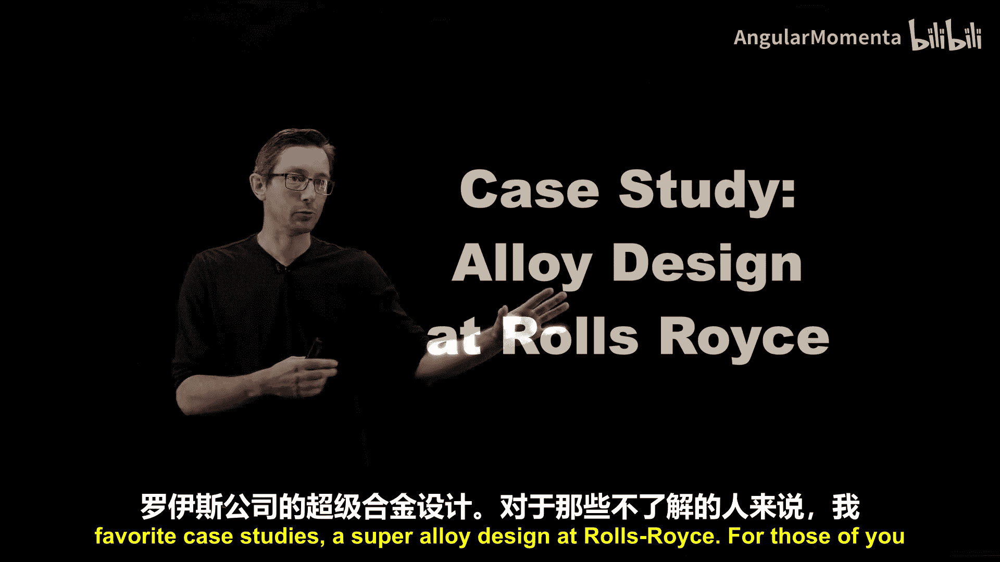
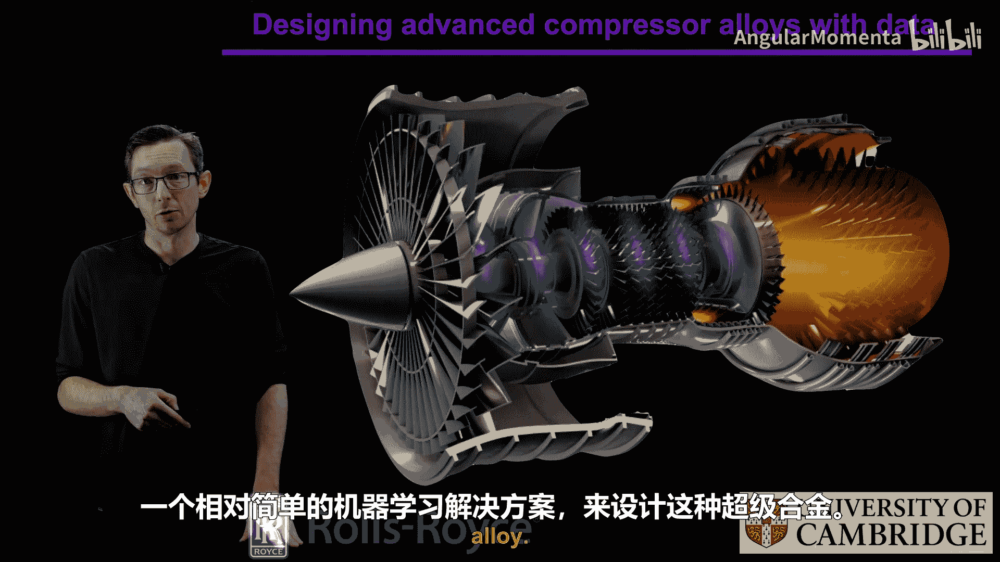
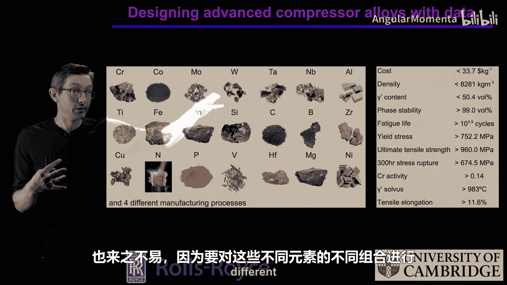
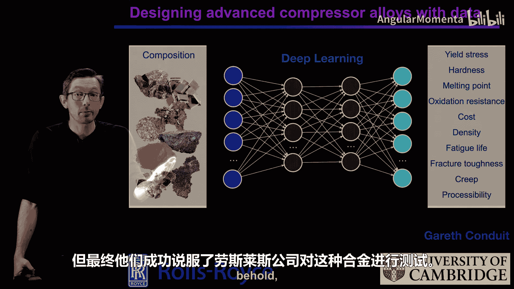
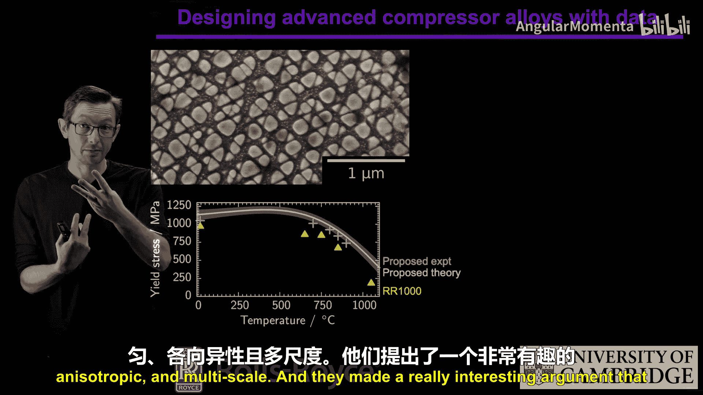
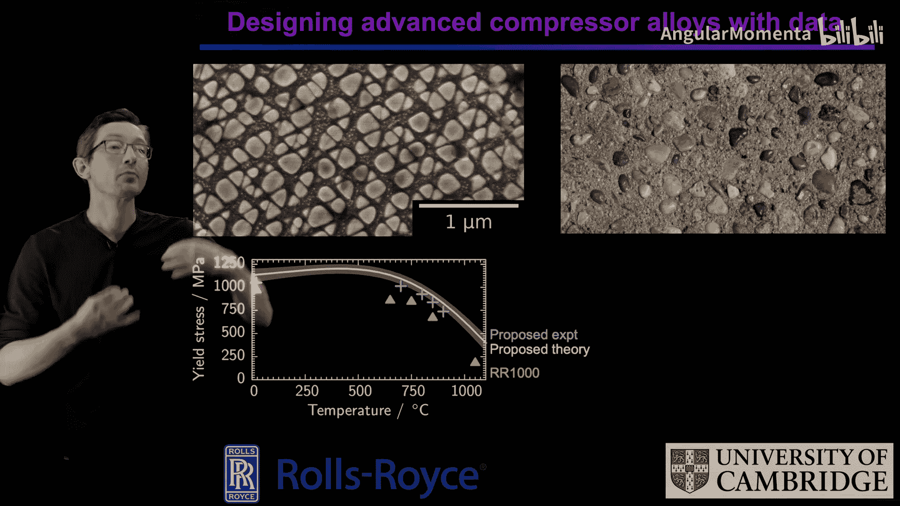

# 【精译】数据密集型工程导论-p05-05-材料科学案例研究，用机器学习设计超级合金--BV1J8G3z1EHF_p5-

Welcome back so we're going through this short focused introduction to data intensive engineering and to start off I really want us to go through a number of aerospace case studies that motivates some of the opportunities to innovate and to really drive the field forward with data-driven solutions so there is a massive wealth of data in aerospace engineering and this wealth of data is a really fruitful playground for us to build models。

 build controllers， kind of design new materials and new manufacturing processes and lots and lots of other examples so we're just going to go through some vignettes here of some of the things that have been possible and it will be possible in aerospace engineering。

So I'd like to start off， this is one of my favorite case studies。

 a super alloy design at Rolls Royce。

嗯。For those of you who don't know， I think this is a really fascinating topic in general when you look at a modern jet engine。

The compressor blades are operating at such a high temperature。

 this is how we get to really high kind of efficiency and power conversion。

 they operate at an extremely high temperature that is actually often above the melting point of the compressor blades。

Now this sounds a little scary right so these things are operating above the melting point so the blades could be melting and what they do is they have these little micromanufacturd essentially tubes that go through those blades that are actively cooled by the propellant by the fuel and that's kind of amazing that these actively cooled compressor blades cooled by the fuel that is actually being burnt。

Will not melt because the liquid cooling keeps them below that melting point。

 but that's very expensive， it is prone to needing lots and lots of inspective maintenance and it's clearly just a very complicated solution so what would be much more preferred is to design an alloy that has a higher melting point now that's a lot easier said than done okay there's been tons of research into metallurgy and alloys and material science and it is not easy to design a new superaloy that is you know melts  to 10% hotter melting point。

And so here's where the machine learning enters， is this great collaboration between Rolls Royce and University of Cambridge。

 Conduit and conduit， essentially used a machine learning solution。

 a relatively simple machine learning solution to design this super alloy。

The idea is that there are lots of constituent elements that you can use to make a new alloy。

 maybe you know typically you might have a small handful of these that you use in a very particular proportion and there's a few different manufacturing processes but essentially melt them together and cool them mix them and cool them at a certain temperature schedule。

 some anneing schedule and that will give rise to an alloy that has any number of properties that you're trying to optimize and balance over so not just melting point but things like fatigue life yield stress cost you know per kilogram things like that。

 so there's lots of inputs to your alloy and there are lots of outputs to your alloy and of course over the decades we。

 the community and especially rolls Royce and other companies have made and tested many。

 many types of alloys with different configurations of elements and different manufacturing processes to get different output configurations。

So this is the rich data set that's actually a very expensive kind of。

Hard fought data to acquire with all of those different tests to test these different combinations of different elements。

But that gives us a rich training data set to build a machine learning model。

 and it doesn't even necessarily have to be that deep of a neural network to take in。

 so you train this on different examples of alloys that have been tested in the past。

 so different compositions and manufacturing processes。

And the output are all of these material properties that we're trying to optimize over。

And so conduit and conduit， I don't know the relationship one at Ros Royce one at University of Cambridge。

 essentially。Learned a machine learning map between these inputs。

 kind of the things that go into an alloy and the properties of the alloy once it's manufactured。

And using a little bit of you know physics and prior data。

 they were able to build this machine learning model。

 this neural network that is essentially a surrogate model。

 so it is much less expensive to test a new composition in this you know machine learning model than it is to actually bake a new super alloy right it might cost。

50，000 to test a new alloy， it costs you sense to test this in a computer in this virtual surrogate model of that physical process。

 and as long as the machine learning model that they train is accurate enough。

If it is faithful enough to the real world， then you can do optimization over this neural network to optimize for various properties on the output that you want to be improved like higher melting point。

 and so you can do this optimization over this surrogate model to find the right composition that will for example。

 maximize the melting point while still having acceptable other parameters。

Now you're not guaranteed that that composition is actually going to be the best composition you can come up with and it might not even give you the predicted melting point。

 so you have to actually test that composition once you have a candidate that you done you've identified through optimization。

And that's what conduit and conduit did was they essentially ran this optimization over this surrogate model。

 came up with a candidate composition that had a higher melting point。

 and they presented this to Rolls Royce and said look。

 you this is a new potential superaloy we want to bake this we want to try it out。

 we want to see if this actually has the properties but again it's very expensive so it was not easy to convince people to test this new superaloy it had way more elements than our traditionally used。

 a funky aneling process， but they finally convinced Rolls Royce to actually test this alloy。

 and lo and behold it actually did outperform the previous top versions of their alloys。

So here this is yield stress versus temperature， and so RR 1000 is basically Ros Royce's previous super alloy。

 I'm pretty sure that's what the terminator is made out of。

And then you can see the proposed experiment and proposed theory curve。

 they agree pretty well and they push the envelope of the materials's properties in terms of the melting point and the yield stress。

 so in these two dimensions the new proposed superaloy actually outperforms the previous RR1000。

So I don't know if this is in compressor blades today or not。

 that's kind of where my knowledge of this story ends， and I'm sure I'm missing details。

 there's papers on this you should read if you're more interested。

But they did some interesting studies where they actually zoomed in and looked at these microscope images of what the actual alloy looks like to see if they could understand why did it have such good properties compared to the leading RR 1。

000 previous alloys？And so you can see that this has the characteristic features， it's anisotropic。

 it's multiscale and it's heterogeneous， those are the three properties that biological supermaterials have like fingernails and teeth and hair theyre heterogeneous anisotropic and multiscale and they made a really interesting argument that I like a lot that essentially this is operating as a thermal analog of how a concrete mixture with hard pebbles or rocks behaves。

 so you know we know that if we put these hard stones inside of a concrete mixture it improve certain material properties namely that cracks don't form and propagate as easily because the hard stones essentially stop those stress lines from propagating and so the analog here is that this heterogeneous anisotropic and multiscale structure does something similar。

For kind of thermal management and thermal propagation。

 keeping this material from melting until it is pushed to higher temperatures。

So I just think this is an incredibly fascinating story and it's a story that。

It was clear that they identified a task， they wanted to find a material that had a higher melting point。

They had a lot of good training data， there are lots of alloys that had been made and we know what their compositions are and we know what their output properties are。

They built a surrogate model that is much， much faster to run and optimize over than actually making new materials one after the other testing them。

And then they ran an optimization over that neural network to get a candidate that they then tested in the real world and analyzed to understand why it had these remarkable properties so really cool example。

 I think materials is one of the great motivating examples in engineering for the need for machine learning。

Because material science is one of these fields where we don't know the theoretical upper limit of the performance envelope of materials with three or four or five basic elements。

 that is an open question is to characterize what is the highest melting point you can get with those four elements in any mixture。

And we know that the biological supermaterials have these very interesting rich structures that are heterogeneous and isotropic and multiscale。

 but that's very， very hard to optimize over us that's a high dimensionional nonconvex optimization landscape。

 so using machine learning tools and historical data can give us a distinct advantage in optimizing over those structures。

Okay， one of my favorite examples in material science。

