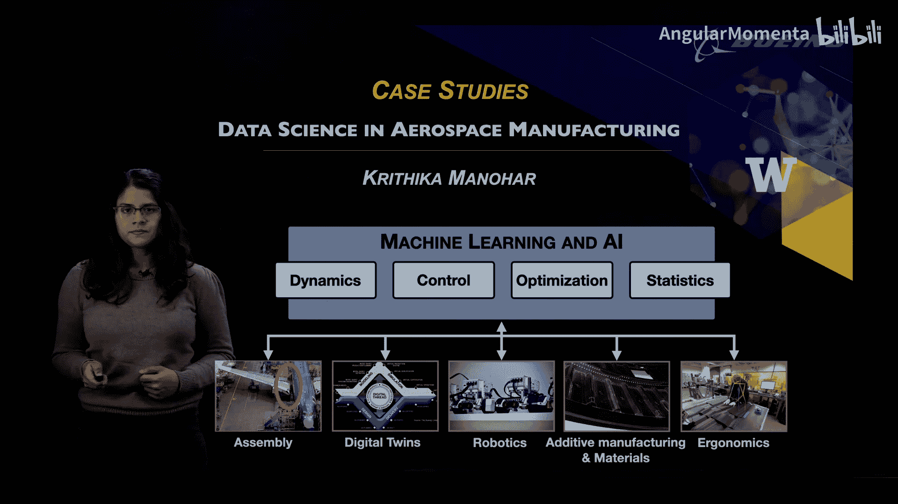
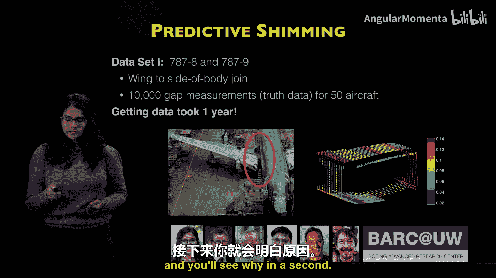
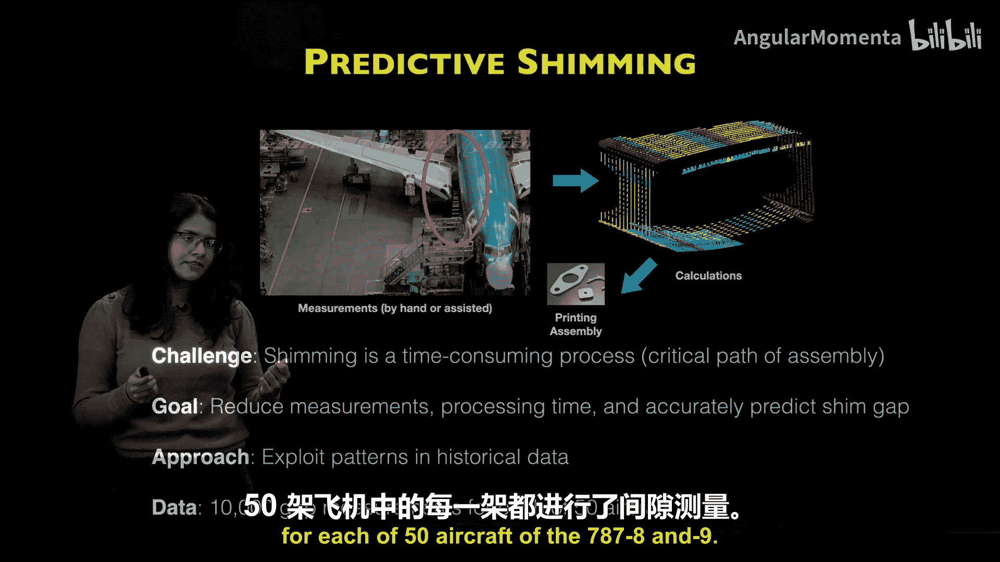
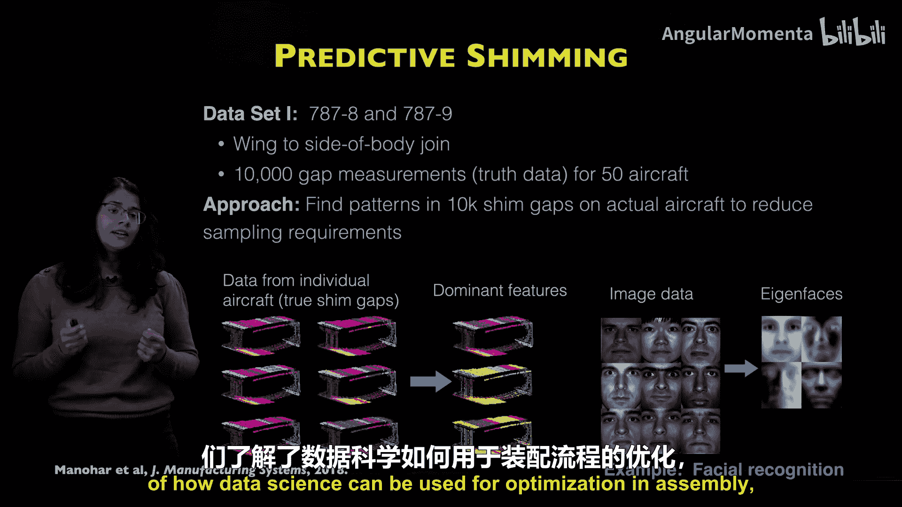
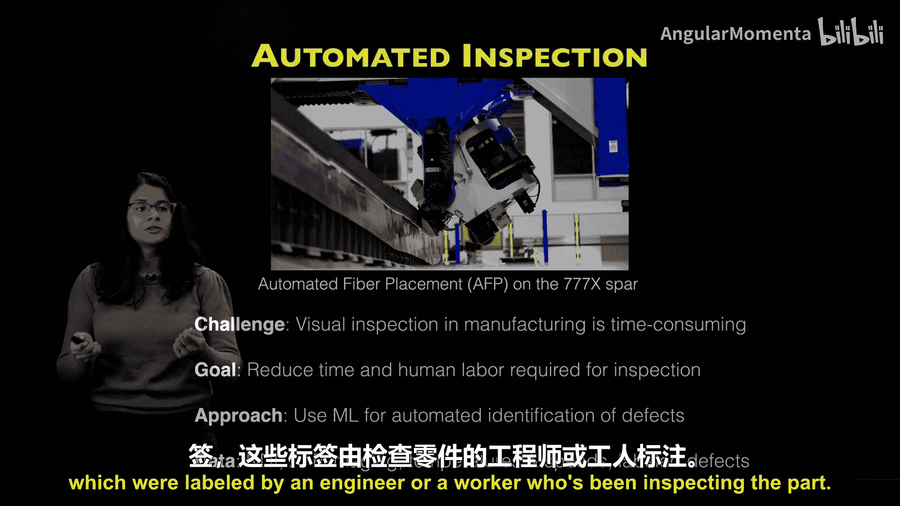
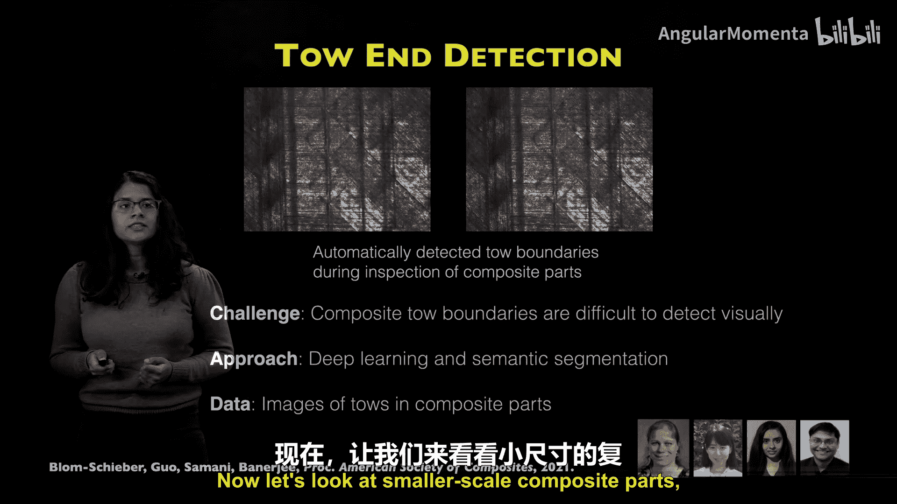
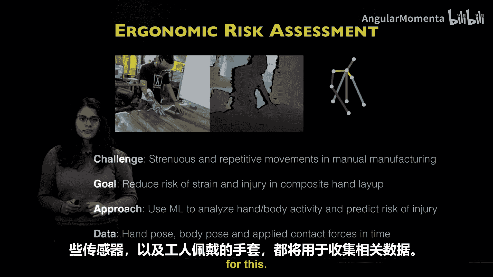
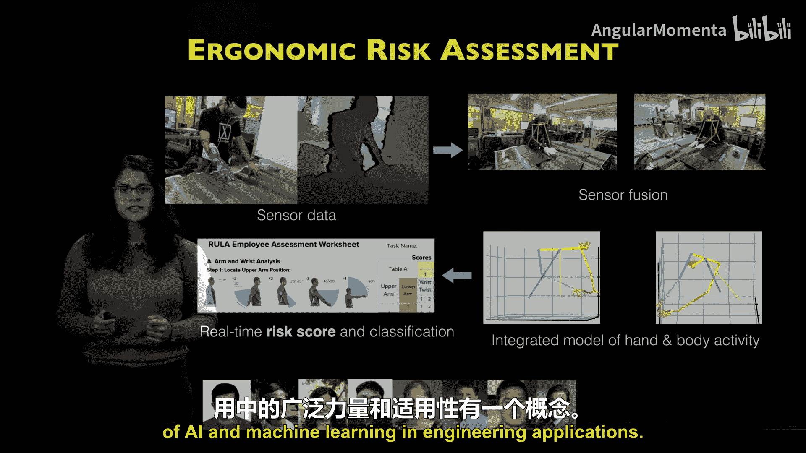

# 【精译】数据密集型工程导论-p06-06-波音案例研究与克里希卡·马诺哈尔教授--BV1J8G3z1EHF_p6-

Welcome back。Now that we've been introduced to machine learning and data science more broadly。

 let's look at some concrete real world applications through some case studies at Boeing。

I'm Critheica Menohar， and I will take you through some of the ways machine learning and AI are being used for modeling。

 control and optimization of very complex engineering processes at Boeing。

These include assembly and composites manufacturing， inspection and automation。

 as well as ergonomics and safety。Our first case study is predictivetive shimming。

 which is a part of assembly。

So first， what is shimming？Sims are filler components that are manufactured and made to fit the gaps that arise between joining parts in manufacturing。

These gaps arise due to the scale and complexity of these composite structures and the fact that they're often manufactured separately and undergo various transport and inspection processes before they are fit together。

Shown here is one example of the wing to side of body joint， where the wing meets the fuselage。

This forms a box like shape which is shown on the right and showing 10。

000 gap measurements from 787-8 and-9 we have data from 50 aircraft of each type。

 and I want to emphasize that this data collection procedure is very challenging and took one year。

And you'll see why in a second。

This brings us to the predictive part of predictive shimming。

Shiimming is a time consuming process due to the measurements required。

 and this measurement process is in the critical path of assembly。So historically。

 this used to be done by dry fitting two parts together。

Measuring the gaps and manufacturing the shims and reassembling the parts together with the shims in place。

 So the aircraft was essentially built twice。More recently。

 metrology and robotic scanning is used to generate point clouds of both parts。

 which undergo an extremely heavily computationally expensive alignment and data processing procedure before you see this nice gap distribution of 10。

000 points that you see on the right， so each point there is one gap measurement with red being the largest gap measurements and blue being the smallest。

So our goal is to reduce this measurement and processing time by exploiting patterns in historical data。

 and we have these gap measurements for each of 50 aircraft。

Of the 787-8 and-9。So to preview some of the data processing tools that we use。

 we take this raw data and extract the dominant features from the data ranked by their contribution or importance in the data。

 using state of the R tools like robust principal component analysis。

This technique is very analogous to image processing and facial recognition applications。

 where oftentimes these high- dimensionmensional images are reduced to a feature space consisting of their important elements。

 so in the face example each face is comprised of a small number of eigenfaces。

 much smaller than the number of pixels in the image。When we do this dimensionality reduction。

 it allows us to optimize and reduce the number of measurements required to reconstruct each of these gap distributions。

As it turns out， using this dimensionality reduction approach。

 we were able to reduce the number of measurements by 10 times while still maintaining accuracy and reconstructing 99% of the unmeasured shim gaps to within Boeing manufacturing tolerance。

 and that's again with 10 times less measurements。Okay。

 so now that I've given you an idea of how data science can be used for optimization in assembly。

Let's go back to another step in the process， which is inspection。

So these large scale composite structures are often laid up using advanced fiber placement techniques like automated fiber placement。

 which is shown here on the triple7X bar。These large scale composite layup procedures need to be very carefully inspected for quality and inspection。

This is time consuming and oftentimes too difficult to do by hand by Boeing workers and engineers。

So our goal is to reduce the time and human labor and potential fatigue that is caused by inspecting these large scale parts。

This is a suite of approaches， machine learning approaches for automated identification of defects。

 and I'll show you one particular example next。😊，The data for these kinds of automated inspection approaches can come from a variety of sources。

 including nondestructive inspection or imaging， videos or theographic images of the layout process。

 as well as AFP sensor data such as temperatures， speeds， pressures， and part geometry。

 and other information that we can use to basically be able to tell the quality of a part。

This can also include labels of defective and non defective parts。

 which were labeled by an engineer or a worker who has been inspecting the part。

So one example of this is an extremely difficult inspection procedure is toe and detections。

 so toes are bundles of these composite fibers and oftentimes we need to know where the edges fall during the inspection。

As you can see from the images shown above these。Composite toe boundaries are difficult to detect visually。

 and the artifacts from the imaging can be confused with the actual toe ends。

 so you can see that the identified toe ends are correctly shown on the right through these red lines。

 but we can actually learn from images， hundreds and thousands of images of toes in composite parts and some of the labels of these toe ends。

And apply deep learning and semantic segmentation tools to actually automatically produce these toe end detection lines。

So now you have an idea of how machine learning can be used for inspection。

Now let's look at smaller scale composite parts， which still require a tremendous amount of manual layup and assembly and manufacturing with Boeing workers and technicians。

Oftentimes these manual processes such as composite hand layup。

 riveting draping and installation involves strenuous and repetitive movements。

 these are a known cause of potential strain strain and。Stress injuries on the hands， the wrists。

 as well as other musculoskeletal disorders。According to OSHA。

 the direct and indirect costs associated with worker turnover。

 lost productivity and worker compensation are expected to total $120 billion across the entire industrial sector annually so there's a tremendous need to reduce the risk of strain and injury in these processes and be able to adapt these processes so that they are less injurious to the worker or less produce less risk of injury to the worker。

So our goal is a data driven methodology to analyze hand and body activity as the worker is performing these tasks。

and predict the risk of injury and we're specifically looking at composite layup where we collect hand and body post data from Boeing technicians as well as applied contact forces in time。

 so all of these sensors including the motion tracking sensor。

 as well as the gloves the worker is wearing will be used to collect the data for this。

So here's an overview of the methodology。The sensors are collecting raw data of the hand and body pose using motion capture that is mounted on the worker's head。

 as well as pressure sensing gloves and two webcams that are used to estimate the body pose。

We perform sensor fusion on all of this raw sensor data to get an integrated bottle of hand and body activity in time。

This model is then used for real time numeric risk scoring。

 where this number represents a probability of risk， of ergonomic risk。

 and classification of this ergonomic risk into high， moderate and low levels of risk。

This is done using established ergonomics techniques such as ruleula or rapid upper limb assessment。

 which is currently used in industry to assess safety of processes。

It extracts features such as the joint angles， the back bend angle。

 twist and torss of the neck in order to produce the score。

So what we have is a completely data driven methodology to assess ergonomic risk。So with this。

 this concludes our high level preview of Boeing case studies。

Hopefully this gives you an idea of the broad power and applicability of AI and machine learning in engineering applications。

Thank you for listening。Stay tuned for a deeper dive into predictive shimming。

Thank you。