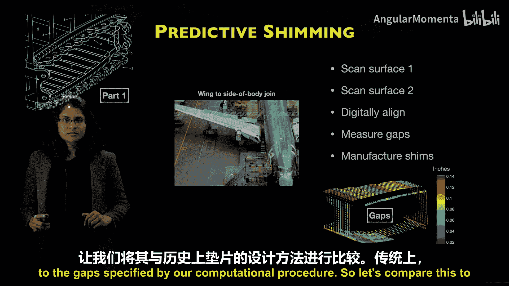
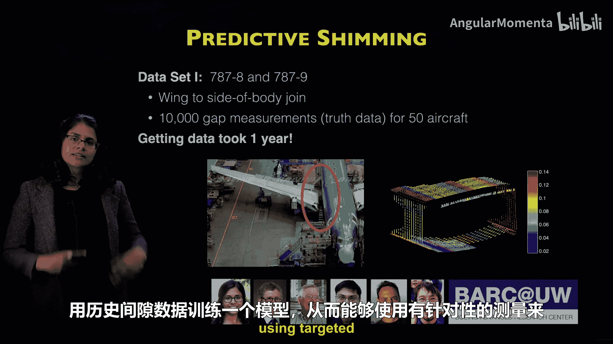
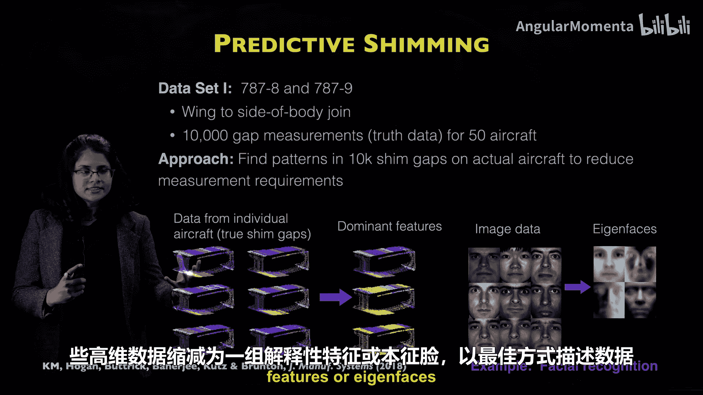
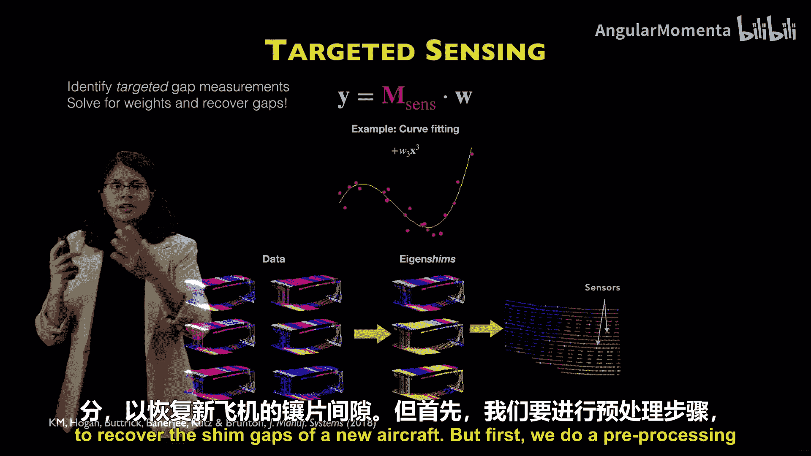
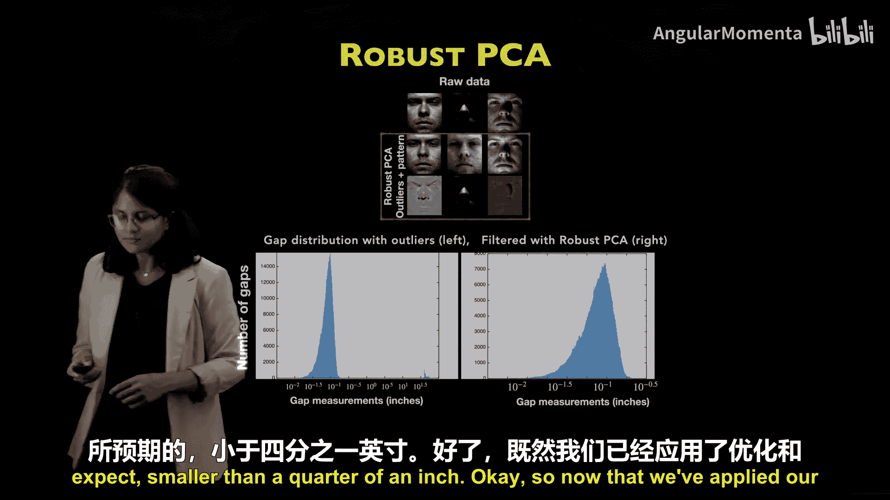
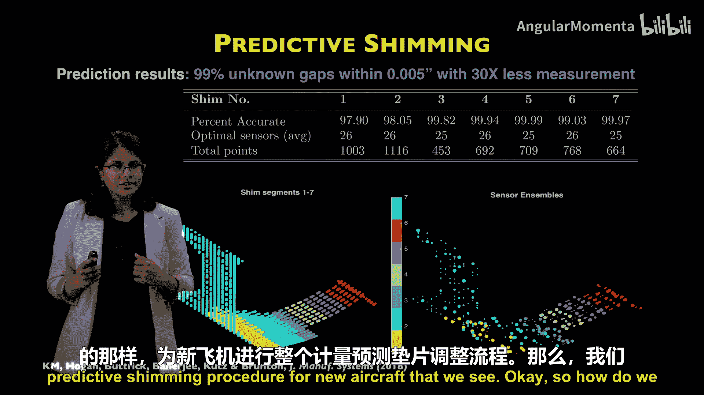
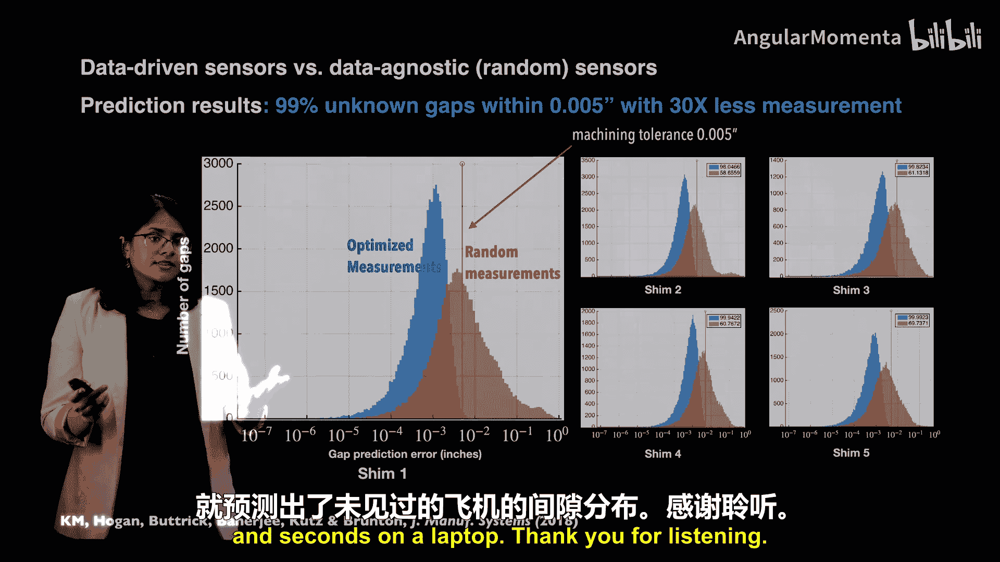

# 【精译】数据密集型工程导论-p07-07-克里希卡·马诺哈尔教授的预测垫片案例研究--BV1J8G3z1EHF_p7-

Welcome back everybody。 I'm Critheica Manohar， and I will take you through a deep dive of predictive shimming at Boeing。

So first of all， what is shimming？Sins are filler components made of various materials that are manufactured and designed to fit gaps between parts in assembly。

So how is predictive shimming done？For this complex geometry， like the wing to of body join。So first。

You scan the first surface， which would be the interior of the fuselage。

The second step is to scan the second surface， the exterior of the wing joint。

We digitally align both of these surfaces using computational methods。

We measure the gaps that occur between the parts in this digitally aligned coordinate system。

And finally， we manufacture the shims according to the gaps specified by our computational procedure。

So let's compare this to how shims were historically designed。So shimming is typically reactive。

 where you drive fit two complex parts together， measure the gaps between them by hand。

Disassemble the two parts， manufacture the shims and reassemble。

So for something as complex as a wing to body join or the wing skin and spars。

This is extremely computationally expensive and labor intensive。

So this is why we've moved towards predictive shimming。

where you scan the surface interior surface of one of the parts， the exterior surface of the other。

 and so that you can measure the gaps where they join in a digital environment and then process this data to generate hyp precision gap measurements。

 which usually takes hours because of the sheer number of points int。

 these metrology and scanning processes generate tens of thousands to millions and billions of point clouds of points in a point clouds。

 but we're talking about predictive predictive shimming， meaning。

Can we use historical data from other instances of the same part of an aircraft？

And go directly from these reduced set of measurements。To our box of shims。

And that's exactly what we're going to do for the 787-8 and dash 9 wing to body join。

 So here's our data set for the 787s， dash8 and D9。

We have 10，000 points or gap measurements from the metrology or predictive shimming procedure for 50 different aircraft。

And we want to be able to reduce the measurement requirements down the line because this translates to millions saved in the manufacturing processes。

That's because shimming is in the critical path， and any time or resources saved during the critical path directly translates to millions of dollars saved per aircraft。

So this data is actually very high fidelity and getting it itself took one year。😊。

We want to see if we can train a model on the historical gap data to be able to predict the gaps for a new aircraft using targeted measurements。

So here are the data of 10，000 gap measurements for the first six aircraft。

 you can see there's definitely some structure in these aircraft in these wing to body joints。

 but you cannot necessarily predict one just by looking at the other within the required manufacturing tolerance。

So our approach is to find patterns in the 10，000 shim gaps and reduce the measurement requirements。

This is very similar to high dimensional data processing that happens with image processing or facial recognition。

Given very high fidelity images of people's faces， you can very quickly classify them using standard techniques in machine learning and AI。

And we can reduce these high dimensional data to an explanative set of features or eigenfaces that optimally describe the variation across the data。

These patterns can be extracted from the data using a method called principal component analysis。

The idea is that every high dimensional data point or high resolution image can be written as a weighted sum of these dominant features or principal components that can be learned from the data in seconds on your laptop。

For example， an image of you might be 60% face one and 20% Ph2 and so on。

 an image of me may be 50% of face one and 30% of Ph two and so on。So the idea is that。Each image。

Each person's image can be reconstructed by just knowing these weights， and in practice。

Each of these thousand dimensional images can be reconstructed from just 50 to 100 of these weights。

We're going to apply a similar idea to learn the full gap distributions from targeted measurements。

So identifying these targeted gap measurements to be able to reconstruct these weights is equivalent to solving this linear system of equations for the weights and recovering the full image or the gaps in this case。

The idea is very similar to curve fitting， where you might have data points that are measured。

 and you specify what kinds of functions may fit them。But in this case。

 the functions are these dominant features or principal components learned from the data。

In curve fittinging， these functions or features are basically different functions of x， for example。

 linear functions， quadratic functions， and cubic functions。

We're going to use the idea that every face is low dimensional in a function of eigenfaces to basically learn the sparse sensor measurements。

That we have to measure to reconstruct the full space。We use a similar idea with predictive shimming。

 where we extract these eigen shims or template shims from the data。

Exploit the patterns revealed by these eigensschims to place a number of sparse sensors along different segments of the winging of body joint。

And from those sensor measurements， we optimize。A linear system of equations that depends on these selected sensors。

And the principal components that we've extracted from the data to recover the shim gaps of a new aircraft。

But first， we do a preprocessing step where we don't just apply PCA。

 but we apply robust PCA which extracts outliers in the data from the true patterns that underlie the data。

 For example， in the facial images， you may have shadows。

 glasses or mustaches that don't represent the overall distribution of everyone's face。

 These are outliers that must be extracted from the data using things like robust principal components。

Analysis to pull out these sparse outliers and shadows。

 We do something similar with the overall gap distribution。

 So let's look at the overall gap distribution for all the aircraft。

You can see that when you plot the histogram on a logarithmic scale。

 there's a small number of extremely large gaps or outliers greater than 30 inches。

 this is likely a numerical artifact and shouldn't be considered in our analysis。

So we use robust PCA to filter the data so that the gap measurements that we are left with reflect a more structured distribution that are。

 as we expect smaller than quarter of an inch。

ok。So now that we've applied our optimization and principal component analysis。

 we can actually try to reconstruct by solving that linear system of equations。

These are the shim sensor ensembles that are revealed from our method。

And we apply the method to segments of the wing to body joint separately to extract localized patterns in these shim segments。

And what we found is that 99% of the unmeasured gaps can be predicted to within 500th of an inch。

 which is Boeing's machining tolerance with 30 times less measurements。That means， for example。

 for the segment number seven， we can reconstruct or recover almost 1000 unmeasured gaps by just measuring at a targeted number of locations around the order of 20 to 25 shim locations and when we do that。

 we can predict anywhere from 98 to 99% of the unmeasured gaps with extremely high fidelity and the manufacturing tolerance that is specified by the application。

And we've done this in seconds on a laptop rather than the entire metrology predictive shimming procedure for new aircraft that we see。

Okay， so how do we verify that these optimal sensors are good？

We compare these data driven optimal sensors with data agnostic or random point sensors for predicting the gap distribution。

And we look at the probability distribution of the gap prediction error。

And what we see is that with our optimized measurements。

 the majority of the probability mass of that distribution is less than 5000 of an inch。

 almost 98 to 99% of the mass of the distribution is within machining tolerance or manufacturing tolerance。

If we compare these two reconstructions with random measurements。

 we can see that almost half of the probability mass exceeds 500 of an inch。So。In conclusion。

 we have managed to predict the gap distribution of an unseen aircraft using just a few targeted measurements。

And seconds on a laptop。

Thank you for listening。