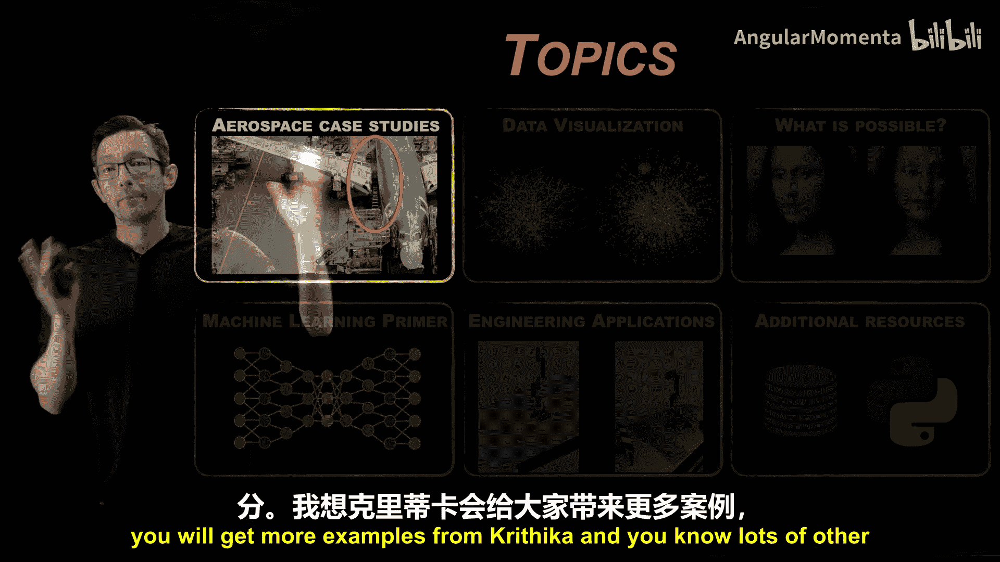
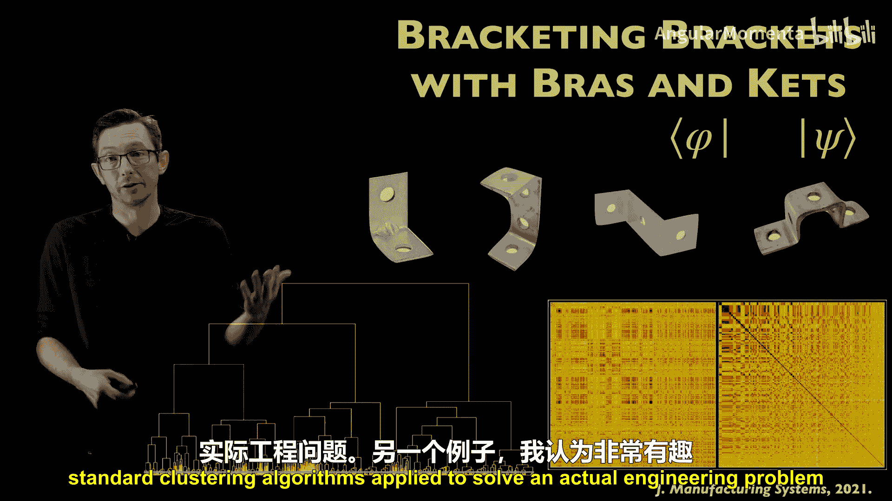
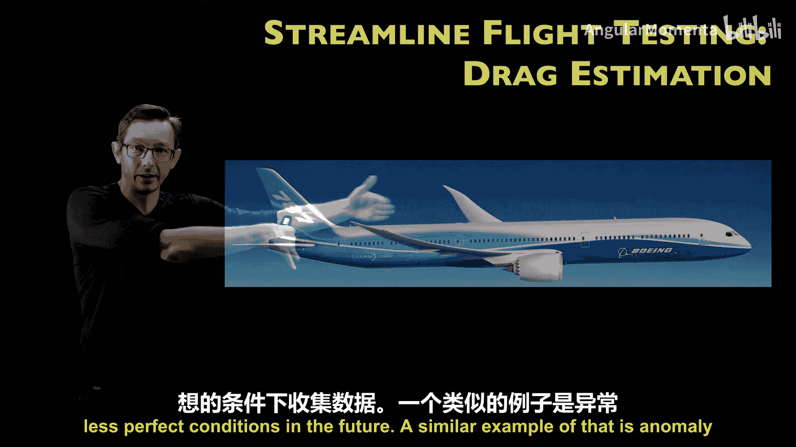
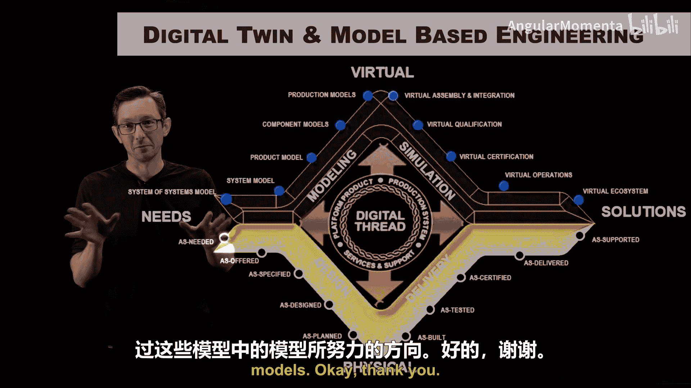

# 【精译】数据密集型工程导论-p08-08-波音案例研究与史蒂夫·布鲁顿教授--BV1J8G3z1EHF_p8-

Welcome back。So I wanted to cover a couple more aerospace case studies to motivate some of the things you can do with data intensive methods and machine learning and visualization in the aerospace sector in particular。

 most of these are collaborations between University of Washington and Boeing。

 some of my favorite examples， just a small handful out of many， many more。

 I think you will get more examples from Critheica and you lots of other examples。

One of my favorite examples， I think this is kind of a neat collaboration。

 you can read about it more in the Journal of Manufacturing Systems。

 is this idea of reducing the number of unique parts on an aircraft， what we call standardization。

In the context in this case of brackets， so I had no idea that a modern aircraft like a 787 has tens of thousands of unique brackets。

 all designed for different aspects of what is needed on an aircraft。

 things like holding bundles of cables or bracing one piece against another。

 brackets brackets hold up the world， they are designed to hold things together to join parts and to hold things。

And oftentimes it is easier when someone is designing a bracket for a specific specialty case on an aircraft。

Instead of looking through a catalog of 10，000 brackets。

It's easier oftentimes for an engineer just to design a new bracket for that particular case。

 and that's how you get you know kind of this bloat of brackets is that if the library gets too large。

 if the catalog gets too large， it's easier to just add another element to the catalog and so it gets larger。

 so it's kind of an unstable process。And so working with Boeing engineers。

We essentially took a database of brackets that were actually designed and put onto a modern commercial aircraft。

And we used ideas from machine learning from kind of data science to see if we could identify a core subset of those brackets that would do a good job on most of the use cases so we wanted to reduce。

 let's say 10，000 unique brackets down to a couple of hundred they would get 80% of the job done Could we do that that was the task so we have this kind of cute title bracketing brackets we're finding you know eigen brackets or kind of standardized brackets with bras and cats。

 so this is an homage to quantum mechanics where a bra cat pair essentially just means we're taking an inner product it's a way that we can tell if I have two brackets。

It's essentially like I'm taking the dot product of those two brackets in some kind of a feature space to see are those two brackets similar or different。

 that's what a bracket or an inner product does and so essentially what we did was take all of those unique brackets and take the dot product of every bracket with every other bracket it's kind of this visualization here you can see kind of these similarity scores between every bracket and every other bracket。

And we used hierarchical clustering algorithms to find brackets in our data set that were close to as many other brackets as possible。

 so we could take all of those and collapse them down to one part and that's kind of what's visualized here is that at a given level of closeness you can kind of pick how many representative brackets you have that would describe that whole set。

😊，And in doing so we did find that you could get a pretty dramatic reduction in the number of unique brackets。

 but there are these kind of long tails， there are actually a number of unique brackets that really aren't that close to anything else and are in fact needed to be designed by hand and manufactured by hand。

But any brackets that you can consolidate or standardize。

 clearly that's going to save engineers time， it's going to save money because you economies of scale and just having less unique parts sitting around for warehousing and things like that。

Lots of opportunities， not just bracketing， you can do this with electrical connectors。

 all kinds of other pieces that get designed as one offs。

 there's an opportunity for standardization that's kind of a cool example of relatively standard clustering algorithms applied to solve an actual engineering problem that exist in aerospace。

Another example I think is super fascinating is flight test evaluation， so flight testing。

 a new aircraft is extremely important， extremely expensive。

 extremely thorough and extensive tests are done to certify every aircraft， not just Boeing。

 but other other makers as well。And so there are a lot of opportunities to streamline and improve flight testing。

With data intensive solutions， so these are some of the biggest data applications are in flight testing when you see an aircraft that's being outfitted for a new set of flight tests。

 they are just covered in sensors thousands of sensors。

 sometimes you know just an absurd amount of sensors measuring everything anyone can think about and those sensors are logging huge amounts of data like terabytes and terabytes of data you know every single time this thing goes up in the sky for an hour measuring everything they can think about to test anything that anyone can kind of imagine needs to be tested they're going down this checklist trying to certify different things about the aircraft okay very expensive timecon process。

And if you can shave a couple of days off of that process， that's very， very。

It's a lot of savings and it also means that you're getting those aircraft to customers sooner。

 so it's a big win for everybody。Now I'm just going to highlight a couple of examples。

 there are a million examples of flight testing streamlining that you can do。

 just a couple that we've thought about and worked on， one of them is drag estimation。

So when you put， you know the 787 is one of my favorite aircraft because it is just an aerodynamic marvel。

 the composite shape of the wings allows it to have this unprecedented fuel economy and drag minimization and kind of lift and drag。

And to test an aircraft like this， to test its drag profile and its drag performance under different weighting conditions。

 under different mock numbers， typically。I'm not an expert in this。

 my understanding is that typically what you would do is you would have to fly this aircraft in fairly perfect blue sky conditions where there's not much turbulence and where you know what the atmospheric conditions are to essentially calibrate your measurements to get a really accurate drag estimation。

Now that is expensive because it's hard to find a couple of hours of perfect blue sky weather conditions you might lose half a week waiting for those conditions where you can get a really good dialed in drag estimation for your aircraft。

And so what we did essentially again in collaboration with Boeing at University of Washington and Boeing in our bar lab was we took historical data from flight tests where we had that blue sky perfect weather benchmark。

 but we also had the measurements in crummy weather conditions where it was not know where there was turbulence and there were clouds and it wasn't perfect。

 and we essentially built a machine learning model that would boost the imperfect data and recover the drag estimates that you would have gotten if you had a blue sky condition。

So in principle and the good news is it's very hard for a human to write down those analytic relationships。

 but there is enough data and there's enough patterns in the data and enough historical data。

 a machine can learn those correlations to kind of clean up non- idealal drag measurements and give you an output as if they were done in blue sky conditions。

So that's a really cool example where you can actually streamline and save time on flight testing。

 so that's kind of， you know I like that example a lot， very。

 very relevant and you can imagine lots of other cases where you can kind of leverage the historical data you have to make it so that you can collect data faster and in less perfect conditions in the future。

A similar example of that is anomaly detection， so again when you have a large aircraft that you are testing and evaluating。

 it's got all of these different sensors on all of these different parts。Sometimes the sensor fails。

 sometimes a couple of critical sensors that you need fail during that flight test and you're not even sure that they failed。

 maybe they just saturate or they start acting strangely。

And you only learn when you land that aircraft that that three hour window was wasted and you have to redo that test。

 again， very expensive， very frustrating when these sensors fail。

But because there are so many sensors， so much redundancy。

 and they're measuring so many different aspects of this flight test。

It is possible often to in real time detect when a sensor becomes anomalous when it becomes nonphysical or where it starts to derelate with all of the other measurements that are being taken。

So first off， you can flag， hey， you better land this plane and fix that sensor because your data is going to be useless。

 don't waste another couple of hours。But even better than that。

 sometimes we can actually use the statistical patterns and correlations in those other sensors to fill in what the failed sensor would have measured if it was operational through the power of the statistical correlations because this is a physical system and if I measure something in one location。

 it probably does have a physical correlation with another measurement somewhere downstream。

And so there's a lot of opportunities here， I'm just you know， tip of the iceberg is。

Can you leverage the correlations between all of those thousands of measurements you're taking to know when something's going wrong with your sensor。

 maybe to improve the fidelity of your sensors and fill in missing or faulty data and can you even start to certify things as you go as data accumulates an evidence accumulates in a dynamic way maybe we don't have to run targeted flight tests for particular you know tests we need to check maybe those tests are always running and as data accumulates and something becomes certified。

 it automatically checks itself off the list That's a future idea but there's a lot of potential there because again these are very time consuming very expensive and you got to get it right this is super important these tests need we need as much information as possible to certify you know the things we're trying to certify in a new aircraft。

So a lot of what I'm talking about in general and it's not just flight testing。

 it's not just manufacturing， it's not just designing new supermaterials or aerodynamic wings。

 a lot of this fits into what is known as the digital twin so large aerospace companies like Boeing are sitting on this mountain of data from you know concepts to designs to early stages of manufacturing to production manufacturing。

 flight test and evaluation service records in flight there is just。In space and in time。

 this massive volume of data spanning decades and spanning continents and spanning many， many。

 many scales。And so that data can essentially inform a supermod。

 it's kind of we've been building models for a long time。

 but the digital twin is a model of models of models。

 a hierarchical kind of super Uber model of the entire process。

 whether it's an entire you know factory floor or an entire aircraft， you know from start to finish。

That。Digital version of that asset that is essentially pinned to actual data you've been collecting throughout the entire lifetime of that aircraft or lifetime of that factory allows you to do really amazing things in model-based engineering just like we saw that you can design supermaterials by having a surrogate model that is faster to optimize over having a surrogate model of your factory or your aircraft allows you to optimize over those processes in a much。

 much faster， more streamlined way without just testing a bunch of different factories and seeing which one works or building 10 different aircraft and seeing which one is better。

Having the ability to optimize over surrogate models is a huge future goal for machine learning。

 integrating machine learning and data intensive science into the aerospace industry this is one of the most exciting areas of development it involves reduced order modeling。

 uncertainty quantification， machine learning， sensor fusion internet and things it's just a super fascinating culmination of lots of new technologies and it's going to enable us to design safer higher performance aircraft faster and with less resources so that's at least the promise and that's what we're working towards with these kind of models of models of models。

Okay， thank you。

