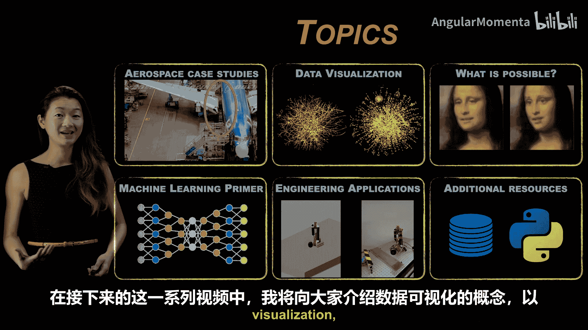
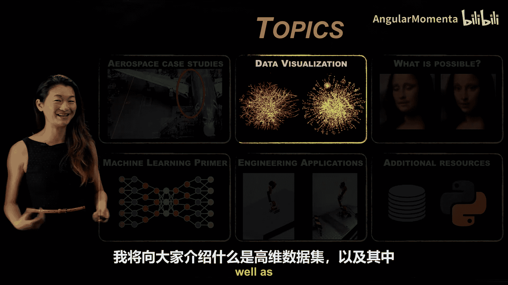
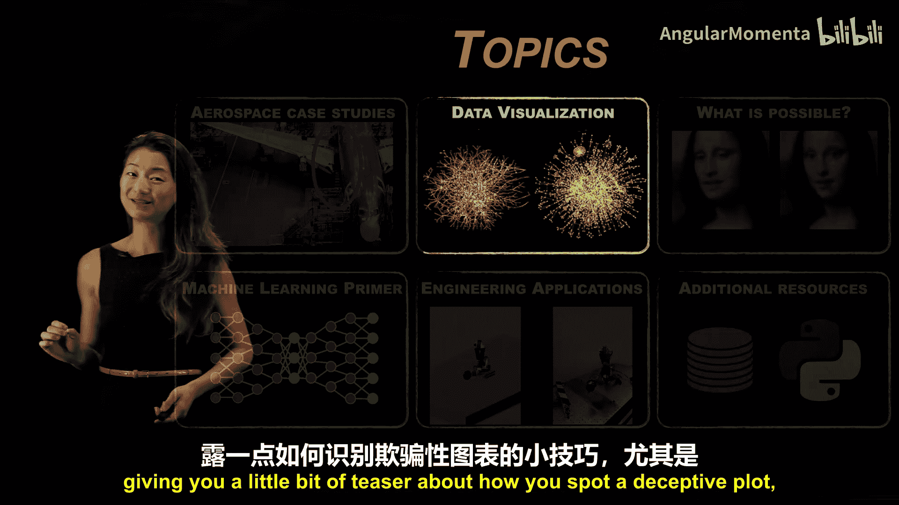
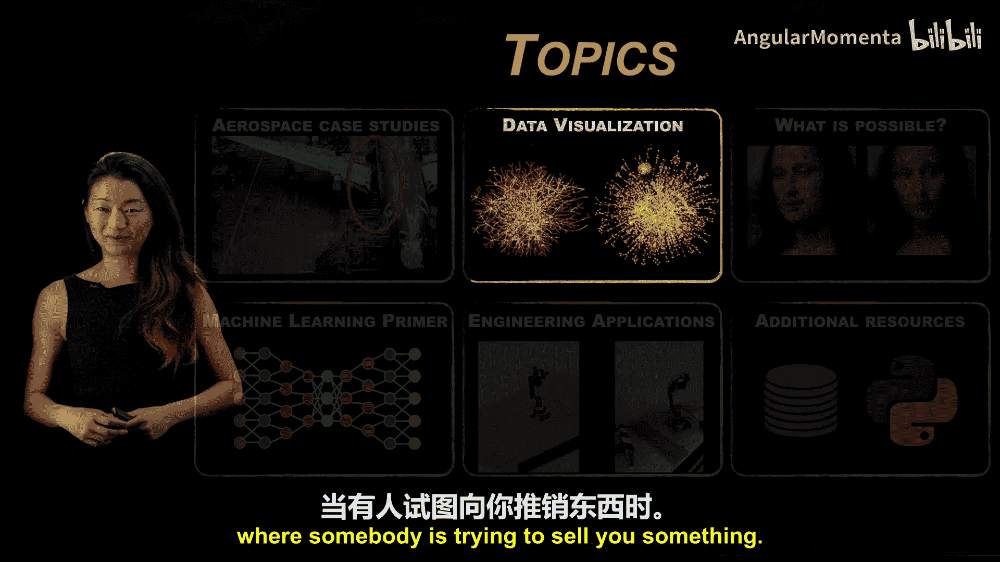

# 【精译】数据密集型工程导论-p09-09-数据可视化简介--BV1J8G3z1EHF_p9-

Hi， my name is Bing Brenton and I'm a professor at the University of Washington in Seattle in this next series of videos。

 I will be introducing to you the concept of data visualization and how it fits in with the larger context of data intensive engineering。

 specifically tailored for aerospace case applications so we're going to be learning about data visualization as a way of telling a story with data I'm going be telling you about what is a highdisional data set as well as a different data types that could be in there and at the very I'm going to be giving you a little bit teaser about how you spot a deceptive plot。

 especially one where somebody is trying to sell you something so I'm really looking forward to it and I' hope to see you for these videos。

😊。

