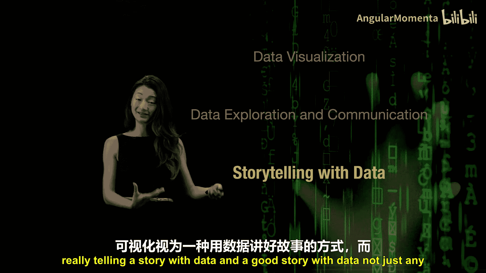
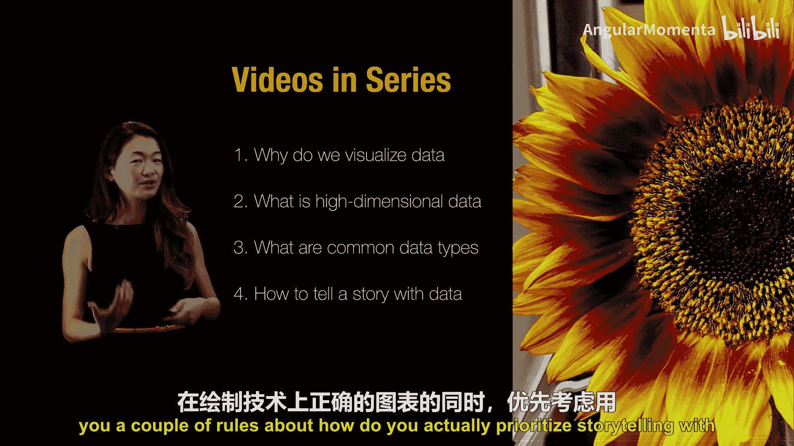

# 【精译】数据密集型工程导论-p10-10-可视化简介--BV1J8G3z1EHF_p10-

Hi everyone。 My name is being Brenton and I'm a professor at the University of Washington in Seattle。

 and this is a short course on data visualization。 so as a scientist。

 it may not surprise you that I love data but data nowadays can be really overwhelming it comes in so many different types and it's really confusing in terms of how much is coming down from all the instruments that we have and how much we have access to and so the goal of the course is really to help you understand data visualization as a tool in this ecosystem of modeling analysis and understanding in terms of using data for making decisions and so in order to talk about data visualization。

 I'm not just talking about how do you make plots with data a lot of other courses have covered that and so the goal my goal here is not to just make plots with data even though I love making plots as much of the next person data visualization is really all about data exploration and communication and this communication includes communicating your data with other people as well as communicating your data with future versions of your。

😊，Maybe a year from now you've already forgotten what data you collected。

 and so data visualization is a really useful tool for doing that。

And in taking data and communicating with people， really what we're doing is telling a story and so the goal of the course is to view data visualization less as a technical discipline and more as an ex and really telling a story with data and a good story with data not just any story so my goals for you today are a couple fold som not trying to make you an expert in terms of using on the latest tools in data visualization rather we're going be focusing on how to think like a data scientist visualizing data。

 what are the things that one might think about what are the things that are consideration with the data type。

 stuff like that and also even if you're not the person who's actually making the data visualizations。

 I'm going to be focusing how do you communicate how do you use the language of data science to talk to other people who might be the people who are actually making the visualizations on your team and to understand what their contributions are on a team like a scientific one engineering team in terms of visualizing the data along the way what I'm hoping to teach you is to be familiar with modern data。

😊。

Different types and visualization tools。 If you already know what the rough categories of things that can be done。

 it's much， much easier to accomplish the rest of the learning goals as well。

 So if you want to come on this adventure with here is the itinerary We're going to have a series of five videos focused a short videos focused on five very specific goals We're going be asking these following five questions。

 The first is why do we want to visualize data in the first place。 What is it for do we use it。

 do we incorporate it into the process of actually making decisions with data。

 The second video we're going to be looking at what's high dimensional data hear a lot high dimensional data these days What is it what makes it different low dimensional data。

 how high is high dimensional stuff like that。 what is it actually mean to have high dimensional data And then of course。

 we're going to be talking about the common data types as well as some isoteric data types and how do you actually deal with data types that don't fit in with the regular types of data we usually deal with We're then going to be talking more coming back to this idea of。

telling with data I I'm going to give you a couple of rules about how do you actually prioritize storytelling with data over just making a technically correct plot。

 And of course， at the end， after you've made a really pretty plot or somebody else has made a really plot for you。

 I'm going to tell you about how to spot as a s plot byer beware telling a story with data can also mean telling a story this's misleading with data。

 And so that's what the last video is going to be about。

 So if that sounds interesting to you here are the next five videos， there's going to be links below。

 and I hope to see you back。😊。

