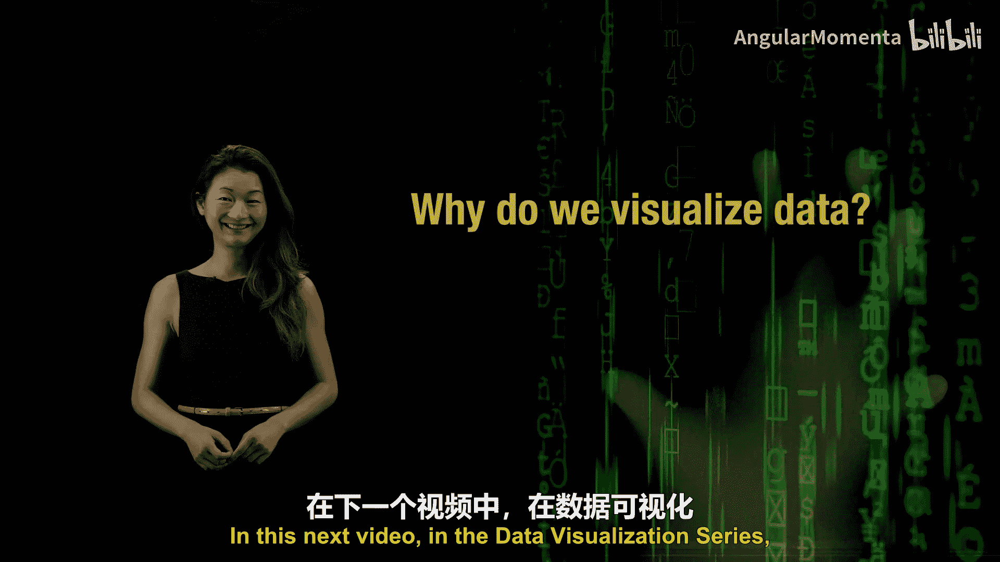
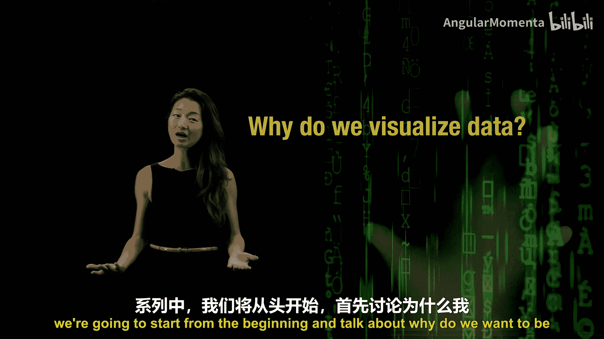
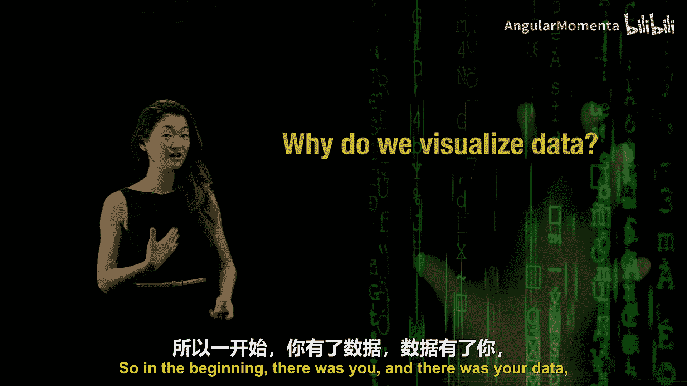
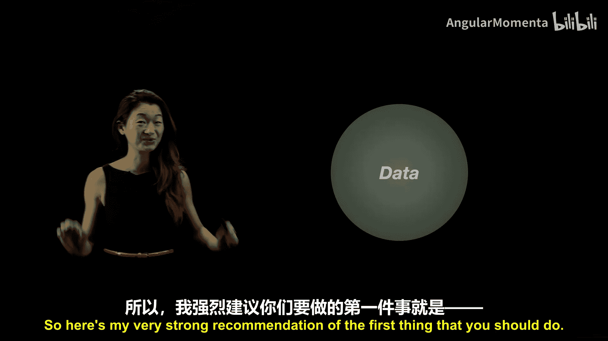
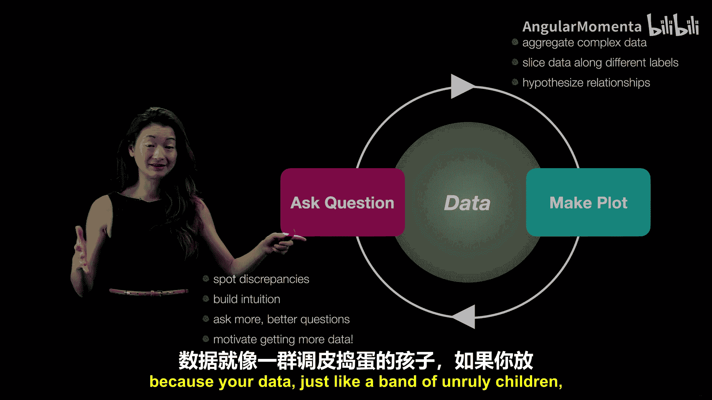
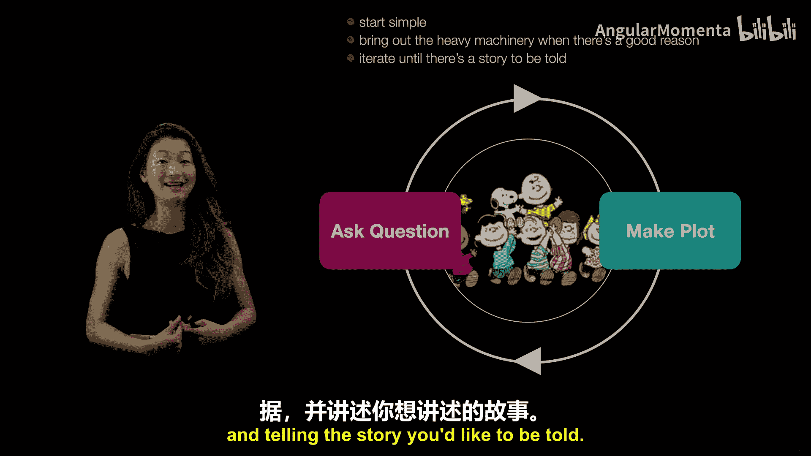

# 【精译】数据密集型工程导论-p11-11-通过图表用数据提问和回答问题--BV1J8G3z1EHF_p11-

In this next video in the data visualization series。

 we're going to start from the beginning and talk about why do we want to be visualizing data in the first place。

 So in the beginning， there was you and there was your data and you're staring each other going like okay how do we get to know each other So here is my very strong recommendation the first thing that you should do ask a question about your data and then using that question make a plot to answer that question。

 Whatever it is you're asking maybe there's a relationship between this one thing this other thing that you think might exist。

 try to make the simplest plot you can think of to answer that question to visualize it in some way The reason you're doing this is because oftentimes our data is complicated And so a lot of the task of analyzing and understanding the data is aggregating complex data by slicing it among different dimensions trying to look at relationship to one thing and another thing or something a little more simpler than just looking at the entire data in this way we can hypothesize relationships and just really get to know our data in this way。

 by making this plot， you also gain a lot of intuition about your data and importantly you can spot。

😊。

Srepancies maybe there's an instrument that was broken this one day you were collecting the data maybe there is a recording that is just kind of a little bit off maybe you collected demographics data and one person just check the wrong box and with filling out the form making a plot is one of the easiest way to be able to spot the discrepancy so that you don't have that cone your analysis later onBuild the intuitions about your data is super important because it allows you to ask more and better questions because this is not a one step process asking the question making a plot and then using that intuition to ask more and better questions。

 including motivating getting more data maybe the right thing for you to do it this point is not to call it quit to make a story out of it but you realize oh man I really need more data this is just simply not enough getting this intuition is a really really important thing to do in every other part of the data analysis and data science pathway so I'm going to advocate for the cyclic process of asking questions in order to aggregate complex data making plots looking at it learning about your data in this very visual way so that you can ask a better。

Later onThe cyclic process is also super important because your data。

 just like a band on really children will do crazy things if you let it。

 so I always recommend starting simple if there's a scatter plot you can make don't make a more complicated one if there's a linear regression analysis you can run' don't find a more complicated one do the simple things first and when you find the simple thing does not work and more importantly specific way does it not work in what way is it lacking then you bring out the heavier machinery when there's a very specific good reason to do so so when you are asking questions and making plots you are going to iterate until there is a story to be told and when that story is going to be told you're going to be really refining your story refin the questions you're asking the right questions not merely the first possible question that could be asked so that you can make then make a plot and tell a story that is a very compelling story to be told so in the remainder of the videos I'm going be talking a little bit more about what actually goes into this kind of process depending on what type of data you have as well as some。

Pctices that you can actually do a really good job conveying and communicating your data and telling the story you'd like to be told。

