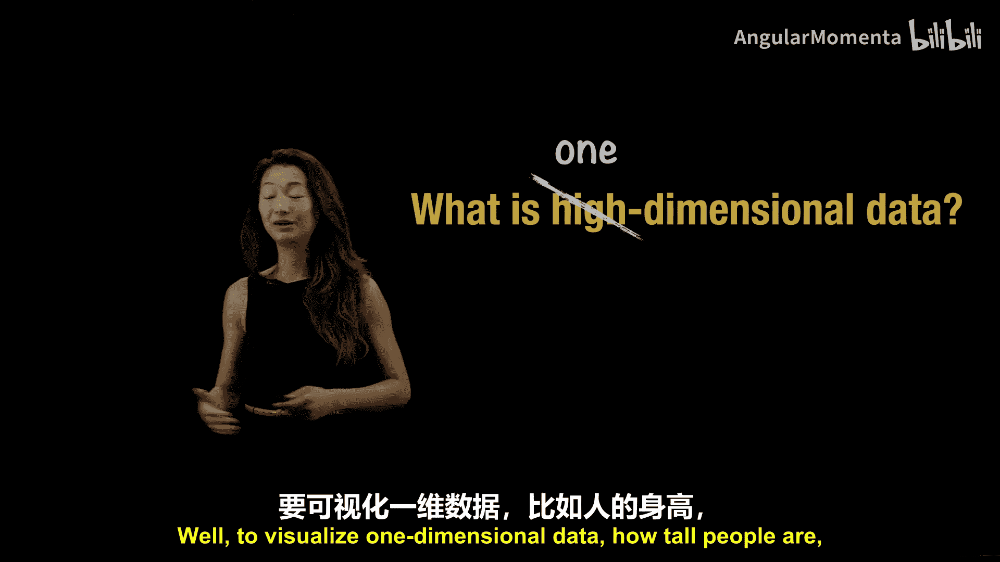
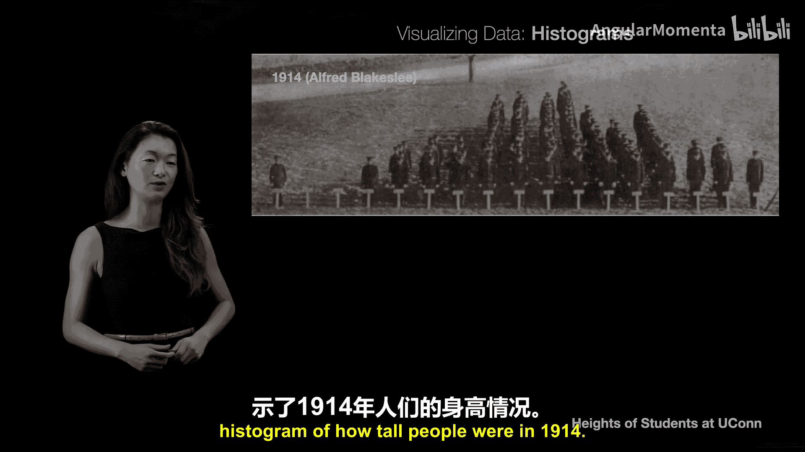
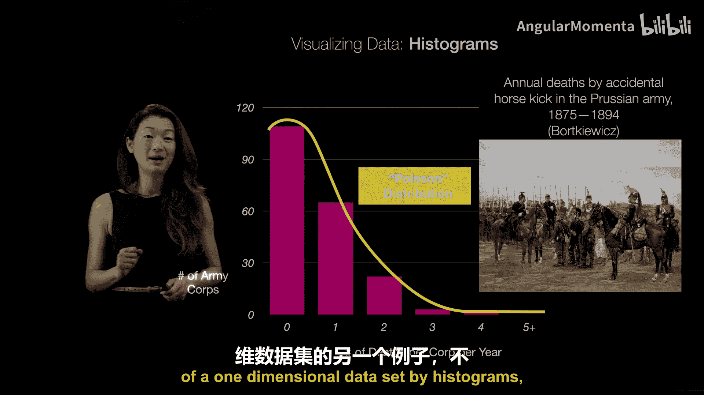
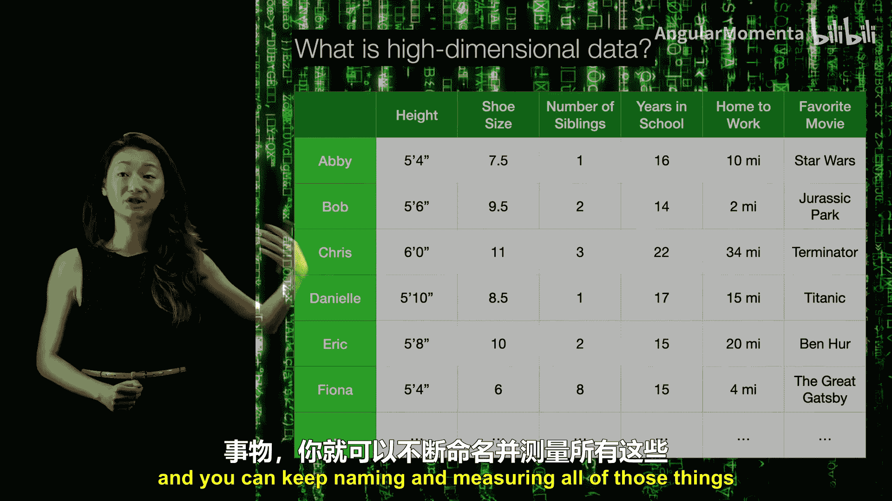
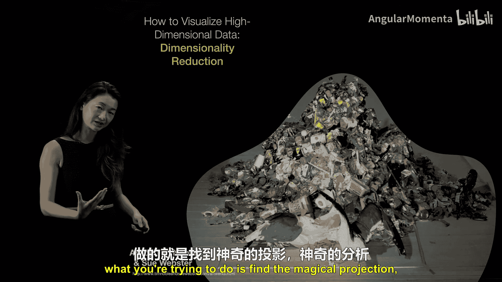
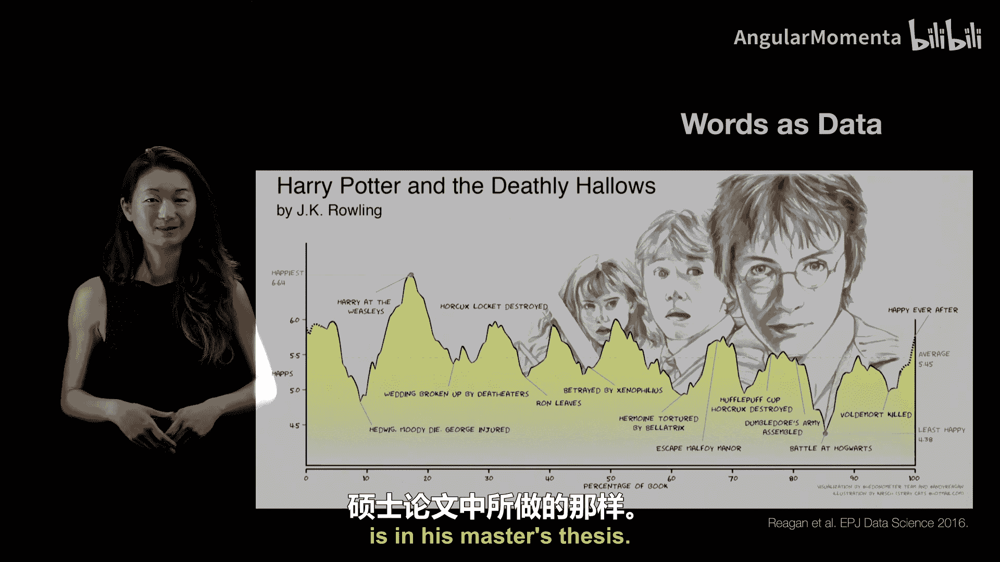
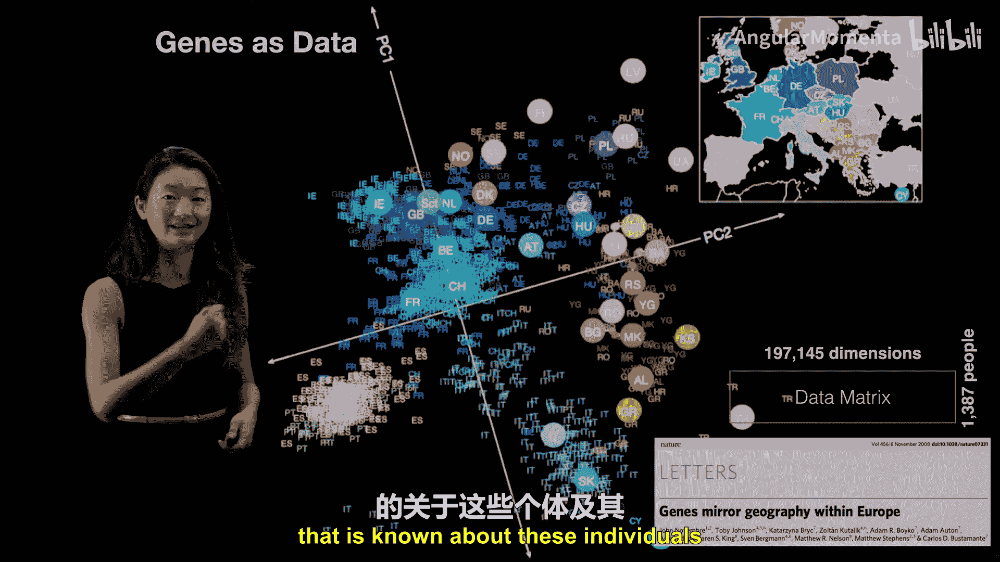
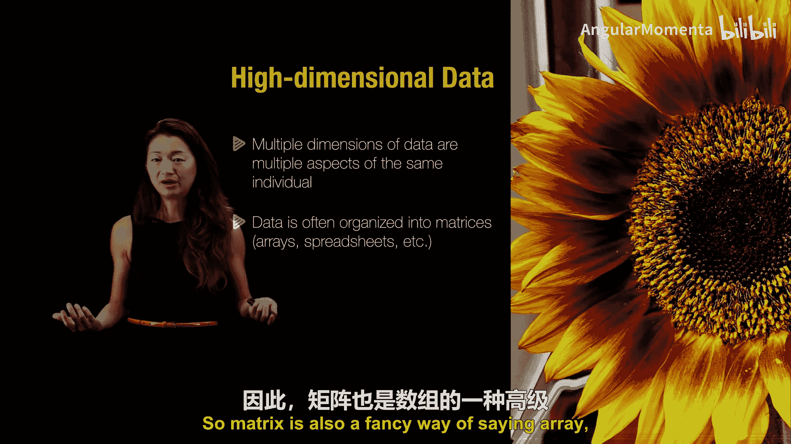

# 【精译】数据密集型工程导论-p12-12-可视化高维数据--BV1J8G3z1EHF_p12-

In this video in the data visualization series we're going to be talking about what is high dimensionmenal data This is a question I get asked all the time people are really confused and it seems like it's really mysterious and really complicated but the answer is actually remarkably simple so I'm going walk you through an explanation that makes sense to me in terms of what is high dimensional data what is a good for and what do we do with it so before we talk about high dimensional data let's just talk about one dimensional data first because you can't build up to many before you do one let's just do one dimensional data what is one dimensional data well well there's a dimension of me that's really easy to measure which is how tall I am so let's suppose we're talking about one dimensional data of people which is how tall they are well to visualize one dimensional data how tall people are you don't even need a computer in fact it was done way before the age of computing when people are visualized by their height by just having them lined up on the football field and making a very real life in real life histogram of how tall people are this is a picture from the University of Connecticut of students who are in the marching band at the time。

1914 and so each of these little labels is how tall they were and the people just kind of got behind the label of how tall they were and you can kind of see a very easy one dimensionmensional data visualization histogram of hall Ta people were in 1914 Now of course back then there was all men and so it was one distribution this experiment were repeated at the University of Connecticut in 1994 by Linda Schsberg where the women were wearing white shirts and the men were wearing black shirts and they all similarly lined up behind the little placard of how tall they were So of course the distribution for men versus women is slightly different but for men only you can see that the histogram of the men in 1914 followed very neatly what we call a normal world the known Gaussian distribution This is also sometimes called the bell curve because the curve resembles the shape of an upside down bell where you have the vast majority of the people kind of in this middle portion and then there are some people who were way shorter and some people who were way taller in a way that seems to be really predictable in the。

😊。

Pop levelSo this type of onedimensal data is easy to visualize and there's also other types of onedimensal data for which histograms are a really good description Here's the even older example were going back farther in history now by looking at the annual deaths by accidental horse kicks in the Prussian army in the 1800s this particular data set is kind of horrific but also kind of fun because back then in the Prussian Army。

 there were a lot of army course which the men were taking care of the horses by accident every year some do to get kicked in the chest by a horse and they would die and this would happen not very often you can kind of see that and the census were're talking about the number of army course towards there were zero deaths that year and it's the vast majority of them nothing was going wrong。

 there were no accidents， nobody died that year in a smaller number of army cor。

 one person died by gig kicked guy horse and then in a smaller number still two people died by getting hit in the chest by a horse Now mysteriously one year in one army。

F different individuals were kicked in the chest by a horse and died that way and so this prompted an investigation because people started wondering oh are they mistreating the horses。

 is there something wrong or is there some wrongdoing here or something that we can actually fix and so by looking at the data in this way visualizing it as the histogram of the number of hits per year per army corps there was an econist Burrkowitz who under the following analysis by modeling this process of what we call a Poson process now Poson distribution is a distribution of events that happened completely randomly and stochtically by chance with a certain fixed rate and if you basically sum over a certain period of time and count how many of those events there are it follows what we call a Poisson distribution well Brkowitz saw when he analyzed the data set that we are seeing here it's exact data we're looking at in this histogram here is that you would expect that there's approximately one Army corps per year for which there were four deaths by kicking kicked in the chest by a horse。

Wwhich is exactly what they observed thus Barowitz concluded that this was no wrongdoing on the men's part and this was something that you would expect by chance because this is a kind of a catastrophic accidental event that happens with a small probability so this is another example of a visualization of a onedimensional data set by histograms but making histogram of something that's even more complicated like a whole individual gets a lot more complicated so we talked about histograms a one dimensional data。

 for example， a measurement of how tall I am how tall you are we can take all of those measurements so there will be one dimension of data we can kind of represent that type of data by making a spreadsheet。

 let's say that I have each row is individual so I have my name your name。

 everyone else's same have this gigantic list of names as well as how tall each of those folks actually are so this is by onedial data set okay now as we know all of us are multidimensional creatures there's a lot more to me than how tall I am there's lots of other things that are interesting or not so。

😊。

For saying about me and about you。 but there's certainly a lot more to me than just how tall I am so we can fill out the spreadsheet by adding more columns to it。

 we can say my shoe sizes， how many siblings do I have how many years have I been to school how far do I live from work what's my favorite movie and on and on and on and on that is a high dimensional data So for each individual each dimension is just an aspect a description of you and we can add as many of these as we can care to measure So there's a couple of things I'm going to point out here about this particular high dimensional data that I want to remember and we' going dig into in the next lecture series as well So some of these number some of these dimensions are variables that are numerical。

 So for example a height is a continuous variable you can be5 foot4 inches tall and you can also be54 inches and a half tall anything in between really So a height is a continuous variable it's a number and it could be any number really the number of siblings is a little more complicated It's still a number still but you can't have。

😊，1。275 siblings， you might count half siblings if you wanted to。

 but you know I choose not to because because I think half siblings are siblings to their individual people and so the number of siblings。

 even though it's numerical is usually a whole number you also can't have a negative number of siblings mean maybe you go to if you go to holiday gatherings with your family you wish you had negative siblings but you can't really have negative siblings。

 number of siblings is numerical variable it has to be a whole number and it cannot be negative right so those are still numbers to some extent right so shoe size。

 number of siblings these are all just numbers and we have lots of lots of things that we can name for about ourselves in a highdimenal data set that their numbers。

 but if you think about favorite movies。That is a dimension of you， but it is not numerical。

 This is really important Favor movies are categorical。

 It's either you like this movie where you don't like this movie。

 and the movies you can lump them into categories like maybe I like romantic comedies and you like action movies or whatever it is。

 But nevertheless， it's a distinct categories。 and it's not obvious how you might take your favorite movie and map that into a number。

 So that is a different type of data altogether。 So well that telling you exactly what to do with that when you're doing data visualization。

 I just wanted to plant that seed in your head。 that this is a representation。

 a spreadsheet or an array or a matrix of high dimensionional data where every row is a person or something you're measuring。

 and every column is something that can be measured about that person or about that object or about that time。

 and there's different types of data such as numerical numbers。

 things that maybe be whole numbers rankings and then there are things that are not numbers at all。

 and that's something we have to deal with。 Now， as you can probably appreciate by the way that。😊。

I arranged the data matrix here。 this data matrix can get rather large。

 There's a lot of people in the world you can even name all the people in your organization It cannot be a really really large list and you can also have lots and lots of columns this can just keep going just keep naming things and you can keep naming and measuring all of those things about all of those people so this data matrix get quite large and so one of the biggest things that we talk about in data visualization is how do we visualize high dimensional data because I can't actually visualize anything more than two maybe three dimensions I am human my brain is built to work in the three dimensional world I'm very comfortable navigating the three dimensional world if you make me an animation I can kind of do four dimensions more than four dimensions know I'm starting I'm starting to get a little bit lost here lots of people have tried mathematicians have tried really hard but it's really hard visualize higher dimensional data than that but as you can solve the in the last slide it's really easy to get high- dimensional data that is thousands。

 tens of thousands millions if not billions in la。😊。

So a lot of the trick of visualizing high-dial data is actually reducing that complexity into something that we can actually handle with our visual cortex so that we can see it as a twodimensional picture or sometimes a threedimenal object in three dimensional space but that's really difficult because without being able to see it your data is kind of like this pile of trash I don't actually mean your data is this pile of trash but every data set is a pile of trash because it's really complicated we don't even know we're looking at so the entire goal of data reduction and data dimensionality reduction is the following if you had a pile of data that you don't even know what to do it and you don't know how to look at it what you're trying to do is find the magical projection。

 the magical way of looking at this data so that instead of looking like a pile of trash you can find a dimension on which it looks like something coherent for which there can be a story to be told now I really love this art exhibit here by Tim Noble and Sue Webster because they've arranged it so that when the light you can kind of imagine it' being projected。

😊。

In the studio is being projected onto the wall in the very back。

 this pile of trash actually looks like two people who are hanging out Now I want to say that word projection one more time because projection here there's like a visual interpretation of it is literally a spotlight that's being projected onto a wall in the back is like a projection of a light bulb and that projection is also a mathematical term as well for the projection of higher dimensional data onto a lower dimension you can imagine especially in this project case it matters a lot exactly what the directionality of that light bulb is and exactly what the orientation of that wall surface in the very back is they were tilted by just a few degrees or the light moved by a couple of inches the whole thing would break down and you wouldn't be able to see this beautiful picture in the back so that's where the mathematicalematics comes in when we're looking at dimensionality reduction techniques and thinking about how do we reduce our very very large data set onto something simpler for which a story actually emerges it's all about finding the magical dimension。

😊，Finding that directionality in space where we can project our data so that a story comes out so that we have a story to be told。

That's the mental image， one mental image of the Menality reduction。

 The second one that I want to want to tell you is less visual。

 but I think it's nevertheless something that for which people have a lot of intuition so this comes from Kurtmannegut。

 the noted author who is famous for having written lots of novels among some of my favorites of course。

 but Kurtmannegut in an interview once said the thing that he which he is most proud was actually what he did for his master's thesis in which he observed the shapes of stories so here's an infographic that illustrates Kurtmaniggut's shapes of stories what Kurtmaniggut said was that after having just read a bunch of stories and having read a lot of novels and short stories and whatever it is that they do when they are reading lots of stories he summarized them as these canonical stories that are illustrated in the following way so for example we have the man in the hall where the protagonist is kind of an medium happy in the middle of the story he gets really really unhappy in the very end he is much happier that that's canonical story that gets told there is the boy meets girl story。

😊，From the back to war story and so on and so forth。

 all of these shapes of stories of Kurt Vonegut has observed from summarizing lots and lots of stories。

 so this is another mental picture I want you to have when you're thinking about dimensionality reduction of high dimensional data is that if you actually aggregated over lots and lots of examples of high dimensional data you can in fact simplify all of that data set into these canonical dimensions that simplify it because they are patterns to be told。

😊，So not all your data is equally likely they are a correlation within it you will see the similar types of data so in this case similar types of stories and if you could actually know what they are。

 you can summarize them and reduce the complexity of your data set onto these canonical dimension these canonical descriptions of whatever it is that you are describing in your data now Cur wantna get this is kind of you know just by intuition he read a bunch of stories and then made these observations through these little pictures later on but there is in fact a mathematical way of doing this by computing so I was actually teaching this story for many years before the following paper came out I'm just going to show you because I'm really really delighted to see the paper published so this is a story such is an example of how to turn words like novels and short stories into data so the authors here did was that they took a bunch of books so for example here is illustrated Harry Potter and the Desley Holow as just one example what they did is that they took tool called a heinometer which is a way。

😊。

Turning a small s of text into a happiness score。 they originally developed to Twitter。

 you can give it a tweet and they could show you basically how positive or how negative was this little piece of text。

 they did that and ran it over the entire text a bunch of novels including Harry Potter and the Duly hollows So what you see here on the horizontal axis percentage of from zero% to 10% the beginning to end and for every little piece of the story there was a happiness score basically how unhappy or happy the general sentiment of the book was you can kind of see annotated that example。

 up here there was all time high happiness in this book was Harry is at the weasley is super happy right now but the wedding was broken by and so the happiness drops down and so on and so forth。

 What they then did is took this tool if turning words as data into a bunch of numbers and they did for all of the books on the internet on the Google corpus and then you can use a dimensionality de reduction techniques that are mathematical such as principal component analysis for example to turn these into the canonical stories such as。

😊，The one that Kurt mont head intotu it is in his master's thesis。

Another example of another way of turning data turning data into numbers is genes as data。

 So here's a genetic data set where we're looking at about 1000。

 you know 1300 people or so before we were talking about different dimensions of people as like shoe size number of siblings。

 how tall you are stuff like that here the dimensions are actually different genomic variations in those individuals and for which it was really easy to measure tons and tons with them here。

 they actually had almost 200000 dimensions that they measure for every single individuals then the authors that reduce this almost 200。

000 dimensional data onto two dimensions and remarkably this did not happen to happen this way。

 so it kind of magical that it did remarkably each individual here colored by their ethnic origin within Europe mirrored the geography of Europe so you can kind of see it here。

 the Iberian peninsula with people a Spanish and Portuguese ancestry。

 they are somewhat separated by the French。😊，Cluster over here。

 you have the all of the British iss over here， Eastern Europe over there and so on and so forth。

 So I really like this example because it really gives you another way of thinking about dimensions of people。

 and also reducing that dimensionality by projecting it down to a smaller number of dimensions in a way that is actually meaningful here because it reflects the geography of something that is known about these individuals and their genetic ancestry So those is's a really short summary introduction to high dimensional data I'm going summarize here and tell you the key concepts that I told you today we talked about how multiple dimensions of data are just different aspects of the same individuals things that you can measure about one individual over and over and over and you can measure that about every individual and you can make yourself a matrix of those individual characteristics and that is a highdisal data So matrix is also a fancy way of saying an array oftentimes this is represent an exc spreadsheet if it's really big you maybe have a relational database。

😊。

SQL database to relate it， there are fancier ways of doing it。

 but a lot of the times it fundamentally breaks down into just a spreadsheet of some kind in case you're all probably familiar with spreadsheets。

 that's high dimensional data when you have high dimensionional data you can have mixed data types。

 the data types that do not all have to be numerical but is really convenient for us to turn nonnu data into numerical data sets at some point so we talk about a little bit of how to do that a little bit later。

We also talked about visualizing highdimensal data sets and usually that involves reducing complexity。

 highdisional data sets are overwhelming in part because we in limited understanding as humans cannot really visualize high- dimensionsal datas。

 so oftentimes a lot of the trick of making these very pretty plots is by reducing that complexity。

 building models and using mathematical analyses to reduce the complexity of the data and projecting it just like shining a flashlight onto a piece of paper into a few summary dimensions。

 so in the next video we're going to be talking a little bit more about the mixed datas that are already introduced here so I hope you come back for that one。

😊。