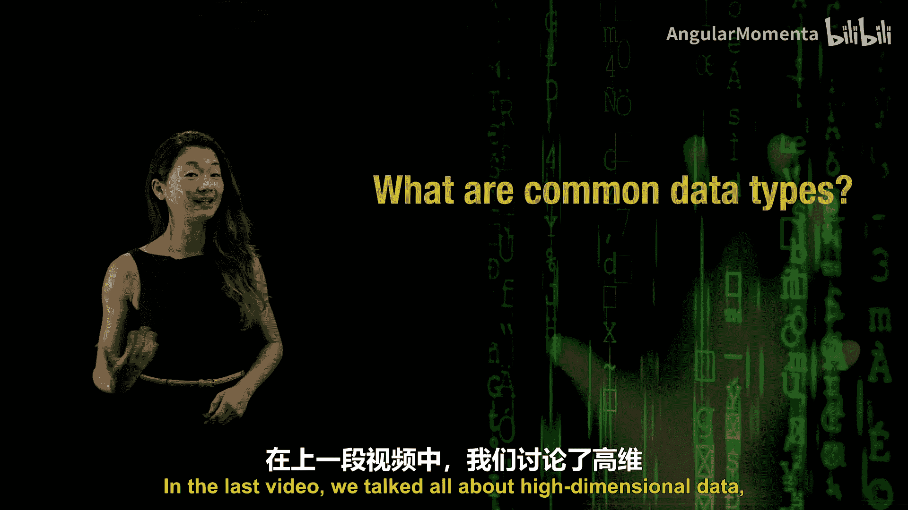
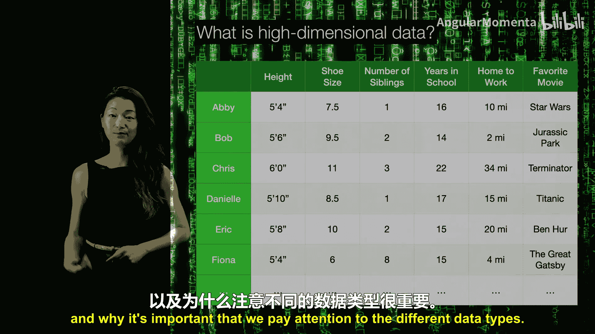
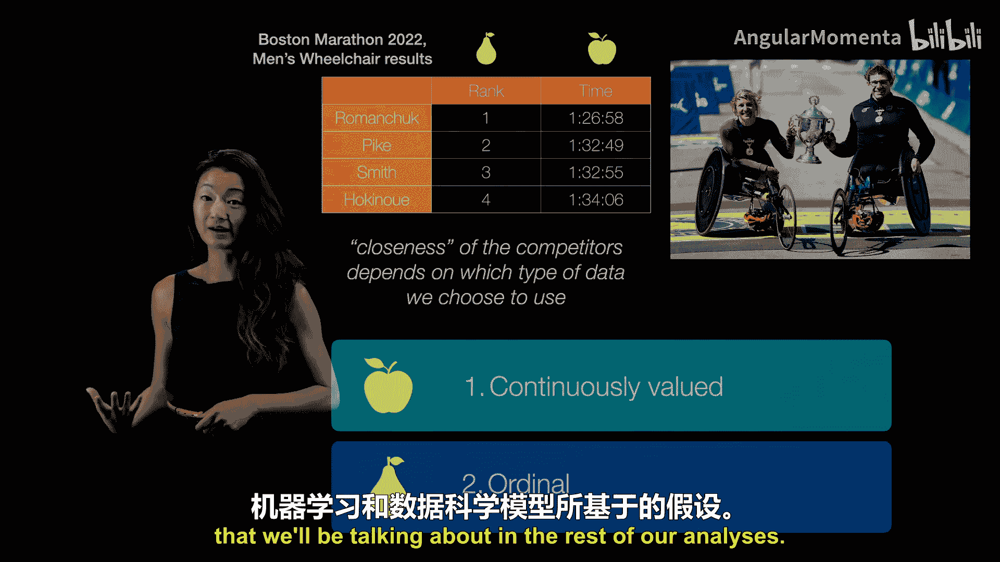
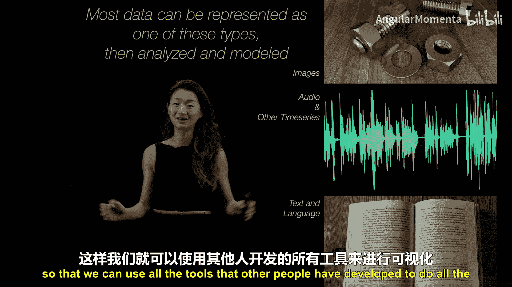
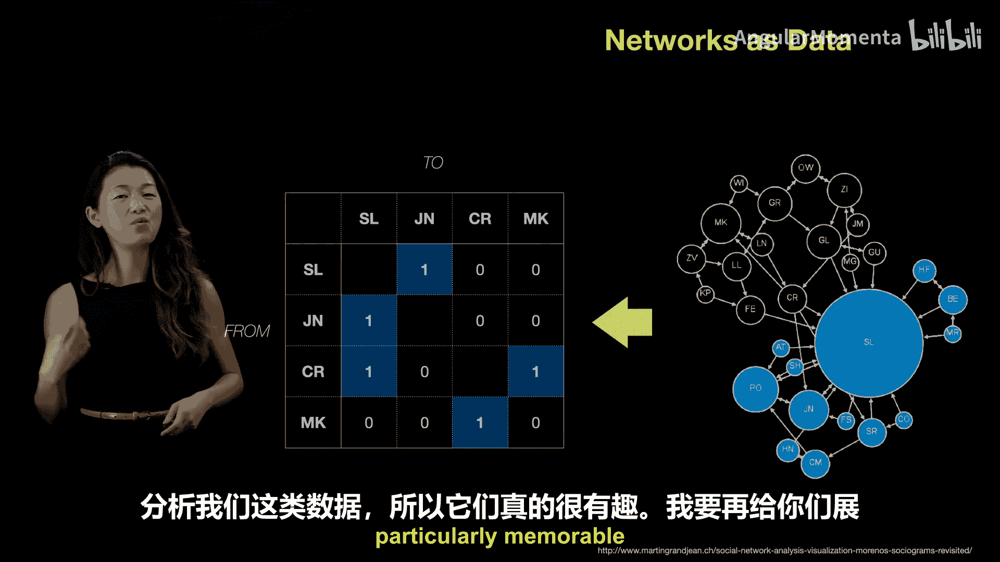

# 【精译】数据密集型工程导论-p13-13种不同类型的数据--BV1J8G3z1EHF_p13-

In this next video and data visualization， we're going to be talking about the common data types as well as why it's important that you pay attention to what type of data you've actually got in the last video we talked all about high dimensional data and I gave the example of different people and different ways in which we can measure and record different aspects of individual as an example of high dimensional data and in that video I previewed the fact that different types and dimensions of data actually have different data types so here we're going to talk a little bit more about what that's about and why it's important we pay attention to the different data types so in my opinion they are three fundamental data types and i'm going to call them continuously valued ornal and categorical these are just different types of data so it's really important pay attention to what they are because trying to compare them and mix them is kind of like comparing apples to oranges continuously value data is kind of the most straightforward type of data it's just a number of some kind these numbers could be positive or negative it could be whole numbers it could be fractions it could be decimals of some kind so these are just regular data。

😊。

That has a number attached to it。 These are things that we can measure like how tall you are many how many centimeters your fingers are stuff like that these are all continuously value data sets The second data that data type is ornal Now ordinal on the face of it sounds a lot like continuously see value。

 but there's an important difference Ornal numbers are ordered nonneg integers and they indicate ordering like you come in first place。

 second place， third place and so on and so forth。 you cannot come in one and a half place and you can't come in negative 2。

75 place so they have to be nonne integers they're not negative numbers and their whole numbers indicating ordering especially that's important for reason I'm going to tell you about in the next second The third type of data is categorical and categorical is kind of like kind of intuitive what it is but it's important to keep them separate from the first two types of data categorical data are data sets that are come in distinct classes So for example。

 if you're an animal you could be a raccoon you could be。Tut where you could be a blue Jay。

 Those are just different types of animals。 Now， the reason this is important is because a raccoon is not like a trout and trout is not like a blue Jay。

 and they're just distinct， different from each other。

 And it's not obvious if one of them are close to each other or not。

 The reason we care about these three fundamental data types is because。

You keep track of what type of data you have。 It gives you a notion of how different one data point is different from another。

 this notion of closeness and distance measures， how close together one thing is from another thing is a really foundational concept because it underlines everything that we have to do in modeling machine learning as well as visualization how do we measure if something is close to something else means that we can make quantitative relationships and quantitative relationships including building models regression models classification models as well as using those distances to actually place things on a piece of paper or on a computer screen and visualizing them so I'm gonna give you an example of why this actually matters what type of data that you have and what data types you're using to compute these distance measures Probably the most intuitive type of distance measures of the first two categorical kinds we have have the continuously valued numbers and we have the or numbers use for an example here the men's we。

S divisions for the Boston marathon in 2022 so here the first four place finishers for this race numbers 1。

2，3 and4 and their respective finishing times in Boston marathon you can see here that these are the same results okay so we're talking about the same things here these four individuals finished with those times and they came in first place。

 second place third place and fourth respectively but if you pay a little bit more attention you'll see that the first place finisher finished significantly faster then places two。

3 and four right so those two and three came in within seconds of each other and they were preceded by the first place finisher by minutes and then like a minute later place number four came in and class the finish line and so if we were to be using the times as as a numerical variable we would say that the person number one place far away from persons two and three kind of came in closer together because their times are closer together。

If we were to use the ordinal variable instead and look at their ranks in terms of where they came in。

 then you would say the one is just as far away from two and two as two is from three so it kind of matters here and there's no right answer this is the same results and we could be running our models and using our visualization techniques using either of these columns and dimensions of data but it matters which one you pick because the closeness of these competitors depends on which type of data we had chosen to use and like I said there's no right answer but it's important to pay attention because this notion of closeness and how they're defined for continuously valued and ordinal variables is the underlying assumption that's made by all of the visualization techniques and most of the machine learning and data science models that would be talking about in the rest of our analyses。

So even though if you're not using data of one of these different kinds， it is very。

 very common that most data sets are the massage and put into one of these data types because these are the data types that we have the ability to compute these distances and to compute these metrics so we can figure out what to do with them later on for example。

 if you have an image， super duper common type of data right an image can be very easily turned into a set of numbers because you take one common way to do it would be to take every pixel。

 take the numerical value of the intensity， let's say in RGB red。

 green and blue channels in each of those pixels and turn that into a set of numbers similarly if you have an audio series。

 or another time series of some kind you can turn those into numbers by looking at every sampling point in time measuring the recording whatever the amplitude of that signal is in positive and negative numbers and turning that into a series of numbers now in high dimensional data speak。

 sometimes we consider each time point to be a dimension。It's one way to do it。

 It's not the only way to do it， but on one way of turning time series data into highdimensional data we talked a little bit in the last video about text and languages and I talked to you about one way of turning this kind of mysterious type of data into a set of numbers So there's a lot of different other ways of doing it but nevertheless the most common way of dealing with text and language data is to turn them into numbers of some kind So it's really important to think about these types of data and if your data is not one of these types one of the most common things to do my strong recommendation is think about what is the closest type to what you have and if you can turn anything you have let you have a spectroscopy image you have a brain imaging study of some kind if you can turn that into something that resembles an image or audio or some kind of text then you have the ability to leverage the lots and lots of tools in learning and visualization we can then immediately use them off thes shelf and so this is a really important thing to remember how are the abundant are。

Fundamental data types and how can you turn whatever you have into one of these data types so that we can use all the tools that other people have developed to do all the visual visualization and modeling as well。

I'm going to tell you a couple of different types of data as well that don't fit neatly into what I've talked about so far but nevertheless we can turn them into different numbers。

 so the first one that's kind of interesting as well as kind of useful in different contexts is network says data so what does a network mean so network has node and relationship so I'm going to illustrate that with a really simple example here so what we're looking at here is a network that's visualized as individuals these are kids in first grade in one first grade class what they've done here is they ask every kid if you could pick two other people to sit next to who would they be and so they all took this little survey and and the results are visualized following here where each circle is an individual the girls are colored as blue and the black circles are boys and the diameter of the circles reports to how many people picked that person。

 how many people wanted to sit next to them so you can see here Sl is super popular everyone wants to sit next to SL in first grade so。

😊，The social dynamics here are rather obvious just looking at this network visualization。

 so you have one popular person， everyone wants to sing next to her。

 and then there's a kind of boys wants to sit next each other and the girls who want to sit next week each otherre very typical social dynamics in first grade。

By third grade， this has changed somewhat， there's no longer one very popular person。

 people have four friendship groups， but there is still this rather stark segregation in between the boys and the girls where they sort of want to sit next to their friends of that kind。

By grade 8， this has changed dramatically so by looking at network as data and then looking at network visualization this kind。

 there's a lot of really interesting social dynamics that can be revealed in this way。

 I just want to be really explicit here and how do you turn network data into numerical data like we talked about in the three fundamental data types so I'm going to look one more time at this first grade network I'm going to show you a subset of the network and just be really explicit about how do you turn this type of data into a set of numbers I'm not showing you the entire data set here because there's a little too many。

 so I'm going to show you four individuals so we're going to say here what's happening is that we're going to have a matrix of numbers where every time one person says they want to sit with another person So this is a from column This is a two column I'm going to put a one there。

 and if they didn't say they want to sit next to the other person'm going to find zero So the way to interpret this is that if fjN wanted to sit next to SL that means this。

😊，Element becomes a one， but JN did not say they want to sit next to CR。 so that's a zero。

 and JN also didn't say they wanted to sit next to Mk。 so that's a zero there as well。

 okay so if you fill in the survey results and put them into a matrix of this kind。

 we've then turned a network data into a numerical data and that this is also it's called a directed graph a directed network because it's not necessarily reciprocal right so CR wanted to sit next to Sl。

 but Sl did not want to sit next to CR。 And so it could be a one directionional relationship。

 so this matrix is not necessarily symmetric in that way。

 there's lots and lots of tools for visualizing networks。

 also analyzing of kind so they're really interesting。

 I'm going to show you one more particularly memorable example I have seen in terms of visualizing networks as data and this is one that that was made to visualize the conpeople and how they have voted over the years。

 So here we're looking at one example from the year 1951。

Each dot is a congressperson。 They are colored by whether or not they identified as as a Democratic member of Congress or a Republican member of Congress。

 So each dot is connected to every other dot based on whether or not they ever agreed when they were voting for a bill。

 So two people if two congress people ever voted the same way。

 whether for against on any bill that made it so that they had a line between them。

 Okay that's it that's all there is to it。 Hs of people color blue dots and red dots and the couple of noncolored dots with lines connecting them every time they agree。

 So you can kind of see what's happening here in 1951 right So there's kind of like the blue dots on one side。

 red dots on that side， but there's lots and lots of lines connecting them because con people were actually agreeing with each other when they were voting for or against particular bills summarized over this entire year。

 This is 1951。 Here is what happened in 1993。Right。As we'll talk about in a future video。

 this is a case in which the data visualization makes the message super duper obvious。

 I don't think it is necessary for me to say much about the difference between 1951 and 1993 here。

 it's really obvious the fact that that the segregation between the blue dots and the red dots is a lot more stark and if you look between them it is really difficult to see any lines connecting any of the blue dots and the red dots。

This visualization was repeated over many years， and so you can see that the difference in the segregation between the blue dots and the red dots did not happen overnight did not happen any one year。

 but in fact emerged over many， many decades and has gotten to the point in which in 2011。

 which is the last infographic down there， there was almost an entirely separable set of clusters of the red dots and the blue dots as well。

Okay so in this video we talked all about the data types and in particular。

 I introduced the three fundamental types of data， numerical data， oral data and categorical data。

 and we talked about why it's really important to to know which data type you're dealing with because it determines how you analyze and visualize it This is an important point because these data types are usually what all of the mathematical tools are being built for and so if you don't have one of these data types straightforwardly。

 one of the first things you do like if you have an image， you have an audio file。

 you have something else that's not naturally one of these the first thing you would do is think about which of these data types you can turn your data into and so if you can do that。

 then you can leverage a bunch of different tools that other people have built and do things with your data without having to invent everything from scratch So that's really important to pay attention to what type of data you've got。

